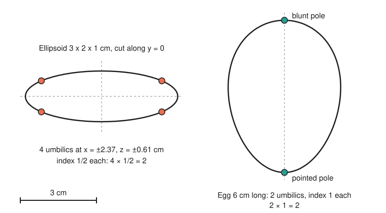

# Caratheodory's conjecture: does every smooth convex surface have two round points, and the competing 2026 claims

[Syllabus](../../../SYLLABUS.md) → [Frontier](../README.md) → [Geometry and Combinatorics](../README.md#s04) → Caratheodory's conjecture

---

## General Overview

Hold a hen's egg, about 6 cm long (the egg on this card is an illustrative model of one). At most points its shell bends more one way than the other: tightly round the egg's waist, gently along its length. At the two tips the shell bends the same in every direction, like a small piece of a ball. A point like that is an **umbilic**, a "round point": its two principal curvatures (the largest and smallest bending rates over all directions) are equal.

A smooth pebble, shaped like an ellipsoid 6 cm by 4 cm by 2 cm, has no tips. It still has round points: exactly four, in two pairs near the ends of its long axis. A ring of pasta (a torus) has none at all.

**Caratheodory's conjecture** (a conjecture: a statement offered without proof) says that every smooth, closed, convex surface (one that bulges outward everywhere, like an egg or a pebble) has at least two umbilics. An egg has 2, the pebble has 4, and a ball has infinitely many. No accepted example has only one, and no accepted proof shows that none exists.

The tool that gives the count is an **index**: walk a small loop round a round point and count how far the "tightest bending" direction turns. On a closed convex surface the indices always add up to 2. The pebble's four points have index 1/2 each, and 4 × 1/2 = 2. The egg's two tips have index 1 each, and 2 × 1 = 2.

So the question becomes a question about one number: how large can one index be? If no index can exceed 1, the surface needs at least two umbilics. A single umbilic would need index 2.

**On a smooth closed convex surface the indices of the round points add up to 2, so Caratheodory's conjecture (at least two round points) follows from any bound that keeps each index below 2, and a counterexample needs one round point of index exactly 2.**

**What kind of fact this is:** a conjecture, open as of 2026-11-24, with two unaccepted claims that point in opposite directions. The index sum is a theorem; the egg and pebble counts are computed on this card. The terms "claimed" and "open" are used as on [Kinds of claim](../01-How%20Research%20Works/02-theorem-conjecture-model-approximation.md).

### Status, as of 2026-11-24

| Statement | Kind | Status | Primary source |
| --- | --- | --- | --- |
| Every smooth closed convex surface has at least 2 umbilics | conjecture | open | — |
| The same for real-analytic surfaces (given locally by convergent power series), through the bound "index at most 1" | theorem | proved, refereed, 1941 | Hamburger (1941) |
| A proof for surfaces with three derivatives plus a little more ($`C^{3+\alpha}`$) | theorem | claimed: posted 2008-08-06, last revised 2024-10-01; parts published in 2019 and 2024; not accepted as a whole by any independent source found | Guilfoyle and Klingenberg (2008) |
| Each umbilic on such a surface has index below 2 | theorem | claimed: posted 2012-07-25, revised 2026-03-06; no journal reference | Guilfoyle and Klingenberg (2012) |
| A smooth, strictly convex closed surface with exactly one umbilic, of index 2 | theorem | claimed: preprint posted 2026-10-25, one version, not refereed | Ando and Umehara (2026) |

The last row contradicts the two rows above it, so at most one side is right. A smooth surface has every derivative, so it is $`C^{3+\alpha}`$. The 2008 claim then forbids its single round point, and the 2012 claim forbids the index 2 that the 2026 preprint builds. The 2026 preprint also credits an earlier announcement of smooth counterexamples, a social-media post of 2026-08-19, which it says was developed with AI help. This card found no paper behind that post as of 2026-11-24, so it gets no status of its own.

The preprint says its authors used an AI system to help search for candidate functions, and that they checked every argument themselves. How to audit such a claim is on [Machines that prove](../07-Physics%2C%20Finance%20and%20Machines/02-ai-and-mathematics-2026.md).

**Register row**, for [The status register](../07-Physics%2C%20Finance%20and%20Machines/05-the-status-register.md): Caratheodory's conjecture · conjecture · open · since — · checked 2026-11-24 · proof claim arXiv:0808.0851 and counterexample claim arXiv:2610.34036, both unaccepted.

### The picture: the round points of a pebble and an egg, to scale

<p align="center"></p>

Left: the pebble cut through its longest and shortest axes; all four round points lie in this cut. Right: the egg's outline; its round points are its tips. Both are drawn to scale at 50 pixels per cm; the round points and the egg's tips are at the coordinates the checks print.

---

## The formula

Notation first, in words.

- A **principal heading** at a point is a direction of tightest or gentlest bending. The two headings are at right angles ([Principal, mean and Gaussian curvature](../../23-Differential%20geometry%20and%20Lie%20groups/02-Surfaces/05-principal-mean-and-gaussian-curvature.md)).
- A heading is a **line**, not an arrow: turning it by half a turn gives the same heading. The headings at every non-umbilic point form a **line field**.
- At an umbilic, every heading bends alike, so the line field has no value there. An umbilic is a **singular point** of the line field.
- The **index** of an isolated umbilic $`p`$ is the net turning of the principal heading round a small loop, in full turns. Because a heading repeats after half a turn, the index can be a half-number, such as 1/2.

The index:

```math
\mathrm{ind}_p = \frac{\Delta_C\, \theta}{2\pi}, \qquad \theta \text{ known only up to a half turn, so } \mathrm{ind}_p \in \{\dots, -\tfrac12, 0, \tfrac12, 1, \tfrac32, \dots\}
```

**Read it aloud:** the index at p is the total change of the principal heading's angle round a small loop C, divided by one full turn.

The sum, which is the Poincare–Hopf theorem for line fields:

```math
\sum_{\text{umbilics } p} \mathrm{ind}_p = \chi(S) = 2, \qquad\text{so if every } \mathrm{ind}_p \le m \text{ then } N \ge \frac{2}{m}
```

**Read it aloud:** the indices of all the round points add up to the Euler characteristic of the surface, which is 2 for any convex surface; so if no index exceeds m, there are at least 2 divided by m round points.

For the pebble, the ellipsoid $`x^2/a^2 + y^2/b^2 + z^2/c^2 = 1`$ with half-axes $`a > b > c`$, the four round points have a closed form:

```math
x = \pm a\sqrt{\frac{a^2 - b^2}{a^2 - c^2}}, \qquad y = 0, \qquad z = \pm c\sqrt{\frac{b^2 - c^2}{a^2 - c^2}}, \qquad \kappa_1 = \kappa_2 = \frac{ac}{b^3}
```

**Read it aloud:** the round points sit in the plane of the longest and shortest axes, at these four positions, and there both bending rates equal a times c over b cubed.

With $`a = 3`$, $`b = 2`$, $`c = 1`$ cm: $`x = \pm 3\sqrt{5/8} = \pm 2.371708`$ cm, $`z = \pm\sqrt{3/8} = \pm 0.612372`$ cm, and both curvatures are $`3/8 = 0.375`$ per cm.

| Symbol | Plain meaning | In our example | Push it up and the answer… |
| --- | --- | --- | --- |
| $`S`$ | a smooth closed convex surface | the pebble, the egg | — |
| $`a`$, $`b`$, $`c`$; $`x`$, $`y`$, $`z`$ | the pebble's half-axes; position along them, cm | 3, 2, 1 | $`a = 4`$: round points move out to $`x = \pm 3.577709`$ |
| $`\kappa_1`$, $`\kappa_2`$ | principal curvatures: largest and smallest bending rates, per cm | both 0.375 at the pebble's round points | — |
| $`K`$, $`dA`$ | Gaussian curvature $`\kappa_1\kappa_2`$; a small piece of area | $`\int K\,dA`$ over $`2\pi`$ is 2.000000 on both | — |
| $`p`$ | an umbilic: a point with $`\kappa_1 = \kappa_2`$ | 4 on the pebble, 2 on the egg | — |
| $`\theta`$, $`C`$, $`\Delta_C\, \theta`$ | the angle of a principal heading, known up to a half turn; a small loop round $`p`$; the total change of $`\theta`$ once round $`C`$ | turns 180° round each pebble point; loop radius 0.01 cm | — |
| $`\mathrm{ind}_p`$ | index: net turning of $`\theta`$ round $`C`$, in full turns | 1/2 (pebble), 1 (egg tips) | — |
| $`\chi(S)`$ | Euler characteristic: 2 for a sphere-shaped surface, 0 for a torus | 2 | — |
| $`N`$, $`m`$ | the number of umbilics; an upper bound on every index | 4 and 2; $`m`$ = 1 (Loewner), below 2 (claimed) | at $`m = 2`$ the bound allows $`N = 1`$ |
| $`s`$ | the egg's skew: how much blunter one end is, per cm | 0.04 | at 0.06 a whole circle of umbilics appears |
| $`f`$; $`F`$, $`a(t)`$ | a height function; the 2026 preprint's seed and its building block | $`F = a(x) - a(y) + \sin x \sin y`$, $`a(t) = \sin^4 t + 3\sin^2 t`$ | — |
| $`z`$, $`W`$, $`k`$ | in Step 5 only: points of the plane as complex numbers; the substitution $`W = z^{-k/2}`$; a whole number | $`k = 2`$ gives index 2 | index $`1 + k/2`$ grows with $`k`$ |

### When it holds

- **The surface is closed and sphere-shaped.** The sum is $`\chi`$, which is 2 only for a sphere-shaped surface. The pasta torus has $`\chi = 0`$ and no umbilic at all.
- **The umbilics are isolated.** If round points fill a curve, no small loop surrounds just one and the index is not defined. A blunter egg (skew 0.06 per cm) has a whole circle of them near $`z = 2.190`$ cm.
- **The surface is smooth enough to have curvature.** A cube's corners and edges have no curvature in this sense; the conjecture speaks only of smooth surfaces.
- **The bound must be below 2.** Each index bound $`m < 2`$ gives $`N \ge 2/m > 1`$, so $`N \ge 2`$. The bound $`m = 2`$ gives only $`N \ge 1`$.

---

## Why it works

### Step 0: round points are the places where the bending directions break down

Away from round points, each point has two principal headings at right angles. Draw one of them at every point and you get a line field, like the grain on a piece of wood. At a round point no heading is special, so the grain has a defect there.

Defects of a field on a closed surface obey a counting law. On the [Hairy ball theorem](../../23-Differential%20geometry%20and%20Lie%20groups/06-Lie%20Groups/09-vector-field-zeros-and-the-hairy-ball.md) card, the turning numbers of a wind's calm spots add up to the Euler characteristic $`\chi`$. The same law holds for a grain. The only change is that a line has no arrowhead, so its turning can stop at half a turn.

### Step 1: an index can be a half-number

Model a round point by the surface $`z = (x^2 + y^2)/2 + \text{cubic}`$ at the origin. There the bending is the same in every direction, and the cubic term decides how the grain turns nearby. The principal heading at a point is half the angle of the pair $`(f_{xx} - f_{yy},\ 2f_{xy})`$, made from the second derivatives of the height $`f`$.

- **Lemon**, cubic $`x^3 + xy^2`$: the pair is $`(4x, 4y)`$. It turns once forward round the loop, so the heading turns half a turn: index $`+1/2`$.
- **Star**, cubic $`x^3 - 3xy^2`$: the pair is $`(12x, -12y)`$. It turns once backward: index $`-1/2`$.

The checks walk a loop of 720 steps round each and print $`+0.500000`$ and $`-0.500000`$.

### Step 2: the indices add up to 2

The proof on the Hairy ball theorem card cuts the surface into small triangles and adds the turning round each edge. Every inside edge is walked once each way, so those turnings cancel. What is left is $`\chi`$ ([Gauss-Bonnet](../../23-Differential%20geometry%20and%20Lie%20groups/02-Surfaces/10-gauss-bonnet-theorem.md) gives the same 2 as total curvature over $`2\pi`$). Tracking angles up to a half turn instead of a full turn changes nothing in that argument, so it holds for line fields.

A convex surface is sphere-shaped, so $`\chi = 2`$. The checks compute $`\chi`$ for the pebble and the egg by Gauss–Bonnet, $`\frac{1}{2\pi}\int K\,dA`$, and get 2.000000 for both.

### Step 3: the pebble and the egg

- **The pebble.** A blind search over 7,200 grid points finds exactly four round points, at the closed-form positions. Round each one the heading turns 180°: index 1/2, a lemon. The sum is $`4 \times 1/2 = 2`$.
- **The egg.** It is a surface of revolution (the same all the way round its long axis). So the principal headings are the meridians (lines of longitude) and the circles of latitude. At a tip the meridians fan out like spokes, and the heading turns 360° round a loop: index 1. Elsewhere the circle bending beats the meridian bending at all 2,000 profile points checked, so the check finds no other round points. The sum is $`2 \times 1 = 2`$.

### Step 4: an index bound proves the conjecture

Suppose every index is at most $`m`$. The indices add to 2, so the count $`N`$ satisfies $`N \times m \ge 2`$.

| Bound on each index | Source of the bound | Fewest round points |
| --- | --- | --- |
| at most 1 | Loewner's conjecture; proved for real-analytic surfaces (Hamburger) | 2 |
| below 2, so at most 3/2 (indices are half-numbers) | claimed for $`C^{3+\alpha}`$ surfaces (Guilfoyle and Klingenberg, 2012) | 2 |
| none below 2 | — | 1 |

So a counterexample is exactly one round point carrying the whole sum: index 2. That is what the 2026 preprint claims to build.

Ghomi and Howard (2012) recast the conjecture as a statement about graphs over the plane: the graph of every function whose slope dies away faster than one over the distance from the origin has at least one round point. They proved weaker forms of that statement, not the conjecture.

### Step 5: the two claims, in outline

These are research arguments, outlined from their own abstracts and text. This card does not prove either.

**The proof claim (Guilfoyle and Klingenberg, posted 2008, last revised 2024).**

1. Replace the surface by the set of its normal lines. That set sits inside the space of all oriented lines in space, which has a natural complex structure.
2. Round points of the surface become special "complex points" of that set.
3. A surface with only one round point would give a hemisphere in that space whose rim no holomorphic disc (a disc that respects the complex structure) can sit on.
4. Build such a holomorphic disc anyway, by a mean curvature flow (a process that smooths a surface step by step) and estimates on it. This contradicts step 3.

Its technical parts were published separately, in 2019 and 2024. This card found no independent source that accepts the whole argument as of 2026-11-24.

**The counterexample claim (Ando and Umehara, 2026-10-25).**

1. Start from a **seed** on the plane, $`F = a(x) - a(y) + \sin x \sin y`$ with $`a(t) = \sin^4 t + 3\sin^2 t`$.
2. Its trace-free Hessian (the part of the second derivatives that sets the grain) is never zero. The paper shows this from $`a''(t) = 6 - 16\sin^4 t`$; the checks find its size never below 0.176140 on a 400 × 400 grid.
3. Pull the seed in towards a point by the substitution $`W = z^{-k/2}`$, damped so strongly that all derivatives vanish there. The grain then turns $`1 + k/2`$ times round that point. For $`k = 2`$ this is index 2.
4. Use the damped seed as a small wobble in a sphere's **support function** (the distance from the centre to each tangent plane). For small wobbles the surface stays strictly convex and keeps exactly one round point, of index 2.

The checks verify only the seed facts in step 2. They do not verify the construction.

<details>
<summary>Why index 3/2 is allowed by one claim and index 2 is not</summary>

The 2012 claim bounds each index of a $`C^{3+\alpha}`$ convex surface by "less than 2". Its own abstract notes that this leaves room for index 3/2, which the real-analytic bound of 1 forbids. The 2026 preprint builds smooth local round points of every index $`1 + k/2`$: 3/2 for $`k = 1`$, 2 for $`k = 2`$, and more.

Index 3/2 fits inside both claims. Index 2 for $`k = 2`$ does not: the 2026 surface is smooth, hence $`C^{3+\alpha}`$, and the 2012 claim forbids it. The real-analytic theorem is untouched, because the 2026 surface is flat to all orders at its round point and so is not real-analytic there.

</details>

---

## Worked numbers, by hand

The pebble, half-axes 3, 2 and 1 cm.

| Step | Arithmetic | Value |
| --- | --- | --- |
| $`x`$ of the round points | $`3\sqrt{(9 - 4)/(9 - 1)} = 3\sqrt{0.625}`$ | ±2.371708 cm |
| $`z`$ of the round points | $`1 \times \sqrt{(4 - 1)/(9 - 1)} = \sqrt{0.375}`$ | ±0.612372 cm |
| both curvatures there | $`ac/b^3 = 3/8`$ | 0.375 per cm |
| how many | 2 choices of sign for $`x`$ × 2 for $`z`$ | 4 |
| index of each | 180° of turning ÷ 360° | 1/2 |
| sum | $`4 \times 1/2`$ | **2** |
| egg: tip index | 360° ÷ 360° | 1 |
| egg: sum | $`2 \times 1`$ | **2** |

Both totals are 2, the Euler characteristic of a sphere, as the theorem demands; the pebble spreads the 2 over four lemons, the egg over two tips.

### What breaks if you drop a piece

| Mistake | Comes out at | What went wrong |
| --- | --- | --- |
| A blunter egg, skew 0.06 per cm | the two curvatures swap order once, near $`z = 2.190`$ cm: a whole circle of round points | the round points are not isolated, so no index exists there |
| A torus instead of a convex surface | no round point; $`\kappa_1 - \kappa_2 \ge 0.484848`$ per mm; total $`\chi = 0`$ | the sum is $`\chi = 0`$, which forces nothing |
| Counting round points instead of adding indices | 5 lemons and 1 star: 6 points, sum still 2 | a star counts $`-1/2`$, so the count can grow without limit |
| Allowing index 2 | fewest round points = 1 | the bound must stay below 2 to force a second point |

The checks print all four.

---

## Code, from first principles, and it actually runs

The code builds each surface from its equation and computes the 2 × 2 shape matrix (the bending in a pair of tangent directions) at any point. It takes four independent roads. The pebble's round points come from the closed form and, separately, from a blind grid search with a pattern search on the curvature gap. Each index comes from walking a loop of 720 steps and adding the heading's turning, and the sum is compared with $`\chi`$ from a Gauss–Bonnet integral by Simpson's rule. The egg's tip curvature is checked against its own closed form. Exact fractions give the index sums. The 2026 seed's second derivative is checked against a finite difference before the grid scan.

### Python

```python
# Caratheodory's conjecture -- the check behind the card.  Standard library only.
# Umbilics of an ellipsoid and an egg found two ways, their indices by walking a loop,
# Euler characteristics by Gauss-Bonnet, a torus with none, and the October 2026 seed.
from math import sin, cos, atan2, sqrt, pi, ceil; from fractions import Fraction as Fr

A, B, C = 3.0, 2.0, 1.0                      # ellipsoid semi-axes, cm (a pebble, illustrative)
EB, EC = 2.2, 3.0                            # egg: width scale and half-length, cm (illustrative)
def ell(p):                                  # F = x2/a2 + y2/b2 + z2/c2 - 1: gradient, Hessian, F
    return [2*p[0]/A**2, 2*p[1]/B**2, 2*p[2]/C**2], [2/A**2, 2/B**2, 2/C**2], \
        p[0]**2/A**2 + p[1]**2/B**2 + p[2]**2/C**2 - 1
def mkegg(k):                                # F = x2 + y2 - b2 (1 - z2/c2) (1 + k z)2
    def egg(p):
        z = p[2]; u, u1, u2 = 1 - z*z/EC**2, -2*z/EC**2, -2/EC**2
        w, w1, w2 = (1 + k*z)**2, 2*k*(1 + k*z), 2*k*k
        return [2*p[0], 2*p[1], -EB**2*(u1*w + u*w1)], [2.0, 2.0, -EB**2*(u2*w + 2*u1*w1 + u*w2)], \
            p[0]**2 + p[1]**2 - EB**2*u*w
    rho = lambda th: EB*sin(th)*(1 + k*EC*cos(th))            # profile radius at z = c cos(th)
    return egg, rho
dot = lambda u, v: u[0]*v[0] + u[1]*v[1] + u[2]*v[2]
crs = lambda u, v: [u[1]*v[2]-u[2]*v[1], u[2]*v[0]-u[0]*v[2], u[0]*v[1]-u[1]*v[0]]
unit = lambda u: [x/sqrt(dot(u, u)) for x in u]
def frame(n, t):                             # tangent pair (t1, t2) with t1, t2, n right-handed
    t1 = unit([t[i] - dot(t, n)*n[i] for i in range(3)]); return t1, crs(n, t1)
def shape(surf, p, t=None):                  # 2x2 shape matrix in a tangent frame, outward normal
    g, h, _ = surf(p); n = unit(g); ng = sqrt(dot(g, g))
    t1, t2 = frame(n, t if t else ([0, 0, 1] if abs(n[2]) < 0.9 else [1, 0, 0]))
    q = lambda u, v: sum(u[i]*h[i]*v[i] for i in range(3))/ng
    return q(t1, t1), q(t1, t2), q(t2, t2)
gap = lambda m: sqrt((m[0] - m[2])**2 + 4*m[1]**2)      # kappa1 - kappa2
epoint = lambda th, ph: [A*sin(th)*cos(ph), B*sin(th)*sin(ph), C*cos(th)]
f6 = lambda x: f"{x:.6f}"
def turns(angles):                           # add up the turning of a line (angle mod 180 deg)
    return sum((b - a + pi/2) % pi - pi/2 for a, b in zip(angles, angles[1:]))/(2*pi)
def index(surf, p0, r=0.01, N=720):         # walk a loop round p0, follow a principal line
    g, _, _ = surf(p0); n0 = unit(g)
    e1, e2 = frame(n0, [0, 0, 1] if abs(n0[2]) < 0.9 else [1, 0, 0]); angs = []
    for k in range(N + 1):
        q = [p0[i] + r*(cos(2*pi*k/N)*e1[i] + sin(2*pi*k/N)*e2[i]) for i in range(3)]
        for _ in range(30):                  # slide along the normal onto the surface
            gq, _, F = surf(q); q = [q[i] - F/dot(gq, n0)*n0[i] for i in range(3)]
        m = shape(surf, q, e1); angs.append(0.5*atan2(2*m[1], m[0] - m[2]))
    return turns(angs)
def simpson(f, a, b, n):
    return (b - a)/n/3*sum((1 if k in (0, n) else 4 if k % 2 else 2)*f(a + k*(b - a)/n) for k in range(n + 1))

# Road 1: the closed form for the ellipsoid's umbilics
ux, uz = A*sqrt((A*A - B*B)/(A*A - C*C)), C*sqrt((B*B - C*C)/(A*A - C*C))
print(f"ellipsoid {A:g} x {B:g} x {C:g} cm: closed form umbilics at x = +-{f6(ux)}, y = 0, z = +-{f6(uz)}")
# Road 2: blind search -- grid minima of (kappa1 - kappa2)^2, then a pattern search
NT, NP = 60, 120
G = [[gap(shape(ell, epoint((i + .5)*pi/NT, j*2*pi/NP)))**2 for j in range(NP)] for i in range(NT)]
found = []
for i in range(1, NT - 1):
    for j in range(NP):
        if all(G[i][j] <= G[i+di][(j+dj) % NP] for di in (-1, 0, 1) for dj in (-1, 0, 1)):
            th, ph, st, best = (i + .5)*pi/NT, j*2*pi/NP, 0.05, G[i][j]
            while st > 1e-12:
                moved = False
                for dt, dp in ((st, 0), (-st, 0), (0, st), (0, -st)):
                    v = gap(shape(ell, epoint(th + dt, ph + dp)))**2
                    if v < best: best, th, ph, moved = v, th + dt, ph + dp, True
                if not moved: st /= 2
            if sqrt(best) < 1e-6 and all(sum((epoint(th, ph)[k] - q[k])**2 for k in range(3)) > 1e-6 for q in found):
                found.append(epoint(th, ph))
found.sort(key=lambda p: (-p[0], -p[2]))
print(f"blind search: {NT*NP} grid points, umbilics found {len(found)}")
for p in found:
    m = shape(ell, p)
    print(f"  umbilic ({f6(p[0])}, {f6(abs(p[1]))}, {f6(p[2])}), both curvatures {f6(m[0])} per cm, gap {gap(m):.9f}")
    assert abs(abs(p[0]) - ux) < 1e-6 and abs(abs(p[2]) - uz) < 1e-6 and abs(p[1]) < 1e-6
    assert abs(m[0] - A*C/B**3) < 1e-9 and abs(m[2] - A*C/B**3) < 1e-9          # a c / b^3
assert len(found) == 4
eidx = [index(ell, p) for p in found]
print("ellipsoid: principal line turns per loop, degrees", [f"{360*i:.2f}" for i in eidx])
def ell_KdA(th, NPH=64):                     # Gaussian curvature times area, round one circle
    s = 0.0
    for j in range(NPH):
        ph = 2*pi*j/NPH; m = shape(ell, epoint(th, ph))
        rt = [A*cos(th)*cos(ph), B*cos(th)*sin(ph), -C*sin(th)]
        rp = [-A*sin(th)*sin(ph), B*sin(th)*cos(ph), 0]
        s += (m[0]*m[2] - m[1]**2)*sqrt(dot(crs(rt, rp), crs(rt, rp)))*2*pi/NPH
    return s
chi_e = simpson(ell_KdA, 0, pi, 200)/(2*pi)
print(f"ellipsoid: Gauss-Bonnet total curvature / 2 pi = {f6(chi_e)}; index sum {Fr(round(2*sum(eidx)), 2)}")
assert all(abs(i - 0.5) < 1e-6 for i in eidx) and abs(chi_e - 2) < 1e-6

# The egg: a surface of revolution, umbilics at its two poles
K0 = 0.04; egg, rho = mkegg(K0)              # skew 0.04 per cm: blunt end up, pointed end down
rho1 = lambda th: EB*cos(th)*(1 + K0*EC*cos(th)) - EB*K0*EC*sin(th)**2
poles = [[0, 0, EC], [0, 0, -EC]]
for p in poles:
    m = shape(egg, p); R = EB**2*(1 + K0*p[2])**2/EC
    print(f"egg pole z = {p[2]:+.0f} cm: curvature {f6(m[0])} = 1/{f6(R)} per cm, gap {gap(m):.9f}")
    assert abs(m[0] - 1/R) < 1e-12 and gap(m) < 1e-12
profile = lambda surf, rh: [(lambda m: (m[0], m[2]))(shape(surf, [rh(t), 0, EC*cos(t)], [0, 0, 1]))
                           for t in (pi*(k + .5)/2000 for k in range(2000))]   # (meridian, round)
prof = profile(egg, rho)
print(f"egg: length {2*EC:g} cm, widest {f6(2*max(rho(pi*k/2000) for k in range(2001)))} cm; "
      f"smallest Gaussian curvature {f6(min(a*b for a, b in prof))} per cm2")
print(f"egg: round-the-circle curvature beats meridian curvature at {sum(b > a for a, b in prof)} of 2000 profile points")
assert all(b > a for a, b in prof)
gidx = [index(egg, p) for p in poles]
egg_KdA = lambda th: (lambda m: (m[0]*m[2] - m[1]**2)*rho(th)*sqrt(rho1(th)**2 + (EC*sin(th))**2)*2*pi)(
    shape(egg, [rho(th), 0, EC*cos(th)]))
chi_g = simpson(egg_KdA, 0, pi, 2000)/(2*pi)
print(f"egg: line turns per loop {[f'{360*i:.2f}' for i in gidx]}; Gauss-Bonnet / 2 pi = {f6(chi_g)}")
assert all(abs(i - 1) < 1e-6 for i in gidx) and abs(chi_g - 2) < 1e-6
# What breaks 1: a blunter egg (skew 0.06 per cm) grows whole circles of umbilics
egg6, rho6 = mkegg(0.06); p6 = profile(egg6, rho6)
flips = [k for k in range(1999) if (p6[k][1] > p6[k][0]) != (p6[k+1][1] > p6[k+1][0])]
print(f"blunter egg: the two curvatures swap order {len(flips)} time, near z = {EC*cos(pi*(flips[0] + 1)/2000):.3f} cm:"
      " a whole circle of umbilics there")
assert len(flips) == 1
# What breaks 2: a torus (the pasta ring, a = 1.5 mm tube, b = 4 mm ring) has no umbilic at all
ta, tb = 1.5, 4.0
tg = min(1/ta - cos(v)/(tb + ta*cos(v)) for v in (2*pi*k/3600 for k in range(3600)))
chi_t = simpson(lambda v: (1/ta)*cos(v)/(tb + ta*cos(v))*ta*(tb + ta*cos(v))*2*pi, 0, 2*pi, 200)/(2*pi)
print(f"torus: smallest kappa1 - kappa2 = {f6(tg)} per mm, umbilics 0; Gauss-Bonnet / 2 pi = {abs(chi_t):.6f}")
assert abs(tg - (1/ta - 1/(ta + tb))) < 1e-12 and abs(chi_t) < 1e-9
# Model umbilics on z = (x2 + y2)/2 + cubic: the line of the Hessian, walked round the origin
def germ(d, e, N=720):                       # d = f_xx - f_yy, e = f_xy
    return turns([0.5*atan2(2*e(cos(2*pi*k/N), sin(2*pi*k/N)), d(cos(2*pi*k/N), sin(2*pi*k/N))) for k in range(N + 1)])
lemon = germ(lambda x, y: 4*x, lambda x, y: 2*y)          # cubic x^3 + x y^2
star = germ(lambda x, y: 12*x, lambda x, y: -6*y)         # cubic x^3 - 3 x y^2
print(f"model germs: lemon x^3 + xy^2 index {lemon:+.6f}, star x^3 - 3xy^2 index {star:+.6f}")
assert abs(lemon - 0.5) < 1e-9 and abs(star + 0.5) < 1e-9
# Exact arithmetic: Poincare-Hopf sums and the fewest umbilics each index bound allows
print("sums:", Fr(1, 2)*4, "= 4 x 1/2 (ellipsoid);", 1*2, "= 2 x 1 (egg); 5 lemons + 1 star:", Fr(5, 2) - Fr(1, 2))
for name, m in (("Loewner, index <= 1", Fr(1)), ("index < 2, so <= 3/2", Fr(3, 2)), ("no bound but 2", Fr(2))):
    print(f"  {name}: fewest umbilics = ceil(2 / {m}) = {ceil(Fr(2)/m)}")
# The October 2026 seed F = a(x) - a(y) + sin x sin y, a(t) = sin^4 t + 3 sin^2 t
app = lambda t: 6 - 16*sin(t)**4                          # a''(t), worked out by hand
aa, h = (lambda t: sin(t)**4 + 3*sin(t)**2), 1e-4           # check a'' by a finite difference
assert max(abs(app(t/100) - (aa(t/100 + h) - 2*aa(t/100) + aa(t/100 - h))/h/h) for t in range(315)) < 1e-5
M = 400; mz = min(sqrt((app(pi*i/M) + app(pi*j/M))**2 + 4*(cos(pi*i/M)*cos(pi*j/M))**2)/4 for i in range(M) for j in range(M))
print(f"seed: smallest |F_zz| on a {M} x {M} grid of one period = {f6(mz)}; a'' runs from {app(pi/2):g} to {app(0):g}")
assert mz > 0.17
S = 50                                       # figure: pixels per cm, umbilics then egg poles
print("figure," + ";".join(f"{200 + S*p[0]:.1f} {190 - S*p[2]:.1f}" for p in found) + f";560 {190 - S*EC:.0f};560 {190 + S*EC:.0f}")
print("ALL CHECKS PASS")
```

**Ran 2026-11-24 on macOS, Python 3.14.10, standard library only. All checks passed. Output, pasted from the run:**

```
ellipsoid 3 x 2 x 1 cm: closed form umbilics at x = +-2.371708, y = 0, z = +-0.612372
blind search: 7200 grid points, umbilics found 4
  umbilic (2.371708, 0.000000, 0.612372), both curvatures 0.375000 per cm, gap 0.000000000
  umbilic (2.371708, 0.000000, -0.612372), both curvatures 0.375000 per cm, gap 0.000000000
  umbilic (-2.371708, 0.000000, -0.612372), both curvatures 0.375000 per cm, gap 0.000000000
  umbilic (-2.371708, 0.000000, 0.612372), both curvatures 0.375000 per cm, gap 0.000000000
ellipsoid: principal line turns per loop, degrees ['180.00', '180.00', '180.00', '180.00']
ellipsoid: Gauss-Bonnet total curvature / 2 pi = 2.000000; index sum 2
egg pole z = +3 cm: curvature 0.494128 = 1/2.023765 per cm, gap 0.000000000
egg pole z = -3 cm: curvature 0.800406 = 1/1.249365 per cm, gap 0.000000000
egg: length 6 cm, widest 4.431131 cm; smallest Gaussian curvature 0.103379 per cm2
egg: round-the-circle curvature beats meridian curvature at 2000 of 2000 profile points
egg: line turns per loop ['360.00', '360.00']; Gauss-Bonnet / 2 pi = 2.000000
blunter egg: the two curvatures swap order 1 time, near z = 2.190 cm: a whole circle of umbilics there
torus: smallest kappa1 - kappa2 = 0.484848 per mm, umbilics 0; Gauss-Bonnet / 2 pi = 0.000000
model germs: lemon x^3 + xy^2 index +0.500000, star x^3 - 3xy^2 index -0.500000
sums: 2 = 4 x 1/2 (ellipsoid); 2 = 2 x 1 (egg); 5 lemons + 1 star: 2
  Loewner, index <= 1: fewest umbilics = ceil(2 / 1) = 2
  index < 2, so <= 3/2: fewest umbilics = ceil(2 / 3/2) = 2
  no bound but 2: fewest umbilics = ceil(2 / 2) = 1
seed: smallest |F_zz| on a 400 x 400 grid of one period = 0.176140; a'' runs from -10 to 6
figure,318.6 159.4;318.6 220.6;81.4 220.6;81.4 159.4;560 40;560 340
ALL CHECKS PASS
```

### Rust

```rust
// Caratheodory's conjecture -- the same check as caratheodory_conjecture_check.py, in Rust.
// Standard library only, no crates.  Umbilics of an ellipsoid and an egg found two ways,
// their indices by walking a loop, Euler characteristics by Gauss-Bonnet, a torus with none,
// and the October 2026 seed.  Compile: rustc --edition 2021 -O caratheodory_conjecture_check.rs
use std::f64::consts::PI;
const A: f64 = 3.0; const B: f64 = 2.0; const C: f64 = 1.0; // ellipsoid semi-axes, cm
const EB: f64 = 2.2; const EC: f64 = 3.0;                    // egg width scale, half-length, cm
type V3 = [f64; 3];
#[derive(Clone, Copy)]
enum Surf { Ell, Egg(f64) }                                  // Egg(k): skew k per cm
fn surf(s: Surf, p: V3) -> (V3, V3, f64) {                   // gradient, Hessian diagonal, F
    match s {
        Surf::Ell => ([2.0*p[0]/(A*A), 2.0*p[1]/(B*B), 2.0*p[2]/(C*C)], [2.0/(A*A), 2.0/(B*B), 2.0/(C*C)],
            p[0]*p[0]/(A*A) + p[1]*p[1]/(B*B) + p[2]*p[2]/(C*C) - 1.0),
        Surf::Egg(k) => {
            let z = p[2]; let (u, u1, u2) = (1.0 - z*z/(EC*EC), -2.0*z/(EC*EC), -2.0/(EC*EC));
            let (w, w1, w2) = ((1.0 + k*z)*(1.0 + k*z), 2.0*k*(1.0 + k*z), 2.0*k*k);
            ([2.0*p[0], 2.0*p[1], -EB*EB*(u1*w + u*w1)], [2.0, 2.0, -EB*EB*(u2*w + 2.0*u1*w1 + u*w2)],
             p[0]*p[0] + p[1]*p[1] - EB*EB*u*w)
        }
    }
}
fn rho(k: f64, th: f64) -> f64 { EB*th.sin()*(1.0 + k*EC*th.cos()) }
fn dot(u: V3, v: V3) -> f64 { u[0]*v[0] + u[1]*v[1] + u[2]*v[2] }
fn crs(u: V3, v: V3) -> V3 { [u[1]*v[2]-u[2]*v[1], u[2]*v[0]-u[0]*v[2], u[0]*v[1]-u[1]*v[0]] }
fn unit(u: V3) -> V3 { let s = dot(u, u).sqrt(); [u[0]/s, u[1]/s, u[2]/s] }
fn frame(n: V3, t: V3) -> (V3, V3) { let d = dot(t, n); let t1 = unit([t[0] - d*n[0], t[1] - d*n[1], t[2] - d*n[2]]); (t1, crs(n, t1)) }
fn helper(n: V3) -> V3 { if n[2].abs() < 0.9 { [0.0, 0.0, 1.0] } else { [1.0, 0.0, 0.0] } }
fn shape(s: Surf, p: V3, t: Option<V3>) -> [f64; 3] {        // 2x2 shape matrix: m11, m12, m22
    let (g, h, _) = surf(s, p); let n = unit(g); let ng = dot(g, g).sqrt();
    let (t1, t2) = frame(n, t.unwrap_or(helper(n)));
    let q = |u: V3, v: V3| (u[0]*h[0]*v[0] + u[1]*h[1]*v[1] + u[2]*h[2]*v[2])/ng;
    [q(t1, t1), q(t1, t2), q(t2, t2)]
}
fn gap(m: [f64; 3]) -> f64 { ((m[0] - m[2]).powi(2) + 4.0*m[1]*m[1]).sqrt() }
fn epoint(th: f64, ph: f64) -> V3 { [A*th.sin()*ph.cos(), B*th.sin()*ph.sin(), C*th.cos()] }
fn rem(a: f64, b: f64) -> f64 { let r = a % b; if r < 0.0 { r + b } else { r } } // Python's %
fn turns(a: &[f64]) -> f64 { a.windows(2).map(|w| rem(w[1] - w[0] + PI/2.0, PI) - PI/2.0).sum::<f64>()/(2.0*PI) }
fn index(s: Surf, p0: V3) -> f64 {
    let (r, nn) = (0.01, 720); let n0 = unit(surf(s, p0).0); let (e1, e2) = frame(n0, helper(n0));
    let mut angs = vec![];
    for k in 0..=nn {
        let (c, sn) = ((2.0*PI*k as f64/nn as f64).cos(), (2.0*PI*k as f64/nn as f64).sin());
        let mut q = [0.0; 3]; for i in 0..3 { q[i] = p0[i] + r*(c*e1[i] + sn*e2[i]); }
        for _ in 0..30 { let (gq, _, f) = surf(s, q); let d = f/dot(gq, n0); for i in 0..3 { q[i] -= d*n0[i]; } }
        let m = shape(s, q, Some(e1)); angs.push(0.5*(2.0*m[1]).atan2(m[0] - m[2]));
    }
    turns(&angs)
}
fn simpson<F: Fn(f64) -> f64>(f: F, a: f64, b: f64, n: usize) -> f64 {
    (b - a)/n as f64/3.0*(0..=n).map(|k| (if k == 0 || k == n { 1.0 } else if k % 2 == 1 { 4.0 } else { 2.0 })
        * f(a + k as f64*(b - a)/n as f64)).sum::<f64>()
}
fn f6(x: f64) -> String { format!("{:.6}", x) }
fn degs(v: &[f64]) -> String {
    format!("[{}]", v.iter().map(|i| format!("'{:.2}'", 360.0*i)).collect::<Vec<_>>().join(", "))
}
fn profile(k: f64) -> Vec<(f64, f64)> {                       // (meridian, round) curvature pairs
    (0..2000).map(|j| { let t = PI*(j as f64 + 0.5)/2000.0;
        let m = shape(Surf::Egg(k), [rho(k, t), 0.0, EC*t.cos()], Some([0.0, 0.0, 1.0])); (m[0], m[2]) }).collect()
}
fn main() {
    let ux = A*((A*A - B*B)/(A*A - C*C)).sqrt(); let uz = C*((B*B - C*C)/(A*A - C*C)).sqrt();
    println!("ellipsoid {} x {} x {} cm: closed form umbilics at x = +-{}, y = 0, z = +-{}", A, B, C, f6(ux), f6(uz));
    let (nt, np) = (60usize, 120usize);
    let g: Vec<Vec<f64>> = (0..nt).map(|i| (0..np).map(|j| gap(shape(Surf::Ell,
        epoint((i as f64 + 0.5)*PI/nt as f64, j as f64*2.0*PI/np as f64), None)).powi(2)).collect()).collect();
    let mut found: Vec<V3> = vec![];
    for i in 1..nt - 1 { for j in 0..np {
        let mut ismin = true;
        for di in [-1i64, 0, 1] { for dj in [-1i64, 0, 1] {
            if g[i][j] > g[(i as i64 + di) as usize][((j as i64 + dj).rem_euclid(np as i64)) as usize] { ismin = false; }
        } }
        if !ismin { continue; }
        let (mut th, mut ph, mut st, mut best) = ((i as f64 + 0.5)*PI/nt as f64, j as f64*2.0*PI/np as f64, 0.05, g[i][j]);
        while st > 1e-12 {
            let mut moved = false;
            for (dt, dp) in [(st, 0.0), (-st, 0.0), (0.0, st), (0.0, -st)] {
                let v = gap(shape(Surf::Ell, epoint(th + dt, ph + dp), None)).powi(2);
                if v < best { best = v; th += dt; ph += dp; moved = true; }
            }
            if !moved { st /= 2.0; }
        }
        let p = epoint(th, ph);
        if best.sqrt() < 1e-6 && found.iter().all(|q| (0..3).map(|k| (p[k] - q[k]).powi(2)).sum::<f64>() > 1e-6) { found.push(p); }
    } }
    found.sort_by(|p, q| (-p[0]).partial_cmp(&-q[0]).unwrap().then((-p[2]).partial_cmp(&-q[2]).unwrap()));
    println!("blind search: {} grid points, umbilics found {}", nt*np, found.len());
    for p in &found {
        let m = shape(Surf::Ell, *p, None);
        println!("  umbilic ({}, {}, {}), both curvatures {} per cm, gap {:.9}", f6(p[0]), f6(p[1].abs()), f6(p[2]), f6(m[0]), gap(m));
        assert!((p[0].abs() - ux).abs() < 1e-6 && (p[2].abs() - uz).abs() < 1e-6 && p[1].abs() < 1e-6);
        assert!((m[0] - A*C/(B*B*B)).abs() < 1e-9 && (m[2] - A*C/(B*B*B)).abs() < 1e-9);  // a c / b^3
    }
    assert_eq!(found.len(), 4);
    let eidx: Vec<f64> = found.iter().map(|p| index(Surf::Ell, *p)).collect();
    println!("ellipsoid: principal line turns per loop, degrees {}", degs(&eidx));
    let ell_kda = |th: f64| (0..64).map(|j| {
        let ph = 2.0*PI*j as f64/64.0; let m = shape(Surf::Ell, epoint(th, ph), None);
        let rt = [A*th.cos()*ph.cos(), B*th.cos()*ph.sin(), -C*th.sin()];
        let rp = [-A*th.sin()*ph.sin(), B*th.sin()*ph.cos(), 0.0];
        (m[0]*m[2] - m[1]*m[1])*dot(crs(rt, rp), crs(rt, rp)).sqrt()*2.0*PI/64.0 }).sum::<f64>();
    let chi_e = simpson(ell_kda, 0.0, PI, 200)/(2.0*PI);
    let half = (2.0*eidx.iter().sum::<f64>()).round() as i64; let sum_s = if half % 2 == 0 { format!("{}", half/2) } else { format!("{}/2", half) };
    println!("ellipsoid: Gauss-Bonnet total curvature / 2 pi = {}; index sum {}", f6(chi_e), sum_s);
    assert!(eidx.iter().all(|i| (i - 0.5).abs() < 1e-6) && (chi_e - 2.0).abs() < 1e-6);

    let k0 = 0.04; let egg = Surf::Egg(k0);                  // blunt end up, pointed end down
    let rho1 = |th: f64| EB*th.cos()*(1.0 + k0*EC*th.cos()) - EB*k0*EC*th.sin().powi(2);
    let poles = [[0.0, 0.0, EC], [0.0, 0.0, -EC]];
    for p in poles {
        let m = shape(egg, p, None); let r = EB*EB*(1.0 + k0*p[2]).powi(2)/EC;
        println!("egg pole z = {:+.0} cm: curvature {} = 1/{} per cm, gap {:.9}", p[2], f6(m[0]), f6(r), gap(m));
        assert!((m[0] - 1.0/r).abs() < 1e-12 && gap(m) < 1e-12);
    }
    let prof = profile(k0);
    let (widest, kmin) = ((0..=2000).map(|j| rho(k0, PI*j as f64/2000.0)).fold(f64::MIN, f64::max), prof.iter().map(|(a, b)| a*b).fold(f64::MAX, f64::min));
    println!("egg: length {} cm, widest {} cm; smallest Gaussian curvature {} per cm2", 2.0*EC, f6(2.0*widest), f6(kmin));
    let beats = prof.iter().filter(|(a, b)| b > a).count();
    println!("egg: round-the-circle curvature beats meridian curvature at {} of 2000 profile points", beats);
    assert_eq!(beats, 2000);
    let gidx: Vec<f64> = poles.iter().map(|p| index(egg, *p)).collect();
    let egg_kda = |th: f64| { let m = shape(egg, [rho(k0, th), 0.0, EC*th.cos()], None);
        (m[0]*m[2] - m[1]*m[1])*rho(k0, th)*(rho1(th).powi(2) + (EC*th.sin()).powi(2)).sqrt()*2.0*PI };
    let chi_g = simpson(egg_kda, 0.0, PI, 2000)/(2.0*PI);
    println!("egg: line turns per loop {}; Gauss-Bonnet / 2 pi = {}", degs(&gidx), f6(chi_g));
    assert!(gidx.iter().all(|i| (i - 1.0).abs() < 1e-6) && (chi_g - 2.0).abs() < 1e-6);
    // What breaks 1: a blunter egg (skew 0.06 per cm) grows a whole circle of umbilics
    let p6 = profile(0.06); let flips: Vec<usize> = (0..1999).filter(|&k| (p6[k].1 > p6[k].0) != (p6[k+1].1 > p6[k+1].0)).collect();
    println!("blunter egg: the two curvatures swap order {} time, near z = {:.3} cm: a whole circle of umbilics there",
        flips.len(), EC*(PI*(flips[0] + 1) as f64/2000.0).cos());
    assert_eq!(flips.len(), 1);
    // What breaks 2: a torus (the pasta ring, a = 1.5 mm tube, b = 4 mm ring) has no umbilic
    let (ta, tb) = (1.5, 4.0);
    let tg = (0..3600).map(|k| { let v = 2.0*PI*k as f64/3600.0; 1.0/ta - v.cos()/(tb + ta*v.cos()) }).fold(f64::MAX, f64::min);
    let chi_t = simpson(|v: f64| (1.0/ta)*v.cos()/(tb + ta*v.cos())*ta*(tb + ta*v.cos())*2.0*PI, 0.0, 2.0*PI, 200)/(2.0*PI);
    println!("torus: smallest kappa1 - kappa2 = {} per mm, umbilics 0; Gauss-Bonnet / 2 pi = {:.6}", f6(tg), chi_t.abs());
    assert!((tg - (1.0/ta - 1.0/(ta + tb))).abs() < 1e-12 && chi_t.abs() < 1e-9);
    // Model umbilics on z = (x2 + y2)/2 + cubic: the line of the Hessian, walked round the origin
    let germ = |d: &dyn Fn(f64, f64) -> f64, e: &dyn Fn(f64, f64) -> f64| turns(&(0..=720).map(|k| {
        let (x, y) = ((2.0*PI*k as f64/720.0).cos(), (2.0*PI*k as f64/720.0).sin());
        0.5*(2.0*e(x, y)).atan2(d(x, y)) }).collect::<Vec<f64>>());
    let (lemon, star) = (germ(&|x, _| 4.0*x, &|_, y| 2.0*y), germ(&|x, _| 12.0*x, &|_, y| -6.0*y)); // x^3 + xy^2, x^3 - 3xy^2
    println!("model germs: lemon x^3 + xy^2 index {:+.6}, star x^3 - 3xy^2 index {:+.6}", lemon, star);
    assert!((lemon - 0.5).abs() < 1e-9 && (star + 0.5).abs() < 1e-9);
    // Exact arithmetic, in halves: Poincare-Hopf sums and the fewest umbilics each bound allows
    println!("sums: {} = 4 x 1/2 (ellipsoid); {} = 2 x 1 (egg); 5 lemons + 1 star: {}", 4*1/2, 2*1, (5 - 1)/2);
    for (name, mh, ms) in [("Loewner, index <= 1", 2i64, "1"), ("index < 2, so <= 3/2", 3, "3/2"), ("no bound but 2", 4, "2")] {
        println!("  {}: fewest umbilics = ceil(2 / {}) = {}", name, ms, (4 + mh - 1)/mh); }  // 2 = 4 halves
    // The October 2026 seed F = a(x) - a(y) + sin x sin y, a(t) = sin^4 t + 3 sin^2 t
    let app = |t: f64| 6.0 - 16.0*t.sin().powi(4);
    let aa = |t: f64| t.sin().powi(4) + 3.0*t.sin().powi(2); let h = 1e-4;
    assert!((0..315).map(|t| { let t = t as f64/100.0; (app(t) - (aa(t + h) - 2.0*aa(t) + aa(t - h))/h/h).abs() })
        .fold(0.0, f64::max) < 1e-5);
    let m = 400; let mut mz = f64::MAX;
    for i in 0..m { for j in 0..m {
        let (x, y) = (PI*i as f64/m as f64, PI*j as f64/m as f64);
        mz = mz.min(((app(x) + app(y)).powi(2) + 4.0*(x.cos()*y.cos()).powi(2)).sqrt()/4.0);
    } }
    println!("seed: smallest |F_zz| on a {} x {} grid of one period = {}; a'' runs from {} to {}", m, m, f6(mz), app(PI/2.0), app(0.0));
    assert!(mz > 0.17);
    let s = 50.0; let pts: Vec<String> = found.iter().map(|p| format!("{:.1} {:.1}", 200.0 + s*p[0], 190.0 - s*p[2])).collect();
    println!("figure,{};560 {:.0};560 {:.0}", pts.join(";"), 190.0 - s*EC, 190.0 + s*EC);
    println!("ALL CHECKS PASS");
}
```

**Ran 2026-11-24 on macOS, rustc 1.98.1, no crates. All checks passed. Output, pasted from the run:**

```
ellipsoid 3 x 2 x 1 cm: closed form umbilics at x = +-2.371708, y = 0, z = +-0.612372
blind search: 7200 grid points, umbilics found 4
  umbilic (2.371708, 0.000000, 0.612372), both curvatures 0.375000 per cm, gap 0.000000000
  umbilic (2.371708, 0.000000, -0.612372), both curvatures 0.375000 per cm, gap 0.000000000
  umbilic (-2.371708, 0.000000, -0.612372), both curvatures 0.375000 per cm, gap 0.000000000
  umbilic (-2.371708, 0.000000, 0.612372), both curvatures 0.375000 per cm, gap 0.000000000
ellipsoid: principal line turns per loop, degrees ['180.00', '180.00', '180.00', '180.00']
ellipsoid: Gauss-Bonnet total curvature / 2 pi = 2.000000; index sum 2
egg pole z = +3 cm: curvature 0.494128 = 1/2.023765 per cm, gap 0.000000000
egg pole z = -3 cm: curvature 0.800406 = 1/1.249365 per cm, gap 0.000000000
egg: length 6 cm, widest 4.431131 cm; smallest Gaussian curvature 0.103379 per cm2
egg: round-the-circle curvature beats meridian curvature at 2000 of 2000 profile points
egg: line turns per loop ['360.00', '360.00']; Gauss-Bonnet / 2 pi = 2.000000
blunter egg: the two curvatures swap order 1 time, near z = 2.190 cm: a whole circle of umbilics there
torus: smallest kappa1 - kappa2 = 0.484848 per mm, umbilics 0; Gauss-Bonnet / 2 pi = 0.000000
model germs: lemon x^3 + xy^2 index +0.500000, star x^3 - 3xy^2 index -0.500000
sums: 2 = 4 x 1/2 (ellipsoid); 2 = 2 x 1 (egg); 5 lemons + 1 star: 2
  Loewner, index <= 1: fewest umbilics = ceil(2 / 1) = 2
  index < 2, so <= 3/2: fewest umbilics = ceil(2 / 3/2) = 2
  no bound but 2: fewest umbilics = ceil(2 / 2) = 1
seed: smallest |F_zz| on a 400 x 400 grid of one period = 0.176140; a'' runs from -10 to 6
figure,318.6 159.4;318.6 220.6;81.4 220.6;81.4 159.4;560 40;560 340
ALL CHECKS PASS
```

### Lean

Lean proves the counting of Step 4 for any finite set of round points whose indices add up to 2.

- Suppose finitely many round points have indices adding up to 2, each at most $`m < 2`$. Then there are at least 2 round points.
- Suppose the indices add up to 2, each at most $`m > 0`$. Then $`N \ge 2/m`$.
- Suppose the indices add up to 2 and there are fewer than 2 round points. Then there is exactly one, and its index is 2.
- The sums match: $`4 \times 1/2 = 2`$ for the pebble, $`2 \times 1 = 2`$ for the egg, and 2 for 5 lemons and 1 star.
- The fewest round points match the Step 4 table: 2 for $`m = 1`$, 2 for $`m = 3/2`$, and 1 for $`m = 2`$.
- Take the pebble with $`a, b, c = 3, 2, 1`$. Then the closed form gives $`x^2 = 45/8`$, $`z^2 = 3/8`$ and $`ac/b^3 = 3/8`$.

Lean takes the sum of 2 as given; the searches, loop walks and Gauss–Bonnet totals are left to the Python and Rust checks.

```lean
-- Caratheodory's conjecture: if the indices of finitely many round points add up to 2 and each index is below 2, there are at least two round points.
import Mathlib.Algebra.Order.BigOperators.Group.Finset
import Mathlib.Algebra.Order.Field.Basic
import Mathlib.Algebra.Order.Floor.Ring
import Mathlib.Data.Rat.Floor
import Mathlib.Tactic.NormNum
import Mathlib.Tactic.Linarith
import Mathlib.Tactic.IntervalCases

/-! The geometry (Poincare-Hopf for line fields on a sphere-shaped surface) is not in Mathlib.
It enters here as a hypothesis: the round points form a finite set `U` (they are isolated on a
closed surface) and their indices `ind p` add up to 2, the Euler characteristic of the sphere.
What is proved is the card's Step 4: how an index bound turns that sum into a count. -/

open Finset

/-- An index bound proves the conjecture: if the round points of a closed sphere-shaped surface
are isolated (finitely many) with indices adding up to 2, and every index is at most some bound
`m` below 2, then the surface has at least two round points. -/
theorem two_umbilics_of_index_bound_below_two {ι : Type*} (U : Finset ι) (ind : ι → ℚ)
    (hsum : ∑ p ∈ U, ind p = 2) (m : ℚ) (hm : m < 2) (hbound : ∀ p ∈ U, ind p ≤ m) :
    2 ≤ U.card := by
  have h := Finset.sum_le_card_nsmul U ind m hbound
  rw [hsum, nsmul_eq_mul] at h
  by_contra hc
  have hc' : U.card ≤ 1 := by omega
  interval_cases hcard : U.card
  · norm_num at h
  · norm_num at h
    linarith

/-- The card's formula: if the indices add up to 2 and no index exceeds a positive bound `m`,
the number of round points `N` is at least `2 / m`. -/
theorem umbilic_count_ge_two_div_bound {ι : Type*} (U : Finset ι) (ind : ι → ℚ)
    (hsum : ∑ p ∈ U, ind p = 2) (m : ℚ) (hm : 0 < m) (hbound : ∀ p ∈ U, ind p ≤ m) :
    2 / m ≤ (U.card : ℚ) := by
  have h := Finset.sum_le_card_nsmul U ind m hbound
  rw [hsum, nsmul_eq_mul] at h
  rw [div_le_iff₀ hm]
  exact h

/-- A counterexample needs one round point of index exactly 2: if the indices add up to 2 and
there are fewer than two round points, there is exactly one, and its index is 2. -/
theorem single_umbilic_has_index_two {ι : Type*} (U : Finset ι) (ind : ι → ℚ)
    (hsum : ∑ p ∈ U, ind p = 2) (hfew : U.card < 2) :
    ∃ p, U = {p} ∧ ind p = 2 := by
  interval_cases hcard : U.card
  · rw [Finset.card_eq_zero.mp hcard] at hsum
    simp at hsum
  · obtain ⟨a, rfl⟩ := Finset.card_eq_one.mp hcard
    refine ⟨a, rfl, ?_⟩
    simpa using hsum

-- The pebble: 4 round points of index 1/2 each, sum 2.
example : ∑ _p : Fin 4, (1 / 2 : ℚ) = 2 := by norm_num
-- The egg: 2 tips of index 1 each, sum 2.
example : ∑ _p : Fin 2, (1 : ℚ) = 2 := by norm_num
-- 5 lemons (index 1/2) and 1 star (index -1/2): 6 points, sum still 2.
example : 5 * (1 / 2 : ℚ) + (-1 / 2) = 2 ∧ 5 + 1 = 6 := by norm_num
-- Fewest round points, ceil(2 / m), for m = 1 (Loewner), m = 3/2 (index below 2), m = 2.
example : ⌈(2 : ℚ) / 1⌉ = 2 := by norm_num
example : ⌈(2 : ℚ) / (3 / 2)⌉ = 2 := by norm_num [Int.ceil_eq_iff]
example : ⌈(2 : ℚ) / 2⌉ = 1 := by norm_num
-- The pebble's closed form with a, b, c = 3, 2, 1: x^2 = 9 * 5/8, z^2 = 3/8, both curvatures a c / b^3 = 3/8.
example : (3 : ℚ) ^ 2 * ((3 ^ 2 - 2 ^ 2) / (3 ^ 2 - 1 ^ 2)) = 45 / 8 := by norm_num
example : (1 : ℚ) ^ 2 * ((2 ^ 2 - 1 ^ 2) / (3 ^ 2 - 1 ^ 2)) = 3 / 8 := by norm_num
example : (3 : ℚ) * 1 / 2 ^ 3 = 3 / 8 := by norm_num

#print axioms two_umbilics_of_index_bound_below_two
#print axioms umbilic_count_ge_two_div_bound
#print axioms single_umbilic_has_index_two
```

**Checked 2026-11-24 on macOS, Lean 4.36.0-rc2, Mathlib v4.36.0-rc2. Every proof is complete and uses only Lean's standard axioms. Output, pasted from the run:**

```
'two_umbilics_of_index_bound_below_two' depends on axioms: [propext, Classical.choice, Quot.sound]
'umbilic_count_ge_two_div_bound' depends on axioms: [propext, Classical.choice, Quot.sound]
'single_umbilic_has_index_two' depends on axioms: [propext, Classical.choice, Quot.sound]
```

> [!TIP]
> **Try changing**
>
> - **A longer pebble.** Guess first: does stretching the pebble change the number of round points? Set `A, B, C = 4.0, 2.0, 1.0`. Answer: still 4, now at $`x = \pm 3.577709`$, $`z = \pm 0.447214`$, both curvatures 0.5 per cm, each index 1/2, sum 2.
> - **A blunter egg.** Guess first: what does skew 0.06 do to the egg's tips? Set `K0 = 0.06`. Answer: the circle bending beats the meridian bending at only 1,521 of 2,000 profile points, so a circle of round points appears, and the assert stops the run.
> - **A thinner pasta tube.** Guess first: can a torus be given a round point by changing its tube? Set `ta, tb = 1.0, 4.0`. Answer: no; the smallest gap is 0.8 per mm and $`\chi`$ is still 0.
> - **A coarser grid for the seed.** Guess first: does a 40 × 40 grid find a smaller or a larger minimum? Set `M = 40`. Answer: larger, 0.176777; the coarse grid misses the dip, which is why a grid scan is evidence about the seed, not a proof.

---

## The usual mistake

> [!warning]
> **Reading "two claims" as "settled".** A posted proof claim and a later counterexample claim do not cancel into an answer. At most one of them is right, neither is accepted, and the status is open as of 2026-11-24.
>
> - **Thinking the pebble has two round points.** It has 4, of index 1/2 each. Two round points of index 1 is the egg's pattern, not the only one.
> - **Treating the real-analytic theorem as the conjecture.** Hamburger's 1941 proof covers surfaces given by power series. The 2026 claim lives on smooth surfaces that are flat to all orders at their round point, outside that theorem.
> - **Counting round points.** The law is about the sum of indices, 2, not the number. Five lemons and one star make 6 points, sum 2.
> - **Calling the blunter egg a counterexample.** Its round points fill a circle: infinitely many, not fewer than two.

---

## Where you meet it in real life

- **Lens and eye testing.** A spherical lens surface is umbilic everywhere; astigmatism is a cornea whose two principal curvatures differ. Lens grinders measure both rates at each point.
- **Car body and product design.** Design software draws lines of curvature (curves that follow the principal headings) to judge whether a body panel is smooth. Round points are where those lines meet in lemon or star patterns.
- **Light caustics.** The bright curves at the bottom of a swimming pool form along the surface's focal points. Near an umbilic of the wave front they take a shape that optics calls an umbilic caustic.
- **Computer graphics.** Pen-and-ink renderers hatch along principal headings. At round points the hatching has no preferred direction and must break or swirl.

> **Say it back**
>
> An umbilic is a round point, where a surface bends the same in every direction. Round each one the bending direction turns a whole or half number of times, its index. On any closed convex surface the indices add up to 2: four halves on a 3 × 2 × 1 cm pebble, two ones on an egg. So any bound below 2 on each index forces a second round point, and a counterexample needs a single point of index 2. A proof claim for such a bound and a 2026 claim of exactly that index 2 point contradict each other, and neither is accepted as of 2026-11-24.

---

## What this builds on

- [Counterexamples](../01-How%20Research%20Works/03-how-a-counterexample-works.md): one surface with one round point would refute the conjecture, which is why the 2026 claim matters.
- [Principal, mean and Gaussian curvature](../../23-Differential%20geometry%20and%20Lie%20groups/02-Surfaces/05-principal-mean-and-gaussian-curvature.md): the two bending rates and their headings, whose equality defines a round point.
- [Point types](../../23-Differential%20geometry%20and%20Lie%20groups/02-Surfaces/06-classification-of-surface-points.md): the name "umbilic", and the pasta torus with none.
- [Hairy ball theorem](../../23-Differential%20geometry%20and%20Lie%20groups/06-Lie%20Groups/09-vector-field-zeros-and-the-hairy-ball.md): the index of a zero and the Poincare–Hopf sum, used here for line fields.
- [Gauss-Bonnet](../../23-Differential%20geometry%20and%20Lie%20groups/02-Surfaces/10-gauss-bonnet-theorem.md): total curvature over $`2\pi`$ gives $`\chi = 2`$, the checks' second road to the sum.

## Where this goes next

- [The smooth Poincare conjecture in dimension four](11-smooth-four-dimensional-poincare-conjecture.md): another problem where "smooth" and "nicer than smooth" can have different answers.
- [The status register](../07-Physics%2C%20Finance%20and%20Machines/05-the-status-register.md): where this card's register row goes, so the two claims stay dated side by side.
- [Machines that prove](../07-Physics%2C%20Finance%20and%20Machines/02-ai-and-mathematics-2026.md): the audit list for a construction found with machine help.

Earlier on this shelf, [The six-sphere](08-complex-structures-on-the-six-sphere.md) is another 2026 claim about smooth shapes that began as an announcement made with machine help and was then rebuilt by independent mathematicians; like this one, it is not refereed.

The question this card leaves open: does a smooth convex surface with exactly one round point exist, so that the 2026 construction stands and the index-below-2 claim falls, or the reverse?

---

## Sources

Verified 2026-11-24: every link below resolves to the publisher's page.

- Hamburger, H. L. "Beweis einer Caratheodoryschen Vermutung." *Acta Mathematica* 73 (1941), 175–332. [doi:10.1007/BF02392230](https://doi.org/10.1007/BF02392230). The proof for real-analytic surfaces.
- Guilfoyle, B., and W. Klingenberg. "Proof of the Caratheodory Conjecture." Preprint, arXiv:0808.0851, posted 2008-08-06, v4 2024-10-01. [arXiv page](https://arxiv.org/abs/0808.0851). The proof claim for $`C^{3+\alpha}`$ surfaces and the list of its published parts.
- Guilfoyle, B., and W. Klingenberg. "An index bound for smooth umbilic points." Preprint, arXiv:1207.5994, posted 2012-07-25, v3 2026-03-06. [arXiv page](https://arxiv.org/abs/1207.5994). The claimed bound "index below 2" and its remark on index 3/2.
- Ando, N., and M. Umehara. "A simple construction of smooth counterexamples to the Loewner and Carathéodory conjectures." Preprint, arXiv:2610.34036, posted 2026-10-25. [arXiv page](https://arxiv.org/abs/2610.34036). The seed function, the index $`1 + k/2`$ germs and the one-umbilic surface; source of Step 5.
- Ghomi, M., and R. Howard. "Normal curvatures of asymptotically constant graphs and Carathéodory's conjecture." *Proceedings of the American Mathematical Society* 140 (2012), 4323–4335. [doi:10.1090/S0002-9939-2012-11420-0](https://doi.org/10.1090/S0002-9939-2012-11420-0). Restates the conjecture as a question about graphs over the plane and proves weaker forms.
