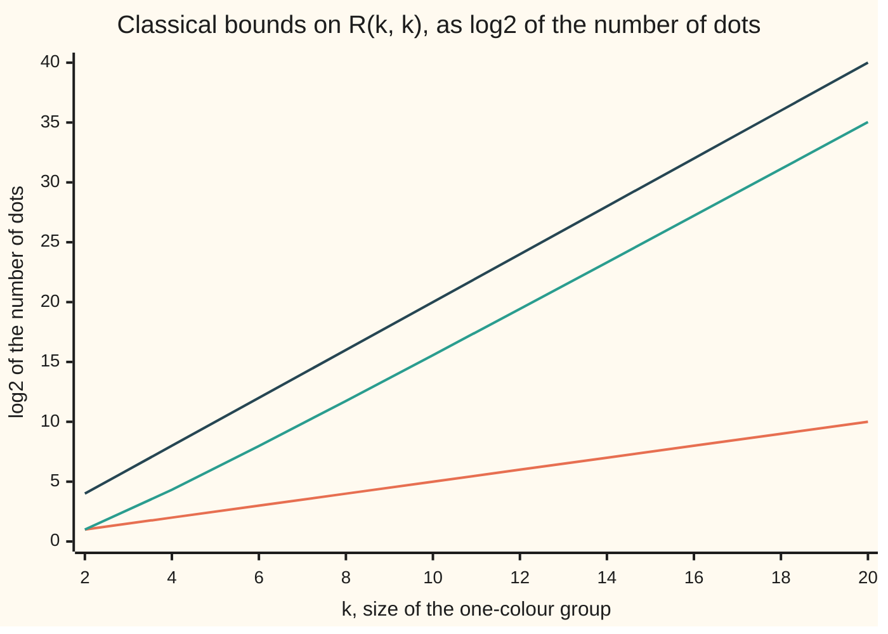
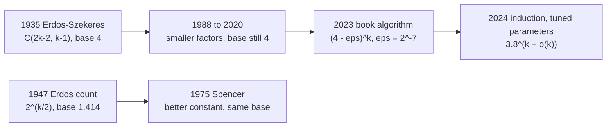

# Diagonal Ramsey numbers: R(k, k) between root 2 to the k and 4 to the k, and the first exponential improvement in 88 years

[Syllabus](../../../SYLLABUS.md) → [Frontier](../README.md) → [Geometry and Combinatorics](../README.md#s04) → Diagonal Ramsey numbers

---

## General Overview

Put 43 dots on a page. Join every pair of dots by a line: 903 lines. Colour each line red or blue. Must some 5 dots have all 10 lines between them in one colour?

Nobody knows. With 46 dots the answer is yes, by a computer proof posted in 2024. With 42 dots the answer is no: Geoffrey Exoo found a colouring of 42 dots with no such 5 in 1989. The true threshold lies somewhere from 43 to 46. It is called $`R(5,5)`$, a **diagonal Ramsey number**: the number of dots that forces $`k`$ dots joined all in one colour, here with $`k = 5`$.

The two classical tools miss this range by a wide margin. In 1935 Paul Erdős and George Szekeres proved a ceiling of 70, in a paper about points in the plane forming convex polygons. In 1947 Erdős proved a floor by counting colourings: as a clean formula it gives only $`2^{5/2} \approx 5.66`$. Both tools grow exponentially in $`k`$, with different bases: about 1.41 for the floor and 4 for the ceiling. At $`k = 100`$ the gap runs from $`2^{50} \approx 1.13 \times 10^{15}`$ dots to $`4^{100} \approx 1.61 \times 10^{60}`$.

For 88 years nobody lowered the base 4. In March 2023 Marcelo Campos, Simon Griffiths, Robert Morris and Julian Sahasrabudhe proved a ceiling of $`(4 - \varepsilon)^k`$ for large $`k`$, with a fixed small $`\varepsilon`$. Later work pushed the base to about 3.8.

**R(k, k) is known to grow exponentially, with a base between the square root of 2 and 3.8; the 2023 proof was the first to move the upper base below 4, and only two diagonal values, 6 and 18, are known exactly.**

**What kind of fact this is:** two theorems (the 1935 ceiling and the 1947 floor, recapped from wing 04 in Why it works), one research theorem outlined with its source (the 2023 ceiling), and an open question: the true base.

**Status, 2026-11-24:**

| Claim | Kind | Status | Source |
| --- | --- | --- | --- |
| $`R(k,k) \le C(2k-2,\,k-1) < 4^{k}`$ | theorem | proved, 1935 | Erdős and Szekeres |
| $`R(k,k) > 2^{k/2}`$ for $`k \ge 3`$ | theorem | proved, 1947 | Erdős |
| $`R(k,k) \le (4-\varepsilon)^k`$ for large $`k`$ | theorem | proved: refereed, *Annals of Mathematics* 203 (2026), accepted 2025-06-30 | Campos, Griffiths, Morris, Sahasrabudhe |
| $`R(k,k) \le 3.8^{\,k + o(k)}`$ | theorem | proved: accepted in the refereed paper of the row above, whose revised version (2025) says Gupta, Ndiaye, Norin and Wei showed it; their own paper is still a preprint (2024, revised 2026-08-29) | Gupta, Ndiaye, Norin, Wei |
| $`43 \le R(5,5) \le 46`$ | theorem | proved. 43: refereed, 1989. 46: by computer, refereed, *Journal of Graph Theory* 112 (2026) | Exoo; Angeltveit and McKay |
| the limit of $`R(k,k)^{1/k}`$: does it exist, and what is it? | question | open; Erdős problem 77, prize $250, open in the database's data file (last change 2025-08-31) | Erdős |

### The picture: floor and ceiling on a log scale



The lowest line is the counting floor $`2^{k/2}`$, which climbs half a step per unit of $`k`$. The middle line is the Erdős–Szekeres ceiling $`C(2k-2,\,k-1)`$. The top line is $`4^k`$, which climbs two steps per unit of $`k`$. The true value of $`R(k,k)`$ lies between the lowest and middle lines; the slopes differ by a factor of 4.

---

## The formula

Notation first, in words. $`K(n)`$ is $`n`$ dots with every pair joined by a line. A **colouring** paints each line red or blue. $`R(k,k)`$ is the smallest $`n`$ such that every colouring of $`K(n)`$ has $`k`$ dots whose lines are all one colour, a **one-colour** $`K(k)`$. $`C(n,k)`$, "n choose k", counts the ways to pick $`k`$ things from $`n`$ ([Ramsey numbers](../../04-Combinatorics%20and%20graphs/14-Ramsey%20and%20Extremal%2C%20in%20Outline/02-ramsey-numbers.md) defines $`R(s,t)`$ for two different sizes; "diagonal" means $`s = t = k`$).

The classical sandwich, for every $`k \ge 3`$:

```math
2^{k/2} \;<\; R(k,k) \;\le\; C(2k-2,\;k-1) \;<\; 4^{k}
```

**Read it aloud:** the threshold is more than root 2 to the power k, and at most the number of ways to choose k − 1 things from 2k − 2, which is below 4 to the power k.

The 2023 ceiling and its refinement:

```math
R(k,k) \;\le\; (4-\varepsilon)^{k} \ \text{for all large } k, \qquad R(k,k) \;\le\; 3.8^{\,k+o(k)}
```

**Read it aloud:** for large enough k the threshold is at most a base a little below 4 raised to the k; with a correction in the exponent that matters less and less, the base can be 3.8.

The open question, as Erdős posed it:

```math
\lim_{k\to\infty} R(k,k)^{1/k} \;=\; ? \qquad \sqrt{2} \;\le\; \liminf_{k\to\infty} R(k,k)^{1/k} \;\le\; \limsup_{k\to\infty} R(k,k)^{1/k} \;\le\; 3.8
```

**Read it aloud:** take the k-th root of the threshold, which reads off its base; nobody knows whether that root settles down, but its lowest and highest long-run values lie between root 2 and 3.8.

| Symbol | Plain meaning | In our example | Push it up and the answer… |
| --- | --- | --- | --- |
| $`k`$ | size of the one-colour group demanded | 5 | every bound grows exponentially |
| $`n`$ | number of dots | 43 to 46 is the unknown zone | from $`R(k,k)`$ on, the group is certain |
| $`K(n)`$ | $`n`$ dots, every pair joined | $`K(43)`$, 903 lines | — |
| $`R(k,k)`$ | fewest dots forcing a one-colour $`K(k)`$ | $`R(5,5)`$: 43 to 46 | — |
| $`C(n,k)`$ | ways to pick $`k`$ things from $`n`$ | $`C(8,4) = 70`$ | — |
| $`2^{k/2}`$ | the counting floor, clean form | 5.66 | grows by $`\sqrt{2}`$ per step of $`k`$ |
| $`\varepsilon`$ | the fixed cut below base 4 in 2023 | $`2^{-7}`$, so base 3.9921875 | — |
| $`o(k)`$ | a correction that grows slower than $`k`$: divided by $`k`$, it shrinks to 0 | unknown at $`k = 100`$ | — |
| $`R(k,k)^{1/k}`$ | the k-th root of the threshold: its exponential base | 2.12 to 2.15 at $`k = 5`$ | — |
| $`\liminf`$, $`\limsup`$ | the lowest and highest values a sequence keeps returning to | — | — |
| $`q`$ | a prime with remainder 1 on division by 4: the dots of a Paley colouring | 37 | at 41 the rule fails for $`k = 5`$ |
| $`s`$, $`t`$; $`A`$, $`B`$, $`X`$, $`Y`$ | the two group sizes in $`R(s,t)`$; in the book algorithm, the red group, the blue group and two sets of candidate dots ($`Y`$ also the pages) | $`s = t = 5`$ | — |

At $`k = 5`$ the k-th root is $`43^{1/5} \approx 2.12`$ to $`46^{1/5} \approx 2.15`$; small cases say little about the limit.

### When it holds

- **Two colours, every line coloured.** With three colours the ceilings and floors change; that is a separate problem (multicolour Ramsey numbers).
- **The 2023 bound needs large $`k`$.** It is proved "for all sufficiently large $`k`$". Read literally at $`k = 100`$, $`(4 - 2^{-7})^{100} \approx 1.32 \times 10^{60}`$ is worse than the old ceiling $`C(198,99) \approx 2.28 \times 10^{58}`$.
- **The $`o(k)`$ hides a constant.** $`3.8^{\,k+o(k)}`$ gives no number at any fixed $`k`$; it fixes only the base in the long run.
- **The counting floor shows existence, not a colouring.** It names none. The best explicit constructions for large $`k`$ are far weaker.
- **Exact values come from searches.** The formulas never give $`R(5,5)`$; only a colouring one dot short plus a proof of the ceiling does.

---

## Why it works

### Step 0: a ceiling is an argument, a floor is a colouring

To show $`n`$ dots always force a one-colour $`K(k)`$, one argument must cover every colouring. To show $`n`$ dots do not, one colouring that dodges is enough, or a count proving such a colouring exists. The ceiling side and the floor side use different tools, and that is why they meet so rarely.

### Step 1: the ceiling, recapped

Stand at one dot. Its lines split into red and blue. If the red pile is big enough, the red neighbours hold a red $`K(k-1)`$ (which joins this dot) or a blue $`K(k)`$; the same works for the blue pile. That gives $`R(s,t) \le R(s-1,t) + R(s,t-1)`$, and unrolled, $`R(k,k) \le C(2k-2,\,k-1)`$. The proof is on [Ramsey numbers](../../04-Combinatorics%20and%20graphs/14-Ramsey%20and%20Extremal%2C%20in%20Outline/02-ramsey-numbers.md).

At $`k = 5`$: $`C(8,4) = 70`$. The code reaches 70 three ways: Pascal's triangle, the falling product $`8 \times 7 \times 6 \times 5 / 4!`$, and the recursion itself.

Why base 4: $`C(2k-2,\,k-1)`$ is the middle of row $`2k-2`$ of Pascal's triangle, and a row sums to $`2^{2k-2} = 4^{k-1}`$. Each step of the recursion halves the dots, in the worst case, and it takes about $`2k`$ steps to build both groups.

### Step 2: the floor, recapped

Count colourings of $`K(n)`$ with a one-colour $`K(k)`$. Blame each on a group of $`k`$ dots and a colour: at most $`2 \times C(n,k) \times 2^{C(n,2) - C(k,2)}`$. If that is below all $`2^{C(n,2)}`$ colourings, some colouring dodges:

```math
2 \times C(n,k) \;<\; 2^{C(k,2)} \quad\Longrightarrow\quad R(k,k) > n
```

**Read it aloud:** if twice the number of k-groups is below 2 to the number of lines inside one group, n dots can dodge.

At $`k = 5`$: $`2^{C(5,2)} = 2^{10} = 1024`$. $`2 \times C(11,5) = 924`$ is below, $`2 \times C(12,5) = 1584`$ is not, so $`R(5,5) > 11`$. The clean form $`2^{k/2}`$ comes from loosening this test; the proof is on [Erdos's counting trick](../../04-Combinatorics%20and%20graphs/14-Ramsey%20and%20Extremal%2C%20in%20Outline/03-probabilistic-method-by-counting.md).

### Step 3: real colourings beat the count for small k

For small $`k`$, written-out colourings do much better than the count. The **Paley colouring** of $`q`$ dots, for a prime $`q`$ that leaves remainder 1 on division by 4, places the dots round a clock of $`q`$ hours. A line is red when the gap between its two dots is a perfect square modulo $`q`$ (the remainder of some $`x^2`$ on division by $`q`$), and blue otherwise.

- $`q = 17`$: no one-colour $`K(4)`$ among 2,380 groups, the colouring behind $`R(4,4) = 18`$ on [Ramsey numbers](../../04-Combinatorics%20and%20graphs/14-Ramsey%20and%20Extremal%2C%20in%20Outline/02-ramsey-numbers.md).
- $`q = 37`$: no one-colour $`K(5)`$ among 435,897 groups, so $`R(5,5) > 37`$. The count gave only 11.
- $`q = 41`$: 410 one-colour $`K(5)`$s. The rule stops working for $`k = 5`$.
- $`q = 101`$: no one-colour $`K(6)`$, so $`R(6,6) > 101`$. That matches the record floor, $`R(6,6) \ge 102`$.

The code checks 101 dots quickly by symmetry. Turning the clock by one hour keeps every gap, so it maps the colouring to itself. Any one-colour $`K(6)`$ can therefore be turned until it contains dot 0, and the code searches only groups through dot 0.

For large $`k`$, no explicit colouring is known that comes close to $`2^{k/2}`$. The count still wins in the long run.

### Step 4: the 2023 ceiling, in outline

This step outlines a research proof. It states the result, the key idea and the source; it does not prove it.

**Statement.** There is a fixed $`\varepsilon > 0`$ such that $`R(k,k) \le (4-\varepsilon)^k`$ for all large $`k`$. The paper gives two proofs, with $`\varepsilon = 2^{-10}`$ and $`\varepsilon = 2^{-7}`$.

**Where the old proof wastes.** The Step 1 argument picks one dot at a time. Each pick keeps only that dot's red or blue neighbours, so it may throw away half the dots, about $`2k`$ times over.

**The key object: a book.** A red **book** is a red one-colour group $`A`$, the **spine**, plus a set $`Y`$ of dots, the **pages**, each joined in red to every dot of $`A`$. A book lets many dots be added to the red group at once, without halving at each one.

**The book algorithm.** It grows a red group $`A`$ and a blue group $`B`$ together, and tracks two sets of candidate dots, $`X`$ and $`Y`$. At each step it does one of three things:

1. Add one dot to the red group (a red step).
2. Add many dots to the blue group at once, when many candidates have many blue lines (a big blue step).
3. Add a dot to the blue group chosen to raise the share of red lines between $`X`$ and $`Y`$ (a density-boost step).

The density boosts make red steps cheaper later. The book that comes out is large enough to finish the red group with the old recursion. The saving over halving is a fixed fraction per step, so it compounds into a smaller base.

**Refinements.** Gupta, Ndiaye, Norin and Wei recast the argument as an induction, optimised its parameters, and reached $`3.8^{\,k+o(k)}`$ (2024). Balister and seven coauthors gave a shorter proof of the 2023 exponential improvement itself, as one case of a result for more colours (arXiv:2410.17197, 2024). The 2026 survey of small Ramsey numbers reports a 2025 formal check of the 2023 theorem in the Isabelle proof assistant.



The improvements between 1988 and 2020 (Thomason, Conlon, Sah) shrank the ceiling by factors that grow slower than any exponential, so the base stayed 4. On the floor side, Spencer's 1975 argument multiplied $`2^{k/2}`$ by about $`\sqrt{2}\,k/e`$, and the base has not moved since 1947.

---

## Worked numbers, by hand

| Step | Arithmetic | Value |
| --- | --- | --- |
| lines among 43 dots | $`C(43,2)`$ | 903 |
| ceiling, Erdős–Szekeres | $`C(8,4) = 8 \cdot 7 \cdot 6 \cdot 5 / 24`$ | 70 |
| floor, clean form | $`2^{5/2} = \sqrt{32}`$ | 5.66, so $`R(5,5) > 5`$ |
| floor, exact count | $`2 \times C(11,5) = 924 < 1024 \le 1584 = 2 \times C(12,5)`$ | $`R(5,5) > 11`$ |
| floor, Paley colouring of 37 dots | 0 one-colour $`K(5)`$s | $`R(5,5) > 37`$ |
| known, quoted | Exoo 1989; Angeltveit and McKay 2024 | **43 to 46** |
| $`k = 100`$, floor | $`2^{50}`$ = 1,125,899,906,842,624 | $`1.13 \times 10^{15}`$ |
| $`k = 100`$, ceiling | $`C(198,99)`$ | $`2.28 \times 10^{58}`$ |
| $`k = 100`$, $`4^{100}`$ | $`2^{200}`$ | $`1.61 \times 10^{60}`$ |

The five-dot answer lies between 43 and 46, inside the classical range 6 to 70; at $`k = 100`$ the classical range spans 43 powers of ten.

The table for $`k`$ from 3 to 10, with the known values quoted from the 2026 survey:

| $`k`$ | $`2^{k/2}`$ | count floor: $`R > n`$ | known lower | known upper | $`C(2k-2,k-1)`$ | $`4^{k-1}`$ |
| ---: | ---: | ---: | ---: | ---: | ---: | ---: |
| 3 | 2.83 | 3 | 6 | 6 | 6 | 16 |
| 4 | 4.00 | 6 | 18 | 18 | 20 | 64 |
| 5 | 5.66 | 11 | 43 | 46 | 70 | 256 |
| 6 | 8.00 | 17 | 102 | 160 | 252 | 1,024 |
| 7 | 11.31 | 27 | 205 | 492 | 924 | 4,096 |
| 8 | 16.00 | 42 | 282 | 1,518 | 3,432 | 16,384 |
| 9 | 22.63 | 65 | 565 | 4,956 | 12,870 | 65,536 |
| 10 | 32.00 | 100 | 798 | 16,064 | 48,620 | 262,144 |

Only $`k = 3`$ and $`k = 4`$ are exact. From $`k = 6`$ on, the known lower bound is a written-out colouring, and the known upper bound a computer-aided computation; both stay far inside the classical range. The upper bounds for $`k \ge 6`$ are unpublished computations of Angeltveit and McKay, listed in the survey's Table Ib (2024).

### What breaks if you drop a piece

| Mistake | Comes out at | What went wrong |
| --- | --- | --- |
| Clean floor taken as the count's best | $`R(5,5) > 5`$, against $`> 11`$ from the exact count | $`2^{k/2}`$ is a loosened form, good only for the base |
| Ceiling read as the value | $`R(5,5) = 70`$ | The truth is at most 46 |
| $`4^k`$ written for the ceiling | $`4^5 = 1024`$, against $`C(8,4) = 70`$ | $`4^{k-1}`$ is the whole row of Pascal's triangle, not its middle |
| Paley rule pushed to 41 dots | 410 one-colour $`K(5)`$s | A pattern that works at 37 stops at 41 |
| 2023 base used at $`k = 100`$ | $`1.32 \times 10^{60}`$, worse than $`2.28 \times 10^{58}`$ | It beats $`C(2k-2,k-1)`$ only from $`k = 3054`$ on, and is proved only for large $`k`$ |

---

## Code, from first principles, and it actually runs

The code reaches the $`k = 5`$ ceiling by three roads: Pascal's triangle, the falling product, and the recursion; for every $`k`$ up to 11 it checks the three agree and stay below $`4^{k-1}`$. It reaches floors by two kinds of road: Erdős's exact count, in whole-number arithmetic, and written-out Paley colourings whose one-colour groups it counts by search. It confirms $`R(3,3) = 6`$ by listing all 1,024 colourings of $`K(5)`$ and all 32,768 of $`K(6)`$. The quoted bounds for $`k`$ from 3 to 10 are checked against both classical bounds. Last, it compares the bases at $`k = 100`$ through logarithms, and finds where each new base first beats the binomial ceiling.

### Python

```python
# Diagonal Ramsey numbers -- the check behind the card.  Standard library only; math gives log2 and sqrt.
# R(k,k): the fewest dots n such that every red/blue colouring of the lines of K(n) has k dots joined
# all in one colour.  Ceilings: Erdos-Szekeres, three roads.  Floors: Erdos's count, and real colourings.
import math

def binom_pascal(n, k):                       # road 1: build Pascal's triangle row by row
    row = [1]
    for _ in range(n):
        row = [1] + [row[i] + row[i + 1] for i in range(len(row) - 1)] + [1]
    return row[k]

def binom_prod(n, k):                         # road 2: falling product over a factorial
    top, bot = 1, 1
    for i in range(k):
        top, bot = top * (n - i), bot * (i + 1)
    return top // bot

def rec(s, t):                                # road 3: the recursion R(s,t) <= R(s-1,t) + R(s,t-1)
    return t if s == 2 else s if t == 2 else rec(s - 1, t) + rec(s, t - 1)

def count_floor(k):                           # largest n with 2 C(n,k) < 2^C(k,2): some colouring dodges
    n = k
    while 2 * binom_prod(n + 1, k) < 2 ** binom_prod(k, 2):
        n += 1
    return n

def cliques(adj, m, k, lo=0):                 # k-sets inside the dot set m, every line among them in adj
    if k == 0:
        return 1
    return sum(cliques(adj, adj[v] & m, k - 1, v + 1) for v in range(lo, len(adj)) if m >> v & 1)

def paley(q):                                 # red line i-j when the gap j - i is a nonzero square mod q
    sq = {x * x % q for x in range(1, q)}
    red = [sum(1 << j for j in range(q) if (j - i) % q in sq) for i in range(q)]
    blue = [((1 << q) - 1) ^ a ^ (1 << i) for i, a in enumerate(red)]
    return red, blue

def dodgers(n):                               # colourings of K(n) with no one-colour triangle, by listing
    pairs = [(i, j) for i in range(n) for j in range(i + 1, n)]
    idx = {p: b for b, p in enumerate(pairs)}
    tri = [(idx[(a, b)], idx[(a, c)], idx[(b, c)]) for a in range(n) for b in range(a + 1, n) for c in range(b + 1, n)]
    good = 0
    for col in range(1 << len(pairs)):
        if all(0 < (col >> x & 1) + (col >> y & 1) + (col >> z & 1) < 3 for x, y, z in tri):
            good += 1
    return good

def sci(log10x):                              # a number given by its log10, printed as m.mme+XX
    e = math.floor(log10x)
    return f"{10 ** (log10x - e):.2f}e+{e}"

KNOWN = {3: (6, 6), 4: (18, 18), 5: (43, 46), 6: (102, 160), 7: (205, 492), 8: (282, 1518), 9: (565, 4956), 10: (798, 16064)}
print("k = 5, the card's example")
p5, q5, r5 = binom_pascal(8, 4), binom_prod(8, 4), rec(5, 5)
print(f"ceiling, Erdos-Szekeres: C(8,4) = {p5} by Pascal's triangle, {q5} by the falling product, {r5} by the recursion")
f5 = count_floor(5)
print(f"floor, clean form: 2^(5/2) = {math.sqrt(32):.2f}, so R(5,5) > {math.isqrt(32)}")
print(f"floor, exact count: 2 x C({f5},5) = {2 * binom_prod(f5, 5)} < 2^10 = {2 ** 10} <= 2 x C({f5 + 1},5) = "
      f"{2 * binom_prod(f5 + 1, 5)}, so R(5,5) > {f5}")
red37, blue37 = paley(37)
k5r, k5b = cliques(red37, (1 << 37) - 1, 5), cliques(blue37, (1 << 37) - 1, 5)
print(f"floor, Paley colouring of K(37): one-colour K(5)s {k5r} red + {k5b} blue of {binom_prod(37, 5)}, so R(5,5) > 37")
red41, blue41 = paley(41)
k41 = cliques(red41, (1 << 41) - 1, 5) + cliques(blue41, (1 << 41) - 1, 5)
print(f"the same rule on K(41): one-colour K(5)s {k41}, so the pattern stops")
print(f"known, quoted: {KNOWN[5][0]} <= R(5,5) <= {KNOWN[5][1]}")
print(f"lines among 43 dots C(43,2) = {binom_prod(43, 2)}; fifth roots 43^(1/5) = {43 ** 0.2:.2f}, "
      f"46^(1/5) = {46 ** 0.2:.2f}; sqrt(2) = {math.sqrt(2):.2f}")
d5, d6 = dodgers(5), dodgers(6)
print(f"search: K(5) colourings with no one-colour triangle {d5} of {2 ** 10}; K(6) {d6} of {2 ** 15}, so R(3,3) = 6")
red17, blue17 = paley(17)
k17 = cliques(red17, (1 << 17) - 1, 4) + cliques(blue17, (1 << 17) - 1, 4)
print(f"Paley colouring of K(17): one-colour K(4)s {k17} of {binom_prod(17, 4)}, so R(4,4) > 17")
red101, blue101 = paley(101)
k101 = (cliques(red101, red101[0], 5), cliques(blue101, blue101[0], 5))
print(f"Paley colouring of K(101): one-colour K(6)s through dot 0, {k101[0]} red + {k101[1]} blue; "
      f"shifting moves any K(6) onto dot 0, so R(6,6) > 101")
print("  k  2^(k/2)  count floor  known lower  known upper  C(2k-2,k-1)     4^(k-1)")
for k in range(3, 11):
    lo, hi = KNOWN[k]
    print(f"{k:>3}{math.sqrt(2 ** k):>9.2f}{count_floor(k):>13}{lo:>13}{hi:>13}{binom_prod(2 * k - 2, k - 1):>13}{4 ** (k - 1):>12}")
print("k = 100")
l10c = sum(math.log10((99 + i) / i) for i in range(1, 100))
print(f"floor 2^50 = {2 ** 50} = {sci(50 * math.log10(2))}; ceiling C(198,99) = {sci(l10c)}; 4^100 = {sci(200 * math.log10(2))}")
print(f"2^50 to C(198,99) spans {math.floor(l10c) - math.floor(50 * math.log10(2))} powers of ten")
print(f"(4 - 2^-7)^100 = {sci(100 * math.log10(4 - 2 ** -7))}; 3.8^100 = {sci(100 * math.log10(3.8))}")
lc, k, cross = 0.0, 1, {}
while len(cross) < 2:                         # lc = log2 C(2k-2, k-1), grown one k at a time
    lc += math.log2((2 * k - 1) * (2 * k) / (k * k))
    k += 1
    for base in (3.8, 4 - 2 ** -7):
        if base not in cross and k * math.log2(base) < lc:
            cross[base] = k
print(f"first k where base^k falls below C(2k-2,k-1): 3.8 at k = {cross[3.8]}, 4 - 2^-7 = {4 - 2 ** -7} at k = {cross[4 - 2 ** -7]}")
ks = list(range(2, 21, 2))
print("chart, k: " + ", ".join(str(k) for k in ks))
print("chart, log2 floor k/2: " + ", ".join(f"{k / 2:.2f}" for k in ks))
print("chart, log2 C(2k-2,k-1): " + ", ".join(f"{math.log2(binom_prod(2 * k - 2, k - 1)):.2f}" for k in ks))
print("chart, log2 4^k: " + ", ".join(f"{2 * k:.2f}" for k in ks))
print(f"mistake 1, clean floor taken as the count's best: R(5,5) > {math.isqrt(32)} against > {f5}")
print(f"mistake 2, ceiling read as the value: R(5,5) = {p5} against at most 46")
print(f"mistake 3, 4^k written for the ceiling: 4^5 = {4 ** 5} against C(8,4) = {p5}")
assert p5 == q5 == r5 == 70                   # three roads to the ceiling agree
assert all(binom_pascal(2 * k - 2, k - 1) == binom_prod(2 * k - 2, k - 1) == rec(k, k) <= 4 ** (k - 1) for k in range(2, 12))
assert 2 * binom_prod(f5, 5) < 2 ** 10 <= 2 * binom_prod(f5 + 1, 5) and f5 >= math.isqrt(32)
assert (d5, d6) == (12, 0) and k17 == 0 and (k5r, k5b) == (0, 0) and k41 > 0 and k101 == (0, 0)
assert all(count_floor(k) < KNOWN[k][0] <= KNOWN[k][1] <= binom_prod(2 * k - 2, k - 1) for k in range(3, 11))
assert cross[3.8] < 100 < cross[4 - 2 ** -7]  # the 2023 base beats the binomial only for very large k
print("ALL CHECKS PASS")
```

**Ran 2026-11-24 on macOS, Python 3.14.10, standard library only. All checks passed. Output, pasted from the run:**

```
k = 5, the card's example
ceiling, Erdos-Szekeres: C(8,4) = 70 by Pascal's triangle, 70 by the falling product, 70 by the recursion
floor, clean form: 2^(5/2) = 5.66, so R(5,5) > 5
floor, exact count: 2 x C(11,5) = 924 < 2^10 = 1024 <= 2 x C(12,5) = 1584, so R(5,5) > 11
floor, Paley colouring of K(37): one-colour K(5)s 0 red + 0 blue of 435897, so R(5,5) > 37
the same rule on K(41): one-colour K(5)s 410, so the pattern stops
known, quoted: 43 <= R(5,5) <= 46
lines among 43 dots C(43,2) = 903; fifth roots 43^(1/5) = 2.12, 46^(1/5) = 2.15; sqrt(2) = 1.41
search: K(5) colourings with no one-colour triangle 12 of 1024; K(6) 0 of 32768, so R(3,3) = 6
Paley colouring of K(17): one-colour K(4)s 0 of 2380, so R(4,4) > 17
Paley colouring of K(101): one-colour K(6)s through dot 0, 0 red + 0 blue; shifting moves any K(6) onto dot 0, so R(6,6) > 101
  k  2^(k/2)  count floor  known lower  known upper  C(2k-2,k-1)     4^(k-1)
  3     2.83            3            6            6            6          16
  4     4.00            6           18           18           20          64
  5     5.66           11           43           46           70         256
  6     8.00           17          102          160          252        1024
  7    11.31           27          205          492          924        4096
  8    16.00           42          282         1518         3432       16384
  9    22.63           65          565         4956        12870       65536
 10    32.00          100          798        16064        48620      262144
k = 100
floor 2^50 = 1125899906842624 = 1.13e+15; ceiling C(198,99) = 2.28e+58; 4^100 = 1.61e+60
2^50 to C(198,99) spans 43 powers of ten
(4 - 2^-7)^100 = 1.32e+60; 3.8^100 = 9.51e+57
first k where base^k falls below C(2k-2,k-1): 3.8 at k = 81, 4 - 2^-7 = 3.9921875 at k = 3054
chart, k: 2, 4, 6, 8, 10, 12, 14, 16, 18, 20
chart, log2 floor k/2: 1.00, 2.00, 3.00, 4.00, 5.00, 6.00, 7.00, 8.00, 9.00, 10.00
chart, log2 C(2k-2,k-1): 1.00, 4.32, 7.98, 11.74, 15.57, 19.43, 23.31, 27.21, 31.12, 35.04
chart, log2 4^k: 4.00, 8.00, 12.00, 16.00, 20.00, 24.00, 28.00, 32.00, 36.00, 40.00
mistake 1, clean floor taken as the count's best: R(5,5) > 5 against > 11
mistake 2, ceiling read as the value: R(5,5) = 70 against at most 46
mistake 3, 4^k written for the ceiling: 4^5 = 1024 against C(8,4) = 70
ALL CHECKS PASS
```

### Rust

Same numbers, same labels, built with `rustc --edition 2021 -O`.

```rust
// Diagonal Ramsey numbers -- the same check as the Python, in Rust.  No crates.
// R(k,k): the fewest dots n such that every red/blue colouring of the lines of K(n) has k dots joined
// all in one colour.  Ceilings: Erdos-Szekeres, three roads.  Floors: Erdos's count, and real colourings.

fn binom_pascal(n: usize, k: usize) -> u128 {  // road 1: build Pascal's triangle row by row
    let mut row: Vec<u128> = vec![1];
    for _ in 0..n {
        let mut next = vec![1u128];
        for i in 0..row.len() - 1 { next.push(row[i] + row[i + 1]); }
        next.push(1);
        row = next;
    }
    row[k]
}

fn binom_prod(n: u128, k: u128) -> u128 {      // road 2: falling product over a factorial
    let (mut top, mut bot) = (1u128, 1u128);
    for i in 0..k { top *= n - i; bot *= i + 1; }
    top / bot
}

fn rec(s: u128, t: u128) -> u128 {             // road 3: the recursion R(s,t) <= R(s-1,t) + R(s,t-1)
    if s == 2 { t } else if t == 2 { s } else { rec(s - 1, t) + rec(s, t - 1) }
}

fn count_floor(k: u128) -> u128 {              // largest n with 2 C(n,k) < 2^C(k,2): some colouring dodges
    let mut n = k;
    while 2 * binom_prod(n + 1, k) < 1u128 << binom_prod(k, 2) { n += 1; }
    n
}

fn cliques(adj: &[u128], m: u128, k: u32, lo: usize) -> u64 {  // k-sets inside m, every line among them in adj
    if k == 0 { return 1; }
    (lo..adj.len()).filter(|&v| m >> v & 1 == 1).map(|v| cliques(adj, adj[v] & m, k - 1, v + 1)).sum()
}

fn full(q: usize) -> u128 { if q == 128 { u128::MAX } else { (1u128 << q) - 1 } }

fn paley(q: usize) -> (Vec<u128>, Vec<u128>) {  // red line i-j when the gap j - i is a nonzero square mod q
    let sq: Vec<usize> = (1..q).map(|x| x * x % q).collect();
    let red: Vec<u128> = (0..q).map(|i| (0..q).filter(|&j| sq.contains(&((j + q - i) % q)) && j != i).map(|j| 1u128 << j).sum()).collect();
    let blue: Vec<u128> = red.iter().enumerate().map(|(i, &a)| full(q) ^ a ^ (1u128 << i)).collect();
    (red, blue)
}

fn dodgers(n: usize) -> u64 {                   // colourings of K(n) with no one-colour triangle, by listing
    let mut idx = vec![vec![0usize; n]; n];
    let mut b = 0;
    for i in 0..n { for j in i + 1..n { idx[i][j] = b; b += 1; } }
    let mut tri = vec![];
    for a in 0..n { for x in a + 1..n { for c in x + 1..n { tri.push((idx[a][x], idx[a][c], idx[x][c])); } } }
    let mut good = 0;
    for col in 0u32..1 << b {
        if tri.iter().all(|&(x, y, z)| { let s = (col >> x & 1) + (col >> y & 1) + (col >> z & 1); s > 0 && s < 3 }) { good += 1; }
    }
    good
}

fn sci(log10x: f64) -> String {                 // a number given by its log10, printed as m.mme+XX
    let e = log10x.floor();
    format!("{:.2}e+{}", 10f64.powf(log10x - e), e as i64)
}

fn known(k: u128) -> (u128, u128) {
    match k { 3 => (6, 6), 4 => (18, 18), 5 => (43, 46), 6 => (102, 160), 7 => (205, 492), 8 => (282, 1518), 9 => (565, 4956), _ => (798, 16064) }
}

fn main() {
    println!("k = 5, the card's example");
    let (p5, q5, r5) = (binom_pascal(8, 4), binom_prod(8, 4), rec(5, 5));
    println!("ceiling, Erdos-Szekeres: C(8,4) = {} by Pascal's triangle, {} by the falling product, {} by the recursion", p5, q5, r5);
    let f5 = count_floor(5);
    println!("floor, clean form: 2^(5/2) = {:.2}, so R(5,5) > {}", 32f64.sqrt(), 32f64.sqrt().floor() as u64);
    println!("floor, exact count: 2 x C({},5) = {} < 2^10 = {} <= 2 x C({},5) = {}, so R(5,5) > {}",
             f5, 2 * binom_prod(f5, 5), 1u32 << 10, f5 + 1, 2 * binom_prod(f5 + 1, 5), f5);
    let (red37, blue37) = paley(37);
    let (k5r, k5b) = (cliques(&red37, full(37), 5, 0), cliques(&blue37, full(37), 5, 0));
    println!("floor, Paley colouring of K(37): one-colour K(5)s {} red + {} blue of {}, so R(5,5) > 37", k5r, k5b, binom_prod(37, 5));
    let (red41, blue41) = paley(41);
    let k41 = cliques(&red41, full(41), 5, 0) + cliques(&blue41, full(41), 5, 0);
    println!("the same rule on K(41): one-colour K(5)s {}, so the pattern stops", k41);
    println!("known, quoted: {} <= R(5,5) <= {}", known(5).0, known(5).1);
    println!("lines among 43 dots C(43,2) = {}; fifth roots 43^(1/5) = {:.2}, 46^(1/5) = {:.2}; sqrt(2) = {:.2}",
             binom_prod(43, 2), 43f64.powf(0.2), 46f64.powf(0.2), 2f64.sqrt());
    let (d5, d6) = (dodgers(5), dodgers(6));
    println!("search: K(5) colourings with no one-colour triangle {} of {}; K(6) {} of {}, so R(3,3) = 6", d5, 1u32 << 10, d6, 1u32 << 15);
    let (red17, blue17) = paley(17);
    let k17 = cliques(&red17, full(17), 4, 0) + cliques(&blue17, full(17), 4, 0);
    println!("Paley colouring of K(17): one-colour K(4)s {} of {}, so R(4,4) > 17", k17, binom_prod(17, 4));
    let (red101, blue101) = paley(101);
    let k101 = (cliques(&red101, red101[0], 5, 0), cliques(&blue101, blue101[0], 5, 0));
    println!("Paley colouring of K(101): one-colour K(6)s through dot 0, {} red + {} blue; shifting moves any K(6) onto dot 0, so R(6,6) > 101", k101.0, k101.1);
    println!("  k  2^(k/2)  count floor  known lower  known upper  C(2k-2,k-1)     4^(k-1)");
    for k in 3u128..11 {
        let (lo, hi) = known(k);
        println!("{:>3}{:>9.2}{:>13}{:>13}{:>13}{:>13}{:>12}", k, ((1u128 << k) as f64).sqrt(), count_floor(k), lo, hi, binom_prod(2 * k - 2, k - 1), 1u128 << (2 * (k - 1)));
    }
    println!("k = 100");
    let l10c: f64 = (1..100).map(|i| ((99 + i) as f64 / i as f64).log10()).sum();
    println!("floor 2^50 = {} = {}; ceiling C(198,99) = {}; 4^100 = {}", 1u64 << 50, sci(50.0 * 2f64.log10()), sci(l10c), sci(200.0 * 2f64.log10()));
    println!("2^50 to C(198,99) spans {} powers of ten", l10c.floor() as i64 - (50.0 * 2f64.log10()).floor() as i64);
    let b7 = 4.0 - 2f64.powi(-7);
    println!("(4 - 2^-7)^100 = {}; 3.8^100 = {}", sci(100.0 * b7.log10()), sci(100.0 * 3.8f64.log10()));
    let (mut lc, mut k, mut cross): (f64, u64, [u64; 2]) = (0.0, 1, [0, 0]);
    while cross[0] == 0 || cross[1] == 0 {      // lc = log2 C(2k-2, k-1), grown one k at a time
        lc += (((2 * k - 1) * (2 * k)) as f64 / (k * k) as f64).log2();
        k += 1;
        for (i, base) in [3.8f64, b7].iter().enumerate() {
            if cross[i] == 0 && (k as f64) * base.log2() < lc { cross[i] = k; }
        }
    }
    println!("first k where base^k falls below C(2k-2,k-1): 3.8 at k = {}, 4 - 2^-7 = {} at k = {}", cross[0], b7, cross[1]);
    let ks: Vec<u128> = (2..21).step_by(2).collect();
    println!("chart, k: {}", ks.iter().map(|k| k.to_string()).collect::<Vec<_>>().join(", "));
    println!("chart, log2 floor k/2: {}", ks.iter().map(|&k| format!("{:.2}", k as f64 / 2.0)).collect::<Vec<_>>().join(", "));
    println!("chart, log2 C(2k-2,k-1): {}", ks.iter().map(|&k| format!("{:.2}", (binom_prod(2 * k - 2, k - 1) as f64).log2())).collect::<Vec<_>>().join(", "));
    println!("chart, log2 4^k: {}", ks.iter().map(|&k| format!("{:.2}", 2.0 * k as f64)).collect::<Vec<_>>().join(", "));
    println!("mistake 1, clean floor taken as the count's best: R(5,5) > {} against > {}", 32f64.sqrt().floor() as u64, f5);
    println!("mistake 2, ceiling read as the value: R(5,5) = {} against at most 46", p5);
    println!("mistake 3, 4^k written for the ceiling: 4^5 = {} against C(8,4) = {}", 1u32 << 10, p5);
    assert!(p5 == q5 && q5 == r5 && r5 == 70);  // three roads to the ceiling agree
    assert!((2..12u128).all(|k| binom_pascal(2 * k as usize - 2, k as usize - 1) == binom_prod(2 * k - 2, k - 1)
        && binom_prod(2 * k - 2, k - 1) == rec(k, k) && rec(k, k) <= 1u128 << (2 * (k - 1))));
    assert!(2 * binom_prod(f5, 5) < 1024 && 1024 <= 2 * binom_prod(f5 + 1, 5) && f5 >= 32f64.sqrt().floor() as u128);
    assert!((d5, d6) == (12, 0) && k17 == 0 && (k5r, k5b) == (0, 0) && k41 > 0 && k101 == (0, 0));
    assert!((3u128..11).all(|k| count_floor(k) < known(k).0 && known(k).0 <= known(k).1 && known(k).1 <= binom_prod(2 * k - 2, k - 1)));
    assert!(cross[0] < 100 && 100 < cross[1]);  // the 2023 base beats the binomial only for very large k
    println!("ALL CHECKS PASS");
}
```

**Ran 2026-11-24 on macOS, rustc 1.98.1, no crates. All checks passed. Output, pasted from the run:**

```
k = 5, the card's example
ceiling, Erdos-Szekeres: C(8,4) = 70 by Pascal's triangle, 70 by the falling product, 70 by the recursion
floor, clean form: 2^(5/2) = 5.66, so R(5,5) > 5
floor, exact count: 2 x C(11,5) = 924 < 2^10 = 1024 <= 2 x C(12,5) = 1584, so R(5,5) > 11
floor, Paley colouring of K(37): one-colour K(5)s 0 red + 0 blue of 435897, so R(5,5) > 37
the same rule on K(41): one-colour K(5)s 410, so the pattern stops
known, quoted: 43 <= R(5,5) <= 46
lines among 43 dots C(43,2) = 903; fifth roots 43^(1/5) = 2.12, 46^(1/5) = 2.15; sqrt(2) = 1.41
search: K(5) colourings with no one-colour triangle 12 of 1024; K(6) 0 of 32768, so R(3,3) = 6
Paley colouring of K(17): one-colour K(4)s 0 of 2380, so R(4,4) > 17
Paley colouring of K(101): one-colour K(6)s through dot 0, 0 red + 0 blue; shifting moves any K(6) onto dot 0, so R(6,6) > 101
  k  2^(k/2)  count floor  known lower  known upper  C(2k-2,k-1)     4^(k-1)
  3     2.83            3            6            6            6          16
  4     4.00            6           18           18           20          64
  5     5.66           11           43           46           70         256
  6     8.00           17          102          160          252        1024
  7    11.31           27          205          492          924        4096
  8    16.00           42          282         1518         3432       16384
  9    22.63           65          565         4956        12870       65536
 10    32.00          100          798        16064        48620      262144
k = 100
floor 2^50 = 1125899906842624 = 1.13e+15; ceiling C(198,99) = 2.28e+58; 4^100 = 1.61e+60
2^50 to C(198,99) spans 43 powers of ten
(4 - 2^-7)^100 = 1.32e+60; 3.8^100 = 9.51e+57
first k where base^k falls below C(2k-2,k-1): 3.8 at k = 81, 4 - 2^-7 = 3.9921875 at k = 3054
chart, k: 2, 4, 6, 8, 10, 12, 14, 16, 18, 20
chart, log2 floor k/2: 1.00, 2.00, 3.00, 4.00, 5.00, 6.00, 7.00, 8.00, 9.00, 10.00
chart, log2 C(2k-2,k-1): 1.00, 4.32, 7.98, 11.74, 15.57, 19.43, 23.31, 27.21, 31.12, 35.04
chart, log2 4^k: 4.00, 8.00, 12.00, 16.00, 20.00, 24.00, 28.00, 32.00, 36.00, 40.00
mistake 1, clean floor taken as the count's best: R(5,5) > 5 against > 11
mistake 2, ceiling read as the value: R(5,5) = 70 against at most 46
mistake 3, 4^k written for the ceiling: 4^5 = 1024 against C(8,4) = 70
ALL CHECKS PASS
```

The two outputs match line for line.

### Lean

Lean proves both classical bounds for every $`k \ge 3`$ and $`R(3,3) = 6`$, and checks the worked numbers.

- Take $`k \ge 3`$ and $`C(2k-2,\,k-1)`$ dots or more. Then every colouring of their lines has a one-colour $`K(k)`$.
- Take $`k \ge 3`$. Then $`C(2k-2,\,k-1) < 4^{k}`$.
- Take $`k \ge 3`$ and $`n`$ dots with $`n^2 \le 2^k`$, that is, $`n \le 2^{k/2}`$. Then some colouring of $`K(n)`$ has no one-colour $`K(k)`$.
- Every colouring of $`K(6)`$ has a one-colour $`K(3)`$.
- Take 5 dots round a circle, with lines between neighbours red and all others blue. Then no one-colour $`K(3)`$ appears, so $`R(3,3) = 6`$.
- 43 dots have 903 lines, and $`C(8,4) = 70`$, as the falling product gives.
- Take $`k = 5`$. Then $`2 \times C(11,5) = 924`$ is below 1024, and $`2 \times C(12,5) = 1584`$ is not.
- Take $`k = 5`$. Then $`2^{5/2}`$ lies between 5 and 6, since $`5^2 \le 2^5 < 6^2`$.
- The table's last two columns hold for every $`k`$ from 3 to 10.
- The count floor column is right at both ends: 3 for $`k = 3`$ and 100 for $`k = 10`$.
- Take $`k = 100`$. Then $`2^{50} < C(198,99) < 4^{100} = 2^{200}`$, and $`2^{50}`$ = 1,125,899,906,842,624.
- The Paley checks' group counts hold: 2,380 for 17 dots and 435,897 for 37 dots.

The Paley searches, quoted values and base comparisons are left to the Python and Rust checks; the 2023 ceiling rests on its paper.

```lean
-- Diagonal Ramsey numbers: for every k ≥ 3, any red/blue colouring of the lines among C(2k − 2, k − 1) or more dots has k dots joined all in one colour, that number is below 4^k, at most 2^(k/2) dots can always dodge, and R(3, 3) = 6.
import Mathlib.Combinatorics.SimpleGraph.Clique
import Mathlib.Data.Nat.Choose.Basic
import Mathlib.Data.Nat.Factorial.Basic
import Mathlib.Tactic.NormNum
import Mathlib.Tactic.Positivity
import Mathlib.Tactic.Linarith
import Mathlib.Tactic.Ring
import Mathlib.Tactic.Push
import Mathlib.Combinatorics.SimpleGraph.CycleGraph
import Mathlib.Data.Nat.Choose.Bounds
import Mathlib.Algebra.Order.BigOperators.Group.Finset
import Mathlib.Algebra.BigOperators.Ring.Finset

/-! A red/blue colouring of every line of K(n) is a graph `G` on the dots: its edges are the red
lines and the edges of its complement `Gᶜ` are the blue lines. A one-colour K(k) is a k-clique of
`G` or of `Gᶜ`, so "no one-colour K(k)" is `G.CliqueFree k ∧ Gᶜ.CliqueFree k`. -/

open Finset in
theorem ramsey_finset_aux {V : Type} (G : SimpleGraph V) :
    ∀ s t : ℕ, ∀ A : Finset V, Nat.choose (s + t) s ≤ A.card →
      (∃ X ⊆ A, G.IsNClique (s + 1) X) ∨ (∃ Y ⊆ A, Gᶜ.IsNClique (t + 1) Y) := by
  classical
  intro s
  induction s with
  | zero =>
    intro t A hA
    rw [Nat.choose_zero_right] at hA
    obtain ⟨a, ha⟩ : A.Nonempty := Finset.card_pos.1 (by omega)
    exact Or.inl ⟨{a}, by simpa using ha, by simp [SimpleGraph.isNClique_singleton]⟩
  | succ s ihs =>
    intro t
    induction t with
    | zero =>
      intro A hA
      rw [Nat.add_zero, Nat.choose_self] at hA
      obtain ⟨a, ha⟩ : A.Nonempty := Finset.card_pos.1 (by omega)
      exact Or.inr ⟨{a}, by simpa using ha, by simp [SimpleGraph.isNClique_singleton]⟩
    | succ t iht =>
      intro A hA
      have hpos : 0 < A.card := lt_of_lt_of_le (Nat.choose_pos (by omega)) hA
      obtain ⟨v, hv⟩ := Finset.card_pos.1 hpos
      set N := (A.erase v).filter (fun w => G.Adj v w) with hN
      set M := (A.erase v).filter (fun w => ¬ G.Adj v w) with hM
      have hNM : N.card + M.card = A.card - 1 := by
        rw [hN, hM, Finset.card_filter_add_card_filter_not, Finset.card_erase_of_mem hv]
      have hsplit : Nat.choose (s + 1 + (t + 1)) (s + 1) =
          Nat.choose (s + (t + 1)) s + Nat.choose (s + 1 + t) (s + 1) := by
        rw [show s + 1 + (t + 1) = (s + t + 1) + 1 by omega, Nat.choose_succ_succ,
          show s + (t + 1) = s + t + 1 by omega, show s + 1 + t = s + t + 1 by omega]
      have hNA : N ⊆ A := fun w hw => Finset.mem_of_mem_erase (Finset.mem_filter.1 hw).1
      have hMA : M ⊆ A := fun w hw => Finset.mem_of_mem_erase (Finset.mem_filter.1 hw).1
      by_cases hc : Nat.choose (s + (t + 1)) s ≤ N.card
      · rcases ihs (t + 1) N hc with ⟨X, hXN, hX⟩ | ⟨Y, hYN, hY⟩
        · refine Or.inl ⟨insert v X, Finset.insert_subset hv (hXN.trans hNA), hX.insert ?_⟩
          intro b hb
          exact (Finset.mem_filter.1 (hXN hb)).2
        · exact Or.inr ⟨Y, hYN.trans hNA, hY⟩
      · have hc' : Nat.choose (s + 1 + t) (s + 1) ≤ M.card := by omega
        rcases iht M hc' with ⟨X, hXM, hX⟩ | ⟨Y, hYM, hY⟩
        · exact Or.inl ⟨X, hXM.trans hMA, hX⟩
        · refine Or.inr ⟨insert v Y, Finset.insert_subset hv (hYM.trans hMA), hY.insert ?_⟩
          intro b hb
          have hb' := Finset.mem_filter.1 (hYM hb)
          rw [SimpleGraph.compl_adj]
          exact ⟨(Finset.ne_of_mem_erase hb'.1).symm, hb'.2⟩


open Finset in
theorem erdos_count_aux (k n : ℕ) (h : 2 * n.choose k < 2 ^ k.choose 2) :
    ∃ G : SimpleGraph (Fin n), G.CliqueFree k ∧ Gᶜ.CliqueFree k := by
  classical
  set U : Finset (Finset (Fin n)) := powersetCard 2 univ with hU
  let T : Finset (Fin n) → Finset (Finset (Fin n)) := fun s => powersetCard 2 s
  let bad : Finset (Fin n) → Finset (Finset (Finset (Fin n))) := fun s =>
    U.powerset.filter (fun S => T s ⊆ S) ∪ U.powerset.filter (fun S => Disjoint (T s) S)
  let Bad := (powersetCard k (univ : Finset (Fin n))).biUnion bad
  have hbad : ∀ s ∈ powersetCard k (univ : Finset (Fin n)),
      (bad s).card * 2 ^ k.choose 2 ≤ 2 * 2 ^ U.card := by
    intro s hs
    rw [mem_powersetCard] at hs
    have hTU : T s ⊆ U := powersetCard_mono (subset_univ _)
    have hTc : (T s).card = k.choose 2 := by
      simp only [T]; rw [card_powersetCard, hs.2]
    have h1 : (U.powerset.filter (fun S => T s ⊆ S)).card ≤ 2 ^ (U \ T s).card := by
      rw [← card_powerset]
      refine card_le_card_of_injOn (fun S => S \ T s) ?_ ?_
      · intro S hS
        simp only [coe_filter, mem_powerset, Set.mem_ofPred_eq] at hS
        simp only [coe_powerset, Set.mem_preimage, Set.mem_powerset_iff, coe_subset]
        exact sdiff_subset_sdiff hS.1 le_rfl
      · intro S1 hS1 S2 hS2 heq
        simp only [coe_filter, mem_powerset, Set.mem_ofPred_eq] at hS1 hS2
        have e1 : S1 = (S1 \ T s) ∪ T s := (sdiff_union_of_subset hS1.2).symm
        have e2 : S2 = (S2 \ T s) ∪ T s := (sdiff_union_of_subset hS2.2).symm
        rw [e1, e2]
        simp only at heq
        rw [heq]
    have h2 : (U.powerset.filter (fun S => Disjoint (T s) S)).card ≤ 2 ^ (U \ T s).card := by
      rw [← card_powerset]
      apply card_le_card
      intro S hS
      simp only [mem_filter, mem_powerset] at hS ⊢
      exact subset_sdiff.2 ⟨hS.1, hS.2.symm⟩
    have hle : (T s).card ≤ U.card := card_le_card hTU
    have h3 : 2 ^ (U \ T s).card * 2 ^ k.choose 2 = 2 ^ U.card := by
      rw [← pow_add, card_sdiff_of_subset hTU, hTc]
      congr 1
      omega
    calc (bad s).card * 2 ^ k.choose 2
        ≤ (2 ^ (U \ T s).card + 2 ^ (U \ T s).card) * 2 ^ k.choose 2 :=
          Nat.mul_le_mul_right _ ((card_union_le _ _).trans (add_le_add h1 h2))
      _ = 2 * 2 ^ U.card := by rw [← h3]; ring
  have hBad : Bad.card < U.powerset.card := by
    rw [card_powerset]
    have hsum : Bad.card * 2 ^ k.choose 2 ≤ n.choose k * (2 * 2 ^ U.card) := by
      calc Bad.card * 2 ^ k.choose 2
          ≤ (∑ s ∈ powersetCard k (univ : Finset (Fin n)), (bad s).card) * 2 ^ k.choose 2 :=
            Nat.mul_le_mul_right _ card_biUnion_le
        _ = ∑ s ∈ powersetCard k (univ : Finset (Fin n)), (bad s).card * 2 ^ k.choose 2 :=
            sum_mul _ _ _
        _ ≤ ∑ s ∈ powersetCard k (univ : Finset (Fin n)), 2 * 2 ^ U.card := sum_le_sum hbad
        _ = n.choose k * (2 * 2 ^ U.card) := by
            rw [sum_const, card_powersetCard, card_univ, Fintype.card_fin, smul_eq_mul]
    have h4 : n.choose k * (2 * 2 ^ U.card) < 2 ^ k.choose 2 * 2 ^ U.card := by
      rw [← mul_assoc, mul_comm (n.choose k) 2]
      exact Nat.mul_lt_mul_of_pos_right h (by positivity)
    by_contra hc
    push Not at hc
    have h5 := Nat.mul_le_mul_right (2 ^ k.choose 2) hc
    nlinarith
  obtain ⟨S, hSU, hSnot⟩ : ∃ S ∈ U.powerset, S ∉ Bad := by
    by_contra hc
    push Not at hc
    exact absurd (card_le_card (show U.powerset ⊆ Bad from hc)) (not_le.2 hBad)
  let G : SimpleGraph (Fin n) := SimpleGraph.fromRel (fun a b => ({a, b} : Finset (Fin n)) ∈ S)
  refine ⟨G, ?_, ?_⟩
  · intro X hX
    apply hSnot
    rw [mem_biUnion]
    refine ⟨X, mem_powersetCard.2 ⟨subset_univ _, hX.2⟩,
      mem_union_left _ (mem_filter.2 ⟨hSU, ?_⟩)⟩
    intro p hp
    rw [mem_powersetCard, card_eq_two] at hp
    obtain ⟨hpX, a, b, hab, rfl⟩ := hp
    have hadj : G.Adj a b := hX.1 (hpX (by simp)) (hpX (by simp)) hab
    simp only [G, SimpleGraph.fromRel_adj] at hadj
    rcases hadj.2 with h' | h'
    · exact h'
    · rwa [pair_comm]
  · intro X hX
    apply hSnot
    rw [mem_biUnion]
    refine ⟨X, mem_powersetCard.2 ⟨subset_univ _, hX.2⟩,
      mem_union_right _ (mem_filter.2 ⟨hSU, ?_⟩)⟩
    rw [disjoint_left]
    intro p hp hpS
    rw [mem_powersetCard, card_eq_two] at hp
    obtain ⟨hpX, a, b, hab, rfl⟩ := hp
    have hadj : Gᶜ.Adj a b := hX.1 (hpX (by simp)) (hpX (by simp)) hab
    rw [SimpleGraph.compl_adj] at hadj
    exact hadj.2 (by simp only [G, SimpleGraph.fromRel_adj]; exact ⟨hab, Or.inl hpS⟩)

theorem two_mul_choose_two_add (k : ℕ) : 2 * k.choose 2 + k = k * k := by
  induction k with
  | zero => simp
  | succ k ih =>
    rw [Nat.choose_succ_succ, Nat.choose_one_right]
    nlinarith

theorem two_pow_lt_factorial_sq (k : ℕ) (hk : 3 ≤ k) : 2 ^ (k + 2) < (k.factorial) ^ 2 := by
  induction k, hk using Nat.le_induction with
  | base => decide
  | succ k hk ih =>
    rw [Nat.factorial_succ, mul_pow, pow_succ]
    have : 2 ≤ (k + 1) ^ 2 := by nlinarith
    nlinarith

theorem erdos_numeric (k : ℕ) (hk : 3 ≤ k) (n : ℕ) (hn : n ^ 2 ≤ 2 ^ k) :
    2 * n.choose k < 2 ^ k.choose 2 := by
  set c := n.choose k
  set F := k.factorial
  set C := k.choose 2
  have hF : 0 < F := Nat.factorial_pos k
  have e1 : 2 * c * F ≤ 2 * n ^ k := by
    have := Nat.descFactorial_le_pow n k
    rw [Nat.descFactorial_eq_factorial_mul_choose] at this
    nlinarith
  have e2 : (2 * n ^ k) ^ 2 ≤ 4 * 2 ^ (k * k) := by
    have : (n ^ 2) ^ k ≤ (2 ^ k) ^ k := Nat.pow_le_pow_left hn k
    rw [← pow_mul, ← pow_mul] at this
    calc (2 * n ^ k) ^ 2 = 4 * n ^ (k * 2) := by ring
      _ ≤ 4 * 2 ^ (k * k) := by rw [mul_comm k 2]; exact Nat.mul_le_mul_left 4 this
  have e3 : 4 * 2 ^ (k * k) < (2 ^ C * F) ^ 2 := by
    have hC := two_mul_choose_two_add k
    have hf := two_pow_lt_factorial_sq k hk
    calc 4 * 2 ^ (k * k) = 2 ^ (2 * C) * 2 ^ (k + 2) := by
          rw [← pow_add, show 2 * C + (k + 2) = k * k + 2 by omega, pow_add]; ring
      _ < 2 ^ (2 * C) * F ^ 2 := Nat.mul_lt_mul_of_pos_left hf (by positivity)
      _ = (2 ^ C * F) ^ 2 := by rw [mul_pow, ← pow_mul, mul_comm C 2]
  have e4 : (2 * c * F) ^ 2 < (2 ^ C * F) ^ 2 :=
    lt_of_le_of_lt (Nat.pow_le_pow_left e1 2) (lt_of_le_of_lt e2 e3)
  have e5 : 2 * c * F < 2 ^ C * F := lt_of_pow_lt_pow_left₀ 2 (by positivity) e4
  exact Nat.lt_of_mul_lt_mul_right e5

theorem c5_ok : (SimpleGraph.cycleGraph 5).CliqueFree 3 ∧ (SimpleGraph.cycleGraph 5)ᶜ.CliqueFree 3 := by
  rw [← SimpleGraph.cliqueFinset_eq_empty_iff, ← SimpleGraph.cliqueFinset_eq_empty_iff]
  decide

#print axioms ramsey_finset_aux
#print axioms erdos_count_aux
#print axioms two_mul_choose_two_add
#print axioms two_pow_lt_factorial_sq
#print axioms erdos_numeric
#print axioms c5_ok

/-- The classical ceiling (Erdős and Szekeres, 1935): for every k ≥ 3, every red/blue colouring of
the lines among n dots, with n at least C(2k − 2, k − 1), has k dots whose lines are all one colour,
so R(k, k) ≤ C(2k − 2, k − 1); and C(2k − 2, k − 1) is below 4^k. -/
theorem diagonal_ramsey_le_choose_lt_four_pow (k : ℕ) (hk : 3 ≤ k) :
    Nat.choose (2 * k - 2) (k - 1) < 4 ^ k ∧
      ∀ (V : Type) [Fintype V], Nat.choose (2 * k - 2) (k - 1) ≤ Fintype.card V →
        ∀ G : SimpleGraph V, ¬ (G.CliqueFree k ∧ Gᶜ.CliqueFree k) := by
  obtain ⟨j, rfl⟩ : ∃ j, k = j + 1 := ⟨k - 1, by omega⟩
  refine ⟨?_, ?_⟩
  · rw [show 2 * (j + 1) - 2 = 2 * j by omega, show j + 1 - 1 = j by omega]
    calc Nat.choose (2 * j) j ≤ 2 ^ (2 * j) := Nat.choose_le_two_pow _ _
      _ = 4 ^ j := by rw [pow_mul]; norm_num
      _ < 4 ^ (j + 1) := Nat.pow_lt_pow_right (by norm_num) (by omega)
  · intro V _ hcard G hG
    rw [show 2 * (j + 1) - 2 = j + j by omega, show j + 1 - 1 = j by omega] at hcard
    rcases ramsey_finset_aux G j j Finset.univ (by rwa [Finset.card_univ]) with
      ⟨X, -, hX⟩ | ⟨Y, -, hY⟩
    · exact hG.1 X hX
    · exact hG.2 Y hY

/-- The classical floor (Erdős, 1947): for every k ≥ 3, R(k, k) > 2^(k/2). That is, for every
number of dots n with n ≤ 2^(k/2), written n² ≤ 2^k, some red/blue colouring of the lines among
the n dots has no k dots joined all in one colour. -/
theorem diagonal_ramsey_gt_two_pow_half (k : ℕ) (hk : 3 ≤ k) (n : ℕ) (hn : n ^ 2 ≤ 2 ^ k) :
    ∃ G : SimpleGraph (Fin n), G.CliqueFree k ∧ Gᶜ.CliqueFree k := by
  exact erdos_count_aux k n (erdos_numeric k hk n hn)

/-- R(3, 3) = 6: every red/blue colouring of the lines among 6 dots has a one-colour triangle, and
some colouring of the lines among 5 dots has none. -/
theorem ramsey_three_three_eq_six :
    (∀ G : SimpleGraph (Fin 6), ¬ (G.CliqueFree 3 ∧ Gᶜ.CliqueFree 3)) ∧
      ∃ G : SimpleGraph (Fin 5), G.CliqueFree 3 ∧ Gᶜ.CliqueFree 3 := by
  refine ⟨fun G hG => ?_, SimpleGraph.cycleGraph 5, c5_ok⟩
  rcases ramsey_finset_aux G 2 2 Finset.univ (by decide) with ⟨X, -, hX⟩ | ⟨Y, -, hY⟩
  · exact hG.1 X hX
  · exact hG.2 Y hY

/-! The card's whole-number examples. -/

-- 43 dots have C(43, 2) = 903 lines.
example : Nat.choose 43 2 = 903 := by decide

-- The ceiling at k = 5: C(8, 4) = 8 · 7 · 6 · 5 / 24 = 70.
example : Nat.choose 8 4 = 70 ∧ 8 * 7 * 6 * 5 / 24 = 70 := by decide

-- The exact count at k = 5: 2 × C(11, 5) = 924 < 1,024 = 2^C(5, 2) ≤ 1,584 = 2 × C(12, 5), so R(5, 5) > 11.
example : 2 * Nat.choose 11 5 = 924 ∧ 2 ^ Nat.choose 5 2 = 1024 ∧ 2 * Nat.choose 12 5 = 1584 ∧
    2 * Nat.choose 11 5 < 2 ^ Nat.choose 5 2 ∧ 2 ^ Nat.choose 5 2 ≤ 2 * Nat.choose 12 5 := by
  decide

-- The clean floor at k = 5: 5² ≤ 2^5 < 6², so 2^(5/2) lies between 5 and 6.
example : 5 ^ 2 ≤ 2 ^ 5 ∧ 2 ^ 5 < 6 ^ 2 := by norm_num

-- Mistake 3: 4^5 = 1,024, against C(8, 4) = 70.
example : 4 ^ 5 = 1024 := by norm_num

-- The table's ceiling column C(2k − 2, k − 1) and 4^(k − 1), for k = 3 to 10.
example : Nat.choose 4 2 = 6 ∧ Nat.choose 6 3 = 20 ∧ Nat.choose 10 5 = 252 ∧
    Nat.choose 12 6 = 924 ∧ Nat.choose 14 7 = 3432 ∧ Nat.choose 16 8 = 12870 ∧
    Nat.choose 18 9 = 48620 := by
  simp only [Nat.choose_eq_descFactorial_div_factorial, Nat.descFactorial, Nat.factorial, and_self]
example : 4 ^ 2 = 16 ∧ 4 ^ 3 = 64 ∧ 4 ^ 4 = 256 ∧ 4 ^ 5 = 1024 ∧ 4 ^ 6 = 4096 ∧
    4 ^ 7 = 16384 ∧ 4 ^ 8 = 65536 ∧ 4 ^ 9 = 262144 := by norm_num

-- The table's count floor column: the largest n with 2 × C(n, k) < 2^C(k, 2) is
-- 3, 6, 11, 17, 27, 42, 65, 100 for k = 3 to 10.
example : 2 * Nat.choose 3 3 < 2 ^ Nat.choose 3 2 ∧ ¬ 2 * Nat.choose 4 3 < 2 ^ Nat.choose 3 2 := by
  simp only [Nat.choose_eq_descFactorial_div_factorial, Nat.descFactorial, Nat.factorial]; norm_num
example : 2 * Nat.choose 100 10 < 2 ^ Nat.choose 10 2 ∧
    ¬ 2 * Nat.choose 101 10 < 2 ^ Nat.choose 10 2 := by
  simp only [Nat.choose_eq_descFactorial_div_factorial, Nat.descFactorial, Nat.factorial]; norm_num

-- k = 100: the floor 2^50 = 1,125,899,906,842,624, and 2^50 < C(198, 99) < 4^100 = 2^200.
example : 2 ^ 50 = 1125899906842624 := by norm_num
example : 2 ^ 50 < Nat.choose 198 99 ∧ Nat.choose 198 99 < 4 ^ 100 ∧ 4 ^ 100 = 2 ^ 200 := by
  simp only [Nat.choose_eq_descFactorial_div_factorial, Nat.descFactorial, Nat.factorial]; norm_num

-- Groups the Paley checks count: C(17, 4) = 2,380 and C(37, 5) = 435,897.
example : Nat.choose 17 4 = 2380 ∧ Nat.choose 37 5 = 435897 := by
  simp only [Nat.choose_eq_descFactorial_div_factorial, Nat.descFactorial, Nat.factorial, and_self]

#print axioms diagonal_ramsey_le_choose_lt_four_pow
#print axioms diagonal_ramsey_gt_two_pow_half
#print axioms ramsey_three_three_eq_six
```

**Checked 2026-11-24 on macOS, Lean 4.36.0-rc2, Mathlib v4.36.0-rc2. Every proof is complete and uses only Lean's standard axioms. Output, pasted from the run:**

```
'ramsey_finset_aux' depends on axioms: [propext, Classical.choice, Quot.sound]
'erdos_count_aux' depends on axioms: [propext, Classical.choice, Quot.sound]
'two_mul_choose_two_add' depends on axioms: [propext, Classical.choice, Quot.sound]
'two_pow_lt_factorial_sq' depends on axioms: [propext, Classical.choice, Quot.sound]
'erdos_numeric' depends on axioms: [propext, Classical.choice, Quot.sound]
'c5_ok' depends on axioms: [propext, Classical.choice, Quot.sound]
'diagonal_ramsey_le_choose_lt_four_pow' depends on axioms: [propext, Classical.choice, Quot.sound]
'diagonal_ramsey_gt_two_pow_half' depends on axioms: [propext, Classical.choice, Quot.sound]
'ramsey_three_three_eq_six' depends on axioms: [propext, Classical.choice, Quot.sound]
```

> [!TIP]
> **Try changing**
> - Guess first: does the Paley rule on 29 dots avoid a one-colour $`K(5)`$? Change `paley(37)` to `paley(29)`. Answer: yes, 0 of each, but it proves only $`R(5,5) > 29`$. The print line keeps its fixed labels for 37, so read only the two counts.
> - Guess first: what does the exact count give at $`k = 10`$? Read the table row. Answer: $`R(10,10) > 100`$, the same as on [Erdos's counting trick](../../04-Combinatorics%20and%20graphs/14-Ramsey%20and%20Extremal%2C%20in%20Outline/03-probabilistic-method-by-counting.md); the known floor is 798.
> - Guess first: from which $`k`$ does base 3.9 beat the binomial ceiling? Put 3.9 in place of 3.8 in the crossing loop. Answer: from $`k = 180`$.
> - Guess first: what if the recursion's base case is wrong, $`R(2,t) = t + 1`$? Change `rec`. Answer: $`R(5,5) \le 80`$ by the recursion, the roads disagree, and the first assert fails.

---

## The usual mistake

> [!warning]
> **Reading the 2023 breakthrough as a better number for small cases.** It improves the base, for large $`k`$ only. At $`k = 5`$ the best ceiling, 46, comes from a computer search; at $`k = 100`$ the 2023 formula with $`\varepsilon = 2^{-7}`$ gives $`1.32 \times 10^{60}`$, above the 1935 ceiling $`2.28 \times 10^{58}`$.
>
> Four smaller traps:
> - **Plugging numbers into $`3.8^{\,k+o(k)}`$.** The $`o(k)`$ is unknown at any fixed $`k`$. $`3.8^{100} \approx 9.51 \times 10^{57}`$ is not a proved bound for $`R(100,100)`$.
> - **Taking $`2^{k/2}`$ as the best floor.** At $`k = 5`$ it gives 5; the exact count gives 11, a Paley colouring 37, and Exoo's colouring 42.
> - **Taking the floor as a construction.** The count shows a dodging colouring of $`K(100)`$ exists for $`k = 10`$ but names none.
> - **Taking "strong evidence" as a value.** McKay and Radziszowski conjectured $`R(5,5) = 43`$ in 1997, with evidence. It is not proved as of 2026-11-24.

---

## Where you meet it in real life

- **Computer proofs.** $`R(5,5) \le 46`$ came from linear programming plus a huge case check, run twice by two independent programs. $`R(4,5) = 25`$ has been rechecked in the HOL4 proof assistant, as the 2026 survey reports.
- **Formal proof.** The 2023 theorem was formalised in the Lean proof assistant in 2023 and again in the Isabelle proof assistant in 2025.
- **Randomness in computer science.** An explicit colouring with no large one-colour group is a source of pseudo-randomness. Building one close to $`2^{k/2}`$ is a long-standing goal tied to randomness extractors.
- **Erdős's prizes.** The limit of $`R(k,k)^{1/k}`$ is problem 77 in the database of [Erdos problems](../03-Primes%20and%20Numbers/07-erdos-problems-selected.md), with a $250 prize, open.

> **Say it back**
> $`R(k,k)`$ is the fewest dots that force $`k`$ dots joined all in one colour. Splitting at one dot gives the ceiling $`C(2k-2,\,k-1)`$, below $`4^k`$; counting colourings gives the floor $`2^{k/2}`$. In 2023 a book algorithm lowered the base 4 for large $`k`$, and an inductive version with tuned parameters reached 3.8. Only $`R(3,3) = 6`$ and $`R(4,4) = 18`$ are exact; $`R(5,5)`$ is 43 to 46. The true base, somewhere from 1.41 to 3.8, is open.

---

## What this builds on

- [Erdos problems](../03-Primes%20and%20Numbers/07-erdos-problems-selected.md): the problem database, its prizes and dated statuses, where the limit of $`R(k,k)^{1/k}`$ is problem 77.
- [Ramsey numbers](../../04-Combinatorics%20and%20graphs/14-Ramsey%20and%20Extremal%2C%20in%20Outline/02-ramsey-numbers.md): the definition, the recursion and the ceiling $`C(s+t-2,\,s-1)`$, proved.
- [Erdos's counting trick](../../04-Combinatorics%20and%20graphs/14-Ramsey%20and%20Extremal%2C%20in%20Outline/03-probabilistic-method-by-counting.md): the floor $`2^{k/2}`$, proved by counting bad colourings.

## Where this goes next

- [Hadwiger's conjecture](12-hadwigers-conjecture.md): a graph-colouring problem on this shelf, open in general.

Earlier on this shelf: [Sunflowers and union-closed families](05-sunflower-and-union-closed-conjectures.md), set-system problems where one new idea moved a decades-old bound, as the book algorithm did here; and [The sum-product problem](07-sum-product-problem.md), another combinatorics question where the known exponents bracket an open answer.

The question this card leaves open: what is the base of $`R(k,k)`$, the limit of its k-th root, somewhere from $`\sqrt{2}`$ to 3.8, and does that limit exist at all?

---

## Sources

Verified 2026-11-24: every link below resolves to the publisher's page.

- Erdős, P., and G. Szekeres. "A combinatorial problem in geometry." *Compositio Mathematica* 2 (1935): 463–470. [Numdam page](http://www.numdam.org/item/CM_1935__2__463_0/). The ceiling $`C(2k-2,\,k-1)`$, in a paper about points in the plane.
- Campos, Marcelo, Simon Griffiths, Robert Morris, and Julian Sahasrabudhe. "An exponential improvement for diagonal Ramsey." *Annals of Mathematics* 203, no. 3 (2026): 869–932. [doi:10.4007/annals.2026.203.3.4](https://doi.org/10.4007/annals.2026.203.3.4). The ceiling $`(4-\varepsilon)^k`$ and the book algorithm.
- Gupta, Parth, Ndiame Ndiaye, Sergey Norin, and Louis Wei. "Optimizing the CGMS upper bound on Ramsey numbers." Preprint, 2024, revised 2026. [arXiv:2407.19026](https://arxiv.org/abs/2407.19026). The base 3.8.
- Angeltveit, Vigleik, and Brendan D. McKay. "R(5,5) ≤ 46." *Journal of Graph Theory* 112, no. 3 (2026): 198–208. [doi:10.1002/jgt.70029](https://doi.org/10.1002/jgt.70029); preprint [arXiv:2409.15709](https://arxiv.org/abs/2409.15709). The computer proof of the ceiling 46.
- Radziszowski, Stanisław P. "Small Ramsey numbers." *The Electronic Journal of Combinatorics*, Dynamic Survey DS1, revision 18 (2026-04-24). [doi:10.37236/21](https://doi.org/10.37236/21). The table of known bounds for $`k`$ up to 10, Exoo's 1989 floor of 43, the 1997 conjecture $`R(5,5) = 43`$, and the record of later work and formal checks.
