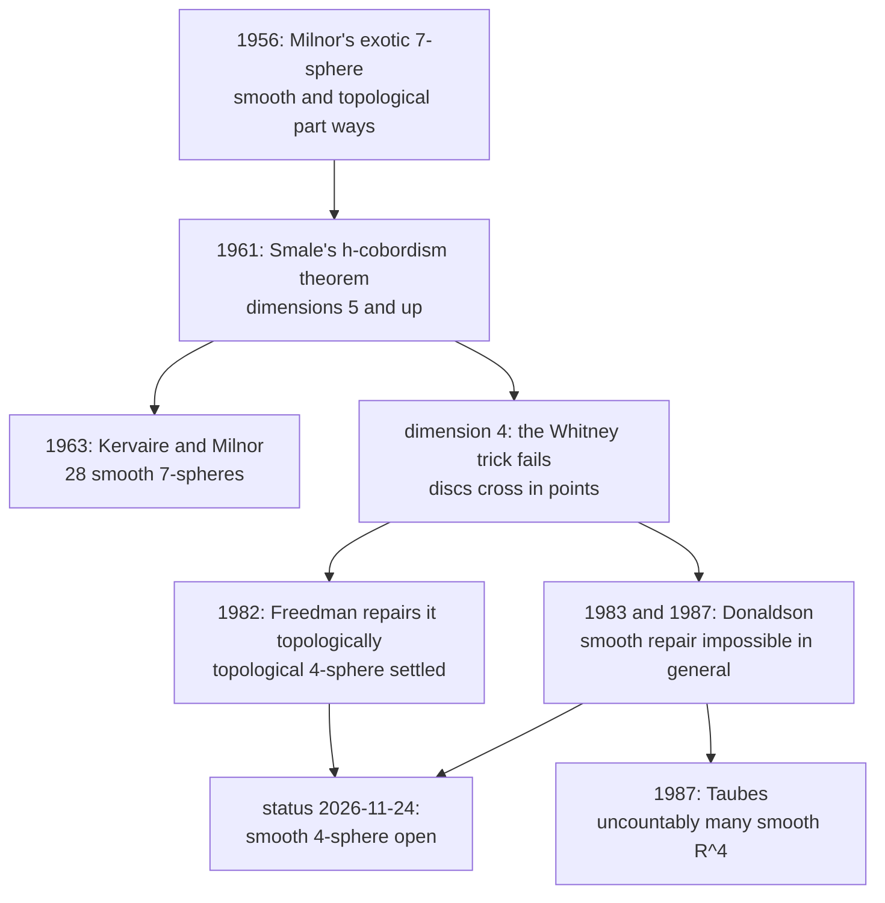

# The smooth Poincare conjecture in dimension four: the one case still open

[Syllabus](../../../SYLLABUS.md) → [Frontier](../README.md) → [Geometry and Combinatorics](../README.md#s04) → The smooth Poincare conjecture in dimension four

---

## General Overview

In 1956 John Milnor built a seven-dimensional space that is a sphere to a topologist and not a sphere to anyone doing calculus. It can be matched to the round 7-sphere point for point, continuously both ways. It cannot be matched smoothly: some derivative always breaks. In 1963 Michel Kervaire and Milnor counted these spaces. There are exactly 28 smooth 7-spheres, counted with orientation: the round one and the exotic rest.

So "is it a sphere?" has two versions. The **topological** one asks for a continuous match. The **smooth** one asks for a match that calculus can see through, with derivatives of every order both ways. By 2003 the topological question was answered "yes" in every dimension. The smooth question is answered dimension by dimension:

- dimensions 1, 2 and 3: yes (dimension 3 by Perelman, 2003);
- dimension 4: **nobody knows**;
- dimensions 5 and 6: yes;
- dimension 7: no, 28 smooth spheres;
- dimension 8: no, 2 smooth spheres.

Dimension 4 is the odd one out in a second way. Ordinary flat space $`\mathbb{R}^n`$ carries exactly one smooth structure for every $`n`$ except 4. Four-dimensional space $`\mathbb{R}^4`$ carries uncountably many (Taubes, 1987).

Dimension 4 resists for two reasons. The tools that settle dimensions 5 and up need room that four dimensions lack. The tools that detect exotic smoothness in dimension 4 need surfaces inside the space that cannot be shrunk away (second homology), and a candidate 4-sphere has none.

**The smooth Poincaré conjecture in dimension four asks whether every finite, edgeless smooth 4-dimensional space with the 4-sphere's loops and holes is smoothly the round 4-sphere, and no known computation decides it.**

**What kind of fact this is:** a conjecture. Status as of 2026-11-24: open, with no accepted proof or disproof; a proof outline posted in 2022 is claimed and not accepted. The topological version in dimension 4 is a theorem (Freedman, 1982). This card proves none of the research results. The code checks instances: the count of 28 by two roads, the E8 form, and a dimension count.

### Status, as of 2026-11-24

| Statement | Kind | Status | Primary source |
| --- | --- | --- | --- |
| Topological Poincaré conjecture, every dimension | theorem | proved: 1961 and 1966 (5 and up), 1982 (4), 2003 (3) | Smale (1961); Freedman (1982); [The Poincare conjecture, solved](../02-The%20Millennium%20Problems/07-poincare-conjecture-solved.md) |
| Smooth version, dimension 7 | theorem | refuted: 28 smooth 7-spheres | Milnor (1956); Kervaire and Milnor (1963) |
| $`\mathbb{R}^4`$ has uncountably many smooth structures | theorem | proved, 1987 | Taubes (1987) |
| Smooth h-cobordism theorem for 5-dimensional h-cobordisms between 4-manifolds | theorem | refuted, 1987 | Donaldson (1987) |
| Smooth version, dimension 4 | conjecture | open: no accepted proof or disproof | no primary source settles it |
| Smooth version, dimension 4: a proof outline | theorem, if correct | claimed: posted 2022-09-17, revised to 2024-07-30 (version 8); not accepted, with no journal version or independent check found | Akbulut, [arXiv:2209.09968](https://arxiv.org/abs/2209.09968) |

### The picture: the route to the open case



Both branches out of dimension 4 are proved. They meet at a question neither answers.

---

## The formula

Reminders. A **closed manifold** is a space that looks like flat space near every point, is finite in extent and has no edge ([Topological manifold](../../17-Topology/03-Surfaces%20and%20Manifolds/01-topological-manifolds.md)). A **smooth manifold** also has charts whose changes of coordinates can be differentiated as often as wanted ([Smooth manifold](../../23-Differential%20geometry%20and%20Lie%20groups/03-Manifolds/01-smooth-manifolds-and-charts.md)).

Three ways to say two spaces are "the same", from weakest to strongest:

- **homotopy equivalent**, $`M \simeq S^n`$: maps each way whose two composites can be deformed back to the identity. Loops and holes of every dimension then match. A space with $`M \simeq S^n`$ is a **homotopy n-sphere**.
- **homeomorphic**, $`M \cong_{\mathrm{top}} S^n`$: a continuous match, point for point, with a continuous inverse.
- **diffeomorphic**, $`M \cong_{\mathrm{diff}} S^n`$: a homeomorphism that is smooth with a smooth inverse.

The two conjectures, for each dimension $`n`$:

```math
\text{TOP}(n):\ M \text{ closed topological, } M \simeq S^n \Rightarrow M \cong_{\mathrm{top}} S^n \qquad \text{DIFF}(n):\ M \text{ closed smooth, } M \simeq S^n \Rightarrow M \cong_{\mathrm{diff}} S^n
```

**Read it aloud:** a closed space with the n-sphere's loops and holes is continuously the n-sphere; and if it is smooth, it is smoothly the n-sphere.

The open case is DIFF(4).

| Symbol | Plain meaning | In our example | Push it up and the answer… |
| --- | --- | --- | --- |
| $`n`$, $`d`$ | the dimension; $`d = n - 1`$ is the dimension of a level inside Step 0's h-cobordism, where the Whitney trick runs | $`n`$ = 4, the open case, with $`d`$ = 3; $`n`$ = 7, where DIFF fails | from 5 up, DIFF is settled dimension by dimension; from $`d`$ = 5 up, the Whitney disc is free |
| $`S^n`$ | the round n-sphere: points at distance 1 from the centre in $`(n+1)`$-dimensional space | $`S^4`$, $`S^7`$ | — |
| $`M`$ | the closed manifold under test | a homotopy 4-sphere | — |
| $`\simeq`$, $`\cong_{\mathrm{top}}`$, $`\cong_{\mathrm{diff}}`$ | homotopy equivalent (same loops and holes); homeomorphic; diffeomorphic | $`M \simeq S^4`$; Milnor's 7-spheres are $`\cong_{\mathrm{top}}`$ but not $`\cong_{\mathrm{diff}}`$ | — |
| TOP(n), DIFF(n) | the topological and the smooth conjecture in dimension $`n`$ | DIFF(4) is open; DIFF(7) is false | — |
| $`\Theta_n`$, $`bP_{4k}`$ | the smooth homotopy n-spheres, counted up to orientation-keeping diffeomorphism ($`n \ge 5`$); $`bP_{4k}`$ is the part of $`\Theta_{4k-1}`$ that bounds a parallelizable manifold | $`\Theta_7`$ has 28 members, all in $`bP_8`$ | 992 at $`n`$ = 11, 16256 at $`n`$ = 15 |
| $`k`$ | the index in $`n = 4k - 1`$ for the bP formula | $`k`$ = 2 gives $`n`$ = 7 | the count grows fast |
| $`B_{2k}`$ | Bernoulli numbers, fixed fractions from a recurrence | $`B_4 = -1/30`$ | — |
| $`Q_M`$ | the intersection form: the signed crossing count of two surfaces in a 4-manifold | E8 for Freedman's manifold; nothing for a homotopy 4-sphere | — |
| $`\sigma`$ | signature: positive minus negative directions of a form | E8: 8 | Rokhlin needs a multiple of 16 for a smooth even form |
| $`p_1`$, $`p_2`$, $`m`$ | Pontryagin classes; on an 8-manifold $`p_2`$ and $`p_1^2`$ give whole numbers that measure how it twists; $`m`$ is the whole number with $`p_2 = 1440m`$ | $`p_1`$ = 0, $`p_2`$ a multiple of 1440 | — |
| $`L`$, $`\hat{A}`$ | two formulas in $`p_1, p_2`$: $`L`$ gives the signature; $`\hat{A}`$ must be a whole number on a spin manifold, as an 8-manifold parallelizable except at one point is | $`\sigma = 7p_2/45`$, $`\hat{A} = -p_2/1440`$ | — |

### When it holds

- **Closed.** Drop "closed" and $`\mathbb{R}^4`$ itself is a test case. It is homotopy equivalent to a point, not a sphere, and it has uncountably many smooth structures (Taubes, 1987). For $`n \ge 5`$, $`\mathbb{R}^n`$ has exactly one (Stallings, 1962).
- **Homotopy equivalence, not loops alone.** In dimension 4, $`S^2 \times S^2`$ (pairs of points on two ordinary spheres) has every loop shrinkable and is not a sphere. It has second homology, two independent 2-dimensional holes. A homotopy 4-sphere has none.
- **Smooth, not only topological.** In dimension 7 the topological statement is true and the smooth one false: 28 classes where the conjecture wants 1.
- **What "the one case still open" means.** From dimension 5 up, Kervaire and Milnor turned DIFF(n) into a calculation in homotopy theory. That calculation is done for every dimension in their table and far beyond, though not yet for every high dimension. Dimension 4 is the one case with no such reduction: no known computation would decide it.
- **Status is not evidence.** Many candidate counterexamples have been shown standard. That proves nothing about the next one.

---

## Why it works

This section explains why the settled cases are settled and why dimension 4 resists. Research proofs are outlined with statement, key steps and source.

### Step 0: cut out two balls and look at what is left

Take a homotopy n-sphere $`M`$. Remove two small round balls. What remains runs from one $`(n-1)`$-sphere to another, and every inclusion of an end is a homotopy equivalence. Such a piece is an **h-cobordism**: a cobordism ([Transversality and cobordism](../../23-Differential%20geometry%20and%20Lie%20groups/03-Manifolds/11-transversality-intersection-numbers-and-cobordism.md)) whose two ends each have the same loops and holes as the whole.

If the piece is a plain cylinder, end × [0, 1], then $`M`$ is two balls glued along their rims. That is the plan in every dimension. The question is whether the h-cobordism is a cylinder.

### Step 1: Smale's h-cobordism theorem, dimensions 5 and up

Build the h-cobordism from handles, as in [Morse theory](../../23-Differential%20geometry%20and%20Lie%20groups/03-Manifolds/12-morse-theory-critical-points-and-handles.md). Algebra says the handles cancel in pairs. Geometry must make them cancel: a k-handle and a (k + 1)-handle cancel when an attaching sphere meets a belt sphere in exactly one point.

Extra crossings come in pairs of opposite sign. The **Whitney trick** removes a pair: find a 2-dimensional disc whose rim runs through both crossings, then push one sphere across the disc. That works only if the disc is embedded and misses everything else.

A disc in general position in a level of dimension $`d`$ meets itself in dimension $`2 + 2 - d`$. A level of Step 0's h-cobordism has dimension $`d = n - 1`$, one less than the sphere's:

| Level dimension $`d`$ | 4 | 5 | 6 | 7 |
| --- | ---: | ---: | ---: | ---: |
| self-crossing dimension | 0: points | −1: none | −2: none | −3: none |

From $`d`$ = 5 up the disc is free and the trick works. Smale (1961) made the handles cancel, and the method became the **h-cobordism theorem**: a simply connected h-cobordism of dimension 6 or more is a cylinder. So every smooth homotopy n-sphere with $`n \ge 6`$ is two balls glued along their rims. Dimension 5 needs an extra argument, also in Smale's work.

Two balls glued by any homeomorphism of the rim make a topological sphere. So TOP(n) holds for smooth homotopy spheres with $`n \ge 5`$. Newman (1966) and Connell (1967) removed the word "smooth".

### Step 2: smoothly, the glue can be twisted: 28 in dimension 7

Gluing two balls smoothly uses a diffeomorphism of the rim sphere. Some of these diffeomorphisms cannot be smoothly undone, and then the result is an **exotic sphere**: a smooth sphere that is not diffeomorphic to the round one.

Kervaire and Milnor (1963) counted them. For $`n = 4k - 1`$ the spheres that bound a parallelizable manifold (one whose tangent directions can be framed everywhere) form a group bP of size

```math
\lvert bP_{4k} \rvert = 2^{2k-2}\,\bigl(2^{2k-1} - 1\bigr) \times \mathrm{numerator}\!\left(\frac{4\lvert B_{2k} \rvert}{k}\right), \qquad k \ge 2
```

At $`k`$ = 2 this is 4 × 7 × 1 = 28, all of $`\Theta_7`$. The second road to 28, through the signature, runs by hand in Worked numbers below. Kervaire and Milnor's table gives $`\Theta_5 = \Theta_6`$ = one class, so DIFF(5) and DIFF(6) hold. [The six-sphere](08-complex-structures-on-the-six-sphere.md) uses that.

### Step 3: in dimension 4 the trick fails, and Freedman repairs it topologically

For a homotopy 4-sphere, Step 0's h-cobordism has dimension 4, so its handles cross inside 3-dimensional levels. A wider route through a 5-dimensional h-cobordism meets 4-dimensional levels. Either way a Whitney disc meets itself: in points at level 4 (the table's first column), along curves at level 3. Pushing across a disc with crossings makes new crossings. The plan stalls.

Freedman (1982) replaced the missing disc with a **Casson handle**: an infinite tower of discs, each one patching the crossings of the one below. He proved every Casson handle is topologically an open disc thickened, with no smooth guarantee. That restored the trick for continuous maps. The consequences:

- TOP(4) holds: every homotopy 4-sphere is homeomorphic to $`S^4`$.
- Closed simply connected topological 4-manifolds are classified by their **intersection form** $`Q_M`$ (plus one extra yes-or-no invariant when the form is odd). The form records the signed crossing counts of surfaces inside $`M`$, as on the transversality card.
- Every whole-number symmetric form of determinant ±1 occurs, including **E8** (the form of the E8 lattice of [Sphere packing, solved in dimensions 8 and 24](06-sphere-packing-and-viazovska.md)).

The E8 manifold comes from the Poincaré homology sphere of [The Poincare conjecture, solved](../02-The%20Millennium%20Problems/07-poincare-conjecture-solved.md). Plumbing eight disc bundles over the 2-sphere along the E8 pattern gives a piece whose rim is that homology sphere. Freedman showed the rim bounds a contractible topological piece, which closes it up.

### Step 4: Donaldson shows the smooth world is different

The E8 form, computed by the code from eight vectors in 8-dimensional space:

- every diagonal entry is 2, so the form is **even**;
- the determinant is 1 by two roads (fractions, and whole numbers only);
- the signature is 8;
- no vector has square 1, while the diagonal form of rank 8 has 16.

Two theorems then forbid a smooth E8 manifold. Rokhlin (1952): a smooth closed simply connected 4-manifold with an even form has signature divisible by 16, and 8 is not. Donaldson (1983), using the instanton equations of physics: a smooth closed simply connected 4-manifold with a positive definite form has the diagonal form. E8 is positive definite and not diagonal, since it has no vectors of square 1.

So in dimension 4 topological and smooth genuinely part ways. Donaldson (1987) showed directly that the smooth h-cobordism theorem fails for 5-dimensional h-cobordisms. Freedman's and Donaldson's results together also give exotic copies of $`\mathbb{R}^4`$, and Taubes (1987) found uncountably many.

<details>
<summary>Why exotic R^4 does not settle the 4-sphere</summary>

An exotic $`\mathbb{R}^4`$ is homeomorphic to flat 4-space and not diffeomorphic to it. It is open: it runs on forever. The smooth Poincaré conjecture is about a closed space.

An exotic 4-sphere with one point removed would be a smooth $`\mathbb{R}^4`$. No way is known to run that the other way: to close up a known exotic $`\mathbb{R}^4`$ with one point and get a smooth sphere.

The gauge-theory invariants that detect exotic smoothness in dimension 4, from Donaldson's instantons and later ones, read their answers off the second homology, the surfaces inside $`M`$ that cannot be shrunk away. A homotopy 4-sphere has no second homology. Its intersection form is empty. The tools have nothing to read.

</details>

### Step 5: candidates, and how they are tested

A counterexample would be a smooth homotopy 4-sphere not diffeomorphic to $`S^4`$. Freedman's theorem makes it homeomorphic to $`S^4`$, so only smooth tools can tell it apart. The standard candidates:

- **Gluck twists** (Gluck, 1962). Take a smoothly embedded 2-sphere in $`S^4`$. Cut out a thickened copy of it, turn the 2-sphere once around as the cut circle is traversed, and glue back. The result is a homotopy 4-sphere. For many families of 2-spheres it is known to be standard.
- **Cappell–Shaneson spheres** (1976), built from bundles over the circle. Akbulut (2010) showed an infinite family of them is standard.
- **A computer test.** Freedman, Gompf, Morrison and Walker (2010) laid out a route: find a knot that bounds a disc in a candidate's 4-ball but whose Rasmussen invariant (a whole number computed from Khovanov homology, a knot invariant) forbids a disc in the round 4-ball. Their computer searches found no such knot.

Each candidate shown standard removes one suspect and proves nothing more.

### Step 6: the audit list

The audit list from [Machines in proofs](../01-How%20Research%20Works/06-computer-assistance-and-formal-verification.md), filled in for DIFF(4):

- **Statement.** Fixed, and formal. Mathlib defines the smooth Poincaré conjecture in dimension $`n`$ as a proposition, in `Mathlib/Geometry/Manifold/PoincareConjecture.lean`. The excerpt below is quoted from Mathlib v4.36.0-rc2, read 2026-11-24. It was not compiled for this card, and it is a statement with no proof.
- **Artifact.** One claimed proof: an outline posted 2022-09-17 and revised to 2024-07-30, [arXiv:2209.09968](https://arxiv.org/abs/2209.09968). No claimed counterexample.
- **Independent check.** None found for that outline, and no journal version.
- **Status.** Open as of 2026-11-24: no accepted proof or disproof.

```lean4
def ContinuousMap.HomotopyEquiv.NonemptyDiffeomorphSphere [T2Space M] (n : ℕ) : Prop :=
  ∀ (_ : ChartedSpace ℝⁿ M) (_ : IsManifold (𝓡 n) ∞ M),
    M ≃ₕ 𝕊ⁿ → Nonempty (M ≃ₘ⟮𝓡 n, 𝓡 n⟯ 𝕊ⁿ)
```

Read it as: for every smooth atlas on $`M`$, a homotopy equivalence with $`S^n`$ gives a diffeomorphism with $`S^n`$. DIFF(4) is this proposition at $`n`$ = 4.

---

## Worked numbers, by hand

The signature road to 28, from Milnor's 1956 idea. Take a closed 8-manifold that is parallelizable except at one point, so its first Pontryagin class $`p_1`$ is 0 and it is **spin** (its frames can be chosen consistently over every loop and surface, the condition that makes $`\hat{A}`$ a whole number). The signature formula $`L`$ and the whole-number formula $`\hat{A}`$ then fix how its signature can step.

| Step | Arithmetic | Value |
| --- | --- | --- |
| $`L`$ in dimension 8 | $`(7p_2 - p_1^2)/45`$, with $`p_1 = 0`$ | $`\sigma = 7p_2/45`$ |
| $`\hat{A}`$ in dimension 8 | $`(-4p_2 + 7p_1^2)/5760`$, with $`p_1 = 0`$ | $`-p_2/1440`$ |
| $`\hat{A}`$ must be a whole number, as the manifold is spin | $`p_2 = 1440 \times m`$ | steps of 1440 |
| signature steps | $`7 \times 1440 / 45`$ | 224 |
| E8 plumbing in dimension 8 | 8 disc bundles over $`S^4`$ glued along E8 | signature 8, rim a homotopy 7-sphere |
| $`k`$ copies, joined at their rims | signature $`8k`$ | rim standard only when 224 divides $`8k`$ |
| smallest such $`k`$ | $`224 / 8`$ | **28** |

The rim of one E8 plumbing is a smooth 7-sphere that needs 28 copies of itself before it becomes standard. Kervaire and Milnor proved these 28 rims are all of $`\Theta_7`$, and the bP formula gives the same 28 by a separate road.

### What breaks if you drop a piece

| Mistake | Comes out at | What went wrong |
| --- | --- | --- |
| Run the bP formula at $`k`$ = 1 | 2 smooth 3-spheres | the formula needs $`n \ge 5`$; the 3-sphere has 1 smooth structure |
| Read $`bP_{16}`$ as all of $`\Theta_{15}`$ | 8128 | the table has 16256: other exotic spheres bound no parallelizable manifold |
| Treat E8 as a diagonal form | 16 vectors of square 1 | E8 has 0, so Donaldson rules out a smooth E8 manifold |
| Apply the Whitney trick in a 4-dimensional level | self-crossing dimension 0 | the disc meets itself in points, so pushing across it makes new crossings |
| Expect a smooth even form of signature 8 | 8 mod 16 = 8 | Rokhlin needs 0 |

---

## Code, from first principles, and it actually runs

The code prints the status table and ledger, then checks instances. It reaches 28 by **two independent roads**: the bP formula from Bernoulli numbers made by their recurrence, and Milnor's signature argument from the $`L`$ and $`\hat{A}`$ power series. The series' top coefficients are checked against Hirzebruch's Bernoulli formulas, a third route. The E8 determinant is computed two ways, and its 240 vectors of square 2 are counted by brute force against 112 + 128. Exact fractions keep every number exact; Rust uses a small fraction type of its own.

### Python

```python
# The smooth Poincare conjecture in dimension four -- the check behind the card.  Standard library only.
# Nothing here proves or refutes the conjecture.  It prints the status by dimension and checks the
# card's instances: 28 smooth 7-spheres by two roads, the E8 form that dimension 4 cannot smooth,
# and the dimension count behind the Whitney trick.  Every number on the card is printed here.
from fractions import Fraction as F
from math import comb, factorial

print("Poincare conjecture by dimension, status as of 2026-11-24")
print("  n  topological   smooth        smooth homotopy n-spheres")
for row in [("1", "true", "true", "1"), ("2", "true", "true", "1"), ("3", "true (2003)", "true (2003)", "1"),
            ("4", "true (1982)", "OPEN", "unknown, at least 1"), ("5", "true (1961)", "true (1963)", "1"),
            ("6", "true (1961)", "true (1963)", "1"), ("7", "true (1961)", "false (1956)", "28"),
            ("8", "true (1961)", "false (1963)", "2")]:
    print("  %-2s %-13s %-13s %s" % row)
print("ledger")
for date, event in [("1952", "Rokhlin: smooth spin 4-manifolds, signature divisible by 16"),
                    ("1956", "Milnor: a 7-sphere that is not smoothly standard"),
                    ("1961", "Smale: h-cobordism, smooth dimensions 5 and up"),
                    ("1962", "Stallings: R^n has one smooth structure for n >= 5"),
                    ("1962", "Gluck: the twist of S^4 along a 2-sphere"), ("1963", "Kervaire-Milnor: 28 smooth 7-spheres"),
                    ("1966", "Newman (1967 Connell): topological manifolds, n >= 5"),
                    ("1976", "Cappell-Shaneson: candidate homotopy 4-spheres"),
                    ("1982", "Freedman: dimension 4, topological"), ("1983", "Donaldson: smooth definite forms are diagonal"),
                    ("1987", "Taubes: uncountably many smooth R^4"), ("1987", "Donaldson: smooth h-cobordism fails in dim 4"),
                    ("2003", "Perelman: dimension 3"), ("2010", "Akbulut: Cappell-Shaneson spheres are standard"),
                    ("2010", "Freedman-Gompf-Morrison-Walker: computer test, no verdict"),
                    ("2022-09-17", "Akbulut: outline of a proof of smooth dimension 4, revised to 2024-07-30; claimed, not accepted"),
                    ("2026-11-24", "smooth dimension 4: open")]:
    print(f"  {date:<11}{event}")

# 1. Bernoulli numbers from the recurrence sum_{j<=m} C(m+1, j) B_j = 0.
B = [F(1)]
for m in range(1, 11):
    B.append(-sum(comb(m + 1, j) * B[j] for j in range(m)) / (m + 1))
print("Bernoulli B2, B4, B6, B8, B10:", ", ".join(str(B[i]) for i in range(2, 11, 2)))

# 2. Road 1 to 28: Kervaire-Milnor's order of bP(4k), the spheres that bound parallelizable manifolds.
def bP(k):
    return 2**(2*k - 2) * (2**(2*k - 1) - 1) * (4 * abs(B[2*k]) / k).numerator
quoted = {7: 28, 11: 992, 15: 16256}            # orders of Theta_n in Kervaire-Milnor's 1963 table
for k in range(1, 5):
    n = 4*k - 1
    note = f"table: {quoted[n]}" if n in quoted else "but the 3-sphere has 1 smooth structure" if k == 1 else "beyond the quoted table"
    print(f"  k={k}  n={n:<3} bP = {2**(2*k-2)} x {2**(2*k-1)-1} x {(4*abs(B[2*k])/k).numerator} = {bP(k):<6} {note}")
assert bP(2) == quoted[7] and bP(3) == quoted[11], "the formula must match the quoted table"
assert quoted[15] % bP(4) == 0, "bP(16) is a subgroup of Theta_15"

# 3. Road 2 to 28: the L and A-hat genera of a closed 8-manifold, from power series in z = x^2.
N = 3
def mul(a, b): return [sum(a[i] * b[j - i] for i in range(j + 1)) for j in range(N)]
def inv(a):
    out = [1 / a[0]]
    for j in range(1, N): out.append(-sum(a[i] * out[j - i] for i in range(1, j + 1)) / a[0])
    return out
def log1(a):                      # log of a series that starts with 1
    u, out, pw = [F(0)] + a[1:], [F(0)] * N, [F(1)] + [F(0)] * (N - 1)
    for m in range(1, N):
        pw = mul(pw, u); out = [o + (-1)**(m + 1) * p / m for o, p in zip(out, pw)]
    return out
cosh = [F(1, factorial(2*i)) for i in range(N)]                # cosh x
sinhx = [F(1, factorial(2*i + 1)) for i in range(N)]           # sinh(x) / x
sinh_half = [F(1, 4**i * factorial(2*i + 1)) for i in range(N)]  # sinh(x/2) / (x/2)
genus = {}
for name, Q in [("L", mul(cosh, inv(sinhx))), ("A-hat", inv(sinh_half))]:
    c = log1(Q)                   # p1 = s1, p2 = (s1^2 - s2)/2 in power sums s_m of z
    genus[name] = (c[1], -2 * c[2], c[2] + c[1]**2 / 2)
    print(f"{name:<6} genus: dim 4 = ({c[1]}) p1;  dim 8 = ({genus[name][1]}) p2 + ({genus[name][2]}) p1^2")
for k in (1, 2):                  # second road to the top coefficients: Hirzebruch's Bernoulli forms
    Lk = F(2**(2*k) * (2**(2*k - 1) - 1)) * abs(B[2*k]) / factorial(2*k)
    Ak = -abs(B[2*k]) / (2 * factorial(2*k))
    assert (Lk, Ak) == (genus["L"][k - 1], genus["A-hat"][k - 1]), "series against Bernoulli"
step = 1 / abs(genus["A-hat"][1])  # p1 = 0 and A-hat a whole number force p2 into steps of this
sig = genus["L"][1] * step
print(f"8-manifold with p1 = 0: p2 in steps of {step}, signature in steps of {sig}; {sig} / 8 = {sig / 8}")
assert sig / 8 == bP(2), "two roads to 28 must agree"

# 4. The E8 form: simple roots in coordinates, their dot products, determinant two ways, signature.
h = F(1, 2)
roots = [[h, -h, -h, -h, -h, -h, -h, h], [F(1), F(1)] + [F(0)] * 6]
roots += [[F(0)] * i + [F(-1), F(1)] + [F(0)] * (6 - i) for i in range(6)]
G = [[sum(x * y for x, y in zip(a, b)) for b in roots] for a in roots]
A, piv = [row[:] for row in G], []
for i in range(8):
    piv.append(A[i][i])
    for r in range(i + 1, 8):
        f = A[r][i] / A[i][i]; A[r] = [x - f * y for x, y in zip(A[r], A[i])]
det = 1
for p in piv: det *= p
def bareiss(M):                   # second road: a determinant in whole numbers only
    M, prev = [[int(x) for x in row] for row in M], 1
    for i in range(7):
        for r in range(i + 1, 8):
            for c in range(i + 1, 8): M[r][c] = (M[r][c] * M[i][i] - M[r][i] * M[i][c]) // prev
        prev = M[i][i]
    return M[7][7]
sigma = sum(p > 0 for p in piv) - sum(p < 0 for p in piv)
print("E8 diagonal", [int(G[i][i]) for i in range(8)], " pivots", ", ".join(str(p) for p in piv))
print(f"E8 determinant {det} (whole-number road {bareiss(G)}), signature {sigma}, even {all(G[i][i] % 2 == 0 for i in range(8))}")
assert det == bareiss(G) == 1 and sigma == 8, "E8 must have determinant 1 and signature 8"
e8, diag = {}, {}                 # every vector of square <= 2 lies in these boxes
for m in range(3**8):
    v = [(m // 3**i) % 3 - 1 for i in range(8)]; s = sum(x*x for x in v)
    diag[s] = diag.get(s, 0) + 1
    if sum(v) % 2 == 0: e8[s] = e8.get(s, 0) + 1
e8[2] += sum(1 for m in range(2**8) if bin(m).count("1") % 2 == 0)   # all entries +-1/2
print(f"square 1: E8 {e8.get(1, 0)}, diagonal form {diag[1]};  square 2: E8 {e8[2]} = {4 * comb(8, 2)} + {2**7}")
assert e8.get(1, 0) == 0 and diag[1] == 2 * 8, "a diagonal form has 16 square-1 vectors, E8 none"
assert e8[2] == 4 * comb(8, 2) + 2**7, "E8 has 112 + 128 = 240 vectors of square 2"
print(f"Rokhlin test: smooth needs signature divisible by 16; E8 gives {sigma} mod 16 = {sigma % 16}")
print("Milnor's 7-spheres: k copies of the E8 plumbing, signature 8k, standard when 224 divides 8k:",
      [k for k in range(1, 60) if (8 * k) % 224 == 0])

# 5. Whitney trick: a 2-disc in general position in a level of dimension d crosses itself in dimension 2+2-d.
print("Whitney disc self-crossing dimension 2+2-d:", ", ".join(f"d={d}: {4 - d}" for d in range(4, 8)))
print("ALL CHECKS PASS")
```

**Ran 2026-11-24 on macOS, Python 3.14.10, standard library only. All checks passed. Output, pasted from the run:**

```
Poincare conjecture by dimension, status as of 2026-11-24
  n  topological   smooth        smooth homotopy n-spheres
  1  true          true          1
  2  true          true          1
  3  true (2003)   true (2003)   1
  4  true (1982)   OPEN          unknown, at least 1
  5  true (1961)   true (1963)   1
  6  true (1961)   true (1963)   1
  7  true (1961)   false (1956)  28
  8  true (1961)   false (1963)  2
ledger
  1952       Rokhlin: smooth spin 4-manifolds, signature divisible by 16
  1956       Milnor: a 7-sphere that is not smoothly standard
  1961       Smale: h-cobordism, smooth dimensions 5 and up
  1962       Stallings: R^n has one smooth structure for n >= 5
  1962       Gluck: the twist of S^4 along a 2-sphere
  1963       Kervaire-Milnor: 28 smooth 7-spheres
  1966       Newman (1967 Connell): topological manifolds, n >= 5
  1976       Cappell-Shaneson: candidate homotopy 4-spheres
  1982       Freedman: dimension 4, topological
  1983       Donaldson: smooth definite forms are diagonal
  1987       Taubes: uncountably many smooth R^4
  1987       Donaldson: smooth h-cobordism fails in dim 4
  2003       Perelman: dimension 3
  2010       Akbulut: Cappell-Shaneson spheres are standard
  2010       Freedman-Gompf-Morrison-Walker: computer test, no verdict
  2022-09-17 Akbulut: outline of a proof of smooth dimension 4, revised to 2024-07-30; claimed, not accepted
  2026-11-24 smooth dimension 4: open
Bernoulli B2, B4, B6, B8, B10: 1/6, -1/30, 1/42, -1/30, 5/66
  k=1  n=3   bP = 1 x 1 x 2 = 2      but the 3-sphere has 1 smooth structure
  k=2  n=7   bP = 4 x 7 x 1 = 28     table: 28
  k=3  n=11  bP = 16 x 31 x 2 = 992    table: 992
  k=4  n=15  bP = 64 x 127 x 1 = 8128   table: 16256
L      genus: dim 4 = (1/3) p1;  dim 8 = (7/45) p2 + (-1/45) p1^2
A-hat  genus: dim 4 = (-1/24) p1;  dim 8 = (-1/1440) p2 + (7/5760) p1^2
8-manifold with p1 = 0: p2 in steps of 1440, signature in steps of 224; 224 / 8 = 28
E8 diagonal [2, 2, 2, 2, 2, 2, 2, 2]  pivots 2, 2, 3/2, 5/6, 4/5, 3/4, 2/3, 1/2
E8 determinant 1 (whole-number road 1), signature 8, even True
square 1: E8 0, diagonal form 16;  square 2: E8 240 = 112 + 128
Rokhlin test: smooth needs signature divisible by 16; E8 gives 8 mod 16 = 8
Milnor's 7-spheres: k copies of the E8 plumbing, signature 8k, standard when 224 divides 8k: [28, 56]
Whitney disc self-crossing dimension 2+2-d: d=4: 0, d=5: -1, d=6: -2, d=7: -3
ALL CHECKS PASS
```

### Rust

```rust
// The smooth Poincare conjecture in dimension four -- the check behind the card.  std only, no crates.
// Nothing here proves or refutes the conjecture.  It prints the status by dimension and checks the
// card's instances: 28 smooth 7-spheres by two roads, the E8 form that dimension 4 cannot smooth,
// and the dimension count behind the Whitney trick.  Every number on the card is printed here.
use std::collections::BTreeMap;
use std::fmt;
use std::ops::{Add, Div, Mul, Neg, Sub};

#[derive(Clone, Copy, PartialEq, Debug)]
struct Q { n: i128, d: i128 } // an exact fraction n/d, kept in lowest terms with d > 0
fn gcd(a: i128, b: i128) -> i128 { if b == 0 { a.abs() } else { gcd(b, a % b) } }
fn q(n: i128, d: i128) -> Q { let g = gcd(n, d) * d.signum(); Q { n: n / g, d: d / g } }
fn qi(n: i128) -> Q { q(n, 1) }
impl Add for Q { type Output = Q; fn add(self, o: Q) -> Q { q(self.n * o.d + o.n * self.d, self.d * o.d) } }
impl Sub for Q { type Output = Q; fn sub(self, o: Q) -> Q { q(self.n * o.d - o.n * self.d, self.d * o.d) } }
impl Mul for Q { type Output = Q; fn mul(self, o: Q) -> Q { q(self.n * o.n, self.d * o.d) } }
impl Div for Q { type Output = Q; fn div(self, o: Q) -> Q { q(self.n * o.d, self.d * o.n) } }
impl Neg for Q { type Output = Q; fn neg(self) -> Q { q(-self.n, self.d) } }
impl Q { fn abs(self) -> Q { q(self.n.abs(), self.d) } }
impl fmt::Display for Q {
    fn fmt(&self, f: &mut fmt::Formatter) -> fmt::Result {
        if self.d == 1 { write!(f, "{}", self.n) } else { write!(f, "{}/{}", self.n, self.d) }
    }
}
fn comb(n: i128, k: i128) -> i128 { (0..k).fold(1, |acc, i| acc * (n - i) / (i + 1)) }
fn fact(n: i128) -> i128 { (1..=n).product() }
fn py(b: bool) -> &'static str { if b { "True" } else { "False" } }

const NS: usize = 3;
fn mul(a: &[Q], b: &[Q]) -> Vec<Q> { (0..NS).map(|j| (0..=j).fold(qi(0), |s, i| s + a[i] * b[j - i])).collect() }
fn inv(a: &[Q]) -> Vec<Q> {
    let mut out = vec![qi(1) / a[0]];
    for j in 1..NS { let s = (1..=j).fold(qi(0), |s, i| s + a[i] * out[j - i]); out.push(-s / a[0]); }
    out
}
fn log1(a: &[Q]) -> Vec<Q> { // log of a series that starts with 1
    let mut u = a.to_vec(); u[0] = qi(0);
    let (mut out, mut pw) = (vec![qi(0); NS], vec![qi(1), qi(0), qi(0)]);
    for m in 1..NS {
        pw = mul(&pw, &u);
        let sg = if m % 2 == 1 { 1 } else { -1 };
        for i in 0..NS { out[i] = out[i] + pw[i] * q(sg, m as i128); }
    }
    out
}
fn bareiss(g: &[Vec<Q>]) -> i128 { // second road: a determinant in whole numbers only
    let mut m: Vec<Vec<i128>> = g.iter().map(|r| r.iter().map(|x| x.n / x.d).collect()).collect();
    let mut prev = 1i128;
    for i in 0..7 {
        for r in i + 1..8 { for c in i + 1..8 { m[r][c] = (m[r][c] * m[i][i] - m[r][i] * m[i][c]) / prev; } }
        prev = m[i][i];
    }
    m[7][7]
}

fn main() {
    println!("Poincare conjecture by dimension, status as of 2026-11-24");
    println!("  n  topological   smooth        smooth homotopy n-spheres");
    for (a, b, c, d) in [("1", "true", "true", "1"), ("2", "true", "true", "1"), ("3", "true (2003)", "true (2003)", "1"),
        ("4", "true (1982)", "OPEN", "unknown, at least 1"), ("5", "true (1961)", "true (1963)", "1"),
        ("6", "true (1961)", "true (1963)", "1"), ("7", "true (1961)", "false (1956)", "28"),
        ("8", "true (1961)", "false (1963)", "2")] {
        println!("  {:<2} {:<13} {:<13} {}", a, b, c, d);
    }
    println!("ledger");
    for (date, event) in [("1952", "Rokhlin: smooth spin 4-manifolds, signature divisible by 16"),
        ("1956", "Milnor: a 7-sphere that is not smoothly standard"),
        ("1961", "Smale: h-cobordism, smooth dimensions 5 and up"),
        ("1962", "Stallings: R^n has one smooth structure for n >= 5"),
        ("1962", "Gluck: the twist of S^4 along a 2-sphere"), ("1963", "Kervaire-Milnor: 28 smooth 7-spheres"),
        ("1966", "Newman (1967 Connell): topological manifolds, n >= 5"),
        ("1976", "Cappell-Shaneson: candidate homotopy 4-spheres"),
        ("1982", "Freedman: dimension 4, topological"), ("1983", "Donaldson: smooth definite forms are diagonal"),
        ("1987", "Taubes: uncountably many smooth R^4"), ("1987", "Donaldson: smooth h-cobordism fails in dim 4"),
        ("2003", "Perelman: dimension 3"), ("2010", "Akbulut: Cappell-Shaneson spheres are standard"),
        ("2010", "Freedman-Gompf-Morrison-Walker: computer test, no verdict"),
        ("2022-09-17", "Akbulut: outline of a proof of smooth dimension 4, revised to 2024-07-30; claimed, not accepted"),
        ("2026-11-24", "smooth dimension 4: open")] {
        println!("  {:<11}{}", date, event);
    }

    // 1. Bernoulli numbers from the recurrence sum_{j<=m} C(m+1, j) B_j = 0.
    let mut b = vec![qi(1)];
    for m in 1..11i128 {
        let s = (0..m).fold(qi(0), |s, j| s + qi(comb(m + 1, j)) * b[j as usize]);
        b.push(-s / qi(m + 1));
    }
    let bs: Vec<String> = (2..11).step_by(2).map(|i| b[i].to_string()).collect();
    println!("Bernoulli B2, B4, B6, B8, B10: {}", bs.join(", "));

    // 2. Road 1 to 28: Kervaire-Milnor's order of bP(4k), the spheres that bound parallelizable manifolds.
    let num = |k: i128| (qi(4) * b[2 * k as usize].abs() / qi(k)).n;
    let bp = |k: i128| (1i128 << (2 * k - 2)) * ((1i128 << (2 * k - 1)) - 1) * num(k);
    let quoted: BTreeMap<i128, i128> = [(7, 28), (11, 992), (15, 16256)].into_iter().collect();
    for k in 1..5i128 {
        let n = 4 * k - 1;
        let note = match quoted.get(&n) { Some(v) => format!("table: {}", v), None if k == 1 => "but the 3-sphere has 1 smooth structure".to_string(), None => "beyond the quoted table".to_string() };
        println!("  k={}  n={:<3} bP = {} x {} x {} = {:<6} {}", k, n, 1i128 << (2 * k - 2), (1i128 << (2 * k - 1)) - 1, num(k), bp(k), note);
    }
    assert!(bp(2) == quoted[&7] && bp(3) == quoted[&11], "the formula must match the quoted table");
    assert!(quoted[&15] % bp(4) == 0, "bP(16) is a subgroup of Theta_15");

    // 3. Road 2 to 28: the L and A-hat genera of a closed 8-manifold, from power series in z = x^2.
    let cosh: Vec<Q> = (0..NS as i128).map(|i| q(1, fact(2 * i))).collect();
    let sinhx: Vec<Q> = (0..NS as i128).map(|i| q(1, fact(2 * i + 1))).collect();
    let sinh_half: Vec<Q> = (0..NS as i128).map(|i| q(1, (1i128 << (2 * i)) * fact(2 * i + 1))).collect();
    let mut genus: BTreeMap<&str, (Q, Q, Q)> = BTreeMap::new();
    for (name, ser) in [("L", mul(&cosh, &inv(&sinhx))), ("A-hat", inv(&sinh_half))] {
        let c = log1(&ser); // p1 = s1, p2 = (s1^2 - s2)/2 in power sums s_m of z
        let g = (c[1], qi(-2) * c[2], c[2] + c[1] * c[1] / qi(2));
        println!("{:<6} genus: dim 4 = ({}) p1;  dim 8 = ({}) p2 + ({}) p1^2", name, c[1], g.1, g.2);
        genus.insert(name, g);
    }
    for k in [1i128, 2] { // second road to the top coefficients: Hirzebruch's Bernoulli forms
        let bk = b[2 * k as usize].abs();
        let lk = qi((1i128 << (2 * k)) * ((1i128 << (2 * k - 1)) - 1)) * bk / qi(fact(2 * k));
        let ak = -bk / qi(2 * fact(2 * k));
        let (gl, ga) = if k == 1 { (genus["L"].0, genus["A-hat"].0) } else { (genus["L"].1, genus["A-hat"].1) };
        assert!(lk == gl && ak == ga, "series against Bernoulli");
    }
    let step = qi(1) / genus["A-hat"].1.abs();
    let sig = genus["L"].1 * step;
    println!("8-manifold with p1 = 0: p2 in steps of {}, signature in steps of {}; {} / 8 = {}", step, sig, sig, sig / qi(8));
    assert!(sig / qi(8) == qi(bp(2)), "two roads to 28 must agree");

    // 4. The E8 form: simple roots in coordinates, their dot products, determinant two ways, signature.
    let h = q(1, 2);
    let mut roots: Vec<Vec<Q>> = vec![vec![h, -h, -h, -h, -h, -h, -h, h], [1, 1, 0, 0, 0, 0, 0, 0].map(qi).to_vec()];
    for i in 0..6 { let mut r = vec![qi(0); 8]; r[i] = qi(-1); r[i + 1] = qi(1); roots.push(r); }
    let g: Vec<Vec<Q>> = roots.iter().map(|a| roots.iter().map(|c| (0..8).fold(qi(0), |s, i| s + a[i] * c[i])).collect()).collect();
    let (mut a, mut piv) = (g.clone(), Vec::new());
    for i in 0..8 {
        piv.push(a[i][i]);
        for r in i + 1..8 { let f = a[r][i] / a[i][i]; for c in 0..8 { a[r][c] = a[r][c] - f * a[i][c]; } }
    }
    let det = piv.iter().fold(qi(1), |p, &x| p * x);
    let sigma = piv.iter().filter(|x| x.n > 0).count() as i64 - piv.iter().filter(|x| x.n < 0).count() as i64;
    let diag: Vec<String> = (0..8).map(|i| g[i][i].to_string()).collect();
    let pv: Vec<String> = piv.iter().map(|p| p.to_string()).collect();
    println!("E8 diagonal [{}]  pivots {}", diag.join(", "), pv.join(", "));
    let even = (0..8).all(|i| g[i][i].d == 1 && g[i][i].n % 2 == 0);
    println!("E8 determinant {} (whole-number road {}), signature {}, even {}", det, bareiss(&g), sigma, py(even));
    assert!(det == qi(bareiss(&g)) && det == qi(1) && sigma == 8, "E8 must have determinant 1 and signature 8");
    let (mut e8, mut dg): (BTreeMap<i64, i64>, BTreeMap<i64, i64>) = (BTreeMap::new(), BTreeMap::new());
    for m in 0..3i64.pow(8) { // every vector of square <= 2 lies in these boxes
        let v: Vec<i64> = (0..8).map(|i| (m / 3i64.pow(i)) % 3 - 1).collect();
        let s: i64 = v.iter().map(|x| x * x).sum();
        *dg.entry(s).or_insert(0) += 1;
        if v.iter().sum::<i64>().rem_euclid(2) == 0 { *e8.entry(s).or_insert(0) += 1; }
    }
    *e8.get_mut(&2).unwrap() += (0..256u32).filter(|m| m.count_ones() % 2 == 0).count() as i64; // all entries +-1/2
    let e1 = *e8.get(&1).unwrap_or(&0);
    println!("square 1: E8 {}, diagonal form {};  square 2: E8 {} = {} + {}", e1, dg[&1], e8[&2], 4 * comb(8, 2), 1 << 7);
    assert!(e1 == 0 && dg[&1] == 2 * 8, "a diagonal form has 16 square-1 vectors, E8 none");
    assert!(e8[&2] as i128 == 4 * comb(8, 2) + 128, "E8 has 112 + 128 = 240 vectors of square 2");
    println!("Rokhlin test: smooth needs signature divisible by 16; E8 gives {} mod 16 = {}", sigma, sigma % 16);
    let ks: Vec<String> = (1..60).filter(|k| (8 * k) % 224 == 0).map(|k: i64| k.to_string()).collect();
    println!("Milnor's 7-spheres: k copies of the E8 plumbing, signature 8k, standard when 224 divides 8k: [{}]", ks.join(", "));

    // 5. Whitney trick: a 2-disc in general position in a level of dimension d crosses itself in dimension 2+2-d.
    let w: Vec<String> = (4..8).map(|d: i64| format!("d={}: {}", d, 4 - d)).collect();
    println!("Whitney disc self-crossing dimension 2+2-d: {}", w.join(", "));
    println!("ALL CHECKS PASS");
}
```

**Ran 2026-11-24 on macOS, rustc 1.98.1, no crates. All checks passed. Output, pasted from the run:**

```
Poincare conjecture by dimension, status as of 2026-11-24
  n  topological   smooth        smooth homotopy n-spheres
  1  true          true          1
  2  true          true          1
  3  true (2003)   true (2003)   1
  4  true (1982)   OPEN          unknown, at least 1
  5  true (1961)   true (1963)   1
  6  true (1961)   true (1963)   1
  7  true (1961)   false (1956)  28
  8  true (1961)   false (1963)  2
ledger
  1952       Rokhlin: smooth spin 4-manifolds, signature divisible by 16
  1956       Milnor: a 7-sphere that is not smoothly standard
  1961       Smale: h-cobordism, smooth dimensions 5 and up
  1962       Stallings: R^n has one smooth structure for n >= 5
  1962       Gluck: the twist of S^4 along a 2-sphere
  1963       Kervaire-Milnor: 28 smooth 7-spheres
  1966       Newman (1967 Connell): topological manifolds, n >= 5
  1976       Cappell-Shaneson: candidate homotopy 4-spheres
  1982       Freedman: dimension 4, topological
  1983       Donaldson: smooth definite forms are diagonal
  1987       Taubes: uncountably many smooth R^4
  1987       Donaldson: smooth h-cobordism fails in dim 4
  2003       Perelman: dimension 3
  2010       Akbulut: Cappell-Shaneson spheres are standard
  2010       Freedman-Gompf-Morrison-Walker: computer test, no verdict
  2022-09-17 Akbulut: outline of a proof of smooth dimension 4, revised to 2024-07-30; claimed, not accepted
  2026-11-24 smooth dimension 4: open
Bernoulli B2, B4, B6, B8, B10: 1/6, -1/30, 1/42, -1/30, 5/66
  k=1  n=3   bP = 1 x 1 x 2 = 2      but the 3-sphere has 1 smooth structure
  k=2  n=7   bP = 4 x 7 x 1 = 28     table: 28
  k=3  n=11  bP = 16 x 31 x 2 = 992    table: 992
  k=4  n=15  bP = 64 x 127 x 1 = 8128   table: 16256
L      genus: dim 4 = (1/3) p1;  dim 8 = (7/45) p2 + (-1/45) p1^2
A-hat  genus: dim 4 = (-1/24) p1;  dim 8 = (-1/1440) p2 + (7/5760) p1^2
8-manifold with p1 = 0: p2 in steps of 1440, signature in steps of 224; 224 / 8 = 28
E8 diagonal [2, 2, 2, 2, 2, 2, 2, 2]  pivots 2, 2, 3/2, 5/6, 4/5, 3/4, 2/3, 1/2
E8 determinant 1 (whole-number road 1), signature 8, even True
square 1: E8 0, diagonal form 16;  square 2: E8 240 = 112 + 128
Rokhlin test: smooth needs signature divisible by 16; E8 gives 8 mod 16 = 8
Milnor's 7-spheres: k copies of the E8 plumbing, signature 8k, standard when 224 divides 8k: [28, 56]
Whitney disc self-crossing dimension 2+2-d: d=4: 0, d=5: -1, d=6: -2, d=7: -3
ALL CHECKS PASS
```

### Lean

Lean proves the card's facts about the E8 form and the road to 28, and states DIFF(4) without proving it.

- DIFF(4) is written in Mathlib's own words, as a statement only. Nothing in the file proves it or its opposite.
- Every diagonal entry of E8 is 2, and every whole-number vector has an even square. So the form is even.
- The E8 form is symmetric with determinant 1. It is positive definite: every nonzero vector has a positive square.
- No whole-number vector has square 1 under E8. So no whole-number change of coordinates turns E8 into the diagonal form.
- The diagonal form of rank 8 has exactly 16 vectors of square 1.
- Take a whole number $`p_2`$ with $`-p_2/1440`$ also whole. Then $`7p_2/45`$ is a whole multiple of 224.
- Take $`k`$ copies of the E8 plumbing, of signature $`8k`$. Then 224 divides $`8k`$ exactly when 28 divides $`k`$.
- $`B_4 = -1/30`$ and $`B_6 = 1/42`$. From these, the bP formula gives 28 at $`k`$ = 2 and 992 at $`k`$ = 3.
- The other worked numbers also check, such as $`7 \times 1440 / 45 = 224`$ and 8 mod 16 = 8.

Python and Rust keep the rest: the status table, the $`L`$ and $`\hat{A}`$ series, and the count of 240.

```lean
-- The smooth Poincare conjecture in dimension four: this file records the open conjecture DIFF(4) in Mathlib's own words without claiming it, and proves the card's exact facts behind it: the E8 form is even, unimodular and positive definite yet not the diagonal form, Milnor's signature steps of 224 give 28, and the card's whole-number checks.
import Mathlib.Geometry.Manifold.PoincareConjecture
import Mathlib.LinearAlgebra.Matrix.Cartan.Basic
import Mathlib.NumberTheory.Bernoulli
import Mathlib.Data.Set.Card
import Mathlib.Data.Real.Basic
import Mathlib.Tactic.NormNum
import Mathlib.Tactic

open Matrix

/-!
The card's main question, DIFF(4), is open as of 2026-11-24: no accepted proof or disproof. It
is recorded below as a definition, using Mathlib's statement of the smooth Poincaré conjecture
(`ContinuousMap.HomotopyEquiv.NonemptyDiffeomorphSphere`), and nothing here claims it or its
negation. The theorems are the exact parts the card proves or computes: the E8 form that
Freedman's manifold carries and that Rokhlin and Donaldson rule out smoothly, and Milnor's
signature road to 28 smooth 7-spheres. The E8 form is Mathlib's Cartan matrix `CartanMatrix.E 8`,
the card's eight simple roots dotted with each other, up to the order of the roots.
-/

/-- The smooth Poincaré conjecture in dimension four, DIFF(4) (statement only; open, not proved
here or anywhere as of 2026-11-24): for every Hausdorff space `M` and every smooth
4-dimensional atlas on it, if `M` has the 4-sphere's loops and holes (is homotopy equivalent to
the round 4-sphere), then `M` is smoothly the round 4-sphere (is diffeomorphic to it). A space
homotopy equivalent to the 4-sphere is automatically closed, so "closed" needs no separate
hypothesis. -/
def SmoothPoincareConjectureDimFour : Prop :=
  ∀ (M : Type) [TopologicalSpace M] [T2Space M],
    ContinuousMap.HomotopyEquiv.NonemptyDiffeomorphSphere M 4

/-- Helper: the E8 form on whole-number vectors, written out as twice a whole number. -/
theorem e8_quad_int (v : Fin 8 → ℤ) :
    v ⬝ᵥ (CartanMatrix.E 8 *ᵥ v) = 2 * (v 0 ^ 2 + v 1 ^ 2 + v 2 ^ 2 + v 3 ^ 2 + v 4 ^ 2 + v 5 ^ 2
      + v 6 ^ 2 + v 7 ^ 2 - (v 0 * v 2 + v 1 * v 3 + v 2 * v 3 + v 3 * v 4 + v 4 * v 5
      + v 5 * v 6 + v 6 * v 7)) := by
  rw [CartanMatrix.E_eight_eq]
  simp [dotProduct, mulVec, Fin.sum_univ_eight]
  ring

/-- Helper: the E8 form on real vectors, written out. -/
theorem e8_quad_real (v : Fin 8 → ℝ) :
    v ⬝ᵥ ((CartanMatrix.E 8).map (Int.cast : ℤ → ℝ) *ᵥ v) = 2 * (v 0 ^ 2 + v 1 ^ 2 + v 2 ^ 2
      + v 3 ^ 2 + v 4 ^ 2 + v 5 ^ 2 + v 6 ^ 2 + v 7 ^ 2 - (v 0 * v 2 + v 1 * v 3 + v 2 * v 3
      + v 3 * v 4 + v 4 * v 5 + v 5 * v 6 + v 6 * v 7)) := by
  rw [CartanMatrix.E_eight_eq]
  simp [dotProduct, mulVec, Fin.sum_univ_eight]
  ring

/-- Helper: the written-out E8 form is a sum of squares with positive weights (completing the
square along the diagram), so it is positive unless all eight numbers are zero. -/
theorem e8_quad_pos (a b c d e f g h : ℝ)
    (hne : ¬ (a = 0 ∧ b = 0 ∧ c = 0 ∧ d = 0 ∧ e = 0 ∧ f = 0 ∧ g = 0 ∧ h = 0)) :
    0 < 2 * (a ^ 2 + b ^ 2 + c ^ 2 + d ^ 2 + e ^ 2 + f ^ 2 + g ^ 2 + h ^ 2 -
      (a * c + b * d + c * d + d * e + e * f + f * g + g * h)) := by
  have key : 2 * (a ^ 2 + b ^ 2 + c ^ 2 + d ^ 2 + e ^ 2 + f ^ 2 + g ^ 2 + h ^ 2 -
      (a * c + b * d + c * d + d * e + e * f + f * g + g * h)) =
      2 * ((a - c / 2) ^ 2 + (b - d / 2) ^ 2 + (h - g / 2) ^ 2 + 3 / 4 * (g - 2 / 3 * f) ^ 2
        + 2 / 3 * (f - 3 / 4 * e) ^ 2 + 5 / 8 * (e - 4 / 5 * d) ^ 2
        + 3 / 4 * (c - 2 / 3 * d) ^ 2 + 1 / 60 * d ^ 2) := by ring
  rw [key]
  by_contra hle
  push Not at hle
  have s1 := sq_nonneg (a - c / 2)
  have s2 := sq_nonneg (b - d / 2)
  have s3 := sq_nonneg (h - g / 2)
  have s4 := sq_nonneg (g - 2 / 3 * f)
  have s5 := sq_nonneg (f - 3 / 4 * e)
  have s6 := sq_nonneg (e - 4 / 5 * d)
  have s7 := sq_nonneg (c - 2 / 3 * d)
  have s8 := sq_nonneg d
  have z (x : ℝ) (hx : x ^ 2 = 0) : x = 0 := pow_eq_zero_iff two_ne_zero |>.1 hx
  have hd : d = 0 := z _ (by linarith)
  have hc : c - 2 / 3 * d = 0 := z _ (by linarith)
  have he : e - 4 / 5 * d = 0 := z _ (by linarith)
  have hf : f - 3 / 4 * e = 0 := z _ (by linarith)
  have hg : g - 2 / 3 * f = 0 := z _ (by linarith)
  have ha : a - c / 2 = 0 := z _ (by linarith)
  have hb : b - d / 2 = 0 := z _ (by linarith)
  have hh : h - g / 2 = 0 := z _ (by linarith)
  apply hne
  refine ⟨?_, ?_, ?_, ?_, ?_, ?_, ?_, ?_⟩ <;> linarith

/-- Helper: a whole-number vector has square 1 exactly when it is plus or minus a basis vector. -/
theorem dot_self_eq_one_iff {n : ℕ} (v : Fin n → ℤ) :
    v ⬝ᵥ v = 1 ↔ ∃ p : Fin n × Bool, Pi.single p.1 (if p.2 then 1 else -1) = v := by
  constructor
  · intro h
    have hs : ∑ i, v i ^ 2 = 1 := by simpa [dotProduct, sq] using h
    have hle : ∀ i, v i ^ 2 ≤ 1 := fun i => by
      rw [← hs]
      exact Finset.single_le_sum (f := fun i => v i ^ 2) (fun j _ => sq_nonneg _)
        (Finset.mem_univ i)
    obtain ⟨i, hi⟩ : ∃ i, v i ≠ 0 := by
      by_contra hc
      push Not at hc
      simp [hc] at hs
    have hi1 : v i ^ 2 = 1 := by
      have := hle i
      have : 0 < v i ^ 2 := by positivity
      omega
    have hrest : ∀ j, j ≠ i → v j = 0 := by
      intro j hj
      have := Finset.add_sum_erase Finset.univ (fun i => v i ^ 2) (Finset.mem_univ i)
      have h2 : v j ^ 2 ≤ ∑ k ∈ Finset.univ.erase i, v k ^ 2 :=
        Finset.single_le_sum (f := fun k => v k ^ 2) (fun k _ => sq_nonneg _)
          (Finset.mem_erase.2 ⟨hj, Finset.mem_univ j⟩)
      have : v j ^ 2 = 0 := by nlinarith [sq_nonneg (v j)]
      exact pow_eq_zero_iff two_ne_zero |>.1 this
    have hpm : v i = 1 ∨ v i = -1 := by
      have : (v i - 1) * (v i + 1) = 0 := by nlinarith
      rcases mul_eq_zero.1 this with h | h
      · left; linarith
      · right; linarith
    refine ⟨(i, decide (v i = 1)), ?_⟩
    funext j
    by_cases hj : j = i
    · subst hj; rcases hpm with h | h <;> simp [h]
    · simp [hj, hrest j hj]
  · rintro ⟨⟨i, b⟩, rfl⟩
    cases b <;> simp [dotProduct, Pi.single_apply]

/-- Helper: the rank-8 diagonal form has exactly 16 vectors of square 1. -/
theorem diag_eight_unit_vectors_ncard : {v : Fin 8 → ℤ | v ⬝ᵥ v = 1}.ncard = 16 := by
  have : {v : Fin 8 → ℤ | v ⬝ᵥ v = 1} =
      Set.range (fun p : Fin 8 × Bool => (Pi.single p.1 (if p.2 then 1 else -1) : Fin 8 → ℤ)) := by
    ext v; exact dot_self_eq_one_iff v
  rw [this, ← Set.image_univ, Set.ncard_image_of_injective]
  · simp [Set.ncard_univ]
  · rintro ⟨i, a⟩ ⟨j, b⟩ h
    have hij : i = j := by
      by_contra hne
      have := congrFun h i
      cases a <;> simp [hne] at this
    subst hij
    have := congrFun h i
    cases a <;> cases b <;> simp at this ⊢

/-- Helper: if `Pᵀ M P = 1`, then the first column of `P` has square 1 under `M`. -/
theorem first_column_square_one (P M : Matrix (Fin 8) (Fin 8) ℤ) (hP : Pᵀ * M * P = 1) :
    (fun k => P k 0) ⬝ᵥ (M *ᵥ (fun k => P k 0)) = 1 := by
  have key : (fun k => P k 0) ⬝ᵥ (M *ᵥ (fun k => P k 0)) = (Pᵀ * M * P) 0 0 := by
    simp only [dotProduct, mulVec, Matrix.mul_apply, transpose_apply, Finset.mul_sum,
      Finset.sum_mul]
    rw [Finset.sum_comm]
    exact Finset.sum_congr rfl fun j _ => Finset.sum_congr rfl fun k _ => by ring
  rw [key, hP]; rfl

/-- The E8 form is even, unimodular and positive definite, so its signature is 8: every
diagonal entry is 2, the form is symmetric, every whole-number vector has an even square
`v · E8 v`, the determinant is 1, and every nonzero real vector has a positive square. -/
theorem e8_form_even_unimodular_positive_definite :
    (∀ i, CartanMatrix.E 8 i i = 2) ∧ (CartanMatrix.E 8).IsSymm ∧
      (∀ v : Fin 8 → ℤ, Even (v ⬝ᵥ (CartanMatrix.E 8 *ᵥ v))) ∧
      (CartanMatrix.E 8).det = 1 ∧
      ∀ v : Fin 8 → ℝ, v ≠ 0 →
        0 < v ⬝ᵥ ((CartanMatrix.E 8).map (Int.cast : ℤ → ℝ) *ᵥ v) := by
  refine ⟨CartanMatrix.E_diag 8, CartanMatrix.E_isSymm 8, fun v => ?_, CartanMatrix.E₈_det,
    fun v hv => ?_⟩
  · rw [e8_quad_int]; exact even_two_mul _
  · rw [e8_quad_real]
    apply e8_quad_pos
    rintro ⟨h0, h1, h2, h3, h4, h5, h6, h7⟩
    apply hv
    funext i
    fin_cases i <;> simpa

/-- E8 is not the diagonal form: no whole-number vector has square `v · E8 v = 1`, so no
whole-number change of basis `P` turns E8 into the diagonal form (`Pᵀ E8 P = 1`); the diagonal
form of rank 8 has exactly 16 vectors of square 1 (plus or minus each basis vector). With
Donaldson's theorem (a smooth closed simply connected 4-manifold with a positive definite form
has the diagonal form), this is why Freedman's E8 manifold has no smooth structure. -/
theorem e8_not_diagonal :
    (∀ v : Fin 8 → ℤ, v ⬝ᵥ (CartanMatrix.E 8 *ᵥ v) ≠ 1) ∧
      (¬ ∃ P : Matrix (Fin 8) (Fin 8) ℤ, Pᵀ * CartanMatrix.E 8 * P = 1) ∧
      {v : Fin 8 → ℤ | v ⬝ᵥ v = 1}.ncard = 16 := by
  have hev : ∀ v : Fin 8 → ℤ, Even (v ⬝ᵥ (CartanMatrix.E 8 *ᵥ v)) := fun v => by
    rw [e8_quad_int]; exact even_two_mul _
  refine ⟨fun v h => ?_, ?_, diag_eight_unit_vectors_ncard⟩
  · have := hev v
    rw [h] at this
    exact Int.not_even_one this
  · rintro ⟨P, hP⟩
    have := hev (fun k => P k 0)
    rw [first_column_square_one P _ hP] at this
    exact Int.not_even_one this

/-- Milnor's signature road to 28. On a closed 8-manifold with `p₁ = 0`, the Â-genus is
`−p₂/1440` and the signature is `7p₂/45`. If `−p₂/1440` is a whole number, the signature is a
whole multiple of 224. And `k` copies of the E8 plumbing, of signature `8k`, reach a multiple of
224 exactly when 28 divides `k`, so 28 is the smallest such number of copies. -/
theorem milnor_signature_steps (p₂ : ℤ) (hA : ∃ a : ℤ, -(p₂ : ℚ) / 1440 = a) :
    (∃ m : ℤ, 7 * (p₂ : ℚ) / 45 = 224 * m) ∧ ∀ k : ℕ, 224 ∣ 8 * k ↔ 28 ∣ k := by
  obtain ⟨a, ha⟩ := hA
  refine ⟨⟨-a, ?_⟩, fun k => by omega⟩
  have h : (p₂ : ℚ) = -1440 * a := by rw [← ha]; ring
  rw [h]; push_cast; ring

-- Bernoulli numbers B4 = −1/30 and B6 = 1/42 (Mathlib's `bernoulli`).
example : bernoulli 4 = -1 / 30 ∧ bernoulli 6 = 1 / 42 := by
  have h5 : bernoulli' 5 = 0 := by
    rw [bernoulli'_def]; norm_num [Finset.sum_range_succ, Nat.choose]
  refine ⟨by rw [bernoulli_eq_bernoulli'_of_ne_one (by decide), bernoulli'_four], ?_⟩
  rw [bernoulli_eq_bernoulli'_of_ne_one (by decide), bernoulli'_def]
  norm_num [Finset.sum_range_succ, Nat.choose, h5]
-- Road 1 to 28, the bP formula 2^(2k−2) (2^(2k−1) − 1) × numerator(4|B_2k|/k):
-- k = 2 gives 4 × 7 × 1 = 28; k = 3 gives 16 × 31 × 2 = 992.
example : 2 ^ 2 * (2 ^ 3 - 1) * ((4 * |(-1 / 30 : ℚ)| / 2).num) = 28 ∧
    2 ^ 4 * (2 ^ 5 - 1) * ((4 * |(1 / 42 : ℚ)| / 3).num) = 992 := by norm_num
-- k = 4 gives 64 × 127 × 1 = 8,128, which divides the table's 16,256 = 2 × 8,128.
example : 2 ^ 6 * (2 ^ 7 - 1) * 1 = 8128 ∧ 16256 % 8128 = 0 ∧ 16256 = 2 * 8128 := by decide
-- What breaks: at k = 1 the formula gives 1 × 1 × 2 = 2, though the 3-sphere has 1 smooth structure.
example : 2 ^ 0 * (2 ^ 1 - 1) * ((4 * |(1 / 6 : ℚ)| / 1).num) = 2 := by norm_num
-- Try changing: k = 5 gives 256 × 511 × 2 = 261,632.
example : 2 ^ 8 * (2 ^ 9 - 1) * 2 = 261632 := by decide
-- Road 2 to 28: steps of p₂ are 1440, signature steps 7 × 1440 / 45 = 224, and 224 / 8 = 28.
example : 7 * 1440 / 45 = 224 ∧ 7 * 1440 % 45 = 0 ∧ 224 / 8 = 28 := by decide
-- The L and  coefficients: L = (7p₂ − p₁²)/45 and  = (−4p₂ + 7p₁²)/5760, so  = −p₂/1440 at p₁ = 0.
example : (-4 : ℚ) / 5760 = -1 / 1440 := by norm_num
-- Copies of the E8 plumbing below 60 whose signature 8k is a multiple of 224: 28 and 56.
example : (List.range 60).filter (fun k => k ≠ 0 ∧ 224 ∣ 8 * k) = [28, 56] := by decide
-- Below 100: 28, 56 and 84.
example : (List.range 100).filter (fun k => k ≠ 0 ∧ 224 ∣ 8 * k) = [28, 56, 84] := by decide
-- E8's diagonal is all 2s, so the form is even.
example : ∀ i, CartanMatrix.E 8 i i = 2 := by decide
-- Rokhlin's test: a smooth even form needs signature divisible by 16; E8 gives 8 mod 16 = 8.
example : 8 % 16 = 8 ∧ ¬ (16 ∣ 8) := by decide
-- E8's 240 vectors of square 2: 4 × C(8, 2) + 2^7 = 112 + 128 = 240; the diagonal form has
-- 2 × 8 = 16 vectors of square 1.
example : 4 * Nat.choose 8 2 = 112 ∧ 2 ^ 7 = 128 ∧ 112 + 128 = 240 ∧ 2 * 8 = 16 := by decide
-- Whitney disc self-crossing dimension 2 + 2 − d in a level of dimension d = 4, 5, 6, 7: 0, −1, −2, −3.
example : (List.range' 4 4).map (fun d : ℕ => (2 + 2 : ℤ) - d) = [0, -1, -2, -3] := by decide

#print axioms e8_quad_int
#print axioms e8_quad_real
#print axioms e8_quad_pos
#print axioms dot_self_eq_one_iff
#print axioms diag_eight_unit_vectors_ncard
#print axioms first_column_square_one
#print axioms e8_form_even_unimodular_positive_definite
#print axioms e8_not_diagonal
#print axioms milnor_signature_steps
```

**Checked 2026-11-24 on macOS, Lean 4.36.0-rc2, Mathlib v4.36.0-rc2. Every proof is complete and uses only Lean's standard axioms. Output, pasted from the run:**

```
'e8_quad_int' depends on axioms: [propext, Classical.choice, Quot.sound]
'e8_quad_real' depends on axioms: [propext, Classical.choice, Quot.sound]
'e8_quad_pos' depends on axioms: [propext, Classical.choice, Quot.sound]
'dot_self_eq_one_iff' depends on axioms: [propext, Classical.choice, Quot.sound]
'diag_eight_unit_vectors_ncard' depends on axioms: [propext, Classical.choice, Quot.sound]
'first_column_square_one' depends on axioms: [propext, Classical.choice, Quot.sound]
'e8_form_even_unimodular_positive_definite' depends on axioms: [propext, Classical.choice, Quot.sound]
'e8_not_diagonal' depends on axioms: [propext, Classical.choice, Quot.sound]
'milnor_signature_steps' depends on axioms: [propext, Classical.choice, Quot.sound]
```

> [!TIP]
> **Try changing**
> - Guess first: how many exotic 19-spheres bound a parallelizable manifold? Change `range(1, 5)` to `range(1, 6)` in section 2. The new line reads `bP = 256 x 511 x 2 = 261632`.
> - Guess first: which numbers of E8 plumbings give a standard 7-sphere below 100? Change `range(1, 60)` to `range(1, 100)`. The list becomes `[28, 56, 84]`: every multiple of 28.
> - Guess first: drop the even-sum rule `if sum(v) % 2 == 0` and count every vector. Square-1 vectors appear (16 of them) and the assert stops the script: without the rule the lattice is not E8.
> - Guess first: where does the Whitney disc first come free? Extend `range(4, 8)` to `range(3, 8)`. Dimension 3 gives 1, a whole curve of crossings; only 5 and up give none.

---

## The usual mistake

> [!warning]
> **Reading "the Poincaré conjecture is solved" as covering every version.** Perelman settled dimension 3, Freedman the topological dimension 4, and Smale the higher dimensions. The smooth question in dimension 4 is open as of 2026-11-24, and in dimension 7 the smooth answer is "no", with 28 smooth 7-spheres.
>
> - **Thinking Freedman's theorem is smooth.** It gives homeomorphisms only. His E8 manifold has no smooth structure at all: no vector of square 1 against a diagonal form's 16, and signature 8 mod 16 = 8.
> - **Thinking exotic $`\mathbb{R}^4`$ means an exotic 4-sphere.** Exotic $`\mathbb{R}^4`$ is proved; it is open, not closed, and no known one closes up to a smooth sphere.
> - **Counting standard candidates as evidence.** An infinite family of Cappell–Shaneson spheres turned out standard. A conjecture about every homotopy 4-sphere is not checked by any list of them.
> - **Reading 28 as 28 exotic spheres.** The 28 classes include the round sphere itself.

---

## Where you meet it in real life

- **Gauge theory from physics.** Donaldson's proof uses the instanton equations of Yang–Mills theory, the field theory of [Yang-Mills existence and mass gap](../02-The%20Millennium%20Problems/06-yang-mills-and-the-mass-gap.md). Equations from particle physics became the main tool for telling smooth 4-manifolds apart.
- **Formal mathematics.** Mathlib states the smooth Poincaré conjecture as a definition, so a future proof or counterexample in dimension 4 has a fixed target to be checked against.
- **Computer search on an open problem.** The 2010 knot-invariant test is a search that could in principle find a counterexample by machine. It fits this shelf's theme: open problems some of which computer search has moved.

> **Say it back**
> The Poincaré conjecture asks whether a closed space with a sphere's loops and holes is a sphere. Topologically the answer is yes in every dimension, by Smale, Freedman and Perelman. Smoothly it is yes in dimensions 1, 2, 3, 5 and 6, and no in 7, with 28 smooth spheres. It is unknown in 4, the one dimension with no computation that would decide it. Dimension 4 resists because the Whitney trick needs a fifth dimension of room, while the smooth invariants that see exotic 4-manifolds need surfaces that cannot be shrunk away (second homology), which a homotopy 4-sphere lacks. Exotic $`\mathbb{R}^4`$ shows that smoothness in dimension 4 is wild, but it does not settle the closed sphere.

---

## What this builds on

- [The Poincare conjecture, solved](../02-The%20Millennium%20Problems/07-poincare-conjecture-solved.md): the loop test, Perelman's dimension 3, and the Poincaré homology sphere that Freedman's E8 manifold caps off.
- [Topological manifold](../../17-Topology/03-Surfaces%20and%20Manifolds/01-topological-manifolds.md): charts without tearing, the setting of TOP(n).
- [Smooth manifold](../../23-Differential%20geometry%20and%20Lie%20groups/03-Manifolds/01-smooth-manifolds-and-charts.md): smooth atlases, the setting of DIFF(n), and the first mention of Milnor's 7-spheres.
- [Morse theory](../../23-Differential%20geometry%20and%20Lie%20groups/03-Manifolds/12-morse-theory-critical-points-and-handles.md): handles, which Smale's proof cancels in pairs.
- [Transversality and cobordism](../../23-Differential%20geometry%20and%20Lie%20groups/03-Manifolds/11-transversality-intersection-numbers-and-cobordism.md): cobordisms and signed crossing counts, the source of the h-cobordism and the intersection form.
- [Sphere packing, solved in dimensions 8 and 24](06-sphere-packing-and-viazovska.md): the E8 lattice, whose form appears here twice, in Milnor's 7-spheres and in Freedman's manifold.
- [The six-sphere](08-complex-structures-on-the-six-sphere.md): another sphere question, which uses that DIFF(6) holds.

## Where this goes next

- [The Hilbert-Smith conjecture](14-hilbert-smith-conjecture.md): another problem where the smooth case is settled and the continuous case is open, there for group actions.
- [Hadwiger's conjecture](12-hadwigers-conjecture.md) and [Two shape puzzles settled](13-moving-sofa-and-ruperts-problem.md): the shelf's next open problem, and two shape puzzles: a sofa proof claimed in 2024, and a 2025 solid, checked by an independent formal proof, that refutes a conjecture.
- [The status register](../07-Physics%2C%20Finance%20and%20Machines/05-the-status-register.md): the wing's ledger, where DIFF(4) belongs with its date and status.

The question this card leaves open: is there a smooth invariant that can see a homotopy 4-sphere at all, or must a proof of DIFF(4) be built some other way?

---

## Sources

Verified 2026-11-24: every link below resolves to the publisher's page.

- Milnor, John. "On manifolds homeomorphic to the 7-sphere." *Annals of Mathematics* 64 (1956), 399–405. [doi:10.2307/1969983](https://doi.org/10.2307/1969983). And Kervaire, Michel A., and John W. Milnor. "Groups of homotopy spheres: I." *Annals of Mathematics* 77 (1963), 504–537. [doi:10.2307/1970128](https://doi.org/10.2307/1970128). The first exotic sphere, the bP formula, and the table with 28 for dimension 7.
- Smale, Stephen. "Generalized Poincaré's conjecture in dimensions greater than four." *Annals of Mathematics* 74 (1961), 391–406. [doi:10.2307/1970239](https://doi.org/10.2307/1970239). Handle cancellation and the high-dimensional cases.
- Freedman, Michael Hartley. "The topology of four-dimensional manifolds." *Journal of Differential Geometry* 17 (1982), 357–453. [doi:10.4310/jdg/1214437136](https://doi.org/10.4310/jdg/1214437136). Casson handles, TOP(4), the classification by intersection forms and the E8 manifold.
- Donaldson, S. K. "An application of gauge theory to four-dimensional topology." *Journal of Differential Geometry* 18 (1983), 279–315. [doi:10.4310/jdg/1214437665](https://doi.org/10.4310/jdg/1214437665). And "Irrationality and the h-cobordism conjecture." *Journal of Differential Geometry* 26 (1987), 141–168. [doi:10.4310/jdg/1214441179](https://doi.org/10.4310/jdg/1214441179). With Taubes, C. H. "Gauge theory on asymptotically periodic 4-manifolds." *Journal of Differential Geometry* 25 (1987), 363–430. [doi:10.4310/jdg/1214440981](https://doi.org/10.4310/jdg/1214440981). Definite smooth forms are diagonal, the smooth h-cobordism theorem fails in dimension 4, and uncountably many smooth $`\mathbb{R}^4`$.
- Gluck, Herman. "The embedding of two-spheres in the four-sphere." *Transactions of the American Mathematical Society* 104 (1962), 308–333. [doi:10.1090/S0002-9947-1962-0146807-0](https://doi.org/10.1090/S0002-9947-1962-0146807-0). With Akbulut, Selman. "Cappell-Shaneson homotopy spheres are standard." *Annals of Mathematics* 171 (2010), 2171–2175. [doi:10.4007/annals.2010.171.2171](https://doi.org/10.4007/annals.2010.171.2171). And Freedman, Michael, Robert Gompf, Scott Morrison and Kevin Walker. "Man and machine thinking about the smooth 4-dimensional Poincaré conjecture." *Quantum Topology* 1 (2010), 171–208. [doi:10.4171/QT/5](https://doi.org/10.4171/QT/5). The candidate counterexamples and how they are tested.
