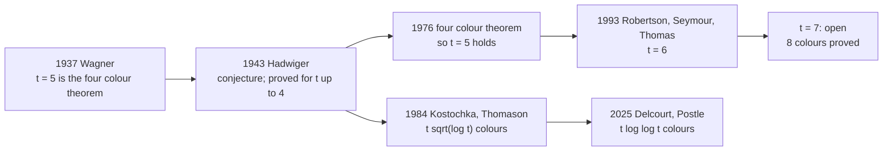
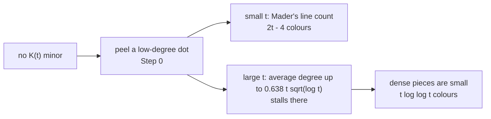

# Hadwiger's conjecture: a graph with no K_t minor can be coloured with t - 1 colours

[Syllabus](../../../SYLLABUS.md) → [Frontier](../README.md) → [Geometry and Combinatorics](../README.md#s04) → Hadwiger's conjecture

---

## General Overview

Take the Petersen graph: 10 dots, 15 lines, an outer ring of five, an inner five-pointed star, and five spokes between them. Shrink each spoke to a point, fusing its two ends. The five fused dots are now all joined to each other. That is $`K_5`$, five dots with every pair joined ([Graph minors](../../04-Combinatorics%20and%20graphs/12-Planarity%20and%20Colouring/09-graph-minors-and-wagner.md) does this contraction). Yet the Petersen graph itself needs only 3 colours, so that joined dots differ.

In 1943 Hugo Hadwiger, a Swiss geometer, proposed a link between these two numbers. If shrinking and deleting can never produce $`t`$ dots all joined, then $`t - 1`$ colours are enough. The Petersen graph cannot produce six all-joined dots, so the conjecture promises at most 5 colours. It needs 3. The promise holds, with room to spare.

The conjecture is proved for $`t`$ up to 6. The case $`t = 5`$ is the four colour theorem in disguise ([Colouring maps](../../04-Combinatorics%20and%20graphs/12-Planarity%20and%20Colouring/05-five-and-four-colour-theorems.md)), as Klaus Wagner showed in 1937. Neil Robertson, Paul Seymour and Robin Thomas proved $`t = 6`$ in 1993. From $`t = 7`$ on it is open. For general $`t`$, the best proved count is a constant times $`t \log\log t`$ colours (Michelle Delcourt and Luke Postle, 2025), not $`t - 1`$.

This is a different problem from [Colouring the plane](03-hadwiger-nelson-chromatic-number-of-the-plane.md), the Hadwiger–Nelson problem, by the same Hadwiger. That one asks about one infinite graph. This one asks about every finite graph.

**A graph that cannot be shrunk to t all-joined dots should need at most t − 1 colours; this is proved for t up to 6, open from 7, and the best general count is about t log log t.**

**What kind of fact this is:** a conjecture, open as of 2026-11-24. The case $`t = 3`$ is proved on this card in Why it works; $`t = 4`$ (Hadwiger, 1943), $`t = 5`$ and $`t = 6`$ are theorems quoted with their sources. The checks verify instances: three small graphs, each needing no more colours than its largest complete minor.

**Status, 2026-11-24:**

| Claim | Kind | Status | Source |
| --- | --- | --- | --- |
| no $`K_t`$ minor ⇒ $`t - 1`$ colours, for $`t \le 4`$ | theorem | proved, 1943 | Hadwiger, as Seymour's survey reports |
| the case $`t = 5`$ is equivalent to the four colour theorem | theorem | proved, 1937; so $`t = 5`$ holds since the four colour theorem (1976) | Wagner |
| the case $`t = 6`$ | theorem | proved: refereed, *Combinatorica* 1993; the proof uses the four colour theorem | Robertson, Seymour, Thomas |
| the case $`t = 7`$ (6 colours) | conjecture | open; 8 colours proved (refereed, *Journal of Graph Theory* 88, 2018) | Albar and Gonçalves, [doi:10.1002/jgt.22203](https://doi.org/10.1002/jgt.22203); Seymour's survey cites their 2013 manuscript |
| every $`t`$: a constant times $`t \log\log t`$ colours | theorem | proved: refereed, *Journal of the AMS* 38 (2025) | Delcourt and Postle |
| every $`t`$: $`t - 1`$ colours | conjecture | open | Hadwiger, 1943 |
| Hajós's version, with subdivisions in place of minors | conjecture | refuted for $`t \ge 7`$, 1979 | Catlin, as Seymour's survey reports |

### The picture: the route from 1937 to now



The top chain proves exact cases one at a time. The bottom chain proves a weaker count for every $`t`$ at once.

---

## The formula

Notation first, in words. A **graph** $`G`$ is a set of dots joined by lines. $`K_t`$ is $`t`$ dots with every pair joined; wing 04 writes it K(t). A **minor** of $`G`$ is any graph reached by deleting lines, deleting dots and contracting lines (fusing a line's two ends), written $`H \preceq G`$ ([Graph minors](../../04-Combinatorics%20and%20graphs/12-Planarity%20and%20Colouring/09-graph-minors-and-wagner.md)). $`\chi(G)`$ is the **chromatic number**: the fewest colours that give joined dots different colours ([Colouring](../../04-Combinatorics%20and%20graphs/12-Planarity%20and%20Colouring/03-vertex-colouring-and-chromatic-number.md)).

```math
K_t \not\preceq G \quad\Longrightarrow\quad \chi(G) \le t - 1
```

**Read it aloud:** if no sequence of deletions and contractions turns G into t all-joined dots, then G can be coloured with t minus one colours.

The same claim in one number. The **Hadwiger number** $`h(G)`$ is the largest $`t`$ with $`K_t \preceq G`$: the size of the largest complete minor. Then $`G`$ has no $`K_{h+1}`$ minor, and the conjecture says:

```math
\chi(G) \le h(G)
```

**Read it aloud:** a graph never needs more colours than the size of its largest complete minor.

The best proved count for every $`t`$:

```math
K_t \not\preceq G \quad\Longrightarrow\quad \chi(G) \le C\, t \log\log t \quad \text{for some fixed } C \text{ and all } t \ge 3
```

**Read it aloud:** with no complete minor on t dots, a fixed constant times t times the log of the log of t colours suffice. Here log is the natural logarithm, and the paper states it as $`O(t \log\log t)`$: big O hides the constant.

| Symbol | Plain meaning | In our example | Push it up and the answer… |
| --- | --- | --- | --- |
| $`G`$ | the graph being coloured | the Petersen graph | — |
| $`n`$, $`E`$ | numbers of dots and of lines in $`G`$ | 10 and 15 | — |
| $`t`$ | size of the forbidden complete minor | 6 for Petersen | the promise allows more colours |
| $`K_t`$ | $`t`$ dots, every pair joined | $`K_5`$, from the spokes | — |
| $`H \preceq G`$ | $`H`$ is a minor of $`G`$ | $`K_5 \preceq`$ Petersen | — |
| $`\chi(G)`$ | fewest colours with joined dots different | 3 | — |
| $`h(G)`$ | size of the largest complete minor | 5 | the conjecture's ceiling rises |
| $`s`$ | size of a branch set: the dots of $`G`$ fused into one dot of the minor | 2, a spoke's two ends | more lines leave the set |
| $`d`$ | a neighbour count that some dot never exceeds (Step 0) | 3 for Petersen | peeling needs more colours |
| $`P(k)`$ | chromatic polynomial: the number of proper colourings with $`k`$ colours | $`P(3) = 120`$ | more colourings |
| $`C`$ | an unnamed fixed constant | not given in the paper | — |
| $`\lambda`$, $`\alpha`$ | constants in Thomason's average-degree law | 0.284668 and 0.63817 | — |

### When it holds

- **Minors, not subgraphs.** "No $`K_t`$ inside $`G`$ as a part" is far weaker. The Petersen graph has no triangle, $`K_3`$, as a part, yet needs 3 colours, not 2.
- **Minors, not subdivisions.** Hajós asked the same with subdivisions ($`K_t`$ with extra dots along its lines). That version is false from $`t = 7`$ (Catlin, 1979).
- **Finite graphs.** Colourings and minors here are of finite graphs; the plane's unit-distance graph is a separate question.
- **The right $`t`$.** The hypothesis forbids $`K_t`$. A graph that has a $`K_t`$ minor is not covered by the case $`t`$; take $`t = h(G) + 1`$.
- **Proved cases only up to 6.** The cases $`t = 5`$ and $`t = 6`$ rest on the four colour theorem, a computer proof.

---

## Why it works

The conjecture is open, so this section proves the case $`t = 3`$, quotes $`t = 4`$, outlines $`t = 5`$ and $`t = 6`$, and shows why the general counts fall short of $`t - 1`$.

### Step 0: a dot with few neighbours lets you colour by peeling

Suppose every graph in a family has some dot with at most $`d`$ neighbours. Remove that dot, colour the rest, and put it back. Its $`d`$ neighbours use at most $`d`$ colours, so $`d + 1`$ colours leave one free. If the family is closed under deleting dots, the rest is again in the family, and the peeling repeats down to nothing. So $`d + 1`$ colours suffice. Graphs with no $`K_t`$ minor form such a family: deleting a dot cannot create a minor.

Every proved general count comes from this idea, or from refining it.

### Step 1: t = 3 and t = 4

**No $`K_3`$ minor.** Any ring (cycle) contracts down to a triangle. So a graph with no $`K_3`$ minor has no ring: it is a forest. A forest has a dot with at most one neighbour, an end of a longest path. Step 0 gives $`1 + 1 = 2`$ colours, which is $`t - 1`$.

**No $`K_4`$ minor.** Hadwiger showed in 1943 that such a graph always has a dot with at most two neighbours. Step 0 gives 3 colours, which is $`t - 1`$. Dirac (1952) and Duffin later gave other proofs.

### Step 2: t = 5 is the four colour theorem

One direction is short. A flat (planar) graph has no $`K_5`$ minor ([Graph minors](../../04-Combinatorics%20and%20graphs/12-Planarity%20and%20Colouring/09-graph-minors-and-wagner.md)). So the case $`t = 5`$ would colour every flat graph with 4 colours.

The other direction is Wagner's 1937 theorem. Every graph with no $`K_5`$ minor is glued together from flat graphs and copies of one 8-dot graph, $`V_8`$ (a ring of 8 with its 4 long diagonals). The gluing is along at most 3 dots, all joined. Gluing two colourable pieces along an all-joined group keeps the colouring: rename one piece's colours to match on the shared dots. Flat pieces take 4 colours by the four colour theorem. $`V_8`$ has 3 lines at each dot and is neither all-joined nor a ring, so it takes at most 3 by Brooks' theorem ([Colouring](../../04-Combinatorics%20and%20graphs/12-Planarity%20and%20Colouring/03-vertex-colouring-and-chromatic-number.md)). So the four colour theorem gives the case $`t = 5`$.

### Step 3: t = 6, in outline

This step outlines a research proof; it does not prove it.

**Statement.** Every graph with no $`K_6`$ minor has $`\chi(G) \le 5`$ (Robertson, Seymour and Thomas, 1993).

**Key step.** Take a smallest graph that breaks the claim. The paper shows, without a computer, that it is **apex**: deleting one dot leaves a flat graph. The flat part takes 4 colours by the four colour theorem, and the deleted dot takes a fifth. So no such graph exists.

**What it needs.** The four colour theorem, used once at the end. The long argument that the smallest counterexample is apex is the new work.

### Step 4: the counting road, and where it stalls

For small $`t`$, Mader (1968) found the most lines a graph with no $`K_t`$ minor can have. For $`t \le 7`$ and $`n \ge t - 2`$ dots:

```math
E \le (t-2)\,n - \tfrac{1}{2}(t-1)(t-2)
```

**Read it aloud:** at most t minus 2 lines per dot, less a fixed amount. Here $`E`$ is the number of lines.

So the average number of neighbours, $`2E/n`$, is below $`2(t-2)`$. Some dot has at most $`2t - 5`$ neighbours, and Step 0 gives $`2t - 4`$ colours. That is about twice the conjectured $`t - 1`$.

The formula stops at $`t = 8`$. The graph K(2,2,2,2,2) is 10 dots in 5 pairs, each dot joined to all 8 dots outside its pair: 40 lines. The formula at $`t = 8`$ allows $`6 \times 10 - 21 = 39`$. Yet it has no $`K_8`$ minor. Eight branch sets in 10 dots leave at most 2 spare dots, so at least 6 sets are single dots, all joined to each other. Its largest all-joined group has only 5.

For large $`t`$ the average-degree road reaches a hard limit. Graphs with no $`K_t`$ minor can have average degree about $`\alpha\, t\sqrt{\log t}`$, with $`\alpha \approx 0.63817`$, and no more (Thomason, 2001, as Seymour's survey states). The constant comes from $`\lambda`$, the root below 1 of $`1 - \lambda + 2\lambda\log\lambda = 0`$:

```math
\alpha = \frac{1-\lambda}{\sqrt{\log(1/\lambda)}}, \qquad \lambda \approx 0.284668
```

**Read it aloud:** alpha is one minus lambda, over the square root of the log of one over lambda. Random graphs reach this many neighbours per dot. So peeling alone gives about $`t\sqrt{\log t}`$ colours (Kostochka and Thomason, 1984), never $`t - 1`$.

### Step 5: below t sqrt(log t), in outline

This step outlines a research proof; it does not prove it.

**Statement.** Graphs with no $`K_t`$ minor have $`\chi(G) = O(t \log\log t)`$ (Delcourt and Postle; posted 2021, *Journal of the AMS* 2025).

**Key idea.** A dense graph with no $`K_t`$ minor must hide its density in small pieces. The paper proves that such a graph, if its average number of neighbours (average degree) is at least a fixed multiple of $`t`$, contains a subgraph on few dots, about $`t (\log t)^3`$, whose average degree is still a fixed fraction of the whole graph's. Then colouring the whole graph reduces to colouring small graphs with no complete minor. The known bounds for small graphs give the $`\log\log t`$ factor.

**What it leaves.** "Linear Hadwiger", a constant times $`t`$ colours, now needs only a good enough bound for small graphs.



---

## Worked numbers, by hand

| Step | Arithmetic | Value |
| --- | --- | --- |
| Petersen: dots and lines | ring 5 + star 5; 5 + 5 + 5 spokes | 10 and 15 |
| colour with 2 | the outer ring has 5 dots, an odd ring | 0 ways |
| colour with 3 | search, and the chromatic polynomial $`P(3)`$ | 120 ways, so $`\chi = 3`$ |
| contract the 5 spokes | each fused dot touches the other 4 | $`K_5`$: 10 of 10 pairs joined |
| $`K_6`$ branch set, $`s`$ dots | at most $`3s - 2(s-1) = s + 2`$ exits; needs 5 | $`s \ge 3`$ |
| $`K_6`$ needs | $`6 \times 3`$ | 18 dots, but there are 10 |
| largest complete minor | $`K_5`$ yes, $`K_6`$ no | $`h = 5`$ |
| the conjecture's promise | no $`K_6`$ minor, proved case $`t = 6`$ | at most 5 colours |
| **the check** | $`\chi = 3 \le 5 = h`$ | **holds, with 2 to spare** |

A branch set of $`s`$ dots, each with 3 lines, spends at least $`s - 1`$ lines inside to stay joined, and each inside line uses two line-ends. That leaves at most $`s + 2`$ lines going out. In $`K_6`$ each branch set must touch 5 others.

The same check on two more graphs:

| Graph | Dots, lines | $`\chi`$ | $`h`$ | Verdict |
| --- | --- | ---: | ---: | --- |
| Petersen | 10, 15 | 3 | 5 | holds, slack 2 |
| Moser spindle (from [Colouring the plane](03-hadwiger-nelson-chromatic-number-of-the-plane.md)) | 7, 11 | 4 | 4 | holds with equality |
| K(2,2,2,2,2) | 10, 40 | 5 | 7 | holds, slack 2 |

```
colours needed (#) against largest complete minor (=)
Petersen      chi ###      3
              h   =====    5
Moser spindle chi ####     4
              h   ====     4
K(2,2,2,2,2)  chi #####    5
              h   =======  7
```

The Moser spindle is the shelf's house example: points in the plane, joined at distance 1. All 2,187 ways to give its 7 dots 3 colours fail; 384 ways with 4 colours work. Its largest complete minor is $`K_4`$. So it meets Hadwiger's promise exactly: no room to spare.

The proved counts, $`t`$ from 3 to 7:

| $`t`$ | conjecture: $`t - 1`$ | Mader's line count: $`2t - 4`$ | best proved |
| ---: | ---: | ---: | ---: |
| 3 | 2 | 2 | 2 |
| 4 | 3 | 4 | 3 |
| 5 | 4 | 6 | 4 |
| 6 | 5 | 8 | 5 |
| 7 | 6 | 10 | 8 |

For large $`t`$ only the extra factor over $`t`$ matters. The 1984 road pays $`\sqrt{\log t}`$; the 2025 road pays $`\log\log t`$, up to constants. At $`t = 10^6`$ these are 3.72 and 2.63; at $`t = 10^{100}`$ they are 15.17 and 5.44. The conjecture pays 1.

### What breaks if you drop a piece

| Mistake | Comes out at | What went wrong |
| --- | --- | --- |
| Minor read as subgraph | Petersen has no triangle, so "2 colours"; it needs 3 | Only minors carry the promise |
| Read backwards: a $`K_t`$ minor forces $`t`$ colours | Petersen has $`K_5`$, so "5 colours"; it needs 3 | The conjecture is a ceiling, never a floor |
| $`t = 5`$ applied to Petersen | ceiling 4 | Petersen has a $`K_5`$ minor; the case that applies is $`t = 6`$, ceiling 5 |
| Mader's line count used at $`t = 8`$ | K(2,2,2,2,2): 40 lines, over 39, "so a $`K_8`$ minor" | The formula holds only for $`t \le 7`$; there is no $`K_8`$ minor |

---

## Code, from first principles, and it actually runs

Nothing is imported except `math`, used for logarithms in the last part. The code finds each graph's chromatic number by two roads: a dot-by-dot search that counts proper colourings, and the chromatic polynomial computed from all subsets of lines. It finds the largest complete minor by searching every choice of disjoint, joined-up branch sets that touch in pairs. Two counting arguments confirm the searches: no $`K_6`$ minor in the Petersen graph, and no $`K_8`$ minor in K(2,2,2,2,2). Thomason's $`\lambda`$ is found by bisection and by Newton's method. Each assert checks an instance or two roads agreeing, never the conjecture.

### Python

```python
# Hadwiger's conjecture -- the check behind the card.  Standard library only; math gives log and sqrt.
# A graph with no K(t) minor should need at most t - 1 colours.  For three small graphs the script
# finds the chromatic number chi and the largest complete minor h by search, and checks chi <= h.
import math

def graph(n, lines):                          # each dot's neighbours as a bitmask
    adj = [0] * n
    for a, b in lines:
        adj[a] |= 1 << b
        adj[b] |= 1 << a
    return adj

PETERSEN = [(i, (i + 1) % 5) for i in range(5)] + [(5 + i, 5 + (i + 2) % 5) for i in range(5)] + [(i, i + 5) for i in range(5)]
SPINDLE = [(0, 1), (0, 2), (1, 2), (1, 3), (2, 3), (0, 4), (0, 5), (4, 5), (4, 6), (5, 6), (3, 6)]
K22222 = [(a, b) for a in range(10) for b in range(a + 1, 10) if a // 2 != b // 2]

def colourings(adj, k):                       # road 1 to chi: count proper k-colourings, dot by dot
    n, col = len(adj), []
    def go(v):
        if v == n:
            return 1
        total = 0
        for c in range(k):
            if not any(adj[v] >> u & 1 and col[u] == c for u in range(v)):
                col.append(c)
                total += go(v + 1)
                col.pop()
        return total
    return go(0)

def chrom_poly(n, lines, k):                  # road 2: P(k) = sum over line sets S of (-1)^|S| k^(pieces of S)
    total = 0
    for s in range(1 << len(lines)):
        parent = list(range(n))
        def root(x):
            while parent[x] != x:
                x = parent[x]
            return x
        for i, (a, b) in enumerate(lines):
            if s >> i & 1:
                parent[root(a)] = root(b)
        total += (-1) ** bin(s).count("1") * k ** sum(1 for v in range(n) if root(v) == v)
    return total

def connected(adj, m):
    seen = m & -m
    while True:
        grown = seen
        for v in range(len(adj)):
            if seen >> v & 1:
                grown |= adj[v] & m
        if grown == seen:
            return seen == m
        seen = grown

def minor_models(adj, t, stop_at_first):      # K(t) minors: t disjoint joined-up branch sets, each pair touching
    n = len(adj)
    sets = []
    for m in range(1, 1 << n):
        if connected(adj, m):
            out = 0
            for v in range(n):
                if m >> v & 1:
                    out |= adj[v]
            sets.append((m, out & ~m, (m & -m).bit_length() - 1))
    found = 0
    def go(chosen, used, lo):
        nonlocal found
        if len(chosen) == t:
            found += 1
            return stop_at_first
        for m, out, low in sets:              # sets taken in order of their lowest dot, so each model once
            if low >= lo and not m & used and all(out & c for c in chosen) \
                    and n - bin(used | m).count("1") >= t - len(chosen) - 1:
                if go(chosen + [m], used | m, low + 1):
                    return True
        return False
    go([], 0, 0)
    return found

def chi(adj):
    return next(k for k in range(1, len(adj) + 1) if colourings(adj, k) > 0)

def hadwiger(adj):
    return next(t for t in range(1, len(adj) + 2) if minor_models(adj, t, True) == 0) - 1

pet, spin, k5x2 = graph(10, PETERSEN), graph(7, SPINDLE), graph(10, K22222)
tri = sum(1 for a in range(10) for b in range(a) for c in range(b) if pet[a] >> b & 1 and pet[a] >> c & 1 and pet[b] >> c & 1)
print(f"Petersen graph: {len(pet)} dots, {len(PETERSEN)} lines, {tri} triangles")
p2, p3 = colourings(pet, 2), colourings(pet, 3)
q2, q3 = chrom_poly(10, PETERSEN, 2), chrom_poly(10, PETERSEN, 3)
print(f"proper colourings, by search: 2 colours {p2}, 3 colours {p3}; by the chromatic polynomial: P(2) = {q2}, P(3) = {q3}")
spokes = [(1 << i) | (1 << (i + 5)) for i in range(5)]
touch = sum(1 for i in range(5) for j in range(i) if any(pet[v] & spokes[j] for v in range(10) if spokes[i] >> v & 1))
print(f"contract the 5 spokes: {touch} of 10 pairs of fused dots touch, so K(5) is a minor")
k5, k6 = minor_models(pet, 5, False), minor_models(pet, 6, False)
print(f"search: K(5) minor models {k5}, K(6) minor models {k6}; a K(5) set needs 4 exits, one dot has 3, so each model uses 10 dots")
need = next(s for s in range(1, 10) if 3 * s - 2 * (s - 1) >= 5)
print(f"count: a K(6) branch set of s dots has at most s + 2 exits, needs 5, so s >= {need}; 6 x {need} = {6 * need} > 10 dots")
hp, cp = hadwiger(pet), chi(pet)
print(f"Petersen: largest complete minor h = {hp}, chi = {cp}; no K({hp + 1}) minor, so the proved case t = {hp + 1} allows {hp} colours")
print(f"Moser spindle: 3-colourings {colourings(spin, 3)} of {3 ** 7}, P(3) = {chrom_poly(7, SPINDLE, 3)}; "
      f"4-colourings {colourings(spin, 4)}, P(4) = {chrom_poly(7, SPINDLE, 4)}")
hs, cs = hadwiger(spin), chi(spin)
print(f"Moser spindle: h = {hs}, chi = {cs}, equality")
hk, ck = hadwiger(k5x2), chi(k5x2)
om = max(bin(m).count("1") for m in range(1 << 10) if all(k5x2[v] | 1 << v | ~m & 1023 == 1023 for v in range(10) if m >> v & 1))
k8 = minor_models(k5x2, 8, False)
print(f"K(2,2,2,2,2): 10 dots, {len(K22222)} lines; h = {hk}, chi = {ck}; the t <= 7 line formula at t = 8 gives 6 x 10 - 21 = {6 * 10 - 21}")
print(f"K(2,2,2,2,2): K(8) minor models {k8}; count: 8 sets in 10 dots need >= {8 - 2} single dots, "
      f"all joined, but the largest all-joined group has {om}")
print("  t  conjecture  edge-count road 2t-4  best proved")
for t in range(3, 8):
    print(f"{t:>3}{t - 1:>12}{2 * t - 4:>22}{(t - 1 if t <= 6 else 8):>13}")
f = lambda x: 1 - x + 2 * x * math.log(x)
lo, hi = 0.1, 0.5
for _ in range(100):                          # road 1 to Thomason's lambda: bisection
    mid = (lo + hi) / 2
    lo, hi = (mid, hi) if f(mid) > 0 else (lo, mid)
x = 0.3
for _ in range(50):                           # road 2: Newton's method, f'(x) = 1 + 2 log x
    x -= f(x) / (1 + 2 * math.log(x))
alpha = (1 - lo) / math.sqrt(math.log(1 / lo))
print(f"Thomason: lambda = {lo:.6f} by bisection, {x:.6f} by Newton; alpha = {alpha:.5f}")
print("  t       extra factor sqrt(log t)  extra factor log log t")
for e in (2, 6, 100):
    lt = e * math.log(10)
    print(f"  10^{e:<5}{math.sqrt(lt):>24.2f}{math.log(lt):>24.2f}")
print(f"mistake 1, minor read as subgraph: no triangle in Petersen, so '2 colours'; true chi = {cp}")
print(f"mistake 2, read backwards: K({hp}) minor, so '{hp} colours'; true chi = {cp}")
print(f"mistake 3, t = 5 applied to Petersen: ceiling 4, but it has a K(5) minor; the case that applies is t = 6, ceiling 5")
print(f"mistake 4, Mader's count past t = 7: {len(K22222)} lines > {6 * 10 - 21}, yet no K(8) minor")
assert p2 == q2 == 0 and p3 == q3 > 0                     # two roads to chi(Petersen) = 3
assert touch == 10 and k5 == 6 and k6 == 0 and hp == 5
assert colourings(spin, 3) == chrom_poly(7, SPINDLE, 3) == 0 and colourings(spin, 4) == chrom_poly(7, SPINDLE, 4) > 0
assert (hs, cs) == (4, 4) and (hk, ck) == (7, 5) and k8 == 0 and om == 5 and len(K22222) > 6 * 10 - 21
assert all(c <= h for c, h in ((cp, hp), (cs, hs), (ck, hk)))  # the conjecture's instances, checked
assert abs(lo - x) < 1e-12 and abs(alpha - 0.63817) < 1e-5  # two roads to lambda; alpha as Thomason states it
print("ALL CHECKS PASS")
```

**Ran 2026-11-24 on macOS, Python 3.14.10, standard library only. All checks passed. Output, pasted from the run:**

```
Petersen graph: 10 dots, 15 lines, 0 triangles
proper colourings, by search: 2 colours 0, 3 colours 120; by the chromatic polynomial: P(2) = 0, P(3) = 120
contract the 5 spokes: 10 of 10 pairs of fused dots touch, so K(5) is a minor
search: K(5) minor models 6, K(6) minor models 0; a K(5) set needs 4 exits, one dot has 3, so each model uses 10 dots
count: a K(6) branch set of s dots has at most s + 2 exits, needs 5, so s >= 3; 6 x 3 = 18 > 10 dots
Petersen: largest complete minor h = 5, chi = 3; no K(6) minor, so the proved case t = 6 allows 5 colours
Moser spindle: 3-colourings 0 of 2187, P(3) = 0; 4-colourings 384, P(4) = 384
Moser spindle: h = 4, chi = 4, equality
K(2,2,2,2,2): 10 dots, 40 lines; h = 7, chi = 5; the t <= 7 line formula at t = 8 gives 6 x 10 - 21 = 39
K(2,2,2,2,2): K(8) minor models 0; count: 8 sets in 10 dots need >= 6 single dots, all joined, but the largest all-joined group has 5
  t  conjecture  edge-count road 2t-4  best proved
  3           2                     2            2
  4           3                     4            3
  5           4                     6            4
  6           5                     8            5
  7           6                    10            8
Thomason: lambda = 0.284668 by bisection, 0.284668 by Newton; alpha = 0.63817
  t       extra factor sqrt(log t)  extra factor log log t
  10^2                        2.15                    1.53
  10^6                        3.72                    2.63
  10^100                     15.17                    5.44
mistake 1, minor read as subgraph: no triangle in Petersen, so '2 colours'; true chi = 3
mistake 2, read backwards: K(5) minor, so '5 colours'; true chi = 3
mistake 3, t = 5 applied to Petersen: ceiling 4, but it has a K(5) minor; the case that applies is t = 6, ceiling 5
mistake 4, Mader's count past t = 7: 40 lines > 39, yet no K(8) minor
ALL CHECKS PASS
```

### Rust

Same numbers, same labels, built with `rustc --edition 2021 -O`.

```rust
// Hadwiger's conjecture -- the same check as the Python, in Rust.  No crates.
// A graph with no K(t) minor should need at most t - 1 colours.  For three small graphs the program
// finds the chromatic number chi and the largest complete minor h by search, and checks chi <= h.

fn graph(n: usize, lines: &[(usize, usize)]) -> Vec<u32> {  // each dot's neighbours as a bitmask
    let mut adj = vec![0u32; n];
    for &(a, b) in lines { adj[a] |= 1 << b; adj[b] |= 1 << a; }
    adj
}

fn colourings(adj: &[u32], k: usize) -> u64 {  // road 1 to chi: count proper k-colourings, dot by dot
    fn go(adj: &[u32], k: usize, col: &mut Vec<usize>) -> u64 {
        let v = col.len();
        if v == adj.len() { return 1; }
        let mut total = 0;
        for c in 0..k {
            if !(0..v).any(|u| adj[v] >> u & 1 == 1 && col[u] == c) {
                col.push(c);
                total += go(adj, k, col);
                col.pop();
            }
        }
        total
    }
    go(adj, k, &mut vec![])
}

fn chrom_poly(n: usize, lines: &[(usize, usize)], k: i64) -> i64 {  // road 2: sum over line sets of (-1)^|S| k^pieces
    let mut total = 0i64;
    for s in 0u32..1 << lines.len() {
        let mut parent: Vec<usize> = (0..n).collect();
        fn root(p: &Vec<usize>, mut x: usize) -> usize { while p[x] != x { x = p[x]; } x }
        for (i, &(a, b)) in lines.iter().enumerate() {
            if s >> i & 1 == 1 { let (ra, rb) = (root(&parent, a), root(&parent, b)); parent[ra] = rb; }
        }
        let pieces = (0..n).filter(|&v| root(&parent, v) == v).count() as u32;
        total += if s.count_ones() % 2 == 0 { 1 } else { -1 } * k.pow(pieces);
    }
    total
}

fn connected(adj: &[u32], m: u32) -> bool {
    let mut seen = m & m.wrapping_neg();
    loop {
        let mut grown = seen;
        for v in 0..adj.len() { if seen >> v & 1 == 1 { grown |= adj[v] & m; } }
        if grown == seen { return seen == m; }
        seen = grown;
    }
}

// K(t) minors: t disjoint joined-up branch sets, each pair touching
fn minor_models(adj: &[u32], t: usize, stop_at_first: bool) -> u64 {
    let n = adj.len();
    let mut sets = vec![];
    for m in 1u32..1 << n {
        if connected(adj, m) {
            let mut out = 0;
            for v in 0..n { if m >> v & 1 == 1 { out |= adj[v]; } }
            sets.push((m, out & !m, m.trailing_zeros() as usize));
        }
    }
    fn go(sets: &[(u32, u32, usize)], n: usize, t: usize, stop: bool, chosen: &mut Vec<u32>, used: u32, lo: usize, found: &mut u64) -> bool {
        if chosen.len() == t { *found += 1; return stop; }
        for &(m, out, low) in sets {  // sets taken in order of their lowest dot, so each model once
            if low >= lo && m & used == 0 && chosen.iter().all(|&c| out & c != 0)
                && n - (used | m).count_ones() as usize + 1 >= t - chosen.len() {
                chosen.push(m);
                let done = go(sets, n, t, stop, chosen, used | m, low + 1, found);
                chosen.pop();
                if done { return true; }
            }
        }
        false
    }
    let mut found = 0;
    go(&sets, n, t, stop_at_first, &mut vec![], 0, 0, &mut found);
    found
}

fn chi(adj: &[u32]) -> usize { (1..=adj.len()).find(|&k| colourings(adj, k) > 0).unwrap() }

fn hadwiger(adj: &[u32]) -> usize { (1..=adj.len() + 1).find(|&t| minor_models(adj, t, true) == 0).unwrap() - 1 }

fn main() {
    let mut petersen = vec![];
    for i in 0..5 { petersen.push((i, (i + 1) % 5)); }
    for i in 0..5 { petersen.push((5 + i, 5 + (i + 2) % 5)); }
    for i in 0..5 { petersen.push((i, i + 5)); }
    let spindle = [(0, 1), (0, 2), (1, 2), (1, 3), (2, 3), (0, 4), (0, 5), (4, 5), (4, 6), (5, 6), (3, 6)];
    let mut k22222 = vec![];
    for a in 0..10 { for b in a + 1..10 { if a / 2 != b / 2 { k22222.push((a, b)); } } }
    let (pet, spin, k5x2) = (graph(10, &petersen), graph(7, &spindle), graph(10, &k22222));
    let mut tri = 0;
    for a in 0..10 { for b in 0..a { for c in 0..b {
        if pet[a] >> b & 1 == 1 && pet[a] >> c & 1 == 1 && pet[b] >> c & 1 == 1 { tri += 1; }
    } } }
    println!("Petersen graph: {} dots, {} lines, {} triangles", pet.len(), petersen.len(), tri);
    let (p2, p3) = (colourings(&pet, 2), colourings(&pet, 3));
    let (q2, q3) = (chrom_poly(10, &petersen, 2), chrom_poly(10, &petersen, 3));
    println!("proper colourings, by search: 2 colours {}, 3 colours {}; by the chromatic polynomial: P(2) = {}, P(3) = {}", p2, p3, q2, q3);
    let spokes: Vec<u32> = (0..5).map(|i| (1 << i) | (1 << (i + 5))).collect();
    let mut touch = 0;
    for i in 0..5 { for j in 0..i {
        if (0..10).any(|v| spokes[i] >> v & 1 == 1 && pet[v] & spokes[j] != 0) { touch += 1; }
    } }
    println!("contract the 5 spokes: {} of 10 pairs of fused dots touch, so K(5) is a minor", touch);
    let (k5, k6) = (minor_models(&pet, 5, false), minor_models(&pet, 6, false));
    println!("search: K(5) minor models {}, K(6) minor models {}; a K(5) set needs 4 exits, one dot has 3, so each model uses 10 dots", k5, k6);
    let need = (1..10).find(|&s| 3 * s - 2 * (s - 1) >= 5).unwrap();
    println!("count: a K(6) branch set of s dots has at most s + 2 exits, needs 5, so s >= {}; 6 x {} = {} > 10 dots", need, need, 6 * need);
    let (hp, cp) = (hadwiger(&pet), chi(&pet));
    println!("Petersen: largest complete minor h = {}, chi = {}; no K({}) minor, so the proved case t = {} allows {} colours", hp, cp, hp + 1, hp + 1, hp);
    let (s3, s4) = (colourings(&spin, 3), colourings(&spin, 4));
    let (ps3, ps4) = (chrom_poly(7, &spindle, 3), chrom_poly(7, &spindle, 4));
    println!("Moser spindle: 3-colourings {} of {}, P(3) = {}; 4-colourings {}, P(4) = {}", s3, 3u32.pow(7), ps3, s4, ps4);
    let (hs, cs) = (hadwiger(&spin), chi(&spin));
    println!("Moser spindle: h = {}, chi = {}, equality", hs, cs);
    let (hk, ck) = (hadwiger(&k5x2), chi(&k5x2));
    let om = (0u32..1 << 10).filter(|&m| (0..10).all(|v| m >> v & 1 == 0 || (k5x2[v] | 1 << v | (!m & 1023)) == 1023))
        .map(|m| m.count_ones()).max().unwrap();
    let k8 = minor_models(&k5x2, 8, false);
    println!("K(2,2,2,2,2): 10 dots, {} lines; h = {}, chi = {}; the t <= 7 line formula at t = 8 gives 6 x 10 - 21 = {}", k22222.len(), hk, ck, 6 * 10 - 21);
    println!("K(2,2,2,2,2): K(8) minor models {}; count: 8 sets in 10 dots need >= {} single dots, all joined, but the largest all-joined group has {}", k8, 8 - 2, om);
    println!("  t  conjecture  edge-count road 2t-4  best proved");
    for t in 3..8 { println!("{:>3}{:>12}{:>22}{:>13}", t, t - 1, 2 * t - 4, if t <= 6 { t - 1 } else { 8 }); }
    let f = |x: f64| 1.0 - x + 2.0 * x * x.ln();
    let (mut lo, mut hi) = (0.1f64, 0.5f64);
    for _ in 0..100 {  // road 1 to Thomason's lambda: bisection
        let mid = (lo + hi) / 2.0;
        if f(mid) > 0.0 { lo = mid; } else { hi = mid; }
    }
    let mut x = 0.3f64;
    for _ in 0..50 { x -= f(x) / (1.0 + 2.0 * x.ln()); }  // road 2: Newton's method, f'(x) = 1 + 2 log x
    let alpha = (1.0 - lo) / (1.0 / lo).ln().sqrt();
    println!("Thomason: lambda = {:.6} by bisection, {:.6} by Newton; alpha = {:.5}", lo, x, alpha);
    println!("  t       extra factor sqrt(log t)  extra factor log log t");
    for e in [2, 6, 100] {
        let lt = e as f64 * 10f64.ln();
        println!("  10^{:<5}{:>24.2}{:>24.2}", e, lt.sqrt(), lt.ln());
    }
    println!("mistake 1, minor read as subgraph: no triangle in Petersen, so '2 colours'; true chi = {}", cp);
    println!("mistake 2, read backwards: K({}) minor, so '{} colours'; true chi = {}", hp, hp, cp);
    println!("mistake 3, t = 5 applied to Petersen: ceiling 4, but it has a K(5) minor; the case that applies is t = 6, ceiling 5");
    println!("mistake 4, Mader's count past t = 7: {} lines > {}, yet no K(8) minor", k22222.len(), 6 * 10 - 21);
    assert!(p2 == 0 && q2 == 0 && p3 as i64 == q3 && p3 > 0);  // two roads to chi(Petersen) = 3
    assert!(touch == 10 && k5 == 6 && k6 == 0 && hp == 5);
    assert!(s3 == 0 && ps3 == 0 && s4 as i64 == ps4 && s4 > 0);
    assert!((hs, cs) == (4, 4) && (hk, ck) == (7, 5) && k8 == 0 && om == 5 && om < 8 - 2 && k22222.len() > 6 * 10 - 21);
    assert!([(cp, hp), (cs, hs), (ck, hk)].iter().all(|&(c, h)| c <= h));  // the conjecture's instances, checked
    assert!((lo - x).abs() < 1e-12 && (alpha - 0.63817).abs() < 1e-5);  // two roads to lambda; alpha as Thomason states it
    println!("ALL CHECKS PASS");
}
```

**Ran 2026-11-24 on macOS, rustc 1.98.1, no crates. All checks passed. Output, pasted from the run:**

```
Petersen graph: 10 dots, 15 lines, 0 triangles
proper colourings, by search: 2 colours 0, 3 colours 120; by the chromatic polynomial: P(2) = 0, P(3) = 120
contract the 5 spokes: 10 of 10 pairs of fused dots touch, so K(5) is a minor
search: K(5) minor models 6, K(6) minor models 0; a K(5) set needs 4 exits, one dot has 3, so each model uses 10 dots
count: a K(6) branch set of s dots has at most s + 2 exits, needs 5, so s >= 3; 6 x 3 = 18 > 10 dots
Petersen: largest complete minor h = 5, chi = 3; no K(6) minor, so the proved case t = 6 allows 5 colours
Moser spindle: 3-colourings 0 of 2187, P(3) = 0; 4-colourings 384, P(4) = 384
Moser spindle: h = 4, chi = 4, equality
K(2,2,2,2,2): 10 dots, 40 lines; h = 7, chi = 5; the t <= 7 line formula at t = 8 gives 6 x 10 - 21 = 39
K(2,2,2,2,2): K(8) minor models 0; count: 8 sets in 10 dots need >= 6 single dots, all joined, but the largest all-joined group has 5
  t  conjecture  edge-count road 2t-4  best proved
  3           2                     2            2
  4           3                     4            3
  5           4                     6            4
  6           5                     8            5
  7           6                    10            8
Thomason: lambda = 0.284668 by bisection, 0.284668 by Newton; alpha = 0.63817
  t       extra factor sqrt(log t)  extra factor log log t
  10^2                        2.15                    1.53
  10^6                        3.72                    2.63
  10^100                     15.17                    5.44
mistake 1, minor read as subgraph: no triangle in Petersen, so '2 colours'; true chi = 3
mistake 2, read backwards: K(5) minor, so '5 colours'; true chi = 3
mistake 3, t = 5 applied to Petersen: ceiling 4, but it has a K(5) minor; the case that applies is t = 6, ceiling 5
mistake 4, Mader's count past t = 7: 40 lines > 39, yet no K(8) minor
ALL CHECKS PASS
```

The two outputs match line for line.

### Lean

Lean proves the case $`t = 3`$, the peeling rule of Step 0, and the Petersen graph's colour count and $`K_5`$ minor.

- A minor is written out by branch sets, since Lean's library has no minors. Each set is joined up, and the sets are disjoint.
- The conjecture is written out for every $`t`$ and every finite graph. It is stated, not proved.
- Take any finite graph with no $`K_3`$ minor. Then 2 colours suffice.
- Take a finite graph where every nonempty set of dots has a dot with at most $`d`$ neighbours inside it. Then $`d + 1`$ colours suffice.
- The Petersen graph needs exactly 3 colours: 3 colours work, and 2 fail on its outer ring of five.
- Fusing the ends of each of the 5 spokes gives $`K_5`$, so $`K_5`$ is a minor of the Petersen graph.
- The Petersen graph has 15 lines, and K(2,2,2,2,2) has 40, one more than Mader's 39 at $`t = 8`$.
- The arithmetic of the $`K_6`$ count holds: each branch set needs 3 dots, so 18 dots, but there are 10.
- The Moser spindle has 2,187 ways to take 3 colours, and the table's columns $`t - 1`$ and $`2t - 4`$ are right.

The minor searches, the colouring counts and Thomason's constant are left to the Python and Rust checks; the conjecture itself stays open.

```lean
-- Hadwiger's conjecture: the conjecture is stated exactly and left open, and the file proves its case t = 3 (a finite graph with no triangle minor takes 2 colours), the peeling rule of Step 0, and that the Petersen graph needs exactly 3 colours while having K(5) as a minor, with the card's whole-number counts.
import Mathlib.Combinatorics.SimpleGraph.Coloring.Vertex
import Mathlib.Combinatorics.SimpleGraph.Connectivity.Connected
import Mathlib.Combinatorics.SimpleGraph.Maps
import Mathlib.Combinatorics.SimpleGraph.Finite
import Mathlib.Tactic.NormNum
import Mathlib.Combinatorics.SimpleGraph.Acyclic
import Mathlib.Combinatorics.SimpleGraph.Connectivity.Subgraph
import Mathlib.Tactic.FinCases
import Mathlib.Data.Fin.VecNotation

namespace HadwigersConjecture

open SimpleGraph

/-- `H` is a minor of `G`: `G` has pairwise disjoint branch sets, one per dot of `H`, each
joined among itself (its induced graph is connected, so in particular not empty), with a line
of `G` between two branch sets wherever `H` has a line. Fusing each branch set into one dot and
deleting what is left over turns `G` into `H`. Mathlib has no graph minors, so the definition
of the card [Graph minors] is written out here. -/
def IsMinor {W V : Type*} (H : SimpleGraph W) (G : SimpleGraph V) : Prop :=
  ∃ B : W → Set V,
    (∀ w, (G.induce (B w)).Connected) ∧
    Pairwise (fun a b => Disjoint (B a) (B b)) ∧
    ∀ a b, H.Adj a b → ∃ x ∈ B a, ∃ y ∈ B b, G.Adj x y

/-- Hadwiger's conjecture (1943), open for t ≥ 7 as of 2026-11-24: every finite graph with no
K(t) minor can be coloured with t - 1 colours. It is stated here and not proved. -/
def HadwigerConjectureStatement : Prop :=
  ∀ (t : ℕ) (V : Type) [Fintype V] (G : SimpleGraph V),
    ¬ IsMinor (⊤ : SimpleGraph (Fin t)) G → G.Colorable (t - 1)

/-- The case t = 3, proved on the card: a finite graph with no triangle K(3) as a minor has no
ring, so it is a forest, and it can be coloured with 2 colours. -/
theorem colorable_two_of_not_K3_minor {V : Type*} [Fintype V] (G : SimpleGraph V)
    (h : ¬ IsMinor (⊤ : SimpleGraph (Fin 3)) G) : G.Colorable 2 := by
  apply IsAcyclic.colorable_two
  intro v c hc
  apply h
  cases c with
  | nil => exact absurd hc (Walk.not_isCycle_nil)
  | @cons _ u _ hvu p =>
    rw [Walk.cons_isCycle_iff] at hc
    obtain ⟨hp, hedge⟩ := hc
    cases p with
    | nil => exact absurd hvu (G.loopless.irrefl _)
    | @cons _ x _ hux q =>
      rw [Walk.cons_isPath_iff] at hp
      obtain ⟨hq, huq⟩ := hp
      have hxv : x ≠ v := by
        rintro rfl
        apply hedge
        simp [Sym2.eq_swap]
      have hrp : q.reverse.IsPath := hq.reverse
      have hur : u ∉ q.reverse.support := by simpa using huq
      generalize q.reverse = r at hrp hur
      cases r with
      | nil => exact absurd rfl hxv
      | cons hvy r' =>
        rw [Walk.cons_isPath_iff] at hrp
        obtain ⟨-, hvr⟩ := hrp
        rw [Walk.support_cons, List.mem_cons, not_or] at hur
        obtain ⟨huv, hur'⟩ := hur
        refine ⟨![{v}, {u}, {z | z ∈ r'.support}], ?_, ?_, ?_⟩
        · intro w
          fin_cases w
          · simp only [Fin.zero_eta, Fin.isValue, Matrix.cons_val_zero, induce_singleton_eq_top]
            exact connected_top
          · simp only [Fin.mk_one, Fin.isValue, Matrix.cons_val_one, Matrix.cons_val_zero,
              induce_singleton_eq_top]
            exact connected_top
          · exact r'.connected_induce_support
        · intro a b hab
          fin_cases a <;> fin_cases b <;> simp_all [Set.disjoint_left, eq_comm]
          all_goals rintro z hz rfl; contradiction
        · intro a b hab
          fin_cases a <;> fin_cases b <;> simp at hab
          · exact ⟨v, rfl, u, rfl, hvu⟩
          · exact ⟨v, rfl, _, r'.start_mem_support, hvy⟩
          · exact ⟨u, rfl, v, rfl, hvu.symm⟩
          · exact ⟨u, rfl, x, r'.end_mem_support, hux⟩
          · exact ⟨_, r'.start_mem_support, v, rfl, hvy.symm⟩
          · exact ⟨x, r'.end_mem_support, u, rfl, hux.symm⟩

/-- Step 0, peeling: if every nonempty set of dots of a finite graph contains a dot with at most
`d` neighbours inside that set, then `d + 1` colours suffice. -/
theorem colorable_succ_of_forall_exists_degree_le {V : Type*} [Fintype V] [DecidableEq V]
    (G : SimpleGraph V) [DecidableRel G.Adj] (d : ℕ)
    (h : ∀ s : Finset V, s.Nonempty → ∃ v ∈ s, (s.filter (G.Adj v)).card ≤ d) :
    G.Colorable (d + 1) := by
  have key : ∀ s : Finset V, ∃ f : V → Fin (d + 1),
      ∀ x ∈ s, ∀ y ∈ s, G.Adj x y → f x ≠ f y := by
    intro s
    induction s using Finset.strongInduction with
    | H s ih =>
      rcases s.eq_empty_or_nonempty with rfl | hs
      · exact ⟨fun _ => 0, by simp⟩
      obtain ⟨v, hv, hdeg⟩ := h s hs
      obtain ⟨f, hf⟩ := ih (s.erase v) (Finset.erase_ssubset hv)
      have hlt : ((s.filter (G.Adj v)).image f).card
          < (Finset.univ : Finset (Fin (d + 1))).card := by
        calc ((s.filter (G.Adj v)).image f).card ≤ (s.filter (G.Adj v)).card :=
              Finset.card_image_le
          _ ≤ d := hdeg
          _ < d + 1 := Nat.lt_succ_self d
          _ = _ := by simp
      obtain ⟨c, -, hc⟩ := Finset.exists_mem_notMem_of_card_lt_card hlt
      refine ⟨Function.update f v c, ?_⟩
      intro x hx y hy hxy
      by_cases hxv : x = v
      · subst hxv
        have hyv : y ≠ x := (G.ne_of_adj hxy).symm
        rw [Function.update_self, Function.update_of_ne hyv]
        intro hcy
        exact hc (Finset.mem_image.2 ⟨y, Finset.mem_filter.2 ⟨hy, hxy⟩, hcy.symm⟩)
      · by_cases hyv : y = v
        · subst hyv
          rw [Function.update_self, Function.update_of_ne hxv]
          intro hcx
          exact hc (Finset.mem_image.2 ⟨x, Finset.mem_filter.2 ⟨hx, hxy.symm⟩, hcx⟩)
        · rw [Function.update_of_ne hxv, Function.update_of_ne hyv]
          exact hf x (Finset.mem_erase.2 ⟨hxv, hx⟩) y (Finset.mem_erase.2 ⟨hyv, hy⟩) hxy
  obtain ⟨f, hf⟩ := key Finset.univ
  exact ⟨Coloring.mk f fun {x y} hxy => hf x (Finset.mem_univ _) y (Finset.mem_univ _) hxy⟩

/-- The links of the Petersen graph, numbered as on the card: an outer ring 0-1-2-3-4, five
spokes `i`-`(i+5)`, and an inner five-pointed star joining `5 + i` to `5 + (i + 2) % 5`. -/
def petersenLinks : List (Fin 10 × Fin 10) :=
  [(0, 1), (1, 2), (2, 3), (3, 4), (4, 0),
   (5, 7), (6, 8), (7, 9), (8, 5), (9, 6),
   (0, 5), (1, 6), (2, 7), (3, 8), (4, 9)]

/-- The Petersen graph: 10 dots, 15 lines. -/
def petersen : SimpleGraph (Fin 10) where
  Adj x y := (x, y) ∈ petersenLinks ∨ (y, x) ∈ petersenLinks
  symm := ⟨fun _ _ h => h.symm⟩
  loopless := ⟨by decide⟩

instance : DecidableRel petersen.Adj := fun _ _ =>
  inferInstanceAs (Decidable (_ ∨ _))

/-- The card's lead example: the Petersen graph needs exactly 3 colours, yet contracting its
five spokes gives K(5) as a minor, so its colour count sits below its largest complete minor. -/
theorem petersen_chromaticNumber_eq_three_and_K5_minor :
    petersen.chromaticNumber = 3 ∧ IsMinor (⊤ : SimpleGraph (Fin 5)) petersen := by
  constructor
  · have h3 : petersen.Colorable 3 := by
      let f : Fin 10 → Fin 3 := ![0, 1, 0, 1, 2, 1, 0, 2, 2, 1]
      have hf : ∀ u v : Fin 10, petersen.Adj u v → f u ≠ f v := by decide
      exact ⟨Coloring.mk f fun {u v} huv => hf u v huv⟩
    have h2 : ¬ petersen.Colorable 2 := by
      rintro ⟨C⟩
      have key : ∀ a b c d e : Fin 2, a ≠ b → b ≠ c → c ≠ d → d ≠ e → e ≠ a → False := by
        intro a b c d e h1 h2 h3 h4 h5
        fin_cases a <;> fin_cases b <;> fin_cases c <;> fin_cases d <;> fin_cases e <;> simp_all
      exact key _ _ _ _ _ (C.valid (by decide : petersen.Adj 0 1))
        (C.valid (by decide : petersen.Adj 1 2)) (C.valid (by decide : petersen.Adj 2 3))
        (C.valid (by decide : petersen.Adj 3 4)) (C.valid (by decide : petersen.Adj 4 0))
    have := (chromaticNumber_eq_iff_colorable_not_colorable (G := petersen) (n := 2)).2 ⟨h3, h2⟩
    exact_mod_cast this
  · refine ⟨![{0, 5}, {1, 6}, {2, 7}, {3, 8}, {4, 9}], ?_, ?_, ?_⟩
    · intro w
      fin_cases w <;> exact induce_pair_connected_of_adj (by decide)
    · intro a b hab
      fin_cases a <;> fin_cases b <;> simp at hab <;> simp [Set.disjoint_left]
    · intro a b hab
      fin_cases a <;> fin_cases b <;> simp at hab <;> simp <;> decide

-- Petersen: 10 dots and 15 lines.
example : (Finset.univ.filter (fun p : Fin 10 × Fin 10 => p.1 < p.2 ∧ petersen.Adj p.1 p.2)).card
    = 15 := by decide

-- K(2,2,2,2,2): 10 dots in 5 pairs, each joined to the 8 dots outside its pair, 40 lines.
example : (Finset.univ.filter (fun p : Fin 10 × Fin 10 =>
    p.1 < p.2 ∧ p.1.val / 2 ≠ p.2.val / 2)).card = 40 := by decide

-- Mader's line count at t = 8 allows 6 × 10 - 21 = 39 lines, fewer than 40.
example : (8 - 2) * 10 - (8 - 1) * (8 - 2) / 2 = 39 ∧ 39 < 40 := by norm_num

-- A K(6) branch set of s dots in the Petersen graph has at most s + 2 exits and needs 5, so
-- s ≥ 3, and six such sets need 18 dots, more than 10.
example : 3 * 3 - 2 * (3 - 1) = 5 ∧ 3 * 2 - 2 * (2 - 1) < 5 ∧ 6 * 3 = 18 ∧ 10 < 18 := by norm_num

-- The Moser spindle: 3^7 = 2,187 ways to give its 7 dots 3 colours.
example : 3 ^ 7 = 2187 := by norm_num

-- The table for t from 3 to 7: the conjecture's t - 1 and Mader's line count road 2t - 4.
example : (List.range 5).map (fun i => (i + 3 - 1, 2 * (i + 3) - 4))
    = [(2, 2), (3, 4), (4, 6), (5, 8), (6, 10)] := by decide

#print axioms colorable_two_of_not_K3_minor
#print axioms colorable_succ_of_forall_exists_degree_le
#print axioms petersen_chromaticNumber_eq_three_and_K5_minor

end HadwigersConjecture
```

**Checked 2026-11-24 on macOS, Lean 4.36.0-rc2, Mathlib v4.36.0-rc2. Every proof is complete and uses only Lean's standard axioms. Output, pasted from the run:**

```
'HadwigersConjecture.colorable_two_of_not_K3_minor' depends on axioms: [propext, Classical.choice, Quot.sound]
'HadwigersConjecture.colorable_succ_of_forall_exists_degree_le' depends on axioms: [propext, Classical.choice, Quot.sound]
'HadwigersConjecture.petersen_chromaticNumber_eq_three_and_K5_minor' depends on axioms: [propext, Classical.choice, Quot.sound]
```

> [!TIP]
> **Try changing**
> - Guess first: if the star joins each inner dot to its neighbour, not two steps away, does a $`K_5`$ minor survive? Change `(i + 2) % 5` to `(i + 1) % 5` in the Petersen lines. Answer: no; the graph becomes the pentagonal prism, which is flat. The search finds 0 models of $`K_5`$, so $`h = 4`$; $`\chi`$ stays 3, with 180 three-colourings, and the asserts fail.
> - Guess first: how many colours does $`K_5`$ itself need, and what is its $`h`$? Add a graph with every pair of 5 dots joined. Answer: 5 and 5, equality, like the Moser spindle.
> - Guess first: in K(2,2,2,2,2), how many models of $`K_7`$ are there? Call `minor_models(k5x2, 7, False)`. Answer: 1,760 models; $`h = 7`$ is reached in many ways.
> - Guess first: does bisection on $`[0.5, 0.9]`$ find Thomason's $`\lambda`$? Answer: no; that bracket holds no sign change, so bisection stops at 0.5, Newton still gives 0.284668, and the last assert fails.

---

## The usual mistake

> [!warning]
> **Reading a large complete minor as a reason for many colours.** The conjecture is a ceiling: it says what a graph without a big minor cannot need. The Petersen graph has a $`K_5`$ minor and needs only 3 colours. Big minors are easy to have: in most graphs the largest complete minor is far bigger than the colour count.
>
> Four smaller traps:
> - **Confusing it with the plane problem.** The Hadwiger–Nelson problem asks how many colours the plane needs; it is a different open problem by the same author.
> - **Using a subgraph test.** The Petersen graph contains no triangle, yet 2 colours fail: no two-colouring works.
> - **Taking Hajós's version for Hadwiger's.** Forbidding $`K_t`$ subdivisions is not enough; Catlin found graphs that break that version for every $`t \ge 7`$.
> - **Treating the general bound as a number.** $`O(t \log\log t)`$ gives no count at a fixed $`t`$; the constant is not stated. At $`t = 7`$ the proved number is 8, from a different paper.

---

## Where you meet it in real life

- **The four colour theorem.** The case $`t = 5`$ is the four colour theorem in another form. Hadwiger's conjecture is the main attempt to find the reason four colours suffice, with planarity stripped away.
- **Structure behind fast algorithms.** Graphs with no $`K_t`$ minor include all flat road and circuit networks. The Graph Minors theory that describes them gives fast algorithms on such networks ([Graph minors](../../04-Combinatorics%20and%20graphs/12-Planarity%20and%20Colouring/09-graph-minors-and-wagner.md)).
- **Random graphs.** Bollobás, Catlin and Erdős proved in 1980, as Seymour's survey reports, that almost every graph satisfies the conjecture: random graphs have complete minors far larger than their colour counts.

> **Say it back**
> A minor is what is left after deleting and contracting. Hadwiger conjectured in 1943 that a graph with no $`K_t`$ minor needs at most $`t - 1`$ colours, so $`\chi(G) \le h(G)`$. The Petersen graph has $`h = 5`$ and $`\chi = 3`$; the Moser spindle has 4 and 4. The cases $`t \le 4`$ are short, $`t = 5`$ is the four colour theorem, and $`t = 6`$ was proved in 1993. From $`t = 7`$ it is open, and the best general count is a constant times $`t \log\log t`$.

---

## What this builds on

- [Colouring the plane](03-hadwiger-nelson-chromatic-number-of-the-plane.md): the Moser spindle and the other Hadwiger problem, kept separate here.
- [Graph minors](../../04-Combinatorics%20and%20graphs/12-Planarity%20and%20Colouring/09-graph-minors-and-wagner.md): deletion, contraction, branch sets, the Petersen $`K_5`$ minor and Wagner's theorem.
- [Colouring maps](../../04-Combinatorics%20and%20graphs/12-Planarity%20and%20Colouring/05-five-and-four-colour-theorems.md): the four colour theorem, which is the case $`t = 5`$.
- [Colouring](../../04-Combinatorics%20and%20graphs/12-Planarity%20and%20Colouring/03-vertex-colouring-and-chromatic-number.md): the chromatic number and greedy colouring, the peeling of Step 0.

## Where this goes next

- [Cycle double cover](04-cycle-double-cover-conjecture.md): another open graph conjecture where the Petersen graph is the key small case.
- [Diagonal Ramsey numbers](10-diagonal-ramsey-numbers.md): forced all-joined groups again, where the known bounds bracket an open answer.
- [Two shape puzzles settled](13-moving-sofa-and-ruperts-problem.md): the next card on this shelf: two fitting puzzles, a sofa proof written by hand and claimed in 2024, and a 2025 solid settled by an exhaustive computer check and confirmed by an independent formal proof.

The question this card leaves open: does every graph with no $`K_7`$ minor take 6 colours, and is a constant times $`t`$ colours enough for every $`t`$?

---

## Sources

Verified 2026-11-24: every link below resolves to the publisher's page.

- Seymour, Paul. "Hadwiger's conjecture." In *Open Problems in Mathematics*, edited by John Forbes Nash Jr. and Michael Th. Rassias, 417–437. Springer, 2016. [doi:10.1007/978-3-319-32162-2_13](https://doi.org/10.1007/978-3-319-32162-2_13). The status of every case, Hadwiger's 1943 proofs for small $`t`$, Mader's line counts, Thomason's constant, the 8-colour result for $`t = 7`$, and Catlin's counterexamples to Hajós's version.
- Wagner, Klaus. "Über eine Eigenschaft der ebenen Komplexe." *Mathematische Annalen* 114 (1937): 570–590. [doi:10.1007/BF01594196](https://doi.org/10.1007/BF01594196). The structure of graphs with no $`K_5`$ minor, and the equivalence of the case $`t = 5`$ with the four colour theorem.
- Robertson, Neil, Paul Seymour, and Robin Thomas. "Hadwiger's conjecture for $`K_6`$-free graphs." *Combinatorica* 13 (1993): 279–361. [doi:10.1007/BF01202354](https://doi.org/10.1007/BF01202354). The case $`t = 6`$.
- Thomason, Andrew. "An extremal function for contractions of graphs." *Mathematical Proceedings of the Cambridge Philosophical Society* 95 (1984): 261–265. [doi:10.1017/S0305004100061521](https://doi.org/10.1017/S0305004100061521). The average-degree bound of order $`t\sqrt{\log t}`$.
- Delcourt, Michelle, and Luke Postle. "Reducing linear Hadwiger's conjecture to coloring small graphs." *Journal of the American Mathematical Society* 38, no. 2 (2025): 481–507. [doi:10.1090/jams/1047](https://doi.org/10.1090/jams/1047); preprint [arXiv:2108.01633](https://arxiv.org/abs/2108.01633). The bound $`O(t \log\log t)`$ and the reduction to small graphs.
