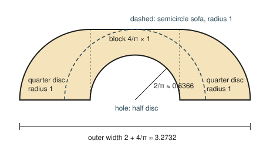
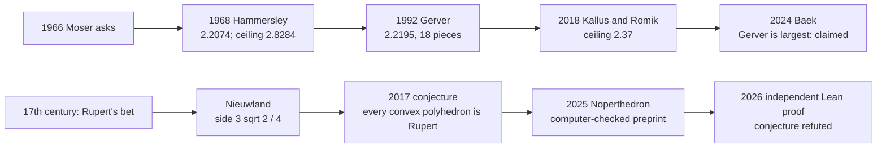

# Two shape puzzles settled: Gerver's sofa is the largest, and a solid that cannot pass through a copy of itself

[Syllabus](../../../SYLLABUS.md) → [Frontier](../README.md) → [Geometry and Combinatorics](../README.md#s04) → Two shape puzzles settled

---

## General Overview

A hallway is 1 metre wide and turns a right angle. What is the largest flat sofa that can be slid and turned around the corner? Leo Moser asked this in 1966. A half-disc of radius 1 works: it pivots in the corner. Its area is $`\pi/2 \approx 1.5708`$ square metres.

In 1968 John Hammersley did better. He cut the half-disc in two, slid the halves apart, filled the gap with a block, and cut a half-disc hole out of the block so it clears the inner corner. His sofa has area $`\pi/2 + 2/\pi \approx 2.2074`$. In 1992 Joseph Gerver built a sofa with 18 boundary pieces and area about 2.2195. On 2024-11-29 Jineon Baek posted a proof that nothing beats Gerver's sofa.

The second puzzle is older. In the 17th century Prince Rupert of the Rhine bet that a hole can be cut through a cube so that an equal cube passes through it. He was right: a cube of side up to $`3\sqrt{2}/4 \approx 1.0607`$ fits through a unit cube. In 2017 three authors conjectured that every **convex polyhedron** has this property: every solid with flat faces and no dents (convex: the straight segment between any two of its points stays inside it). On 2025-08-25 Jakob Steininger and Sergey Yurkevich posted a solid with 90 corners, the **Noperthedron**, and a computer-checked proof that no copy of it passes through it. A separate team has since checked that result with a formal proof in Lean, a program that checks every step of a proof.

**Both puzzles ask whether a shape fits: the sofa through a corner, the solid through itself. Showing that something fits needs one motion; showing that nothing bigger fits, or nothing fits at all, needs an argument that covers every motion, and in 2024 and 2025 both such arguments were posted.**

**What kind of fact this is:** two research results, outlined on this card with their sources. As of 2026-11-24 neither has a journal version. Baek's sofa proof is **claimed**: no refereed version or independent check was found. The 2017 conjecture is **refuted**: besides the authors' own exact recheck, a separate team has a complete Lean formal proof that the Noperthedron is not Rupert, stated with Mathlib's own definitions. The small facts the code checks (Hammersley's area, Nieuwland's square for the cube) are theorems.

**Status, 2026-11-24:**

| Claim | Kind | Status | Source |
| --- | --- | --- | --- |
| Hammersley's sofa has area $`\pi/2 + 2/\pi`$ | theorem | proved; redone on this card | Hammersley 1968, via Romik 2018 |
| the largest sofa has area at most $`2\sqrt{2}`$ | theorem | proved, 1968 | Hammersley, via Romik 2018 |
| the largest sofa has area at most 2.37 | theorem, computer-assisted | proved: refereed, 2018 | Kallus and Romik, as summarised by Baek |
| Gerver's sofa, area 2.2195…, is the largest | theorem | **claimed**: arXiv preprint posted 2024-11-29; no journal version found | Baek |
| a cube passes through a hole in a unit cube up to side $`3\sqrt{2}/4`$, and no larger | theorem | proved (the upper limit by Bezdek, Guan, Hujter and Joós in 2021, as cited by Steininger and Yurkevich) | Nieuwland; Steininger and Yurkevich 2023 |
| every convex polyhedron is Rupert | conjecture, 2017 | **refuted**: arXiv preprint posted 2025-08-25, revised 2026-01-28, no journal version found; checked independently by a Lean 4 formal proof, complete and checked by Lean's kernel alone by 2026-07-13 | Steininger and Yurkevich 2025; the [Lean proof](https://github.com/jcreedcmu/Noperthedron) |

<p align="center"></p>

Hammersley's sofa to scale, in units of the hallway width. The hole of radius $`2/\pi \approx 0.6366`$ clears the inner corner while the sofa turns. The dashed curve is the half-disc sofa, area 1.5708.

---

## The formula

Notation first, in words. A **sofa** is a connected flat shape that a rigid motion (sliding and turning, no bending) carries round the corner of a hallway of width 1. $`A`$ is its area. $`A_{\max}`$ is the largest area any sofa can have. $`G`$ is Gerver's sofa and $`|G|`$ its area.

Hammersley's family: two quarter discs of radius 1, a block $`2r`$ wide between them, and a half-disc hole of radius $`r`$:

```math
A(r) = \frac{\pi}{2} + 2r - \frac{\pi}{2}\,r^{2}, \qquad \max_{r} A(r) = A\!\left(\frac{2}{\pi}\right) = \frac{\pi}{2} + \frac{2}{\pi} \approx 2.2074
```

**Read it aloud:** the area is a half-disc's worth of quarter discs, plus a block of width 2r, minus a half-disc hole of radius r; it is largest when r is 2 over pi.

The sofa question and its claimed answer:

```math
2.2074 \;<\; |G| \approx 2.2195 \;\le\; A_{\max} \;\le\; 2.37, \qquad \text{claimed (2024): } A_{\max} = |G|
```

**Read it aloud:** Gerver's sofa beats Hammersley's; the largest area is at least Gerver's and at most 2.37; the 2024 claim is that it equals Gerver's.

Rupert's property, for a solid $`P`$ that is the same seen from its centre in opposite directions (**point-symmetric**, like a cube):

```math
P \text{ is Rupert} \iff R(\alpha)\,M(\theta_1,\varphi_1)\,P \;\subset\; \big(M(\theta_2,\varphi_2)\,P\big)^{\circ} \ \text{ for some } \theta_1,\varphi_1,\theta_2,\varphi_2,\alpha
```

**Read it aloud:** a solid is Rupert when some shadow of it, turned in its plane, fits strictly inside another shadow of it.

Here $`M(\theta,\varphi)\,P`$ is the **shadow** of $`P`$: its outline when light falls on it from the direction with angles $`\theta`$ and $`\varphi`$. The small circle $`^{\circ}`$ means the inside of that outline, without its edge. The shadow that fits is the moving copy, seen along the tunnel; the bigger shadow is the solid the tunnel is cut through.

| Symbol | Plain meaning | In our example | Push it up and the answer… |
| --- | --- | --- | --- |
| $`A`$, $`A(r)`$ | area of a sofa, in square hallway widths; $`A(r)`$ for Hammersley's with hole radius $`r`$ | 2.207416 at $`r = 2/\pi`$; 2.178097 at $`r = 0.5`$ | — |
| $`r`$ | radius of the hole in Hammersley's family | $`2/\pi \approx 0.6366`$ | area rises until $`r = 2/\pi`$, then falls |
| $`t`$ | angle the hallway has turned, seen from the sofa, from 0 to $`\pi/2`$ | — | — |
| $`n`$ | number of hallway positions the code uses | 800 and 1,600 | the computed area falls toward the true one |
| $`G`$, $`\lvert G\rvert`$ | Gerver's sofa and its area | 2.2195 | — |
| $`A_{\max}`$ | largest possible sofa area | claimed equal to $`\lvert G\rvert`$ | — |
| $`P`$ | a convex solid with flat faces (a **convex polyhedron**) | the unit cube; the Noperthedron | — |
| $`\theta, \varphi`$ | the two angles that fix a direction in space, like longitude and angle from the pole | five numbers in all, with $`\alpha`$ | — |
| $`M(\theta,\varphi)`$ | the map that flattens a solid to its shadow along that direction | the cube along its long diagonal: a hexagon | — |
| $`R(\alpha)`$ | a turn in the plane by angle $`\alpha`$ | — | — |
| $`C_1, C_2, C_3`$ | the three corners that generate the Noperthedron's 90 | distances 1, 0.985576 and 0.983499 from the centre | — |
| $`s`$ | side of the largest cube that passes through a unit cube | $`3\sqrt{2}/4 \approx 1.0607`$ | — |

### When it holds

- **The sofa is rigid and flat.** It may not bend, tilt or be lifted. Real removal crews lift and tilt, so the answer is about the idealized flat version.
- **The hallway turns one way only.** A sofa that must turn both left and right is a different problem, with a different best known shape (Romik, 2018).
- **"Fits" means strictly inside.** A shadow that touches the edge of the other does not leave a wall around the tunnel. Along a face diagonal of the cube, the best square has side exactly 1, which is not enough.
- **No sideways shift is needed only for point-symmetric solids.** For a solid that is not point-symmetric, the definition also allows shifting the smaller shadow, and the search gains two more numbers.
- **Floating-point searches are evidence.** The Noperthedron proof used exact fractions; a random search with rounded numbers, like the one in the code, proves nothing either way.

---

## Why it works

### Step 0: a fit needs one witness, a non-fit needs every case

To show a sofa turns the corner, write down one motion. To show a cube passes through a cube, name one pair of directions and one turn. These are **witnesses**: single cases, checkable exactly, as on [Counterexamples](../01-How%20Research%20Works/03-how-a-counterexample-works.md).

The other side is hard. "No sofa beats Gerver's" covers every shape and every motion. "No copy of the Noperthedron passes through it" covers every point of a five-number space. A search of finitely many cases cannot do it alone. The 2024 sofa proof covers every case by an argument written by hand; the 2025 solid proof covers them by splitting the space into about 18 million boxes and checking each box by computer.

### Step 1: a sofa is what survives every hallway position

Fix the sofa and move the hallway instead. As the hallway turns by $`t`$ from 0 to $`\pi/2`$, its inner corner travels along some path. The largest sofa for that path is the part of the plane inside every hallway position. That is an **intersection**: the points common to all the positions.

The code builds the sofa this way. It cuts the plane into $`n`$ thin rows, keeps in each row the stretch that lies inside all $`n + 1`$ hallway positions, and adds up the stretches. With finitely many positions the sofa comes out slightly too big, because the corner is checked only at those angles. The error halves when $`n`$ doubles, so twice the $`n = 1600`$ area minus the $`n = 800`$ area removes most of it (**Richardson extrapolation**).

- Corner fixed at one point: the hallway pivots, and the survivor is the half-disc, area 1.57079.
- Corner moving on a half-circle of radius $`2/\pi`$: the survivor is Hammersley's sofa, area 2.20742.

### Step 2: Hammersley's area, piece by piece

Hammersley's sofa is three simple shapes:

1. Two quarter discs of radius 1: together $`\pi/4 + \pi/4 = \pi/2`$.
2. A block of width $`2r`$ and height 1: area $`2r`$.
3. A half-disc hole of radius $`r`$: area $`\pi r^2/2`$ removed.

So $`A(r) = \pi/2 + 2r - \pi r^2/2`$. The slope in $`r`$ is $`2 - \pi r`$, zero at $`r = 2/\pi`$. There $`A = \pi/2 + 4/\pi - 2/\pi = \pi/2 + 2/\pi`$. Hammersley guessed this was the largest. It is not: other paths for the corner do better.

### Step 3: Gerver's sofa, from balance conditions

Gerver let the corner's path vary and asked what a best path must satisfy. At a best sofa, no small change of the path gains area. That gives **balance conditions**: rules that relate the lengths of opposite parts of the boundary.

They split the turn into five phases at angles $`\varphi`$, $`\theta`$, $`\pi/2 - \theta`$ and $`\pi/2 - \varphi`$. Gerver's four equations fix $`\varphi`$, $`\theta`$ and two helper numbers. The code solves them by Newton's method and gets $`\varphi = 0.0391773648`$ and $`\theta = 0.6813015094`$, agreeing with Romik's 2018 table within $`10^{-12}`$. It then builds the sofa from Romik's five-phase path and gets 2.21952, against the published 2.21953166. The gain over Hammersley is 0.0121.

### Step 4: Baek's 2024 proof, in outline

This step outlines a research proof. It gives the statement, the key steps and the source; it does not prove the result.

**Statement.** Gerver's sofa has the largest area of any sofa: $`A_{\max} = |G|`$.

**The difficulty.** No single formula gives the area of every possible sofa. So the proof cannot simply maximise a formula.

**The key steps**, in the preprint's own order:

1. Narrow the search. A largest sofa can be taken **monotone** (a convex shape with a dent carved by the corner), **balanced** (Gerver's conditions hold), and turned through the full right angle.
2. Prove the **injectivity condition**: seen from the sofa, the corner's path never crosses itself.
3. Bound the area. Around any such sofa draw a slightly larger region whose area, the **bound**, has a formula. The bound is at least the sofa's area, and equals it for Gerver's sofa.
4. Show the bound is **concave**: on a straight line between two candidate shapes, it bends down, like an upside-down bowl. For such a function a local top is the global top.
5. Show Gerver's sofa is a local top of the bound, using Romik's balance equations. So it is the global top, and the sofa areas cannot beat it.

**Machine help.** The preprint states that the proof needs no computer, apart from numbers that a scientific calculator can produce. An earlier version was computer-assisted; the final one is not. As of 2026-11-24, no refereed version was found, so the status is claimed.

### Step 5: Rupert's cube, from shadows

Push a solid along a straight tunnel. The tunnel's cross-section must contain the moving solid's shadow along the tunnel. The fixed solid keeps a wall round the tunnel only if that cross-section lies strictly inside its own shadow. So a passage exists exactly when one shadow fits strictly inside another.

Seen along its long diagonal, the unit cube casts a regular hexagon of side $`\sqrt{2/3}`$. Seen face-on it casts a unit square. The square fits inside the hexagon with room to spare: Rupert's bet is won. The best square along that diagonal has side $`\sqrt{6} - \sqrt{2} \approx 1.0353`$.

Pieter Nieuwland, about a century after Rupert's death, tilted the tunnel. His square has corners on four edges of the cube, at $`(3/4, 0, 0)`$, $`(0, 3/4, 0)`$, $`(1/4, 1, 1)`$ and $`(1, 1/4, 1)`$. Each side has squared length $`(3/4)^2 + (3/4)^2 = 9/8`$, so the side is $`3\sqrt{2}/4 \approx 1.0607`$. Any slightly smaller square fits strictly inside the cube's shadow seen square-on to Nieuwland's square, so every cube of side below 1.0607 passes through.

The code checks this two ways. In exact fractions, it tests the square against each of the shadow's three pairs of parallel edges. A test value is the shadow's width across one pair, divided by the width across that pair of a square of side $`3\sqrt{2}`$ turned like Nieuwland's. Shrunk by that factor, the square just touches that pair of edges, so the largest side is $`3\sqrt{2}`$ times the smallest test value. The three test values are $`1/4`$, $`1/4`$ and $`1/3`$, and the smallest, $`1/4`$, gives side $`3\sqrt{2} \times 1/4`$. Then it searches all directions and turns in floating point and finds no bigger square: 1.060660 again.

### Step 6: the Noperthedron, in outline

This step outlines a research proof, computer-assisted. It gives the statement, the method and the source.

**Statement.** The Noperthedron is a convex polyhedron with 90 corners, and it is not Rupert. This refutes the 2017 conjecture of Jerrard, Wetzel and Yuan that every convex polyhedron is Rupert.

**The solid.** Three points $`C_1, C_2, C_3`$, each turned 15 times about an axis by $`2\pi/15`$ and also reflected through the centre: $`3 \times 30 = 90`$ corners. $`C_1`$ is exactly distance 1 from the centre, because $`152024884^2 + 210152163^2 = 259375205^2`$; the other two lie between 0.98 and 0.99.

**The method.**

1. Use the 30 symmetries to shrink the range of the five numbers $`\theta_1, \varphi_1, \theta_2, \varphi_2, \alpha`$.
2. Split that range into small boxes. Rule out each box by one of two theorems. The **global** one finds a corner of the moving shadow that sticks out of the fixed shadow for every point of the box. The **local** one handles boxes where the two shadows nearly coincide.
3. The split has 585,200 inner nodes and 18,115,245 boxes: 17,492,530 ruled out by the global theorem and 622,715 by the local one. Building the split took about 7 hours.
4. Recheck every box in exact rational arithmetic, with no rounding, in about 30 hours. This recheck, not the floating-point build, is the proof.

**The audit list** from [Machines in proofs](../01-How%20Research%20Works/06-computer-assistance-and-formal-verification.md):

| Field | Noperthedron |
| --- | --- |
| statement | the 90-corner solid has no Rupert passage; restated in Lean 4 with Mathlib's own definitions of rotations, shift and the inside of a shadow |
| artifact | the table of 18,115,245 boxes and the exact checking code, published by the authors; a separate [Lean 4 proof](https://github.com/jcreedcmu/Noperthedron) with its own certificate |
| independent check | the Lean proof, by a team separate from the authors, checked by Lean's kernel alone and resting only on Lean's three standard axioms, as its project reports; complete by 2026-07-13, last updated 2026-11-24; not compiled for this card |
| status | refuted (the 2017 conjecture) as of 2026-11-24; preprint posted 2025-08-25, revised 2026-01-28, no journal version found |



---

## Worked numbers, by hand

| Step | Arithmetic | Value |
| --- | --- | --- |
| half-disc sofa | $`\pi/2`$ | 1.570796 |
| Hammersley's best hole | slope $`2 - \pi r = 0`$ | $`r = 2/\pi = 0.636620`$ |
| Hammersley's area | $`\pi/2 + 4/\pi - 2/\pi`$ | 2.207416 |
| same, built from the motion | $`2 \times 2.207819 - 2.208215`$ | 2.20742 |
| Gerver's area, built from the motion | $`2 \times 2.219902 - 2.220280`$ | 2.21952 |
| Gerver's gain | $`2.21952 - 2.20742`$ | 0.0121 |
| Hammersley's ceiling | $`2\sqrt{2}`$ | 2.828427 |
| Rupert along the long diagonal | best square | $`\sqrt{6} - \sqrt{2} = 1.035276`$ |
| Nieuwland's square | side$`^2 = (3/4)^2 + (3/4)^2 = 9/8`$ | **side 1.060660** |

The sofa answer lies between 2.2195 and the proved ceiling 2.37 for certain, and equals 2.2195 if Baek's proof stands. For the cube, every side below 1.060660 passes.

### What breaks if you drop a piece

| Mistake | Comes out at | What went wrong |
| --- | --- | --- |
| Hole as wide as the hallway, $`r = 1`$ | area 2.000000, against 2.207416 | The block gains 2 but the hole loses $`\pi/2`$; the best hole is $`2/\pi`$ |
| Too few hallway positions, no extrapolation | Gerver at 2.220280 with $`n = 800`$, above the true 2.2195 | Checking the corner at finitely many angles leaves the sofa too big |
| Tunnel along the long diagonal only | side 1.035276, against 1.060660 | Rupert's direction works, but a tilted tunnel does better |
| Random search read as proof | 0 passages in 20,000 tries for the Noperthedron | The cube passes in only 111 of 20,000 tries; rarer passages could be missed |

---

## Code, from first principles, and it actually runs

The code takes two roads to each number. For the sofas, it sets a closed formula for Hammersley's area against a search over the hole radius, and both against the sofa built from its motion as an intersection of hallways; for Gerver's sofa, it solves Gerver's equations by Newton's method against Romik's table, and builds the sofa from its motion against the published area. For the cube, it checks Nieuwland's square in exact fractions and then searches every direction in floating point. Last, it runs the same random search, with a written-out SplitMix64 generator and seed 2025, on the cube and on the Noperthedron. That search is evidence only: it finds the cube's passages and none for the Noperthedron.

### Python

```python
# Moving sofa and Rupert's problem: the check behind the card. Standard library only.
import math
from fractions import Fraction as Fr
INF, PI = float("inf"), math.pi
# Part 1. A path x(t) carries the hallway's inner corner as the hallway turns by t.
def cut(S, a, b, lo, hi):  # keep x in S with lo <= a*x + b <= hi
    if abs(a) < 1e-15:
        return S if lo <= b <= hi else []
    u, v = sorted(((lo - b) / a, (hi - b) / a))
    return [(max(p, u), min(q, v)) for p, q in S if max(p, u) < min(q, v)]
def merge(S):
    m = []
    for iv in sorted(S):
        if m and iv[0] <= m[-1][1]: m[-1] = (m[-1][0], max(m[-1][1], iv[1]))
        else: m.append(iv)
    return m
def area_from_motion(path, n):  # n hallway angles, n rows of the sofa
    pre = [(math.cos(t), math.sin(t)) + path(t) for t in (PI / 2 * k / n for k in range(n + 1))]
    total = 0.0
    for j in range(n):
        y, S = (j + 0.5) / n, [(-INF, 1.0)]
        for i, (c, s, x1, x2) in enumerate(pre):  # q1 = c*x + k1 and q2 = -s*x + k2
            k1, k2 = -c * x1 + s * (y - x2), s * x1 + c * (y - x2)
            arm_v = cut(cut(S, -s, k2, -INF, 1.0), c, k1, 0.0, 1.0)
            arm_h = [] if i == n else cut(cut(S, c, k1, -INF, 1.0), -s, k2, 0.0, 1.0)
            S = merge(arm_h + arm_v)
        total += sum(q - p for p, q in S) / n
    return total
def extrapolate(path, label):
    a1, a2 = area_from_motion(path, 800), area_from_motion(path, 1600)
    print(f"{label}: n=800 {a1:.6f}  n=1600 {a2:.6f}  extrapolated {2 * a2 - a1:.5f}")
    return 2 * a2 - a1
f = lambda r: PI / 2 + 2 * r - PI / 2 * r * r  # Hammersley's family, hole radius r
print("Part 1. Sofas in a hallway of width 1")
for name, r in [("semicircle", 0.0), ("half-size hole", 0.5), ("Hammersley 2/pi", 2 / PI), ("full-width hole", 1.0)]:
    print(f"r = {r:.6f} ({name}): area {f(r):.6f}")
best = max(range(10001), key=lambda k: f(k / 10000)) / 10000
print(f"best r by search over 10,001 steps: {best:.4f}, area {f(best):.6f}")
assert abs(best - 2 / PI) < 1e-4 and abs(f(best) - (PI / 2 + 2 / PI)) < 1e-8
semi = extrapolate(lambda t: (0.0, 0.0), "semicircle from its motion")
ham = extrapolate(lambda t: (2 / PI * (math.cos(2 * t) - 1), 2 / PI * math.sin(2 * t)), "Hammersley from its motion")
assert abs(semi - PI / 2) < 1e-4 and abs(ham - f(2 / PI)) < 1e-4
def gerver_eqs(v):  # Gerver's four equations (1992), as written by Romik (2018)
    A, B, p, t = v
    return [A * (math.cos(t) - math.cos(p)) - 2 * B * math.sin(p) + (t - p - 1) * math.cos(t) - math.sin(t) + math.cos(p) + math.sin(p),
            A * (3 * math.sin(t) + math.sin(p)) - 2 * B * math.cos(p) + 3 * (t - p - 1) * math.sin(t) + 3 * math.cos(t) - math.sin(p) + math.cos(p),
            A * math.cos(p) - (math.sin(p) + 0.5 - 0.5 * math.cos(p) + B * math.sin(p)),
            (A + PI / 2 - p - t) - (B - 0.5 * (t - p) * (1 + A) - 0.25 * (t - p) ** 2)]
v = [0.1, 1.4, 0.04, 0.7]
for _ in range(30):  # Newton's method with a finite-difference Jacobian
    F0 = gerver_eqs(v)
    J = [[(gerver_eqs([v[k] + (1e-7 if k == j else 0) for k in range(4)])[i] - F0[i]) / 1e-7 for j in range(4)] + [-F0[i]] for i in range(4)]
    for c in range(4):  # Gaussian elimination with partial pivoting
        p = max(range(c, 4), key=lambda r: abs(J[r][c])); J[c], J[p] = J[p], J[c]
        for r in range(c + 1, 4):
            m = J[r][c] / J[c][c]; J[r] = [J[r][k] - m * J[c][k] for k in range(5)]
    d = [0.0] * 4
    for c in range(3, -1, -1): d[c] = (J[c][4] - sum(J[c][k] * d[k] for k in range(c + 1, 4))) / J[c][c]
    v = [v[k] + d[k] for k in range(4)]
A, B, phi, th = v
print(f"Gerver's equations by Newton: A {A:.10f}  B {B:.10f}  phi {phi:.10f}  theta {th:.10f}")
assert abs(phi - 0.039177364790083641) < 1e-12 and abs(th - 0.681301509382724894) < 1e-12  # Romik's table
a1, kap = 1.210322422072688751, [(-0.210322422072688751, 0.25), (-0.919179292771593322, 0.472406619750805465),
    (-0.613763229430251668, 0.889626479003221860), (-0.308347166088910014, 0.472406619750805465), (-1.017204036787814585, 0.25)]
b1, b2, c1, c2, d1, d2 = -0.527624598026784624, 0.920258385160637622, 0.626045522848465867, -0.944750803946430751, 1.313022761424232933, -0.525382670414554437
def turn(t, u, w, k): return (math.cos(t) * u - math.sin(t) * w + k[0], math.sin(t) * u + math.cos(t) * w + k[1])
phases = [lambda t: turn(t, a1 * math.cos(t) - 0.25 * math.sin(t) - 1, 0.25 * math.cos(t) + a1 * math.sin(t) - 0.5, kap[0]),
          lambda t: turn(t, -t * t / 4 + b1 * t + b2, t / 2 - b1 - 1, kap[1]),
          lambda t: turn(t, c1 - t, c2 + t, kap[2]),
          lambda t: turn(t, -t / 2 + d1 - 1, -t * t / 4 + d1 * t + d2, kap[3]),
          lambda t: turn(t, a1 * math.cos(t) + 0.25 * math.sin(t) - 0.5, -0.25 * math.cos(t) + a1 * math.sin(t) - 1, kap[4])]
cuts = [phi, th, PI / 2 - th, PI / 2 - phi]
gap = max(math.dist(phases[i](cuts[i]), phases[i + 1](cuts[i])) for i in range(4))
assert gap < 1e-12 and math.dist(phases[0](0.0), (0, 0)) < 1e-12  # the five pieces join up
gerver = extrapolate(lambda t: phases[sum(t >= c for c in cuts)](t), "Gerver from its motion")
print(f"Gerver published 2.21953166; gain over Hammersley {gerver - ham:.4f}; upper bound 2 sqrt 2 = {2 * math.sqrt(2):.6f}")
assert abs(gerver - 2.21953166) < 1e-4 and gerver > ham + 0.01
# Part 2. The cube's shadow along u has edge normals u x e_i; test the square on each.
def cross(u, e): return (u[1] * e[2] - u[2] * e[1], u[2] * e[0] - u[0] * e[2], u[0] * e[1] - u[1] * e[0])
dot = lambda p, q: sum(x * y for x, y in zip(p, q))
E = [(1, 0, 0), (0, 1, 0), (0, 0, 1)]
P = [(Fr(3, 4), 0, 0), (0, Fr(3, 4), 0), (Fr(1, 4), 1, 1), (1, Fr(1, 4), 1)]  # Nieuwland's square
sides = [tuple(P[(i + 1) % 4][k] - P[i][k] for k in range(3)) for i in range(4)]
assert all(sum(c in (0, 1) for c in p) == 2 for p in P) and all(dot(s, s) == Fr(9, 8) for s in sides) and all(dot(sides[i], sides[(i + 1) % 4]) == 0 for i in range(4))
U, Av, Bv = (2, 2, -1), (-1, 1, 0), (1, 1, 4)  # normal, and the square's two directions (lengths sqrt2, 3 sqrt2)
ratios = [Fr(sum(abs(x) for x in cross(U, e)), 3 * abs(dot(cross(U, e), Av)) + abs(dot(cross(U, e), Bv))) for e in E]
s2 = 18 * min(ratios) ** 2
print("Part 2. A cube through a cube")
print(f"Nieuwland's square: corners on cube edges, sides^2 = 9/8, right angles; edge ratios {[str(r) for r in ratios]}; s^2 = {s2}")
def face_on(u, al):  # largest square side, square turned by al in the shadow plane
    n = math.sqrt(dot(u, u)); u = [x / n for x in u]
    a0 = cross(u, (0, 0, 1) if abs(u[2]) < 0.9 else (1, 0, 0)); n = math.sqrt(dot(a0, a0)); a0 = [x / n for x in a0]; b0 = cross(u, a0)
    a = [math.cos(al) * p + math.sin(al) * q for p, q in zip(a0, b0)]; b = [-math.sin(al) * p + math.cos(al) * q for p, q in zip(a0, b0)]
    return min(sum(map(abs, w)) / (abs(dot(w, a)) + abs(dot(w, b))) for w in (cross(u, e) for e in E))
diag = max(face_on((1, 1, 1), PI / 2 * k / 20000) for k in range(20000))
print(f"along the main diagonal: best side {diag:.6f}; sqrt 6 - sqrt 2 = {math.sqrt(6) - math.sqrt(2):.6f}")
assert abs(diag - (math.sqrt(6) - math.sqrt(2))) < 1e-6
sph = lambda th, ph: (math.cos(th) * math.sin(ph), math.sin(th) * math.sin(ph), math.cos(ph))
g = [(face_on(sph(PI / 2 * i / 24, PI * j / 24), PI / 2 * k / 24), PI / 2 * i / 24, PI * j / 24, PI / 2 * k / 24) for i in range(25) for j in range(1, 24) for k in range(24)]
s, th1, ph1, al1 = max(g); step = PI / 48
while step > 1e-9:  # pattern search from the best grid point
    moves = [(th1 + step, ph1, al1), (th1 - step, ph1, al1), (th1, ph1 + step, al1), (th1, ph1 - step, al1), (th1, ph1, al1 + step), (th1, ph1, al1 - step)]
    cand = max((face_on(sph(p, q), r), p, q, r) for p, q, r in moves)
    if cand[0] > s: s, th1, ph1, al1 = cand
    else: step /= 2
print(f"search over all directions and turns: best side {s:.6f}; exact 3 sqrt 2 / 4 = {3 * math.sqrt(2) / 4:.6f}")
assert s2 == Fr(9, 8) and abs(s - math.sqrt(float(s2))) < 1e-6
# Random search (Steininger and Yurkevich 2023): is one turned shadow strictly inside another?
class SplitMix64:
    def __init__(self, seed): self.x = seed
    def unit(self):
        self.x = (self.x + 0x9E3779B97F4A7C15) % 2**64; z = self.x
        z = ((z ^ (z >> 30)) * 0xBF58476D1CE4E5B9) % 2**64; z = ((z ^ (z >> 27)) * 0x94D049BB133111EB) % 2**64
        return ((z ^ (z >> 31)) >> 11) / 2**53
def shadow(V, th, ph):  # the projection M(theta, phi) of the 2025 paper, then the convex hull
    pts = sorted({(-math.sin(th) * x + math.cos(th) * y, -math.cos(th) * math.cos(ph) * x - math.sin(th) * math.cos(ph) * y + math.sin(ph) * z) for x, y, z in V})
    def half(seq):  # Andrew's monotone chain: keep only left turns
        h = []
        for p in seq:
            while len(h) >= 2 and (h[-1][0] - h[-2][0]) * (p[1] - h[-2][1]) - (h[-1][1] - h[-2][1]) * (p[0] - h[-2][0]) <= 0: h.pop()
            h.append(p)
        return h[:-1]
    return half(pts) + half(pts[::-1])
def passes(V, rng):
    t1, p1, t2, p2, al = (rng.unit() * m for m in (2 * PI, PI, 2 * PI, PI, 2 * PI))
    inner = [(math.cos(al) * x - math.sin(al) * y, math.sin(al) * x + math.cos(al) * y) for x, y in shadow(V, t1, p1)]
    H = shadow(V, t2, p2)
    return all((b[0] - a[0]) * (q[1] - a[1]) - (b[1] - a[1]) * (q[0] - a[0]) > 1e-12 for a, b in zip(H, H[1:] + H[:1]) for q in inner)
cube = [(x, y, z) for x in (-0.5, 0.5) for y in (-0.5, 0.5) for z in (-0.5, 0.5)]
C = [tuple(v / 259375205 for v in (152024884, 0, 210152163)), (0.6632738028, 0.6106948881, 0.3980949609), (0.8193990033, 0.5298215096, 0.1230614493)]
nop = [(sg * (math.cos(2 * PI * k / 15) * x - math.sin(2 * PI * k / 15) * y), sg * (math.sin(2 * PI * k / 15) * x + math.cos(2 * PI * k / 15) * y), sg * z) for x, y, z in C for k in range(15) for sg in (1, -1)]
assert sum(round(v * 259375205) ** 2 for v in C[0]) == 259375205 ** 2 and all(0.98 < math.dist(c, (0, 0, 0)) < 0.99 for c in C[1:])
assert len({tuple(round(c, 9) for c in p) for p in nop}) == 90
print(f"Noperthedron: 90 distinct vertices; |C1| = 1 exactly; |C2| {math.dist(C[1], (0, 0, 0)):.6f}  |C3| {math.dist(C[2], (0, 0, 0)):.6f}")
for name, V in [("cube", cube), ("Noperthedron", nop)]:
    rng = SplitMix64(2025); hits = [i for i in range(1, 20001) if passes(V, rng)]
    print(f"random tries, {name}: {len(hits)} passages in 20,000; first at try {hits[0] if hits else 'none'}")
    assert (len(hits) > 0) == (name == "cube")
print(f"figure, hole radius {2 / PI:.4f}, outer width {2 + 4 / PI:.4f}, quarter-disc centres x = -{2 / PI:.4f} and {2 / PI:.4f}")
print("ALL CHECKS PASS")
```

**Ran 2026-11-24 on macOS, Python 3.14.10, standard library only. All checks passed. Output, pasted from the run:**

```
Part 1. Sofas in a hallway of width 1
r = 0.000000 (semicircle): area 1.570796
r = 0.500000 (half-size hole): area 2.178097
r = 0.636620 (Hammersley 2/pi): area 2.207416
r = 1.000000 (full-width hole): area 2.000000
best r by search over 10,001 steps: 0.6366, area 2.207416
semicircle from its motion: n=800 1.570804  n=1600 1.570799  extrapolated 1.57079
Hammersley from its motion: n=800 2.208215  n=1600 2.207819  extrapolated 2.20742
Gerver's equations by Newton: A 0.0944265608  B 1.3992037273  phi 0.0391773648  theta 0.6813015094
Gerver from its motion: n=800 2.220280  n=1600 2.219902  extrapolated 2.21952
Gerver published 2.21953166; gain over Hammersley 0.0121; upper bound 2 sqrt 2 = 2.828427
Part 2. A cube through a cube
Nieuwland's square: corners on cube edges, sides^2 = 9/8, right angles; edge ratios ['1/4', '1/4', '1/3']; s^2 = 9/8
along the main diagonal: best side 1.035276; sqrt 6 - sqrt 2 = 1.035276
search over all directions and turns: best side 1.060660; exact 3 sqrt 2 / 4 = 1.060660
Noperthedron: 90 distinct vertices; |C1| = 1 exactly; |C2| 0.985576  |C3| 0.983499
random tries, cube: 111 passages in 20,000; first at try 149
random tries, Noperthedron: 0 passages in 20,000; first at try none
figure, hole radius 0.6366, outer width 3.2732, quarter-disc centres x = -0.6366 and 0.6366
ALL CHECKS PASS
```

### Rust

Same numbers, same labels, built with `rustc --edition 2021 -O`. Python's `sum` adds floating-point numbers with a running correction, so the Rust code writes out the same compensated sum to match it to the last digit.

```rust
// Moving sofa and Rupert's problem: the check behind the card. Standard library only.
use std::f64::consts::PI;
const INF: f64 = f64::INFINITY;
type V3 = [f64; 3];
fn fsum<I: IntoIterator<Item = f64>>(it: I) -> f64 { let (mut hi, mut lo) = (0.0f64, 0.0f64); // compensated, as Python's sum()
    for x in it { let t = hi + x; if hi.abs() >= x.abs() { lo += (hi - t) + x } else { lo += (x - t) + hi } hi = t; }
    if lo != 0.0 && lo.is_finite() { hi + lo } else { hi }
}
fn pmax(a: f64, b: f64) -> f64 { if b > a { b } else { a } } fn pmin(a: f64, b: f64) -> f64 { if b < a { b } else { a } }
// Part 1. A path x(t) carries the hallway's inner corner as the hallway turns by t.
fn cut(s: &[(f64, f64)], a: f64, b: f64, lo: f64, hi: f64) -> Vec<(f64, f64)> { // keep x with lo <= a*x + b <= hi
    if a.abs() < 1e-15 { return if lo <= b && b <= hi { s.to_vec() } else { vec![] }; }
    let (mut u, mut v) = ((lo - b) / a, (hi - b) / a);
    if v < u { std::mem::swap(&mut u, &mut v); }
    s.iter().filter_map(|&(p, q)| { let (l, r) = (pmax(p, u), pmin(q, v)); if l < r { Some((l, r)) } else { None } }).collect()
}
fn merge(mut s: Vec<(f64, f64)>) -> Vec<(f64, f64)> {
    s.sort_by(|x, y| x.partial_cmp(y).unwrap()); let mut m: Vec<(f64, f64)> = vec![];
    for iv in s { if let Some(last) = m.last_mut() { if iv.0 <= last.1 { last.1 = pmax(last.1, iv.1); continue; } } m.push(iv); }
    m
}
fn area_from_motion(path: &dyn Fn(f64) -> (f64, f64), n: usize) -> f64 { // n hallway angles, n rows of the sofa
    let pre: Vec<(f64, f64, f64, f64)> = (0..=n).map(|k| { let t = PI / 2.0 * k as f64 / n as f64; let (x1, x2) = path(t); (t.cos(), t.sin(), x1, x2) }).collect();
    let mut total = 0.0;
    for j in 0..n {
        let (y, mut s) = ((j as f64 + 0.5) / n as f64, vec![(-INF, 1.0)]);
        for (i, &(c, sn, x1, x2)) in pre.iter().enumerate() { // q1 = c*x + k1 and q2 = -s*x + k2
            let (k1, k2) = (-c * x1 + sn * (y - x2), sn * x1 + c * (y - x2));
            let mut arm = if i == n { vec![] } else { cut(&cut(&s, c, k1, -INF, 1.0), -sn, k2, 0.0, 1.0) };
            arm.extend(cut(&cut(&s, -sn, k2, -INF, 1.0), c, k1, 0.0, 1.0));
            s = merge(arm);
        }
        total += fsum(s.iter().map(|&(p, q)| q - p)) / n as f64;
    } total
}
fn extrapolate(path: &dyn Fn(f64) -> (f64, f64), label: &str) -> f64 {
    let (a1, a2) = (area_from_motion(path, 800), area_from_motion(path, 1600));
    println!("{label}: n=800 {a1:.6}  n=1600 {a2:.6}  extrapolated {:.5}", 2.0 * a2 - a1); 2.0 * a2 - a1
}
fn f(r: f64) -> f64 { PI / 2.0 + 2.0 * r - PI / 2.0 * r * r } // Hammersley's family, hole radius r
fn gerver_eqs(v: &[f64; 4]) -> [f64; 4] { // Gerver's four equations (1992), as written by Romik (2018)
    let (a, b, p, t) = (v[0], v[1], v[2], v[3]);
    [a * (t.cos() - p.cos()) - 2.0 * b * p.sin() + (t - p - 1.0) * t.cos() - t.sin() + p.cos() + p.sin(),
     a * (3.0 * t.sin() + p.sin()) - 2.0 * b * p.cos() + 3.0 * (t - p - 1.0) * t.sin() + 3.0 * t.cos() - p.sin() + p.cos(),
     a * p.cos() - (p.sin() + 0.5 - 0.5 * p.cos() + b * p.sin()),
     (a + PI / 2.0 - p - t) - (b - 0.5 * (t - p) * (1.0 + a) - 0.25 * ((t - p) * (t - p)))]
}
fn turn(t: f64, u: f64, w: f64, k: (f64, f64)) -> (f64, f64) { (t.cos() * u - t.sin() * w + k.0, t.sin() * u + t.cos() * w + k.1) }
const A1: f64 = 1.210322422072688751;
const KAP: [(f64, f64); 5] = [(-0.210322422072688751, 0.25), (-0.919179292771593322, 0.472406619750805465),
    (-0.613763229430251668, 0.889626479003221860), (-0.308347166088910014, 0.472406619750805465), (-1.017204036787814585, 0.25)];
const B1: f64 = -0.527624598026784624; const B2: f64 = 0.920258385160637622; const C1: f64 = 0.626045522848465867; const C2: f64 = -0.944750803946430751; const D1: f64 = 1.313022761424232933; const D2: f64 = -0.525382670414554437;
fn phase(i: usize, t: f64) -> (f64, f64) { match i {
        0 => turn(t, A1 * t.cos() - 0.25 * t.sin() - 1.0, 0.25 * t.cos() + A1 * t.sin() - 0.5, KAP[0]),
        1 => turn(t, -t * t / 4.0 + B1 * t + B2, t / 2.0 - B1 - 1.0, KAP[1]),
        2 => turn(t, C1 - t, C2 + t, KAP[2]),
        3 => turn(t, -t / 2.0 + D1 - 1.0, -t * t / 4.0 + D1 * t + D2, KAP[3]),
        _ => turn(t, A1 * t.cos() + 0.25 * t.sin() - 0.5, -0.25 * t.cos() + A1 * t.sin() - 1.0, KAP[4]) }
}
fn dist(p: (f64, f64), q: (f64, f64)) -> f64 { ((p.0 - q.0) * (p.0 - q.0) + (p.1 - q.1) * (p.1 - q.1)).sqrt() }
// Part 2. The cube's shadow along u has edge normals u x e_i; test the square on each.
fn cross(u: V3, e: V3) -> V3 { [u[1] * e[2] - u[2] * e[1], u[2] * e[0] - u[0] * e[2], u[0] * e[1] - u[1] * e[0]] }
fn dot(p: V3, q: V3) -> f64 { fsum((0..3).map(|i| p[i] * q[i])) }
const E: [V3; 3] = [[1.0, 0.0, 0.0], [0.0, 1.0, 0.0], [0.0, 0.0, 1.0]];
fn face_on(u: V3, al: f64) -> f64 { // largest square side, square turned by al in the shadow plane
    let n = dot(u, u).sqrt(); let u = [u[0] / n, u[1] / n, u[2] / n];
    let a0 = cross(u, if u[2].abs() < 0.9 { [0.0, 0.0, 1.0] } else { [1.0, 0.0, 0.0] });
    let n = dot(a0, a0).sqrt(); let a0 = [a0[0] / n, a0[1] / n, a0[2] / n]; let b0 = cross(u, a0);
    let a: V3 = std::array::from_fn(|i| al.cos() * a0[i] + al.sin() * b0[i]);
    let b: V3 = std::array::from_fn(|i| -al.sin() * a0[i] + al.cos() * b0[i]);
    E.iter().map(|&e| { let w = cross(u, e); fsum(w.iter().map(|x| x.abs())) / (dot(w, a).abs() + dot(w, b).abs()) }).fold(INF, pmin)
}
fn sph(th: f64, ph: f64) -> V3 { [th.cos() * ph.sin(), th.sin() * ph.sin(), ph.cos()] }
fn gcd(a: i64, b: i64) -> i64 { if b == 0 { a.abs() } else { gcd(b, a % b) } } fn frac(n: i64, d: i64) -> (i64, i64) { let g = gcd(n, d); (n / g, d / g) }
// Random search (Steininger and Yurkevich 2023): is one turned shadow strictly inside another?
struct SplitMix64(u64);
impl SplitMix64 { fn unit(&mut self) -> f64 {
    self.0 = self.0.wrapping_add(0x9E3779B97F4A7C15); let mut z = self.0;
    z = (z ^ (z >> 30)).wrapping_mul(0xBF58476D1CE4E5B9); z = (z ^ (z >> 27)).wrapping_mul(0x94D049BB133111EB);
    ((z ^ (z >> 31)) >> 11) as f64 / 9007199254740992.0
} }
fn shadow(v: &[V3], th: f64, ph: f64) -> Vec<(f64, f64)> { // the projection M(theta, phi) of the 2025 paper, then the convex hull
    let mut pts: Vec<(f64, f64)> = v.iter().map(|&[x, y, z]| (-th.sin() * x + th.cos() * y, -th.cos() * ph.cos() * x - th.sin() * ph.cos() * y + ph.sin() * z)).collect();
    pts.sort_by(|a, b| a.partial_cmp(b).unwrap()); pts.dedup();
    let half = |seq: &mut dyn Iterator<Item = (f64, f64)>| { // Andrew's monotone chain: keep only left turns
        let mut h: Vec<(f64, f64)> = vec![]; for p in seq {
            while h.len() >= 2 { let (a, b) = (h[h.len() - 2], h[h.len() - 1]); if (b.0 - a.0) * (p.1 - a.1) - (b.1 - a.1) * (p.0 - a.0) <= 0.0 { h.pop(); } else { break; } }
            h.push(p);
        }
        h.pop(); h
    };
    let mut hull = half(&mut pts.iter().copied()); hull.extend(half(&mut pts.iter().rev().copied())); hull
}
fn passes(v: &[V3], rng: &mut SplitMix64) -> bool {
    let r: Vec<f64> = [2.0 * PI, PI, 2.0 * PI, PI, 2.0 * PI].iter().map(|m| rng.unit() * m).collect(); let al = r[4];
    let (inner, h): (Vec<(f64, f64)>, _) = (shadow(v, r[0], r[1]).iter().map(|&(x, y)| (al.cos() * x - al.sin() * y, al.sin() * x + al.cos() * y)).collect(), shadow(v, r[2], r[3]));
    (0..h.len()).all(|i| { let (a, b) = (h[i], h[(i + 1) % h.len()]); inner.iter().all(|q| (b.0 - a.0) * (q.1 - a.1) - (b.1 - a.1) * (q.0 - a.0) > 1e-12) })
}
fn main() {
    println!("Part 1. Sofas in a hallway of width 1");
    for (name, r) in [("semicircle", 0.0), ("half-size hole", 0.5), ("Hammersley 2/pi", 2.0 / PI), ("full-width hole", 1.0)] { println!("r = {r:.6} ({name}): area {:.6}", f(r)); }
    let mut kbest = 0; for k in 0..=10000 { if f(k as f64 / 10000.0) > f(kbest as f64 / 10000.0) { kbest = k; } }
    let best = kbest as f64 / 10000.0;
    println!("best r by search over 10,001 steps: {best:.4}, area {:.6}", f(best));
    assert!((best - 2.0 / PI).abs() < 1e-4 && (f(best) - (PI / 2.0 + 2.0 / PI)).abs() < 1e-8);
    let semi = extrapolate(&|_t| (0.0, 0.0), "semicircle from its motion");
    let ham = extrapolate(&|t: f64| (2.0 / PI * ((2.0 * t).cos() - 1.0), 2.0 / PI * (2.0 * t).sin()), "Hammersley from its motion");
    assert!((semi - PI / 2.0).abs() < 1e-4 && (ham - f(2.0 / PI)).abs() < 1e-4);
    let mut v = [0.1, 1.4, 0.04, 0.7];
    for _ in 0..30 { // Newton's method with a finite-difference Jacobian
        let (f0, mut jm) = (gerver_eqs(&v), [[0.0f64; 5]; 4]);
        for i in 0..4 { for j in 0..4 { let mut w = v; w[j] = v[j] + 1e-7; jm[i][j] = (gerver_eqs(&w)[i] - f0[i]) / 1e-7; } jm[i][4] = -f0[i]; }
        for c in 0..4 { // Gaussian elimination with partial pivoting
            let mut p = c; for r in c..4 { if jm[r][c].abs() > jm[p][c].abs() { p = r; } } jm.swap(c, p);
            for r in c + 1..4 { let m = jm[r][c] / jm[c][c]; for k in 0..5 { jm[r][k] = jm[r][k] - m * jm[c][k]; } } }
        let mut d = [0.0f64; 4]; for c in (0..4).rev() { d[c] = (jm[c][4] - fsum((c + 1..4).map(|k| jm[c][k] * d[k]))) / jm[c][c]; }
        for k in 0..4 { v[k] += d[k]; }
    }
    let (a, b, phi, th) = (v[0], v[1], v[2], v[3]);
    println!("Gerver's equations by Newton: A {a:.10}  B {b:.10}  phi {phi:.10}  theta {th:.10}");
    assert!((phi - 0.039177364790083641).abs() < 1e-12 && (th - 0.681301509382724894).abs() < 1e-12); // Romik's table
    let cuts = [phi, th, PI / 2.0 - th, PI / 2.0 - phi];
    let gap = (0..4).map(|i| dist(phase(i, cuts[i]), phase(i + 1, cuts[i]))).fold(0.0, pmax);
    assert!(gap < 1e-12 && dist(phase(0, 0.0), (0.0, 0.0)) < 1e-12); // the five pieces join up
    let gerver = extrapolate(&|t: f64| phase(cuts.iter().filter(|&&c| t >= c).count(), t), "Gerver from its motion");
    println!("Gerver published 2.21953166; gain over Hammersley {:.4}; upper bound 2 sqrt 2 = {:.6}", gerver - ham, 2.0 * 2f64.sqrt());
    assert!((gerver - 2.21953166).abs() < 1e-4 && gerver > ham + 0.01);
    let p4: [[i64; 3]; 4] = [[3, 0, 0], [0, 3, 0], [1, 4, 4], [4, 1, 4]]; // Nieuwland's square, in quarters
    let sides: Vec<[i64; 3]> = (0..4).map(|i| std::array::from_fn(|k| p4[(i + 1) % 4][k] - p4[i][k])).collect();
    let idot = |p: [i64; 3], q: [i64; 3]| p[0] * q[0] + p[1] * q[1] + p[2] * q[2];
    assert!(p4.iter().all(|p| p.iter().filter(|&&c| c == 0 || c == 4).count() == 2) && sides.iter().all(|&s| idot(s, s) == 18) && (0..4).all(|i| idot(sides[i], sides[(i + 1) % 4]) == 0));
    let (u, av, bv) = ([2i64, 2, -1], [-1i64, 1, 0], [1i64, 1, 4]); // normal, and the square's two directions (lengths sqrt2, 3 sqrt2)
    let icross = |u: [i64; 3], e: [i64; 3]| [u[1] * e[2] - u[2] * e[1], u[2] * e[0] - u[0] * e[2], u[0] * e[1] - u[1] * e[0]];
    let ratios: Vec<(i64, i64)> = [[1i64, 0, 0], [0, 1, 0], [0, 0, 1]].iter().map(|&e| { let w = icross(u, e); frac(w.iter().map(|x| x.abs()).sum(), 3 * idot(w, av).abs() + idot(w, bv).abs()) }).collect();
    let m = *ratios.iter().min_by(|x, y| (x.0 * y.1).cmp(&(y.0 * x.1))).unwrap();
    let s2 = frac(18 * m.0 * m.0, m.1 * m.1);
    let rs: Vec<String> = ratios.iter().map(|r| format!("'{}/{}'", r.0, r.1)).collect(); println!("Part 2. A cube through a cube");
    println!("Nieuwland's square: corners on cube edges, sides^2 = 9/8, right angles; edge ratios [{}]; s^2 = {}/{}", rs.join(", "), s2.0, s2.1);
    let diag = (0..20000).map(|k| face_on([1.0, 1.0, 1.0], PI / 2.0 * k as f64 / 20000.0)).fold(-INF, pmax);
    println!("along the main diagonal: best side {diag:.6}; sqrt 6 - sqrt 2 = {:.6}", 6f64.sqrt() - 2f64.sqrt());
    assert!((diag - (6f64.sqrt() - 2f64.sqrt())).abs() < 1e-6);
    let mut g = (-INF, 0.0, 0.0, 0.0); for i in 0..25 { for j in 1..24 { for k in 0..24 {
        let (t1, p1, a1) = (PI / 2.0 * i as f64 / 24.0, PI * j as f64 / 24.0, PI / 2.0 * k as f64 / 24.0);
        let c = (face_on(sph(t1, p1), a1), t1, p1, a1); if c > g { g = c; }
    } } }
    let ((mut s, mut th1, mut ph1, mut al1), mut step) = (g, PI / 48.0);
    while step > 1e-9 { // pattern search from the best grid point
        let moves = [(th1 + step, ph1, al1), (th1 - step, ph1, al1), (th1, ph1 + step, al1), (th1, ph1 - step, al1), (th1, ph1, al1 + step), (th1, ph1, al1 - step)];
        let mut cand = (-INF, 0.0, 0.0, 0.0); for (p, q, r) in moves { let c = (face_on(sph(p, q), r), p, q, r); if c > cand { cand = c; } }
        if cand.0 > s { (s, th1, ph1, al1) = cand; } else { step /= 2.0; }
    }
    println!("search over all directions and turns: best side {s:.6}; exact 3 sqrt 2 / 4 = {:.6}", 3.0 * 2f64.sqrt() / 4.0);
    assert!(s2 == (9, 8) && (s - (9.0f64 / 8.0).sqrt()).abs() < 1e-6);
    let mut cube: Vec<V3> = vec![]; for x in [-0.5, 0.5] { for y in [-0.5, 0.5] { for z in [-0.5, 0.5] { cube.push([x, y, z]); } } }
    let cc: [V3; 3] = [[152024884, 0, 210152163].map(|v: i64| v as f64 / 259375205.0), [0.6632738028, 0.6106948881, 0.3980949609], [0.8193990033, 0.5298215096, 0.1230614493]];
    let mut nop: Vec<V3> = vec![]; for [x, y, z] in cc { for k in 0..15 { for sg in [1.0, -1.0] {
        let ang = 2.0 * PI * k as f64 / 15.0; nop.push([sg * (ang.cos() * x - ang.sin() * y), sg * (ang.sin() * x + ang.cos() * y), sg * z]);
    } } }
    let norm = |p: V3| dot(p, p).sqrt();
    assert!(cc[0].iter().map(|v| { let n = (v * 259375205.0).round() as i64; n * n }).sum::<i64>() == 259375205i64 * 259375205 && cc[1..].iter().all(|&c| 0.98 < norm(c) && norm(c) < 0.99));
    assert!((0..90).all(|i| (0..i).all(|j| (0..3).any(|k| (nop[i][k] - nop[j][k]).abs() > 1e-9))) && nop.len() == 90);
    println!("Noperthedron: 90 distinct vertices; |C1| = 1 exactly; |C2| {:.6}  |C3| {:.6}", norm(cc[1]), norm(cc[2]));
    for (name, vs) in [("cube", &cube), ("Noperthedron", &nop)] {
        let mut rng = SplitMix64(2025); let hits: Vec<usize> = (1..=20000).filter(|_| passes(vs, &mut rng)).collect();
        let first = hits.first().map_or("none".to_string(), |h| h.to_string()); println!("random tries, {name}: {} passages in 20,000; first at try {first}", hits.len());
        assert!((!hits.is_empty()) == (name == "cube"));
    }
    println!("figure, hole radius {:.4}, outer width {:.4}, quarter-disc centres x = -{:.4} and {:.4}", 2.0 / PI, 2.0 + 4.0 / PI, 2.0 / PI, 2.0 / PI);
    println!("ALL CHECKS PASS");
}
```

**Ran 2026-11-24 on macOS, rustc 1.98.1, no crates. All checks passed. Output, pasted from the run:**

```
Part 1. Sofas in a hallway of width 1
r = 0.000000 (semicircle): area 1.570796
r = 0.500000 (half-size hole): area 2.178097
r = 0.636620 (Hammersley 2/pi): area 2.207416
r = 1.000000 (full-width hole): area 2.000000
best r by search over 10,001 steps: 0.6366, area 2.207416
semicircle from its motion: n=800 1.570804  n=1600 1.570799  extrapolated 1.57079
Hammersley from its motion: n=800 2.208215  n=1600 2.207819  extrapolated 2.20742
Gerver's equations by Newton: A 0.0944265608  B 1.3992037273  phi 0.0391773648  theta 0.6813015094
Gerver from its motion: n=800 2.220280  n=1600 2.219902  extrapolated 2.21952
Gerver published 2.21953166; gain over Hammersley 0.0121; upper bound 2 sqrt 2 = 2.828427
Part 2. A cube through a cube
Nieuwland's square: corners on cube edges, sides^2 = 9/8, right angles; edge ratios ['1/4', '1/4', '1/3']; s^2 = 9/8
along the main diagonal: best side 1.035276; sqrt 6 - sqrt 2 = 1.035276
search over all directions and turns: best side 1.060660; exact 3 sqrt 2 / 4 = 1.060660
Noperthedron: 90 distinct vertices; |C1| = 1 exactly; |C2| 0.985576  |C3| 0.983499
random tries, cube: 111 passages in 20,000; first at try 149
random tries, Noperthedron: 0 passages in 20,000; first at try none
figure, hole radius 0.6366, outer width 3.2732, quarter-disc centres x = -0.6366 and 0.6366
ALL CHECKS PASS
```

The two outputs match line for line.

### Lean

Lean proves Hammersley's area and best hole for every hole radius from 0 to 1, and Nieuwland's cube passage.

- Hammersley's sofa is written out as two quarter discs, the block and the half-disc hole, as in Step 2.
- Take a hole radius $`r`$ from 0 to 1. Then the sofa's area is $`A(r) = \pi/2 + 2r - \pi r^2/2`$.
- Take hole radii from 0 to 1. Then the largest area is $`\pi/2 + 2/\pi`$, reached only at $`r = 2/\pi`$.
- Passing through is written with shadows, as in Step 5. Some turned, shifted shadow of one solid lies strictly inside some turned shadow of the other.
- The number $`3\sqrt{2}/4`$ is larger than 1.
- Take a cube of side $`s`$ below $`3\sqrt{2}/4`$. Then it passes through a hole in a unit cube.
- Nieuwland's square has sides of squared length $`9/8`$, both from $`(3/4)^2 + (3/4)^2`$ and from $`18 \times (1/4)^2`$.
- A hole as wide as the hallway, $`r = 1`$, gives area 2.
- $`152024884^2 + 210152163^2 = 259375205^2`$, so $`C_1`$ is exactly distance 1 from the centre.
- The Noperthedron has $`3 \times 30 = 90`$ corners, and 17,492,530 plus 622,715 boxes make 18,115,245.
- Baek's sofa proof and the Noperthedron proof are not stated in Lean here.

Whether these shapes turn the corner, Gerver's sofa and the shadow searches are left to the Python and Rust checks.

```lean
-- Two shape puzzles settled: Hammersley's sofa, two quarter discs and a block with a half-disc hole of radius r, has area π/2 + 2r − (π/2)r², largest at r = 2/π where it is π/2 + 2/π, and every cube of side below 3√2/4, which exceeds 1, passes through a hole in a unit cube.
import Mathlib.MeasureTheory.Measure.Lebesgue.Basic
import Mathlib.MeasureTheory.Constructions.BorelSpace.Real
import Mathlib.Analysis.SpecialFunctions.Trigonometric.Basic
import Mathlib.Analysis.SpecialFunctions.Sqrt
import Mathlib.LinearAlgebra.UnitaryGroup
import Mathlib.Topology.Instances.Real.Lemmas
import Mathlib.Analysis.SpecialFunctions.Integrals.Basic

open MeasureTheory Real Matrix

/-! The plane is `ℝ × ℝ` with Lebesgue measure `volume` (area). Space is `Fin 3 → ℝ`, and a
turn of space is a matrix in Mathlib's `specialOrthogonalGroup`, acting by `*ᵥ`. The shadow of a
point along the third axis drops its third coordinate. The two deep results of the card, Baek's
claimed proof that Gerver's sofa is largest and the Noperthedron, are not stated here. -/

/-- Hammersley's sofa with hole radius `r`, in a hallway of width 1: two quarter discs of
radius 1 centred at `(−r, 0)` and `(r, 0)`, the block `[−r, r] × [0, 1]` between them, and the
half-disc hole of radius `r` about `(0, 0)` cut out of the block. -/
def hammersleySofa (r : ℝ) : Set (ℝ × ℝ) :=
  ({p | p.1 ≤ -r ∧ 0 ≤ p.2 ∧ (p.1 + r) ^ 2 + p.2 ^ 2 ≤ 1} ∪
    {p | r ≤ p.1 ∧ 0 ≤ p.2 ∧ (p.1 - r) ^ 2 + p.2 ^ 2 ≤ 1} ∪
    {p | -r ≤ p.1 ∧ p.1 ≤ r ∧ 0 ≤ p.2 ∧ p.2 ≤ 1}) \
  {p | p.1 ^ 2 + p.2 ^ 2 < r ^ 2}

/-- The shadow of a point of space along the third axis: its first two coordinates. -/
def shadow (x : Fin 3 → ℝ) : Fin 2 → ℝ := ![x 0, x 1]

/-- The solid cube of side `s` centred at the origin. -/
def cube (s : ℝ) : Set (Fin 3 → ℝ) := {x | ∀ i, |x i| ≤ s / 2}

/-- Rupert's property in its shadow form: the solid `P'` passes through a hole in the solid `P`
when, for some turns `Q₁`, `Q₂` of space and some sideways shift `t`, the shadow of the turned
`P'`, shifted by `t`, lies strictly inside (in the interior of) the shadow of the turned `P`. -/
def PassesThrough (P' P : Set (Fin 3 → ℝ)) : Prop :=
  ∃ Q₁ ∈ specialOrthogonalGroup (Fin 3) ℝ, ∃ Q₂ ∈ specialOrthogonalGroup (Fin 3) ℝ,
    ∃ t : Fin 2 → ℝ,
      (fun x => shadow (Q₁ *ᵥ x) + t) '' P' ⊆ interior ((fun x => shadow (Q₂ *ᵥ x)) '' P)

lemma volume_slice_disc (c : ℝ) :
    volume {y : ℝ | 0 ≤ y ∧ c + y ^ 2 ≤ 1} = ENNReal.ofReal (√(1 - c)) := by
  by_cases h : 0 ≤ 1 - c
  · have : {y : ℝ | 0 ≤ y ∧ c + y ^ 2 ≤ 1} = Set.Icc 0 (√(1 - c)) := by
      ext y
      simp only [Set.mem_ofPred_eq, Set.mem_Icc]
      constructor
      · rintro ⟨hy, hc⟩
        exact ⟨hy, (Real.le_sqrt hy h).2 (by linarith)⟩
      · rintro ⟨hy, hc⟩
        exact ⟨hy, by linarith [(Real.le_sqrt hy h).1 hc]⟩
    rw [this, Real.volume_Icc, sub_zero]
  · have : {y : ℝ | 0 ≤ y ∧ c + y ^ 2 ≤ 1} = ∅ := by
      ext y
      simp only [Set.mem_ofPred_eq, Set.mem_empty_iff_false, iff_false, not_and, not_le]
      intro _
      nlinarith [sq_nonneg y]
    rw [this, Real.sqrt_eq_zero'.2 (by linarith)]
    simp

#print axioms volume_slice_disc

lemma volume_slice_mid (d : ℝ) :
    volume {y : ℝ | 0 ≤ y ∧ y ≤ 1 ∧ d ≤ y ^ 2} = ENNReal.ofReal (1 - √d) := by
  have : {y : ℝ | 0 ≤ y ∧ y ≤ 1 ∧ d ≤ y ^ 2} = Set.Icc (√d) 1 := by
    ext y
    simp only [Set.mem_ofPred_eq, Set.mem_Icc, Real.sqrt_le_iff]
    tauto
  rw [this, Real.volume_Icc]

#print axioms volume_slice_mid

/-- The height of Hammersley's sofa above the point `x`. -/

noncomputable def sofaHeight (r x : ℝ) : ℝ :=
  if x ≤ -r then √(1 - (x + r) ^ 2) else if x ≤ r then 1 - √(r ^ 2 - x ^ 2)
  else √(1 - (x - r) ^ 2)

lemma volume_sofa_slice (r x : ℝ) (h0 : 0 ≤ r) :
    volume (Prod.mk x ⁻¹' hammersleySofa r) = ENNReal.ofReal (sofaHeight r x) := by
  unfold sofaHeight
  split_ifs with ha hb
  · rw [← volume_slice_disc]
    congr 1
    ext y
    simp only [hammersleySofa, Set.mem_preimage, Set.mem_sdiff, Set.mem_union, Set.mem_ofPred_eq,
      not_lt]
    constructor
    · rintro ⟨(⟨⟨-, hy, hc⟩ | ⟨hx, hy, hc⟩⟩ | ⟨hx1, hx2, hy, hy1⟩), -⟩
      · exact ⟨hy, hc⟩
      · exact ⟨hy, by nlinarith⟩
      · exact ⟨hy, by nlinarith⟩
    · rintro ⟨hy, hc⟩
      exact ⟨Or.inl (Or.inl ⟨ha, hy, hc⟩), by nlinarith⟩
  · rw [← volume_slice_mid]
    congr 1
    ext y
    simp only [hammersleySofa, Set.mem_preimage, Set.mem_sdiff, Set.mem_union, Set.mem_ofPred_eq,
      not_lt]
    constructor
    · rintro ⟨(⟨⟨hx, hy, hc⟩ | ⟨hx, hy, hc⟩⟩ | ⟨hx1, hx2, hy, hy1⟩), hh⟩
      · exact absurd hx ha
      · exact ⟨hy, by nlinarith, by linarith⟩
      · exact ⟨hy, hy1, by linarith⟩
    · rintro ⟨hy, hy1, hd⟩
      exact ⟨Or.inr ⟨by linarith, hb, hy, hy1⟩, by linarith⟩
  · rw [← volume_slice_disc]
    congr 1
    ext y
    simp only [hammersleySofa, Set.mem_preimage, Set.mem_sdiff, Set.mem_union, Set.mem_ofPred_eq,
      not_lt]
    constructor
    · rintro ⟨(⟨⟨hx, hy, hc⟩ | ⟨hx, hy, hc⟩⟩ | ⟨hx1, hx2, hy, hy1⟩), -⟩
      · exact absurd hx ha
      · exact ⟨hy, hc⟩
      · exact absurd hx2 hb
    · rintro ⟨hy, hc⟩
      exact ⟨Or.inl (Or.inr ⟨by linarith, hy, hc⟩), by nlinarith⟩

#print axioms volume_sofa_slice

lemma measurableSet_hammersleySofa (r : ℝ) : MeasurableSet (hammersleySofa r) := by
  unfold hammersleySofa
  measurability

#print axioms measurableSet_hammersleySofa

lemma integral_sqrt_one_sub_sq_halves :
    (∫ x in (-1 : ℝ)..0, √(1 - x ^ 2)) = π / 4 ∧ (∫ x in (0 : ℝ)..1, √(1 - x ^ 2)) = π / 4 := by
  have hc : Continuous fun x : ℝ => √(1 - x ^ 2) := by fun_prop
  have hsum := intervalIntegral.integral_add_adjacent_intervals
    (hc.intervalIntegrable (μ := volume) (-1) 0) (hc.intervalIntegrable (μ := volume) 0 1)
  rw [integral_sqrt_one_sub_sq] at hsum
  have hsym : (∫ x in (0 : ℝ)..1, √(1 - x ^ 2)) = ∫ x in (-1 : ℝ)..0, √(1 - x ^ 2) := by
    have := intervalIntegral.integral_comp_neg (a := (0 : ℝ)) (b := 1) (fun x : ℝ => √(1 - x ^ 2))
    simpa using this
  constructor <;> linarith

#print axioms integral_sqrt_one_sub_sq_halves

lemma integral_sqrt_sq_sub_sq (r : ℝ) (h0 : 0 ≤ r) :
    (∫ x in (-r)..r, √(r ^ 2 - x ^ 2)) = π / 2 * r ^ 2 := by
  rcases h0.eq_or_lt with rfl | hr
  · simp
  have hpt : ∀ x : ℝ, √(r ^ 2 - x ^ 2) = r * √(1 - (x / r) ^ 2) := by
    intro x
    have : r ^ 2 - x ^ 2 = r ^ 2 * (1 - (x / r) ^ 2) := by field_simp
    rw [this, Real.sqrt_mul (by positivity), Real.sqrt_sq hr.le]
  simp_rw [hpt]
  rw [intervalIntegral.integral_const_mul,
    intervalIntegral.integral_comp_div (fun x : ℝ => √(1 - x ^ 2)) hr.ne',
    neg_div, div_self hr.ne', integral_sqrt_one_sub_sq]
  ring

#print axioms integral_sqrt_sq_sub_sq

lemma continuous_sofaHeight (r : ℝ) (h0 : 0 ≤ r) : Continuous (sofaHeight r) := by
  unfold sofaHeight
  refine Continuous.if_le (by fun_prop) (Continuous.if_le (by fun_prop) (by fun_prop)
    (by fun_prop) (by fun_prop) ?_) (by fun_prop) (by fun_prop) ?_
  · intro x hx
    rw [hx]; simp
  · intro x hx
    rw [hx]
    split_ifs with h
    · simp
    · exact absurd (by linarith) h

#print axioms continuous_sofaHeight

lemma integral_sofaHeight (r : ℝ) (h0 : 0 ≤ r) :
    ∫ x, sofaHeight r x = π / 2 + 2 * r - π / 2 * r ^ 2 := by
  have hc := continuous_sofaHeight r h0
  have s1 := intervalIntegral.integral_add_adjacent_intervals
    (hc.intervalIntegrable (μ := volume) (-r - 1) (-r)) (hc.intervalIntegrable (-r) (r + 1))
  have s2 := intervalIntegral.integral_add_adjacent_intervals
    (hc.intervalIntegrable (μ := volume) (-r) r) (hc.intervalIntegrable r (r + 1))
  rw [← MeasureTheory.setIntegral_eq_integral_of_forall_compl_eq_zero
    (s := Set.Ioc (-r - 1) (r + 1)), ← intervalIntegral.integral_of_le (by linarith), ← s1, ← s2]
  · have e1 : (∫ x in (-r - 1)..(-r), sofaHeight r x) = π / 4 := by
      rw [intervalIntegral.integral_congr (g := fun x => √(1 - (x + r) ^ 2))]
      · rw [intervalIntegral.integral_comp_add_right (fun x : ℝ => √(1 - x ^ 2)) r]
        rw [show -r - 1 + r = -1 by ring, neg_add_cancel]
        exact integral_sqrt_one_sub_sq_halves.1
      · intro x hx
        rw [Set.uIcc_of_le (by linarith), Set.mem_Icc] at hx
        simp [sofaHeight, hx.2]
    have e2 : (∫ x in (-r)..r, sofaHeight r x) = 2 * r - π / 2 * r ^ 2 := by
      rw [intervalIntegral.integral_congr (g := fun x => 1 - √(r ^ 2 - x ^ 2))]
      · rw [intervalIntegral.integral_sub (continuous_const.intervalIntegrable _ _)
          ((by fun_prop : Continuous fun x : ℝ => √(r ^ 2 - x ^ 2)).intervalIntegrable _ _),
          integral_sqrt_sq_sub_sq r h0]
        simp; ring
      · intro x hx
        rw [Set.uIcc_of_le (by linarith), Set.mem_Icc] at hx
        unfold sofaHeight
        split_ifs with h h'
        · have : x = -r := le_antisymm h hx.1
          subst this; simp
        · rfl
        · exact absurd hx.2 h'
    have e3 : (∫ x in r..(r + 1), sofaHeight r x) = π / 4 := by
      rw [intervalIntegral.integral_congr (g := fun x => √(1 - (x - r) ^ 2))]
      · rw [intervalIntegral.integral_comp_sub_right (fun x : ℝ => √(1 - x ^ 2)) r]
        rw [sub_self, show r + 1 - r = 1 by ring]
        exact integral_sqrt_one_sub_sq_halves.2
      · intro x hx
        rw [Set.uIcc_of_le (by linarith), Set.mem_Icc] at hx
        unfold sofaHeight
        split_ifs with h h'
        · have : x = 0 ∧ r = 0 := ⟨by linarith, by linarith⟩
          obtain ⟨rfl, rfl⟩ := this
          simp
        · have : x = r := le_antisymm h' hx.1
          subst this; simp
        · rfl
    rw [e1, e2, e3]; ring
  · intro x hx
    simp only [Set.mem_Ioc, not_and_or, not_lt, not_le] at hx
    unfold sofaHeight
    rcases hx with hx | hx <;> split_ifs <;>
      first | (exfalso; linarith) | exact Real.sqrt_eq_zero'.2 (by nlinarith)

#print axioms integral_sofaHeight

lemma volume_hammersleySofa (r : ℝ) (h0 : 0 ≤ r) (h1 : r ≤ 1) :
    volume (hammersleySofa r) = ENNReal.ofReal (π / 2 + 2 * r - π / 2 * r ^ 2) := by
  rw [Measure.volume_eq_prod, Measure.prod_apply (measurableSet_hammersleySofa r)]
  simp_rw [volume_sofa_slice r _ h0]
  rw [← MeasureTheory.ofReal_integral_eq_lintegral_ofReal, integral_sofaHeight r h0]
  · refine (continuous_sofaHeight r h0).integrable_of_hasCompactSupport ?_
    refine HasCompactSupport.intro (K := Set.Icc (-r - 1) (r + 1)) isCompact_Icc ?_
    intro x hx
    simp only [Set.mem_Icc, not_and_or, not_le] at hx
    unfold sofaHeight
    rcases hx with hx | hx <;> split_ifs <;>
      first | (exfalso; linarith) | exact Real.sqrt_eq_zero'.2 (by nlinarith)
  · refine Filter.Eventually.of_forall fun x => ?_
    simp only [Pi.zero_apply]
    unfold sofaHeight
    split_ifs
    · positivity
    · have : √(r ^ 2 - x ^ 2) ≤ √(r ^ 2) := Real.sqrt_le_sqrt (by nlinarith)
      rw [Real.sqrt_sq h0] at this
      linarith
    · positivity

#print axioms volume_hammersleySofa

lemma sofa_area_completed_square (r : ℝ) :
    π / 2 + 2 * r - π / 2 * r ^ 2 = π / 2 + 2 / π - π / 2 * (r - 2 / π) ^ 2 := by
  have := Real.pi_pos.ne'
  field_simp
  ring

#print axioms sofa_area_completed_square

/-- Hammersley's best hole. Among Hammersley's sofas with hole radius `r` from 0 to 1, the
largest area is `π/2 + 2/π`, and only the hole of radius `2/π` reaches it. -/
theorem hammersley_sofa_largest_at_two_over_pi :
    IsGreatest ((fun r => volume (hammersleySofa r)) '' Set.Icc 0 1)
        (ENNReal.ofReal (π / 2 + 2 / π)) ∧
      ∀ r ∈ Set.Icc (0 : ℝ) 1,
        volume (hammersleySofa r) = ENNReal.ofReal (π / 2 + 2 / π) → r = 2 / π := by
  have hpi := Real.two_le_pi
  have hpos := Real.pi_pos
  refine ⟨⟨⟨2 / π, ⟨by positivity, (div_le_one hpos).2 (by linarith)⟩, ?_⟩, ?_⟩, ?_⟩
  · simp only
    rw [volume_hammersleySofa _ (by positivity) ((div_le_one hpos).2 (by linarith)), sofa_area_completed_square]
    simp
  · rintro _ ⟨r, hr, rfl⟩
    simp only
    rw [volume_hammersleySofa r hr.1 hr.2, sofa_area_completed_square]
    apply ENNReal.ofReal_le_ofReal
    nlinarith [sq_nonneg (r - 2 / π)]
  · intro r hr h
    have hA : 0 ≤ π / 2 + 2 * r - π / 2 * r ^ 2 := by
      have : 0 ≤ π / 2 * (1 - r ^ 2) := mul_nonneg (by positivity) (by nlinarith [hr.1, hr.2])
      nlinarith [hr.1]
    rw [volume_hammersleySofa r hr.1 hr.2, ENNReal.ofReal_eq_ofReal_iff hA (by positivity),
      sofa_area_completed_square] at h
    have h2 : π / 2 * (r - 2 / π) ^ 2 = 0 := by linarith
    rcases mul_eq_zero.1 h2 with h3 | h3
    · linarith
    · have := pow_eq_zero_iff (n := 2) (by norm_num) |>.1 h3
      linarith


/-- Hammersley's area, piece by piece (Step 2). For a hole radius `r` from 0 to 1, the two
quarter discs give `π/2`, the block gives `2r`, and the hole removes `πr²/2`, so the sofa's
area is `A(r) = π/2 + 2r − (π/2) r²`. -/
theorem hammersley_sofa_area (r : ℝ) (h0 : 0 ≤ r) (h1 : r ≤ 1) :
    volume (hammersleySofa r) = ENNReal.ofReal (π / 2 + 2 * r - π / 2 * r ^ 2) := by
  exact volume_hammersleySofa r h0 h1

/-- Prince Rupert's cube, with Nieuwland's tunnel (Step 5). The number `3√2/4` is larger than
1, and every cube of side below `3√2/4` passes through a hole in a unit cube; in particular a
unit cube passes through a hole in another unit cube. -/
theorem nieuwland_cube_passes :
    1 < 3 * √2 / 4 ∧ ∀ s : ℝ, s < 3 * √2 / 4 → PassesThrough (cube s) (cube 1) := by
  have h2 : √2 * √2 = 2 := Real.mul_self_sqrt (by norm_num)
  have h2pos : 0 < √2 := by positivity
  refine ⟨?_, ?_⟩
  · nlinarith
  intro s hs
  refine ⟨!![√2/2, √2/2, 0; -(√2/2), √2/2, 0; 0, 0, 1], ?_,
    !![2/3, 1/3, -2/3; 1/3, 2/3, 2/3; 2/3, -2/3, 1/3], ?_, 0, ?_⟩
  · rw [mem_specialOrthogonalGroup_iff, mem_orthogonalGroup_iff]
    refine ⟨?_, ?_⟩
    · ext i j
      fin_cases i <;> fin_cases j <;>
        simp [Matrix.mul_apply, Fin.sum_univ_three] <;> nlinarith
    · simp [Matrix.det_fin_three]; nlinarith
  · rw [mem_specialOrthogonalGroup_iff, mem_orthogonalGroup_iff]
    refine ⟨?_, ?_⟩
    · ext i j
      fin_cases i <;> fin_cases j <;>
        simp [Matrix.mul_apply, Fin.sum_univ_three] <;> norm_num
    · simp [Matrix.det_fin_three]; norm_num
  · -- the open diamond |p 0| + |p 1| < 3/4 lies in the shadow of the turned unit cube
    let D : Set (Fin 2 → ℝ) := {p | |p 0| + |p 1| < 3 / 4}
    have hDopen : IsOpen D := isOpen_lt (by fun_prop) continuous_const
    have hD : D ⊆ (fun x => shadow (!![2/3, 1/3, -2/3; 1/3, 2/3, 2/3; 2/3, -2/3, 1/3] *ᵥ x)) ''
        cube 1 := by
      intro p hp
      simp only [D, Set.mem_ofPred_eq] at hp
      refine ⟨![(2 * p 0 + p 1) / 3, (p 0 + 2 * p 1) / 3, (2 * p 1 - 2 * p 0) / 3], ?_, ?_⟩
      · intro i
        fin_cases i <;> simp <;> rw [abs_le] <;> constructor <;>
          cases abs_cases (p 0) <;> cases abs_cases (p 1) <;> linarith
      · ext i
        fin_cases i <;> simp [shadow, Matrix.mulVec, dotProduct, Fin.sum_univ_three] <;> ring
    refine subset_trans ?_ (interior_maximal hD hDopen)
    rintro _ ⟨x, hx, rfl⟩
    have h0 := hx 0
    have h1 := hx 1
    simp only [D, Set.mem_ofPred_eq]
    simp [shadow, Matrix.mulVec, dotProduct, Fin.sum_univ_three]
    rw [abs_le] at h0 h1
    have key : |x 0 + x 1| + |x 1 - x 0| ≤ s := by
      cases abs_cases (x 0 + x 1) <;> cases abs_cases (x 1 - x 0) <;> linarith
    have e1 : √2 / 2 * x 0 + √2 / 2 * x 1 = √2 / 2 * (x 0 + x 1) := by ring
    have e2 : -(√2 / 2 * x 0) + √2 / 2 * x 1 = √2 / 2 * (x 1 - x 0) := by ring
    have hpos : (0 : ℝ) ≤ √2 / 2 := by positivity
    rw [e1, e2, abs_mul, abs_mul, abs_of_nonneg hpos, ← mul_add]
    calc √2 / 2 * (|x 0 + x 1| + |x 1 - x 0|) ≤ √2 / 2 * s := by gcongr
      _ < √2 / 2 * (3 * √2 / 4) := by gcongr
      _ = 3 / 4 := by nlinarith

-- The Noperthedron's first corner C1 is exactly distance 1 from the centre.
example : (152024884 : ℕ) ^ 2 + 210152163 ^ 2 = 259375205 ^ 2 := by norm_num
-- Three corners, each turned 15 ways and reflected through the centre: 90 corners.
example : 3 * (15 * 2) = 90 := by norm_num
-- The split: boxes ruled out by the global and the local theorem.
example : (17492530 : ℕ) + 622715 = 18115245 := by norm_num
-- Nieuwland's square: each side squared is (3/4)^2 + (3/4)^2 = 9/8.
example : (3 / 4 : ℚ) ^ 2 + (3 / 4) ^ 2 = 9 / 8 := by norm_num
-- The smallest edge test value 1/4 gives side 3√2 × 1/4, whose square is 18 × (1/4)^2 = 9/8.
example : (18 : ℚ) * (1 / 4) ^ 2 = 9 / 8 := by norm_num
-- A hole as wide as the hallway, r = 1: area π/2 + 2 − π/2 = 2.
example : π / 2 + 2 * 1 - π / 2 * 1 ^ 2 = 2 := by norm_num

#print axioms hammersley_sofa_largest_at_two_over_pi
#print axioms hammersley_sofa_area
#print axioms nieuwland_cube_passes
```

**Checked 2026-11-24 on macOS, Lean 4.36.0-rc2, Mathlib v4.36.0-rc2. Every proof is complete and uses only Lean's standard axioms. Output, pasted from the run:**

```
'volume_slice_disc' depends on axioms: [propext, Classical.choice, Quot.sound]
'volume_slice_mid' depends on axioms: [propext, Classical.choice, Quot.sound]
'volume_sofa_slice' depends on axioms: [propext, Classical.choice, Quot.sound]
'measurableSet_hammersleySofa' depends on axioms: [propext, Classical.choice, Quot.sound]
'integral_sqrt_one_sub_sq_halves' depends on axioms: [propext, Classical.choice, Quot.sound]
'integral_sqrt_sq_sub_sq' depends on axioms: [propext, Classical.choice, Quot.sound]
'continuous_sofaHeight' depends on axioms: [propext, Classical.choice, Quot.sound]
'integral_sofaHeight' depends on axioms: [propext, Classical.choice, Quot.sound]
'volume_hammersleySofa' depends on axioms: [propext, Classical.choice, Quot.sound]
'sofa_area_completed_square' depends on axioms: [propext, Classical.choice, Quot.sound]
'hammersley_sofa_largest_at_two_over_pi' depends on axioms: [propext, Classical.choice, Quot.sound]
'hammersley_sofa_area' depends on axioms: [propext, Classical.choice, Quot.sound]
'nieuwland_cube_passes' depends on axioms: [propext, Classical.choice, Quot.sound]
```

> [!TIP]
> **Try changing**
> - Guess first: is a hole of radius 0.6 much worse than $`2/\pi`$? Put 0.6 in the list of radii. Answer: area 2.205310, only 0.0021 less, because the area curve is flat at its top.
> - Guess first: does the cube pass through a tunnel along a face diagonal? Change the direction `(1, 1, 1)` to `(1, 1, 0)`. Answer: best side 1.000000 exactly, so the square only touches the edge and the main-diagonal assert fails.
> - Guess first: with seed 7 instead of 2025, how often does the cube pass? Change the seed. Answer: 82 passages in 20,000, first at try 201; the Noperthedron still has none.
> - Guess first: does a search ten times longer find a Noperthedron passage? Make the loop run 200,000 tries. Answer: no; the cube passes 965 times. This is still evidence, not proof.

---

## The usual mistake

> [!warning]
> **Reading "settled" as "refereed".** Neither result has a journal version as of 2026-11-24. Baek's sofa proof, posted on 2024-11-29, is claimed, however convincing it looks. The Noperthedron, posted on 2025-08-25, counts as refuting the 2017 conjecture because a separate team checked it with a formal proof in Lean, not because the preprint says so.
>
> Four smaller traps:
> - **Calling both proofs computer proofs.** The Noperthedron proof checks 18,115,245 boxes by computer. Baek's sofa proof states that it needs only numbers a scientific calculator can produce.
> - **Taking the ceiling for the answer.** $`2\sqrt{2} \approx 2.828427`$ and 2.37 are upper limits. The best known sofa has area 2.2195.
> - **Taking Hammersley's sofa as the best.** Hammersley conjectured it, at 2.207416; Gerver's sofa beats it by 0.0121.
> - **Taking a failed random search as proof.** 0 passages in 20,000 tries for the Noperthedron is evidence. The proof needed exact arithmetic on every box.

---

## Where you meet it in real life

- **Robot motion planning.** Moving a rigid object through a narrow space is the "piano movers' problem" of robotics. The sofa problem is its smallest hard case with an area to maximise.
- **Auditing computer proofs.** The Noperthedron proof is a model artifact: a table of 18,115,245 boxes, built in floating point and then rechecked in exact arithmetic, published with its code, then checked again by others as a formal proof.
- **Long hand proofs.** Baek's preprint is long and by hand. Its acceptance depends on experts reading it in full, which is why its status stays claimed until a refereed version or an independent check appears.
- **Teaching geometry by shadows.** Rupert's cube turns a question about solids into one about flat shadows, the same move as projecting a 3D model to a 2D screen.

> **Say it back**
> A sofa that turns a corner is the part of the plane that survives every hallway position. Hammersley's sofa, two quarter discs and a block with a hole of radius $`2/\pi`$, has area 2.2074; Gerver's has 2.2195, and Baek's 2024 preprint claims nothing is larger. A solid passes through a copy of itself when one of its shadows fits strictly inside another; the cube does, with room for side 1.0607. The 90-corner Noperthedron, by a 2025 computer-checked preprint, does not, refuting the 2017 conjecture. As of 2026-11-24 the sofa result is claimed, and the conjecture counts as refuted because an independent formal proof checks the Noperthedron.

---

## What this builds on

- [Counterexamples](../01-How%20Research%20Works/03-how-a-counterexample-works.md): one exact witness refutes a claim about every case; the Noperthedron is such a witness against "every convex polyhedron is Rupert".
- [Machines in proofs](../01-How%20Research%20Works/06-computer-assistance-and-formal-verification.md): the four kinds of machine help and the audit list, used here to sort a hand proof from an exhaustive search.

## Where this goes next

- [Kakeya](02-kakeya-and-restriction.md): another turning problem, asking how little area a needle needs to turn all the way round.
- [Sphere packing, solved in dimensions 8 and 24](06-sphere-packing-and-viazovska.md): another "how much fits" question, settled by a proof that a best arrangement is best.
- [The unit-distance problem](01-unit-distance-problem.md): the shelf's house example, points in the plane and the distances between them.
- [The status register](../07-Physics%2C%20Finance%20and%20Machines/05-the-status-register.md): the wing's record of each problem's kind, status, date and source, where the sofa (claimed) and the Noperthedron (refuted) belong.

The question this card leaves open: will Baek's preprint pass review, and can a proof that a solid is not Rupert avoid splitting space into millions of boxes, as Steininger and Yurkevich themselves ask?

---

## Sources

Verified 2026-11-24: every link below resolves to the publisher's page.

- Gerver, Joseph L. "On moving a sofa around a corner." *Geometriae Dedicata* 42 (1992): 267–283. [doi:10.1007/BF02414066](https://doi.org/10.1007/BF02414066). Gerver's sofa, its balance conditions and its area.
- Romik, Dan. "Differential equations and exact solutions in the moving sofa problem." *Experimental Mathematics* 27, no. 3 (2018): 316–330. [doi:10.1080/10586458.2016.1270858](https://doi.org/10.1080/10586458.2016.1270858). Hammersley's family and his ceiling $`2\sqrt{2}`$, Gerver's four equations, and the table of constants the code uses.
- Baek, Jineon. "Optimality of Gerver's sofa." Preprint, 2024. [arXiv:2411.19826](https://arxiv.org/abs/2411.19826). The claimed proof that Gerver's sofa is largest, its outline, and the ceiling 2.37 of Kallus and Romik.
- Steininger, Jakob, and Sergey Yurkevich. "An algorithmic approach to Rupert's problem." *Mathematics of Computation* 92, no. 342 (2023): 1905–1929. [doi:10.1090/mcom/3831](https://doi.org/10.1090/mcom/3831). The shadow form of Rupert's property, Nieuwland's constant, the history, and random search.
- Steininger, Jakob, and Sergey Yurkevich. "A convex polyhedron without Rupert's property." Preprint, 2025, revised 2026. [arXiv:2508.18475](https://arxiv.org/abs/2508.18475). The Noperthedron, its 90 corners, the split into 18,115,245 boxes and the exact recheck.
