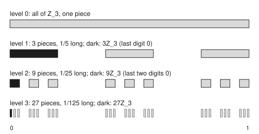
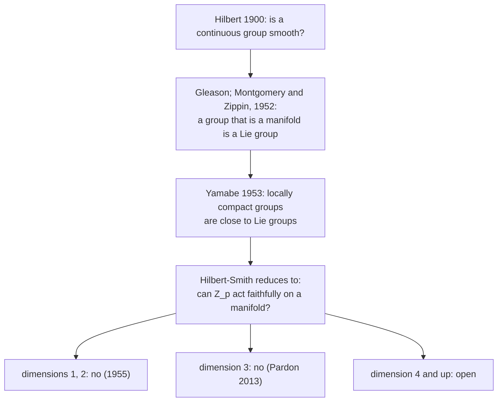

# The Hilbert-Smith conjecture: can the p-adic integers act faithfully on a manifold

[Syllabus](../../../SYLLABUS.md) → [Frontier](../README.md) → [Geometry and Combinatorics](../README.md#s04) → The Hilbert-Smith conjecture

---

## General Overview

Write a whole number in base 3 and let the digits run to the left for ever. The result is a **3-adic integer**, and together they form the group $`\mathbb{Z}_3`$ ([The p-adic numbers](../../21-Algebraic%20and%20analytic%20number%20theory/06-Algebraic%20Numbers/10-p-adic-numbers-and-hensels-lemma.md)).

They add like a car's odometer, carrying to the left. The number ...222222 plus 1 carries for ever and gives 0, so ...222222 is −1. The number ...111112 is 1/2: in base 3, 111112 is 365, and 2 × 365 = 730 = 1 + 729, which is 1 in the last six digits.

Two 3-adic integers are close when they agree in many last digits. Under that distance, $`\mathbb{Z}_3`$ looks like dust. Drawn on a line it is a **Cantor set**: 3 separate pieces, each split into 3 smaller pieces, for ever.

It has a property that the turns of a circle lack:

- **In $`\mathbb{Z}_3`$**, the numbers ending in four zeros (the multiples of 81) form a subgroup, and all of them lie within 1/81 of 0. Add or subtract them and you never leave that small ball.
- **In the circle**, turn by 1° again and again. After 90 steps you are a quarter-turn from the start. Every turn except "no turn" escapes any small ball.

That contrast drives two problems:

- **Hilbert's fifth problem (1900).** Is every group that is also a manifold automatically a smooth **Lie group**? Yes: Andrew Gleason, Deane Montgomery and Leo Zippin, 1952.
- **The Hilbert-Smith conjecture.** Suppose a group moves the points of a manifold, and only the identity leaves every point in place. Must the group be a Lie group? The only suspect is a group like $`\mathbb{Z}_3`$. Proved for manifolds of dimension 1 and 2 (Montgomery and Zippin, 1955) and 3 (John Pardon, 2013). Open from dimension 4.

**The p-adic integers are a group built from ever-smaller subgroups, a Lie group has no small subgroups, and the Hilbert-Smith conjecture says no group of the first kind can move a manifold's points faithfully; this is proved in dimensions 1, 2 and 3 and open from dimension 4.**

**What kind of fact this is:** a conjecture, open as of 2026-11-24 for manifolds of dimension 4 and up; a 2001 claimed proof for every dimension was not accepted. Hilbert's fifth problem is a theorem (1952), stated and cited here, not proved. That $`\mathbb{Z}_3`$ has small subgroups and the circle has none are theorems, proved on this card in Why it works.

**Status, 2026-11-24:**

| Claim | Kind | Status | Source |
| --- | --- | --- | --- |
| Every group that is a manifold is a Lie group | theorem | proved, 1952 | Gleason; Montgomery and Zippin |
| Hilbert-Smith for manifolds of dimension 1 and 2 | theorem | proved, 1955 | Montgomery and Zippin's book, as cited by Pardon |
| Hilbert-Smith for manifolds of dimension 3 | theorem | proved: refereed, 2013 | Pardon, *Journal of the American Mathematical Society* |
| Hilbert-Smith for manifolds of dimension 4 and up | conjecture | open: no accepted proof or disproof found | stated by Pardon, 2013 |
| Hilbert-Smith in every dimension, a claimed proof | theorem, if correct | claimed: posted 2001-03-29, revised to 2001-12-07; not accepted, and later work, Pardon's 2013 paper among it, treats the conjecture as open | McAuley, [arXiv:math/0103215](https://arxiv.org/abs/math/0103215) |

### The picture: the 3-adic integers as a Cantor set

<p align="center"></p>

Drawn to scale. A 3-adic integer with last digits $`d_0, d_1, d_2, \dots`$ sits at $`2d_0/5 + 2d_1/25 + 2d_2/125 + \dots`$ on the line from 0 to 1. Each row fixes one more digit.

The dark bar holds the numbers whose fixed digits are all 0. It is a subgroup, and it shrinks row by row. Every grey bar is a slid copy of it, a coset ([Cosets and Lagrange's theorem](../../03-Algebra/08-Groups/04-cosets-and-lagranges-theorem.md)).

---

## The formula

Notation first, in words.

- A **topological group** is a group whose members form a space, with multiplying and undoing continuous. It is **locally compact** when every member has a small closed, bounded neighbourhood, as in $`\mathbb{R}^n`$ or $`\mathbb{Z}_3`$.
- A **Lie group** is a group that is also a smooth manifold, with smooth operations ([Lie group](../../23-Differential%20geometry%20and%20Lie%20groups/06-Lie%20Groups/01-lie-groups-and-matrix-groups.md)).
- $`M`$ is a connected **topological manifold** of dimension $`n`$: every point has a neighbourhood that matches a piece of $`\mathbb{R}^n`$ ([Topological manifold](../../17-Topology/03-Surfaces%20and%20Manifolds/01-topological-manifolds.md)).
- An **action** of $`G`$ on $`M`$ gives each member $`g`$ a map $`m \mapsto g \cdot m`$ of $`M`$ to itself, with $`(gh)\cdot m = g \cdot (h \cdot m)`$. It is **continuous** when $`g \cdot m`$ depends continuously on both $`g`$ and $`m`$. It is **faithful** when only the identity fixes every point.

The conjecture, as Pardon states it:

```math
G \text{ locally compact, acting continuously and faithfully on a connected } n\text{-manifold } M \;\Longrightarrow\; G \text{ is a Lie group}
```

**Read it aloud:** if a locally compact group moves the points of a connected manifold continuously, and no member but the identity leaves everything in place, then the group is a Lie group.

The 1952 work, Hidehiko Yamabe's sequel (1953) and further known reductions show that any counterexample contains a copy of some $`\mathbb{Z}_p`$. So the conjecture is equivalent to a statement about one kind of group:

```math
\text{for every prime } p, \ \mathbb{Z}_p \text{ has no continuous faithful action on a connected manifold}
```

**Read it aloud:** the p-adic integers can never move a connected manifold's points faithfully.

$`\mathbb{Z}_p`$ is the suspect because of its small subgroups:

```math
p^n\mathbb{Z}_p = \{\, x \in \mathbb{Z}_p : |x|_p \le p^{-n} \,\}
```

**Read it aloud:** the multiples of $`p^n`$ are exactly the p-adic integers of size at most $`1/p^n`$, and they form a subgroup. For $`p = 3`$ and $`n = 4`$: the multiples of 81, all within 1/81 of 0.

| Symbol | Plain meaning | In our example | Push it up and the answer… |
| --- | --- | --- | --- |
| $`G`$ | a locally compact group | $`\mathbb{Z}_3`$, or the circle's turns | — |
| $`M`$ | a connected manifold that $`G`$ acts on | the circle | — |
| $`n`$ | the dimension of $`M`$ (in $`p^n\mathbb{Z}_p`$: the number of last digits that are 0) | 1 for the circle | dimension 4 and up: open |
| $`g \cdot m`$ | the point $`m`$ moved by the member $`g`$ | the member 1 turns the circle by 1/27 of a turn | — |
| $`p`$, $`\mathbb{Z}_p`$ | a prime, and the p-adic integers: base-$`p`$ digits running left for ever | 3; −1 = ...222222 | — |
| $`d_k`$ | the 3-adic digit in position $`k`$, counting from the right, starting at 0 | 1/2 has $`d_0 = 2`$, $`d_1 = 1`$ | the point moves right in the picture |
| $`v`$, $`\lvert x\rvert_p`$ | $`v`$: how many factors $`p`$ divide $`x`$ (for a difference: how many last digits agree); the p-adic size is $`p^{-v}`$ | $`\lvert 81\rvert_3 = 1/81`$ | the size shrinks |
| $`p^n\mathbb{Z}_p`$ | the multiples of $`p^n`$: a subgroup and a ball round 0 | $`81\mathbb{Z}_3`$ | a smaller subgroup, nearer 0 |
| $`N`$, $`\mathbb{Z}/3^N`$ | digits kept in the code's model, and the clock of $`3^N`$ points that models $`\mathbb{Z}_3`$ | 6, so 729 points | a finer model |
| $`B`$ | the turns of the circle by less than a quarter-turn either way | 0° to 89.99°, and back | — |
| $`\mathrm{Homeo}(M)`$ | all continuous, continuously undoable maps of $`M`$ to itself | the circle's turns sit inside it | — |
| $`\varepsilon`$ | a small distance on $`M`$ | — | — |

### When it holds

- **Faithful.** Without it the claim fails at once. Let $`x`$ in $`\mathbb{Z}_3`$ turn the circle by $`x/27`$ of a turn, reading only its last three digits. Every multiple of 27 acts as no turn: 27 of the model's 729 points.
- **A manifold.** On a Cantor set the claim is false. $`\mathbb{Z}_3`$ acts on itself by adding, and only 0 leaves a point where it was.
- **Connected.** A manifold with infinitely many separate pieces fails. Take one circle for each $`k = 1, 2, 3, \dots`$, and let $`x`$ turn the $`k`$-th circle by $`x/3^k`$ of a turn. Every nonzero $`x`$ moves some circle, so the action is faithful.
- **Continuous.** Drop it and the topology stops mattering. As a bare group, $`\mathbb{Z}_3`$ sits inside the 3-adic numbers, which (using the axiom of choice) match the real line under addition. So $`\mathbb{Z}_3`$ can slide $`\mathbb{R}`$ faithfully, with no continuity.
- **Locally compact.** $`\mathrm{Homeo}(M)`$ itself acts faithfully on $`M`$ and is not a Lie group. It is not locally compact.

---

## Why it works

This section proves the small facts behind the conjecture, states the 1952 theorem, and outlines Pardon's 2013 proof. It does not prove the conjecture.

### Step 0: small subgroups are the only obstacle

A Lie group has a neighbourhood of the identity that contains no subgroup except the identity alone: it has **no small subgroups**. The 1952 theorem runs the other way: a locally compact group that is finite-dimensional and has no small subgroups is a Lie group.

Hidehiko Yamabe (1953) removed the word "finite-dimensional". So a locally compact group fails to be a Lie group only by having small subgroups. Using this and further known reductions, which Pardon cites, any counterexample to the conjecture contains a copy of some $`\mathbb{Z}_p`$. The question becomes: can $`\mathbb{Z}_p`$ move a manifold faithfully?



### Step 1: the 3-adic integers are a Cantor set

Fix the last $`n`$ digits. That splits $`\mathbb{Z}_3`$ into $`3^n`$ pieces. Each piece splits into 3 when the next digit is fixed.

The picture places digit $`d_k`$ at $`2d_k/5^{k+1}`$. All digits after position $`k`$ together add at most $`1/5^{k+1}`$. So a piece in row $`n`$ is $`1/5^n`$ long, and the smallest gap between two pieces is $`1/5^n`$ too. The total length of row $`n`$ is $`(3/5)^n`$, which shrinks to 0.

The map keeps closeness in order. In the code's six-digit model, numbers whose last $`v`$ digits agree, and no more, land between $`5^{5-v}+1`$ and $`5^{6-v}-1`$ units of $`1/5^6`$ apart. One more matching digit always lands them closer.

So 3-adic closeness and closeness on the line are the same thing. $`\mathbb{Z}_3`$ is a Cantor set: compact, and in separate pieces at every scale ([The test spaces](../../17-Topology/02-Topological%20Spaces/09-standard-examples-and-counterexamples.md)).

### Step 2: the 3-adic integers have small subgroups

The multiples of $`3^n`$ form a subgroup. If $`3^n`$ divides two numbers, it divides their sum and the negative of each. In terms of size, $`|a + b|_3 \le \max(|a|_3, |b|_3)`$ for any 3-adic integers $`a`$ and $`b`$: the strong triangle inequality of [The p-adic numbers](../../21-Algebraic%20and%20analytic%20number%20theory/06-Algebraic%20Numbers/10-p-adic-numbers-and-hensels-lemma.md).

This subgroup is also the ball of radius $`1/3^n`$ round 0. Every neighbourhood of 0 contains such a ball once $`n`$ is large. So every neighbourhood of 0 contains a whole subgroup other than $`\{0\}`$.

The model $`\mathbb{Z}/729`$ (the last six digits) shows it. A search that generates a subgroup from each of the 729 points finds 7 subgroups, one per divisor of 729. Each is exactly a ball: $`3^n\mathbb{Z}`$ has $`3^{6-n}`$ points, all of size at most $`1/3^n`$.

These small subgroups are not finite. The order of 81 (the number of times it must be added to itself to reach 0) is 9, 27 and 81 in the models with 6, 7 and 8 digits. With every digit kept it never returns to 0. In fact $`81\mathbb{Z}_3`$ is a full copy of $`\mathbb{Z}_3`$: shift every digit four places left.

### Step 3: the circle has no small subgroups

The circle's turns form a Lie group. Take any turn in $`B`$ other than "no turn": say it turns by an angle between 0° and 90° (a turn the other way works the same).

Step through its multiples. Each step adds less than 90°. So the first multiple that reaches 90° lands below 180°, outside $`B`$. That happens at step 90 ÷ angle, rounded up. A 1° turn escapes at step 90, a 0.01° turn at step 9,000. The code tries all 8,999 angles from 0.01° to 89.99° and finds this right every time.

So $`B`$ holds no subgroup except "no turn". Every Lie group has such a neighbourhood. Near the identity each member lies on a one-parameter path (the exponential of a small rate), and its powers walk out along that path, just as the turns do ([Lie's theorems](../../23-Differential%20geometry%20and%20Lie%20groups/06-Lie%20Groups/11-lies-theorems-and-covering-groups.md) treats the exponential map near the identity).

### Step 4: so the p-adic integers never sit inside a Lie group

Take a continuous homomorphism (a map that respects adding) from $`\mathbb{Z}_3`$ to the circle. By continuity at 0, it sends some small subgroup $`3^n\mathbb{Z}_3`$ into $`B`$. That image is a subgroup inside $`B`$, so by Step 3 it is just "no turn". The map kills all of $`3^n\mathbb{Z}_3`$, so it is not one-to-one.

The code checks every homomorphism of the model into the circle (send 1 to some multiple of 1/729 of a turn) against every subgroup $`3^n\mathbb{Z}`$. Of the 1,093 images that land inside $`B`$, all 1,093 are "no turn".

The same argument works for any Lie group in place of the circle. A faithful action of $`\mathbb{Z}_3`$ on $`M`$ is a one-to-one continuous homomorphism into $`\mathrm{Homeo}(M)`$. If $`\mathrm{Homeo}(M)`$ had no small subgroups, the conjecture would follow at once. It does have them: it is far too large. A **flow** (a continuous one-parameter motion) that stirs the points of one tiny ball and leaves the rest of $`M`$ alone gives a subgroup whose members all move points by less than the ball's width. Such a subgroup is not **compact** (closed and bounded, as $`\mathbb{Z}_3`$ and the circle's turns are), and the conjecture forbids only small compact ones.

Pardon's paper gives an equivalent form of the conjecture, which says how small the subgroups must not be. On a connected manifold, pick an open set. Then for some small distance $`\varepsilon`$, the homeomorphisms that move every point of that set by less than $`\varepsilon`$ contain no compact subgroup except the identity.

### Step 5: Hilbert's fifth problem, 1952, stated

Hilbert's fifth problem asked whether Lie's theory of continuous groups needs the assumption that the group's operations are differentiable.

- **Gleason (1952):** a finite-dimensional locally compact group with no small subgroups is a Lie group.
- **Montgomery and Zippin (1952), the next paper in the same journal issue:** a group that is a manifold has no small subgroups.
- **Together:** every group that is a manifold is a Lie group. Continuity alone forces smoothness.

The proofs build, from the group alone, enough smooth structure to find its Lie algebra. They are long, and this card cites them rather than repeating them.

The Hilbert-Smith conjecture is harder because $`\mathbb{Z}_3`$ is not a manifold. The group is dust. Only the space it acts on is a manifold.

### Step 6: what else is proved

| Statement | Kind | Status | Source, as cited by Pardon |
| --- | --- | --- | --- |
| No faithful action of $`\mathbb{Z}_p`$ by twice-differentiable maps, any dimension | theorem | proved, 1946 | Bochner and Montgomery |
| No faithful action of $`\mathbb{Z}_p`$ by Lipschitz maps (maps that stretch distances by at most a fixed factor) | theorem | proved, 1997 | Repovš and Ščepin |
| A counterexample in dimension $`n`$ has an orbit space of cohomological dimension $`n + 2`$ | theorem | proved, 1960 | Yang |
| Faithful actions of $`\mathbb{Z}_p`$ on compact spaces of every dimension from 2 make that jump | theorem | proved, 1963 | Raymond and Williams |

The **orbit space** glues each point to every point the group can move it to. **Cohomological dimension** is a dimension computed from cohomology, an algebraic count of holes. A faithful action on a 3-manifold would give an orbit space of cohomological dimension 5, two more than the manifold. Raymond and Williams' examples show the jump alone gives no contradiction.

A proof in dimension $`n`$ also settles every lower dimension. If $`\mathbb{Z}_p`$ acted faithfully on $`M`$, it would act on $`M \times \mathbb{R}`$, one dimension up, by ignoring the extra line. A proof in dimension 3 says nothing about dimension 4.

### Step 7: Pardon's proof in dimension 3, in outline

This outline follows the paper's abstract and introduction. It is not a check.

1. **Zoom in.** $`p^k\mathbb{Z}_p`$ is a copy of $`\mathbb{Z}_p`$, and as $`k`$ grows it moves points less and less. So one may assume the action stays inside one chart, an open piece of $`\mathbb{R}^3`$, and barely moves anything.
2. **Build a set.** Find a compact set, kept in place by the group as a whole, that looks from far off like a solid two-holed doughnut. Yet the group moves its loops nontrivially: it acts nontrivially on the set's first cohomology, a count of loops dual to first homology ([Homology groups](../../17-Topology/05-Homology/02-homology-groups.md): independent loops that bound nothing).
3. **Pick a surface.** Around that set, take an open set, also kept in place, with exactly one independent closed surface. Among its **incompressible** surfaces (a loop that cannot be shrunk to a point on the surface cannot be shrunk inside the open set either), one surface is fixed by the group up to sliding.
4. **Get a contradiction.** The group then maps into that surface's **mapping class group** (its self-maps counted up to sliding), with finite image, so a cyclic subgroup of order $`p`$ appears there. The coarse doughnut shape demands two fixed pairs of loops, each pair crossing once. The fine twisting demands a nontrivial action. Nielsen's classification of such cyclic actions shows both cannot hold.

The method uses surfaces inside 3-manifolds, a theory special to dimension 3. Dimension 4 has no such theory; it is also the dimension where [The smooth Poincare conjecture in dimension four](11-smooth-four-dimensional-poincare-conjecture.md) stays open, for its own reasons.

### Step 8: the 2026 Fields Medal

In 2026 Pardon received a Fields Medal at the International Congress of Mathematicians in Philadelphia ([Prize citations](../01-How%20Research%20Works/08-reading-a-prize-citation.md) explains how to read one).

- **The short citation** reads: "For his achievements in symplectic geometry including new approaches to virtual fundamental cycles, Fukaya categories of certain manifolds and counting holomorphic curves, and for his contributions to other areas of geometry and topology, including group actions on 3-manifolds and knot theory." It names "group actions on 3-manifolds", not the conjecture.
- **The long citation**, from the same International Mathematical Union page, does name it: Pardon "went on to give a big progress on the 70 years old Hilbert-Smith conjecture", "by proving the conjecture for 𝓃 = 3".

The prize records the community's acceptance of dimension 3. It says nothing about dimension 4.

---

## Worked numbers, by hand

The model keeps the last six 3-adic digits: $`\mathbb{Z}/729`$.

| Step | Arithmetic | Value |
| --- | --- | --- |
| −1 in base 3 | ...222222 + 1 carries for ever | ...000000 = 0 |
| 1/2 in base 3 | 2 × 365 = 730 = 1 + 729 | ...111112 |
| size of 81 and 162 | 81 = 3^4, 162 = 2 × 3^4 | 1/81 each |
| Cantor row 3 | 27 pieces × 1/125 | 27/125 of the line |
| the ball of radius 1/81 | multiples of 81 among 729 points | 9 points, a subgroup |
| 1° turns in the circle | 90 ÷ 1, rounded up | 90 steps to a quarter-turn |
| 0.01° turns | 90 ÷ 0.01, rounded up | 9,000 steps |
| subgroups of the model | divisors of 729: 1, 3, 9, 27, 81, 243, 729 | **7, each a ball round 0** |

Every ball round 0 in the 3-adic integers is a subgroup, while the circle's quarter-turn ball holds none. A faithful action on a manifold would have to bridge that difference.

### What breaks if you drop a piece

| Mistake | Comes out at | What went wrong |
| --- | --- | --- |
| Dropping "faithful" | turn by $`x/27`$: 27 of 729 points act as no turn, kernel $`27\mathbb{Z}_3`$ of index 27 | a non-faithful action of $`\mathbb{Z}_3`$ always exists |
| Dropping "manifold" | adding 1 on the Cantor set: one orbit of 729 points, only 0 fixes a point | $`\mathbb{Z}_3`$ acts faithfully on itself |
| Taking a small turn for a small subgroup | 0.01° escapes the quarter-turn ball after 9,000 steps | small members of a Lie group do not make small subgroups |
| Taking 81 to have finite order | order 9, 27, 81 in $`\mathbb{Z}/3^N`$ for $`N`$ = 6, 7, 8 | in $`\mathbb{Z}_3`$ its order is infinite |

The code prints all four.

---

## Code, from first principles, and it actually runs

Nothing is imported. The code models $`\mathbb{Z}_3`$ by its last six digits and the circle by angles in hundredths of a degree. It takes two independent roads at each step:

1. **The Cantor map.** Piece sizes and distance ranges are found by checking every pair of the 729 points, then matched to the tail bound of Step 1.
2. **Small subgroups.** The subgroups are found by generating from every point, then matched to the divisors of 729 and to the balls round 0.
3. **The circle.** Each angle's escape step is found by stepping, then matched to the rounded-up division of Step 3.
4. **Homomorphisms.** The images of the model in the circle are found by listing, then matched to a divisibility count.

The table of dimensions at the end is a dated status line, printed and not checked.

### Python

```python
# Hilbert-Smith conjecture -- the check behind the card.  Standard library only,
# nothing imported.  The 3-adic integers are modelled by their last N = 6 digits,
# the clock Z/729; the circle is modelled by angles in hundredths of a degree.
# Roads: brute-force search against a counting formula, at every step.
N, M = 6, 3 ** 6                                     # six 3-adic digits, 729 points

def val(x):                                          # how many 3s divide x (N if x = 0)
    x %= M
    return N if x == 0 else next(k for k in range(N) if x % 3 ** (k + 1))

def digits(x):                                       # base-3 digits, last digit first
    return [x // 3 ** k % 3 for k in range(N)]

def pos(x):                                          # the Cantor map, in units of 1/5^6
    return sum(2 * d * 5 ** (N - 1 - k) for k, d in enumerate(digits(x)))

def show(x): return "".join(str(d) for d in reversed(digits(x)))

half = next(x for x in range(M) if 2 * x % M == 1)
print(f"-1 is ...{show(M - 1)}, 1/2 is ...{show(half)}, check 2 x {half} = {2 * half} = 1 + {M}")
print(f"3-adic size: |1| = 1, |3| = 1/3, |81| = 1/{3 ** val(81)}, |162| = 1/{3 ** val(162)}")

# 1. The Cantor picture: level n has 3^n pieces, each 1/5^n long, with gaps between.
print("level, pieces, piece length, total length, smallest gap")
for n in range(4):
    starts = sorted({sum(2 * (x // 3 ** k % 3) * 5 ** (N - 1 - k) for k in range(n)) for x in range(3 ** n)})
    L = 5 ** (N - n)
    gap = min(b - (a + L) for a, b in zip(starts, starts[1:])) if n else 0
    print(f"  {n}, {len(starts)}, 1/{5 ** n}, {3 ** n}/{5 ** n}, " + (f"{gap}/{5 ** N}" if n else "none"))
    assert len(starts) == 3 ** n and (n == 0 or gap == 5 ** (N - n)) and max(starts) + L <= 5 ** N
lo, hi = [5 ** N] * N, [0] * N                       # line distance against 3-adic distance
for x in range(M):
    for y in range(x + 1, M):
        v, d = val(y - x), abs(pos(y) - pos(x))
        lo[v], hi[v] = min(lo[v], d), max(hi[v], d)
print("agree in last v digits: 3-adic distance, line distance range (units of 1/5^6)")
for v in range(N):
    print(f"  v = {v}: 1/{3 ** v}, {lo[v]} to {hi[v]}")
    assert lo[v] == 5 ** (N - 1 - v) + 1 and hi[v] == 5 ** (N - v) - 1   # by the tail bound
assert all(hi[v + 1] < lo[v] for v in range(N - 1))   # closer 3-adically = closer on the line
px = lambda p: f"{20 + 480 * p / 5 ** N:.2f}"
print("figure," + ";".join(" ".join(px(sum(2 * (x // 3 ** k % 3) * 5 ** (N - 1 - k) for k in range(n)))
      for x in range(3 ** n)) for n in (1, 2, 3)) + f";widths {480 / 5:.1f} {480 / 25:.1f} {480 / 125:.2f}")

# 2. Small subgroups: every subgroup of the clock, found by generating, against divisors.
subs = sorted({frozenset(g * k % M for k in range(M)) for g in range(M)}, key=len, reverse=True)
print(f"subgroups of Z/{M} found by search: {len(subs)}; divisors of {M}: {sum(1 for d in range(1, M + 1) if M % d == 0)}")
for H in subs:
    n = min(val(x) for x in H)
    print(f"  3^{n} Z: {len(H)} point{"s" * (len(H) > 1)}, index {M // len(H)}, every point of size at most 1/{3 ** n}")
    assert H == {x for x in range(M) if val(x) >= n} and len(H) == 3 ** (N - n)   # ball = subgroup
ball = [x for x in range(M) if val(x) >= 1]
assert all(val(a + b) >= 1 and val(-a) >= 1 for a in ball for b in ball)       # closed, by brute force
least = min(val(81 * k) for k in range(1, M))       # fewest 3s dividing any multiple
print(f"multiples of 81 stay small: largest size among 81k is 1/{3 ** least}")
orders = [next(k for k in range(1, 3 ** m + 1) if 81 * k % 3 ** m == 0) for m in (6, 7, 8)]
print("order of 81 in Z/3^N for N = 6, 7, 8: " + ", ".join(map(str, orders)))
assert orders == [3 ** (m - 4) for m in (6, 7, 8)] and least == 4    # no finite bound

# 3. No small subgroups in the circle: every angle in the quarter-turn ball escapes it.
Q = 9000                                             # 90.00 degrees, in hundredths
esc = []
for a in range(1, Q):
    k, t = 1, a
    while min(t, 36000 - t) < Q:
        k, t = k + 1, (t + a) % 36000
    esc.append(k)
assert esc == [-(-Q // a) for a in range(1, Q)]       # brute force = ceil(9000 / a)
print(f"circle: all {len(esc)} angles 0.01 to {(Q - 1) / 100:.2f} degrees escape the ball of {Q // 100} degrees; "
      f"1 degree after {esc[99]} steps, 0.01 degrees after {esc[0]}")

# 4. Any homomorphism from the clock to the circle: a subgroup landing in the ball lands on 0.
inball = trivial = 0
for j in range(M):                                   # x -> j x / 729 of a turn
    for n in range(N + 1):
        img = {j * 3 ** n * k % M for k in range(M)}
        if all(min(i, M - i) * 4 < M for i in img):
            inball += 1; trivial += img == {0}
print(f"homomorphisms x -> jx/729 turn, subgroups 3^n Z: {inball} images inside the ball, {trivial} of them just 0")
assert inball == trivial == sum(1 for j in range(M) for n in range(N + 1) if j * 3 ** n % M == 0)

# 5. What breaks.
ker = [x for x in range(M) if x % 27 == 0]        # x acts as a turn of x/27: a 13.33 degree step
print(f"turn by x/27: {len(ker)} of {M} points act as no turn at all (kernel 27Z, index {M // len(ker)}); "
      f"step {36000 / 27 / 100:.2f} degrees")
orbit, x = 1, 1                                      # adding 1, the odometer, on the Cantor set
while x != 0:
    x, orbit = (x + 1) % M, orbit + 1
print(f"adding 1 on the Cantor set: one orbit of {orbit} points; ...{show(M - 1)} + 1 = ...{show(0)}")
fixers = [g for g in range(M) if any((y + g) % M == y for y in range(M))]
assert orbit == M and fixers == [0] and len(ker) == 27
print("dimension n, Yang's orbit-space dimension n + 2, status 2026-11-24")
for n, s in [(1, "proved, 1955"), (2, "proved, 1955"), (3, "proved, 2013"), (4, "open")]:
    print(f"  {n}{' and up' * (n == 4)}, {n + 2}{' and up' * (n == 4)}, {s}")
print("ALL CHECKS PASS")
```

**Ran 2026-11-24 on macOS, Python 3.14.10, standard library only. All checks passed. Output, pasted from the run:**

```
-1 is ...222222, 1/2 is ...111112, check 2 x 365 = 730 = 1 + 729
3-adic size: |1| = 1, |3| = 1/3, |81| = 1/81, |162| = 1/81
level, pieces, piece length, total length, smallest gap
  0, 1, 1/1, 1/1, none
  1, 3, 1/5, 3/5, 3125/15625
  2, 9, 1/25, 9/25, 625/15625
  3, 27, 1/125, 27/125, 125/15625
agree in last v digits: 3-adic distance, line distance range (units of 1/5^6)
  v = 0: 1/1, 3126 to 15624
  v = 1: 1/3, 626 to 3124
  v = 2: 1/9, 126 to 624
  v = 3: 1/27, 26 to 124
  v = 4: 1/81, 6 to 24
  v = 5: 1/243, 2 to 4
figure,20.00 212.00 404.00;20.00 212.00 404.00 58.40 250.40 442.40 96.80 288.80 480.80;20.00 212.00 404.00 58.40 250.40 442.40 96.80 288.80 480.80 27.68 219.68 411.68 66.08 258.08 450.08 104.48 296.48 488.48 35.36 227.36 419.36 73.76 265.76 457.76 112.16 304.16 496.16;widths 96.0 19.2 3.84
subgroups of Z/729 found by search: 7; divisors of 729: 7
  3^0 Z: 729 points, index 1, every point of size at most 1/1
  3^1 Z: 243 points, index 3, every point of size at most 1/3
  3^2 Z: 81 points, index 9, every point of size at most 1/9
  3^3 Z: 27 points, index 27, every point of size at most 1/27
  3^4 Z: 9 points, index 81, every point of size at most 1/81
  3^5 Z: 3 points, index 243, every point of size at most 1/243
  3^6 Z: 1 point, index 729, every point of size at most 1/729
multiples of 81 stay small: largest size among 81k is 1/81
order of 81 in Z/3^N for N = 6, 7, 8: 9, 27, 81
circle: all 8999 angles 0.01 to 89.99 degrees escape the ball of 90 degrees; 1 degree after 90 steps, 0.01 degrees after 9000
homomorphisms x -> jx/729 turn, subgroups 3^n Z: 1093 images inside the ball, 1093 of them just 0
turn by x/27: 27 of 729 points act as no turn at all (kernel 27Z, index 27); step 13.33 degrees
adding 1 on the Cantor set: one orbit of 729 points; ...222222 + 1 = ...000000
dimension n, Yang's orbit-space dimension n + 2, status 2026-11-24
  1, 3, proved, 1955
  2, 4, proved, 1955
  3, 5, proved, 2013
  4 and up, 6 and up, open
ALL CHECKS PASS
```

### Rust

Same numbers, same labels, built with `rustc --edition 2021 -O`.

```rust
// Hilbert-Smith conjecture -- the same check as the Python, in Rust.  No crates.
// The 3-adic integers are modelled by their last N = 6 digits, the clock Z/729;
// the circle is modelled by angles in hundredths of a degree.
// Roads: brute-force search against a counting formula, at every step.
use std::collections::BTreeSet;
const N: u32 = 6;
const M: i64 = 729; // six 3-adic digits, 729 points

fn val(x: i64) -> u32 { // how many 3s divide x (N if x = 0)
    let x = x.rem_euclid(M);
    if x == 0 { return N; }
    (0..N).find(|&k| x % 3i64.pow(k + 1) != 0).unwrap()
}
fn digit(x: i64, k: u32) -> i64 { x / 3i64.pow(k) % 3 }
fn pos(x: i64) -> i64 { // the Cantor map, in units of 1/5^6
    (0..N).map(|k| 2 * digit(x, k) * 5i64.pow(N - 1 - k)).sum()
}
fn start(x: i64, n: u32) -> i64 { (0..n).map(|k| 2 * digit(x, k) * 5i64.pow(N - 1 - k)).sum() }
fn show(x: i64) -> String { (0..N).rev().map(|k| digit(x, k).to_string()).collect() }

fn main() {
    let half = (0..M).find(|x| 2 * x % M == 1).unwrap();
    println!("-1 is ...{}, 1/2 is ...{}, check 2 x {} = {} = 1 + {}", show(M - 1), show(half), half, 2 * half, M);
    println!("3-adic size: |1| = 1, |3| = 1/3, |81| = 1/{}, |162| = 1/{}", 3i64.pow(val(81)), 3i64.pow(val(162)));

    // 1. The Cantor picture: level n has 3^n pieces, each 1/5^n long, with gaps between.
    println!("level, pieces, piece length, total length, smallest gap");
    let p5 = 5i64.pow(N);
    for n in 0..4u32 {
        let starts: Vec<i64> = (0..3i64.pow(n)).map(|x| start(x, n)).collect::<BTreeSet<_>>().into_iter().collect();
        let l = 5i64.pow(N - n);
        let gap = starts.windows(2).map(|w| w[1] - (w[0] + l)).min().unwrap_or(0);
        let g = if n > 0 { format!("{}/{}", gap, p5) } else { "none".to_string() };
        println!("  {}, {}, 1/{}, {}/{}, {}", n, starts.len(), 5i64.pow(n), 3i64.pow(n), 5i64.pow(n), g);
        assert!(starts.len() as i64 == 3i64.pow(n) && (n == 0 || gap == 5i64.pow(N - n)) && starts[starts.len() - 1] + l <= p5);
    }
    let (mut lo, mut hi) = (vec![p5; N as usize], vec![0i64; N as usize]); // line against 3-adic distance
    for x in 0..M {
        for y in x + 1..M {
            let (v, d) = (val(y - x) as usize, (pos(y) - pos(x)).abs());
            lo[v] = lo[v].min(d);
            hi[v] = hi[v].max(d);
        }
    }
    println!("agree in last v digits: 3-adic distance, line distance range (units of 1/5^6)");
    for v in 0..N as usize {
        println!("  v = {}: 1/{}, {} to {}", v, 3i64.pow(v as u32), lo[v], hi[v]);
        assert!(lo[v] == 5i64.pow(N - 1 - v as u32) + 1 && hi[v] == 5i64.pow(N - v as u32) - 1); // tail bound
    }
    assert!((0..N as usize - 1).all(|v| hi[v + 1] < lo[v])); // closer 3-adically = closer on the line
    let px = |p: i64| format!("{:.2}", 20.0 + 480.0 * p as f64 / p5 as f64);
    let rows: Vec<String> = [1u32, 2, 3].iter()
        .map(|&n| (0..3i64.pow(n)).map(|x| px(start(x, n))).collect::<Vec<_>>().join(" ")).collect();
    println!("figure,{};widths {:.1} {:.1} {:.2}", rows.join(";"), 480.0 / 5.0, 480.0 / 25.0, 480.0 / 125.0);

    // 2. Small subgroups: every subgroup of the clock, found by generating, against divisors.
    let mut subs: Vec<BTreeSet<i64>> = (0..M).map(|g| (0..M).map(|k| g * k % M).collect())
        .collect::<BTreeSet<_>>().into_iter().collect();
    subs.sort_by(|a, b| b.len().cmp(&a.len()));
    println!("subgroups of Z/{} found by search: {}; divisors of {}: {}", M, subs.len(), M, (1..=M).filter(|d| M % d == 0).count());
    for h in &subs {
        let n = h.iter().map(|&x| val(x)).min().unwrap();
        let s = if h.len() > 1 { "s" } else { "" };
        println!("  3^{} Z: {} point{}, index {}, every point of size at most 1/{}", n, h.len(), s, M as usize / h.len(), 3i64.pow(n));
        let ball: BTreeSet<i64> = (0..M).filter(|&x| val(x) >= n).collect();
        assert!(*h == ball && h.len() as i64 == 3i64.pow(N - n)); // ball = subgroup
    }
    let ball: Vec<i64> = (0..M).filter(|&x| val(x) >= 1).collect();
    assert!(ball.iter().all(|&a| val(-a) >= 1 && ball.iter().all(|&b| val(a + b) >= 1))); // closed
    let least = (1..M).map(|k| val(81 * k)).min().unwrap(); // fewest 3s dividing any multiple
    println!("multiples of 81 stay small: largest size among 81k is 1/{}", 3i64.pow(least));
    let orders: Vec<i64> = [6u32, 7, 8].iter()
        .map(|&m| (1..=3i64.pow(m)).find(|k| 81 * k % 3i64.pow(m) == 0).unwrap()).collect();
    println!("order of 81 in Z/3^N for N = 6, 7, 8: {}", orders.iter().map(|o| o.to_string()).collect::<Vec<_>>().join(", "));
    assert!(orders == vec![9, 27, 81] && orders.iter().zip([6u32, 7, 8]).all(|(&o, m)| o == 3i64.pow(m - 4)) && least == 4);

    // 3. No small subgroups in the circle: every angle in the quarter-turn ball escapes it.
    let q: i64 = 9000; // 90.00 degrees, in hundredths
    let mut esc = Vec::new();
    for a in 1..q {
        let (mut k, mut t) = (1i64, a);
        while t.min(36000 - t) < q {
            k += 1;
            t = (t + a) % 36000;
        }
        esc.push(k);
    }
    assert!((1..q).all(|a| esc[(a - 1) as usize] == (q + a - 1) / a)); // brute force = ceil(9000 / a)
    println!("circle: all {} angles 0.01 to {:.2} degrees escape the ball of {} degrees; 1 degree after {} steps, 0.01 degrees after {}",
             esc.len(), (q - 1) as f64 / 100.0, q / 100, esc[99], esc[0]);

    // 4. Any homomorphism from the clock to the circle: a subgroup landing in the ball lands on 0.
    let (mut inball, mut trivial, mut formula) = (0, 0, 0);
    for j in 0..M { // x -> j x / 729 of a turn
        for n in 0..=N {
            let img: BTreeSet<i64> = (0..M).map(|k| j * 3i64.pow(n) * k % M).collect();
            if img.iter().all(|&i| i.min(M - i) * 4 < M) {
                inball += 1;
                if img.len() == 1 && img.contains(&0) { trivial += 1; }
            }
            if j * 3i64.pow(n) % M == 0 { formula += 1; }
        }
    }
    println!("homomorphisms x -> jx/729 turn, subgroups 3^n Z: {} images inside the ball, {} of them just 0", inball, trivial);
    assert!(inball == trivial && trivial == formula);

    // 5. What breaks.
    let ker: Vec<i64> = (0..M).filter(|x| x % 27 == 0).collect(); // x acts as a turn of x/27
    println!("turn by x/27: {} of {} points act as no turn at all (kernel 27Z, index {}); step {:.2} degrees",
             ker.len(), M, M as usize / ker.len(), 36000.0 / 27.0 / 100.0);
    let (mut orbit, mut x) = (1, 1i64); // adding 1, the odometer, on the Cantor set
    while x != 0 {
        x = (x + 1) % M;
        orbit += 1;
    }
    println!("adding 1 on the Cantor set: one orbit of {} points; ...{} + 1 = ...{}", orbit, show(M - 1), show(0));
    let fixers: Vec<i64> = (0..M).filter(|&g| (0..M).any(|y| (y + g) % M == y)).collect();
    assert!(orbit == M && fixers == vec![0] && ker.len() == 27);
    println!("dimension n, Yang's orbit-space dimension n + 2, status 2026-11-24");
    for (n, s) in [(1, "proved, 1955"), (2, "proved, 1955"), (3, "proved, 2013"), (4, "open")] {
        let up = if n == 4 { " and up" } else { "" };
        println!("  {}{}, {}{}, {}", n, up, n + 2, up, s);
    }
    println!("ALL CHECKS PASS");
}
```

**Ran 2026-11-24 on macOS, rustc 1.98.1, no crates. All checks passed. Output, pasted from the run:**

```
-1 is ...222222, 1/2 is ...111112, check 2 x 365 = 730 = 1 + 729
3-adic size: |1| = 1, |3| = 1/3, |81| = 1/81, |162| = 1/81
level, pieces, piece length, total length, smallest gap
  0, 1, 1/1, 1/1, none
  1, 3, 1/5, 3/5, 3125/15625
  2, 9, 1/25, 9/25, 625/15625
  3, 27, 1/125, 27/125, 125/15625
agree in last v digits: 3-adic distance, line distance range (units of 1/5^6)
  v = 0: 1/1, 3126 to 15624
  v = 1: 1/3, 626 to 3124
  v = 2: 1/9, 126 to 624
  v = 3: 1/27, 26 to 124
  v = 4: 1/81, 6 to 24
  v = 5: 1/243, 2 to 4
figure,20.00 212.00 404.00;20.00 212.00 404.00 58.40 250.40 442.40 96.80 288.80 480.80;20.00 212.00 404.00 58.40 250.40 442.40 96.80 288.80 480.80 27.68 219.68 411.68 66.08 258.08 450.08 104.48 296.48 488.48 35.36 227.36 419.36 73.76 265.76 457.76 112.16 304.16 496.16;widths 96.0 19.2 3.84
subgroups of Z/729 found by search: 7; divisors of 729: 7
  3^0 Z: 729 points, index 1, every point of size at most 1/1
  3^1 Z: 243 points, index 3, every point of size at most 1/3
  3^2 Z: 81 points, index 9, every point of size at most 1/9
  3^3 Z: 27 points, index 27, every point of size at most 1/27
  3^4 Z: 9 points, index 81, every point of size at most 1/81
  3^5 Z: 3 points, index 243, every point of size at most 1/243
  3^6 Z: 1 point, index 729, every point of size at most 1/729
multiples of 81 stay small: largest size among 81k is 1/81
order of 81 in Z/3^N for N = 6, 7, 8: 9, 27, 81
circle: all 8999 angles 0.01 to 89.99 degrees escape the ball of 90 degrees; 1 degree after 90 steps, 0.01 degrees after 9000
homomorphisms x -> jx/729 turn, subgroups 3^n Z: 1093 images inside the ball, 1093 of them just 0
turn by x/27: 27 of 729 points act as no turn at all (kernel 27Z, index 27); step 13.33 degrees
adding 1 on the Cantor set: one orbit of 729 points; ...222222 + 1 = ...000000
dimension n, Yang's orbit-space dimension n + 2, status 2026-11-24
  1, 3, proved, 1955
  2, 4, proved, 1955
  3, 5, proved, 2013
  4 and up, 6 and up, open
ALL CHECKS PASS
```

The two outputs match line for line.

### Lean

Lean proves the facts of Steps 2 to 4, for every prime p, and checks the worked numbers.

- Take any prime p and any whole number n. Then the multiples of $`p^n`$ are exactly the p-adic integers of size at most $`1/p^n`$.
- Take any prime p. Then every neighbourhood of 0 in $`\mathbb{Z}_p`$ contains a whole subgroup other than $`\{0\}`$.
- Take a turn of the circle whose every multiple stays inside $`B`$. Then it is "no turn".
- Take any prime p and a continuous homomorphism from $`\mathbb{Z}_p`$ to the circle's turns. Then it is not one-to-one.
- 1/2 is ...111112 in base 3, since 2 × 365 = 730 = 1 + 729 and 729 = 3^6.
- 81 and 162 are each divisible by exactly four 3s, so each has 3-adic size 1/81.
- Cantor row 3 has 3^3 = 27 pieces, each 1/5^3 = 1/125 long.
- The divisors of 729 are 1, 3, 9, 27, 81, 243 and 729.
- In the model, 9 of the 729 points are multiples of 81, and 27 are multiples of 27.
- 81 has order 9, 27 and 81 in the models with 6, 7 and 8 digits.
- 90 ÷ angle, rounded up, gives 90 steps for a 1° turn and 9,000 for a 0.01° turn.
- Send 1 to j/729 of a turn, for each j below 729. Then 1,093 pairs of j and a subgroup $`3^n\mathbb{Z}`$ go wholly to "no turn".

The Cantor distances, the subgroup search, the 8,999 escaping angles and the status table are left to the Python and Rust checks.

```lean
-- The Hilbert-Smith conjecture: the p-adic integers have small subgroups, each ball of radius 1/p^n round 0 is exactly the multiples of p^n, and no continuous homomorphism from the p-adic integers to the circle is one-to-one; the conjecture itself is open and not stated as proved.
import Mathlib.NumberTheory.Padics.PadicIntegers
import Mathlib.Topology.Instances.AddCircle.Real
import Mathlib.Analysis.Normed.Group.AddCircle
import Mathlib.NumberTheory.Padics.PadicVal.Basic
import Mathlib.NumberTheory.Divisors
import Mathlib.Tactic.NormNum.Prime
import Mathlib.Tactic.Simproc.Divisors

open Topology

/-- The circle has no small subgroups: if every whole-number multiple of a point of the circle
stays within a quarter turn of 0, the point is 0. -/
theorem addCircle_one_no_small_subgroups (x : AddCircle (1 : ℝ))
    (h : ∀ k : ℕ, ‖k • x‖ < 1 / 4) : x = 0 := by
  obtain ⟨s, rfl⟩ := QuotientAddGroup.mk_surjective x
  set t : ℝ := s - round s with ht_def
  have hts : (t : AddCircle (1 : ℝ)) = (s : AddCircle (1 : ℝ)) := by
    rw [ht_def, AddCircle.coe_sub, sub_eq_self, AddCircle.coe_eq_zero_iff]
    exact ⟨round s, by simp⟩
  have hnorm : ∀ k : ℕ, |(k : ℝ) * t| ≤ 1 / 2 →
      ‖k • (s : AddCircle (1 : ℝ))‖ = |(k : ℝ) * t| := by
    intro k hk
    rw [← hts, ← AddCircle.coe_nsmul, nsmul_eq_mul]
    exact (AddCircle.norm_coe_eq_abs_iff (p := (1 : ℝ)) one_ne_zero).mpr (by simpa using hk)
  have ht_half : |t| ≤ 1 / 2 := abs_sub_round s
  have ht1 : |t| < 1 / 4 := by
    have h1 := h 1
    rw [hnorm 1 (by simpa using ht_half)] at h1
    simpa using h1
  by_contra hx
  have htpos : 0 < |t| := by
    rw [abs_pos]
    intro h0
    apply hx
    rw [← hts, h0]
    rfl
  set k := ⌈1 / (4 * |t|)⌉₊ with hk_def
  have hk1 : 1 / 4 ≤ (k : ℝ) * |t| := by
    have hc := Nat.le_ceil (1 / (4 * |t|))
    calc (1 : ℝ) / 4 = (1 / (4 * |t|)) * |t| := by field_simp
      _ ≤ (k : ℝ) * |t| := mul_le_mul_of_nonneg_right hc htpos.le
  have hk2 : (k : ℝ) * |t| < 1 / 2 := by
    have hc := Nat.ceil_lt_add_one (show (0 : ℝ) ≤ 1 / (4 * |t|) by positivity)
    calc (k : ℝ) * |t| < (1 / (4 * |t|) + 1) * |t| := mul_lt_mul_of_pos_right hc htpos
      _ = 1 / 4 + |t| := by field_simp
      _ < 1 / 2 := by linarith
  have hk := h k
  rw [hnorm k (by rw [abs_mul, Nat.abs_cast]; linarith), abs_mul, Nat.abs_cast] at hk
  linarith

#print axioms addCircle_one_no_small_subgroups

/-- The p-adic integers have small subgroups: for every prime p, every neighbourhood of 0 in
the p-adic integers contains a whole additive subgroup other than {0}. -/
theorem padicInt_has_small_subgroups (p : ℕ) [Fact p.Prime] (U : Set ℤ_[p])
    (hU : U ∈ 𝓝 (0 : ℤ_[p])) :
    ∃ H : AddSubgroup ℤ_[p], H ≠ ⊥ ∧ (H : Set ℤ_[p]) ⊆ U := by
  obtain ⟨ε, hε, hball⟩ := Metric.mem_nhds_iff.mp hU
  obtain ⟨n, hn⟩ := PadicInt.exists_pow_neg_lt p hε
  have hp0 : (p : ℤ_[p]) ^ n ≠ 0 :=
    pow_ne_zero n (Nat.cast_ne_zero.mpr (Fact.out : p.Prime).ne_zero)
  refine ⟨AddSubgroup.zmultiples ((p : ℤ_[p]) ^ n), ?_, ?_⟩
  · intro h
    have hmem := AddSubgroup.mem_zmultiples ((p : ℤ_[p]) ^ n)
    rw [h, AddSubgroup.mem_bot] at hmem
    exact hp0 hmem
  · rintro x ⟨k, rfl⟩
    apply hball
    rw [Metric.mem_ball, dist_zero_right]
    show ‖k • (p : ℤ_[p]) ^ n‖ < ε
    rw [zsmul_eq_mul, norm_mul, PadicInt.norm_p_pow]
    calc ‖((k : ℤ) : ℤ_[p])‖ * (p : ℝ) ^ (-(n : ℤ)) ≤ 1 * (p : ℝ) ^ (-(n : ℤ)) :=
          mul_le_mul_of_nonneg_right (PadicInt.norm_le_one _) (zpow_nonneg (Nat.cast_nonneg _) _)
      _ < ε := by rwa [one_mul]

/-- The ball of radius 1/p^n round 0 is a subgroup: the p-adic integers of size at most 1/p^n
are exactly the multiples of p^n. -/
theorem padicInt_closedBall_eq_multiples (p : ℕ) [Fact p.Prime] (n : ℕ) :
    Metric.closedBall (0 : ℤ_[p]) ((p : ℝ) ^ (-(n : ℤ))) = {x : ℤ_[p] | (p : ℤ_[p]) ^ n ∣ x} := by
  ext x
  rw [Metric.mem_closedBall, dist_zero_right, Set.mem_ofPred_eq,
    PadicInt.norm_le_pow_iff_mem_span_pow, Ideal.mem_span_singleton]

/-- The p-adic integers never sit inside the circle: no continuous homomorphism from the
p-adic integers to the circle's turns (the reals modulo 1) is one-to-one. -/
theorem padicInt_to_circle_not_injective (p : ℕ) [Fact p.Prime]
    (f : ℤ_[p] →+ AddCircle (1 : ℝ)) (hf : Continuous f) :
    ¬ Function.Injective f := by
  intro hinj
  have hV : f ⁻¹' {y | ‖y‖ < 1 / 4} ∈ 𝓝 (0 : ℤ_[p]) := by
    apply hf.continuousAt.preimage_mem_nhds
    rw [map_zero]
    exact (isOpen_lt continuous_norm continuous_const).mem_nhds (by norm_num)
  obtain ⟨H, hH, hHV⟩ := padicInt_has_small_subgroups p _ hV
  obtain ⟨h, hh, hne⟩ := (AddSubgroup.bot_or_exists_ne_zero H).resolve_left hH
  have hfh : f h = 0 := addCircle_one_no_small_subgroups (f h) (fun k => by
    have hk := hHV (H.nsmul_mem hh k)
    rw [Set.mem_preimage, map_nsmul] at hk
    exact hk)
  exact hne (hinj (hfh.trans (map_zero f).symm))

-- 1/2 is ...111112 in base 3: 2 × 365 = 730 = 1 + 729, and 729 = 3^6.
example : 2 * 365 = 1 + 729 ∧ (3 : ℕ) ^ 6 = 729 := by norm_num

-- 3-adic sizes: 81 and 162 are each divisible by exactly four 3s, so each has size 1/81.
example : padicValNat 3 81 = 4 ∧ padicValNat 3 162 = 4 := by
  constructor
  · rw [show (81 : ℕ) = 3 ^ 4 by norm_num, padicValNat.prime_pow]
  · rw [show (162 : ℕ) = 2 * 3 ^ 4 by norm_num, padicValNat.mul (by norm_num) (by norm_num),
      padicValNat.prime_pow, padicValNat_primes (by norm_num)]

-- Cantor row 3: 27 pieces, each 1/125 long.
example : (3 : ℕ) ^ 3 = 27 ∧ (5 : ℕ) ^ 3 = 125 := by norm_num

-- The model Z/729 has 7 subgroups, one per divisor of 729: 1, 3, 9, 27, 81, 243, 729.
example : Nat.divisors 729 = {1, 3, 9, 27, 81, 243, 729} := by
  simp [Nat.divisors_ofNat]

-- The ball of radius 1/81 in the model: 9 of the 729 points are multiples of 81.
example : ((Finset.range 729).filter (fun x => 81 ∣ x)).card = 9 := by decide +kernel

-- Dropping "faithful": 27 of the 729 points are multiples of 27 and act as no turn.
example : ((Finset.range 729).filter (fun x => 27 ∣ x)).card = 27 := by decide +kernel

-- The order of 81 in Z/3^6, Z/3^7, Z/3^8 is 9, 27, 81.
example : 9 * 81 = 3 ^ 6 ∧ ∀ k < 9, 0 < k → ¬ 3 ^ 6 ∣ 81 * k := by
  decide +kernel
example : 27 * 81 = 3 ^ 7 ∧ ∀ k < 27, 0 < k → ¬ 3 ^ 7 ∣ 81 * k := by
  decide +kernel
example : 81 * 81 = 3 ^ 8 ∧ ∀ k < 81, 0 < k → ¬ 3 ^ 8 ∣ 81 * k := by
  decide +kernel

-- Escaping the quarter-turn ball of 9000 hundredths of a degree: 1 degree (100 hundredths)
-- after 90 steps, 0.01 degrees (1 hundredth) after 9,000 steps (9000 ÷ angle, rounded up).
example : (9000 + 100 - 1) / 100 = 90 ∧ (9000 + 1 - 1) / 1 = 9000 := by norm_num

-- Homomorphisms x ↦ jx/729 of a turn against subgroups 3^n Z: 1,093 pairs (j, n) with
-- j < 729 and n ≤ 6 send the subgroup to 0.
example : ((Finset.range 729 ×ˢ Finset.range 7).filter
    (fun q : ℕ × ℕ => 729 ∣ q.1 * 3 ^ q.2)).card = 1093 := by decide +kernel

#print axioms padicInt_has_small_subgroups
#print axioms padicInt_closedBall_eq_multiples
#print axioms padicInt_to_circle_not_injective
```

**Checked 2026-11-24 on macOS, Lean 4.36.0-rc2, Mathlib v4.36.0-rc2. Every proof is complete and uses only Lean's standard axioms. Output, pasted from the run:**

```
'addCircle_one_no_small_subgroups' depends on axioms: [propext, Classical.choice, Quot.sound]
'padicInt_has_small_subgroups' depends on axioms: [propext, Classical.choice, Quot.sound]
'padicInt_closedBall_eq_multiples' depends on axioms: [propext, Classical.choice, Quot.sound]
'padicInt_to_circle_not_injective' depends on axioms: [propext, Classical.choice, Quot.sound]
```

> [!TIP]
> **Try changing**
> Guess first, then run the Python. An assert is a line that stops the program if a number comes out wrong.
> - **Keep five digits, not six.** Set `N, M = 5, 3 ** 5`. Guess first: how many subgroups? The search finds 6. The turn by $`x/27`$ now fixes 9 of 243 points, so the last assert stops the run.
> - **Turn by $`x/81`$ instead.** Change `x % 27 == 0` to `x % 81 == 0`. Guess first: how many points act as no turn? 9 of 729, index 81, and the last assert stops the run.
> - **Use a 45° ball.** Set `Q = 4500`. Guess first: when does 1° escape? After 45 steps, and 0.01° after 4,500. Every check still passes.

---

## The usual mistake

> [!warning]
> **Reading the 1952 solution of Hilbert's fifth problem as settling the Hilbert-Smith conjecture.** The 1952 theorem assumes the group itself is a manifold. The conjecture assumes only that the space it acts on is a manifold. The group can be a Cantor set like $`\mathbb{Z}_3`$, and that case is open from dimension 4.
>
> - Small subgroups are not small finite subgroups. 81 has order 9, 27 and 81 in the models with 6, 7 and 8 digits, and infinite order in $`\mathbb{Z}_3`$.
> - A non-faithful action proves nothing. Turning by $`x/27`$ leaves 27 of the 729 model points acting as no turn.
> - Dimension 3 does not give dimension 4. Proofs pass down to lower dimensions, never up.
> - A smooth action is not the general case. Twice-differentiable actions were ruled out in 1946; the conjecture is about merely continuous ones.

---

## Where you meet it in real life

- **Physics.** A group of continuous symmetries that is a manifold, such as the rotations of space, is a Lie group. So it may be described by its infinitesimal rotations, its Lie algebra, without assuming smoothness first. Hilbert's fifth problem is the theorem that allows this.
- **Computer algebra.** p-adic integers appear when software lifts a solution modulo 3 to modulo 9, 27, 81 and so on, as in Hensel lifting.
- **Dynamical systems.** Adding 1 on $`\mathbb{Z}_p`$, the **odometer**, is a standard example of a motion that never repeats, yet always comes back close to its start.
- **Topology research.** Pardon notes a consequence for homeomorphisms that almost repeat: some power of each would lie on a flow, a continuous one-parameter motion of the manifold.

> **Say it back**
> The 3-adic integers form a group that is a Cantor set, and every ball round 0 in it is a subgroup. A Lie group, such as the circle's turns, has a neighbourhood of the identity with no subgroup but the identity. In 1952 Gleason, Montgomery and Zippin showed that a group that is a manifold is a Lie group. The Hilbert-Smith conjecture asks the same when the group only acts faithfully on a manifold, and it comes down to whether some $`\mathbb{Z}_p`$ can do so. It is proved in dimensions 1, 2 and 3, and open from dimension 4, as of 2026-11-24.

---

## What this builds on

- [Topological manifold](../../17-Topology/03-Surfaces%20and%20Manifolds/01-topological-manifolds.md): the spaces the action must move, matched piece by piece to flat space.
- [The p-adic numbers](../../21-Algebraic%20and%20analytic%20number%20theory/06-Algebraic%20Numbers/10-p-adic-numbers-and-hensels-lemma.md): the p-adic size and the strong triangle inequality that make each ball a subgroup.
- [Lie group](../../23-Differential%20geometry%20and%20Lie%20groups/06-Lie%20Groups/01-lie-groups-and-matrix-groups.md): the smooth groups that the conjecture says every faithful locally compact group must be.
- [Lie's theorems](../../23-Differential%20geometry%20and%20Lie%20groups/06-Lie%20Groups/11-lies-theorems-and-covering-groups.md): the exponential map near the identity, which keeps small members from making small subgroups.

## Where this goes next

- [Hilbert's and Smale's lists](../06-Algebra%2C%20Logic%20and%20Computation/05-hilbert-and-smale-problems-selected.md): Hilbert's fifth problem in its place among his 23, settled in 1952.
- [The status register](../07-Physics%2C%20Finance%20and%20Machines/05-the-status-register.md): the wing's record of each problem's kind, status, date and source.
- [The smooth Poincare conjecture in dimension four](11-smooth-four-dimensional-poincare-conjecture.md): another problem where dimension four resists the tools that work below it.

The question this card leaves open: can the p-adic integers act faithfully on a manifold of dimension 4?

---

## Sources

Verified 2026-11-24: every link below resolves to the publisher's page.

- Hilbert, D. "Mathematical problems." *Bulletin of the American Mathematical Society* 8 (1902), 437–479. [doi:10.1090/S0002-9904-1902-00923-3](https://doi.org/10.1090/S0002-9904-1902-00923-3). The English text of the 1900 list, with the fifth problem.
- Gleason, A. M. "Groups without small subgroups." *Annals of Mathematics* 56 (1952), 193–212. [doi:10.2307/1969795](https://doi.org/10.2307/1969795). Locally compact, finite-dimensional, no small subgroups: a Lie group.
- Montgomery, D., and Zippin, L. "Small subgroups of finite-dimensional groups." *Annals of Mathematics* 56 (1952), 213–241. [doi:10.2307/1969796](https://doi.org/10.2307/1969796). The other half of the 1952 solution.
- Pardon, J. "The Hilbert–Smith conjecture for three-manifolds." *Journal of the American Mathematical Society* 26 (2013), 879–899. [doi:10.1090/S0894-0347-2013-00766-3](https://doi.org/10.1090/S0894-0347-2013-00766-3). The dimension 3 proof, the reduction to $`\mathbb{Z}_p`$, the reformulation in Step 4, and the known cases in Step 6; preprint [arXiv:1112.2324](https://arxiv.org/abs/1112.2324).
- International Mathematical Union. "Fields Medals 2026." [Prize page](https://www.mathunion.org/imu-awards/fields-medal/fields-medals-2026) and [Pardon's citations](https://www.mathunion.org/fileadmin/documents/2026-07/John_Pardon_Citations.pdf). The short and long citations quoted in Step 8.
