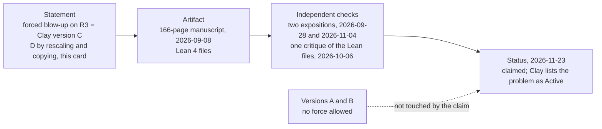

# The September 2026 Navier-Stokes claim: forced finite-time blow-up for versions C and D

[Syllabus](../../../SYLLABUS.md) → [Frontier](../README.md) → [Analysis and Dynamics](../README.md#s05) → The September 2026 Navier-Stokes claim

---

## General Overview

In 2000 the Clay Mathematics Institute put a prize of one million US dollars on the Navier-Stokes equations, the equations of a moving fluid such as water or air. Its official statement offers four versions, labelled (A) to (D), set out on [Navier-Stokes](../02-The%20Millennium%20Problems/04-navier-stokes-existence-and-smoothness.md). A proof of any one of them counts.

| Version | Where the fluid lives | Outside force | What must be shown |
| --- | --- | --- | --- |
| (A) | all of space | none | every smooth start stays smooth forever |
| (B) | a repeating box | none | every smooth start stays smooth forever |
| (C) | all of space | allowed: smooth, fading in space and time | some smooth start, with some force, breaks down |
| (D) | a repeating box | allowed: smooth, fading in time | some smooth start, with some force, breaks down |

A **repeating box** is a cube where fluid leaving one face comes back in at the opposite face. **Breaks down** means that no smooth solution with bounded energy lasts for all time. The usual way is **finite-time blow-up**: the speed somewhere becomes infinite at a finite time.

On 2026-09-08 an AI lab announced a proof of finite-time blow-up under a smooth outside force: the shape of versions (C) and (D). It released a 166-page manuscript and a repository of Lean files (Lean is a proof assistant). This card does not cite the announcement. It reads the claim through two expositions on arXiv that cite the manuscript, and one critique. The claimed picture: water starts at rest. A smooth push, switched on and off inside a bounded region, spins up a thin vortex. The vortex shrinks to a point, and its top speed becomes infinite at a finite time. Its total kinetic energy stays bounded the whole time.

The claim answers the versions that allow a force. The expositions prove the all-of-space statement, (C); (D) follows from it by the rescaling-and-copying step outlined on this card (Step 4). It says nothing about (A) or (B), the versions most people mean by "do fluids stay smooth". Water left alone, or pushed by an ordinary force, is not claimed to blow up.

**The claim builds one designed force under which a fluid at rest develops infinite speed in finite time with bounded energy; if correct, that settles version (C), and (D) by a short rescaling step, leaves (A) and (B) open, and as of 2026-11-23 it is a claim, not an accepted proof.**

**What kind of fact this is:** a theorem by kind (an exact statement offered with a proof), with status "claimed" as of 2026-11-23. A primary source asserts a proof. Two expositions by independent mathematicians follow it. One critique shows the Lean files do not mirror the written proof. No refereed publication or prize decision exists, and Clay's page lists the problem as "Active". The scalings on this card are arithmetic, checked by the code. Which versions the claim addresses comes from reading Clay's statement and the second exposition's main theorem; no program can compute it.

### The picture: four separate questions about one claim



This chain is the **audit list** of [Machines in proofs](../01-How%20Research%20Works/06-computer-assistance-and-formal-verification.md): what exactly is stated, what was released, who has checked it independently, and what status that earns. Each box is a separate question. A yes in one box does not answer the next.

---

## The formula

The equations, with the symbols of [The energy inequality, and the gap it leaves in three dimensions](../../19-Partial%20differential%20equations/07-Nonlinear%20PDE%20and%20Fluids/03-energy-inequality-and-the-regularity-question.md), now with an outside force $`\mathbf{f}`$:

```math
\frac{\partial \mathbf{u}}{\partial t} + (\mathbf{u}\cdot\nabla)\mathbf{u} = -\nabla p + \nu\,\Delta\mathbf{u} + \mathbf{f}, \qquad \nabla\cdot\mathbf{u} = 0, \qquad \mathbf{u}(x, 0) = \mathbf{u}_0(x) .
```

**Read it aloud:** the change in velocity, following the fluid, equals the pressure push plus friction plus the outside force, and the fluid cannot be squeezed.

The claimed theorem, as the expositions state it (with $`\nu = 1`$; any $`\nu > 0`$ follows by rescaling):

```math
\mathbf{u}_0 = 0, \quad \mathbf{f} \text{ smooth and zero outside a bounded region of space-time}, \quad \sup_{0 \le t < 1} \lVert\mathbf{u}(t)\rVert_{L^2} < \infty, \quad \limsup_{t \to 1} \lVert\mathbf{u}(t)\rVert_{L^\infty} = \infty .
```

**Read it aloud:** starting from rest, with a smooth force that lives in a bounded region, the energy stays bounded but the top speed becomes infinite as the time reaches 1.

Inside the vortex core, with $`\tau = 1 - t`$ the time left, the sizes scale as

```math
\ell_r \propto \tau^{1/2}, \qquad \ell_z \propto \tau^{(1-\delta)/2}, \qquad U \propto \tau^{-(1+\delta)/2}, \qquad 0 < \delta < \tfrac{1}{200} .
```

**Read it aloud:** the core's radius shrinks like the square root of the time left, its height shrinks a little more slowly, and its speed grows a little faster than one over that square root.

| Symbol | Plain meaning | In our example | Push it up and the answer… |
| --- | --- | --- | --- |
| $`\mathbf{u}`$, $`\mathbf{u}_0`$; $`p`$ | velocity, and its value at the start; pressure divided by density | $`\mathbf{u}_0 = 0`$: water at rest | — |
| $`\nu`$ | kinematic viscosity: how fast friction spreads motion | 1, in the papers' units | the force needed grows |
| $`\mathbf{f}`$ | the outside force per unit mass | designed; zero outside a bounded region | — |
| $`t`$; $`\tau`$ | time, scaled so blow-up is at $`t = 1`$; the time left, $`1 - t`$ | $`\tau = 10^{-2}, 10^{-4}, 10^{-6}`$ | — |
| $`\lVert\mathbf{u}\rVert_{L^2}`$; $`E`$ | the square root of the squared speed added over space; kinetic energy, half its square | $`E`$ stays bounded | — |
| $`\lVert\mathbf{u}\rVert_{L^\infty}`$; $`U`$ | the top speed anywhere; its size in the core | 443.9538 at $`\tau = 10^{-6}`$, model | blow-up when it has no bound |
| $`\ell_r`$; $`\ell_z`$ | the core's radius; its height | $`\tau^{1/2}`$; $`\tau^{(1-\delta)/2}`$ | — |
| $`\delta`$ | how much faster the speed grows than $`\tau^{-1/2}`$ | below 1/200; 1/200 used here, an illustrative value at the edge | energy and Reynolds number change exponent |
| $`\mathrm{Re}`$ | Reynolds number of the core, speed times radius over $`\nu`$: spin against friction; the model uses its top speed and the radius where it sits | 0.3068 to 0.3139, model | — |
| $`r`$, $`z`$; $`s`$, $`\zeta`$ | distance from the vortex axis, height; $`r/\ell_r`$ and $`z/\ell_z`$, in the fold | — | — |
| $`c`$; $`T`$ | a fixed number in Leray's bound; any blow-up time | — | — |
| $`\propto`$; $`\sup`$, $`\limsup`$ | "is proportional to": equal up to a fixed factor; the largest value over all times before 1; the largest value that keeps coming back as $`t`$ nears 1 | — | — |

### When it holds

- **A force is allowed.** Versions (C) and (D) let the solver choose the force. With $`\mathbf{f} = 0`$ the question is (A) or (B), and the claim says nothing.
- **The force stays smooth through the blow-up time.** Clay's force must be smooth for all time, with every derivative fading. Any flow solves the equations with the force "whatever is left over". For a naive flow, such as the model swirl, that leftover blows up too: its swirl component is $`3.7155 \times 10^{9}`$ at $`\tau = 10^{-6}`$.
- **The energy stays bounded.** Clay accepts only solutions with bounded energy. A core whose energy grew would break the rules; the claimed core's energy shrinks like $`\tau^{(1-3\delta)/2}`$.
- **The flow is the only one.** "No solution exists" needs uniqueness: any smooth, bounded-energy solution with the same start and force must be this flow. The manuscript proves this in a separate lemma, one the critique looks at.
- **Everything stays in a bounded region.** Velocity, pressure and force stay inside one fixed bounded set. That lets the same flow be placed inside a repeating box, which is how (D) follows from (C).

---

## Why it works

This section outlines a research proof that runs to hundreds of pages. It gives the statement, the key steps and the sources. It is an outline, not a proof.

### Step 0: any flow solves the equations with some force; the work is making that force smooth

Pick any velocity field $`\mathbf{u}`$ that is divergence-free. Put it into the left side of the equations. Whatever is left over, call it $`\mathbf{f}`$. Now the equations hold.

So "a flow that blows up under some force" is easy, if the force may be anything. The whole difficulty is the force. It must stay smooth, with every derivative bounded, right through the blow-up time.

The code shows the easy version failing. A model swirl with the claimed scalings needs a leftover force whose swirl component (the part pointing around the axis) is $`3.6690 \times 10^{3}`$ at $`\tau = 10^{-2}`$, $`3.6920 \times 10^{6}`$ at $`10^{-4}`$ and $`3.7155 \times 10^{9}`$ at $`10^{-6}`$. The whole force is at least that large. It grows like $`\tau^{-(3+\delta)/2}`$, a little faster than $`\tau^{-3/2}`$. Pressure cannot cancel it, because a swirl around an axis has no pressure gradient around the axis.

### Step 1: a collapsing vortex core (Part I)

The first exposition builds the leading flow. It is **axisymmetric** (the same at every angle around one axis) and spins about that axis, staying smooth on the axis itself.

The flow is **self-similar**: its shape stays fixed while the core shrinks, with the scales in The formula, radius $`\tau^{1/2}`$ and height $`\tau^{(1-\delta)/2}`$. A shrinking spinning core speeds up, like a skater pulling in her arms.

This core does not solve the equations exactly. Two errors remain:

- a **stress term** in a ring around the core: a leftover push that grows as the core collapses and need not be small, and
- a **flat remainder**, which goes to zero faster than any power of $`\tau`$, so it extends smoothly through the blow-up time.

### Step 2: oscillating pulses cancel the stress (Part II)

The second exposition removes the stress term. It adds small, fast, wave-like pulses in the ring.

A rapid oscillation has an average push of its own. Two oscillating velocity parts multiply in the term $`(\mathbf{u}\cdot\nabla)\mathbf{u}`$, and their product has a nonzero average. The pulses are tuned so that this average push cancels the stress.

Each correction leaves a smaller error. Repeated corrections push every error into the flat kind. What is finally left is the force: smooth, zero outside a bounded region, and smooth through $`t = 1`$.

### Step 3: from one flow that blows up to "no solution exists" (version C)

Version (C) asks that **no** smooth, bounded-energy solution exists for all time. One blowing-up flow is not enough on its own.

The manuscript adds a uniqueness lemma. A smooth, bounded-energy solution with the same start and force would have to equal the constructed flow up to $`t = 1`$. That flow blows up, so no such solution exists.

The start is $`\mathbf{u}_0 = 0`$ and the force vanishes outside a bounded region. Both meet Clay's decay conditions automatically.

### Step 4: from all of space to the repeating box (version D)

Velocity, pressure and force all stay inside one bounded set. Shrink the picture until that set fits inside one cell of the repeating box, then copy it into every cell.

The copies never touch, so each one still solves the equations. Shrinking space by a factor and time by its square keeps the equations and the viscosity, with a rescaled force. This step is outlined here; the expositions cited below treat all of space.

### Step 5: why the speed must grow a little faster than $`\tau^{-1/2}`$

Leray proved in 1934 that a smooth solution that blows up at time $`T`$ has top speed at least

```math
\lVert\mathbf{u}(t)\rVert_{L^\infty} \;\ge\; c\,\sqrt{\frac{\nu}{T - t}} .
```

**Read it aloud:** blow-up can never be slower than one over the square root of the time left.

Exactly that rate is called **Type I**. The second exposition states the claimed rate as a lower bound, top speed at least a fixed number times $`\tau^{-(1+\delta)/2}`$. That is faster than Type I by the factor $`\tau^{-\delta/2}`$.

That factor is tiny. With $`\delta = 1/200`$, an illustrative value at the edge of the allowed range, it is only 1.0351 at $`\tau = 10^{-6}`$. On the model, speed times $`\sqrt{\tau}`$ creeps from 0.4338 to 0.4440 as $`\tau`$ falls from $`10^{-2}`$ to $`10^{-6}`$. The blow-up is barely faster than the slowest rate allowed.

### Step 6: what the Lean files do and do not settle

A proof assistant checks that a formal proof proves a formal statement ([Proof assistants](../../24-Computability%20and%20complexity/02-Computability%20and%20Logic/08-proof-assistants-and-formal-verification.md)). It does not check that the statement says what was meant. That leaves three separate questions here.

1. **Does the Lean statement match Clay's (C) and (D)?** The repository says it formalises the manuscript's results. A reader has to check its definitions of smoothness, energy and the repeating box against Clay's text; no source cited here reports that check.
2. **Does the Lean proof compile?** Nobody here compiled it; no check on this card runs Lean.
3. **Is the written proof correct?** The critique of 2026-10-06 shows the Lean proof does not follow the written one. In one lemma the paper uses 4 extra derivatives and Lean uses 5. In the uniqueness step, Lean proves a different bound by a different route. The authors make no claim either way about the written proof.

So a compiling Lean proof would support the formal statement. It would not certify the 166-page argument as written.

<details>
<summary>The scalings of the core, worked by hand</summary>

Take the core's speed $`U = \tau^{-(1+\delta)/2}`$, radius $`\ell_r = \tau^{1/2}`$ and height $`\ell_z = \tau^{(1-\delta)/2}`$.

Energy is half the squared speed times the volume, so up to a fixed factor:

$`\displaystyle E \propto U^2\,\ell_r^2\,\ell_z = \tau^{-(1+\delta)}\cdot\tau\cdot\tau^{(1-\delta)/2} = \tau^{(1-3\delta)/2} .`$

The exponent is positive when $`\delta < 1/3`$, so the core's energy goes to zero. The Reynolds number of the core is

$`\displaystyle \mathrm{Re} = \frac{U\,\ell_r}{\nu} = \tau^{-(1+\delta)/2}\cdot\tau^{1/2} = \tau^{-\delta/2} ,`$

which grows without bound, but very slowly.

The model swirl in the code is $`u = U\,s\,e^{-s^2}\,e^{-(z/\ell_z)^2}`$ with $`s = r/\ell_r`$. It is illustrative: it has the same scalings, but it is not the papers' flow. Its energy is

$`\displaystyle E = \tfrac12\,\tau^{(1-3\delta)/2}\cdot\frac{\pi}{4}\cdot\sqrt{\frac{\pi}{2}} ,`$

from $`\int_0^\infty s^3 e^{-2s^2}\,ds = 1/8`$ and $`\int e^{-2\zeta^2}\,d\zeta = \sqrt{\pi/2}`$. Its top speed is $`U e^{-1/2}/\sqrt{2}`$, at $`s = 1/\sqrt{2}`$.

</details>

---

## Worked numbers, by hand

The example: which version of the problem the claim addresses, and which it does not.

| Step | Arithmetic | Value |
| --- | --- | --- |
| (A): needs $`\mathbf{f} = 0`$ | the claim's force is not zero | not addressed |
| (B): needs $`\mathbf{f} = 0`$, repeating box | same reason | not addressed |
| (C): force allowed, all of space, breakdown | start at rest, smooth bounded force, bounded energy, unique | addressed |
| (D): force allowed, repeating box, breakdown | bounded support, copied into each cell (Step 4, this card's deduction) | addressed |
| core energy, model, $`\tau = 10^{-6}`$ | $`\tfrac12 (10^{-6})^{0.4925}\cdot\tfrac{\pi}{4}\sqrt{\pi/2}`$ | 0.0005459085 |
| top speed, model, $`\tau = 10^{-6}`$ | $`(10^{-6})^{-0.5025}\, e^{-1/2}/\sqrt2`$ | 443.9538 |
| speed above Leray's rate | $`(10^{-6})^{-0.0025}`$ | 1.0351 |
| **versions addressed** | | **(C) and (D) only** |

The four version rows are read from Clay's statement and the second exposition's Theorem 1.1, not computed. If the claim is correct, the force-allowed half of the problem is settled, and the no-force half is exactly as open as before.

### What breaks if you drop a piece

| Mistake | Comes out at | What went wrong |
| --- | --- | --- |
| Let the force be the leftover of a naive blowing-up flow, the model swirl | swirl component $`3.7155 \times 10^{9}`$ at $`\tau = 10^{-6}`$, unbounded | the force blows up too; Clay's force must stay smooth |
| A core whose speed grows like $`\tau^{-0.4}`$ | speed against Leray's rate: 0.2512 at $`10^{-6}`$, falling to 0 | slower than Leray's floor, so it cannot be a blow-up |
| A core with $`\delta`$ = 0.4 | energy multiplied by 3.9811 at $`\tau = 10^{-6}`$ | energy grows without bound; Clay requires bounded energy |

---

## Code, from first principles, and it actually runs

The code does two jobs. It prints the four Clay versions as a typed record: which ones the claim addresses comes from reading Clay's statement and the second exposition's Theorem 1.1, so the code asserts nothing about them. It then computes the core's scalings on the model swirl by two independent roads each: energy by a two-dimensional Simpson's rule against the closed form, top speed by a grid search against calculus, and the swirl component of the leftover force by finite differences against the hand formula. It also fits the energy exponent from the numbers and matches it to $`(1-3\delta)/2`$. It checks nothing about the claimed proof itself, which no short program can.

### Python

```python
# The September 2026 Navier-Stokes claim: which Clay version it addresses, and the
# scalings of its collapsing vortex core, on a model swirl with the same scalings.
# Standard library only.  Units are normalised: viscosity nu = 1, blow-up at t = 1.
from math import exp, log, sqrt, pi

DELTA = 1 / 200            # the papers' parameter: 0 < delta < 1/200; the edge value, for illustration
NU = 1.0
TAUS = (1e-2, 1e-4, 1e-6)  # tau = 1 - t, the time left before the blow-up

def scales(tau, d):        # speed, core radius and core height of the model
    return tau ** (-(1 + d) / 2), tau ** 0.5, tau ** ((1 - d) / 2)

def swirl(r, z, tau, d):   # model swirl speed: A * F(r/a) * G(z/b), F(s) = s e^(-s^2), G = e^(-z^2)
    A, a, b = scales(tau, d)
    s = r / a
    return A * s * exp(-s * s) * exp(-(z / b) ** 2)

def energy_numeric(tau, d, n=400):     # road 1: Simpson's rule over r and z
    A, a, b = scales(tau, d)
    R, Z = 8 * a, 8 * b
    hr, hz = R / n, 2 * Z / n
    w = [1 if i in (0, n) else (4 if i % 2 else 2) for i in range(n + 1)]
    total = 0.0
    for i in range(n + 1):
        r = i * hr
        row = 0.0
        for j in range(n + 1):
            u = swirl(r, -Z + j * hz, tau, d)
            row += w[j] * u * u
        total += w[i] * row * 2 * pi * r
    return 0.5 * total * hr * hz / 9

def energy_closed(tau, d):             # road 2: by hand, (pi/4) sqrt(pi/2) times the scales
    return 0.5 * tau ** ((1 - 3 * d) / 2) * (pi / 4) * sqrt(pi / 2)

def peak_grid(tau, d, n=20000):        # road 1: search r on a grid at z = 0
    A, a, b = scales(tau, d)
    return max(swirl(8 * a * i / n, 0.0, tau, d) for i in range(n + 1))

def peak_closed(tau, d):               # road 2: F peaks at s = 1/sqrt 2
    return scales(tau, d)[0] * exp(-0.5) / sqrt(2)

def residual_fd(tau, d):               # road 1: force needed = time change - friction, by differences
    A, a, b = scales(tau, d)
    r, ht, hr, hz = a / sqrt(2), tau * 1e-4, a * 1e-3, b * 1e-3
    u = lambda rr, zz, tt: swirl(rr, zz, tt, d)
    dt = -(u(r, 0, tau + ht) - u(r, 0, tau - ht)) / (2 * ht)        # t = 1 - tau
    urr = (u(r + hr, 0, tau) - 2 * u(r, 0, tau) + u(r - hr, 0, tau)) / hr ** 2
    ur = (u(r + hr, 0, tau) - u(r - hr, 0, tau)) / (2 * hr)
    uzz = (u(r, hz, tau) - 2 * u(r, 0, tau) + u(r, -hz, tau)) / hz ** 2
    return dt - NU * (urr + ur / r - u(r, 0, tau) / r ** 2 + uzz)

def residual_closed(tau, d):           # road 2: the same force worked out by hand
    c = exp(-0.5)
    return (c * (1 + d) / (2 * sqrt(2)) * tau ** (-(3 + d) / 2)
            + NU * (3 * sqrt(2) * c * tau ** (-(3 + d) / 2) + sqrt(2) * c * tau ** (-(3 - d) / 2)))

print("ledger,1934,Leray: a blow-up is never slower than c sqrt(nu/(T - t))")
print("ledger,2000,Clay names seven prize problems, 1,000,000 US dollars each")
print("ledger,2026-09-08,announced by an AI lab: manuscript (166 pages) and Lean files")
print("ledger,2026-09-28,first exposition on arXiv (Part I)")
print("ledger,2026-10-06,critique on arXiv: Lean uses m+5 derivatives where the paper uses m+4")
print("ledger,2026-11-04,second exposition on arXiv (Part II)")
print("ledger,2026-11-23,Clay page lists the problem as 'Active'; status: claimed")
# Which version the claim addresses is read from Clay's statement and Part II, Theorem 1.1.
# No program can compute it, so these rows are a typed record and nothing is asserted about them.
no = "not addressed: needs f = 0, claim uses a force"
versions = [("A", "R3", "zero", "smooth forever", no), ("B", "torus", "zero", "smooth forever", no),
            ("C", "R3", "allowed", "breakdown", "addressed: Part II, Theorem 1.1, all of space"),
            ("D", "torus", "allowed", "breakdown", "addressed: from C by rescaling and copying")]
for name, space, force, asks, why in versions:
    print(f"version {name}: {space:<5} force {force:<7} asks {asks:<14} -> {why}")

print("tau      energy(Simpson)   energy(by hand)   peak(grid)     peak(by hand)  Reynolds  speed*sqrt(tau)")
E = {}
for tau in TAUS:
    en, ec = energy_numeric(tau, DELTA), energy_closed(tau, DELTA)
    pg, pc = peak_grid(tau, DELTA), peak_closed(tau, DELTA)
    assert abs(en - ec) < 1e-7 * ec and abs(pg - pc) < 1e-7 * pc
    re, ler = pc * (sqrt(tau) / sqrt(2)) / NU, pc * sqrt(tau / NU)
    E[tau] = en
    print(f"{tau:.0e}  {en:.10f}  {ec:.10f}  {pg:.6e}  {pc:.6e}  {re:.4f}    {ler:.4f}")
slope = log(E[1e-6] / E[1e-2]) / log(1e-6 / 1e-2)
assert abs(slope - (1 - 3 * DELTA) / 2) < 1e-9
print(f"energy exponent fitted {slope:.6f}, by hand (1 - 3 delta)/2 = {(1 - 3 * DELTA) / 2:.6f}")
for tau in TAUS:
    fd, fc = residual_fd(tau, DELTA), residual_closed(tau, DELTA)
    assert abs(fd - fc) < 1e-5 * fc
    print(f"swirl component of the force a naive swirl needs at tau {tau:.0e}: {fd:.4e} (by hand {fc:.4e})")
print(f"Leray floor factor tau^(-delta/2) at 1e-6: {1e-6 ** (-DELTA / 2):.4f}")

# what breaks
print(f"break: speed ~ tau^-0.4, ratio to Leray floor at 1e-6: {1e-6 ** 0.1:.4f} (must stay above a constant)")
print(f"break: delta = 0.4, energy factor at 1e-6: {1e-6 ** ((1 - 3 * 0.4) / 2):.4f} (energy grows)")
assert energy_closed(1e-6, 0.4) > energy_closed(1e-2, 0.4) > energy_closed(1.0, 0.4)
# try changing
print(f"try: delta = 0, Reynolds at 1e-2 and 1e-12: {peak_closed(1e-2, 0) * sqrt(1e-2 / 2):.4f} {peak_closed(1e-12, 0) * sqrt(1e-12 / 2):.4f}")
print(f"try: delta = 1/3, energy at 1e-2 and 1e-12: {energy_closed(1e-2, 1 / 3):.6f} {energy_closed(1e-12, 1 / 3):.6f}")
print(f"try: tau = 1e-12, speed*sqrt(tau): {peak_closed(1e-12, DELTA) * sqrt(1e-12):.4f}")
print(f"try: tau = 1e-12, swirl component of the naive force: {residual_closed(1e-12, DELTA):.4e}")
print("ALL CHECKS PASS")
```

**Ran 2026-11-23 on macOS, Python 3.14.10, standard library only. All checks passed. Output, pasted from the run:**

```
ledger,1934,Leray: a blow-up is never slower than c sqrt(nu/(T - t))
ledger,2000,Clay names seven prize problems, 1,000,000 US dollars each
ledger,2026-09-08,announced by an AI lab: manuscript (166 pages) and Lean files
ledger,2026-09-28,first exposition on arXiv (Part I)
ledger,2026-10-06,critique on arXiv: Lean uses m+5 derivatives where the paper uses m+4
ledger,2026-11-04,second exposition on arXiv (Part II)
ledger,2026-11-23,Clay page lists the problem as 'Active'; status: claimed
version A: R3    force zero    asks smooth forever -> not addressed: needs f = 0, claim uses a force
version B: torus force zero    asks smooth forever -> not addressed: needs f = 0, claim uses a force
version C: R3    force allowed asks breakdown      -> addressed: Part II, Theorem 1.1, all of space
version D: torus force allowed asks breakdown      -> addressed: from C by rescaling and copying
tau      energy(Simpson)   energy(by hand)   peak(grid)     peak(by hand)  Reynolds  speed*sqrt(tau)
1e-02  0.0509471396  0.0509471418  4.338482e+00  4.338482e+00  0.3068    0.4338
1e-04  0.0052737532  0.0052737535  4.388719e+01  4.388719e+01  0.3103    0.4389
1e-06  0.0005459084  0.0005459085  4.439538e+02  4.439538e+02  0.3139    0.4440
energy exponent fitted 0.492500, by hand (1 - 3 delta)/2 = 0.492500
swirl component of the force a naive swirl needs at tau 1e-02: 3.6690e+03 (by hand 3.6690e+03)
swirl component of the force a naive swirl needs at tau 1e-04: 3.6920e+06 (by hand 3.6920e+06)
swirl component of the force a naive swirl needs at tau 1e-06: 3.7155e+09 (by hand 3.7155e+09)
Leray floor factor tau^(-delta/2) at 1e-6: 1.0351
break: speed ~ tau^-0.4, ratio to Leray floor at 1e-6: 0.2512 (must stay above a constant)
break: delta = 0.4, energy factor at 1e-6: 3.9811 (energy grows)
try: delta = 0, Reynolds at 1e-2 and 1e-12: 0.3033 0.3033
try: delta = 1/3, energy at 1e-2 and 1e-12: 0.492175 0.492175
try: tau = 1e-12, speed*sqrt(tau): 0.4596
try: tau = 1e-12, swirl component of the naive force: 3.7888e+18
ALL CHECKS PASS
```

### Rust

```rust
// The September 2026 Navier-Stokes claim: which Clay version it addresses, and the
// scalings of its collapsing vortex core, on a model swirl with the same scalings.
// std only.  Units are normalised: viscosity nu = 1, blow-up at t = 1.
use std::f64::consts::PI;

const DELTA: f64 = 1.0 / 200.0; // the papers' parameter: 0 < delta < 1/200; the edge value, for illustration
const NU: f64 = 1.0;
const TAUS: [f64; 3] = [1e-2, 1e-4, 1e-6]; // tau = 1 - t, the time left before the blow-up

fn sci(x: f64, p: usize) -> String {
    // Python-style e-notation: 3.7155e+09
    let s = format!("{:.*e}", p, x);
    let (m, e) = s.split_once('e').unwrap();
    let ev: i32 = e.parse().unwrap();
    format!("{}e{}{:02}", m, if ev < 0 { '-' } else { '+' }, ev.abs())
}

fn scales(tau: f64, d: f64) -> (f64, f64, f64) {
    (tau.powf(-(1.0 + d) / 2.0), tau.powf(0.5), tau.powf((1.0 - d) / 2.0))
}

fn swirl(r: f64, z: f64, tau: f64, d: f64) -> f64 {
    let (a_, a, b) = scales(tau, d);
    let s = r / a;
    a_ * s * (-s * s).exp() * (-(z / b).powi(2)).exp()
}

fn energy_numeric(tau: f64, d: f64, n: usize) -> f64 {
    // road 1: Simpson's rule over r and z
    let (_, a, b) = scales(tau, d);
    let (rr, zz) = (8.0 * a, 8.0 * b);
    let (hr, hz) = (rr / n as f64, 2.0 * zz / n as f64);
    let w: Vec<f64> = (0..=n).map(|i| if i == 0 || i == n { 1.0 } else if i % 2 == 1 { 4.0 } else { 2.0 }).collect();
    let mut total = 0.0;
    for i in 0..=n {
        let r = i as f64 * hr;
        let mut row = 0.0;
        for j in 0..=n {
            let u = swirl(r, -zz + j as f64 * hz, tau, d);
            row += w[j] * u * u;
        }
        total += w[i] * row * 2.0 * PI * r;
    }
    0.5 * total * hr * hz / 9.0
}

fn energy_closed(tau: f64, d: f64) -> f64 {
    0.5 * tau.powf((1.0 - 3.0 * d) / 2.0) * (PI / 4.0) * (PI / 2.0).sqrt()
}

fn peak_grid(tau: f64, d: f64, n: usize) -> f64 {
    let (_, a, _) = scales(tau, d);
    (0..=n).map(|i| swirl(8.0 * a * i as f64 / n as f64, 0.0, tau, d)).fold(f64::MIN, f64::max)
}

fn peak_closed(tau: f64, d: f64) -> f64 {
    scales(tau, d).0 * (-0.5f64).exp() / 2f64.sqrt()
}

fn residual_fd(tau: f64, d: f64) -> f64 {
    // road 1: force needed = time change - friction, by differences
    let (_, a, b) = scales(tau, d);
    let (r, ht, hr, hz) = (a / 2f64.sqrt(), tau * 1e-4, a * 1e-3, b * 1e-3);
    let u = |rr: f64, zz: f64, tt: f64| swirl(rr, zz, tt, d);
    let dt = -(u(r, 0.0, tau + ht) - u(r, 0.0, tau - ht)) / (2.0 * ht);
    let urr = (u(r + hr, 0.0, tau) - 2.0 * u(r, 0.0, tau) + u(r - hr, 0.0, tau)) / hr.powi(2);
    let ur = (u(r + hr, 0.0, tau) - u(r - hr, 0.0, tau)) / (2.0 * hr);
    let uzz = (u(r, hz, tau) - 2.0 * u(r, 0.0, tau) + u(r, -hz, tau)) / hz.powi(2);
    dt - NU * (urr + ur / r - u(r, 0.0, tau) / r.powi(2) + uzz)
}

fn residual_closed(tau: f64, d: f64) -> f64 {
    let c = (-0.5f64).exp();
    c * (1.0 + d) / (2.0 * 2f64.sqrt()) * tau.powf(-(3.0 + d) / 2.0)
        + NU * (3.0 * 2f64.sqrt() * c * tau.powf(-(3.0 + d) / 2.0) + 2f64.sqrt() * c * tau.powf(-(3.0 - d) / 2.0))
}

fn main() {
    println!("ledger,1934,Leray: a blow-up is never slower than c sqrt(nu/(T - t))");
    println!("ledger,2000,Clay names seven prize problems, 1,000,000 US dollars each");
    println!("ledger,2026-09-08,announced by an AI lab: manuscript (166 pages) and Lean files");
    println!("ledger,2026-09-28,first exposition on arXiv (Part I)");
    println!("ledger,2026-10-06,critique on arXiv: Lean uses m+5 derivatives where the paper uses m+4");
    println!("ledger,2026-11-04,second exposition on arXiv (Part II)");
    println!("ledger,2026-11-23,Clay page lists the problem as 'Active'; status: claimed");
    // Which version the claim addresses is read from Clay's statement and Part II, Theorem 1.1.
    // No program can compute it, so these rows are a typed record and nothing is asserted about them.
    let no = "not addressed: needs f = 0, claim uses a force";
    let versions = [("A", "R3", "zero", "smooth forever", no), ("B", "torus", "zero", "smooth forever", no),
                    ("C", "R3", "allowed", "breakdown", "addressed: Part II, Theorem 1.1, all of space"),
                    ("D", "torus", "allowed", "breakdown", "addressed: from C by rescaling and copying")];
    for (name, space, force, asks, why) in versions {
        println!("version {}: {:<5} force {:<7} asks {:<14} -> {}", name, space, force, asks, why);
    }

    println!("tau      energy(Simpson)   energy(by hand)   peak(grid)     peak(by hand)  Reynolds  speed*sqrt(tau)");
    let mut e = Vec::new();
    for &tau in TAUS.iter() {
        let (en, ec) = (energy_numeric(tau, DELTA, 400), energy_closed(tau, DELTA));
        let (pg, pc) = (peak_grid(tau, DELTA, 20000), peak_closed(tau, DELTA));
        assert!((en - ec).abs() < 1e-7 * ec && (pg - pc).abs() < 1e-7 * pc);
        let (re, ler) = (pc * (tau.sqrt() / 2f64.sqrt()) / NU, pc * (tau / NU).sqrt());
        e.push(en);
        println!("{}  {:.10}  {:.10}  {}  {}  {:.4}    {:.4}", sci(tau, 0), en, ec, sci(pg, 6), sci(pc, 6), re, ler);
    }
    let slope = (e[2] / e[0]).ln() / (1e-6f64 / 1e-2).ln();
    assert!((slope - (1.0 - 3.0 * DELTA) / 2.0).abs() < 1e-9);
    println!("energy exponent fitted {:.6}, by hand (1 - 3 delta)/2 = {:.6}", slope, (1.0 - 3.0 * DELTA) / 2.0);
    for &tau in TAUS.iter() {
        let (fd, fc) = (residual_fd(tau, DELTA), residual_closed(tau, DELTA));
        assert!((fd - fc).abs() < 1e-5 * fc);
        println!("swirl component of the force a naive swirl needs at tau {}: {} (by hand {})", sci(tau, 0), sci(fd, 4), sci(fc, 4));
    }
    println!("Leray floor factor tau^(-delta/2) at 1e-6: {:.4}", 1e-6f64.powf(-DELTA / 2.0));

    // what breaks
    println!("break: speed ~ tau^-0.4, ratio to Leray floor at 1e-6: {:.4} (must stay above a constant)", 1e-6f64.powf(0.1));
    println!("break: delta = 0.4, energy factor at 1e-6: {:.4} (energy grows)", 1e-6f64.powf((1.0 - 3.0 * 0.4) / 2.0));
    assert!(energy_closed(1e-6, 0.4) > energy_closed(1e-2, 0.4) && energy_closed(1e-2, 0.4) > energy_closed(1.0, 0.4));
    // try changing
    println!("try: delta = 0, Reynolds at 1e-2 and 1e-12: {:.4} {:.4}", peak_closed(1e-2, 0.0) * (1e-2f64 / 2.0).sqrt(), peak_closed(1e-12, 0.0) * (1e-12f64 / 2.0).sqrt());
    println!("try: delta = 1/3, energy at 1e-2 and 1e-12: {:.6} {:.6}", energy_closed(1e-2, 1.0 / 3.0), energy_closed(1e-12, 1.0 / 3.0));
    println!("try: tau = 1e-12, speed*sqrt(tau): {:.4}", peak_closed(1e-12, DELTA) * 1e-12f64.sqrt());
    println!("try: tau = 1e-12, swirl component of the naive force: {}", sci(residual_closed(1e-12, DELTA), 4));
    println!("ALL CHECKS PASS");
}
```

**Ran 2026-11-23 on macOS, rustc 1.98.1, no crates. All checks passed. Output, pasted from the run:**

```
ledger,1934,Leray: a blow-up is never slower than c sqrt(nu/(T - t))
ledger,2000,Clay names seven prize problems, 1,000,000 US dollars each
ledger,2026-09-08,announced by an AI lab: manuscript (166 pages) and Lean files
ledger,2026-09-28,first exposition on arXiv (Part I)
ledger,2026-10-06,critique on arXiv: Lean uses m+5 derivatives where the paper uses m+4
ledger,2026-11-04,second exposition on arXiv (Part II)
ledger,2026-11-23,Clay page lists the problem as 'Active'; status: claimed
version A: R3    force zero    asks smooth forever -> not addressed: needs f = 0, claim uses a force
version B: torus force zero    asks smooth forever -> not addressed: needs f = 0, claim uses a force
version C: R3    force allowed asks breakdown      -> addressed: Part II, Theorem 1.1, all of space
version D: torus force allowed asks breakdown      -> addressed: from C by rescaling and copying
tau      energy(Simpson)   energy(by hand)   peak(grid)     peak(by hand)  Reynolds  speed*sqrt(tau)
1e-02  0.0509471396  0.0509471418  4.338482e+00  4.338482e+00  0.3068    0.4338
1e-04  0.0052737532  0.0052737535  4.388719e+01  4.388719e+01  0.3103    0.4389
1e-06  0.0005459084  0.0005459085  4.439538e+02  4.439538e+02  0.3139    0.4440
energy exponent fitted 0.492500, by hand (1 - 3 delta)/2 = 0.492500
swirl component of the force a naive swirl needs at tau 1e-02: 3.6690e+03 (by hand 3.6690e+03)
swirl component of the force a naive swirl needs at tau 1e-04: 3.6920e+06 (by hand 3.6920e+06)
swirl component of the force a naive swirl needs at tau 1e-06: 3.7155e+09 (by hand 3.7155e+09)
Leray floor factor tau^(-delta/2) at 1e-6: 1.0351
break: speed ~ tau^-0.4, ratio to Leray floor at 1e-6: 0.2512 (must stay above a constant)
break: delta = 0.4, energy factor at 1e-6: 3.9811 (energy grows)
try: delta = 0, Reynolds at 1e-2 and 1e-12: 0.3033 0.3033
try: delta = 1/3, energy at 1e-2 and 1e-12: 0.492175 0.492175
try: tau = 1e-12, speed*sqrt(tau): 0.4596
try: tau = 1e-12, swirl component of the naive force: 3.7888e+18
ALL CHECKS PASS
```

### Lean

Lean proves the core's scalings for every $`\delta`$ between 0 and 1/200, and the model swirl's constants, but not the claimed blow-up.

- Take $`0 < \delta < 1/200`$. Then the core's speed $`U = \tau^{-(1+\delta)/2}`$ becomes infinite as $`\tau`$ falls to 0.
- Take the radius $`\ell_r = \tau^{1/2}`$ and height $`\ell_z = \tau^{(1-\delta)/2}`$. Then $`U^2 \ell_r^2 \ell_z = \tau^{(1-3\delta)/2}`$, which goes to 0.
- Take $`\nu = 1`$. Then the Reynolds number $`U \ell_r`$ equals $`\tau^{-\delta/2}`$ and becomes infinite, so the speed pulls ahead of Leray's rate.
- Take the model swirl's profile $`s e^{-s^2}`$ over every real $`s`$. Then its largest value is $`e^{-1/2}/\sqrt2`$, reached at $`s = 1/\sqrt2`$.
- Take $`s`$ from 0 to infinity. Then $`\int_0^\infty s^3 e^{-2s^2}\,ds = 1/8`$.
- Take $`\zeta`$ over the whole line. Then $`\int e^{-2\zeta^2}\,d\zeta = \sqrt{\pi/2}`$.
- Take $`\delta = 1/200`$. Then the energy exponent is 0.4925, the speed exponent 0.5025, and the lead over Leray's rate 0.0025.
- Take $`\delta`$ = 0.4. Then the energy exponent is −0.1, so the energy grows.
- Take a speed like $`\tau^{-0.4}`$. Then its ratio to Leray's rate is $`\tau^{0.1}`$, which falls to 0.
- Take $`\delta`$ = 1/3. Then the energy exponent is exactly 0.

The numbers at each $`\tau`$ and the naive swirl's leftover force are left to the Python and Rust checks.

```lean
-- The September 2026 Navier-Stokes claim: for 0 < δ < 1/200 the claimed collapsing core's speed and Reynolds number become infinite while its energy goes to zero, and the model swirl's peak and energy constants are exactly as the card computes them.
import Mathlib.Analysis.SpecialFunctions.Pow.Asymptotics
import Mathlib.Analysis.SpecialFunctions.Gaussian.GaussianIntegral
import Mathlib.MeasureTheory.Integral.Gamma

open Real Filter Topology MeasureTheory Set

/-- The claimed vortex core has speed `U = τ^(-(1+δ)/2)`, radius `ℓ_r = τ^(1/2)` and height
`ℓ_z = τ^((1-δ)/2)`, where `τ = 1 - t` is the time left and `0 < δ < 1/200`.
As `τ` falls to 0: the speed becomes infinite; the energy scale `U² ℓ_r² ℓ_z` equals
`τ^((1-3δ)/2)` and goes to 0; and the Reynolds number `U ℓ_r` (with `ν = 1`), which is also
the speed measured against Leray's rate `τ^(-1/2)`, equals `τ^(-δ/2)` and becomes infinite. -/
theorem core_speed_blows_up_while_energy_vanishes {δ : ℝ} (hδ0 : 0 < δ) (hδ1 : δ < 1 / 200) :
    Tendsto (fun τ : ℝ => τ ^ (-(1 + δ) / 2)) (𝓝[>] 0) atTop ∧
    (∀ τ : ℝ, 0 < τ →
      (τ ^ (-(1 + δ) / 2)) ^ 2 * (τ ^ (1 / 2 : ℝ)) ^ 2 * τ ^ ((1 - δ) / 2)
        = τ ^ ((1 - 3 * δ) / 2)) ∧
    Tendsto (fun τ : ℝ => (τ ^ (-(1 + δ) / 2)) ^ 2 * (τ ^ (1 / 2 : ℝ)) ^ 2 * τ ^ ((1 - δ) / 2))
      (𝓝[>] 0) (𝓝 0) ∧
    (∀ τ : ℝ, 0 < τ → τ ^ (-(1 + δ) / 2) * τ ^ (1 / 2 : ℝ) = τ ^ (-δ / 2)) ∧
    Tendsto (fun τ : ℝ => τ ^ (-(1 + δ) / 2) * τ ^ (1 / 2 : ℝ)) (𝓝[>] 0) atTop := by
  have key : ∀ τ : ℝ, 0 < τ → ∀ a b : ℝ, τ ^ a * τ ^ b = τ ^ (a + b) :=
    fun τ hτ a b => (Real.rpow_add hτ a b).symm
  have sq : ∀ τ : ℝ, 0 < τ → ∀ a : ℝ, (τ ^ a) ^ 2 = τ ^ (2 * a) := by
    intro τ hτ a
    rw [← Real.rpow_natCast, ← Real.rpow_mul hτ.le]
    norm_num [mul_comm]
  have hE : ∀ τ : ℝ, 0 < τ →
      (τ ^ (-(1 + δ) / 2)) ^ 2 * (τ ^ (1 / 2 : ℝ)) ^ 2 * τ ^ ((1 - δ) / 2)
        = τ ^ ((1 - 3 * δ) / 2) := by
    intro τ hτ
    rw [sq τ hτ, sq τ hτ, key τ hτ, key τ hτ]
    congr 1; ring
  have hR : ∀ τ : ℝ, 0 < τ → τ ^ (-(1 + δ) / 2) * τ ^ (1 / 2 : ℝ) = τ ^ (-δ / 2) := by
    intro τ hτ
    rw [key τ hτ]
    congr 1; ring
  refine ⟨tendsto_rpow_neg_nhdsGT_zero (by linarith), hE, ?_, hR, ?_⟩
  · have hc : 0 < (1 - 3 * δ) / 2 := by linarith
    have h0 : Tendsto (fun τ : ℝ => τ ^ ((1 - 3 * δ) / 2)) (𝓝[>] 0) (𝓝 0) := by
      have := ((Real.continuous_rpow_const hc.le).tendsto 0)
      rw [Real.zero_rpow hc.ne'] at this
      exact tendsto_nhdsWithin_of_tendsto_nhds this
    refine h0.congr' ?_
    filter_upwards [self_mem_nhdsWithin] with τ hτ
    exact (hE τ hτ).symm
  · refine (tendsto_rpow_neg_nhdsGT_zero (by linarith : -δ / 2 < 0)).congr' ?_
    filter_upwards [self_mem_nhdsWithin] with τ hτ
    exact (hR τ hτ).symm

/-- The model swirl's radial profile `s e^(-s²)` is never larger than `e^(-1/2)/√2`, and it
reaches that value at `s = 1/√2`; so the model's top speed is `U e^(-1/2)/√2`. -/
theorem model_swirl_peak :
    IsGreatest (Set.range fun s : ℝ => s * exp (-s ^ 2)) (exp (-1 / 2) / √2) ∧
    (1 / √2) * exp (-(1 / √2) ^ 2) = exp (-1 / 2) / √2 := by
  have h2 : (0 : ℝ) < √2 := by positivity
  have hs2 : √2 * √2 = 2 := Real.mul_self_sqrt (by norm_num)
  have hval : (1 / √2) * exp (-(1 / √2) ^ 2) = exp (-1 / 2) / √2 := by
    have : (1 / √2) ^ 2 = 1 / 2 := by
      rw [div_pow, Real.sq_sqrt (by norm_num)]; norm_num
    rw [this]; ring_nf
  refine ⟨⟨⟨1 / √2, hval⟩, ?_⟩, hval⟩
  rintro _ ⟨s, rfl⟩
  simp only
  rcases le_or_gt s 0 with hs | hs
  · have : s * exp (-s ^ 2) ≤ 0 := mul_nonpos_of_nonpos_of_nonneg hs (exp_pos _).le
    exact this.trans (by positivity)
  · rw [le_div_iff₀ h2]
    -- √2 s ≤ s² + 1/2 ≤ exp (s² - 1/2)
    have h1 : √2 * s ≤ s ^ 2 + 1 / 2 := by
      nlinarith [sq_nonneg (s - 1 / √2), sq_nonneg (√2 * s - 1)]
    have h3 : s ^ 2 + 1 / 2 ≤ exp (s ^ 2 - 1 / 2) := by
      have := Real.add_one_le_exp (s ^ 2 - 1 / 2); linarith
    have h4 : exp (s ^ 2 - 1 / 2) * exp (-s ^ 2) = exp (-1 / 2) := by
      rw [← Real.exp_add]; congr 1; ring
    calc s * exp (-s ^ 2) * √2 = (√2 * s) * exp (-s ^ 2) := by ring
      _ ≤ exp (s ^ 2 - 1 / 2) * exp (-s ^ 2) :=
          mul_le_mul_of_nonneg_right (h1.trans h3) (exp_pos _).le
      _ = exp (-1 / 2) := h4

/-- The two integrals behind the model swirl's energy `½ τ^((1-3δ)/2) (π/4) √(π/2)`:
`∫₀^∞ s³ e^(-2s²) ds = 1/8` and `∫ e^(-2ζ²) dζ = √(π/2)` over the whole line. -/
theorem model_swirl_energy_integrals :
    (∫ s in Ioi (0 : ℝ), s ^ 3 * exp (-2 * s ^ 2)) = 1 / 8 ∧
    (∫ ζ : ℝ, exp (-2 * ζ ^ 2)) = √(π / 2) := by
  constructor
  · have h := integral_rpow_mul_exp_neg_mul_rpow (p := 2) (q := 3) (b := 2)
      (by norm_num) (by norm_num) (by norm_num)
    have hc : (∫ s in Ioi (0 : ℝ), s ^ 3 * exp (-2 * s ^ 2))
        = ∫ x in Ioi (0 : ℝ), x ^ (3 : ℝ) * exp (-2 * x ^ (2 : ℝ)) := by
      refine setIntegral_congr_fun measurableSet_Ioi (fun x _ => ?_)
      rw [show (3 : ℝ) = ((3 : ℕ) : ℝ) by norm_num, show (2 : ℝ) = ((2 : ℕ) : ℝ) by norm_num,
        Real.rpow_natCast, Real.rpow_natCast]
    rw [hc, h]
    have hg : (3 + 1 : ℝ) / 2 = (1 : ℕ) + 1 := by norm_num
    have hn : -((3 : ℝ) + 1) / 2 = ((-2 : ℤ) : ℝ) := by norm_num
    rw [hg, hn, Real.rpow_intCast, Real.Gamma_nat_eq_factorial]
    norm_num
  · simpa using integral_gaussian 2

-- The card's exponents at δ = 1/200, exactly.
-- Energy exponent (1 - 3δ)/2 = 0.4925.
example : ((1 : ℚ) - 3 * (1 / 200)) / 2 = 197 / 400 := by norm_num
-- Speed exponent (1 + δ)/2 = 0.5025.
example : (1 + (1 : ℚ) / 200) / 2 = 201 / 400 := by norm_num
-- Speed above Leray's rate: exponent δ/2 = 0.0025.
example : ((1 : ℚ) / 200) / 2 = 1 / 400 := by norm_num
-- What breaks: δ = 0.4 makes the energy exponent negative, so the energy grows.
example : ((1 : ℚ) - 3 * (2 / 5)) / 2 = -1 / 10 := by norm_num
-- What breaks: speed like τ^(-0.4) against Leray's τ^(-1/2) leaves τ^(1/10), which falls to 0.
example : -(2 : ℚ) / 5 + 1 / 2 = 1 / 10 := by norm_num
-- Try changing: δ = 1/3 makes the energy exponent exactly 0.
example : ((1 : ℚ) - 3 * (1 / 3)) / 2 = 0 := by norm_num

#print axioms core_speed_blows_up_while_energy_vanishes
#print axioms model_swirl_peak
#print axioms model_swirl_energy_integrals
```

**Checked 2026-11-23 on macOS, Lean 4.36.0-rc2, Mathlib v4.36.0-rc2. Every proof is complete and uses only Lean's standard axioms. Output, pasted from the run:**

```
'core_speed_blows_up_while_energy_vanishes' depends on axioms: [propext, Classical.choice, Quot.sound]
'model_swirl_peak' depends on axioms: [propext, Classical.choice, Quot.sound]
'model_swirl_energy_integrals' depends on axioms: [propext, Classical.choice, Quot.sound]
```

> [!TIP]
> **Try changing**
> - Guess first: set $`\delta`$ = 0, the exact Type I rate. What does the core's Reynolds number do between $`\tau = 10^{-2}`$ and $`10^{-12}`$? It stays at 0.3033: no growth at all.
> - Guess first: set $`\delta`$ = 1/3. Does the model core's energy shrink? No: it is 0.492175 at both $`\tau = 10^{-2}`$ and $`10^{-12}`$. Above 1/3 it grows.
> - Guess first: take $`\tau = 10^{-12}`$. How far has the speed pulled ahead of Leray's rate? Speed times $`\sqrt{\tau}`$ is 0.4596, against 0.4440 at $`10^{-6}`$.
> - Guess first: at $`\tau = 10^{-12}`$, how big is the swirl component of the naive swirl's leftover force? $`3.7888 \times 10^{18}`$.

---

## The usual mistake

> [!warning]
> **"Navier-Stokes is solved: water can blow up."** The claim needs a force designed for the purpose. It says nothing about water left alone, or pushed by an ordinary force such as gravity. Versions (A) and (B), with no force, are untouched. A blow-up with no force would settle (C) as well; a blow-up with a designed force does not settle (A).
>
> - **"Lean checked it, so the paper is right."** The critique shows the Lean proof takes other routes, with 5 extra derivatives where the paper uses 4. A compiling Lean file supports the Lean statement only.
> - **"The prize has been awarded."** On 2026-11-23 Clay's page lists the problem as "Active". The status is the custodian's word, quoted as theirs.
> - **"Any force will do."** The leftover force of a naive swirl has swirl component $`3.7155 \times 10^{9}`$ at $`\tau = 10^{-6}`$, and it is unbounded. The whole construction exists to keep the force smooth.
> - **"Blow-up means the energy blows up."** The core's energy goes to zero like $`\tau^{0.4925}`$. Only the top speed becomes infinite.

---

## Where you meet it in real life

- **Turbulence simulation.** Codes that solve the 3D equations assume a smallest eddy size set by friction. A forced blow-up would mean some designed forcing defeats any fixed grid. Ordinary forcing in such codes is not claimed to.
- **Weather and engineering models.** These use the unforced or gently forced equations. They assume smooth solutions exist, which is what (A) and (B) ask, and those stay open.
- **Reading a research claim.** The audit list on this card, statement, artifact, independent check, status, applies to any announcement. [The August 2026 zeta-zeros claim](03-zeta-zero-proportion-2026.md) is read the same way.
- **Machine-checked mathematics.** The critique of 2026-10-06 is a worked case of what a formal check covers and what it does not.

> **Say it back**
> Clay's Navier-Stokes problem has four versions. (A) and (B) ask for smoothness forever with no force; (C) and (D) ask for a breakdown, with a force allowed. The September 2026 claim builds a smooth, bounded force under which water at rest develops infinite speed at a finite time, with bounded energy. If correct, that settles (C), and (D) by a short rescaling-and-copying step, and leaves (A) and (B) open. As of 2026-11-23 it is claimed: two expositions follow it, a critique shows the Lean files do not mirror the written proof, and Clay lists the problem as "Active".

---

## What this builds on

- [The energy inequality, and the gap it leaves in three dimensions](../../19-Partial%20differential%20equations/07-Nonlinear%20PDE%20and%20Fluids/03-energy-inequality-and-the-regularity-question.md): the equations, why energy alone cannot stop blow-up in three dimensions, and the open question this claim answers in its forced form.
- [Proof assistants](../../24-Computability%20and%20complexity/02-Computability%20and%20Logic/08-proof-assistants-and-formal-verification.md): what a kernel's check guarantees, and why the statement must still be read by a person.
- [Navier-Stokes](../02-The%20Millennium%20Problems/04-navier-stokes-existence-and-smoothness.md): Clay's four versions in full, finite-time blow-up, and the known partial results.

## Where this goes next

- [Machines that prove](../07-Physics%2C%20Finance%20and%20Machines/02-ai-and-mathematics-2026.md): how to audit an AI-assisted claim, with this one as a case.
- [The status register](../07-Physics%2C%20Finance%20and%20Machines/05-the-status-register.md): this claim's entry, kept with its date and sources.
- On this shelf: [Collatz](02-collatz-conjecture.md), [The Jacobian conjecture](04-jacobian-conjecture.md), [Two algebra questions](05-sofic-groups-and-kothe.md) and [Percolation](06-dying-percolation-and-critical-phenomena.md), each another open question about equations and iterations.

The question this card leaves open is the one the claim does not touch: does a smooth fluid with no outside force stay smooth forever in three dimensions?

---

## Sources

Verified 2026-11-23: every link below resolves to the publisher's page.

- Fefferman, Charles L. "Existence and smoothness of the Navier-Stokes equation." Clay Mathematics Institute, official problem description. [PDF](https://www.claymath.org/wp-content/uploads/2022/06/navierstokes.pdf). The four versions (A) to (D), with the decay and energy conditions used on this card.
- Clay Mathematics Institute. "Navier-Stokes Equation." [Problem page](https://www.claymath.org/millennium/navier-stokes-equation/), read 2026-11-23. Lists the problem as "Active", with no mention of the 2026 claim.
- Lei, Zhen, and Xiao Ren. "Finite-Time Blowup for Navier-Stokes with Smooth Forcing, Part I: Construction of Self-Similar Solutions with Admissible Stress and Flat Remainder." arXiv:2609.35406, first posted 2026-09-28, version 3 of 2026-11-18. [doi:10.48550/arXiv.2609.35406](https://doi.org/10.48550/arXiv.2609.35406). An exposition of the collapsing core, with the scalings and the parameter $`\delta`$; the authors claim no original contribution.
- Lei, Zhen, and Xiao Ren. "Finite-Time Blowup for Navier-Stokes with Smooth Forcing, Part II: Residual Correction via Oscillatory Pulses." arXiv:2611.06869, 2026-11-04. [doi:10.48550/arXiv.2611.06869](https://doi.org/10.48550/arXiv.2611.06869). The pulses that cancel the stress, and the main theorem: smooth compact force, bounded energy, top speed unbounded.
- Bastounis, Alexander, Fabian Circelli and Anders C. Hansen. "Navier-Stokes lost in translation: Why Lean verification of AI autoformalisation does not guarantee correct natural language proofs." arXiv:2610.08144, 2026-10-06. [doi:10.48550/arXiv.2610.08144](https://doi.org/10.48550/arXiv.2610.08144). Two places where the Lean files prove something different from the written proof; no claim about the written proof's correctness.
