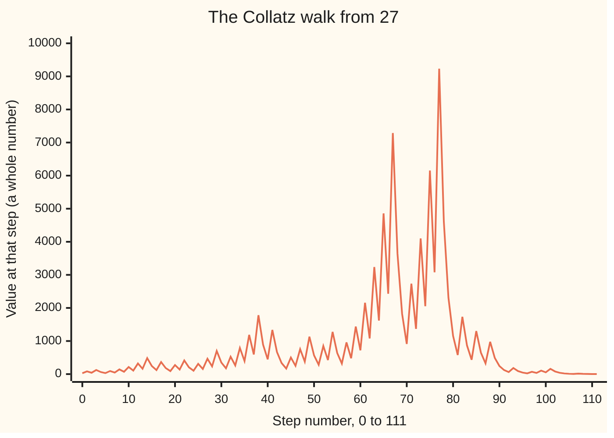

# Collatz: halve if even, triple and add one if odd, and always reach 1

[Syllabus](../../../SYLLABUS.md) → [Frontier](../README.md) → [Analysis and Dynamics](../README.md#s05) → Collatz

---

## General Overview

Start at 27. It is odd, so triple it and add 1: 82. That is even, so halve it: 41. Odd again: 124. Keep going.

The walk climbs to 9,232 at step 77, about 342 times where it started. Then it falls. It reaches 1 at step 111. From 1 it would only loop: 1, 4, 2, 1.

Every number from 2 to 26 gets to 1 within 23 steps. Its neighbour 28 takes 18. Nothing about 27 warns that it will take 111.

The **Collatz conjecture** says that every whole number from 1 upward reaches 1 this way. It is credited to Lothar Collatz, who studied problems like it in the 1930s. Computers have checked every start below $`2^{71}`$, about 2.4 × 10^21, in a run published in 2025. Nobody has a proof.

The best proved result is a theorem posted by Terence Tao on 2019-09-08 and published in 2022. It says that almost every start gets down to a small value, though not necessarily to 1. This card states the problem exactly, follows 27 step by step, explains why the walks tend to fall, and records what is proved and what is open.

**Each step halves an even number or multiplies an odd one by about 3, and the halvings win on average, so almost every walk falls; turning "almost every" and "on average" into "every" is the open problem.**

**What kind of fact this is:** a conjecture, open as of 2026-11-23. Checked for every start below $`2^{71}`$ (published 2025), which proves nothing beyond that range. Terras's 1976 result, the 2003 counting bound and Tao's almost-all result are theorems, outlined in Why it works with their sources.

### The picture: the 111 steps of 27



The one line is the value after each step. It stays below 500 until step 29, climbs in bursts to 9,232 at step 77, and then halves its way down to 1.

---

## The formula

Notation first, in words. The **Collatz map** $`T`$ takes a whole number to the next one on its walk. The walk itself, $`n, T(n), T(T(n)), \dots`$, is the **trajectory** of $`n`$. Throughout, log means the natural logarithm.

```math
T(n) = \begin{cases} n/2 & n \text{ even} \\ 3n + 1 & n \text{ odd} \end{cases}
```

**Read it aloud:** halve an even number; triple an odd number and add one.

Two counts describe a trajectory. The **total stopping time** $`\sigma_\infty(n)`$ is the number of steps to reach 1. The **stopping time** $`\sigma(n)`$ is the number of steps until the walk first drops below its start. For 27: $`\sigma_\infty(27) = 111`$ and $`\sigma(27) = 96`$, when the walk reaches 23.

The conjecture, in one line:

```math
\sigma_\infty(n) \text{ is finite for every whole number } n \ge 1
```

**Read it aloud:** every start reaches 1 after some finite number of steps.

The best proved statement in the other direction is Tao's. Write $`T_{\min}(n)`$ for the smallest value on the trajectory of $`n`$; the conjecture says it is always 1.

```math
T_{\min}(n) < f(n) \text{ for almost every } n, \text{ whenever } f(n) \to \infty
```

**Read it aloud:** pick any function that grows to infinity, however slowly; then almost every start reaches a value below that function.

"Almost every" here is in **logarithmic density**: each start $`n`$ counts with weight $`1/n`$, and the exceptions carry a share of the total weight that shrinks to 0. Why it works, Step 4, says more.

A shortcut is used in the proofs. The **shortcut map** $`S`$ merges each odd step with the halving that always follows it, since $`3n + 1`$ is even when $`n`$ is odd:

```math
S(n) = \begin{cases} n/2 & n \text{ even} \\ (3n + 1)/2 & n \text{ odd} \end{cases}
```

On the [Erdos problems](../../21-Algebraic%20and%20analytic%20number%20theory/08-Additive%20Combinatorics%20and%20Probabilistic%20Number%20Theory/07-erdos-problems-and-computer-search.md) card the plain step is written $`C(n)`$ and the shortcut $`T(n)`$. This wing writes $`T`$ for the plain step, as in the title, and $`S`$ for the shortcut.

| Symbol | Plain meaning | In our example | Push it up and the answer… |
| --- | --- | --- | --- |
| $`n`$ | a starting whole number | 27 | walks tend to get longer, by about 10.4282 steps per unit of log n |
| $`T(n)`$ | the Collatz map: one plain step | $`T(27) = 82`$ | — |
| $`S(n)`$ | the shortcut map: an odd step and its halving in one | 27 takes 70 shortcut steps | — |
| $`\sigma_\infty(n)`$ | total stopping time: steps to reach 1 | 111 | — |
| $`\sigma(n)`$ | stopping time: steps until the walk first drops below $`n`$ | 96 | — |
| $`T_{\min}(n)`$ | the smallest value on the trajectory | 1 | — |
| $`f(n)`$ | any function that grows to infinity | for example log log log n | Tao's bound becomes weaker |
| $`n_i`$ | the odd values the walk passes through | 41 of them for 27 | — |
| $`k`$ | the number of shortcut steps in a parity string | 3 in the example list | $`2^k`$ strings, all of them met |
| $`j`$ | the odd steps among those $`k`$ | 2 for the string 101 | the walk is multiplied by more |
| $`N`$ | the top of the range a computer has checked | 1,000,000 here; $`2^{71}`$ published | more starts settled, none beyond |
| $`x`$ | a counting bound: the starts from 1 to $`x`$ | — | at least $`x^{0.84}`$ of them proved to reach 1 |

### When it holds

- **Whole numbers from 1 upward.** On negative numbers the same rule has another cycle: −5, −14, −7, −20, −10, −5.
- **The rule is exactly 3n + 1.** With $`3n - 1`$ the start 5 loops: 5, 14, 7, 20, 10, 5. A second cycle, through 17, takes 18 steps.
- **"Almost every" is a statement about shares.** Tao's theorem allows infinitely many exceptions, provided their share of the weight shrinks to 0. It cannot rule out one bad start.
- **A checked range is a theorem about that range only.** Every start below $`2^{71}`$ reaches 1; nothing follows about $`2^{71}`$ itself or beyond.
- **The coin-flip model is a model.** It predicts averages well and single walks badly: 34.37 steps for 27, against 111.

---

## Why it works

The conjecture is not proved, so this section explains why it is believed, then what is proved and how. Each step names its source.

### Step 0: why walks fall on average

Look at the shortcut map. An even number is halved. An odd number goes to $`(3n + 1)/2`$, a little over $`3/2`$ times itself.

Suppose odd and even turned up like fair coin flips. Then each shortcut step multiplies the value, on average in the log, by

```math
\sqrt{\tfrac{3}{2} \cdot \tfrac{1}{2}} = \sqrt{\tfrac{3}{4}} \approx 0.866
```

**Read it aloud:** one step up by three halves and one step down by a half leave three quarters, so a typical step keeps about 87% of the value.

In logs the drift is $`\tfrac{1}{2}\log\tfrac{3}{4} = -0.143841`$ per shortcut step. To fall from $`n`$ to 1 takes about $`\log n / 0.143841`$ shortcut steps. Each shortcut step is 1.5 plain steps on average, since half of them hide a halving. So the model predicts

```math
\sigma_\infty(n) \approx \frac{3}{\log(4/3)}\,\log n \approx 10.4282\,\log n
```

**Read it aloud:** the number of plain steps to reach 1 is about 10.4 times the natural log of the start.

The check tests this against every start up to 1,000,000. The measured mean is 131.4344 steps, from a total of 131,434,424 steps found two ways; the model gives 133.6425. The ratio is 0.9835.

For one start the model is poor. It gives 27 about 34.37 steps; 27 takes 111. The model describes the crowd, not the individual.

### Step 1: the coin flips are honest for the first k steps

Write down whether $`n`$, $`S(n)`$, $`S(S(n))`$, … are odd (1) or even (0) for $`k`$ shortcut steps. Call it the **parity string** of length $`k`$. Terras proved in 1976:

- The parity string depends only on the remainder of $`n`$ after division by $`2^k`$.
- The $`2^k`$ remainders give $`2^k`$ different strings, so every string occurs exactly once.

For $`k = 3`$, remainder and string:

```
0:000  1:101  2:010  3:110  4:001  5:100  6:011  7:111
```

So among whole numbers, each pattern of $`k`$ odd-or-even outcomes has share exactly $`1/2^k`$: the share a fair coin gives it. The model in Step 0 is exact for the first $`k`$ steps. The check confirms both facts for every $`k`$ from 1 to 12.

The idea underneath is the one from [When cycles meet again](../../02-Number%20theory/05-Check%20Digits%2C%20Calendars%20and%20Cycles/04-cycles-that-realign.md): a quantity that depends only on a remainder repeats with the period of that remainder.

<details>
<summary>Detailed proof: the parity string is a one-to-one function of the remainder mod 2^k</summary>

Take two starts $`n`$ and $`n'`$ and follow their difference $`d = n' - n`$. While both have the same parity, a shared even step sends $`d`$ to $`d/2`$, and a shared odd step sends it to $`3d/2`$.

Same remainder: let $`n' = n + 2^k m`$. After $`i < k`$ shared steps the difference is $`3^{j}2^{k-i}m`$, where $`j`$ counts the odd steps so far. It is even, so the two values have the same parity at step $`i + 1`$ as well. By induction the first $`k`$ parities agree.

One-to-one: suppose $`0 \le n < n' < 2^k`$ share a parity string with $`j`$ odd steps. After $`k`$ steps the difference is

$`\displaystyle \frac{3^j\,(n' - n)}{2^k},`$

and it is a whole number, because both values are whole numbers. Since 3 shares no factor with 2, $`2^k`$ divides $`n' - n`$. That is impossible for two different remainders. So the $`2^k`$ remainders give $`2^k`$ different strings, which are all the strings there are.

</details>

### Step 2: almost every start drops below itself (Terras 1976)

A parity string with $`j`$ odd steps among $`k`$ multiplies the start by about $`3^j/2^k`$. When $`3^j < 2^k`$, a large start with that string has fallen below itself after $`k`$ steps.

By Step 1 the share of starts with a given string is the coin-flip share. For a fair coin, $`j`$ is close to $`k/2`$ for most strings, and $`3^{k/2} < 2^k`$. So as $`k`$ grows, the share of starts that drop within $`k`$ steps tends to 1.

That is Terras's theorem: the starts with a finite stopping time $`\sigma(n)`$ have natural density 1, meaning their share of 1 to $`x`$ tends to 1. C. J. Everett proved the same in 1977. The [Erdos problems](../../21-Algebraic%20and%20analytic%20number%20theory/08-Additive%20Combinatorics%20and%20Probabilistic%20Number%20Theory/07-erdos-problems-and-computer-search.md) card computes the shares that have not yet dropped, as a sieve, and uses them to speed up its search.

### Step 3: why "almost every start drops" is not the conjecture

If every start dropped below itself, strong induction (assume every smaller start reaches 1, then prove the next one does) would finish the proof: the smaller value reaches 1 by assumption, so the start does too.

"Almost every" breaks that chain. A start that drops may land on one of the rare exceptions, and nothing says it does not. Two later results push from opposite sides:

| Result | What it proves | Its weakness |
| --- | --- | --- |
| Korec, 1994 (recorded in Tao's paper) | almost every $`n`$ gets below $`n^{0.8}`$, and below any power of $`n`$ above log 3 / log 4 ≈ 0.79248 | the target still grows with $`n`$ |
| Krasikov and Lagarias, 2003 | at least $`x^{0.84}`$ of the starts from 1 to $`x`$ reach 1, for large $`x`$ | a vanishing share: $`x^{0.84}/x \to 0`$ |

The first covers almost all starts but proves little about each. The second proves everything about its starts but covers a vanishing share of them.

### Step 4: Tao's almost-all theorem (posted 2019, published 2022)

Tao's theorem pushes Korec's target down from a power of $`n`$ to any function that grows to infinity. Take $`f(n) = \log\log\log n`$. Then almost every start reaches a value below $`\log\log\log n`$. For $`n = 10^{100}`$ that bound is 1.6936.

The cost is the meaning of "almost every". Tao uses **logarithmic density**: a set of starts counts as having density $`d`$ if the sum of $`1/n`$ over its members up to $`x`$, divided by the sum of $`1/n`$ over all starts up to $`x`$, tends to $`d`$. Small starts weigh more. A set with natural density has the same logarithmic density, but not the other way round, so this is a slightly weaker kind of "almost all".

The proof is long and research-level. Its route, from the paper's own summary:

1. **Odd numbers only.** Work with the Syracuse map, which sends an odd number to the next odd number on its walk: triple it, add 1, then halve until the result is odd.
2. **A first passage.** Follow a start until its walk first falls below a smaller threshold. Show that where it lands is spread out almost the same way whichever start in a large range it came from. Tao calls this an approximate transport property.
3. **The hard estimate.** That spreading comes from showing that a random walk on the remainders modulo $`3^k`$ is very close to uniform. The tool is the walk's Fourier transform: a measure of how evenly the walk spreads, taken one frequency at a time, here at high frequencies.
4. **Repeat.** Each passage lowers the scale of the value by a fixed power. Chaining enough passages takes almost every start below any $`f(n)`$ that tends to infinity.

What the theorem does not say: it does not rule out a walk that climbs forever, a second cycle, or an infinite set of exceptions with logarithmic density 0.

### Step 5: the status ledger

Each claim has a kind and a dated status, kept as separate fields, as on [Kinds of claim](../01-How%20Research%20Works/02-theorem-conjecture-model-approximation.md). A verification bound is a theorem about a finite range, proved by computation; its status is written "checked".

| Claim | Kind | Status, 2026-11-23 | Source |
| --- | --- | --- | --- |
| Every start reaches 1 | conjecture | open | Lagarias 1985 survey |
| Every start below $`2^{71}`$ reaches 1 | theorem (by computation) | checked, published 2025 | Barina 2025 |
| Starts with finite stopping time have density 1 | theorem | proved, 1976 | Terras 1976 |
| At least $`x^{0.84}`$ starts up to $`x`$ reach 1 | theorem | proved, 2003 | Krasikov and Lagarias 2003 |
| $`T_{\min}(n) < f(n)`$ for almost every $`n`$, in logarithmic density | theorem | proved; posted 2019-09-08, published 2022 | Tao 2022 |

The verified range and what it forces about cycles are worked on the [Erdos problems](../../21-Algebraic%20and%20analytic%20number%20theory/08-Additive%20Combinatorics%20and%20Probabilistic%20Number%20Theory/07-erdos-problems-and-computer-search.md) card: a clean range to 1,000,000 alone forces any other cycle to have thousands of odd steps.

---

## Worked numbers, by hand

| Step | Arithmetic | Value |
| --- | --- | --- |
| first step | 27 is odd: 3 × 27 + 1 | 82 |
| second step | 82 is even: 82 ÷ 2 | 41 |
| highest point | step 77, reached from 6,154 ÷ 2 = 3,077 and 3 × 3,077 + 1 | 9,232 |
| first value below 27 | step 96 | 23, so $`\sigma(27) = 96`$ |
| odd steps and halvings | counted along the walk | 41 and 70 |
| shortcut steps | 111 − 41 | 70 |
| a check on the counts | $`27 \times 3^{41} \times \prod(1 + 1/(3n_i)) = 2^{70}`$ | the product of the 41 nudges is 1.1988 |
| coin-flip model | 10.4282 × log 27 | 34.37 |
| steps to reach 1 | the whole walk | **111** |

27 takes 111 steps, more than three times the 34.37 the coin-flip model expects of a typical start that size, which is why it is the standard example of how far one walk can stray from the average.

The check line works like this. Each odd step multiplies by $`3 + 1/n_i = 3(1 + 1/(3n_i))`$ and each halving by $`1/2`$. Going from 27 to 1 multiplies by $`1/27`$ overall. So 41 triplings, 70 halvings and the small "+1 nudges" must multiply 27 to exactly 1. The checks confirm it in whole numbers.

### What breaks if you drop a piece

| Mistake | Comes out at | What went wrong |
| --- | --- | --- |
| Counting 27 with the shortcut map | 70 steps, not 111 | Each shortcut step folds an odd step and its halving into one: 41 steps vanish |
| Reading the stopping time as the total | 96, not 111 | $`\sigma(27)`$ stops at the first value below 27, which is 23; the walk to 1 takes 15 more steps |
| Using the coin-flip model for one start | 34.37, not 111 | The model gives an average over many starts; single walks scatter widely |
| Using $`3n - 1`$ instead of $`3n + 1`$ | 5, 14, 7, 20, 10, 5: never reaches 1 | Changing the +1 changes the problem; this rule has a cycle through 5 and an 18-step cycle through 17 |

The code prints every row.

---

## Code, from first principles, and it actually runs

Each script follows 27 to 1 and reaches its 111 steps by three roads: the plain loop, a separate shortcut loop whose count must equal plain steps minus odd steps, and the exact product identity of the worked numbers. It then tests the coin-flip model against every start up to 1,000,000, whose stopping times it totals two ways (with memory, and by walking each start all the way to 1), confirms Terras's parity fact by exhaustive enumeration for $`k`$ from 1 to 12, and counts starts by total stopping time two ways: a backward tree grown from 1 (each $`m`$ has the parent $`2m`$, and $`(m - 1)/3`$ when that is an odd whole number above 1), against a forward count of every start up to $`2^{20}`$. Python checks the product identity with exact whole numbers; Rust, whose integers stop at 128 bits, checks it modulo three large primes. The asserts check instances and agreements, never the conjecture, and the published bound $`2^{71}`$ is quoted, not run.

### Python

```python
# Collatz conjecture -- the check behind the card.  Standard library only.
# T(n) = n/2 for even n, 3n + 1 for odd n.  Follows 27 to 1, counts its steps
# two ways, tests the coin-flip model against a million starts, confirms
# Terras's parity fact, matches a backward tree against a forward count, and
# prints the 3n - 1 cycle.  Asserts check instances, never the conjecture.
import math

def T(n): return n // 2 if n % 2 == 0 else 3 * n + 1
def S(n): return n // 2 if n % 2 == 0 else (3 * n + 1) // 2   # shortcut map

def orbit(n, f, stop):                       # n, f(n), f(f(n)), ... until stop
    out = [n]
    while out[-1] != stop or len(out) == 1:
        out.append(f(out[-1]))
        if len(out) > 10_000: break
    return out

# ---- road 1: the plain trajectory of 27 ----
tr = orbit(27, T, 1)
steps, odd = len(tr) - 1, sum(x % 2 for x in tr[:-1])
peak = max(tr)
sigma = next(i for i, x in enumerate(tr) if x < 27)          # stopping time
print("trajectory of 27, 14 values a line:")
for i in range(0, len(tr), 14):
    print(" ".join(str(x) for x in tr[i:i + 14]))
print(f"27: total stopping time {steps}, odd steps {odd}, halvings {steps - odd}, "
      f"peak {peak} at step {tr.index(peak)}, peak/start {peak / 27:.1f}")
print(f"27: stopping time {sigma}, first value below 27 is {tr[sigma]}")
# ---- road 2: the shortcut map, counted separately ----
short = len(orbit(27, S, 1)) - 1
print(f"27 under the shortcut map: {short} steps; plain minus odd = {steps - odd}")
assert (steps, odd, peak, sigma) == (111, 41, 9232, 96)
assert short == steps - odd                  # two counts, two loops
# ---- road 3: the exact product identity 27 * prod(3n+1) = 2^halvings * prod(n) ----
lhs, rhs = 27, 2 ** (steps - odd)
for x in tr[:-1]:
    if x % 2: lhs, rhs = lhs * (3 * x + 1), rhs * x
assert lhs == rhs
nudge = 2 ** (steps - odd) / 3 ** (odd + 3)  # 27 = 3^3
print(f"identity 27 * prod(3n+1) = 2^{steps - odd} * prod(n): exact; "
      f"the +1 nudges multiply by {nudge:.4f}")
longest = max(range(2, 27), key=lambda n: len(orbit(n, T, 1)))
print(f"starts 2 to 26: longest is {longest} with {len(orbit(longest, T, 1)) - 1} steps")
# ---- the coin-flip model against a million starts ----
drift = 0.5 * math.log(3 / 4)                # mean log factor per shortcut step
per_ln = 1.5 * (-1 / drift)                  # plain steps per unit of ln n
print(f"model: mean log factor per shortcut step {drift:.6f}, "
      f"typical factor {math.sqrt(3 / 4):.6f}")
print(f"model: {per_ln:.4f} plain steps per unit of ln n; for 27: "
      f"{per_ln * math.log(27):.2f} steps, actual {steps}")
N, M = 1_000_000, 2 ** 20
st = [0] * (M + 1)
for n in range(2, M + 1):                    # memory: walk only until below n
    m, s = n, 0
    while m >= n:
        m, s = T(m), s + 1
    st[n] = s + st[m]
mean = sum(st[1:N + 1]) / N
model = per_ln * sum(math.log(n) for n in range(1, N + 1)) / N
print(f"checked n <= {N}: every start reaches 1")
print(f"mean total stopping time {mean:.4f}, model {model:.4f}, ratio {mean / model:.4f}")
assert st[27] == steps and abs(mean / model - 1) < 0.05
full = 0                                     # second road: walk every start all the way to 1
for n in range(1, N + 1):
    m = n
    while m != 1:
        m, full = (m // 2 if m % 2 == 0 else 3 * m + 1), full + 1
print(f"sum of total stopping times, n <= {N}: with memory {sum(st[1:N + 1])}, by full walks {full}")
assert full == sum(st[1:N + 1])
best = max(range(2, 1000), key=lambda n: st[n])
print(f"starts below 1000: longest is {best} with {st[best]} steps")
for n0 in (28, 97, 871):
    o = orbit(n0, T, 1)
    print(f"start {n0}: {len(o) - 1} steps, peak {max(o)}, model {per_ln * math.log(n0):.2f}")
assert st[97] == len(orbit(97, T, 1)) - 1 and st[871] == len(orbit(871, T, 1)) - 1
print(f"Korec exponent log 3 / log 4 = {math.log(3) / math.log(4):.5f}; "
      f"log log log of 10^100 = {math.log(math.log(100 * math.log(10))):.4f}")
# ---- Terras: the first k shortcut parities depend on n mod 2^k, one-to-one ----
def parity(n, k):
    v = []
    for _ in range(k):
        v.append(n % 2); n = S(n)
    return tuple(v)
for k in range(1, 13):
    vecs = [parity(r, k) for r in range(2 ** k)]
    assert len(set(vecs)) == 2 ** k
    assert all(parity(r + 2 ** k, k) == vecs[r] for r in range(2 ** k))
print("Terras: k = 1 to 12, the 2^k residues give 2^k different parity strings")
print("k = 3: " + " ".join(f"{r}:{''.join(map(str, parity(r, 3)))}" for r in range(8)))
# ---- the tree of starts: backward from 1 against forward counting ----
layer, back = {1}, [1]
for k in range(1, 21):
    nxt = set()
    for m in layer:
        nxt.add(2 * m)
        if m % 6 == 4 and m > 4: nxt.add((m - 1) // 3)
    layer = nxt; back.append(len(layer))
fwd = [sum(1 for n in range(1, M + 1) if st[n] == k) for k in range(21)]
print("starts with total stopping time k, k = 0 to 20:")
print(" ".join(map(str, back)))
assert back == fwd
print("backward tree and forward count over n <= 2^20 agree")
# ---- what breaks ----
c5, c17 = orbit(5, lambda n: n // 2 if n % 2 == 0 else 3 * n - 1, 5), \
          orbit(17, lambda n: n // 2 if n % 2 == 0 else 3 * n - 1, 17)
neg = orbit(-5, T, -5)
print("3n - 1 from 5: " + " ".join(map(str, c5)))
print(f"3n - 1 from 17: a cycle of {len(c17) - 1} steps, peak {max(c17)}")
print("3n + 1 from -5: " + " ".join(map(str, neg)))
assert c5 == [5, 14, 7, 20, 10, 5] and len(c17) - 1 == 18 and neg == [-x for x in c5]
print(f"verification bound 2^71 = {2 ** 71} (quoted, not run here)")
print("ALL CHECKS PASS")
```

**Ran 2026-11-23 on macOS, Python 3.14.10, standard library only. All checks passed. Output, pasted from the run:**

```
trajectory of 27, 14 values a line:
27 82 41 124 62 31 94 47 142 71 214 107 322 161
484 242 121 364 182 91 274 137 412 206 103 310 155 466
233 700 350 175 526 263 790 395 1186 593 1780 890 445 1336
668 334 167 502 251 754 377 1132 566 283 850 425 1276 638
319 958 479 1438 719 2158 1079 3238 1619 4858 2429 7288 3644 1822
911 2734 1367 4102 2051 6154 3077 9232 4616 2308 1154 577 1732 866
433 1300 650 325 976 488 244 122 61 184 92 46 23 70
35 106 53 160 80 40 20 10 5 16 8 4 2 1
27: total stopping time 111, odd steps 41, halvings 70, peak 9232 at step 77, peak/start 341.9
27: stopping time 96, first value below 27 is 23
27 under the shortcut map: 70 steps; plain minus odd = 70
identity 27 * prod(3n+1) = 2^70 * prod(n): exact; the +1 nudges multiply by 1.1988
starts 2 to 26: longest is 25 with 23 steps
model: mean log factor per shortcut step -0.143841, typical factor 0.866025
model: 10.4282 plain steps per unit of ln n; for 27: 34.37 steps, actual 111
checked n <= 1000000: every start reaches 1
mean total stopping time 131.4344, model 133.6425, ratio 0.9835
sum of total stopping times, n <= 1000000: with memory 131434424, by full walks 131434424
starts below 1000: longest is 871 with 178 steps
start 28: 18 steps, peak 52, model 34.75
start 97: 118 steps, peak 9232, model 47.71
start 871: 178 steps, peak 190996, model 70.60
Korec exponent log 3 / log 4 = 0.79248; log log log of 10^100 = 1.6936
Terras: k = 1 to 12, the 2^k residues give 2^k different parity strings
k = 3: 0:000 1:101 2:010 3:110 4:001 5:100 6:011 7:111
starts with total stopping time k, k = 0 to 20:
1 1 1 1 1 2 2 4 4 6 6 8 10 14 18 24 29 36 44 58 72
backward tree and forward count over n <= 2^20 agree
3n - 1 from 5: 5 14 7 20 10 5
3n - 1 from 17: a cycle of 18 steps, peak 272
3n + 1 from -5: -5 -14 -7 -20 -10 -5
verification bound 2^71 = 2361183241434822606848 (quoted, not run here)
ALL CHECKS PASS
```

### Rust

```rust
// Collatz conjecture -- the check behind the card.  Rust std only, no crates.
// T(n) = n/2 for even n, 3n + 1 for odd n.  The same roads as the Python check;
// the product identity, too big for u128, is checked modulo three primes.
use std::collections::HashSet;

fn t(n: i64) -> i64 { if n % 2 == 0 { n / 2 } else { 3 * n + 1 } }
fn s(n: i64) -> i64 { if n % 2 == 0 { n / 2 } else { (3 * n + 1) / 2 } } // shortcut map
fn tm(n: i64) -> i64 { if n % 2 == 0 { n / 2 } else { 3 * n - 1 } }     // the 3n - 1 map

fn orbit(n: i64, f: fn(i64) -> i64, stop: i64) -> Vec<i64> {
    let mut out = vec![n];
    while *out.last().unwrap() != stop || out.len() == 1 {
        let next = f(*out.last().unwrap());
        out.push(next);
        if out.len() > 10_000 { break; }
    }
    out
}

fn join(v: &[i64]) -> String { v.iter().map(|x| x.to_string()).collect::<Vec<_>>().join(" ") }

fn parity(mut n: i64, k: usize) -> Vec<i64> {
    let mut v = Vec::new();
    for _ in 0..k { v.push(n % 2); n = s(n); }
    v
}

fn main() {
    // ---- road 1: the plain trajectory of 27 ----
    let tr = orbit(27, t, 1);
    let steps = tr.len() - 1;
    let odd = tr[..steps].iter().filter(|x| *x % 2 == 1).count();
    let peak = *tr.iter().max().unwrap();
    let at = tr.iter().position(|&x| x == peak).unwrap();
    let sigma = tr.iter().position(|&x| x < 27).unwrap(); // stopping time
    println!("trajectory of 27, 14 values a line:");
    for c in tr.chunks(14) { println!("{}", join(c)); }
    println!("27: total stopping time {}, odd steps {}, halvings {}, peak {} at step {}, peak/start {:.1}",
             steps, odd, steps - odd, peak, at, peak as f64 / 27.0);
    println!("27: stopping time {}, first value below 27 is {}", sigma, tr[sigma]);
    // ---- road 2: the shortcut map, counted separately ----
    let short = orbit(27, s, 1).len() - 1;
    println!("27 under the shortcut map: {} steps; plain minus odd = {}", short, steps - odd);
    assert!((steps, odd, peak, sigma) == (111, 41, 9232, 96));
    assert!(short == steps - odd);
    // ---- road 3: 27 * prod(3n+1) = 2^halvings * prod(n), modulo three primes ----
    for p in [1_000_000_007u128, 998_244_353, 2_305_843_009_213_693_951] {
        let (mut lhs, mut rhs) = (27u128, 1u128);
        for _ in 0..(steps - odd) { rhs = rhs * 2 % p; }
        for &x in &tr[..steps] {
            if x % 2 == 1 { lhs = lhs * (3 * x as u128 + 1) % p; rhs = rhs * x as u128 % p; }
        }
        assert!(lhs == rhs);
    }
    let nudge = (1u128 << (steps - odd)) as f64 / 3u128.pow(odd as u32 + 3) as f64;
    println!("identity 27 * prod(3n+1) = 2^{} * prod(n): exact; the +1 nudges multiply by {:.4}",
             steps - odd, nudge);
    let longest = (2..27).max_by_key(|&n| (orbit(n, t, 1).len(), -n)).unwrap();
    println!("starts 2 to 26: longest is {} with {} steps", longest, orbit(longest, t, 1).len() - 1);
    // ---- the coin-flip model against a million starts ----
    let drift = 0.5 * (3.0f64 / 4.0).ln();
    let per_ln = 1.5 * (-1.0 / drift);
    println!("model: mean log factor per shortcut step {:.6}, typical factor {:.6}",
             drift, (3.0f64 / 4.0).sqrt());
    println!("model: {:.4} plain steps per unit of ln n; for 27: {:.2} steps, actual {}",
             per_ln, per_ln * 27f64.ln(), steps);
    let (n_top, m_top) = (1_000_000usize, 1usize << 20);
    let mut st = vec![0u64; m_top + 1];
    for n in 2..=m_top {
        let (mut m, mut c) = (n as u64, 0u64);
        while m >= n as u64 { m = if m % 2 == 0 { m / 2 } else { 3 * m + 1 }; c += 1; }
        st[n] = c + st[m as usize];
    }
    let mean = st[1..=n_top].iter().sum::<u64>() as f64 / n_top as f64;
    let mut lsum = 0.0f64;
    for n in 1..=n_top { lsum += (n as f64).ln(); }
    let model = per_ln * lsum / n_top as f64;
    println!("checked n <= {}: every start reaches 1", n_top);
    println!("mean total stopping time {:.4}, model {:.4}, ratio {:.4}", mean, model, mean / model);
    assert!(st[27] == steps as u64 && (mean / model - 1.0).abs() < 0.05);
    let mut full = 0u64; // second road: walk every start all the way to 1
    for n in 1..=n_top as u64 {
        let mut m = n;
        while m != 1 { m = if m % 2 == 0 { m / 2 } else { 3 * m + 1 }; full += 1; }
    }
    let memo: u64 = st[1..=n_top].iter().sum();
    println!("sum of total stopping times, n <= {}: with memory {}, by full walks {}", n_top, memo, full);
    assert!(full == memo);
    let best = (2..1000usize).max_by_key(|&n| (st[n], std::cmp::Reverse(n))).unwrap();
    println!("starts below 1000: longest is {} with {} steps", best, st[best]);
    for n0 in [28i64, 97, 871] {
        let o = orbit(n0, t, 1);
        println!("start {}: {} steps, peak {}, model {:.2}", n0, o.len() - 1,
                 o.iter().max().unwrap(), per_ln * (n0 as f64).ln());
        assert!(st[n0 as usize] == (o.len() - 1) as u64);
    }
    println!("Korec exponent log 3 / log 4 = {:.5}; log log log of 10^100 = {:.4}",
             3f64.ln() / 4f64.ln(), (100.0 * 10f64.ln()).ln().ln());
    // ---- Terras: the first k shortcut parities depend on n mod 2^k, one-to-one ----
    for k in 1..=12usize {
        let size = 1i64 << k;
        let vecs: Vec<Vec<i64>> = (0..size).map(|r| parity(r, k)).collect();
        let set: HashSet<&Vec<i64>> = vecs.iter().collect();
        assert!(set.len() as i64 == size);
        assert!((0..size).all(|r| parity(r + size, k) == vecs[r as usize]));
    }
    println!("Terras: k = 1 to 12, the 2^k residues give 2^k different parity strings");
    let k3: Vec<String> = (0..8).map(|r| format!("{}:{}", r,
        parity(r, 3).iter().map(|b| b.to_string()).collect::<String>())).collect();
    println!("k = 3: {}", k3.join(" "));
    // ---- the tree of starts: backward from 1 against forward counting ----
    let mut layer: HashSet<u64> = [1u64].into_iter().collect();
    let mut back = vec![1i64];
    for _ in 1..=20 {
        let mut nxt = HashSet::new();
        for &m in &layer {
            nxt.insert(2 * m);
            if m % 6 == 4 && m > 4 { nxt.insert((m - 1) / 3); }
        }
        layer = nxt;
        back.push(layer.len() as i64);
    }
    let fwd: Vec<i64> = (0..=20u64).map(|k| st[1..=m_top].iter().filter(|&&x| x == k).count() as i64).collect();
    println!("starts with total stopping time k, k = 0 to 20:");
    println!("{}", join(&back));
    assert!(back == fwd);
    println!("backward tree and forward count over n <= 2^20 agree");
    // ---- what breaks ----
    let c5 = orbit(5, tm, 5);
    let c17 = orbit(17, tm, 17);
    let neg = orbit(-5, t, -5);
    println!("3n - 1 from 5: {}", join(&c5));
    println!("3n - 1 from 17: a cycle of {} steps, peak {}", c17.len() - 1, c17.iter().max().unwrap());
    println!("3n + 1 from -5: {}", join(&neg));
    assert!(c5 == vec![5, 14, 7, 20, 10, 5] && c17.len() - 1 == 18);
    assert!(neg == c5.iter().map(|x| -x).collect::<Vec<i64>>());
    println!("verification bound 2^71 = {} (quoted, not run here)", 1u128 << 71);
    println!("ALL CHECKS PASS");
}
```

**Ran 2026-11-23 on macOS, rustc 1.98.1, no crates. All checks passed. Output, pasted from the run:**

```
trajectory of 27, 14 values a line:
27 82 41 124 62 31 94 47 142 71 214 107 322 161
484 242 121 364 182 91 274 137 412 206 103 310 155 466
233 700 350 175 526 263 790 395 1186 593 1780 890 445 1336
668 334 167 502 251 754 377 1132 566 283 850 425 1276 638
319 958 479 1438 719 2158 1079 3238 1619 4858 2429 7288 3644 1822
911 2734 1367 4102 2051 6154 3077 9232 4616 2308 1154 577 1732 866
433 1300 650 325 976 488 244 122 61 184 92 46 23 70
35 106 53 160 80 40 20 10 5 16 8 4 2 1
27: total stopping time 111, odd steps 41, halvings 70, peak 9232 at step 77, peak/start 341.9
27: stopping time 96, first value below 27 is 23
27 under the shortcut map: 70 steps; plain minus odd = 70
identity 27 * prod(3n+1) = 2^70 * prod(n): exact; the +1 nudges multiply by 1.1988
starts 2 to 26: longest is 25 with 23 steps
model: mean log factor per shortcut step -0.143841, typical factor 0.866025
model: 10.4282 plain steps per unit of ln n; for 27: 34.37 steps, actual 111
checked n <= 1000000: every start reaches 1
mean total stopping time 131.4344, model 133.6425, ratio 0.9835
sum of total stopping times, n <= 1000000: with memory 131434424, by full walks 131434424
starts below 1000: longest is 871 with 178 steps
start 28: 18 steps, peak 52, model 34.75
start 97: 118 steps, peak 9232, model 47.71
start 871: 178 steps, peak 190996, model 70.60
Korec exponent log 3 / log 4 = 0.79248; log log log of 10^100 = 1.6936
Terras: k = 1 to 12, the 2^k residues give 2^k different parity strings
k = 3: 0:000 1:101 2:010 3:110 4:001 5:100 6:011 7:111
starts with total stopping time k, k = 0 to 20:
1 1 1 1 1 2 2 4 4 6 6 8 10 14 18 24 29 36 44 58 72
backward tree and forward count over n <= 2^20 agree
3n - 1 from 5: 5 14 7 20 10 5
3n - 1 from 17: a cycle of 18 steps, peak 272
3n + 1 from -5: -5 -14 -7 -20 -10 -5
verification bound 2^71 = 2361183241434822606848 (quoted, not run here)
ALL CHECKS PASS
```

### Lean

Lean proves Terras's parity fact for every k and the induction of Step 3, and checks the card's worked numbers.

- Take any k. Two starts have the same parity string of length k exactly when they leave the same remainder after division by $`2^k`$.
- Every string of k odd-or-even outcomes is the parity string of exactly one remainder below $`2^k`$.
- Suppose every start from 2 upward eventually falls below itself. Then every start from 1 upward reaches 1.
- 27 reaches 1 at step 111, not before. It peaks at 9,232 at step 77, and 41 of its steps are odd steps.
- The walk from 27 first drops below 27 at step 96, landing on 23. Under the shortcut map, 27 takes 70 steps.
- Take the 41 odd values $`n_i`$ on the walk from 27. Then $`27 \times \prod(3n_i + 1) = 2^{70} \times \prod n_i`$ exactly.
- Every start from 2 to 26 reaches 1 within 23 steps, and 25 takes exactly 23.
- 28 takes 18 steps and peaks at 52. 97 takes 118 steps and peaks at 9,232. 871 takes 178 steps and peaks at 190,996.
- For k = 3, the eight remainders have exactly the parity strings listed in Step 1.
- With $`3n - 1`$, the start 5 loops: 5, 14, 7, 20, 10, 5. The start 17 returns after 18 steps, peaking at 272.
- On negative numbers, $`3n + 1`$ has the cycle −5, −14, −7, −20, −10, −5.
- The published bound $`2^{71}`$ equals 2,361,183,241,434,822,606,848.

The coin-flip model, the million-start counts and the backward tree are left to the Python and Rust checks; the conjecture itself stays open.

```lean
-- Collatz: the conjecture is stated exactly and left open; the file proves Terras's fact that the first k odd-or-even outcomes of the shortcut map depend only on the remainder mod 2^k and determine it, that every start dropping below itself would give the conjecture, and the card's whole-number examples.
import Mathlib.Logic.Function.Iterate
import Mathlib.Basic.ExistsUnique
import Mathlib.Order.Interval.Finset.Nat
import Mathlib.Algebra.Order.Group.Nat
import Mathlib.Data.Int.Init
import Mathlib.Data.Fin.Basic
import Mathlib.Data.Nat.ModEq
import Mathlib.Data.Fintype.EquivFin
import Mathlib.Data.Fintype.BigOperators

/-- The Collatz map T(n): halve an even number; triple an odd number and add one. -/
def collatz (n : ℕ) : ℕ := if n % 2 = 0 then n / 2 else 3 * n + 1

/-- The shortcut map S(n): halve an even number; send an odd number to (3n + 1)/2. -/
def shortcut (n : ℕ) : ℕ := if n % 2 = 0 then n / 2 else (3 * n + 1) / 2

/-- The 3n - 1 rule from the card's "What breaks": halve an even number, otherwise 3n - 1. -/
def collatzMinus (n : ℕ) : ℕ := if n % 2 = 0 then n / 2 else 3 * n - 1

/-- The 3n + 1 rule on all integers, used on the card for negative starts. -/
def collatzInt (n : ℤ) : ℤ := if n % 2 = 0 then n / 2 else 3 * n + 1

/-- The Collatz conjecture (open as of 2026-11-23; the card does not prove it): every whole
number n ≥ 1 reaches 1 after finitely many steps of the Collatz map. -/
def CollatzConjecture : Prop := ∀ n : ℕ, 1 ≤ n → ∃ i : ℕ, collatz^[i] n = 1

theorem shortcut_mod_step (k n n' : ℕ) (h : n % 2 = n' % 2) :
    shortcut n % 2 ^ k = shortcut n' % 2 ^ k ↔ n / 2 % 2 ^ k = n' / 2 % 2 ^ k := by
  rcases Nat.mod_two_eq_zero_or_one n with h0 | h1
  · have h0' : n' % 2 = 0 := by omega
    have e1 : shortcut n = n / 2 := by simp [shortcut, h0]
    have e2 : shortcut n' = n' / 2 := by simp [shortcut, h0']
    rw [e1, e2]
  · have h1' : n' % 2 = 1 := by omega
    have e1 : shortcut n = 3 * (n / 2) + 2 := by simp [shortcut, h1]; omega
    have e2 : shortcut n' = 3 * (n' / 2) + 2 := by simp [shortcut, h1']; omega
    rw [e1, e2]
    have hc : Nat.gcd (2 ^ k) 3 = 1 := Nat.Coprime.pow_left k (by decide : Nat.Coprime 2 3)
    constructor
    · intro hm
      have hm' : 3 * (n / 2) + 2 ≡ 3 * (n' / 2) + 2 [MOD 2 ^ k] := hm
      exact Nat.ModEq.cancel_left_of_coprime hc (Nat.ModEq.add_right_cancel' 2 hm')
    · intro hm
      have hm' : n / 2 ≡ n' / 2 [MOD 2 ^ k] := hm
      exact (hm'.mul_left 3).add_right 2

#print axioms shortcut_mod_step

theorem collatz_pos (n : ℕ) (hn : 1 ≤ n) : 1 ≤ collatz n := by
  unfold collatz; split_ifs <;> omega

#print axioms collatz_pos

theorem collatz_iterate_pos (i n : ℕ) (hn : 1 ≤ n) : 1 ≤ collatz^[i] n := by
  induction i generalizing n with
  | zero => simpa
  | succ i ih => rw [Function.iterate_succ_apply]; exact ih _ (collatz_pos n hn)

#print axioms collatz_iterate_pos

/-- Terras 1976: the parity string is a one-to-one function of the remainder mod 2^k.
For any k, two whole numbers n and n' are odd or even alike at each of the first k steps of
the shortcut map (at n, S(n), ..., S^(k-1)(n)) exactly when they leave the same remainder
after division by 2^k. -/
theorem parity_string_eq_iff_mod_two_pow_eq (k n n' : ℕ) :
    (∀ i < k, shortcut^[i] n % 2 = shortcut^[i] n' % 2) ↔ n % 2 ^ k = n' % 2 ^ k := by
  induction k generalizing n n' with
  | zero => simp [Nat.mod_one]
  | succ k ih =>
    rw [Nat.forall_lt_succ_left]
    simp only [Function.iterate_zero_apply, Function.iterate_succ_apply]
    rw [ih, pow_succ', Nat.mod_mul, Nat.mod_mul]
    constructor
    · rintro ⟨h1, h2⟩
      rw [h1, (shortcut_mod_step k n n' h1).1 h2]
    · intro h
      have h1 : n % 2 = n' % 2 := by omega
      refine ⟨h1, (shortcut_mod_step k n n' h1).2 ?_⟩
      omega

/-- Every parity string occurs exactly once: for any k and any string b of k odd-or-even
outcomes (true for odd), exactly one remainder r below 2^k has b as its parity string under
the shortcut map. So each string has share exactly 1/2^k, the fair-coin share. -/
theorem every_parity_string_occurs_once (k : ℕ) (b : Fin k → Bool) :
    ∃! r : ℕ, r < 2 ^ k ∧ ∀ i : Fin k, (shortcut^[i] r % 2 = 1 ↔ b i = true) := by
  let f : Fin (2 ^ k) → (Fin k → Bool) := fun r i => decide (shortcut^[i] (r : ℕ) % 2 = 1)
  have key : ∀ r r' : ℕ, (∀ i : Fin k, (shortcut^[i] r % 2 = 1 ↔ shortcut^[i] r' % 2 = 1)) →
      r % 2 ^ k = r' % 2 ^ k := by
    intro r r' h
    rw [← parity_string_eq_iff_mod_two_pow_eq]
    intro i hi
    have := h ⟨i, hi⟩
    simp only at this
    omega
  have hinj : Function.Injective f := by
    intro r r' hrr
    apply Fin.ext
    have := key r r' (fun i => by
      have := congrFun hrr i
      simpa [f] using this)
    rwa [Nat.mod_eq_of_lt r.2, Nat.mod_eq_of_lt r'.2] at this
  have hbij : Function.Bijective f :=
    (Fintype.bijective_iff_injective_and_card f).2 ⟨hinj, by simp⟩
  obtain ⟨r, hr⟩ := hbij.2 b
  refine ⟨r, ⟨r.2, fun i => ?_⟩, ?_⟩
  · rw [← hr]; simp [f]
  · rintro y ⟨hy, hyb⟩
    have := key y r (fun i => by
      rw [hyb i, ← hr]; simp [f])
    rwa [Nat.mod_eq_of_lt hy, Nat.mod_eq_of_lt r.2] at this

/-- Why dropping below the start would be enough (Step 3): if every start n ≥ 2 eventually
falls below n under the Collatz map, then strong induction gives the Collatz conjecture. -/
theorem collatz_conjecture_of_every_start_drops
    (hdrop : ∀ n : ℕ, 2 ≤ n → ∃ i : ℕ, collatz^[i] n < n) : CollatzConjecture := by
  intro n
  induction n using Nat.strong_induction_on with
  | _ n ih =>
    intro hn
    rcases Nat.lt_or_ge n 2 with h | h
    · exact ⟨0, by simp; omega⟩
    · obtain ⟨i, hi⟩ := hdrop n h
      obtain ⟨j, hj⟩ := ih _ hi (collatz_iterate_pos i n hn)
      exact ⟨j + i, by rw [Function.iterate_add_apply, hj]⟩

-- The first two steps from 27: 3 × 27 + 1 = 82, then 82 ÷ 2 = 41.
example : collatz 27 = 82 ∧ collatz 82 = 41 := by decide +kernel
-- 27 reaches 1 after 111 steps, not before.
example : collatz^[111] 27 = 1 ∧ ∀ i < 111, collatz^[i] 27 ≠ 1 := by decide +kernel
-- Its walk peaks at 9,232, reached at step 77.
example : collatz^[77] 27 = 9232 ∧ ∀ i ≤ 111, collatz^[i] 27 ≤ 9232 := by decide +kernel
-- 41 of the 111 steps are odd steps, so 70 are halvings.
example : ((List.range 111).filter fun i => collatz^[i] 27 % 2 = 1).length = 41 := by decide +kernel
-- Stopping time σ(27) = 96: the walk first drops below 27 at step 96, landing on 23.
example : collatz^[96] 27 = 23 ∧ ∀ i < 96, 27 ≤ collatz^[i] 27 := by decide +kernel
-- Under the shortcut map 27 takes 70 steps to reach 1, which is 111 − 41.
example : shortcut^[70] 27 = 1 ∧ ∀ i < 70, shortcut^[i] 27 ≠ 1 := by decide +kernel
-- The check line: 27 × ∏ (3n_i + 1) = 2^70 × ∏ n_i over the 41 odd values n_i of the walk.
example : 27 * (((List.range 111).map fun i => collatz^[i] 27).filter (· % 2 = 1)
      |>.map (3 * · + 1)).prod =
    2 ^ 70 * (((List.range 111).map fun i => collatz^[i] 27).filter (· % 2 = 1)).prod := by
  decide +kernel
-- Every start from 2 to 26 reaches 1 within 23 steps; 25 takes exactly 23.
example : ∀ n ∈ Finset.Icc 2 26, ∃ i ≤ 23, collatz^[i] n = 1 := by decide +kernel
example : collatz^[23] 25 = 1 ∧ ∀ i < 23, collatz^[i] 25 ≠ 1 := by decide +kernel
-- 28 takes 18 steps and peaks at 52.
example : collatz^[18] 28 = 1 ∧ (∀ i < 18, collatz^[i] 28 ≠ 1) ∧
    (∀ i ≤ 18, collatz^[i] 28 ≤ 52) ∧ ∃ i ≤ 18, collatz^[i] 28 = 52 := by decide +kernel
-- 97 takes 118 steps and peaks at 9,232.
example : collatz^[118] 97 = 1 ∧ (∀ i < 118, collatz^[i] 97 ≠ 1) ∧
    (∀ i ≤ 118, collatz^[i] 97 ≤ 9232) ∧ ∃ i ≤ 118, collatz^[i] 97 = 9232 := by decide +kernel
-- 871 takes 178 steps and peaks at 190,996.
example : collatz^[178] 871 = 1 ∧ (∀ i < 178, collatz^[i] 871 ≠ 1) ∧
    (∀ i ≤ 178, collatz^[i] 871 ≤ 190996) ∧ ∃ i ≤ 178, collatz^[i] 871 = 190996 := by decide +kernel
-- The parity strings for k = 3, remainder by remainder:
-- 0:000 1:101 2:010 3:110 4:001 5:100 6:011 7:111.
example : (List.range 8).map (fun r => (List.range 3).map fun i => shortcut^[i] r % 2) =
    [[0, 0, 0], [1, 0, 1], [0, 1, 0], [1, 1, 0], [0, 0, 1], [1, 0, 0], [0, 1, 1],
      [1, 1, 1]] := by decide +kernel
-- With 3n - 1 the start 5 loops: 5, 14, 7, 20, 10, 5.
example : (List.range 6).map (fun i => collatzMinus^[i] 5) = [5, 14, 7, 20, 10, 5] := by
  decide +kernel
-- With 3n - 1 the start 17 returns to itself after 18 steps, not before, peaking at 272.
example : collatzMinus^[18] 17 = 17 ∧ (∀ i, 1 ≤ i → i < 18 → collatzMinus^[i] 17 ≠ 17) ∧
    (∀ i ≤ 18, collatzMinus^[i] 17 ≤ 272) ∧ ∃ i ≤ 18, collatzMinus^[i] 17 = 272 := by decide +kernel
-- On negative numbers 3n + 1 has the cycle -5, -14, -7, -20, -10, -5.
example : (List.range 6).map (fun i => collatzInt^[i] (-5)) = [-5, -14, -7, -20, -10, -5] := by
  decide +kernel
-- The published bound: 2^71 = 2,361,183,241,434,822,606,848.
example : 2 ^ 71 = 2361183241434822606848 := by decide +kernel

#print axioms parity_string_eq_iff_mod_two_pow_eq
#print axioms every_parity_string_occurs_once
#print axioms collatz_conjecture_of_every_start_drops
```

**Checked 2026-11-23 on macOS, Lean 4.36.0-rc2, Mathlib v4.36.0-rc2. Every proof is complete and uses only Lean's standard axioms. Output, pasted from the run:**

```
'shortcut_mod_step' depends on axioms: [propext, Classical.choice, Quot.sound]
'collatz_pos' depends on axioms: [propext, Quot.sound]
'collatz_iterate_pos' depends on axioms: [propext, Quot.sound]
'parity_string_eq_iff_mod_two_pow_eq' depends on axioms: [propext, Classical.choice, Quot.sound]
'every_parity_string_occurs_once' depends on axioms: [propext, Classical.choice, Quot.sound]
'collatz_conjecture_of_every_start_drops' depends on axioms: [propext, Quot.sound]
```

> [!TIP]
> **Try changing**
> - Guess first: does 28, the next start, take about as long as 27? The `start 28` line of the output answers: 18 steps, peak 52. To try another start, add it to the list `(28, 97, 871)`; road 1 asserts 27's numbers, so changing 27 there stops the run.
> - Guess first: how high does 97 climb? The `start 97` line: 118 steps, peaking at 9,232 again, because its walk runs into 94, a value 27 passes early, before its climb, and from there it follows 27's whole climb.
> - Guess first: does 871, the slowest start below 1,000, come close to the model's 70.60 steps? The `start 871` line: 178 steps, peak 190,996.
> - Guess first: does Terras's fact still hold at $`k = 16`$? Change `range(1, 13)` to `range(1, 17)`. All 65,536 strings occur, each once.

---

## The usual mistake

> [!warning]
> **Reading the checked range as evidence that almost proves it.** Every start below $`2^{71}`$ reaches 1, and that settles nothing above $`2^{71}`$. A counterexample, if one exists, could be a walk that climbs forever or a second cycle, and both could start far beyond any search.
>
> Smaller traps:
> - **Reading Tao's theorem as "Collatz is nearly proved".** It says almost every start gets below any slowly growing $`f(n)`$, in logarithmic density. It does not say they reach 1, and it allows infinitely many exceptions.
> - **Mixing the plain and shortcut counts.** 27 takes 111 plain steps and 70 shortcut steps. Record tables from different sources disagree for this reason alone.
> - **Confusing the stopping time with the total stopping time.** $`\sigma(27) = 96`$; $`\sigma_\infty(27) = 111`$.
> - **Treating the model as a proof.** The coin-flip model matches the mean over a million starts to 0.9835 of its prediction. It says nothing certain about any one start.

---

## Where you meet it in real life

- **Large verification projects.** The range to $`2^{71}`$ came from code that skips starts known to drop, spread over thousands of parallel workers on several European supercomputers. The problem is a standard test of how far careful parallel computing can go.
- **Logic and computation.** John Conway showed in 1972 that rules of the same shape, with more cases than odd and even, can simulate any computer program. For such rules no general method can decide whether every walk ends (Lagarias's survey records this).
- **Random models of deterministic problems.** The coin-flip model treats fixed arithmetic as if it were chance, and predicts the mean within 2%. Number theorists use the same move for primes; Tao's proof makes part of it exact.
- **Teaching what "almost all" means.** Terras, Korec, Krasikov–Lagarias and Tao each prove a different kind of "most starts behave". Reading them side by side shows how carefully such statements must be read.

> **Say it back**
> The Collatz map halves an even number and sends an odd one to 3n + 1, and the conjecture says every walk reaches 1. 27 takes 111 steps and climbs to 9,232 on the way. Walks fall on average because a typical step keeps about 87% of the value, and Terras proved the coin-flip picture exact for the first k steps. Tao proved that almost every start, in logarithmic density, gets below any function that grows to infinity. As of 2026-11-23 the conjecture is open, checked below $`2^{71}`$, which proves nothing beyond.

---

## What this builds on

- [When cycles meet again](../../02-Number%20theory/05-Check%20Digits%2C%20Calendars%20and%20Cycles/04-cycles-that-realign.md): remainders and how they repeat. Terras's parity fact is that kind of statement, with remainders modulo $`2^k`$.
- [Iteration](../../08-Differential%20equations%20and%20dynamics/11-Discrete%20Dynamics%20and%20Chaos/01-iteration-and-cobweb-plots.md): applying one rule to its own output, orbits and fixed points. The trajectory of 27 is an orbit, and 1, 4, 2 is a cycle of the map.
- [Erdos problems](../../21-Algebraic%20and%20analytic%20number%20theory/08-Additive%20Combinatorics%20and%20Probabilistic%20Number%20Theory/07-erdos-problems-and-computer-search.md): what a computer search proves. It runs Collatz to a million, explains the sieve and the published range, and turns a clean range into a lower bound on the length of any other cycle.

## Where this goes next

- [The September 2026 Navier-Stokes claim](01-navier-stokes-blow-up-claim-2026.md): another question of whether an evolving quantity stays bounded, there in a fluid, here in a walk of whole numbers.
- [The August 2026 zeta-zeros claim](03-zeta-zero-proportion-2026.md): another "proportion" result, a proved lower bound on a share that must not be read as the full statement.
- [Percolation](06-dying-percolation-and-critical-phenomena.md): probability models for questions about very large systems, and how far they can be made exact.
- [The Jacobian conjecture](04-jacobian-conjecture.md) and [Two algebra questions](05-sofic-groups-and-kothe.md): further one-line statements on this shelf whose status is recorded the same way.

The question this card leaves open: can any argument rule out, for every single start, both a walk that climbs forever and a second cycle?

---

## Sources

Verified 2026-11-23: every link below resolves to the publisher's page.

- Lagarias, Jeffrey C. "The 3x + 1 problem and its generalizations." *The American Mathematical Monthly* 92 (1985): 3–23. [doi:10.1080/00029890.1985.11971528](https://doi.org/10.1080/00029890.1985.11971528). The survey: the problem's origin with Collatz, stopping times, Everett's result and Conway's undecidable generalisations.
- Terras, Riho. "A stopping time problem on the positive integers." *Acta Arithmetica* 30 (1976): 241–252. [doi:10.4064/aa-30-3-241-252](https://doi.org/10.4064/aa-30-3-241-252). The parity-string fact of Step 1 and the density-1 result of Step 2.
- Krasikov, Ilia, and Jeffrey C. Lagarias. "Bounds for the 3x+1 problem using difference inequalities." *Acta Arithmetica* 109 (2003): 237–258. [doi:10.4064/aa109-3-4](https://doi.org/10.4064/aa109-3-4). At least $`x^{0.84}`$ of the starts up to $`x`$ reach 1.
- Tao, Terence. "Almost all orbits of the Collatz map attain almost bounded values." *Forum of Mathematics, Pi* 10 (2022): e12. [doi:10.1017/fmp.2022.8](https://doi.org/10.1017/fmp.2022.8); first posted 2019-09-08 as [arXiv:1909.03562](https://arxiv.org/abs/1909.03562). The almost-all theorem of Step 4, its proof route, and Korec's earlier bound.
- Barina, David. "Improved verification limit for the convergence of the Collatz conjecture." *The Journal of Supercomputing* 81 (2025): 810. [doi:10.1007/s11227-025-07337-0](https://doi.org/10.1007/s11227-025-07337-0). The verification of every start below $`2^{71}`$.
