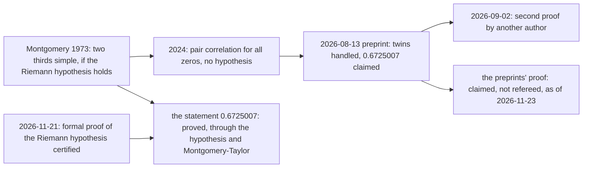

# The August 2026 zeta-zeros claim: a reported rise in the proved lower bound for zeros on the line, from 41.6 to 67.2 percent

[Syllabus](../../../SYLLABUS.md) → [Frontier](../README.md) → [Analysis and Dynamics](../README.md#s05) → The August 2026 zeta-zeros claim

---

## General Overview

In August 2026 an AI lab announced a proof about the zeros of the Riemann zeta function. On 2026-08-13 two mathematicians posted it as a preprint (a paper shared before peer review) on arXiv, the public preprint server. They say an AI system found the argument and that they checked it. The claim: at least 67.25 percent of the zeros are simple (not repeated) and lie on the critical line.

The previous record for zeros on the line, from 2020, was "more than five-twelfths": 41.67 percent, with the theorem giving 0.417293. The title's 41.6 and 67.2 are five-twelfths (41.67 percent) and 67.25 percent, cut to one decimal place.

What rose is a **proved lower bound** on a share, not a measured share. Every zero checked by computer lies on the line, and the Riemann hypothesis says all of them do: a share of 100 percent, long only conjectured. A bound of 67.25 percent says nothing about any one zero, and leaves up to 32.75 percent unplaced. So 67.2 percent on the line is not the Riemann hypothesis.

The claim was verified for this card at its primary source: the preprint exists and states these numbers. A second, independent proof of the same constant was posted on 2026-09-02. Neither has been refereed.

Then the hypothesis itself changed status. On 2026-11-20 a proof of the Riemann hypothesis was released as a Lean library (Lean is a proof assistant: a program that checks every step). On 2026-11-21 the maintainers of Lean and of its mathematics library, Mathlib, certified that the proof checks and proves exactly Mathlib's statement of the hypothesis ([joint statement](https://leanprover-community.github.io/blog/posts/riemann-hypothesis/)). In this library a formal proof rerun by others and matched to the statement counts as proved, so [The status register](../07-Physics%2C%20Finance%20and%20Machines/05-the-status-register.md) records the hypothesis as proved from 2026-11-21. On 2026-11-23 the Clay Mathematics Institute still lists it as "Active"; that word is theirs.

That moves this claim too. With the hypothesis, every zero is on the line, and Montgomery and Taylor's bound, proved assuming the hypothesis (Step 3), already makes at least 0.6725 of them simple. So the statement now follows from the hypothesis. What stays claimed is the August proof itself, which does not use the hypothesis.

**The 2026 claim makes Montgomery's 1973 count of simple zeros work without the Riemann hypothesis, by proving that zeros off the line, which come in mirror pairs, cannot inflate the count; with the best window this lifts the share on the line proved without the hypothesis from 0.417293 to 0.6725007.**

**What kind of fact this is:** a theorem by kind, with two dated statuses as of 2026-11-23. The statement is proved, from 2026-11-21, through the Riemann hypothesis and Montgomery and Taylor's bound. The August proof, which avoids the hypothesis, is claimed: a preprint, with a second proof by another author, not refereed. The code on this card checks the claim's arithmetic and its counting step on small cases, not the theorem.

### The record, as bars

```
bars, Levinson 1974, on the line  ##############                           0.3474
bars, Conrey 1989, on the line    ################                         0.4088
bars, PRZZ 2020, on the line      #################                        0.4173
bars, 2026 claim, simple + line   ###########################              0.6725
bars, ceiling of this method      ###########################              0.6820
bars, Riemann hypothesis says     ######################################## 1.0000
```

PRZZ is Pratt, Robles, Zaharescu and Zeindler. The top three are proved and refereed; the fourth is the claim, whose statement now also follows from the Riemann hypothesis; the fifth is this method's ceiling, by the preprint's estimate; the last is what the hypothesis says, proved in this library from 2026-11-21 by the certified formal proof.

---

## The formula

Notation first, in words. A zero is $`\rho = \beta + i\gamma`$: real part $`\beta`$, height $`\gamma`$ ([Zeros on the line](../../21-Algebraic%20and%20analytic%20number%20theory/02-The%20Zeta%20Function%20and%20the%20Prime%20Number%20Theorem/10-zeros-on-the-critical-line-and-proportion-results.md)). It is on the critical line when $`\beta = \tfrac12`$. Its **multiplicity** $`m`$ is how many times it repeats; a **simple** zero has $`m = 1`$.

$`N(T)`$ counts zeros with height from 0 to $`T`$, repeats included. This card adds $`N_0^{s}(T)`$: the simple zeros on the line up to height $`T`$. The new tool is a **window** $`g(x)`$: a function that is zero or positive, and zero outside $`-\tfrac12 \le x \le \tfrac12`$. In the form used on this card, the claim reads:

```math
\liminf_{T\to\infty}\frac{N_0^{s}(T)}{N(T)} \ \ge\ 2 - Q(g), \qquad Q(g) = \frac{\int g(x)^2\,dx + \iint g(x)\,g(y)\,\lvert x-y\rvert\,dx\,dy}{\left(\int g(x)\,dx\right)^2}
```

**Read it aloud:** at great heights, the share of zeros that are simple and on the line is at least two minus Q of g, where Q of g is the window's "energy" divided by its total squared.

Two windows matter:

```math
g = 1:\quad Q = \tfrac43,\quad 2 - Q = \tfrac23; \qquad g(x) = \cos(\sqrt2\,x):\quad Q = \tfrac12 + \tfrac{1}{\sqrt2}\cot\tfrac{1}{\sqrt2} = 1.3274993,\quad 2 - Q = 0.6725007
```

**Read it aloud:** a flat window gives two thirds; the Montgomery–Taylor cosine window gives 0.6725.

| Symbol | Plain meaning | In our example | Push it up and the answer… |
| --- | --- | --- | --- |
| $`\rho = \beta + i\gamma`$ | a zero of zeta; its real part; its height | $`\beta = \tfrac12`$ on the line | — |
| $`m`$ | multiplicity: how often a zero repeats | 1 for a simple zero | each repeat costs the count |
| $`T`$ | the height counted up to | grows without end | the bound is about large $`T`$ |
| $`N(T)`$ | all zeros up to height $`T`$, repeats included | 29 at height 100 | — |
| $`N_0(T)`$ | zeros on the line up to height $`T`$ | share above 0.417293, proved in 2020 without the hypothesis | — |
| $`N_0^{s}(T)`$ | simple zeros on the line up to height $`T`$ | share at least 0.6725007: claimed without the hypothesis, implied by it | — |
| $`g(x)`$, $`x`$, $`y`$ | the window and two points inside it | $`\cos(\sqrt2\,x)`$ on $`[-\tfrac12, \tfrac12]`$ | a wider window is not allowed |
| $`Q(g)`$ | the window's energy, divided by its total squared | 1.3274993 | the bound $`2 - Q`$ falls |
| $`\alpha`$, $`F(\alpha)`$ | a frequency; Montgomery's pair-correlation function | $`F(\alpha) \approx \lvert\alpha\rvert`$ for $`\lvert\alpha\rvert \le 1`$ | beyond 1, unproved |
| $`K`$ | the kernel built from $`g`$ that scores pairs of zeros | $`K(w) = \sin(\pi w)/(\pi w)`$ for $`g = 1`$ | — |
| $`z`$, $`s`$ | rescaled zeros: real part from the height, imaginary part from the distance off the line | twins $`3 \pm 0.3i`$ | further off: the pair costs more |

`liminf` (wing 10) is the smallest value the ratio keeps returning to as $`T`$ grows.

### When it holds

- **Only at great heights.** The bound is a limit. At height 100 it promises nothing; there all 29 zeros are on the line, as [Zeros on the line](../../21-Algebraic%20and%20analytic%20number%20theory/02-The%20Zeta%20Function%20and%20the%20Prime%20Number%20Theorem/10-zeros-on-the-critical-line-and-proportion-results.md) counts two ways.
- **Only with $`g`$ inside $`[-\tfrac12, \tfrac12]`$.** Montgomery's $`F(\alpha) = \lvert\alpha\rvert`$ is proved only for $`\lvert\alpha\rvert \le 1`$. A wider window gives 0.8333, but only by using $`F(\alpha) = \lvert\alpha\rvert`$ past 1, where it is unproved and expected to be wrong ($`F`$ is conjectured to equal 1 there). That 0.8333 proves nothing.
- **Only if pair correlation holds for all zeros.** Montgomery assumed the Riemann hypothesis; a 2024 theorem removed that assumption (Step 2).
- **Only with the twin step.** Without it, an off-line pair counts as two simple zeros on the line.
- **Not the Riemann hypothesis.** Even a share of 100 percent in the limit would allow infinitely many zeros off the line.

---

## Why it works

This is an outline of a research proof: the statement, the key steps and the sources. The full arguments are in the two preprints.

### Step 0: repeated zeros cost more than they count

Score each zero by $`m(2 - m)`$. A simple zero scores 1. A double zero scores 0. A triple zero scores −3. So the number of simple zeros is at least the total score:

```math
\#\{\text{simple}\} \ \ge\ \sum m(2 - m) = 2N - \sum m^2 .
```

**Read it aloud:** the simple zeros number at least twice the count of all zeros, minus the sum of the squared multiplicities.

The sum of $`m^2`$ counts **self-pairs**: a zero repeated $`m`$ times pairs with itself $`m \times m`$ ways. If an "energy" that includes these self-pairs is at most $`Q \times N`$, then at least $`(2 - Q)N`$ zeros are simple. The whole proof is a bound on that energy.

### Step 1: the energy, when every zero is on the line

Rescale heights by $`(\log T)/2\pi`$, so neighbouring zeros sit about one unit apart. Score each pair of zeros by $`K(z - s)^2`$, with $`K(0) = 1`$. The energy $`E`$ is the sum of all scores.

If every zero is on the line, every score is zero or positive, so $`E \ge \sum m^2`$ and the simple zeros number at least $`2N - E`$.

### Step 2: measuring the energy with pair correlation

Montgomery (1973) measured sums over pairs of zeros with his **pair-correlation function** $`F(\alpha)`$: how strongly the heights line up at frequency $`\alpha`$. For $`\lvert\alpha\rvert \le 1`$ he proved $`F(\alpha)`$ is about $`\lvert\alpha\rvert`$, plus a spike at $`\alpha = 0`$. Feeding this in gives $`E \approx Q(g) \times N(T)`$:

- the spike at 0 gives the term $`\int g^2`$;
- the $`\lvert\alpha\rvert`$ part gives the double integral of $`g(x)g(y)\lvert x - y\rvert`$.

The window must sit inside $`[-\tfrac12, \tfrac12]`$: pair scores then use only frequencies with $`\lvert\alpha\rvert \le 1`$, the proved range.

Montgomery needed the Riemann hypothesis to prove $`F`$. In 2024 Baluyot, Goldston, Suriajaya and Turnage-Butterbaugh proved the same formula for the sum over **all** zeros, on the line or not.

<details>
<summary>Detailed steps: the counting lemma on the line, and where Q(g) comes from</summary>

Counting lemma. Group equal points: a point repeated $`m`$ times. Every score $`K(z - s)^2`$ with real $`z - s`$ is zero or positive, and each point scores $`K(0)^2 = 1`$ with each of its $`m^2`$ self-pairs. So

$`\displaystyle E = \sum_{z, s} K(z - s)^2 \ \ge\ \sum m^2, \qquad \#\{\text{simple}\} \ \ge\ \sum m(2 - m) = 2\,\#Z - \sum m^2 \ \ge\ 2\,\#Z - E .`$

The middle step holds because $`m(2 - m)`$ is 1 when $`m = 1`$ and at most 0 otherwise.

Energy. Take $`K`$ to be the Fourier transform of $`g`$, scaled so $`K(0) = \int g = 1`$. Then $`K^2`$ has Fourier transform $`g * g`$, the overlap of $`g`$ with itself, which lives on $`[-1, 1]`$. Pair correlation turns the sum over pairs into an integral against $`F`$:

$`\displaystyle E \approx N(T) \int F(\alpha)\,(g * g)(\alpha)\,d\alpha = N(T)\left[(g * g)(0) + \int \lvert\alpha\rvert\,(g * g)(\alpha)\,d\alpha\right].`$

Here $`(g * g)(0) = \int g^2`$, and $`\int \lvert\alpha\rvert\,(g * g)(\alpha)\,d\alpha`$ is the double integral of $`g(x)g(y)\lvert x - y\rvert`$. Dividing by $`(\int g)^2`$ removes the scaling, which gives $`Q(g)`$.

</details>

### Step 3: choosing the window

The flat window $`g = 1`$ gives $`Q = 1 + \tfrac13 = \tfrac43`$, so at least $`\tfrac23`$ of zeros are simple. That is Montgomery's 1973 result, which assumed the Riemann hypothesis.

Montgomery and Taylor, also assuming the hypothesis, found the best window of this kind: $`g(x) = \cos(\sqrt2\,x)`$. It gives $`Q = 1.3274993`$ and the bound 0.6725007. The code searches over windows $`\cos(a x)`$ and lands on $`a = 1.41421`$, which is $`\sqrt2`$. A triangle window gives only 0.433333, and $`\cos(x)`$ gives 0.670970.

### Step 4: the new step, twins off the line

The functional equation and the mirror symmetry of zeta make $`1 - \bar\rho`$ a zero whenever $`\rho`$ is. If $`\rho`$ is off the line, the two are distinct **twins**: same height, real parts mirrored about $`\tfrac12`$. After rescaling, twins are a point $`z`$ and its mirror $`\bar z`$, with imaginary part set by the distance off the line.

So off-line zeros make $`z - s`$ complex, and Step 1's "every score is positive" fails. Two points matter.

- **The twins score each other highly.** In the code's toy set, twins at $`3 \pm 0.3i`$ score $`K(0.6i)^2 = 2.9129`$. With their two self-pairs, the pair costs 7.8259, against a double zero's 4. Pulled to $`3 \pm 0.05i`$, the cost falls to 4.0667: a pair near the line looks like a double zero.
- **The whole sum needs its own proof.** Scores between a twin and other zeros can be negative.

The August preprint gives that proof with linear algebra. It takes a finite piece of **Weil's Hermitian form**, a quadratic expression whose value is a sum over zeros and which is never negative if the Riemann hypothesis holds. The **rank–trace inequality** (a symmetric matrix with no negative directions has rank at least its trace squared over the trace of its square) gives the count. Twins can add negative directions, and **Sylvester's law of inertia** (the number of negative directions does not depend on the coordinates) bounds them.

The September proof uses one inequality instead: simple zeros on the line number at least $`2\,\#Z - E`$, with $`E`$ summed over all zeros. The code tests it on 4,000 random toy sets, 2,885 with twins. The smallest slack is 0.000000 overall, reached by trivial sets such as a single simple point; among the 2,885 sets with twins it is 0.003285, so twins come close to the bound but never break it. That is a check of the toy sets, not a proof.

### Step 5: against Levinson and Conrey

[Zeros on the line](../../21-Algebraic%20and%20analytic%20number%20theory/02-The%20Zeta%20Function%20and%20the%20Prime%20Number%20Theorem/10-zeros-on-the-critical-line-and-proportion-results.md) gives the older route. Levinson (1974) and Conrey (1989) multiply zeta by a **mollifier**, a short sum that damps its swings, and then bound the zeros of a related function off the line. That route reached 0.3474, then 0.4088, then 0.417293 in 2020.

The 2026 route uses no mollifier. It reads simplicity and position together from the spacing of zeros. Its gain is a factor of 1.612 on the old record. With pair correlation used only in its proved range, its ceiling is about 0.682, by the preprint's estimate. So this method alone cannot reach 100 percent.



---

## Worked numbers, by hand

| Step | Arithmetic | Value |
| --- | --- | --- |
| flat window, self-pair term | $`\int_{-1/2}^{1/2} 1\,dx`$ | 1 |
| flat window, pair term | average of $`\lvert x - y\rvert`$ over the unit square | 1/3 |
| flat window, $`Q`$ | 1 + 1/3 | 4/3 = 1.333333 |
| flat window, bound | 2 − 4/3 | 2/3 = 0.666667 |
| cosine window, $`Q`$ | $`\tfrac12 + \cot(1/\sqrt2)/\sqrt2`$ | 1.3274993 |
| cosine window, bound | 2 − 1.3274993 | **0.6725007** |
| distinct zeros | (0.6725007 + 1)/2 | 0.83625 |
| simple or on the line (second proof) | $`(1 + 2\sqrt2 + 2 \times 0.6725007)/(3 + 2\sqrt2)`$ | 0.88762 |
| rise over the 2020 record | 0.6725007 / 0.417293 | 1.612 |
| left unplaced | 1 − 0.6725007 | at most 0.3275 |

So at great heights at least 67.25 percent of zeros are simple and on the line, as the claim states and the Riemann hypothesis now implies; up to 32.75 percent are not placed by this bound.

### What breaks if you drop a piece

| Mistake | Comes out at | What went wrong |
| --- | --- | --- |
| Drop the $`\lvert\alpha\rvert`$ term from $`Q`$ | bound 1.0000: "every zero simple" | it ignores zeros close to each other |
| Widen the flat window to $`[-1, 1]`$ | bound 0.8333 | it uses $`F(\alpha) = \lvert\alpha\rvert`$ past 1, which is unproved and conjectured false there |
| Skip the twin step: count lone points | toy set: 4 "simple on the line", truth 2 | twins at $`3 \pm 0.3i`$ are two distinct points, yet neither is on the line |
| Apply the limit at height 100 | 0.6725 × 29 = 19.50 promised | the bound is about large heights; all 29 are on the line |

The code prints all four.

---

## Code, from first principles, and it actually runs

The script checks the claim's arithmetic and its counting step, never the theorem. It takes four independent roads. The window constant $`Q(g)`$: a midpoint-rule integral against the exact fraction 4/3 and the cotangent closed form. The best window: a golden-section search over $`\cos(a x)`$ against $`a = \sqrt2`$. The constants: computed values against those the two preprints quote. The counting step: the inequality "simple on the line ≥ $`2\,\#Z - E`$" against a direct count, on 4,000 random toy sets from a written-out SplitMix64 generator with seed 20260813, and on every multiplicity up to 49. The count of 29 zeros below height 100 is quoted from [Zeros on the line](../../21-Algebraic%20and%20analytic%20number%20theory/02-The%20Zeta%20Function%20and%20the%20Prime%20Number%20Theorem/10-zeros-on-the-critical-line-and-proportion-results.md), whose checks find it two ways.

### Python

```python
# The August 2026 zeta-zeros claim -- the check behind the card.  Standard library only.
# It checks the claim's arithmetic and its counting step on small cases, never the theorem itself:
# the window constant Q(g) by quadrature against its closed form, a search for the best window,
# the counting lemma on random toy sets of "zeros", and the gaps between the dated records.
import math
from fractions import Fraction
N = 4000                                       # midpoint grid on the window's support [-w, w]
def Q(g, w=0.5, pairs=True):                   # (int g^2 + iint g(x) g(y) |x - y|) / (int g)^2
    h = 2 * w / N; xs = [-w + (k + 0.5) * h for k in range(N)]; v = [g(x) for x in xs]
    A = sum(v) * h; B = sum(t * t for t in v) * h
    C = S = Sx = 0.0                           # pairs j < i, by running sums: O(N), not O(N^2)
    for x, t in zip(xs, v):
        C += t * (x * S - Sx); S += t; Sx += t * x
    return (B + (2 * C * h * h if pairs else 0.0)) / (A * A)
r2 = math.sqrt(2)
q_flat = Q(lambda x: 1.0)                      # Montgomery's window (the Fejer kernel)
q_flat_exact = Fraction(1) + Fraction(1, 3)    # int 1 = 1, iint |x - y| over the unit square = 1/3
q_mt = Q(lambda x: math.cos(r2 * x))           # the Montgomery-Taylor window
q_mt_exact = 0.5 + 1 / (r2 * math.tan(1 / r2)) # closed form 1/2 + cot(1/sqrt 2)/sqrt 2
lo, hi = 0.5, 3.0                              # golden-section search over windows cos(a x)
phi = (math.sqrt(5) - 1) / 2
for _ in range(40):
    m1, m2 = hi - phi * (hi - lo), lo + phi * (hi - lo)
    if Q(lambda x: math.cos(m1 * x)) < Q(lambda x: math.cos(m2 * x)): hi = m2
    else: lo = m1
a_best = (lo + hi) / 2
q_tri = Q(lambda x: 1 - 2 * abs(x))            # a triangle window, for "Try changing"
q_a1 = Q(lambda x: math.cos(x))
C0 = 2 - q_mt_exact                            # simple and on the line
C1 = (C0 + 1) / 2                              # distinct
C2 = (1 + 2 * r2 + 2 * C0) / (3 + 2 * r2)      # simple or on the line (the second proof's extra)
print(f"window g = 1:            Q by quadrature {q_flat:.6f}, exact {q_flat_exact} = {float(q_flat_exact):.6f}")
print(f"  bound 2 - Q = {2 - q_flat:.6f} (exact {2 - q_flat_exact})")
print(f"window g = cos(sqrt2 x): Q by quadrature {q_mt:.6f}, closed form {q_mt_exact:.10f}")
print(f"  bound 2 - Q = {C0:.7f}")
print(f"best window cos(a x) by search: a = {a_best:.5f} (sqrt 2 = {r2:.5f}), Q = {Q(lambda x: math.cos(a_best * x)):.6f}")
print(f"other windows: triangle 1 - 2|x|: Q = {q_tri:.6f}, bound {2 - q_tri:.6f}; cos(x): Q = {q_a1:.6f}, bound {2 - q_a1:.6f}")
print(f"distinct (C0 + 1)/2 = {C1:.5f}; simple or on the line (1 + 2 sqrt2 + 2 C0)/(3 + 2 sqrt2) = {C2:.5f}")
def csin(a, b): return (math.sin(a) * math.cosh(b), math.cos(a) * math.sinh(b))
def K2(z, s):                                  # K(z - s)^2, K(w) = sin(pi w)/(pi w); real part of the pair sum
    a, b = (z[0] - s[0]) * math.pi, (z[1] - s[1]) * math.pi
    if a == 0 and b == 0: return (1.0, 0.0)
    sr, si = csin(a, b); d = a * a + b * b
    kr, ki = (sr * a + si * b) / d, (si * a - sr * b) / d
    return (kr * kr - ki * ki, 2 * kr * ki)
def lemma(Z):                                  # (simple points on the real line, 2 #Z - sum K^2)
    simple = sum(1 for z in Z if z[1] == 0 and Z.count(z) == 1)
    return simple, 2 * len(Z) - sum(K2(z, s)[0] for z in Z for s in Z)
state = 20260813                               # SplitMix64, seed stated
def rnd():
    global state
    state = (state + 0x9E3779B97F4A7C15) % 2 ** 64; z = state
    z = ((z ^ (z >> 30)) * 0xBF58476D1CE4E5B9) % 2 ** 64; z = ((z ^ (z >> 27)) * 0x94D049BB133111EB) % 2 ** 64
    return ((z ^ (z >> 31)) >> 11) / 2 ** 53
worst, worst_off, offline_sets, trials = 1e9, 1e9, 0, 4000
for _ in range(trials):
    Z, off = [], False
    for _ in range(1 + int(rnd() * 5)):
        x = -3 + 6 * rnd()
        if rnd() < 0.4:
            y = 0.01 + 0.99 * rnd(); Z += [(x, y), (x, -y)]; off = True
        else:
            Z += [(x, 0.0)] * [1, 1, 1, 2, 3][int(rnd() * 5)]
    s, b = lemma(Z); worst = min(worst, s - b); offline_sets += off
    if off: worst_off = min(worst_off, s - b)  # the twin case on its own
print(f"counting lemma, {trials} random toy sets ({offline_sets} with off-line pairs): smallest slack {round(worst, 6) + 0.0:.6f}")
print(f"  smallest slack among the sets with off-line pairs: {worst_off:.6f}")
mult = max(m * (2 - m) - (1 if m == 1 else 0) for m in range(1, 50))
print(f"one point of multiplicity m: m(2 - m) minus [m = 1] is at most {mult}, checked for m <= 49")
toy = [(0.0, 0.0), (1.5, 0.0), (3.0, 0.3), (3.0, -0.3), (5.0, 0.0), (5.0, 0.0)]
s, b = lemma(toy)
naive = sum(1 for z in toy if toy.count(z) == 1)
pair = K2((3.0, 0.3), (3.0, -0.3))[0]
print(f"toy set, 6 zeros: simple on the line {s}; lemma bound {b:.4f}; naive count of lone points {naive}")
print(f"  off-line pair 3 +- 0.3i: cross term K(0.6i)^2 = {pair:.4f}, so the pair costs {2 + 2 * pair:.4f} against a double zero's 4")
pair2 = K2((3.0, 0.05), (3.0, -0.05))[0]      # twins pulled toward the line
print(f"  pull the twins to 3 +- 0.05i: the pair costs {2 + 2 * pair2:.4f}")
q_wide = Q(lambda x: 1.0, w=1.0)               # window on [-1, 1]: reaches alpha = 2, |alpha| proved only to 1
q_diag = Q(lambda x: 1.0, pairs=False)         # self-pairs only, the |alpha| term dropped
rec = [("Levinson 1974, on the line", 0.3474), ("Conrey 1989, on the line", 0.4088),
       ("PRZZ 2020, on the line", 0.417293), ("2026 claim, simple + line", round(C0, 6)),
       ("ceiling of this method", 0.682), ("Riemann hypothesis says", 1.0)]
for name, x in rec:
    print(f"bars, {name:27s} {'#' * round(40 * x):40s} {x:.4f}")
print(f"five-twelfths = {5 / 12:.6f}; PRZZ simple and on the line 0.407511; rise 0.417293 -> {C0:.4f}, ratio {C0 / 0.417293:.3f}")
print(f"left unplaced by the claim: at most {1 - C0:.4f} of all zeros")
print(f"what breaks: drop the |alpha| term: bound {2 - q_diag:.4f}; window past alpha = 1: bound {2 - q_wide:.4f}; "
      f"0.6725 x 29 zeros below height 100 = {0.6725 * 29:.2f}, true count on the line 29 (quoted)")
print("ledger: statement  simple-and-on-the-line share of zeta zeros >= 0.6725007 (liminf, with multiplicity)")
print("ledger: artifact   preprint v1 2026-08-13, v2 2026-08-19; Lean 4 formalisation reported, not run here")
print("ledger: check      independent second proof, preprint v1 2026-09-02; follow-up 0.67353, preprint 2026-10-06")
print("ledger: check      second proof's key inequality: formal certificate by an outside machine prover, not run here")
print("ledger: status     statement proved from 2026-11-21: RH (formal proof certified) with Montgomery-Taylor 1975")
print("ledger: status     the preprints' proof without RH: claimed, not refereed, as of 2026-11-23")
assert abs(q_flat - float(q_flat_exact)) < 1e-6 and abs(q_mt - q_mt_exact) < 1e-6     # quadrature vs closed form
assert abs(a_best - r2) < 0.01 and abs(Q(lambda x: math.cos(a_best * x)) - q_mt_exact) < 1e-6  # search finds sqrt 2
assert abs(C0 - 0.6725007) < 1e-7 and abs(C1 - 0.83625) < 1e-5 and abs(C2 - 0.88762) < 1e-5     # the papers' quoted constants
assert worst > -1e-9 and offline_sets > 1000 and mult <= 0                    # counting lemma holds on every toy set
assert s == 2 and naive == 4 and b <= s + 1e-9 and pair > pair2 > 1                    # off-line pair priced like a double zero
assert q_tri > q_mt_exact and q_a1 > q_mt_exact and abs(q_wide - 7 / 6) < 1e-6 and abs(q_diag - 1) < 1e-9  # hand values
print("ALL CHECKS PASS")
```

**Ran 2026-11-23 on macOS, Python 3.14.10, standard library only. All checks passed. Output, pasted from the run:**

```
window g = 1:            Q by quadrature 1.333333, exact 4/3 = 1.333333
  bound 2 - Q = 0.666667 (exact 2/3)
window g = cos(sqrt2 x): Q by quadrature 1.327499, closed form 1.3274992963
  bound 2 - Q = 0.6725007
best window cos(a x) by search: a = 1.41421 (sqrt 2 = 1.41421), Q = 1.327499
other windows: triangle 1 - 2|x|: Q = 1.566667, bound 0.433333; cos(x): Q = 1.329030, bound 0.670970
distinct (C0 + 1)/2 = 0.83625; simple or on the line (1 + 2 sqrt2 + 2 C0)/(3 + 2 sqrt2) = 0.88762
counting lemma, 4000 random toy sets (2885 with off-line pairs): smallest slack 0.000000
  smallest slack among the sets with off-line pairs: 0.003285
one point of multiplicity m: m(2 - m) minus [m = 1] is at most 0, checked for m <= 49
toy set, 6 zeros: simple on the line 2; lemma bound -2.0221; naive count of lone points 4
  off-line pair 3 +- 0.3i: cross term K(0.6i)^2 = 2.9129, so the pair costs 7.8259 against a double zero's 4
  pull the twins to 3 +- 0.05i: the pair costs 4.0667
bars, Levinson 1974, on the line  ##############                           0.3474
bars, Conrey 1989, on the line    ################                         0.4088
bars, PRZZ 2020, on the line      #################                        0.4173
bars, 2026 claim, simple + line   ###########################              0.6725
bars, ceiling of this method      ###########################              0.6820
bars, Riemann hypothesis says     ######################################## 1.0000
five-twelfths = 0.416667; PRZZ simple and on the line 0.407511; rise 0.417293 -> 0.6725, ratio 1.612
left unplaced by the claim: at most 0.3275 of all zeros
what breaks: drop the |alpha| term: bound 1.0000; window past alpha = 1: bound 0.8333; 0.6725 x 29 zeros below height 100 = 19.50, true count on the line 29 (quoted)
ledger: statement  simple-and-on-the-line share of zeta zeros >= 0.6725007 (liminf, with multiplicity)
ledger: artifact   preprint v1 2026-08-13, v2 2026-08-19; Lean 4 formalisation reported, not run here
ledger: check      independent second proof, preprint v1 2026-09-02; follow-up 0.67353, preprint 2026-10-06
ledger: check      second proof's key inequality: formal certificate by an outside machine prover, not run here
ledger: status     statement proved from 2026-11-21: RH (formal proof certified) with Montgomery-Taylor 1975
ledger: status     the preprints' proof without RH: claimed, not refereed, as of 2026-11-23
ALL CHECKS PASS
```

### Rust

Same numbers, same labels, built with `rustc --edition 2021 -O`.

```rust
// The August 2026 zeta-zeros claim -- the same check as the Python, in Rust.  No crates.
// It checks the claim's arithmetic and its counting step on small cases, never the theorem itself:
// the window constant Q(g) by quadrature against its closed form, a search for the best window,
// the counting lemma on random toy sets of "zeros", and the gaps between the dated records.
const N: usize = 4000; // midpoint grid on the window's support [-w, w]
// (int g^2 + iint g(x) g(y) |x - y|) / (int g)^2
fn q(g: &dyn Fn(f64) -> f64, w: f64, pairs: bool) -> f64 {
    let h = 2.0 * w / N as f64;
    let (mut a, mut b, mut c, mut s, mut sx) = (0.0, 0.0, 0.0, 0.0, 0.0);
    for k in 0..N {
        let x = -w + (k as f64 + 0.5) * h;
        let t = g(x);
        a += t; b += t * t;
        c += t * (x * s - sx); s += t; sx += t * x; // pairs j < i, by running sums
    }
    let (a, b) = (a * h, b * h);
    (b + if pairs { 2.0 * c * h * h } else { 0.0 }) / (a * a)
}
fn qs(g: &dyn Fn(f64) -> f64) -> f64 { q(g, 0.5, true) }
// K(z - s)^2 with K(w) = sin(pi w)/(pi w), as (real, imaginary)
fn k2(z: (f64, f64), s: (f64, f64)) -> (f64, f64) {
    let (a, b) = ((z.0 - s.0) * std::f64::consts::PI, (z.1 - s.1) * std::f64::consts::PI);
    if a == 0.0 && b == 0.0 { return (1.0, 0.0); }
    let (sr, si) = (a.sin() * b.cosh(), a.cos() * b.sinh());
    let d = a * a + b * b;
    let (kr, ki) = ((sr * a + si * b) / d, (si * a - sr * b) / d);
    (kr * kr - ki * ki, 2.0 * kr * ki)
}
// (simple points on the real line, 2 #Z - sum K^2)
fn lemma(zs: &[(f64, f64)]) -> (usize, f64) {
    let simple = zs.iter().filter(|z| z.1 == 0.0 && zs.iter().filter(|u| *u == *z).count() == 1).count();
    let mut tot = 0.0;
    for z in zs { for s in zs { tot += k2(*z, *s).0; } }
    (simple, 2.0 * zs.len() as f64 - tot)
}
struct Rng(u64); // SplitMix64, seed stated
impl Rng {
    fn next(&mut self) -> f64 {
        self.0 = self.0.wrapping_add(0x9E3779B97F4A7C15);
        let mut z = self.0;
        z = (z ^ (z >> 30)).wrapping_mul(0xBF58476D1CE4E5B9);
        z = (z ^ (z >> 27)).wrapping_mul(0x94D049BB133111EB);
        ((z ^ (z >> 31)) >> 11) as f64 / 9007199254740992.0
    }
}
fn bars(n: usize) -> String { format!("{:<40}", "#".repeat(n)) }
fn main() {
    let r2 = 2f64.sqrt();
    let q_flat = qs(&|_x| 1.0); // Montgomery's window (the Fejer kernel)
    let q_flat_exact = 1.0 + 1.0 / 3.0; // int 1 = 1, iint |x - y| over the unit square = 1/3
    let q_mt = qs(&|x: f64| (r2 * x).cos()); // the Montgomery-Taylor window
    let q_mt_exact = 0.5 + 1.0 / (r2 * (1.0 / r2).tan()); // 1/2 + cot(1/sqrt 2)/sqrt 2
    let (mut lo, mut hi) = (0.5f64, 3.0f64); // golden-section search over windows cos(a x)
    let phi = (5f64.sqrt() - 1.0) / 2.0;
    for _ in 0..40 {
        let (m1, m2) = (hi - phi * (hi - lo), lo + phi * (hi - lo));
        if qs(&|x: f64| (m1 * x).cos()) < qs(&|x: f64| (m2 * x).cos()) { hi = m2; } else { lo = m1; }
    }
    let a_best = (lo + hi) / 2.0;
    let q_best = qs(&|x: f64| (a_best * x).cos());
    let q_tri = qs(&|x: f64| 1.0 - 2.0 * x.abs());
    let q_a1 = qs(&|x: f64| x.cos());
    let c0 = 2.0 - q_mt_exact; // simple and on the line
    let c1 = (c0 + 1.0) / 2.0; // distinct
    let c2 = (1.0 + 2.0 * r2 + 2.0 * c0) / (3.0 + 2.0 * r2); // simple or on the line
    println!("window g = 1:            Q by quadrature {:.6}, exact 4/3 = {:.6}", q_flat, q_flat_exact);
    println!("  bound 2 - Q = {:.6} (exact 2/3)", 2.0 - q_flat);
    println!("window g = cos(sqrt2 x): Q by quadrature {:.6}, closed form {:.10}", q_mt, q_mt_exact);
    println!("  bound 2 - Q = {:.7}", c0);
    println!("best window cos(a x) by search: a = {:.5} (sqrt 2 = {:.5}), Q = {:.6}", a_best, r2, q_best);
    println!("other windows: triangle 1 - 2|x|: Q = {:.6}, bound {:.6}; cos(x): Q = {:.6}, bound {:.6}", q_tri, 2.0 - q_tri, q_a1, 2.0 - q_a1);
    println!("distinct (C0 + 1)/2 = {:.5}; simple or on the line (1 + 2 sqrt2 + 2 C0)/(3 + 2 sqrt2) = {:.5}", c1, c2);
    let mut rng = Rng(20260813);
    let (mut worst, mut worst_off, mut offline_sets, trials) = (1e9f64, 1e9f64, 0, 4000);
    for _ in 0..trials {
        let (mut zs, mut off): (Vec<(f64, f64)>, bool) = (vec![], false);
        let n = 1 + (rng.next() * 5.0) as usize;
        for _ in 0..n {
            let x = -3.0 + 6.0 * rng.next();
            if rng.next() < 0.4 {
                let y = 0.01 + 0.99 * rng.next();
                zs.push((x, y)); zs.push((x, -y)); off = true;
            } else {
                let m = [1, 1, 1, 2, 3][(rng.next() * 5.0) as usize];
                for _ in 0..m { zs.push((x, 0.0)); }
            }
        }
        let (s, b) = lemma(&zs);
        worst = worst.min(s as f64 - b);
        if off { offline_sets += 1; worst_off = worst_off.min(s as f64 - b); } // the twin case on its own
    }
    let shown = (worst * 1e6).round() / 1e6 + 0.0;
    println!("counting lemma, {} random toy sets ({} with off-line pairs): smallest slack {:.6}", trials, offline_sets, shown);
    println!("  smallest slack among the sets with off-line pairs: {:.6}", worst_off);
    let mult = (1..50i64).map(|m| m * (2 - m) - if m == 1 { 1 } else { 0 }).max().unwrap();
    println!("one point of multiplicity m: m(2 - m) minus [m = 1] is at most {}, checked for m <= 49", mult);
    let toy = [(0.0, 0.0), (1.5, 0.0), (3.0, 0.3), (3.0, -0.3), (5.0, 0.0), (5.0, 0.0)];
    let (s, b) = lemma(&toy);
    let naive = toy.iter().filter(|z| toy.iter().filter(|u| *u == *z).count() == 1).count();
    let pair = k2((3.0, 0.3), (3.0, -0.3)).0;
    println!("toy set, 6 zeros: simple on the line {}; lemma bound {:.4}; naive count of lone points {}", s, b, naive);
    println!("  off-line pair 3 +- 0.3i: cross term K(0.6i)^2 = {:.4}, so the pair costs {:.4} against a double zero's 4", pair, 2.0 + 2.0 * pair);
    let pair2 = k2((3.0, 0.05), (3.0, -0.05)).0; // twins pulled toward the line
    println!("  pull the twins to 3 +- 0.05i: the pair costs {:.4}", 2.0 + 2.0 * pair2);
    let q_wide = q(&|_x| 1.0, 1.0, true); // window on [-1, 1]: reaches alpha = 2, |alpha| proved only to 1
    let q_diag = q(&|_x| 1.0, 0.5, false); // self-pairs only, the |alpha| term dropped
    let rec: [(&str, f64); 6] = [("Levinson 1974, on the line", 0.3474), ("Conrey 1989, on the line", 0.4088),
        ("PRZZ 2020, on the line", 0.417293), ("2026 claim, simple + line", (c0 * 1e6).round() / 1e6),
        ("ceiling of this method", 0.682), ("Riemann hypothesis says", 1.0)];
    for (name, x) in rec.iter() {
        println!("bars, {:<27} {} {:.4}", name, bars((40.0 * x).round() as usize), x);
    }
    println!("five-twelfths = {:.6}; PRZZ simple and on the line 0.407511; rise 0.417293 -> {:.4}, ratio {:.3}", 5.0 / 12.0, c0, c0 / 0.417293);
    println!("left unplaced by the claim: at most {:.4} of all zeros", 1.0 - c0);
    println!("what breaks: drop the |alpha| term: bound {:.4}; window past alpha = 1: bound {:.4}; 0.6725 x 29 zeros below height 100 = {:.2}, true count on the line 29 (quoted)",
        2.0 - q_diag, 2.0 - q_wide, 0.6725 * 29.0);
    println!("ledger: statement  simple-and-on-the-line share of zeta zeros >= 0.6725007 (liminf, with multiplicity)");
    println!("ledger: artifact   preprint v1 2026-08-13, v2 2026-08-19; Lean 4 formalisation reported, not run here");
    println!("ledger: check      independent second proof, preprint v1 2026-09-02; follow-up 0.67353, preprint 2026-10-06");
    println!("ledger: check      second proof's key inequality: formal certificate by an outside machine prover, not run here");
    println!("ledger: status     statement proved from 2026-11-21: RH (formal proof certified) with Montgomery-Taylor 1975");
    println!("ledger: status     the preprints' proof without RH: claimed, not refereed, as of 2026-11-23");
    assert!((q_flat - q_flat_exact).abs() < 1e-6 && (q_mt - q_mt_exact).abs() < 1e-6); // quadrature vs closed form
    assert!((a_best - r2).abs() < 0.01 && (q_best - q_mt_exact).abs() < 1e-6); // search finds sqrt 2
    assert!((c0 - 0.6725007).abs() < 1e-7 && (c1 - 0.83625).abs() < 1e-5 && (c2 - 0.88762).abs() < 1e-5); // quoted constants
    assert!(worst > -1e-9 && offline_sets > 1000 && mult <= 0); // counting lemma holds on every toy set
    assert!(s == 2 && naive == 4 && b <= s as f64 + 1e-9 && pair > pair2 && pair2 > 1.0); // off-line pair priced like a double zero
    assert!(q_tri > q_mt_exact && q_a1 > q_mt_exact && (q_wide - 7.0 / 6.0).abs() < 1e-6 && (q_diag - 1.0).abs() < 1e-9); // hand values
    println!("ALL CHECKS PASS");
}
```

**Ran 2026-11-23 on macOS, rustc 1.98.1, no crates. All checks passed. Output, pasted from the run:**

```
window g = 1:            Q by quadrature 1.333333, exact 4/3 = 1.333333
  bound 2 - Q = 0.666667 (exact 2/3)
window g = cos(sqrt2 x): Q by quadrature 1.327499, closed form 1.3274992963
  bound 2 - Q = 0.6725007
best window cos(a x) by search: a = 1.41421 (sqrt 2 = 1.41421), Q = 1.327499
other windows: triangle 1 - 2|x|: Q = 1.566667, bound 0.433333; cos(x): Q = 1.329030, bound 0.670970
distinct (C0 + 1)/2 = 0.83625; simple or on the line (1 + 2 sqrt2 + 2 C0)/(3 + 2 sqrt2) = 0.88762
counting lemma, 4000 random toy sets (2885 with off-line pairs): smallest slack 0.000000
  smallest slack among the sets with off-line pairs: 0.003285
one point of multiplicity m: m(2 - m) minus [m = 1] is at most 0, checked for m <= 49
toy set, 6 zeros: simple on the line 2; lemma bound -2.0221; naive count of lone points 4
  off-line pair 3 +- 0.3i: cross term K(0.6i)^2 = 2.9129, so the pair costs 7.8259 against a double zero's 4
  pull the twins to 3 +- 0.05i: the pair costs 4.0667
bars, Levinson 1974, on the line  ##############                           0.3474
bars, Conrey 1989, on the line    ################                         0.4088
bars, PRZZ 2020, on the line      #################                        0.4173
bars, 2026 claim, simple + line   ###########################              0.6725
bars, ceiling of this method      ###########################              0.6820
bars, Riemann hypothesis says     ######################################## 1.0000
five-twelfths = 0.416667; PRZZ simple and on the line 0.407511; rise 0.417293 -> 0.6725, ratio 1.612
left unplaced by the claim: at most 0.3275 of all zeros
what breaks: drop the |alpha| term: bound 1.0000; window past alpha = 1: bound 0.8333; 0.6725 x 29 zeros below height 100 = 19.50, true count on the line 29 (quoted)
ledger: statement  simple-and-on-the-line share of zeta zeros >= 0.6725007 (liminf, with multiplicity)
ledger: artifact   preprint v1 2026-08-13, v2 2026-08-19; Lean 4 formalisation reported, not run here
ledger: check      independent second proof, preprint v1 2026-09-02; follow-up 0.67353, preprint 2026-10-06
ledger: check      second proof's key inequality: formal certificate by an outside machine prover, not run here
ledger: status     statement proved from 2026-11-21: RH (formal proof certified) with Montgomery-Taylor 1975
ledger: status     the preprints' proof without RH: claimed, not refereed, as of 2026-11-23
ALL CHECKS PASS
```

The two outputs match line for line.

### Lean

Lean proves the counting step for every finite set of points on the line, and two windows' exact $`Q`$, but not the claim.

- Take finitely many points on the line, each repeated $`m`$ times, and a score $`K`$ with $`K(0) = 1`$. Then the simple points number at least twice the total, repeats included, minus the energy $`E`$.
- Take the flat window $`g = 1`$ on $`[-w, w]`$, for any $`w > 0`$. Then $`Q = 1/(2w) + 2w/3`$.
- Take $`w = \tfrac12`$. Then $`Q = \tfrac43`$ and the bound is $`\tfrac23`$; at $`w = 1`$ they are $`\tfrac76`$ and $`\tfrac56`$.
- Take the cosine window $`g(x) = \cos(\sqrt2\,x)`$ on $`[-\tfrac12, \tfrac12]`$. Then $`Q = \tfrac12 + \cot(1/\sqrt2)/\sqrt2`$ exactly.
- Drop the $`\lvert\alpha\rvert`$ term from the flat window. Then $`Q = 1`$ and the bound is 1, the false "every zero simple".
- Take one point of multiplicity $`m`$, up to 49. Then its score $`m(2 - m)`$ is at most 1 when $`m = 1`$, and at most 0 otherwise.
- In the toy set of 6 zeros, 2 are simple and on the line, while counting lone points gives 4.

The midpoint-rule integrals, the window search, the 4,000 toy sets with twins and the decimals are left to the Python and Rust checks.

```lean
-- The August 2026 zeta-zeros claim: the counting step "simple points on the line number at least twice the total minus the pair energy" holds for every finite set of points, and the flat and cosine windows give Q = 1/(2w) + 2w/3 and Q = 1/2 + cot(1/√2)/√2, so the bounds 2/3 and 0.6725007 are exact arithmetic.
import Mathlib.Analysis.SpecialFunctions.Integrals.Basic
import Mathlib.Algebra.Order.BigOperators.Group.Finset

open Finset

/-- The window constant of the card: for a window `g` that lives on `[-w, w]`,
`Q(g) = (∫ g² + ∬ g(x) g(y) |x - y|) / (∫ g)²`. -/
noncomputable def windowQ (w : ℝ) (g : ℝ → ℝ) : ℝ :=
  ((∫ x in (-w)..w, g x ^ 2) +
      ∫ x in (-w)..w, ∫ y in (-w)..w, g x * g y * |x - y|) /
    (∫ x in (-w)..w, g x) ^ 2

lemma abs_split_integral (g : ℝ → ℝ) (hg : Continuous g) {w x : ℝ} (h1 : -w ≤ x) (h2 : x ≤ w) :
    ∫ y in (-w)..w, g y * |x - y| =
      (∫ y in (-w)..x, g y * (x - y)) + ∫ y in x..w, g y * (y - x) := by
  have hc : Continuous fun y => g y * |x - y| := by fun_prop
  rw [← intervalIntegral.integral_add_adjacent_intervals (b := x)
    (hc.intervalIntegrable _ _) (hc.intervalIntegrable _ _)]
  congr 1
  · apply intervalIntegral.integral_congr
    intro y hy
    rw [Set.uIcc_of_le h1] at hy
    simp only
    rw [abs_of_nonneg (by linarith [hy.2])]
  · apply intervalIntegral.integral_congr
    intro y hy
    rw [Set.uIcc_of_le h2] at hy
    simp only
    rw [abs_of_nonpos (by linarith [hy.1])]
    ring

lemma flat_inner {w x : ℝ} (h1 : -w ≤ x) (h2 : x ≤ w) :
    ∫ y in (-w)..w, (1 : ℝ) * |x - y| = x ^ 2 + w ^ 2 := by
  rw [abs_split_integral (fun _ => (1 : ℝ)) continuous_const h1 h2]
  rw [intervalIntegral.integral_eq_sub_of_hasDerivAt (f := fun y => -(x - y) ^ 2 / 2)
    (fun y _ => ((((hasDerivAt_id' y).const_sub x).fun_pow 2).fun_neg.div_const 2).congr_deriv
      (by norm_num))
    ((by fun_prop : Continuous fun y : ℝ => (1:ℝ) * (x - y)).intervalIntegrable _ _)]
  rw [intervalIntegral.integral_eq_sub_of_hasDerivAt (f := fun y => (y - x) ^ 2 / 2)
    (fun y _ => ((((hasDerivAt_id' y).sub_const x).fun_pow 2).div_const 2).congr_deriv
      (by norm_num))
    ((by fun_prop : Continuous fun y : ℝ => (1:ℝ) * (y - x)).intervalIntegrable _ _)]
  ring

lemma hasDerivAt_sin_mul_div (a y : ℝ) (ha : a ≠ 0) :
    HasDerivAt (fun y => Real.sin (a * y) / a) (Real.cos (a * y)) y :=
  (((hasDerivAt_id' y).const_mul a).sin.div_const a).congr_deriv (by field_simp)

lemma hasDerivAt_cos_mul_div (a y : ℝ) (ha : a ≠ 0) :
    HasDerivAt (fun y => Real.cos (a * y) / a ^ 2) (-(Real.sin (a * y) / a)) y :=
  (((hasDerivAt_id' y).const_mul a).cos.div_const (a ^ 2)).congr_deriv (by field_simp)

lemma integral_cos_mul (a w : ℝ) (ha : a ≠ 0) :
    ∫ x in (-w)..w, Real.cos (a * x) = 2 * Real.sin (a * w) / a := by
  rw [intervalIntegral.integral_eq_sub_of_hasDerivAt (fun y _ => hasDerivAt_sin_mul_div a y ha)
    ((by fun_prop : Continuous fun y : ℝ => Real.cos (a * y)).intervalIntegrable _ _)]
  rw [mul_neg, Real.sin_neg]
  ring

lemma integral_cos_mul_sq (a w : ℝ) (ha : a ≠ 0) :
    ∫ x in (-w)..w, Real.cos (a * x) ^ 2 = w + Real.sin (2 * a * w) / (2 * a) := by
  have hd : ∀ y : ℝ, HasDerivAt (fun y => y / 2 + Real.sin (2 * a * y) / (4 * a))
      (Real.cos (a * y) ^ 2) y := by
    intro y
    refine (((hasDerivAt_id' y).div_const 2).fun_add
      (((hasDerivAt_id' y).const_mul (2 * a)).sin.div_const (4 * a))).congr_deriv ?_
    rw [Real.cos_sq (a * y)]
    field_simp
    ring_nf
  rw [intervalIntegral.integral_eq_sub_of_hasDerivAt (fun y _ => hd y)
    ((by fun_prop : Continuous fun y : ℝ => Real.cos (a * y) ^ 2).intervalIntegrable _ _)]
  rw [mul_neg, Real.sin_neg]
  field_simp
  ring

lemma cos_inner {a w x : ℝ} (ha : a ≠ 0) (h1 : -w ≤ x) (h2 : x ≤ w) :
    ∫ y in (-w)..w, Real.cos (a * y) * |x - y| =
      2 * w * Real.sin (a * w) / a + 2 * Real.cos (a * w) / a ^ 2 -
        2 * Real.cos (a * x) / a ^ 2 := by
  rw [abs_split_integral (fun y => Real.cos (a * y)) (by fun_prop) h1 h2]
  rw [intervalIntegral.integral_eq_sub_of_hasDerivAt
    (f := fun y => (x - y) * (Real.sin (a * y) / a) - Real.cos (a * y) / a ^ 2)
    (fun y _ => (((hasDerivAt_id' y).const_sub x).fun_mul (hasDerivAt_sin_mul_div a y ha)).fun_sub
      (hasDerivAt_cos_mul_div a y ha) |>.congr_deriv (by ring))
    ((by fun_prop : Continuous fun y : ℝ => Real.cos (a * y) * (x - y)).intervalIntegrable _ _)]
  rw [intervalIntegral.integral_eq_sub_of_hasDerivAt
    (f := fun y => (y - x) * (Real.sin (a * y) / a) + Real.cos (a * y) / a ^ 2)
    (fun y _ => (((hasDerivAt_id' y).sub_const x).fun_mul (hasDerivAt_sin_mul_div a y ha)).fun_add
      (hasDerivAt_cos_mul_div a y ha) |>.congr_deriv (by ring))
    ((by fun_prop : Continuous fun y : ℝ => Real.cos (a * y) * (y - x)).intervalIntegrable _ _)]
  simp only [mul_neg, Real.sin_neg, Real.cos_neg]
  field_simp
  ring

lemma cos_double {a w : ℝ} (ha : a ≠ 0) (hw : 0 ≤ w) :
    (∫ x in (-w)..w, ∫ y in (-w)..w, Real.cos (a * x) * Real.cos (a * y) * |x - y|) =
      (2 * w * Real.sin (a * w) / a + 2 * Real.cos (a * w) / a ^ 2) * (2 * Real.sin (a * w) / a) -
        2 / a ^ 2 * (w + Real.sin (2 * a * w) / (2 * a)) := by
  have hin : (∫ x in (-w)..w, ∫ y in (-w)..w, Real.cos (a * x) * Real.cos (a * y) * |x - y|) =
      ∫ x in (-w)..w, ((2 * w * Real.sin (a * w) / a + 2 * Real.cos (a * w) / a ^ 2) *
        Real.cos (a * x) - 2 / a ^ 2 * Real.cos (a * x) ^ 2) := by
    apply intervalIntegral.integral_congr
    intro x hx
    rw [Set.uIcc_of_le (by linarith)] at hx
    simp only [mul_assoc]
    rw [intervalIntegral.integral_const_mul, cos_inner ha hx.1 hx.2]
    ring
  rw [hin, intervalIntegral.integral_sub
    ((by fun_prop : Continuous fun x : ℝ => (2 * w * Real.sin (a * w) / a +
      2 * Real.cos (a * w) / a ^ 2) * Real.cos (a * x)).intervalIntegrable _ _)
    ((by fun_prop : Continuous fun x : ℝ => 2 / a ^ 2 * Real.cos (a * x) ^ 2).intervalIntegrable _ _),
    intervalIntegral.integral_const_mul, intervalIntegral.integral_const_mul,
    integral_cos_mul a w ha, integral_cos_mul_sq a w ha]

#print axioms abs_split_integral
#print axioms flat_inner
#print axioms hasDerivAt_sin_mul_div
#print axioms hasDerivAt_cos_mul_div
#print axioms integral_cos_mul
#print axioms integral_cos_mul_sq
#print axioms cos_inner
#print axioms cos_double

/-- The counting lemma on the line (Step 0 and Step 1 of the card). Take finitely many
distinct points `z` on the real line, the point `z` repeated `m z` times, and any real
score `K` with `K 0 = 1`. Let `N` be the total count with repeats and
`E = Σ_z Σ_s m(z) m(s) K(z - s)²` the pair energy, self-pairs included. Then the number
of simple points (those with `m z = 1`) is at least `2N - E`. -/
theorem simple_count_ge_two_mul_total_sub_energy (s : Finset ℝ) (m : ℝ → ℕ) (K : ℝ → ℝ)
    (hK : K 0 = 1) :
    2 * (∑ z ∈ s, (m z : ℝ)) -
        ∑ z ∈ s, ∑ t ∈ s, (m z : ℝ) * (m t : ℝ) * K (z - t) ^ 2 ≤
      ((s.filter (fun z => m z = 1)).card : ℝ) := by
  have hE : ∑ z ∈ s, (m z : ℝ) ^ 2 ≤
      ∑ z ∈ s, ∑ t ∈ s, (m z : ℝ) * (m t : ℝ) * K (z - t) ^ 2 := by
    apply Finset.sum_le_sum
    intro z hz
    have h := Finset.single_le_sum (f := fun t => (m z : ℝ) * (m t : ℝ) * K (z - t) ^ 2)
      (fun t _ => by positivity) hz
    simpa [hK, sq] using h
  have hC : ((s.filter (fun z => m z = 1)).card : ℝ) =
      ∑ z ∈ s, (if m z = 1 then (1 : ℝ) else 0) := by
    rw [Finset.card_filter]; push_cast; rfl
  have hP : ∀ z ∈ s, 2 * (m z : ℝ) - (m z : ℝ) ^ 2 ≤ (if m z = 1 then (1 : ℝ) else 0) := by
    intro z _
    rcases Nat.lt_or_ge (m z) 2 with h | h
    · interval_cases hm : m z <;> norm_num
    · have h1 : m z ≠ 1 := by omega
      have h2 : (2 : ℝ) ≤ m z := by exact_mod_cast h
      simp only [h1, ↓reduceIte]; nlinarith
  rw [hC]
  calc 2 * (∑ z ∈ s, (m z : ℝ)) - ∑ z ∈ s, ∑ t ∈ s, (m z : ℝ) * (m t : ℝ) * K (z - t) ^ 2
      ≤ 2 * (∑ z ∈ s, (m z : ℝ)) - ∑ z ∈ s, (m z : ℝ) ^ 2 := by linarith
    _ = ∑ z ∈ s, (2 * (m z : ℝ) - (m z : ℝ) ^ 2) := by
        rw [Finset.sum_sub_distrib, Finset.mul_sum]
    _ ≤ _ := Finset.sum_le_sum hP

/-- The flat window `g = 1` on `[-w, w]` has `Q = 1/(2w) + 2w/3`. At the allowed width
`w = 1/2` this is `4/3`, Montgomery's bound `2 - 4/3 = 2/3`; at `w = 1`, which uses the
unproved range of pair correlation, it is `7/6`, the bound `5/6 ≈ 0.8333` that proves
nothing. -/
theorem flat_window_Q (w : ℝ) (hw : 0 < w) :
    windowQ w (fun _ => 1) = 1 / (2 * w) + 2 * w / 3 := by
  unfold windowQ
  have hin : (∫ x in (-w)..w, ∫ y in (-w)..w, (fun _ => (1 : ℝ)) x * (fun _ => (1 : ℝ)) y * |x - y|)
      = ∫ x in (-w)..w, (x ^ 2 + w ^ 2) := by
    apply intervalIntegral.integral_congr
    intro x hx
    rw [Set.uIcc_of_le (by linarith)] at hx
    simp only [one_mul]
    rw [← flat_inner hx.1 hx.2]
    simp
  rw [hin]
  simp only [one_pow, intervalIntegral.integral_const, smul_eq_mul, mul_one]
  rw [intervalIntegral.integral_add ((by fun_prop : Continuous fun x : ℝ => x ^ 2).intervalIntegrable _ _)
    intervalIntegrable_const]
  rw [integral_pow, intervalIntegral.integral_const, smul_eq_mul]
  field_simp
  ring

/-- The Montgomery–Taylor window `g(x) = cos(√2 x)` on `[-1/2, 1/2]` has the closed form
`Q = 1/2 + cot(1/√2)/√2 ≈ 1.3274993`, so the bound `2 - Q` is `0.6725007`. -/
theorem cos_sqrt_two_window_Q :
    windowQ (1 / 2) (fun x => Real.cos (Real.sqrt 2 * x)) =
      1 / 2 + Real.cot (1 / Real.sqrt 2) / Real.sqrt 2 := by
  have hs0 : 0 < Real.sqrt 2 := by positivity
  have hs : Real.sqrt 2 ^ 2 = 2 := Real.sq_sqrt (by norm_num)
  unfold windowQ
  simp only
  rw [cos_double hs0.ne' (by norm_num), integral_cos_mul_sq _ _ hs0.ne',
    integral_cos_mul _ _ hs0.ne']
  set s := Real.sqrt 2 with hsdef
  have hc : s * (1 / 2) = 1 / s := by field_simp; nlinarith
  have hc2 : 2 * s * (1 / 2) = 2 * (1 / s) := by rw [← hc]; ring
  rw [hc, hc2, Real.sin_two_mul, Real.cot_eq_cos_div_sin]
  have hS : 0 < Real.sin (1 / s) := by
    apply Real.sin_pos_of_pos_of_lt_pi (by positivity)
    have : 1 < s := by nlinarith
    have : 1 / s < 1 := by rw [div_lt_one hs0]; exact this
    linarith [Real.two_le_pi]
  set S := Real.sin (1 / s)
  set C := Real.cos (1 / s)
  field_simp
  linear_combination (s + 2 * S * C) * hs

/-! ### The card's exact worked numbers -/

-- Flat window: Q = 1 + 1/3 = 4/3 and the bound 2 - 4/3 = 2/3.
example : (1 : ℚ) + 1 / 3 = 4 / 3 ∧ (2 : ℚ) - 4 / 3 = 2 / 3 := by norm_num

-- What breaks: window on [-1, 1] gives Q = 7/6 and bound 5/6; dropping the |α| term
-- leaves Q = 1 and the bound 1, "every zero simple".
example : (1 : ℚ) / (2 * 1) + 2 * 1 / 3 = 7 / 6 ∧ (2 : ℚ) - 7 / 6 = 5 / 6 := by norm_num
example : (1 : ℚ) / (2 * (1 / 2)) = 1 ∧ (2 : ℚ) - 1 = 1 := by norm_num

-- One point of multiplicity m: m(2 - m) minus [m = 1] is at most 0, for m ≤ 49.
example : ∀ m ∈ Finset.range 50, (m : ℤ) * (2 - m) - (if m = 1 then 1 else 0) ≤ 0 := by
  decide

-- The toy set of 6 zeros, coordinates scaled by 10: 0, 1.5, 3 ± 0.3i, and 5 twice.
-- Simple points on the line: 2. Naive count of lone points: 4.
example :
    let toy : List (ℤ × ℤ) := [(0, 0), (15, 0), (30, 3), (30, -3), (50, 0), (50, 0)]
    (toy.filter (fun z => z.2 = 0 ∧ toy.count z = 1)).length = 2 ∧
      (toy.filter (fun z => toy.count z = 1)).length = 4 := by
  decide

#print axioms simple_count_ge_two_mul_total_sub_energy
#print axioms flat_window_Q
#print axioms cos_sqrt_two_window_Q
```

**Checked 2026-11-23 on macOS, Lean 4.36.0-rc2, Mathlib v4.36.0-rc2. Every proof is complete and uses only Lean's standard axioms. Output, pasted from the run:**

```
'abs_split_integral' depends on axioms: [propext, Classical.choice, Quot.sound]
'flat_inner' depends on axioms: [propext, Classical.choice, Quot.sound]
'hasDerivAt_sin_mul_div' depends on axioms: [propext, Classical.choice, Quot.sound]
'hasDerivAt_cos_mul_div' depends on axioms: [propext, Classical.choice, Quot.sound]
'integral_cos_mul' depends on axioms: [propext, Classical.choice, Quot.sound]
'integral_cos_mul_sq' depends on axioms: [propext, Classical.choice, Quot.sound]
'cos_inner' depends on axioms: [propext, Classical.choice, Quot.sound]
'cos_double' depends on axioms: [propext, Classical.choice, Quot.sound]
'simple_count_ge_two_mul_total_sub_energy' depends on axioms: [propext, Classical.choice, Quot.sound]
'flat_window_Q' depends on axioms: [propext, Classical.choice, Quot.sound]
'cos_sqrt_two_window_Q' depends on axioms: [propext, Classical.choice, Quot.sound]
```

> [!TIP]
> **Try changing**
> - Guess first: does a plain $`\cos(x)`$ window do better or worse than $`\cos(\sqrt2\,x)`$? In the `q_mt` line, replace `r2 * x` by `x`. It gives $`Q = 1.329030`$ and bound 0.670970, a little worse, and the asserts stop the run because the closed form no longer matches.
> - Guess first: a triangle window $`1 - 2\lvert x\rvert`$ puts more weight near the centre. Is that good? Its line reads $`Q = 1.566667`$, bound 0.433333: much worse, barely above the 2020 record.
> - Guess first: what happens if the window is widened to $`[-1, 1]`$? Pass `w=1.0` to `Q`, as the `q_wide` line does. The bound jumps to 0.8333, but it rests on the unproved range of $`F(\alpha)`$, so it proves nothing.
> - Guess first: as twins move toward the line, does their cost rise or fall? Change `0.05` in the `pair2` line. At $`3 \pm 0.05i`$ the pair costs 4.0667, close to a double zero's 4.

---

## The usual mistake

> [!warning]
> **Reading 67.25 percent as a measured share, or as most of the way to the Riemann hypothesis.** It is a floor at great heights, not a measurement. Every zero ever checked is on the line, and the Riemann hypothesis, recorded as proved from 2026-11-21, says all are. A floor of 0.6725 leaves up to 0.3275 of the zeros unplaced, and this method stops near 0.682, so no bound of this kind reaches the hypothesis.
>
> - **Treating the August proof as accepted.** Its statement now follows from the Riemann hypothesis, but its own route, which avoids the hypothesis, rests on two preprints and reported formal proofs. That route stays "claimed" until a referee or an independent published check accepts it.
> - **Comparing different counts.** The 2020 record is 0.417293 for zeros on the line, and 0.407511 for simple zeros on the line. The claim's 0.6725 is for simple zeros on the line, so it beats both.
> - **Applying the limit at a fixed height.** At height 100 the bound promises 0.6725 × 29 = 19.50 zeros; the truth is all 29.
> - **Dropping the twin step.** Counting lone points calls an off-line pair "two simple zeros on the line": 4 in the toy set, where the truth is 2.

---

## Where you meet it in real life

- **Peer review and preprints.** A result posted on arXiv is a claim until refereed. The code's status ledger keeps statement, artifact, check and status apart.
- **Formal proof checking.** The August preprint reports a Lean 4 formal proof, not run here. The second preprint's appendix gives a formal certificate for its key inequality, produced by a machine prover from outside the August team. An October follow-up claims 0.67353 with Lean proofs that rest on three extra axioms. Each axiom records a search-program run that Lean's kernel did not check.
- **Machine-found mathematics.** The argument was reported as found by an AI system and checked by its human authors. An independent second proof is what moves such a claim toward "proved".
- **Random matrices and physics.** Montgomery's pair correlation matches the spacing of eigenvalues of large random matrices. Physicists use the same statistics for the energy levels of heavy atomic nuclei.

> **Say it back**
> In August 2026 a preprint claimed that at least 67.25 percent of zeta's zeros are simple and on the critical line, up from a 2020 proved record of 0.417293 for zeros on the line. It adapts Montgomery's count of simple zeros: the number of simple zeros is at least twice the total minus a pair energy, and pair correlation measures that energy as Q(g) times the total. The new step handles zeros off the line, which come as twins at one height and cost at least as much as a double zero. The best window gives Q = 1.3274993 and the bound 0.6725007. It is a lower bound at great heights, and it is not the Riemann hypothesis. As of 2026-11-23 the August proof is claimed and not refereed; the statement itself follows from the Riemann hypothesis, whose Lean proof was certified on 2026-11-21, while Clay still lists that problem as "Active".

---

## What this builds on

- [Zeros on the line](../../21-Algebraic%20and%20analytic%20number%20theory/02-The%20Zeta%20Function%20and%20the%20Prime%20Number%20Theorem/10-zeros-on-the-critical-line-and-proportion-results.md): Hardy's function, the exact count $`N(T)`$, and the Selberg, Levinson and Conrey shares that this claim overtakes.
- [Kinds of claim](../01-How%20Research%20Works/02-theorem-conjecture-model-approximation.md): a claim's kind and its dated status, open, claimed, proved or refuted, kept as separate fields.
- [Machines in proofs](../01-How%20Research%20Works/06-computer-assistance-and-formal-verification.md): the audit list of statement, artifact, independent check and status that the ledger follows.

## Where this goes next

- [The Riemann hypothesis](../02-The%20Millennium%20Problems/01-riemann-hypothesis.md): the full statement, which no proportion result reaches.
- [The status register](../07-Physics%2C%20Finance%20and%20Machines/05-the-status-register.md): the wing's dated table, with this claim's row and the Riemann hypothesis's.
- [Machines that prove](../07-Physics%2C%20Finance%20and%20Machines/02-ai-and-mathematics-2026.md): the 2026 machine-found and machine-checked results, this one among them, audited side by side.
- [The September 2026 Navier-Stokes claim](01-navier-stokes-blow-up-claim-2026.md): another 2026 claim on this shelf, audited with the same ledger.

The question this card leaves open: will the August proof pass refereeing, and is every zero simple, which even the Riemann hypothesis does not say?

---

## Sources

Verified 2026-11-23: every link below resolves to the publisher's page.

- Alpöge, Levent, and Ralph Furman. "More than two thirds of the zeta zeros are simple and on the critical line." arXiv preprint 2608.13637, v1 2026-08-13, v2 2026-08-19. [DOI](https://doi.org/10.48550/arXiv.2608.13637). The claim, its constants 0.67250 and 0.83625, the twin step, the ceiling near 0.682 and the reported Lean proof.
- Lamzouri, Youness. "A new proof that more than 2/3 of the zeros of the Riemann zeta function are simple and on the critical line." arXiv preprint 2609.02882, v1 2026-09-02, v2 2026-09-08. [DOI](https://doi.org/10.48550/arXiv.2609.02882). The independent second proof, the closed form, the counting inequality tested in the code, and 0.88762; its introduction records Montgomery and Taylor's 0.6725007 under the Riemann hypothesis, and its Appendix A the formal certificate for the key inequality.
- Knausgård, Kristian Muri. "More than 83.9% of the zeros of the Riemann zeta function are distinct and more than 67.35% are simple and on the critical line." arXiv preprint 2610.08965, 2026-10-06. [DOI](https://doi.org/10.48550/arXiv.2610.08965). The follow-up claim of 0.67353 and its Lean proofs with three extra axioms.
- Pratt, Kyle, Nicolas Robles, Alexandru Zaharescu and Dirk Zeindler. "More than five-twelfths of the zeros of ζ are on the critical line." *Research in the Mathematical Sciences* 7 (2020), article 2. [DOI](https://doi.org/10.1007/s40687-019-0199-8). The previous record: 0.417293 on the line, 0.407511 simple and on the line.
- Baluyot, Siegfred, Daniel Goldston, Ade Irma Suriajaya and Caroline Turnage-Butterbaugh. "An unconditional Montgomery theorem for pair correlation of zeros of the Riemann zeta-function." *Acta Arithmetica* 214 (2024), 357–376. [DOI](https://doi.org/10.4064/aa230612-20-3). Pair correlation for all zeros, without the Riemann hypothesis. Levinson's and Conrey's papers are cited on [Zeros on the line](../../21-Algebraic%20and%20analytic%20number%20theory/02-The%20Zeta%20Function%20and%20the%20Prime%20Number%20Theorem/10-zeros-on-the-critical-line-and-proportion-results.md).
