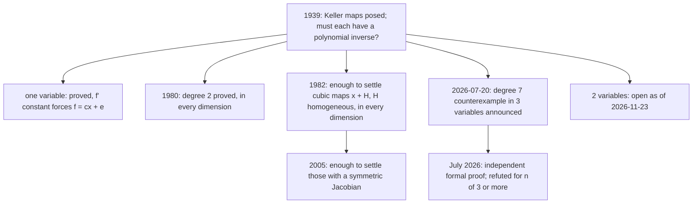

# The Jacobian conjecture: a polynomial map with constant nonzero Jacobian has a polynomial inverse

[Syllabus](../../../SYLLABUS.md) → [Frontier](../README.md) → [Analysis and Dynamics](../README.md#s05) → The Jacobian conjecture

---

## General Overview

Take the plane map that sends a point $`(x, y)`$ to $`(x + (x+y)^2,\ y - (x+y)^2)`$. It sends $`(1, 2)`$ to $`(10, -7)`$. Each output is a polynomial: a sum of whole-number powers of $`x`$ and $`y`$ times numbers.

Zoom in at any point and the map acts like a matrix, its **Jacobian** (the grid of partial derivatives, one row per output). For this map the determinant of that grid is exactly 1 at every point of the plane. So the map never squashes area and never flips it, anywhere.

The map can also be run backwards by a polynomial. Add the two outputs: $`10 + (-7) = 3`$, which is $`x + y`$ again. Then $`x = 10 - 3^2 = 1`$ and $`y = -7 + 3^2 = 2`$. A polynomial map with a polynomial inverse is a **polynomial automorphism**: a change of coordinates that polynomials can undo.

In 1939 a short paper asked whether this always happens. Take any number n of coordinates. Every polynomial map from n-space (points with n coordinates) to itself whose Jacobian determinant is a nonzero constant: must it have a polynomial inverse? That question is the Jacobian conjecture. A map that meets the hypothesis is called a **Keller map**, after the paper's author.

On 2026-07-20 Levent Alpöge announced a counterexample in three variables in a public post, crediting an AI system with work leading to the map. Its Jacobian determinant is −2 everywhere, yet three different points go to one point, so no inverse of any kind exists. An independent formal proof (a proof checked line by line by a computer program, here Isabelle/HOL) appeared in the Archive of Formal Proofs the same month. The checks on this card confirm both facts in exact arithmetic. The two-variable case is still open.

**A Keller map can be undone near every point, and the conjecture asked whether it can always be undone everywhere by polynomials; that holds in one variable and for degree 2, fails from three variables up, and is unknown in the plane.**

**What kind of fact this is:** a conjecture. Status as of 2026-11-23, in the fields taught on [Kinds of claim](../01-How%20Research%20Works/02-theorem-conjecture-model-approximation.md):

| Case | Kind | Status | Source of the status |
| --- | --- | --- | --- |
| one variable | theorem | proved | Why it works, Step 1, on this card |
| any number of variables, degree 2 | theorem | proved, 1980 | refereed paper (Sources) |
| three or more variables | conjecture | refuted, July 2026 | announced counterexample, checked by an independent formal proof and by this card's code |
| two variables | conjecture | open | no accepted proof or counterexample found as of 2026-11-23 |

### The picture: the problem's route



Each box is a dated result. The two reductions (1982 and 2005) say that if any counterexample exists, a cubic one, and a symmetric cubic one, exists in some larger, computable dimension. The 2026 map is a counterexample of degree 7, not in that form.

---

## The formula

Notation first. $`\mathbb{C}^n`$ is n-space over the complex numbers: lists of n complex numbers. A polynomial map $`F`$ sends a list $`x = (x_1, \dots, x_n)`$ to $`(F_1(x), \dots, F_n(x))`$, each $`F_i`$ a polynomial. Its Jacobian $`J_F`$ is the n by n grid with entry $`\partial F_i / \partial x_j`$ in row i, column j ([Inverse and implicit function theorems](../../06-Calculus%20and%20analysis/07-Several%20Variables/07-inverse-and-implicit-function-theorems.md)).

The conjecture in its standard form (Keller asked it for integer coefficients):

```math
F : \mathbb{C}^n \to \mathbb{C}^n \text{ polynomial}, \quad \det J_F(x) = c \neq 0 \text{ for every } x \quad \Longrightarrow \quad F \text{ has an inverse } G \text{ whose entries are polynomials}
```

**Read it aloud:** if a polynomial map's Jacobian determinant is the same nonzero number at every point, then some polynomial map undoes it.

The plane example and its inverse:

```math
F(x, y) = \big(x + u^2,\ y - u^2\big), \quad u = x + y; \qquad G(a, b) = \big(a - w^2,\ b + w^2\big), \quad w = a + b
```

**Read it aloud:** F pushes the point along the direction (1, −1) by the square of x + y; G reads x + y back off as a + b and pushes the other way.

Worked once: $`F(1, 2) = (1 + 9, 2 - 9) = (10, -7)`$ and $`G(10, -7) = (10 - 9, -7 + 9) = (1, 2)`$.

The 2026 counterexample, with $`s = 1 + xy`$ and $`t = 4 + 3xy`$:

```math
K(x, y, z) = \big(s^3 z + y^2 s t,\ \ y + 3x s^2 z + 3x y^2 t,\ \ 2x - 3x^2 y - x^3 z\big), \qquad \det J_K = -2
```

**Read it aloud:** three polynomial outputs of degree at most 7 whose Jacobian determinant is −2 at every point; yet $`(0, 0, -1/4)`$, $`(1, -3/2, 13/2)`$ and $`(-1, 3/2, 13/2)`$ all go to $`(-1/4, 0, 0)`$.

| Symbol | Plain meaning | In our example | Push it up and the answer… |
| --- | --- | --- | --- |
| $`n`$ | number of variables, the dimension | 2 for F, 3 for K | n = 1 is proved; n = 2 open; n of 3 or more refuted |
| $`F`$, $`G`$ | a polynomial map; its inverse | the plane map and its undo | — |
| $`J_F`$, $`\det J_F`$ | Jacobian grid; its determinant, the local area or volume factor | `[[7, 6], [-6, -5]]` at (1, 2); determinant 1 | — |
| $`c`$ | the constant value of the determinant | 1 for F, −2 for K | any nonzero c behaves the same |
| $`u`$, $`w`$ | x + y on the input side; a + b on the output side | 3 and 3 | — |
| $`H`$ | the non-linear part: F = x + H | $`H = (u^2, -u^2)`$ | higher degree: the conjecture's hard cases |
| $`K`$, $`s`$, $`t`$ | the 2026 counterexample and its two helper polynomials | at (1, −3/2, 13/2): s = −1/2, t = −1/2 | — |
| $`f`$, $`e`$ | a one-variable polynomial; its constant term | f = cx + e | — |
| $`p`$ | a prime, for arithmetic modulo p | 5 | any prime gives the same failure |
| $`i`$, $`v`$ | the square root of −1; $`v = x + iy`$ | in the symmetric example | — |
| $`x, y, z`$; $`a, b`$ | input coordinates; output coordinates of the plane map, also the target point in Step 3 | (1, 2); (10, −7) | — |
| $`d`$ | the degree: highest total power in the map | 2 for F, 7 for K | d = 2 proved; d = 3 enough to settle every case |

### When it holds

- **Polynomial entries.** The question asks for a polynomial inverse of a polynomial map. For general smooth maps it is a different question, which this card does not treat.
- **A constant determinant, not just a nonzero one.** Over the real numbers, $`x + x^3`$ has rate $`1 + 3x^2`$, never zero, and is one to one. Its inverse is not a polynomial: the formal inverse's coefficients 1, −1, 3, −12, 55, −273 never stop.
- **A field where whole numbers never vanish.** Modulo 5, $`x - x^5`$ has rate $`1 - 5x^4`$, which is 1. Yet it sends all of 0, 1, 2, 3, 4 to 0.
- **The dimension.** One variable: true. Two: open. Three or more: false.

---

## Why it works

This is a status card. Steps 0 and 1 are full proofs. Steps 2 to 4 outline published results and say where the proof lives. Step 5 is checked in full by the code.

### Step 0: the easy direction, inverse forces constant determinant

If $`G`$ undoes $`F`$, then $`G(F(x)) = x`$. The chain rule turns that into a product of Jacobians equal to the identity grid. Take determinants:

```math
\det J_G\big(F(x)\big) \cdot \det J_F(x) = 1
```

**Read it aloud:** the two determinants multiply to 1 at every point.

Both factors are polynomials in x. Two polynomials whose product is the constant 1 must both be constants, since degrees add under multiplication. So a polynomial automorphism always has constant nonzero determinant. The conjecture asks for the converse.

### Step 1: one variable, proved

If $`f'(x) = c`$ with $`c \neq 0`$, then $`f(x) = cx + e`$, since the only polynomials with zero rate are constants. Its inverse sends an output $`a`$ back to $`(a - e)/c`$, again a polynomial.

The code checks every polynomial of degree at most 3 with coefficients from −2 to 2: 625 of them. Exactly 20 have a constant nonzero rate. All 20 have degree 1, and each is undone by its formula.

The step "zero rate means constant" fails modulo a prime p, because the rate of $`x^p`$ is $`p x^{p-1}`$, which is zero there. That is why $`x - x^5`$ modulo 5 has rate 1 and still crushes five points to one.

### Step 2: local is free, global is the question

At each point, a determinant of 1 makes the Jacobian invertible. The inverse function theorem then gives an undo near that point ([Inverse and implicit function theorems](../../06-Calculus%20and%20analysis/07-Several%20Variables/07-inverse-and-implicit-function-theorems.md)). That theorem says nothing about how far the undo reaches. Patches that work near each point can still disagree across the whole space.

The gap is exactly injectivity, meaning "one to one": no two inputs share an output. An injective polynomial map of $`\mathbb{C}^n`$ to itself is onto and has a polynomial inverse; the 1982 survey in Sources gives the proof. So the conjecture says: a Keller map never sends two points to one.

In the language of [Maps between varieties](../../22-Algebraic%20geometry/02-Affine%20and%20Projective%20Varieties/05-regular-and-rational-maps.md), F is a regular map of affine n-space, and the question is whether it is an isomorphism: a regular map with a regular inverse.

### Step 3: the plane example, three ways

The plane map is $`F = x + H`$ with $`H = (u^2, -u^2)`$. Its non-linear part only moves points along the direction (1, −1), which leaves $`u = x + y`$ unchanged. That is why $`a + b`$ recovers $`u`$ and the inverse is a polynomial.

The same fact shows in the Jacobian. At (1, 2), the Jacobian is `[[7, 6], [-6, -5]]`. Subtracting the identity grid I gives `[[6, 6], [-6, -6]]`, and its square is the zero grid. A grid with a zero power is **nilpotent**. For $`F = x + H`$ with H homogeneous (every term of the same degree), constant determinant 1 is the same as $`J_H`$ being nilpotent everywhere.

A third road needs no insight. Write the target point, the output to be undone, as $`(a, b)`$. Rewrite $`F(g) = (a, b)`$ as $`g = (a, b) - H(g)`$ and iterate from $`g = (a, b)`$, cutting off high powers each round. The 1982 survey shows the series this produces is the formal inverse, and the conjecture says it always stops. For this map it stops after round 1, at degree 2: the inverse G. For $`x + x^2`$, which is not a Keller map, the coefficients run 1, −1, 2, −5, 14, −42 and never stop.

### Step 4: the reductions

- **Degree 2, proved (1980).** Every Keller map whose entries have degree at most 2 has a polynomial inverse, in every dimension. The plane example is one.
- **Degree 3 is enough (1982).** The survey proves: if the conjecture holds for every map $`x + H`$ with H homogeneous of degree 3 and $`J_H`$ nilpotent, in every dimension, then it holds for all maps. The price is dimension: a map of high degree in n variables becomes a cubic map in many more variables.
- **The symmetric case is enough (2005).** It suffices further to take $`J_H`$ symmetric, equal to its own mirror image. Then H is the gradient of a quartic polynomial.

A real symmetric nilpotent grid is zero, so the symmetric case lives over $`\mathbb{C}`$. The code's example is the gradient of $`(x + iy)^4 / 4`$: $`H = (v^3, i v^3)`$ with $`v = x + iy`$. Its Hessian (the grid of second derivatives) is $`3v^2`$ times $`[[1, i], [i, -1]]`$, whose square is zero. At (1, 1), $`v = 1 + i`$ and $`3v^2 = 6i`$; the code recomputes $`J_H`$ there by exact differences and gets 6i times that pattern. The map sends (1, 1) to (−1 + 2i, −1 − 2i), and its inverse brings that back to (1, 1).

Read backwards, the reductions say: if any counterexample exists, a cubic one, and a symmetric cubic one, exists in some larger dimension. The constructions are explicit, so that dimension can be computed from the map. Since K is a counterexample, such cubic counterexamples now exist. The reductions say nothing about two variables alone.

### Step 5: the 2026 counterexample

The map K above has degree 7. Its determinant is the constant −2. The code computes this two ways: by expanding the 3 by 3 determinant of polynomials, and by dual numbers (each value carried with its rate) at 125 grid points.

Three distinct points share one image. At $`(1, -3/2, 13/2)`$: $`s = 1 + xy = -1/2`$ and $`t = 4 + 3xy = -1/2`$. The first output is $`-13/16 + 9/16 = -1/4`$. The second is $`-3/2 + 39/8 - 27/8 = 0`$. The third is $`2 + 9/2 - 13/2 = 0`$.

Since K is not one to one, it has no inverse at all. Scaling the first output by −1/2 gives determinant 1 and sends the three points to (1/8, 0, 0). Adding untouched extra variables, $`(K(x, y, z), w_4, \dots, w_n)`$, keeps the determinant and the collision. So every n of 3 or more has a counterexample.

The audit list from [Machines in proofs](../01-How%20Research%20Works/06-computer-assistance-and-formal-verification.md):

| Field | Entry |
| --- | --- |
| statement | a polynomial map of $`\mathbb{C}^3`$ with constant nonzero Jacobian determinant that is not injective |
| artifact | the explicit map K and three rational points, announced by Levent Alpöge on 2026-07-20 |
| independent check | Isabelle/HOL proof in the Archive of Formal Proofs, July 2026, by authors other than the finder; it states that it does not address two variables |
| status | refuted for n of 3 or more; open for n = 2 |

The announcement is a social-media post, which this card does not cite. The formal proof reproduces the map and the points, and the checks below recompute both.

<details>
<summary>Why the reductions do not reach the plane</summary>

Both reductions trade degree for dimension. They turn a map in n variables into a cubic map in N variables, with N larger than n. A counterexample in three variables therefore yields cubic counterexamples only in some larger N.

A two-variable counterexample would have to come from elsewhere. For n = 2 the question stays open: is every Keller map of the plane injective?

</details>

---

## Worked numbers, by hand

| Step | Arithmetic | Value |
| --- | --- | --- |
| plane: u at (1, 2) | 1 + 2 | 3 |
| plane: F(1, 2) | (1 + 9, 2 − 9) | (10, −7) |
| plane: determinant at (1, 2) | 7 × (−5) − 6 × (−6) | **1** |
| plane: undo | w = 10 − 7 = 3, then (10 − 9, −7 + 9) | **(1, 2)** |
| 3-d: helpers at (1, −3/2, 13/2) | s = 1 − 3/2, t = 4 − 9/2 | −1/2, −1/2 |
| 3-d: first output | −13/16 + 9/16 | −1/4 |
| 3-d: second output | −3/2 + 39/8 − 27/8 | 0 |
| 3-d: third output | 2 + 9/2 − 13/2 | 0 |
| 3-d: compare | F(0, 0, −1/4) and F(−1, 3/2, 13/2) | **(−1/4, 0, 0), both** |

The plane map is undone by a polynomial; the three-variable map sends three points to one, so nothing undoes it.

### What breaks if you drop a piece

| Mistake | Comes out at | What went wrong |
| --- | --- | --- |
| Determinant nonzero but not constant: $`x + x^3`$ | inverse coefficients 1, −1, 3, −12, 55, −273, never stopping | The inverse exists over the reals but is not a polynomial |
| Working modulo 5: $`x - x^5`$ | rate 1, yet 0, 1, 2, 3, 4 all go to 0 | "Zero rate means constant" fails when p is zero |
| Reading the local inverse as global | det −2 at each of the three collision points | Each point has a local undo; the three undos cannot join into one |

The code prints all three.

---

## Code, from first principles, and it actually runs

The checks write their own exact polynomials (dictionaries from powers to whole numbers or fractions) and their own dual numbers. Nothing imported does algebra. The plane map is checked by **four roads**: the symbolic determinant, dual-number determinants on a grid, composing F and G both ways, and the formal-inverse iteration. The counterexample is checked by **two roads** for the determinant and by exact fractions for the collision. The symmetric map's Jacobian is recomputed at one point by exact differences and matched to its formula.

### Python

```python
# Jacobian conjecture -- the check behind the card.  Standard library only.
# Polynomials are dicts {exponents: integer or fraction}, so every number is
# exact.  Derivatives are taken two ways: term by term on the dict, and by
# dual numbers (a value carried together with its rate) at single points.
from fractions import Fraction as Q
from math import comb, prod

class P:  # polynomial in n variables
    def __init__(s, n, t): s.n, s.t = n, {e: c for e, c in t.items() if c}
    def up(s, b): return b if isinstance(b, P) else P(s.n, {(0,) * s.n: b})
    def __add__(s, b):
        r = dict(s.t)
        for e, c in s.up(b).t.items(): r[e] = r.get(e, 0) + c
        return P(s.n, r)
    def __mul__(s, b):
        r = {}
        for e1, c1 in s.t.items():
            for e2, c2 in s.up(b).t.items():
                e = tuple(i + j for i, j in zip(e1, e2)); r[e] = r.get(e, 0) + c1 * c2
        return P(s.n, r)
    __radd__, __rmul__ = __add__, __mul__
    def __sub__(s, b): return s + (-1) * s.up(b)
    def __eq__(s, b): return s.t == s.up(b).t
    def d(s, i): return P(s.n, {e[:i] + (e[i] - 1,) + e[i + 1:]: c * e[i] for e, c in s.t.items() if e[i]})
    def cut(s, D): return P(s.n, {e: c for e, c in s.t.items() if sum(e) <= D})
    def deg(s): return max(sum(e) for e in s.t)
    def coef(s, k): return s.t.get((k,), 0)
    def at(s, *v): return sum(c * prod(x ** k for x, k in zip(v, e)) for e, c in s.t.items())

class D:  # dual number: value v and rate r along one direction
    def __init__(s, v, r=0): s.v, s.r = v, r
    def up(s, b): return b if isinstance(b, D) else D(b)
    def __add__(s, b): b = s.up(b); return D(s.v + b.v, s.r + b.r)
    def __mul__(s, b): b = s.up(b); return D(s.v * b.v, s.v * b.r + s.r * b.v)
    __radd__, __rmul__ = __add__, __mul__
    def __sub__(s, b): return s + (-1) * s.up(b)

def var(i, n): return P(n, {tuple(int(j == i) for j in range(n)): 1})
def det(M):
    if len(M) == 1: return M[0][0]
    return sum((-1) ** j * M[0][j] * det([r[:j] + r[j + 1:] for r in M[1:]]) for j in range(len(M)))
def jac_sym(F, n): return [[f.d(j) for j in range(n)] for f in F]
def jac_dual(F, pt):  # column j = rates of F when coordinate j moves at rate 1
    cols = [F(*[D(v, int(i == j)) for i, v in enumerate(pt)]) for j in range(len(pt))]
    return [[cols[j][i].r for j in range(len(pt))] for i in range(len(pt))]
def show(v): return ", ".join(str(x) for x in v)

# 1. The plane map with Jacobian 1, its inverse, and the formal inverse
def F2(x, y): u = x + y; return (x + u * u, y - u * u)
def G2(a, b): w = a + b; return (a - w * w, b + w * w)
X, Y = var(0, 2), var(1, 2)
assert det(jac_sym(F2(X, Y), 2)) == 1                          # road 1: symbolic
grid2 = [(x, y) for x in range(-3, 4) for y in range(-3, 4)]
assert all(det(jac_dual(F2, p)) == 1 for p in grid2)          # road 2: dual numbers
J12 = jac_dual(F2, (1, 2)); N12 = [[J12[0][0] - 1, J12[0][1]], [J12[1][0], J12[1][1] - 1]]
NN = [[sum(N12[i][k] * N12[k][j] for k in range(2)) for j in range(2)] for i in range(2)]
assert NN == [[0, 0], [0, 0]] and F2(1, 2) == (10, -7) and G2(10, -7) == (1, 2)
assert G2(*F2(X, Y)) == (X, Y) and F2(*G2(X, Y)) == (X, Y)      # road 3: compose both ways
g, rounds = (X, Y), 0
while True:                                                     # road 4: g = (a, b) - H(g)
    u = g[0] + g[1]; new = ((X - u * u).cut(9), (Y + u * u).cut(9)); rounds += 1
    if new == g: break
    g = new
assert g == G2(X, Y) and max(p.deg() for p in g) == 2
print("plane, u = x + y =", 1 + 2, " u^2 =", (1 + 2) ** 2, " F(1, 2):", show(F2(1, 2)), "  G(10, -7):", show(G2(10, -7)))
print("plane, J at (1, 2):", J12, " det:", det(J12), " J - I:", N12, " (J - I)^2:", NN)
print("plane, det J = 1 at all", len(grid2), "grid points and as a polynomial; G(F) = F(G) = identity")
print("plane, formal inverse stable after round", rounds - 1, "of g = (a, b) - H(g), highest degree", g[0].deg())

# 2. One variable: constant derivative forces degree 1; what fails without it
T = var(0, 1); good = 0
for c0 in range(-2, 3):
    for c1 in range(-2, 3):
        for c2 in range(-2, 3):
            for c3 in range(-2, 3):
                f = c0 + c1 * T + c2 * T * T + c3 * T * T * T
                if f.d(0).t and f.d(0).deg() == 0:
                    good += 1; assert f.deg() == 1 and all((c0 + c1 * Q(y - c0, c1)) == y for y in range(5))
assert good == 5 * 4                                            # c2 = c3 = 0, c1 != 0
print("one variable, polynomials with coefficients -2..2 up to degree 3:", 5 ** 4, " constant nonzero f':", good, " all degree 1 and inverted")
for k, name in ((2, "x + x^2"), (3, "x + x^3")):
    h = T
    for _ in range(12): h = (T - h * h if k == 2 else T - h * h * h).cut(13)
    cs = [h.coef(m) for m in range(1, 14) if h.coef(m)][:6]
    exact = [(-1) ** j * comb(k * j, j) // ((k - 1) * j + 1) for j in range(6)]
    assert cs == exact
    print("formal inverse of", name, "coefficients:", show(cs), " never stop")
cube = T + T * T * T
print("x + x^3: rate 1 + 3x^2 >= 1, f(1) =", cube.at(1), " f(2) =", cube.at(2), " inverse has no polynomial form")
fp = T - T * T * T * T * T
vals = [(x - x ** 5) % 5 for x in range(5)]
assert vals == [0] * 5 and {e: c % 5 for e, c in fp.d(0).t.items() if c % 5} == {(0,): 1}
print("mod 5, f(x) = x - x^5: f' = 1 - 5x^4 = 1 mod 5, values at 0..4:", show(vals))

# 3. Three variables: the counterexample announced 2026-07-20
def F3(x, y, z):
    s, t = 1 + x * y, 4 + 3 * x * y
    return (s * s * s * z + y * y * s * t, y + 3 * x * s * s * z + 3 * x * y * y * t, 2 * x - 3 * x * x * y - x * x * x * z)
X3 = [var(i, 3) for i in range(3)]
J3 = jac_sym(F3(*X3), 3)
assert det(J3) == -2                                              # road 1: symbolic
grid3 = [(x, y, z) for x in range(-2, 3) for y in range(-2, 3) for z in range(-2, 3)]
assert all(det(jac_dual(F3, p)) == -2 for p in grid3)            # road 2: dual numbers
pts = [(0, 0, Q(-1, 4)), (1, Q(-3, 2), Q(13, 2)), (-1, Q(3, 2), Q(13, 2))]
imgs = [F3(*p) for p in pts]
assert len(set(pts)) == 3 and all(v == (Q(-1, 4), 0, 0) for v in imgs)
assert all(det(jac_dual(F3, p)) == -2 for p in pts)
print("3-d, degree of the map:", max(f.deg() for f in F3(*X3)), " det J = -2 as a polynomial and at all", len(grid3), "grid points")
for p, v in zip(pts, imgs): print("3-d, F(" + show(p) + ") =", show(v), " det J there:", det(jac_dual(F3, p)))
x_, y_, z_ = pts[1]; s_, t_ = 1 + x_ * y_, 4 + 3 * x_ * y_
terms = [s_ ** 3 * z_, y_ * y_ * s_ * t_, y_, 3 * x_ * s_ * s_ * z_, 3 * x_ * y_ * y_ * t_, 2 * x_, -3 * x_ * x_ * y_, -x_ ** 3 * z_]
assert [sum(terms[:2]), sum(terms[2:5]), sum(terms[5:])] == list(imgs[1])
print("3-d, at (1, -3/2, 13/2): s = 1 + xy =", s_, " t = 4 + 3xy =", t_, " terms:", show(terms))
J3n = [[Q(-1, 2) * e for e in J3[0]]] + J3[1:]
assert det(J3n) == 1
print("3-d, first output times -1/2: det J =", det(J3n).at(0, 0, 0), " all three points go to", show((Q(-1, 2) * imgs[0][0], 0, 0)))

# 4. A symmetric cubic map over the Gaussian integers (pairs a + bi)
def cm(a, b): return (a[0] * b[0] - a[1] * b[1], a[0] * b[1] + a[1] * b[0])
def ca(a, b, s=1): return (a[0] + s * b[0], a[1] + s * b[1])
I = (0, 1)
def Hs(x, y): u = ca(x, cm(I, y)); u3 = cm(u, cm(u, u)); return u3, cm(I, u3)
def Fs(x, y): h = Hs(x, y); return ca(x, h[0]), ca(y, h[1])
def Gs(a, b): w = ca(a, cm(I, b)); w3 = cm(w, cm(w, w)); return ca(a, w3, -1), ca(b, cm(I, w3), -1)
def cs_(a): return f"{a[0]}{'+' if a[1] >= 0 else '-'}{abs(a[1])}i"
Ns = [[(1, 0), I], [I, (-1, 0)]]
NNs = [[ca(cm(Ns[i][0], Ns[0][j]), cm(Ns[i][1], Ns[1][j])) for j in range(2)] for i in range(2)]
assert NNs == [[(0, 0), (0, 0)], [(0, 0), (0, 0)]]
gauss = [((a, b), (c, e)) for a in range(-1, 2) for b in range(-1, 2) for c in range(-1, 2) for e in range(-1, 2)]
assert all(Gs(*Fs(*p)) == p for p in gauss)
print("symmetric, F(1, 1) =", ", ".join(cs_(v) for v in Fs((1, 0), (1, 0))), " G of that:", ", ".join(cs_(v) for v in Gs(*Fs((1, 0), (1, 0)))))
print("symmetric, Hessian direction [[1, i], [i, -1]] squared: 0; G(F(p)) = p at all", len(gauss), "Gaussian points")
def d5(j, k):  # dH_k / d(coordinate j) at (1, 1) by a 5-point difference, exact for cubics
    sh = lambda m: Hs(*[(1 + m * (i == j), 0) for i in range(2)])[k]
    return tuple((8 * (sh(1)[r] - sh(-1)[r]) - (sh(2)[r] - sh(-2)[r])) // 12 for r in range(2))
v = ca((1, 0), I); f3v2 = cm((3, 0), cm(v, v)); JH = [d5(m % 2, m // 2) for m in range(4)]
assert JH == [cm(f3v2, e) for row in Ns for e in row]
print("symmetric, at (1, 1): v = 1+1i  3v^2 =", cs_(f3v2), " J_H by 5-point differences:", ", ".join(cs_(g) for g in JH))
print("ALL CHECKS PASS")
```

**Ran 2026-11-23 on macOS, Python 3.14.10, standard library only. All checks passed. Output, pasted from the run:**

```
plane, u = x + y = 3  u^2 = 9  F(1, 2): 10, -7   G(10, -7): 1, 2
plane, J at (1, 2): [[7, 6], [-6, -5]]  det: 1  J - I: [[6, 6], [-6, -6]]  (J - I)^2: [[0, 0], [0, 0]]
plane, det J = 1 at all 49 grid points and as a polynomial; G(F) = F(G) = identity
plane, formal inverse stable after round 1 of g = (a, b) - H(g), highest degree 2
one variable, polynomials with coefficients -2..2 up to degree 3: 625  constant nonzero f': 20  all degree 1 and inverted
formal inverse of x + x^2 coefficients: 1, -1, 2, -5, 14, -42  never stop
formal inverse of x + x^3 coefficients: 1, -1, 3, -12, 55, -273  never stop
x + x^3: rate 1 + 3x^2 >= 1, f(1) = 2  f(2) = 10  inverse has no polynomial form
mod 5, f(x) = x - x^5: f' = 1 - 5x^4 = 1 mod 5, values at 0..4: 0, 0, 0, 0, 0
3-d, degree of the map: 7  det J = -2 as a polynomial and at all 125 grid points
3-d, F(0, 0, -1/4) = -1/4, 0, 0  det J there: -2
3-d, F(1, -3/2, 13/2) = -1/4, 0, 0  det J there: -2
3-d, F(-1, 3/2, 13/2) = -1/4, 0, 0  det J there: -2
3-d, at (1, -3/2, 13/2): s = 1 + xy = -1/2  t = 4 + 3xy = -1/2  terms: -13/16, 9/16, -3/2, 39/8, -27/8, 2, 9/2, -13/2
3-d, first output times -1/2: det J = 1  all three points go to 1/8, 0, 0
symmetric, F(1, 1) = -1+2i, -1-2i  G of that: 1+0i, 1+0i
symmetric, Hessian direction [[1, i], [i, -1]] squared: 0; G(F(p)) = p at all 81 Gaussian points
symmetric, at (1, 1): v = 1+1i  3v^2 = 0+6i  J_H by 5-point differences: 0+6i, -6+0i, -6+0i, 0-6i
ALL CHECKS PASS
```

Every determinant is an exact integer, not a rounded decimal. The collision is exact in fractions, so no rounding could fake it.

### Rust

The same checks. Rust has no fraction type, so the script writes one on 128-bit integers.

```rust
// Jacobian conjecture -- the same check as jacobian_conjecture_check.py, in Rust.
// Standard library only, no crates.  Numbers are exact fractions, polynomials
// map exponent lists to fractions, and dual numbers carry a value and a rate.
use std::collections::BTreeMap;
use std::ops::{Add, Mul, Sub};

fn gcd(a: i128, b: i128) -> i128 { if b == 0 { a.abs() } else { gcd(b, a % b) } }
#[derive(Clone, Copy, PartialEq, Eq, PartialOrd, Ord, Debug)] struct Q { n: i128, d: i128 }
fn q(n: i128, d: i128) -> Q { let g = gcd(n, d).max(1); let s = d.signum(); Q { n: s * n / g, d: s * d / g } }  fn qi(n: i128) -> Q { q(n, 1) }
impl Add for Q { type Output = Q; fn add(self, o: Q) -> Q { q(self.n * o.d + o.n * self.d, self.d * o.d) } }
impl Mul for Q { type Output = Q; fn mul(self, o: Q) -> Q { q(self.n * o.n, self.d * o.d) } }
impl Sub for Q { type Output = Q; fn sub(self, o: Q) -> Q { self + qi(-1) * o } }
impl std::fmt::Display for Q { fn fmt(&self, f: &mut std::fmt::Formatter) -> std::fmt::Result {
    if self.d == 1 { write!(f, "{}", self.n) } else { write!(f, "{}/{}", self.n, self.d) } } }
trait R: Clone + Add<Output = Self> + Sub<Output = Self> + Mul<Output = Self> { fn c(&self, k: i128) -> Self; }
impl R for Q { fn c(&self, k: i128) -> Q { qi(k) } }

#[derive(Clone, PartialEq, Debug)] struct P { n: usize, t: BTreeMap<Vec<u32>, Q> } // polynomial in n variables
fn mk(n: usize, t: BTreeMap<Vec<u32>, Q>) -> P { P { n, t: t.into_iter().filter(|(_, c)| c.n != 0).collect() } }
fn var(i: usize, n: usize) -> P { mk(n, BTreeMap::from([((0..n).map(|j| (j == i) as u32).collect(), qi(1))])) }
impl Add for P { type Output = P; fn add(self, o: P) -> P {
    let mut r = self.t.clone();
    for (e, c) in o.t { let v = *r.get(&e).unwrap_or(&qi(0)) + c; r.insert(e, v); }
    mk(self.n, r) } }
impl Mul for P { type Output = P; fn mul(self, o: P) -> P {
    let mut r: BTreeMap<Vec<u32>, Q> = BTreeMap::new();
    for (e1, c1) in &self.t { for (e2, c2) in &o.t {
        let e: Vec<u32> = e1.iter().zip(e2).map(|(a, b)| a + b).collect();
        let v = *r.get(&e).unwrap_or(&qi(0)) + *c1 * *c2; r.insert(e, v); } }
    mk(self.n, r) } }
impl Sub for P { type Output = P; fn sub(self, o: P) -> P { let m = self.c(-1); self + m * o } }
impl R for P { fn c(&self, k: i128) -> P { mk(self.n, BTreeMap::from([(vec![0; self.n], qi(k))])) } }
impl P {
    fn d(&self, i: usize) -> P { mk(self.n, self.t.iter().filter(|(e, _)| e[i] > 0)
        .map(|(e, c)| { let mut f = e.clone(); f[i] -= 1; (f, *c * qi(e[i] as i128)) }).collect()) }
    fn cut(&self, dd: u32) -> P { mk(self.n, self.t.iter().filter(|(e, _)| e.iter().sum::<u32>() <= dd).map(|(e, c)| (e.clone(), *c)).collect()) }
    fn deg(&self) -> u32 { self.t.keys().map(|e| e.iter().sum::<u32>()).max().unwrap() }
    fn coef(&self, k: u32) -> Q { *self.t.get(&vec![k]).unwrap_or(&qi(0)) }
    fn at(&self, v: &[Q]) -> Q { self.t.iter().fold(qi(0), |s, (e, c)| {
        s + e.iter().zip(v).fold(*c, |m, (k, x)| (0..*k).fold(m, |m2, _| m2 * *x)) }) }
}
#[derive(Clone, Copy)] struct Dl { v: Q, r: Q } // dual number: value and rate along one direction
impl Add for Dl { type Output = Dl; fn add(self, o: Dl) -> Dl { Dl { v: self.v + o.v, r: self.r + o.r } } }
impl Mul for Dl { type Output = Dl; fn mul(self, o: Dl) -> Dl { Dl { v: self.v * o.v, r: self.v * o.r + self.r * o.v } } }
impl Sub for Dl { type Output = Dl; fn sub(self, o: Dl) -> Dl { Dl { v: self.v - o.v, r: self.r - o.r } } }
impl R for Dl { fn c(&self, k: i128) -> Dl { Dl { v: qi(k), r: qi(0) } } }

fn det<T: R>(m: &Vec<Vec<T>>) -> T {
    if m.len() == 1 { return m[0][0].clone(); }
    let mut s = m[0][0].c(0);
    for j in 0..m.len() {
        let minor: Vec<Vec<T>> = m[1..].iter().map(|r| { let mut x = r.clone(); x.remove(j); x }).collect();
        s = s + m[0][j].c(if j % 2 == 0 { 1 } else { -1 }) * m[0][j].clone() * det(&minor);
    }
    s
}
fn jac_sym(f: &[P]) -> Vec<Vec<P>> { f.iter().map(|p| (0..p.n).map(|j| p.d(j)).collect()).collect() }
fn jac_dual(f: &dyn Fn(&[Dl]) -> Vec<Dl>, pt: &[Q]) -> Vec<Vec<Q>> {
    let n = pt.len();
    let cols: Vec<Vec<Dl>> = (0..n).map(|j| f(&(0..n).map(|i| Dl { v: pt[i], r: qi((i == j) as i128) }).collect::<Vec<_>>())).collect();
    (0..n).map(|i| (0..n).map(|j| cols[j][i].r).collect()).collect()
}
fn show(v: &[Q]) -> String { v.iter().map(|x| x.to_string()).collect::<Vec<_>>().join(", ") }
fn mat(m: &Vec<Vec<Q>>) -> String { format!("[{}]", m.iter().map(|r| format!("[{}]", show(r))).collect::<Vec<_>>().join(", ")) }
fn f2<T: R>(x: T, y: T) -> Vec<T> { let u = x.clone() + y.clone(); vec![x + u.clone() * u.clone(), y - u.clone() * u] }
fn g2<T: R>(a: T, b: T) -> Vec<T> { let w = a.clone() + b.clone(); vec![a - w.clone() * w.clone(), b + w.clone() * w] }
fn f3<T: R>(x: T, y: T, z: T) -> Vec<T> {
    let s = x.c(1) + x.clone() * y.clone();
    let t = x.c(4) + x.c(3) * x.clone() * y.clone();
    vec![s.clone() * s.clone() * s.clone() * z.clone() + y.clone() * y.clone() * s.clone() * t.clone(),
         y.clone() + x.c(3) * x.clone() * s.clone() * s * z.clone() + x.c(3) * x.clone() * y.clone() * y.clone() * t,
         x.c(2) * x.clone() - x.c(3) * x.clone() * x.clone() * y - x.clone() * x.clone() * x * z]
}
fn comb(n: i128, k: i128) -> i128 { (0..k).fold(1, |a, i| a * (n - i) / (i + 1)) }
type G = (i64, i64); const I: G = (0, 1); // Gaussian integer a + bi
fn cm(a: G, b: G) -> G { (a.0 * b.0 - a.1 * b.1, a.0 * b.1 + a.1 * b.0) }
fn ca(a: G, b: G, s: i64) -> G { (a.0 + s * b.0, a.1 + s * b.1) }
fn hs(x: G, y: G) -> (G, G) { let u = ca(x, cm(I, y), 1); let u3 = cm(u, cm(u, u)); (u3, cm(I, u3)) }
fn fs(x: G, y: G) -> (G, G) { let h = hs(x, y); (ca(x, h.0, 1), ca(y, h.1, 1)) }
fn gs(a: G, b: G) -> (G, G) { let w = ca(a, cm(I, b), 1); let w3 = cm(w, cm(w, w)); (ca(a, w3, -1), ca(b, cm(I, w3), -1)) }
fn cs(a: G) -> String { format!("{}{}{}i", a.0, if a.1 >= 0 { "+" } else { "-" }, a.1.abs()) }
fn d5(j: usize, k: usize) -> G { // dH_k / d(coordinate j) at (1, 1) by a 5-point difference, exact for cubics
    let sh = |m: i64| { let mut p = [(1, 0), (1, 0)]; p[j].0 += m; let h = hs(p[0], p[1]); if k == 0 { h.0 } else { h.1 } };
    ((8 * (sh(1).0 - sh(-1).0) - (sh(2).0 - sh(-2).0)) / 12, (8 * (sh(1).1 - sh(-1).1) - (sh(2).1 - sh(-2).1)) / 12) }

fn main() {
    // 1. The plane map with Jacobian 1, its inverse, and the formal inverse
    let (x, y) = (var(0, 2), var(1, 2));
    assert!(det(&jac_sym(&f2(x.clone(), y.clone()))) == x.c(1));
    let fd2 = |v: &[Dl]| f2(v[0], v[1]);
    let grid2: Vec<Vec<Q>> = (-3..4).flat_map(|a| (-3..4).map(move |b| vec![qi(a), qi(b)])).collect();
    assert!(grid2.iter().all(|p| det(&jac_dual(&fd2, p)) == qi(1)));
    let j12 = jac_dual(&fd2, &[qi(1), qi(2)]);
    let n12 = vec![vec![j12[0][0] - qi(1), j12[0][1]], vec![j12[1][0], j12[1][1] - qi(1)]];
    let nn: Vec<Vec<Q>> = (0..2).map(|i| (0..2).map(|j| n12[i][0] * n12[0][j] + n12[i][1] * n12[1][j]).collect()).collect();
    assert!(nn.iter().flatten().all(|v| v.n == 0) && f2(qi(1), qi(2)) == vec![qi(10), qi(-7)] && g2(qi(10), qi(-7)) == vec![qi(1), qi(2)]);
    let fx = f2(x.clone(), y.clone()); let gx = g2(x.clone(), y.clone());
    assert!(g2(fx[0].clone(), fx[1].clone()) == vec![x.clone(), y.clone()] && f2(gx[0].clone(), gx[1].clone()) == vec![x.clone(), y.clone()]);
    let (mut g, mut rounds) = (vec![x.clone(), y.clone()], 0);
    loop {
        let u = g[0].clone() + g[1].clone();
        let new = vec![(x.clone() - u.clone() * u.clone()).cut(9), (y.clone() + u.clone() * u).cut(9)];
        rounds += 1; if new == g { break; } g = new;
    }
    assert!(g == gx && g.iter().map(|p| p.deg()).max().unwrap() == 2);
    println!("plane, u = x + y = {}  u^2 = {}  F(1, 2): {}   G(10, -7): {}", 1 + 2, (1 + 2) * (1 + 2), show(&f2(qi(1), qi(2))), show(&g2(qi(10), qi(-7))));
    println!("plane, J at (1, 2): {}  det: {}  J - I: {}  (J - I)^2: {}", mat(&j12), det(&j12), mat(&n12), mat(&nn));
    println!("plane, det J = 1 at all {} grid points and as a polynomial; G(F) = F(G) = identity", grid2.len());
    println!("plane, formal inverse stable after round {} of g = (a, b) - H(g), highest degree {}", rounds - 1, g[0].deg());

    // 2. One variable: constant derivative forces degree 1; what fails without it
    let (t, mut good) = (var(0, 1), 0);
    for c0 in -2..3 { for c1 in -2..3 { for c2 in -2..3 { for c3 in -2..3 {
        let f = t.c(c0) + t.c(c1) * t.clone() + t.c(c2) * t.clone() * t.clone() + t.c(c3) * t.clone() * t.clone() * t.clone();
        let fd = f.d(0); if !fd.t.is_empty() && fd.deg() == 0 { good += 1;
            assert!(f.deg() == 1 && (0..5).all(|yy| qi(c0) + qi(c1) * q(yy - c0, c1) == qi(yy))); }
    } } } }
    assert!(good == 5 * 4); // c2 = c3 = 0, c1 != 0
    println!("one variable, polynomials with coefficients -2..2 up to degree 3: {}  constant nonzero f': {}  all degree 1 and inverted", 5i32.pow(4), good);
    for (k, name) in [(2i128, "x + x^2"), (3, "x + x^3")] {
        let mut h = t.clone();
        for _ in 0..12 { h = (if k == 2 { t.clone() - h.clone() * h.clone() } else { t.clone() - h.clone() * h.clone() * h.clone() }).cut(13); }
        let cs_: Vec<Q> = (1..14).map(|m| h.coef(m)).filter(|c| c.n != 0).take(6).collect();
        let exact: Vec<Q> = (0..6).map(|j| qi(if j % 2 == 0 { 1 } else { -1 } * comb(k * j, j) / ((k - 1) * j + 1))).collect();
        assert!(cs_ == exact);
        println!("formal inverse of {} coefficients: {}  never stop", name, show(&cs_));
    }
    let cube = t.clone() + t.clone() * t.clone() * t.clone();
    println!("x + x^3: rate 1 + 3x^2 >= 1, f(1) = {}  f(2) = {}  inverse has no polynomial form", cube.at(&[qi(1)]), cube.at(&[qi(2)]));
    let fp = t.clone() - t.clone() * t.clone() * t.clone() * t.clone() * t.clone();
    let vals: Vec<Q> = (0..5i128).map(|v| qi((v - v.pow(5)).rem_euclid(5))).collect();
    let red: Vec<(Vec<u32>, i128)> = fp.d(0).t.iter().map(|(e, c)| (e.clone(), c.n.rem_euclid(5))).filter(|(_, c)| *c != 0).collect();
    assert!(vals.iter().all(|v| v.n == 0) && red == vec![(vec![0], 1)]);
    println!("mod 5, f(x) = x - x^5: f' = 1 - 5x^4 = 1 mod 5, values at 0..4: {}", show(&vals));

    // 3. Three variables: the counterexample announced 2026-07-20
    let x3: Vec<P> = (0..3).map(|i| var(i, 3)).collect();
    let f3x = f3(x3[0].clone(), x3[1].clone(), x3[2].clone());
    let j3 = jac_sym(&f3x);
    assert!(det(&j3) == x3[0].c(-2));
    let fd3 = |v: &[Dl]| f3(v[0], v[1], v[2]);
    let grid3: Vec<Vec<Q>> = (-2..3).flat_map(|a| (-2..3).flat_map(move |b| (-2..3).map(move |c| vec![qi(a), qi(b), qi(c)]))).collect();
    assert!(grid3.iter().all(|p| det(&jac_dual(&fd3, p)) == qi(-2)));
    let pts = vec![vec![qi(0), qi(0), q(-1, 4)], vec![qi(1), q(-3, 2), q(13, 2)], vec![qi(-1), q(3, 2), q(13, 2)]];
    let imgs: Vec<Vec<Q>> = pts.iter().map(|p| f3(p[0], p[1], p[2])).collect();
    assert!(pts[0] != pts[1] && pts[1] != pts[2] && pts[0] != pts[2] && imgs.iter().all(|v| *v == vec![q(-1, 4), qi(0), qi(0)]));
    assert!(pts.iter().all(|p| det(&jac_dual(&fd3, p)) == qi(-2)));
    println!("3-d, degree of the map: {}  det J = -2 as a polynomial and at all {} grid points", f3x.iter().map(|f| f.deg()).max().unwrap(), grid3.len());
    for (p, v) in pts.iter().zip(&imgs) { println!("3-d, F({}) = {}  det J there: {}", show(p), show(v), det(&jac_dual(&fd3, p))); }
    let (x_, y_, z_) = (pts[1][0], pts[1][1], pts[1][2]); let (s_, t_) = (qi(1) + x_ * y_, qi(4) + qi(3) * x_ * y_);
    let tm = vec![s_ * s_ * s_ * z_, y_ * y_ * s_ * t_, y_, qi(3) * x_ * s_ * s_ * z_, qi(3) * x_ * y_ * y_ * t_, qi(2) * x_, qi(-3) * x_ * x_ * y_, qi(-1) * x_ * x_ * x_ * z_];
    assert!(vec![tm[0] + tm[1], tm[2] + tm[3] + tm[4], tm[5] + tm[6] + tm[7]] == imgs[1]);
    println!("3-d, at (1, -3/2, 13/2): s = 1 + xy = {}  t = 4 + 3xy = {}  terms: {}", s_, t_, show(&tm)); let half = mk(3, BTreeMap::from([(vec![0, 0, 0], q(-1, 2))]));
    let mut j3n = j3.clone(); j3n[0] = j3[0].iter().map(|e| half.clone() * e.clone()).collect();
    assert!(det(&j3n) == x3[0].c(1));
    println!("3-d, first output times -1/2: det J = {}  all three points go to {}", det(&j3n).at(&[qi(0), qi(0), qi(0)]), show(&[q(-1, 2) * imgs[0][0], qi(0), qi(0)]));

    // 4. A symmetric cubic map over the Gaussian integers (pairs a + bi)
    let ns = [[(1, 0), I], [I, (-1, 0)]];
    let nns: Vec<G> = (0..4).map(|k| { let (i, j) = (k / 2, k % 2); ca(cm(ns[i][0], ns[0][j]), cm(ns[i][1], ns[1][j]), 1) }).collect();
    assert!(nns.iter().all(|v| *v == (0, 0)));
    let gauss: Vec<(G, G)> = (0..81i64).map(|k| ((k / 27 % 3 - 1, k / 9 % 3 - 1), (k / 3 % 3 - 1, k % 3 - 1))).collect();
    assert!(gauss.iter().all(|&(p0, p1)| gs(fs(p0, p1).0, fs(p0, p1).1) == (p0, p1)));
    let (a, b) = fs((1, 0), (1, 0)); let (c, e) = gs(a, b); println!("symmetric, F(1, 1) = {}, {}  G of that: {}, {}", cs(a), cs(b), cs(c), cs(e));
    println!("symmetric, Hessian direction [[1, i], [i, -1]] squared: 0; G(F(p)) = p at all {} Gaussian points", gauss.len());
    let v = ca((1, 0), I, 1); let f3v2 = cm((3, 0), cm(v, v)); let jh: Vec<G> = (0..4).map(|m| d5(m % 2, m / 2)).collect();
    assert!(jh == ns.iter().flatten().map(|&e| cm(f3v2, e)).collect::<Vec<G>>());
    println!("symmetric, at (1, 1): v = 1+1i  3v^2 = {}  J_H by 5-point differences: {}", cs(f3v2), jh.iter().map(|&g| cs(g)).collect::<Vec<_>>().join(", "));
    println!("ALL CHECKS PASS");
}
```

**Ran 2026-11-23 on macOS, rustc 1.98.1, no crates. All checks passed. Output, pasted from the run:**

```
plane, u = x + y = 3  u^2 = 9  F(1, 2): 10, -7   G(10, -7): 1, 2
plane, J at (1, 2): [[7, 6], [-6, -5]]  det: 1  J - I: [[6, 6], [-6, -6]]  (J - I)^2: [[0, 0], [0, 0]]
plane, det J = 1 at all 49 grid points and as a polynomial; G(F) = F(G) = identity
plane, formal inverse stable after round 1 of g = (a, b) - H(g), highest degree 2
one variable, polynomials with coefficients -2..2 up to degree 3: 625  constant nonzero f': 20  all degree 1 and inverted
formal inverse of x + x^2 coefficients: 1, -1, 2, -5, 14, -42  never stop
formal inverse of x + x^3 coefficients: 1, -1, 3, -12, 55, -273  never stop
x + x^3: rate 1 + 3x^2 >= 1, f(1) = 2  f(2) = 10  inverse has no polynomial form
mod 5, f(x) = x - x^5: f' = 1 - 5x^4 = 1 mod 5, values at 0..4: 0, 0, 0, 0, 0
3-d, degree of the map: 7  det J = -2 as a polynomial and at all 125 grid points
3-d, F(0, 0, -1/4) = -1/4, 0, 0  det J there: -2
3-d, F(1, -3/2, 13/2) = -1/4, 0, 0  det J there: -2
3-d, F(-1, 3/2, 13/2) = -1/4, 0, 0  det J there: -2
3-d, at (1, -3/2, 13/2): s = 1 + xy = -1/2  t = 4 + 3xy = -1/2  terms: -13/16, 9/16, -3/2, 39/8, -27/8, 2, 9/2, -13/2
3-d, first output times -1/2: det J = 1  all three points go to 1/8, 0, 0
symmetric, F(1, 1) = -1+2i, -1-2i  G of that: 1+0i, 1+0i
symmetric, Hessian direction [[1, i], [i, -1]] squared: 0; G(F(p)) = p at all 81 Gaussian points
symmetric, at (1, 1): v = 1+1i  3v^2 = 0+6i  J_H by 5-point differences: 0+6i, -6+0i, -6+0i, 0-6i
ALL CHECKS PASS
```

The two outputs match line for line.

### Lean

Lean proves the one-variable case, and refutes the conjecture with the 2026 map K in every dimension from three up.

- Take a polynomial f over a field where whole numbers never vanish, whose rate is a constant $`c \neq 0`$. Then some polynomial g undoes f, and f undoes g.
- K has Jacobian determinant −2 as a polynomial, so −2 at every point.
- K sends (0, 0, −1/4) to (−1/4, 0, 0). So do (1, −3/2, 13/2) and (−1, 3/2, 13/2).
- Take any dimension n of 3 or more. Then some polynomial map of $`\mathbb{C}^n`$ has constant nonzero Jacobian determinant, yet sends two different points to one.
- The plane map sends (1, 2) to (10, −7), and G brings it back.
- At (1, 2) the Jacobian has determinant 1, and J − I squares to the zero grid.
- Modulo 5, $`x - x^5`$ sends all of 0, 1, 2, 3, 4 to 0.
- Of the 625 polynomials in Step 1, exactly 20 have a constant nonzero rate.

The formal inverses, the 49-point and 125-point grids and the symmetric map are left to the Python and Rust checks.

```lean
-- The Jacobian conjecture: a one-variable polynomial with constant nonzero derivative has a polynomial inverse, while from three variables up a polynomial map with constant nonzero Jacobian determinant can send two points to one, as the 2026 map K does.
import Mathlib.Algebra.MvPolynomial.PDeriv
import Mathlib.Algebra.Polynomial.Derivative
import Mathlib.Basic.Complex.Basic
import Mathlib.Data.ZMod.Basic
import Mathlib.LinearAlgebra.Matrix.Determinant.Basic
import Mathlib.LinearAlgebra.Matrix.Notation
import Mathlib.Tactic.NormNum

noncomputable section

open MvPolynomial

/-- The Jacobian grid of a polynomial map F of n-space: the entry in row i, column j is the
partial derivative ∂F_i/∂x_j, itself a polynomial. -/
def jacobianMatrix {n : ℕ} (F : Fin n → MvPolynomial (Fin n) ℂ) :
    Matrix (Fin n) (Fin n) (MvPolynomial (Fin n) ℂ) :=
  Matrix.of fun i j => pderiv j (F i)

/-- The point map of F: it sends a point x of ℂⁿ to (F_1(x), …, F_n(x)). -/
def pointMap {n : ℕ} (F : Fin n → MvPolynomial (Fin n) ℂ) : (Fin n → ℂ) → (Fin n → ℂ) :=
  fun x i => eval x (F i)

/-- One variable, proved. Over a field where whole numbers never vanish, a polynomial f whose
rate f' is a constant c ≠ 0 has an inverse g that is again a polynomial: g undoes f and f
undoes g, as compositions of polynomials. -/
theorem jacobian_conjecture_one_variable {K : Type*} [Field K] [CharZero K]
    (f : Polynomial K) (c : K) (hf : Polynomial.derivative f = Polynomial.C c) (hc : c ≠ 0) :
    ∃ g : Polynomial K, f.comp g = Polynomial.X ∧ g.comp f = Polynomial.X := by
  have hcoef : ∀ n, f.coeff (n + 2) = 0 := by
    intro n
    have h := congrArg (fun p => Polynomial.coeff p (n + 1)) hf
    simp only [Polynomial.coeff_derivative, Polynomial.coeff_C] at h
    simp only [Nat.add_one_ne_zero, ite_false] at h
    have h2 : ((n + 1 : ℕ) : K) + 1 ≠ 0 := by exact_mod_cast Nat.succ_ne_zero (n + 1)
    have : f.coeff (n + 1 + 1) * (((n + 1 : ℕ) : K) + 1) = 0 := by exact_mod_cast h
    exact (mul_eq_zero.mp this).resolve_right h2
  have h1 : f.coeff 1 = c := by
    have h := congrArg (fun p => Polynomial.coeff p 0) hf
    simpa [Polynomial.coeff_derivative] using h
  have hform : f = Polynomial.C (f.coeff 0) + Polynomial.C c * Polynomial.X := by
    ext n
    rcases n with _ | _ | n
    · simp
    · simp [h1]
    · simp [hcoef n]
  obtain ⟨a, ha⟩ : ∃ a, f = Polynomial.C a + Polynomial.C c * Polynomial.X := ⟨_, hform⟩
  subst ha
  refine ⟨Polynomial.C c⁻¹ * (Polynomial.X - Polynomial.C a), ?_, ?_⟩
  · 
    simp only [Polynomial.add_comp, Polynomial.mul_comp, Polynomial.C_comp, Polynomial.X_comp]
    rw [← mul_assoc, ← Polynomial.C_mul, mul_inv_cancel₀ hc]
    simp
  · simp only [Polynomial.mul_comp, Polynomial.sub_comp, Polynomial.C_comp, Polynomial.X_comp]
    rw [add_sub_cancel_left, ← mul_assoc, ← Polynomial.C_mul, inv_mul_cancel₀ hc]
    simp

/-- The 2026 counterexample, with s = 1 + xy and t = 4 + 3xy:
K(x, y, z) = (s³z + y²st, y + 3xs²z + 3xy²t, 2x − 3x²y − x³z). -/
def keller2026 : Fin 3 → MvPolynomial (Fin 3) ℂ :=
  let x : MvPolynomial (Fin 3) ℂ := X 0
  let y : MvPolynomial (Fin 3) ℂ := X 1
  let z : MvPolynomial (Fin 3) ℂ := X 2
  let s := 1 + x * y
  let t := 4 + 3 * x * y
  ![s ^ 3 * z + y ^ 2 * s * t,
    y + 3 * x * s ^ 2 * z + 3 * x * y ^ 2 * t,
    2 * x - 3 * x ^ 2 * y - x ^ 3 * z]

/-- The 2026 map K of ℂ³ has Jacobian determinant −2 as a polynomial, so −2 at every point,
yet the three different points (0, 0, −1/4), (1, −3/2, 13/2) and (−1, 3/2, 13/2) all go to
(−1/4, 0, 0); so K is not one to one and has no inverse of any kind. -/
theorem keller2026_det_and_collision :
    (jacobianMatrix keller2026).det = C (-2) ∧
      pointMap keller2026 ![0, 0, -1/4] = ![-1/4, 0, 0] ∧
      pointMap keller2026 ![1, -3/2, 13/2] = ![-1/4, 0, 0] ∧
      pointMap keller2026 ![-1, 3/2, 13/2] = ![-1/4, 0, 0] := by
  refine ⟨?_, ?_, ?_, ?_⟩
  · have hn : ∀ (i : Fin 3) (n : ℕ) [n.AtLeastTwo],
        pderiv i (OfNat.ofNat n : MvPolynomial (Fin 3) ℂ) = 0 := by
      intro i n _
      rw [show (OfNat.ofNat n : MvPolynomial (Fin 3) ℂ) = ((OfNat.ofNat n : ℕ) : MvPolynomial (Fin 3) ℂ)
        from (Nat.cast_ofNat).symm]
      exact Derivation.map_natCast _ _
    have h01 : pderiv 0 (X 1 : MvPolynomial (Fin 3) ℂ) = 0 := pderiv_X_of_ne (by decide)
    have h02 : pderiv 0 (X 2 : MvPolynomial (Fin 3) ℂ) = 0 := pderiv_X_of_ne (by decide)
    have h10 : pderiv 1 (X 0 : MvPolynomial (Fin 3) ℂ) = 0 := pderiv_X_of_ne (by decide)
    have h12 : pderiv 1 (X 2 : MvPolynomial (Fin 3) ℂ) = 0 := pderiv_X_of_ne (by decide)
    have h20 : pderiv 2 (X 0 : MvPolynomial (Fin 3) ℂ) = 0 := pderiv_X_of_ne (by decide)
    have h21 : pderiv 2 (X 1 : MvPolynomial (Fin 3) ℂ) = 0 := pderiv_X_of_ne (by decide)
    rw [Matrix.det_fin_three]
    simp only [jacobianMatrix, Matrix.of_apply, keller2026, Matrix.cons_val_zero, Matrix.cons_val_one,
      Matrix.cons_val_two, Matrix.head_cons, Matrix.tail_cons]
    simp only [map_add, map_sub, Derivation.leibniz, Derivation.leibniz_pow, smul_eq_mul, nsmul_eq_mul,
      Derivation.map_one_eq_zero, pderiv_X_self, h01, h02, h10, h12, h20, h21, hn]
    simp only [Nat.cast_ofNat, Nat.add_one_sub_one, pow_one]
    rw [map_neg, map_ofNat C 2]
    ring
  all_goals
    funext i
    fin_cases i <;> simp [pointMap, keller2026] <;> norm_num

/-- Refuted for n of 3 or more: in every dimension n ≥ 3 there is a polynomial map of ℂⁿ whose
Jacobian determinant is a nonzero constant c, yet two different points have the same image,
so no polynomial inverse exists. -/
theorem jacobian_conjecture_false_of_three_le (n : ℕ) (hn : 3 ≤ n) :
    ∃ F : Fin n → MvPolynomial (Fin n) ℂ, ∃ c : ℂ, c ≠ 0 ∧
      (jacobianMatrix F).det = C c ∧ ¬ Function.Injective (pointMap F) := by
  classical
  obtain ⟨hdet, h1, h2, -⟩ := keller2026_det_and_collision
  obtain ⟨k, rfl⟩ : ∃ k, n = 3 + k := ⟨n - 3, by omega⟩
  let e : Fin 3 ⊕ Fin k ≃ Fin (3 + k) := finSumFinEquiv
  let ι : Fin 3 → Fin (3 + k) := fun j => e (Sum.inl j)
  have hι : Function.Injective ι := e.injective.comp Sum.inl_injective
  have hzero : ∀ (p : MvPolynomial (Fin 3) ℂ) (v : Fin (3 + k)), (∀ j, ι j ≠ v) →
      pderiv v (rename ι p) = 0 := by
    intro p v hv
    induction p using MvPolynomial.induction_on with
    | C a => simp
    | add p q hp hq => simp [hp, hq]
    | mul_X p j h =>
      rw [map_mul, rename_X, Derivation.leibniz, h, pderiv_X_of_ne (hv j)]
      simp
  let F : Fin (3 + k) → MvPolynomial (Fin (3 + k)) ℂ := fun i =>
    Sum.elim (fun j => rename ι (keller2026 j)) (fun _ => X i) (e.symm i)
  refine ⟨F, -2, by norm_num, ?_, ?_⟩
  · have key : (jacobianMatrix F).submatrix e e =
        Matrix.fromBlocks ((jacobianMatrix keller2026).map (rename ι)) 0 0 1 := by
      refine Matrix.ext fun i j => ?_
      rcases i with a | a <;> rcases j with b | b
      · simp [jacobianMatrix, F, ι, Matrix.fromBlocks]
        exact pderiv_rename hι b (keller2026 a)
      · simp only [jacobianMatrix, F, Matrix.submatrix_apply, Matrix.of_apply,
          Equiv.symm_apply_apply, Sum.elim_inl, Matrix.fromBlocks_apply₁₂, Matrix.zero_apply]
        apply hzero
        intro j h
        exact Sum.inl_ne_inr (e.injective h)
      · simp only [jacobianMatrix, F, Matrix.submatrix_apply, Matrix.of_apply,
          Equiv.symm_apply_apply, Sum.elim_inr, Matrix.fromBlocks_apply₂₁, Matrix.zero_apply]
        apply pderiv_X_of_ne
        intro h
        exact Sum.inr_ne_inl (e.injective h)
      · simp only [jacobianMatrix, F, Matrix.submatrix_apply, Matrix.of_apply,
          Equiv.symm_apply_apply, Sum.elim_inr, Matrix.fromBlocks_apply₂₂, pderiv_X,
          Pi.single_apply, Matrix.one_apply, e.injective.eq_iff, Sum.inr.injEq]
    rw [← Matrix.det_submatrix_equiv_self e, key, Matrix.det_fromBlocks_zero₂₁, Matrix.det_one,
      mul_one]
    have hm := AlgHom.map_det (rename ι) (jacobianMatrix keller2026)
    rw [AlgHom.mapMatrix_apply] at hm
    rw [← hm, hdet, rename_C]
  · intro hinj
    let lift : (Fin 3 → ℂ) → Fin (3 + k) → ℂ := fun v i => Sum.elim v (fun _ => 0) (e.symm i)
    have hlift : ∀ v, pointMap F (lift v) = lift (pointMap keller2026 v) := by
      intro v
      funext i
      obtain ⟨a, rfl⟩ := e.surjective i
      rcases a with j | j
      · have hc : lift v ∘ ι = v := by
          funext j'
          simp [lift, ι]
        simp only [pointMap, F, lift, Equiv.symm_apply_apply, Sum.elim_inl, eval_rename]
        rw [show (fun i => Sum.elim v (fun _ => (0 : ℂ)) (e.symm i)) ∘ ι = v from hc]
      · simp [pointMap, F, lift]
    have h := @hinj (lift ![0, 0, -1/4]) (lift ![1, -3/2, 13/2]) (by rw [hlift, hlift, h1, h2])
    have := congrFun h (ι 0)
    simp [lift, ι] at this

end

-- The plane map at (1, 2): u = 3, F(1, 2) = (1 + 9, 2 − 9) = (10, −7).
example : ((1 : ℤ) + (1 + 2) ^ 2, (2 : ℤ) - (1 + 2) ^ 2) = (10, -7) := by norm_num
-- The undo: w = 10 + (−7) = 3, G(10, −7) = (10 − 9, −7 + 9) = (1, 2).
example : ((10 : ℤ) - (10 + -7) ^ 2, (-7 : ℤ) + (10 + -7) ^ 2) = (1, 2) := by norm_num
-- The Jacobian at (1, 2) is [[7, 6], [−6, −5]], determinant 7 × (−5) − 6 × (−6) = 1.
example : !![(7 : ℤ), 6; -6, -5].det = 1 := by norm_num [Matrix.det_fin_two]
-- J − I = [[6, 6], [−6, −6]] squares to the zero grid.
example : !![(6 : ℤ), 6; -6, -6] * !![(6 : ℤ), 6; -6, -6] = 0 := by decide
-- Modulo 5, x − x⁵ sends all of 0, 1, 2, 3, 4 to 0.
example : ∀ a : ZMod 5, a - a ^ 5 = 0 := by decide
-- Coefficients −2..2 up to degree 3: 625 polynomials; rate a₁ + 2a₂x + 3a₃x² is a nonzero
-- constant for exactly 20 of them.
example : (Finset.univ : Finset (Fin 5 × Fin 5 × Fin 5 × Fin 5)).card = 625 := by
  norm_num [Finset.card_univ]
example : ((Finset.univ : Finset (Fin 5 × Fin 5 × Fin 5 × Fin 5)).filter fun a =>
    let v : Fin 5 → ℤ := fun k => (k : ℤ) - 2
    v a.2.1 ≠ 0 ∧ 2 * v a.2.2.1 = 0 ∧ 3 * v a.2.2.2 = 0).card = 20 := by decide
-- The 3-d collision at (1, −3/2, 13/2), by hand: s = t = −1/2 and the three outputs.
example : (1 : ℚ) + 1 * (-3/2) = -1/2 ∧ (4 : ℚ) + 3 * 1 * (-3/2) = -1/2 ∧
    (-13/16 : ℚ) + 9/16 = -1/4 ∧ (-3/2 : ℚ) + 39/8 - 27/8 = 0 ∧ (2 : ℚ) + 9/2 - 13/2 = 0 := by
  norm_num

#print axioms jacobian_conjecture_one_variable
#print axioms keller2026_det_and_collision
#print axioms jacobian_conjecture_false_of_three_le
```

**Checked 2026-11-23 on macOS, Lean 4.36.0-rc2, Mathlib v4.36.0-rc2. Every proof is complete and uses only Lean's standard axioms. Output, pasted from the run:**

```
'jacobian_conjecture_one_variable' depends on axioms: [propext, Classical.choice, Quot.sound]
'keller2026_det_and_collision' depends on axioms: [propext, Classical.choice, Quot.sound]
'jacobian_conjecture_false_of_three_le' depends on axioms: [propext, Classical.choice, Quot.sound]
```

> [!TIP]
> **Try changing**
> - Guess first: in `F3`, change `4 + 3 * x * y` to `5 + 3 * x * y`. Does the determinant stay constant? No. It becomes a non-constant polynomial, and the first symbolic assert fails.
> - Guess first: in `F2`, double the second `u * u`. Is the plane map still a Keller map? No. Its determinant now changes from point to point, and the plane assert fails.
> - Guess first: replace 5 by 7 in the modulo test, using `x - x ** 7`. How many of the seven values are 0? All of them; the rate is still 1.
> - Guess first: raise the cut-off from 13 to 19 and the rounds from 12 to 18 in the one-variable loop, and print more coefficients (with 12 rounds, coefficients from degree 14 up come out wrong). Do they ever stop? No: for $`x + x^2`$ they keep growing, with alternating signs.

---

## The usual mistake

> [!warning]
> **Treating "invertible Jacobian everywhere" as "invertible map".** The Jacobian test is local. K has determinant −2 at every point, including at each of the three points it merges into (−1/4, 0, 0).
>
> Smaller traps:
> - **Calling the conjecture refuted in the plane.** The counterexample has three variables. Adding variables is easy; removing them is not. The plane case is open as of 2026-11-23.
> - **Forgetting the field.** Modulo 5, $`x - x^5`$ has rate 1 and sends five points to 0.
> - **Allowing a non-constant determinant.** $`x + x^3`$ has rate at least 1 everywhere, sends 1 to 2 and 2 to 10, and its inverse has the endless coefficients 1, −1, 3, −12, 55, −273.
> - **Reading a reduction as a proof.** The 1982 and 2005 reductions narrowed the search. They proved nothing true or false by themselves.

---

## Where you meet it in real life

- **Changes of coordinates in algebra.** Simplifying a system of polynomial equations often means substituting new variables. The substitution is safe to undo only if it is a polynomial automorphism, and a constant Jacobian determinant does not guarantee that from three variables up.
- **Robot arms and mechanisms.** After the standard half-angle substitution, the map from joint settings to hand position is built from ratios of polynomials. An invertible Jacobian means small motions can be reversed. Whether one hand position has several joint settings is the same local-versus-global question this card asks.
- **Formal proof.** The counterexample was settled within days because its claim is finite: one determinant identity and three evaluations. That is the kind of statement a proof assistant checks fully.
- **Teaching the inverse function theorem.** K is a clean example that a local inverse at every point does not give a global inverse, even for polynomials.

> **Say it back**
> A Keller map is a polynomial map whose Jacobian determinant is the same nonzero number everywhere. The Jacobian conjecture asked whether every Keller map has a polynomial inverse. It is true in one variable and for degree 2. A three-variable map of degree 7 with determinant −2 sends three points to one, so the conjecture is false in every dimension from three up. For two variables it is open as of 2026-11-23.

---

## What this builds on

- [Inverse and implicit function theorems](../../06-Calculus%20and%20analysis/07-Several%20Variables/07-inverse-and-implicit-function-theorems.md): an invertible Jacobian gives a local inverse. This card asks when local becomes global.
- [Maps between varieties](../../22-Algebraic%20geometry/02-Affine%20and%20Projective%20Varieties/05-regular-and-rational-maps.md): regular maps given by polynomials, and when one has a regular inverse.

## Where this goes next

- [Two algebra questions](05-sofic-groups-and-kothe.md): two more algebra problems stated exactly, with their dated status.
- [Collatz](02-collatz-conjecture.md): another problem where checked cases are evidence and not proof.
- [The September 2026 Navier-Stokes claim](01-navier-stokes-blow-up-claim-2026.md): a 2026 claim whose status is still "claimed", unlike the counterexample here.

The question this card leaves open: is every Keller map of the plane one to one?

---

## Sources

Verified 2026-11-23: every link below resolves to the publisher's page.

- Keller, Ott-Heinrich. "Ganze Cremona-Transformationen." *Monatshefte für Mathematik und Physik* 47 (1939): 299–306. [doi:10.1007/BF01695502](https://doi.org/10.1007/BF01695502). The paper that posed the question.
- Wang, Stuart Sui-Sheng. "A Jacobian Criterion for Separability." *Journal of Algebra* 65 (1980): 453–494. [doi:10.1016/0021-8693(80)90233-1](https://doi.org/10.1016/0021-8693(80)90233-1). Proves the degree 2 case in every dimension.
- Bass, Hyman, Edwin H. Connell, and David Wright. "The Jacobian Conjecture: Reduction of Degree and Formal Expansion of the Inverse." *Bulletin of the American Mathematical Society* 7, no. 2 (1982): 287–330. [doi:10.1090/S0273-0979-1982-15032-7](https://doi.org/10.1090/S0273-0979-1982-15032-7). The reduction to cubic maps, the formal inverse, and injective maps having polynomial inverses.
- de Bondt, Michiel, and Arno van den Essen. "A Reduction of the Jacobian Conjecture to the Symmetric Case." *Proceedings of the American Mathematical Society* 133, no. 8 (2005): 2201–2205. [doi:10.1090/S0002-9939-05-07570-2](https://doi.org/10.1090/S0002-9939-05-07570-2). The reduction to $`x + H`$ with $`J_H`$ nilpotent and symmetric.
- Freitas Ramos, Arthur, David Barros Hulak, and Ruy José Guerra Barretto de Queiroz. "Formal Verification of an Explicit Counterexample to the Jacobian Conjecture." *Archive of Formal Proofs*, July 2026. [Entry page](https://isa-afp.org/entries/Jacobian_Counterexample.html). The independent formal proof: the map, determinant −2, the three points, and every dimension from three up.
