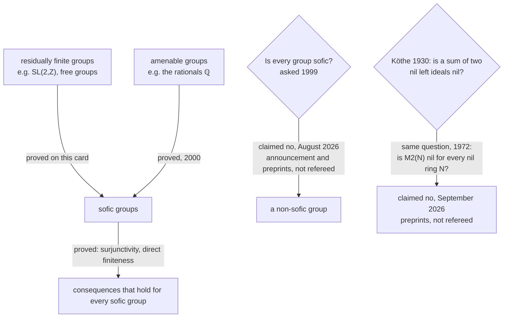

# Two algebra questions: is every group sofic, and is the sum of two nil left ideals nil (Kothe)

[Syllabus](../../../SYLLABUS.md) → [Frontier](../README.md) → [Analysis and Dynamics](../README.md#s05) → Two algebra questions

---

## General Overview

Take the 2 × 2 integer matrices with determinant 1. Under matrix multiplication they form a group: the **modular group** SL(2, Z), which changes one basis of a flat lattice of points into another. It is infinite. Yet any finite piece of it can be copied exactly by a finite group.

Here is the copy, with real numbers. Write down every product of at most three of the generators S = `[[1, 1], [0, 1]]` and T = `[[0, -1], [1, 0]]` and their undos. That gives 36 different matrices. Now read every entry as its remainder after dividing by 5. None of them except I itself turns into I, and they land in a finite group of 120 matrices.

Let each of the 36 act on those 120 points by multiplying on the left. Each one becomes a shuffle of 120 points. The shuffles multiply exactly as the matrices do, and no shuffle except the identity's leaves a point where it was. A finite shuffle picture of this kind, allowed a small error, is what makes a group **sofic**.

Two questions from algebra sit side by side on this card:

- **Sofic groups** (asked in 1999): does every group have such finite pictures, perhaps slightly wrong, of every finite piece?
- **Köthe's question** (asked in 1930): in any ring, if two left ideals contain only elements with some power equal to 0, does their sum also have that property?

Both were open for decades. On 2026-08-01 an AI lab announced a "no" to the first, and preprints followed; in September 2026 two preprints claimed a "no" to the second. As of 2026-11-23, none of these claims is refereed.

**A sofic group is one whose finite pieces can be copied, almost exactly, by shuffles of finitely many points; Köthe asked whether two "nil" left ideals always add up to a nil one; both now carry 2026 claims of a counterexample, not yet refereed.**

**What kind of fact this is:** two questions, each with a dated status (below). The one theorem proved on this card is its example: every residually finite group (one whose members all survive in some finite remainder picture, as SL(2, Z) does mod 5) is sofic, proved in Why it works. The status lines are records of claims, not proofs.

### The picture: what is proved, what is claimed



---

## The formula

Notation first, in words. A group is a set with one way to combine two members, a member $`e`$ that changes nothing, and an undo for every member ([Groups](../../03-Algebra/08-Groups/01-groups.md)). $`\mathrm{Sym}(n)`$ is the group of all shuffles (permutations) of $`n`$ points.

To compare two shuffles $`\alpha`$ and $`\beta`$ of $`n`$ points, count the points where they disagree and divide by $`n`$. That share is the **Hamming distance** $`d(\alpha, \beta)`$, a number from 0 to 1.

**Sofic.** A group $`G`$ is sofic when, for every finite set $`F`$ of its members and every error $`\varepsilon > 0`$, some $`n`$ and some map $`\sigma`$ from $`G`$ to $`\mathrm{Sym}(n)`$ satisfy, for all $`g, h`$ in $`F`$:

```math
d\big(\sigma(gh),\ \sigma(g)\,\sigma(h)\big) \le \varepsilon \qquad \text{and} \qquad d\big(\sigma(g),\ \mathrm{id}\big) \ge 1 - \varepsilon \ \text{ when } g \ne e
```

**Read it aloud:** the shuffle of a product almost equals the product of the shuffles, and every member other than $`e`$ moves almost every point.

**Köthe.** An element $`x`$ of a ring is **nilpotent** when some power $`x^k`$ is 0. A set is **nil** when every one of its elements is nilpotent; each element may need its own $`k`$. A **left ideal** $`L`$ of a ring $`R`$ is closed under subtraction and under multiplying on the left by anything in $`R`$ ([Ideals and quotient rings](../../03-Algebra/09-Rings%20and%20Fields/04-ideals-and-quotient-rings.md) treats the two-sided kind). Köthe's statement is:

```math
L_0,\ L_1 \text{ nil left ideals of } R \ \Longrightarrow\ L_0 + L_1 = \{\, a + b : a \in L_0,\ b \in L_1 \,\} \text{ is nil}
```

**Read it aloud:** add any member of one nil left ideal to any member of another, and some power of the sum is still 0.

| Symbol | Plain meaning | In our example | Push it up and the answer… |
| --- | --- | --- | --- |
| $`G`$; $`e`$; $`g`$, $`h`$, $`q`$ | the group; its do-nothing member; members | SL(2, Z); the identity matrix I; any of the 36 words | — |
| $`S`$, $`T`$ | the two generators | `[[1, 1], [0, 1]]` and `[[0, -1], [1, 0]]` | — |
| $`F`$ | the finite piece to copy | the 36 words of length at most 3 | still 120 points at length 4; 336 points (p = 7) at length 5 |
| $`\varepsilon`$ | allowed error, a share of points | 0: the copy is exact | an easier test |
| $`d(\alpha, \beta)`$ | share of points where shuffles $`\alpha`$, $`\beta`$ differ | 0 for products, 1 for moved points | — |
| $`n`$; $`\mathrm{Sym}(n)`$; $`\sigma`$ | number of points; all their shuffles; the map to shuffles | 120; shuffles of 120 points; multiply on the left, mod 5 | — |
| $`p`$; $`\varphi`$; $`Q`$ | the prime; reading entries mod $`p`$; the finite group it lands in | 5; mod 5; SL(2, $`\mathbb{F}_5`$) | 2 and 3 fail; 5 is the first that works |
| $`R`$; $`N`$ | the ring; a nil ring inside it | $`\mathbb{F}_2`$ with $`N`$ added; strictly upper triangular 3 × 3 over $`\mathbb{F}_2`$, 8 elements | — |
| $`L_0`$, $`L_1`$ | two nil left ideals | first-column and second-column matrices over $`N`$, 64 each | — |
| $`M_2(N)`$; E12, E21, E22 | 2 × 2 matrices over $`N`$; the matrices with a single 1 in row i, column j | 4,096 matrices; `[[0, 1], [0, 0]]` is E12 | — |
| $`a`$, $`b`$, $`c`$, $`x`$, $`y`$ | ring elements | entries of $`N`$ | — |
| $`x^k`$; $`j`$, $`k`$ | $`x`$ multiplied by itself $`k`$ times; powers | largest $`k`$ needed in $`M_2(N)`$: 3 | — |

Here $`\mathbb{F}_2`$ is arithmetic on 0 and 1 with 1 + 1 = 0.

### When it holds

- **Finite pieces only.** Soficity asks nothing about the whole group at once. Ask for one exact finite copy of all of SL(2, Z) and it fails, since the group is infinite.
- **The moving rule is not optional.** Drop "moves almost every point" and the map sending everything to the identity on 1 point passes for every group. The test then says nothing.
- **Residually finite is enough, not needed.** The rationals $`\mathbb{Q}`$ under addition are not residually finite: any map to Z/n that respects addition sends 1 = n × (1/n) to 0, so 1 never survives. Yet $`\mathbb{Q}`$ is sofic, because it is amenable (a group with good averages, defined in the survey below).
- **Nil is not nilpotent.** A nil ideal lets each element need its own power. When one power kills every product, as $`N^3 = 0`$ here, Köthe's statement holds at once. The 2026 claims need nil rings with no such bound.
- **Commutative rings always pass.** If $`ab = ba`$, sums of nilpotents are nilpotent (Step 4). Only rings where order of multiplication matters can fail.

---

## Why it works

### Step 0: a finite group acting on itself is a perfect picture

A finite group $`Q`$ shuffles its own members: $`q`$ sends $`x`$ to $`qx`$. Doing $`h`$ then $`g`$ is the same as doing $`gh`$, so products copy exactly. And $`qx = x`$ forces $`q = e`$, so every other member moves every point. That is the sofic test with $`\varepsilon = 0`$. The work is to find a finite $`Q`$ that keeps the members of $`F`$ apart.

### Step 1: residually finite groups supply that finite group

A group is **residually finite** when every member $`g \ne e`$ survives in some finite quotient: a map $`\varphi`$ to a finite group, respecting products, with $`\varphi(g) \ne e`$. For SL(2, Z), reading entries mod a prime $`p`$ is such a map. A matrix other than I survives as soon as $`p`$ does not divide every entry of $`g - I`$.

For a whole finite set $`F`$, combine one map per member into a single map to a product of finite groups. Its kernel (what it sends to $`e`$) misses every member of $`F`$ other than $`e`$.

### Step 2: put the two together

Send $`g`$ to the shuffle "multiply by $`\varphi(g)`$" on the $`n = \lvert Q\rvert`$ points of $`Q`$. Products copy exactly, since $`\varphi`$ respects products. Every $`g \ne e`$ in $`F`$ has $`\varphi(g) \ne e`$, so by Step 0 it moves all $`n`$ points. So every residually finite group is sofic, with no error at all.

On the card's example, the code finds $`p = 5`$. None of the 35 matrices other than I reads as I mod 5, the group SL(2, $`\mathbb{F}_5`$) has $`5 \times (25 - 1) = 120`$ members, and all 1,296 pairs $`g, h`$ copy with 0 points wrong. Two different words may share one shuffle mod 5; the test allows that, since it asks only that each member other than $`e`$ move points.

### Step 3: what is known about sofic groups

The idea and the first theorems are in [Gromov's 1999 paper](https://doi.org/10.1007/PL00011162). The name "sofic" came in 2000. Proved since, and collected in Pestov's survey (Sources):

- Residually finite groups and amenable groups are sofic.
- Subgroups and direct products of sofic groups are sofic.
- For sofic groups, two older conjectures hold. Gottschalk's surjunctivity: a one-to-one cellular automaton over the group is also onto. Kaplansky's direct finiteness: in the group's ring over a field, $`ab = 1`$ forces $`ba = 1`$ ([Elek and Szabó, 2004](https://doi.org/10.1016/j.jalgebra.2004.06.023)).

So a proof that every group is sofic would have settled both conjectures. A non-sofic group settles neither: it only removes one route.

### Step 4: what is known about Köthe's question

The commutative case is the binomial theorem. If $`a^j = 0`$ and $`b^k = 0`$ and $`ab = ba`$, every term of $`(a + b)^{j + k - 1}`$ holds $`a^j`$ or $`b^k`$, so the sum is nilpotent. In Z/72 the nilpotent remainders are exactly the 12 multiples of 6, and they are closed under addition. Köthe's statement is also known to hold for Noetherian rings (every growing chain of left ideals stops) and for rings satisfying a polynomial identity (one fixed polynomial expression in several letters vanishes for every choice of elements), as the first 2026 preprint recalls.

Without commuting, single elements fail at once: `[[0, 1], [0, 0]]` and `[[0, 0], [1, 0]]` both square to 0, but their sum squares to the identity. Köthe's question is about ideals, which is much stronger than elements.

[Köthe's 1930 paper](https://doi.org/10.1007/BF01194626) raised it. In 1972 Krempa showed it is the same as several other questions (Sources). The first 2026 claim uses the matrix form: **for every nil ring $`N`$, is $`M_2(N)`$ nil?** One direction is short, and the fold below gives it. The second uses an equivalent polynomial form, due to Krempa and Amitsur: for every nil ring, are the polynomials over it **Jacobson radical** (for each element a, 1 − a has an inverse once a 1 is added)?

<details>
<summary>Why Köthe's statement forces M2(N) to be nil</summary>

Let $`N`$ be a nil ring and $`R`$ the ring $`N`$ with a 1 added. In $`M_2(R)`$, let $`L_0`$ be the matrices whose second column is 0 and whose first column has entries in $`N`$. Multiplying on the left by any matrix over $`R`$ keeps the second column 0 and the first column in $`N`$, so $`L_0`$ is a left ideal.

It is nil. Write a member as first column $`x, y`$. Its powers keep that shape:

$`\displaystyle \begin{pmatrix} x & 0 \\ y & 0 \end{pmatrix}^{k} = \begin{pmatrix} x^k & 0 \\ y\,x^{k-1} & 0 \end{pmatrix}`$

Since $`x^k = 0`$ for some $`k`$, the $`(k+1)`$-th power is 0. The same holds for $`L_1`$, the second-column matrices. Their sum is all of $`M_2(N)`$. So if Köthe's statement is true, every matrix in $`M_2(N)`$ is nilpotent. A single non-nilpotent matrix over a nil ring is a counterexample.

</details>

A related, stronger statement failed earlier. Amitsur asked whether polynomials over a nil ring form a nil ring. [Smoktunowicz, 2000](https://doi.org/10.1006/jabr.2000.8451) built a nil ring where they do not, and Köthe's question stayed open.

### Step 5: the 2026 claims

| Field | Sofic groups | Köthe |
| --- | --- | --- |
| Statement | some group is not sofic | some nil ring $`N`$ has a non-nilpotent matrix in $`M_2(N)`$ (first claim), or polynomials over it that are not Jacobson radical (second claim); the two forms are equivalent |
| First claim | announced by an AI lab on 2026-08-01: the unit group (the invertible elements) of the binary Leavitt algebra | preprint 2026-09-07, Adamczewski, Böhmler and Marczinzik: a nil algebra over any countable field |
| Machine help | the announcement was machine-assisted; the preprints cited here state no formal proof of it | the authors say a machine found the original construction and posted a Lean proof of it, not of the paper's modified version over every countable field; two authors checked the written proof; not rerun here |
| Independent work | Fournier-Facio, 2026-08-03: a finitely presented torsion-free non-sofic group; [Kun and Thom](https://arxiv.org/abs/2608.06222), 2026-08-06: non-sofic wreath products | Greenfeld, King and Vendramin, 2026-09-14: a separate short construction through point modules, in the polynomial form |
| Status as of 2026-11-23 | claimed: preprints, not refereed | claimed: preprints, not refereed |

The sofic route, in outline. Both claims rest on a criterion built from earlier work of Kun and of Kun and Thom on groups with Kazhdan's property (T), a strong rigidity property. Roughly: in a sofic group, certain subgroups sitting next to a property (T) subgroup must have exact finite pictures (the $`\varepsilon = 0`$ copies of Step 0). Choose a subgroup that has none, such as a finitely presented infinite simple group, and the big group cannot be sofic. Fournier-Facio's note states this criterion and builds its own example from it.

The first Köthe claim's route, in outline. Build an infinite nil algebra $`N`$, generated by two elements $`b`$ and $`c`$, with each element nilpotent but no common power. Then show that the matrix `[[b^2 + c, bc], [b, c]]` is not nilpotent. The hard part is making $`N`$ nil at all. The construction works over any countable field, finite fields included.

---

## Worked numbers, by hand

| Step | Arithmetic | Value |
| --- | --- | --- |
| the piece $`F`$ | words of length at most 3 in S, T and undos | 5, then 16, then **36** matrices |
| largest entry | S³ = `[[1, 3], [0, 1]]` | 3 |
| $`p = 2`$ | T² = −I and S² read as I | 3 members collapse |
| $`p = 3`$ | S³ reads as I | 2 members collapse |
| $`p = 5`$ | entries of $`g - I`$ are at most 4 in size, so 5 divides all only if all are 0 | none collapse |
| points | $`5 \times (5^2 - 1)`$ | **120** |
| product errors | over all 1,296 pairs | **0** of 120 |
| fixed points of $`g \ne e`$ | Step 0 | **0** of 120 |
| $`M_2(N)`$ | $`8^4`$ matrices, products of three elements of $`N`$ are 0 | all nilpotent, largest index **3** |
| $`L_0 + L_1`$ | 64 + 64 column matrices, all sums | all **4,096** of $`M_2(N)`$, nil |

The modular group's 36-word piece is copied exactly by 120 points, so $`\varepsilon = 0`$ there. In this small ring, Köthe's statement holds, as it must when $`N^3 = 0`$.

### What breaks if you drop a piece

| Mistake | Comes out at | What went wrong |
| --- | --- | --- |
| Prime 2 for SL(2, Z) | $`\sigma(-I)`$ fixes 6 of 6 points | −I reads as I mod 2, so a real member looks like $`e`$ |
| Prime 3 | $`\sigma(S^3)`$ fixes 24 of 24 points | 3 divides the corner entry of S³ |
| Drop the moving rule | errors 0 of 1, fixed points 1 of 1 | the identity map "copies" every group, so the test is empty |
| Nilpotent elements, not ideals | (E12 + E21)² = I | two square-zero matrices add to one that never reaches 0 |
| Left ideal made from one nilpotent | it contains E22, and E22² = E22 | multiplying on the left by E21 turns E12 into a non-nilpotent |

The code prints all five.

---

## Code, from first principles, and it actually runs

The script builds the ball of words, finds the first prime that keeps it apart, and checks the sofic conditions point by point. Then it builds the small ring and checks Köthe's statement there. It takes two independent roads twice: SL(2, $`\mathbb{F}_5`$) counted by brute force against the formula $`p(p^2 - 1)`$, and every matrix of $`M_2(N)`$ powered by brute force against the shortcut "products of three elements of $`N`$ are 0". The nilpotents of Z/72 are also found by brute force and matched to the multiples of 6.

### Python

```python
# Sofic groups and Kothe -- the check behind the card.  Standard library only.
# Part A: the modular group SL(2,Z) is residually finite, so reducing mod a
# prime p and multiplying on the left gives an exact sofic picture of a ball
# of words.  Part B: small rings where Kothe's statement can be checked, and
# the traps around it.  Every search is written out; nothing is imported.

def mul(a, b, p=0):                       # 2x2 matrices as (top-left, top-right, bottom-left, bottom-right)
    r = (a[0]*b[0] + a[1]*b[2], a[0]*b[1] + a[1]*b[3], a[2]*b[0] + a[3]*b[2], a[2]*b[1] + a[3]*b[3])
    return tuple(x % p for x in r) if p else r

def red(g, p):
    return tuple(x % p for x in g)

def yn(claim):
    return "yes" if claim else "no"

I, S, T = (1, 0, 0, 1), (1, 1, 0, 1), (0, -1, 1, 0)
gens = [S, (1, -1, 0, 1), T, (0, 1, -1, 0)]          # S, its undo, T, its undo
ball, layer, sizes = {I}, {I}, []
for r in range(3):                                    # words of length up to 3
    layer = {mul(g, s) for g in layer for s in gens}
    ball |= layer
    sizes.append(len(ball))
F = sorted(ball)
print(f"ball of words of length <= 1, 2, 3 in S, T: {sizes[0]}, {sizes[1]}, {sizes[2]} matrices")
print(f"largest entry in the ball: {max(abs(x) for g in F for x in g)}")

def collapsed(p):                                     # ball members, not I, that read as I mod p
    return [g for g in F if g != I and red(g, p) == red(I, p)]

p = 2
while collapsed(p):
    print(f"p = {p}: {len(collapsed(p))} non-identity ball members reduce to I, e.g. {collapsed(p)[0]}")
    p += 1 if p == 2 else 2
pts = [(a, b, c, d) for a in range(p) for b in range(p) for c in range(p) for d in range(p)
       if (a*d - b*c) % p == 1]                       # road one: count SL(2, F_p) by brute force
n = len(pts)
print(f"first prime keeping the ball apart: p = {p}")
print(f"SL(2,F_{p}) by brute force: {n} points; by p(p^2 - 1): {p * (p*p - 1)}")
index = {x: i for i, x in enumerate(pts)}

def sigma(g):                                         # g acts on the points by left multiplication
    return tuple(index[mul(red(g, p), x, p)] for x in pts)

def test(sig, m):                                     # road two: most points of m where sigma(gh) != sigma(g)sigma(h),
    P = {g: sig(g) for g in F}                        # and most fixed points of sigma(g), g != I
    worst = max(sum(a[i] != P[g][P[h][i]] for i in range(m)) for g in F for h in F for a in [sig(mul(g, h))])
    return worst, max(sum(P[g][i] == i for i in range(m)) for g in F if g != I)

worst, fixed = test(sigma, n)
print(f"pairs g, h in the ball: {len(F) ** 2}; most points where sigma(gh) != sigma(g)sigma(h): {worst} of {n}")
print(f"most fixed points of sigma(g), g != I in the ball: {fixed} of {n}, so epsilon = 0 works")
for q, g in [(2, mul(T, T)), (3, mul(S, mul(S, S)))]:
    qp = [x for x in [(a, b, c, d) for a in range(q) for b in range(q) for c in range(q)
          for d in range(q)] if (x[0]*x[3] - x[1]*x[2]) % q == 1]
    fx = sum(mul(red(g, q), x, q) == x for x in qp)
    print(f"mistake, p = {q} too small: sigma({g}) fixes {fx} of {len(qp)} points")
w1, f1 = test(lambda g: (0,), 1)                     # every g sent to the identity on 1 point
print("mistake, drop the fixed-point rule: send every g to the identity on 1 point:")
print(f"  product errors {w1} of 1, fixed points {f1} of 1, so every group would pass")

# Part B.  R = F_2 + N, where N = strictly upper triangular 3x3 matrices over F_2.
# An element (e, x, y, z) means e*I + [[0, x, y], [0, 0, z], [0, 0, 0]].
def rmul(u, v):
    return (u[0]*v[0] % 2, (u[0]*v[1] + u[1]*v[0]) % 2,
            (u[0]*v[2] + u[2]*v[0] + u[1]*v[3]) % 2, (u[0]*v[3] + u[3]*v[0]) % 2)

def radd(u, v):
    return tuple((s + t) % 2 for s, t in zip(u, v))

Z = (0, 0, 0, 0)
Nset = [(0, x, y, z) for x in (0, 1) for y in (0, 1) for z in (0, 1)]

def mmul(A, B):                                       # 2x2 matrices with entries in R
    return (radd(rmul(A[0], B[0]), rmul(A[1], B[2])), radd(rmul(A[0], B[1]), rmul(A[1], B[3])),
            radd(rmul(A[2], B[0]), rmul(A[3], B[2])), radd(rmul(A[2], B[1]), rmul(A[3], B[3])))

def nil_index(A, mult, zero, cap=12):                 # first k with A^k = 0, or None
    P = A
    for k in range(1, cap + 1):
        if P == zero:
            return k
        P = mult(P, A)
    return None

ZM = (Z, Z, Z, Z)
M2N = [(a, b, c, d) for a in Nset for b in Nset for c in Nset for d in Nset]
idx = [nil_index(W, mmul, ZM) for W in M2N]           # road one: every 2x2 matrix over N
triple = all(rmul(rmul(u, v), w) == Z for u in Nset for v in Nset for w in Nset)
print(f"N has {len(Nset)} elements; every product of three is 0 (road two): {yn(triple)}")
print(f"M2(N): {len(M2N)} matrices, all nilpotent: {yn(None not in idx)}, largest index {max(idx)}")
L0 = [(a, Z, c, Z) for a in Nset for c in Nset]       # first column in N, second column 0
L1 = [(Z, b, Z, d) for b in Nset for d in Nset]
basis = [(1, 0, 0, 0), (0, 1, 0, 0), (0, 0, 1, 0), (0, 0, 0, 1)]
unitsE = [tuple(r if k == j else Z for k in range(4)) for r in basis for j in range(4)]
closed = all(mmul(E, A) in set(L) for L in (L0, L1) for A in L for E in unitsE)
nil01 = all(nil_index(A, mmul, ZM) for A in L0 + L1)
sums = {tuple(radd(a, b) for a, b in zip(A, B)) for A in L0 for B in L1}
print(f"column ideals L0, L1: {len(L0)} and {len(L1)} members, left-closed: {yn(closed)}, nil: {yn(nil01)}")
print(f"L0 + L1 has {len(sums)} members = all of M2(N): {yn(sums == set(M2N))}")
nilz = [x for x in range(72) if any(pow(x, k, 72) == 0 for k in range(1, 8))]
print(f"Z/72, nilpotent by brute force: {len(nilz)}; multiples of 6: {len(range(0, 72, 6))}")
E12, E21 = (0, 1, 0, 0), (0, 0, 1, 0)
W = (0, 1, 1, 0)
print(f"mistake, two nilpotents: E12^2 = {mul(E12, E12)}, E21^2 = {mul(E21, E21)}, "
      f"(E12 + E21)^2 = {mul(W, W)}, nilpotent: {yn(nil_index(W, mul, (0, 0, 0, 0)) is not None)}")
Mall = [(a, b, c, d) for a in (0, 1) for b in (0, 1) for c in (0, 1) for d in (0, 1)]
gen = sorted({mul(A, E12, 2) for A in Mall})
print(f"mistake, left ideal of M2(F_2) made from E12: {gen}; E22 = (0, 0, 0, 1) idempotent: "
      f"{yn(mul((0, 0, 0, 1), (0, 0, 0, 1), 2) == (0, 0, 0, 1))}")

assert n == p * (p*p - 1) and worst == 0 and fixed == 0         # sofic picture, two roads
assert all(collapsed(q) for q in (2, 3)) and p == 5             # p = 5 is the first that works
assert (w1, f1) == (0, 1)                                       # the trivial picture passes products
assert triple and None not in idx and max(idx) == 3             # brute force agrees with N^3 = 0
assert closed and nil01 and sums == set(M2N)                    # two nil left ideals, nil sum
assert nilz == list(range(0, 72, 6)) and nil_index(W, mul, (0, 0, 0, 0)) is None
print("ALL CHECKS PASS")
```

**Ran 2026-11-23 on macOS, Python 3.14.10, standard library only. All checks passed. Output, pasted from the run:**

```
ball of words of length <= 1, 2, 3 in S, T: 5, 16, 36 matrices
largest entry in the ball: 3
p = 2: 3 non-identity ball members reduce to I, e.g. (-1, 0, 0, -1)
p = 3: 2 non-identity ball members reduce to I, e.g. (1, -3, 0, 1)
first prime keeping the ball apart: p = 5
SL(2,F_5) by brute force: 120 points; by p(p^2 - 1): 120
pairs g, h in the ball: 1296; most points where sigma(gh) != sigma(g)sigma(h): 0 of 120
most fixed points of sigma(g), g != I in the ball: 0 of 120, so epsilon = 0 works
mistake, p = 2 too small: sigma((-1, 0, 0, -1)) fixes 6 of 6 points
mistake, p = 3 too small: sigma((1, 3, 0, 1)) fixes 24 of 24 points
mistake, drop the fixed-point rule: send every g to the identity on 1 point:
  product errors 0 of 1, fixed points 1 of 1, so every group would pass
N has 8 elements; every product of three is 0 (road two): yes
M2(N): 4096 matrices, all nilpotent: yes, largest index 3
column ideals L0, L1: 64 and 64 members, left-closed: yes, nil: yes
L0 + L1 has 4096 members = all of M2(N): yes
Z/72, nilpotent by brute force: 12; multiples of 6: 12
mistake, two nilpotents: E12^2 = (0, 0, 0, 0), E21^2 = (0, 0, 0, 0), (E12 + E21)^2 = (1, 0, 0, 1), nilpotent: no
mistake, left ideal of M2(F_2) made from E12: [(0, 0, 0, 0), (0, 0, 0, 1), (0, 1, 0, 0), (0, 1, 0, 1)]; E22 = (0, 0, 0, 1) idempotent: yes
ALL CHECKS PASS
```

### Rust

Same numbers, same labels, built with `rustc --edition 2021 -O`.

```rust
// Sofic groups and Kothe -- the same check as the Python, in Rust.  No crates.
// Part A: the modular group SL(2,Z) is residually finite, so reducing mod a
// prime p and multiplying on the left gives an exact sofic picture of a ball
// of words.  Part B: small rings where Kothe's statement can be checked, and
// the traps around it.  Every search is written out.
use std::collections::{BTreeSet, HashMap};
type M = (i64, i64, i64, i64);                  // (top-left, top-right, bottom-left, bottom-right)
type R = (u8, u8, u8, u8);                      // e*I + [[0, x, y], [0, 0, z], [0, 0, 0]] over F_2
type Q = (R, R, R, R);                          // 2x2 matrices with entries in R

fn mul(a: M, b: M, p: i64) -> M {
    let r = (a.0 * b.0 + a.1 * b.2, a.0 * b.1 + a.1 * b.3, a.2 * b.0 + a.3 * b.2, a.2 * b.1 + a.3 * b.3);
    if p == 0 { r } else { red(r, p) }
}
fn red(g: M, p: i64) -> M { (g.0.rem_euclid(p), g.1.rem_euclid(p), g.2.rem_euclid(p), g.3.rem_euclid(p)) }
fn yn(c: bool) -> &'static str { if c { "yes" } else { "no" } }
fn sl2(p: i64) -> Vec<M> {                      // road one: SL(2, F_p) by brute force
    let mut v = Vec::new();
    for a in 0..p { for b in 0..p { for c in 0..p { for d in 0..p {
        if (a * d - b * c).rem_euclid(p) == 1 { v.push((a, b, c, d)) }
    }}}}
    v
}
fn collapsed(f: &[M], p: i64) -> Vec<M> {       // ball members, not I, that read as I mod p
    f.iter().copied().filter(|&g| g != (1, 0, 0, 1) && red(g, p) == red((1, 0, 0, 1), p)).collect()
}
fn test(f: &[M], m: usize, sig: &dyn Fn(M) -> Vec<usize>) -> (usize, usize) {
    // road two: most points of m where sigma(gh) != sigma(g)sigma(h), and most fixed points of sigma(g), g != I
    let perm: HashMap<M, Vec<usize>> = f.iter().map(|&g| (g, sig(g))).collect();
    let mut worst = 0;
    for &g in f { for &h in f {
        let (a, b, c) = (sig(mul(g, h, 0)), &perm[&g], &perm[&h]);
        worst = worst.max((0..m).filter(|&k| a[k] != b[c[k]]).count());
    }}
    let fixed = f.iter().filter(|&&g| g != (1, 0, 0, 1)).map(|g| (0..m).filter(|&k| perm[g][k] == k).count()).max().unwrap();
    (worst, fixed)
}
fn rmul(u: R, v: R) -> R {
    (u.0 * v.0 % 2, (u.0 * v.1 + u.1 * v.0) % 2, (u.0 * v.2 + u.2 * v.0 + u.1 * v.3) % 2, (u.0 * v.3 + u.3 * v.0) % 2)
}
fn radd(u: R, v: R) -> R { ((u.0 + v.0) % 2, (u.1 + v.1) % 2, (u.2 + v.2) % 2, (u.3 + v.3) % 2) }
fn qadd(a: Q, b: Q) -> Q { (radd(a.0, b.0), radd(a.1, b.1), radd(a.2, b.2), radd(a.3, b.3)) }
fn mmul(a: Q, b: Q) -> Q {
    (radd(rmul(a.0, b.0), rmul(a.1, b.2)), radd(rmul(a.0, b.1), rmul(a.1, b.3)),
     radd(rmul(a.2, b.0), rmul(a.3, b.2)), radd(rmul(a.2, b.1), rmul(a.3, b.3)))
}
fn nil_index<T: PartialEq + Copy>(a: T, mult: impl Fn(T, T) -> T, zero: T) -> Option<usize> {
    let mut p = a;
    for k in 1..=12 {
        if p == zero { return Some(k) }
        p = mult(p, a);
    }
    None
}

fn main() {
    let (i, s, t): (M, M, M) = ((1, 0, 0, 1), (1, 1, 0, 1), (0, -1, 1, 0));
    let gens = [s, (1, -1, 0, 1), t, (0, 1, -1, 0)];
    let (mut ball, mut layer, mut sizes) = (BTreeSet::from([i]), BTreeSet::from([i]), Vec::new());
    for _ in 0..3 {
        layer = layer.iter().flat_map(|&g| gens.iter().map(move |&x| mul(g, x, 0))).collect();
        ball.extend(layer.iter().copied());
        sizes.push(ball.len());
    }
    let f: Vec<M> = ball.into_iter().collect();
    println!("ball of words of length <= 1, 2, 3 in S, T: {}, {}, {} matrices", sizes[0], sizes[1], sizes[2]);
    println!("largest entry in the ball: {}", f.iter().map(|g| g.0.abs().max(g.1.abs()).max(g.2.abs()).max(g.3.abs())).max().unwrap());
    let mut p = 2;
    while !collapsed(&f, p).is_empty() {
        let c = collapsed(&f, p);
        println!("p = {}: {} non-identity ball members reduce to I, e.g. {:?}", p, c.len(), c[0]);
        p += if p == 2 { 1 } else { 2 };
    }
    let pts = sl2(p);
    let n = pts.len();
    println!("first prime keeping the ball apart: p = {}", p);
    println!("SL(2,F_{}) by brute force: {} points; by p(p^2 - 1): {}", p, n, p * (p * p - 1));
    let index: HashMap<M, usize> = pts.iter().enumerate().map(|(k, &x)| (x, k)).collect();
    let sigma = |g: M| -> Vec<usize> { pts.iter().map(|&x| index[&mul(red(g, p), x, p)]).collect() };
    let (worst, fixed) = test(&f, n, &sigma);
    println!("pairs g, h in the ball: {}; most points where sigma(gh) != sigma(g)sigma(h): {} of {}", f.len() * f.len(), worst, n);
    println!("most fixed points of sigma(g), g != I in the ball: {} of {}, so epsilon = 0 works", fixed, n);
    for (q, g) in [(2, mul(t, t, 0)), (3, mul(s, mul(s, s, 0), 0))] {
        let qp = sl2(q);
        let fx = qp.iter().filter(|&&x| mul(red(g, q), x, q) == x).count();
        println!("mistake, p = {} too small: sigma({:?}) fixes {} of {} points", q, g, fx, qp.len());
    }
    let (w1, f1) = test(&f, 1, &|_g: M| vec![0]);  // every g sent to the identity on 1 point
    println!("mistake, drop the fixed-point rule: send every g to the identity on 1 point:");
    println!("  product errors {} of 1, fixed points {} of 1, so every group would pass", w1, f1);

    // Part B.  R = F_2 + N, where N = strictly upper triangular 3x3 matrices over F_2.
    let z: R = (0, 0, 0, 0);
    let zm: Q = (z, z, z, z);
    let nset: Vec<R> = (0..8u8).map(|k| (0, k >> 2 & 1, k >> 1 & 1, k & 1)).collect();
    let mut m2n: Vec<Q> = Vec::new();
    for &a in &nset { for &b in &nset { for &c in &nset { for &d in &nset { m2n.push((a, b, c, d)) }}}}
    let idx: Vec<Option<usize>> = m2n.iter().map(|&w| nil_index(w, mmul, zm)).collect();
    let triple = nset.iter().all(|&u| nset.iter().all(|&v| nset.iter().all(|&w| rmul(rmul(u, v), w) == z)));
    let all_nil = idx.iter().all(|k| k.is_some());
    let max_idx = idx.iter().map(|k| k.unwrap_or(99)).max().unwrap();
    println!("N has {} elements; every product of three is 0 (road two): {}", nset.len(), yn(triple));
    println!("M2(N): {} matrices, all nilpotent: {}, largest index {}", m2n.len(), yn(all_nil), max_idx);
    let mut l0: Vec<Q> = Vec::new();            // first column in N, second column 0
    let mut l1: Vec<Q> = Vec::new();
    for &a in &nset { for &c in &nset { l0.push((a, z, c, z)); l1.push((z, a, z, c)) }}
    let basis: [R; 4] = [(1, 0, 0, 0), (0, 1, 0, 0), (0, 0, 1, 0), (0, 0, 0, 1)];
    let mut units_e: Vec<Q> = Vec::new();
    for &r in &basis { for j in 0..4 {
        units_e.push((if j == 0 { r } else { z }, if j == 1 { r } else { z }, if j == 2 { r } else { z }, if j == 3 { r } else { z }));
    }}
    let closed = [&l0, &l1].iter().all(|l| l.iter().all(|&a| units_e.iter().all(|&e| l.contains(&mmul(e, a)))));
    let nil01 = l0.iter().chain(l1.iter()).all(|&a| nil_index(a, mmul, zm).is_some());
    let sums: BTreeSet<Q> = l0.iter().flat_map(|&a| l1.iter().map(move |&b| qadd(a, b))).collect();
    let full = sums == m2n.iter().copied().collect::<BTreeSet<Q>>();
    println!("column ideals L0, L1: {} and {} members, left-closed: {}, nil: {}", l0.len(), l1.len(), yn(closed), yn(nil01));
    println!("L0 + L1 has {} members = all of M2(N): {}", sums.len(), yn(full));
    let pw = |x: u64, k: u32| (0..k).fold(1u64, |acc, _| acc * x % 72);
    let nilz: Vec<u64> = (0..72).filter(|&x| (1..8).any(|k| pw(x, k) == 0)).collect();
    println!("Z/72, nilpotent by brute force: {}; multiples of 6: {}", nilz.len(), (0..72).step_by(6).count());
    let (e12, e21, w): (M, M, M) = ((0, 1, 0, 0), (0, 0, 1, 0), (0, 1, 1, 0));
    let wn = nil_index(w, |a, b| mul(a, b, 0), (0, 0, 0, 0));
    println!("mistake, two nilpotents: E12^2 = {:?}, E21^2 = {:?}, (E12 + E21)^2 = {:?}, nilpotent: {}",
             mul(e12, e12, 0), mul(e21, e21, 0), mul(w, w, 0), yn(wn.is_some()));
    let gen: BTreeSet<M> = (0..16i64).map(|k| mul((k >> 3 & 1, k >> 2 & 1, k >> 1 & 1, k & 1), e12, 2)).collect();
    let e22: M = (0, 0, 0, 1);
    println!("mistake, left ideal of M2(F_2) made from E12: {:?}; E22 = (0, 0, 0, 1) idempotent: {}",
             gen.iter().collect::<Vec<_>>(), yn(mul(e22, e22, 2) == e22));

    assert!(n as i64 == p * (p * p - 1) && worst == 0 && fixed == 0);       // sofic picture, two roads
    assert!(!collapsed(&f, 2).is_empty() && !collapsed(&f, 3).is_empty() && p == 5); // p = 5 is the first that works
    assert!((w1, f1) == (0, 1));                                             // the trivial picture passes products
    assert!(triple && all_nil && max_idx == 3);                              // brute force agrees with N^3 = 0
    assert!(closed && nil01 && full);                                        // two nil left ideals, nil sum
    assert!(nilz == (0..72).step_by(6).collect::<Vec<u64>>() && wn.is_none());
    println!("ALL CHECKS PASS");
}
```

**Ran 2026-11-23 on macOS, rustc 1.98.1, no crates. All checks passed. Output, pasted from the run:**

```
ball of words of length <= 1, 2, 3 in S, T: 5, 16, 36 matrices
largest entry in the ball: 3
p = 2: 3 non-identity ball members reduce to I, e.g. (-1, 0, 0, -1)
p = 3: 2 non-identity ball members reduce to I, e.g. (1, -3, 0, 1)
first prime keeping the ball apart: p = 5
SL(2,F_5) by brute force: 120 points; by p(p^2 - 1): 120
pairs g, h in the ball: 1296; most points where sigma(gh) != sigma(g)sigma(h): 0 of 120
most fixed points of sigma(g), g != I in the ball: 0 of 120, so epsilon = 0 works
mistake, p = 2 too small: sigma((-1, 0, 0, -1)) fixes 6 of 6 points
mistake, p = 3 too small: sigma((1, 3, 0, 1)) fixes 24 of 24 points
mistake, drop the fixed-point rule: send every g to the identity on 1 point:
  product errors 0 of 1, fixed points 1 of 1, so every group would pass
N has 8 elements; every product of three is 0 (road two): yes
M2(N): 4096 matrices, all nilpotent: yes, largest index 3
column ideals L0, L1: 64 and 64 members, left-closed: yes, nil: yes
L0 + L1 has 4096 members = all of M2(N): yes
Z/72, nilpotent by brute force: 12; multiples of 6: 12
mistake, two nilpotents: E12^2 = (0, 0, 0, 0), E21^2 = (0, 0, 0, 0), (E12 + E21)^2 = (1, 0, 0, 1), nilpotent: no
mistake, left ideal of M2(F_2) made from E12: [(0, 0, 0, 0), (0, 0, 0, 1), (0, 1, 0, 0), (0, 1, 0, 1)]; E22 = (0, 0, 0, 1) idempotent: yes
ALL CHECKS PASS
```

The two outputs match line for line.

### Lean

Lean proves that every residually finite group is sofic, and Köthe's statement for commutative rings; it only states the two open questions.

- Take a residually finite group $`G`$. Then $`G`$ is sofic, for every finite set $`F`$ and every error $`\varepsilon > 0`$.
- Take a residually finite group $`G`$ and a finite set $`F`$ of its members. Then some map $`\sigma`$ to shuffles of $`n \ge 1`$ points copies every product exactly. Every member of $`F`$ other than $`e`$ moves all $`n`$ points.
- Take a commutative ring and two nil left ideals $`L_0`$, $`L_1`$. Then every sum $`a + b`$ with $`a`$ in $`L_0`$ and $`b`$ in $`L_1`$ is nilpotent.
- Take S and T over the integers. Then S³ = `[[1, 3], [0, 1]]` and T² = −I.
- Take entries mod 2, then mod 3. Then T² reads as I mod 2, and S³ reads as I mod 3.
- Take $`p = 5`$. Then SL(2, $`\mathbb{F}_5`$) has 120 members, by brute force and by $`5 \times (5^2 - 1)`$.
- Take E12 and E21 over the integers. Then both square to 0, but (E12 + E21)² = I.
- Take E12, E21 and E22 over $`\mathbb{F}_2`$. Then E21 · E12 = E22, and E22² = E22.
- Take Z/72. Then its nilpotent remainders, found as in the code, are exactly the 12 multiples of 6.

The 36-word picture mod 5 and the ring $`N`$ are left to the Python and Rust checks.

```lean
-- Two algebra questions: every residually finite group is sofic (in fact with an exact finite picture), and in a commutative ring the sum of two nil ideals is nil.
import Mathlib.GroupTheory.ResiduallyFinite
import Mathlib.GroupTheory.Perm.Basic
import Mathlib.InformationTheory.Hamming
import Mathlib.RingTheory.Nilpotent.Basic
import Mathlib.LinearAlgebra.Matrix.Notation
import Mathlib.Data.ZMod.Basic
import Mathlib.RingTheory.Ideal.Defs

namespace SoficKothe

/-- The card's Hamming distance between two shuffles `α`, `β` of `n` points: the number of
points where they disagree, divided by `n` (a share from 0 to 1). -/
noncomputable def permDist {n : ℕ} (α β : Equiv.Perm (Fin n)) : ℝ :=
  (hammingDist (α : Fin n → Fin n) (β : Fin n → Fin n) : ℝ) / n

/-- The card's definition of a sofic group: for every finite set `F` of members and every error
`ε > 0`, some `n` and some map `σ` from `G` to the shuffles of `n` points satisfy, for all
`g, h` in `F`, `d(σ(gh), σ(g)σ(h)) ≤ ε`, and `d(σ(g), id) ≥ 1 − ε` when `g ≠ e`. -/
def IsSofic (G : Type*) [Group G] : Prop :=
  ∀ (F : Finset G) (ε : ℝ), 0 < ε →
    ∃ (n : ℕ) (σ : G → Equiv.Perm (Fin n)),
      (∀ g ∈ F, ∀ h ∈ F, permDist (σ (g * h)) (σ g * σ h) ≤ ε) ∧
      (∀ g ∈ F, g ≠ 1 → 1 - ε ≤ permDist (σ g) 1)

/-- The first open question (Gromov, 1999), stated exactly: is every group sofic?
Only stated here, never proved: as of 2026-11-23 a "no" is claimed, not refereed. -/
def EveryGroupIsSofic : Prop :=
  ∀ (G : Type) [Group G], IsSofic G

/-- Köthe's question (1930), stated exactly: in any ring `R`, if two left ideals `L₀`, `L₁`
are nil (every member has some power equal to 0), is every sum `a + b` with `a ∈ L₀`,
`b ∈ L₁` nil too? (`Submodule R R` is a left ideal.) Only stated here, never proved: as of
2026-11-23 a "no" is claimed, not refereed. -/
def KotheStatement : Prop :=
  ∀ (R : Type) [Ring R] (L₀ L₁ : Submodule R R),
    (∀ x ∈ L₀, IsNilpotent x) → (∀ x ∈ L₁, IsNilpotent x) →
      ∀ a ∈ L₀, ∀ b ∈ L₁, IsNilpotent (a + b)

theorem exists_fins_normal_avoiding (G : Type*) [Group G] [Group.ResiduallyFinite G]
    (F : Finset G) : ∃ K : FiniteIndexNormalSubgroup G, ∀ g ∈ F, g ≠ 1 → g ∉ K := by
  classical
  induction F using Finset.induction_on with
  | empty => exact ⟨FiniteIndexNormalSubgroup.ofSubgroup ⊤, by simp⟩
  | insert a s _ ih =>
    obtain ⟨K, hK⟩ := ih
    by_cases ha : a = 1
    · refine ⟨K, fun g hg hg1 => ?_⟩
      rcases Finset.mem_insert.mp hg with rfl | hg
      · exact (hg1 ha).elim
      · exact hK g hg hg1
    · obtain ⟨H, hH⟩ := Group.exists_finiteIndexNormalSubgroup_notMem a ha
      refine ⟨K ⊓ H, fun g hg hg1 hmem => ?_⟩
      rcases Finset.mem_insert.mp hg with rfl | hg
      · exact hH ((inf_le_right : K ⊓ H ≤ H) hmem)
      · exact hK g hg hg1 ((inf_le_left : K ⊓ H ≤ K) hmem)

#print axioms exists_fins_normal_avoiding

theorem exact_picture_pos (G : Type*) [Group G] [Group.ResiduallyFinite G] (F : Finset G) :
    ∃ (n : ℕ) (σ : G →* Equiv.Perm (Fin n)), 0 < n ∧
      ∀ g ∈ F, g ≠ 1 → ∀ x : Fin n, σ g x ≠ x := by
  classical
  obtain ⟨K, hK⟩ := exists_fins_normal_avoiding G F
  let N : Subgroup G := K.toSubgroup
  let e : (G ⧸ N) ≃ Fin (Nat.card (G ⧸ N)) := Finite.equivFin _
  refine ⟨Nat.card (G ⧸ N), (Equiv.permCongrHom e).toMonoidHom.comp (MulAction.toPermHom G (G ⧸ N)),
    Nat.card_pos, fun g hg hg1 x hx => ?_⟩
  apply hK g hg hg1
  obtain ⟨y, rfl⟩ := e.surjective x
  obtain ⟨z, rfl⟩ := QuotientGroup.mk_surjective y
  simp only [MonoidHom.coe_comp, Function.comp_apply, MulEquiv.coe_toMonoidHom,
    Equiv.permCongrHom_coe, Equiv.permCongr_apply, Equiv.symm_apply_apply,
    MulAction.toPermHom_apply, MulAction.toPerm_apply] at hx
  have h2 := e.injective hx
  change ((g * z : G) : G ⧸ N) = z at h2
  rw [QuotientGroup.eq] at h2
  have h3 : z⁻¹ * g⁻¹ * z ∈ N := by simpa [mul_assoc] using h2
  have h4 := (inferInstance : N.Normal).conj_mem _ h3 z
  have h5 : g⁻¹ ∈ N := by simpa [mul_assoc] using h4
  exact (FiniteIndexNormalSubgroup.mem_toSubgroup_iff).mp (N.inv_mem_iff.mp h5)

#print axioms exact_picture_pos

/-- Every residually finite group is sofic. (Mathlib's `Group.ResiduallyFinite`: every member
other than `e` survives in some finite quotient.) -/
theorem residually_finite_group_is_sofic (G : Type*) [Group G] [Group.ResiduallyFinite G] :
    IsSofic G := by
  intro F ε hε
  obtain ⟨n, σ, hn, hσ⟩ := exact_picture_pos G F
  refine ⟨n, σ, fun g _ h _ => ?_, fun g hg hg1 => ?_⟩
  · simp [permDist, map_mul, hammingDist_self, hε.le]
  · have hd : hammingDist (σ g : Fin n → Fin n) ((1 : Equiv.Perm (Fin n)) : Fin n → Fin n) = n := by
      unfold hammingDist
      rw [Finset.filter_true_of_mem (fun x _ => by simpa using hσ g hg hg1 x)]
      simp
    have hn' : (n : ℝ) ≠ 0 := by positivity
    rw [permDist, hd, div_self hn']
    linarith

/-- Steps 0 to 2 of the card, with no error at all: for a residually finite group and any
finite set `F` of its members, there is a map `σ` from `G` to the shuffles of some `n` points
that copies every product exactly (it respects multiplication), with at least one point, and under which every member of
`F` other than `e` moves every point. -/
theorem residually_finite_exact_picture (G : Type*) [Group G] [Group.ResiduallyFinite G]
    (F : Finset G) :
    ∃ (n : ℕ) (σ : G →* Equiv.Perm (Fin n)), 0 < n ∧ ∀ g ∈ F, g ≠ 1 → ∀ x : Fin n, σ g x ≠ x := by
  obtain ⟨n, σ, hn, hσ⟩ := exact_picture_pos G F
  exact ⟨n, σ, hn, hσ⟩

/-- Köthe's statement holds in every commutative ring: if `L₀` and `L₁` are nil ideals
(every member has some power equal to 0), then every sum `a + b` with `a ∈ L₀` and `b ∈ L₁`
also has some power equal to 0. -/
theorem kothe_holds_in_commutative_rings {R : Type*} [CommRing R] (L₀ L₁ : Ideal R)
    (h₀ : ∀ x ∈ L₀, IsNilpotent x) (h₁ : ∀ x ∈ L₁, IsNilpotent x) :
    ∀ a ∈ L₀, ∀ b ∈ L₁, IsNilpotent (a + b) := by
  intro a ha b hb
  exact (Commute.all a b).isNilpotent_add (h₀ a ha) (h₁ b hb)

/-! The card's exact worked numbers. -/

-- S³ = [[1, 3], [0, 1]], the ball's largest entry 3; and T² = −I.
example : (!![1, 1; 0, 1] : Matrix (Fin 2) (Fin 2) ℤ) ^ 3 = !![1, 3; 0, 1] := by
  decide

example : (!![0, -1; 1, 0] : Matrix (Fin 2) (Fin 2) ℤ) ^ 2 = -1 := by
  decide

-- Prime 2 is too small: T² = −I reads as I mod 2.
example : (!![0, -1; 1, 0] : Matrix (Fin 2) (Fin 2) (ZMod 2)) ^ 2 = 1 := by
  decide

-- Prime 3 is too small: S³ reads as I mod 3.
example : (!![1, 1; 0, 1] : Matrix (Fin 2) (Fin 2) (ZMod 3)) ^ 3 = 1 := by
  decide

-- SL(2, F_5) has 120 members, by brute force over all (a, b, c, d) with ad − bc = 1,
-- and by the formula p(p² − 1) at p = 5.
set_option maxRecDepth 100000 in
example : (Finset.univ.filter
    (fun x : ZMod 5 × ZMod 5 × ZMod 5 × ZMod 5 => x.1 * x.2.2.2 - x.2.1 * x.2.2.1 = 1)).card
      = 120 := by
  decide

example : 5 * (5 ^ 2 - 1) = 120 := by
  norm_num

-- Two square-zero matrices whose sum squares to I: E12² = 0, E21² = 0, (E12 + E21)² = I.
example : (!![0, 1; 0, 0] : Matrix (Fin 2) (Fin 2) ℤ) ^ 2 = 0 ∧
    (!![0, 0; 1, 0] : Matrix (Fin 2) (Fin 2) ℤ) ^ 2 = 0 ∧
    (!![0, 1; 1, 0] : Matrix (Fin 2) (Fin 2) ℤ) ^ 2 = 1 := by
  decide

-- The left ideal of M2(F_2) made from E12 contains E21 · E12 = E22, and E22² = E22.
example : (!![0, 0; 1, 0] : Matrix (Fin 2) (Fin 2) (ZMod 2)) * !![0, 1; 0, 0] = !![0, 0; 0, 1] ∧
    (!![0, 0; 0, 1] : Matrix (Fin 2) (Fin 2) (ZMod 2)) ^ 2 = !![0, 0; 0, 1] := by
  decide

-- In Z/72 the nilpotent remainders (some power up to the 7th is 0, as in the code) are
-- exactly the 12 multiples of 6.
example : ∀ x : ZMod 72, (∃ k ∈ Finset.Icc 1 7, x ^ k = 0) ↔ 6 ∣ x.val := by
  decide

example : (Finset.univ.filter (fun x : ZMod 72 => ∃ k ∈ Finset.Icc 1 7, x ^ k = 0)).card = 12 := by
  decide

#print axioms residually_finite_group_is_sofic
#print axioms residually_finite_exact_picture
#print axioms kothe_holds_in_commutative_rings

end SoficKothe
```

**Checked 2026-11-23 on macOS, Lean 4.36.0-rc2, Mathlib v4.36.0-rc2. Every proof is complete and uses only Lean's standard axioms. Output, pasted from the run:**

```
'SoficKothe.exists_fins_normal_avoiding' depends on axioms: [propext, Classical.choice, Quot.sound]
'SoficKothe.exact_picture_pos' depends on axioms: [propext, Classical.choice, Quot.sound]
'SoficKothe.residually_finite_group_is_sofic' depends on axioms: [propext, Classical.choice, Quot.sound]
'SoficKothe.residually_finite_exact_picture' depends on axioms: [propext, Classical.choice, Quot.sound]
'SoficKothe.kothe_holds_in_commutative_rings' depends on axioms: [propext, Classical.choice, Quot.sound]
```

> [!TIP]
> **Try changing**
> Guess first, then run the Python.
> - **A bigger piece.** Change `range(3)` in the ball loop to `range(4)`. Guess the prime. The pairs line reads 4,624 = 68 × 68, so the ball has 68 matrices, and $`p = 5`$ still works.
> - **Bigger again.** Use `range(5)`. Now S⁵ and its undo collapse mod 5, the ball has 120 matrices, and the first good prime is 7, with 336 points. The second assert, which expects 5, stops the run.
> - **Square zero.** In `rmul`, delete the term `u[1]*v[3]`. Now every product of two elements of $`N`$ is 0, the largest index drops to 2, and the third assert stops the run.
> - **Another modulus.** Change the two 72s in the `nilz` line to 360. The nilpotents are now the 12 multiples of 30, so the last assert stops the run.

---

## The usual mistake

> [!warning]
> **Reading "claimed" as "proved".** Both 2026 answers rest on an announcement and preprints. As of 2026-11-23 none is refereed, and the Lean proof posted for the Köthe claim, of its original construction, has not been rerun here. The status of each question is "claimed: no", not "refuted".
>
> - **Nilpotent elements for nil ideals.** Two square-zero matrices can add to one whose square is I. Köthe's question is about ideals, and the code shows why: (E12 + E21)² = I.
> - **Nil for nilpotent.** In this card's ring $`N^3 = 0`$, so every matrix of $`M_2(N)`$ dies by the third power. A counterexample needs a nil ring with no common power; a finite search like this one cannot find it.
> - **Residually finite for sofic.** Residually finite groups pass, but the rationals have no finite quotient except the trivial one (1 → 0 in every Z/n), and they are still sofic.
> - **A non-sofic group refutes surjunctivity.** It does not. Those conjectures are proved for sofic groups and stay open for the rest.

---

## Where you meet it in real life

- **Remainder checks.** Reading SL(2, Z) mod 5 is the same move as casting out nines in [Ideals and quotient rings](../../03-Algebra/09-Rings%20and%20Fields/04-ideals-and-quotient-rings.md): a finite shadow that still respects multiplication.
- **Cellular automata.** Surjunctivity, proved for sofic groups, is a "Garden of Eden" statement: a rule that never merges two patterns reaches every pattern.
- **Machine-assisted proof.** Both 2026 claims came from machine-assisted work, and the Köthe claim posted a Lean proof of its original construction. They show why a status line keeps the statement, the artifact, the independent check and the status as separate fields.

> **Say it back**
> A group is sofic when every finite piece of it can be copied by shuffles of finitely many points, products nearly matching and every member except the identity moving nearly every point. Residually finite groups pass exactly: the modular group's 36-word piece lives inside 120 points mod 5. Köthe asked whether two nil left ideals always have a nil sum, which is the same as asking whether 2 × 2 matrices over a nil ring are nil. Commutative and nilpotent cases pass. As of 2026-11-23 both questions carry claimed counterexamples from 2026 announcements and preprints, not yet refereed.

---

## What this builds on

- [Groups](../../03-Algebra/08-Groups/01-groups.md): the four rules, members, undos, and the products that a sofic picture must copy.
- [Ideals and quotient rings](../../03-Algebra/09-Rings%20and%20Fields/04-ideals-and-quotient-rings.md): ideals, the absorbing rule that left ideals keep on one side, and reading a ring by remainders.

## Where this goes next

- [Percolation](06-dying-percolation-and-critical-phenomena.md): the next card on this shelf, another status card, on random lattices.
- [The Jacobian conjecture](04-jacobian-conjecture.md): a third algebra question on the shelf, about polynomial maps.
- [Collatz](02-collatz-conjecture.md) and [The September 2026 Navier-Stokes claim](01-navier-stokes-blow-up-claim-2026.md): the shelf's other open question and its other 2026 claim.
- [The August 2026 zeta-zeros claim](03-zeta-zero-proportion-2026.md): another 2026 announcement, read with the same status fields.

The question this card leaves open: will the 2026 counterexamples survive refereeing, and if so, which conjectures proved only for sofic groups still hold for every group?

---

## Sources

Verified 2026-11-23: every link below resolves to the publisher's page.

- Pestov, Vladimir G. "Hyperlinear and sofic groups: a brief guide." *Bulletin of Symbolic Logic* 14 (2008), 449–480. [doi:10.2178/bsl/1231081461](https://doi.org/10.2178/bsl/1231081461). The definition, the known sofic classes, and the consequences listed in Step 3.
- Fournier-Facio, Francesco. "A torsion-free non-sofic group." Preprint, 2026. [arXiv:2608.02025](https://arxiv.org/abs/2608.02025). Dates the 2026-08-01 announcement, states the criterion, and gives an independent example.
- Krempa, Jan. "Logical connections between some open problems concerning nil rings." *Fundamenta Mathematicae* 76 (1972), 121–130. [doi:10.4064/fm-76-2-121-130](https://doi.org/10.4064/fm-76-2-121-130). Köthe's question in its equivalent forms, including the matrix form.
- Adamczewski, Tom, Bernhard Böhmler and Rene Marczinzik. "A counterexample to Köthe's conjecture and a question of Rowen." Preprint, 2026. [arXiv:2609.07996](https://arxiv.org/abs/2609.07996). The claimed counterexample, with its machine-help statement.
- Greenfeld, B., G. King and L. Vendramin. "The Köthe conjecture via point modules." Preprint, 2026. [arXiv:2609.15080](https://arxiv.org/abs/2609.15080). A second, independent claimed counterexample.
