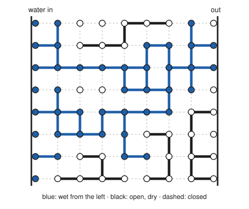
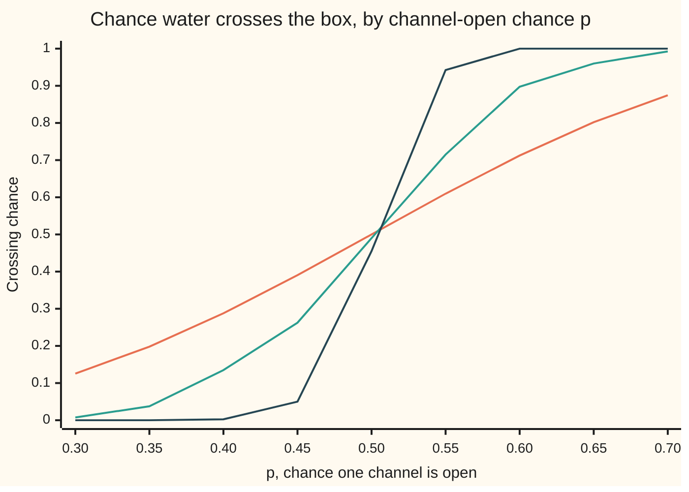
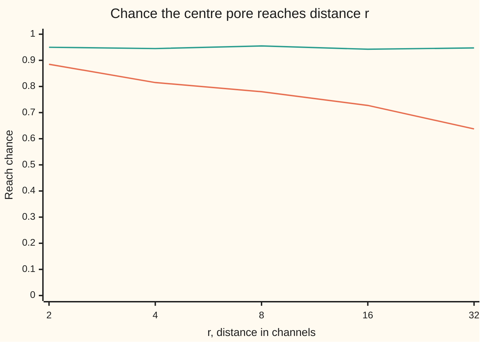

# Percolation: when does a random lattice connect, and the reported 'dying percolation' result to verify

[Syllabus](../../../SYLLABUS.md) → [Frontier](../README.md) → [Analysis and Dynamics](../README.md#s05) → Percolation

---

## General Overview

Pour water on the left face of a kitchen sponge. Inside is a maze of tiny pores joined by thin channels, some open and some blocked, more or less at random. Does the water reach the right face?

Model the sponge as a grid of pores, 9 columns by 8 rows. Each channel between neighbouring pores is open with chance $`p`$, independently of every other channel. Channels inside the first and last columns are left out; they cannot help water cross. The picture below is one such sponge at $`p = 0.50`$: 58 of its 113 channels are open, and the water wets 41 of the 72 pores and gets through.

<p align="center"></p>

This model is **bond percolation**: every link of a grid is open with chance $`p`$, independently.

Turn $`p`$ up and the sponge changes in kind. Below a certain value, water dies out within a short distance. Above it, an endless network of open channels exists. On the square grid that switch sits at exactly one half. Harry Kesten proved it in 1980, and the proof rests on a symmetry this card computes exactly on a small box.

The deep question is what happens at the switch itself. At exactly $`p = 1/2`$, does the water still die out? On the square grid, yes: Ted Harris proved it in 1960. In three dimensions it stayed open for decades. The reported "dying percolation" result most likely refers to a claimed 2026 proof of it.

**Status, as of 2026-11-23.** The lead names no source. The earliest primary record found is a Lean formalization (a proof checked line by line by a computer program) with a 15-page guide, posted in an AI lab's public repository by 2026-08-28. It claims that percolation dies at the threshold on the grid in every dimension from 2 up, completing a 2024 plan by Gady Kozma and Shahaf Nitzan. No independent rerun of it was found. AI-written manuscripts followed on 2026-09-05 and 2026-09-25, and on 2026-09-24 a second AI lab posted preprints for the three-dimensional grid and for a wider class of graphs. Two independent mathematicians have posted notes on the proof (2026-10-07 and 2026-10-21). No refereed publication was found. The status is **claimed**, not proved.

**Each channel is open with chance p; on the square grid an endless open network appears exactly when p passes one half, because open paths and closed walls mirror each other there.**

**What kind of fact this is:** three facts, kept separate. The fair box, $`f(p) + f(1-p) = 1`$, is a theorem proved on this card. Kesten's one half is a theorem, outlined on this card with its source. "No percolation at the threshold" in dimensions 3 to 10 is claimed as of 2026-11-23: several primary records (a Lean formalization, AI-written manuscripts, preprints), two independent expositions, no refereed check.

---

## The formula

This card introduces three symbols. $`\theta(p)`$, read "theta of p", is the chance that one fixed pore is wet by an endless open network. The **threshold** $`p_c`$ is the switch point: $`\theta(p) = 0`$ for every $`p`$ below it and $`\theta(p) > 0`$ for every $`p`$ above it (the least upper bound of the $`p`$ with $`\theta(p) = 0`$). Whether $`\theta(p_c)`$ itself is 0 is the question. On a finite box, $`f(p)`$ is the chance that water crosses from the left face to the right face.

```math
\theta(p) = \Pr_p\big(\text{the pore at the origin joins an infinite open cluster}\big), \qquad p_c = \sup\{\,p : \theta(p) = 0\,\}
```

**Read it aloud:** theta of p is the chance the centre pore belongs to an endless open network; the threshold is the least upper bound of the $`p`$ at which that chance is zero, the point where it switches on.

A **cluster** is a set of pores joined by open channels, with no open channel leaving it. Kesten's theorem, with Harris's half, reads:

```math
p_c(\mathbb{Z}^2) = \tfrac12, \qquad \theta(\tfrac12) = 0
```

**Read it aloud:** on the square grid the threshold is one half, and at one half no endless network forms.

The exact identity behind it lives on a finite box with one more column of pores than rows:

```math
f(p) = \sum_{k=0}^{E} a_k\, p^k (1-p)^{E-k}, \qquad f(p) + f(1-p) = 1
```

**Read it aloud:** add up the chance of every open-and-closed pattern that lets water cross; on this box, the crossing chances at $`p`$ and at one minus $`p`$ add to exactly one.

| Symbol | Plain meaning | In our example | Push it up and the answer… |
| --- | --- | --- | --- |
| $`p`$ | chance that one channel is open | 0.50 at the threshold | water crosses more often |
| $`\Pr_p`$, $`\sup`$ | a chance worked out with every channel open with chance $`p`$; the least upper bound of a set, which need not belong to the set | — | — |
| $`p_c`$ | the threshold: the switch point between dying out and an endless network | 1/2 on the square grid | — |
| $`\theta(p)`$ | chance that a fixed pore joins an endless open network | 0 at $`p = 1/2`$ | rises from zero once $`p`$ passes $`p_c`$ |
| $`\mathbb{Z}^2`$, $`\mathbb{Z}^d`$ | the square grid; the grid in $`d`$ dimensions, each pore joined to its $`2d`$ nearest neighbours | the square grid, 4 neighbours | — |
| $`d`$ | the number of dimensions | 2 | the threshold falls; no exact value is known for $`d \ge 3`$ |
| $`w`$, $`h`$ | a box's width and height, counted in pores | 4 by 3; 9 by 8; 33 by 32 | the switch around $`p_c`$ gets sharper |
| $`E`$ | the number of channels in the box | 13 | more patterns to count: $`2^E`$ |
| $`k`$, $`\binom{E}{k}`$ | how many channels are open in one pattern; how many patterns have exactly $`k`$ open | $`k = 3`$: 286 patterns | — |
| $`a_k`$ | how many patterns with $`k`$ open channels let water cross | $`a_3 = 3`$ | — |
| $`f(p)`$ | chance that water crosses the box left to right | 0.5000 at $`p = 0.50`$ | rises with $`p`$ |
| $`r`$ | distance from the centre pore to the rim of a square box | 2 to 32 | the chance of reaching the rim falls |

### When it holds

- **Every channel is open or closed independently, with one chance $`p`$.** In a real sponge one big void opens several channels at once. Then the threshold moves, and the symmetry argument fails as stated.
- **The grid is the square grid.** The mirror between paths and walls needs a flat grid whose dual is the same grid. On other grids the threshold differs, and in three dimensions no exact threshold is known.
- **Bond percolation, not site percolation.** If pores, not channels, are open or closed, the square grid's threshold is no longer one half.
- **The box has one more column than rows.** Only that shape makes the crossing fair at $`p = 1/2`$. A 3-by-3 box comes out at 0.6719, not one half.
- **The endless network is a limit statement.** No finite sponge has an infinite cluster, so a simulation can only show the trend.

---

## Why it works

### Step 0: a path and a wall cannot both exist, and one of them must

In any pattern, either the water crosses from left to right, or a **wall** stops it: a chain of closed channels running from top to bottom.

Draw that wall on a second grid, the **dual grid**: one point in the middle of each square cell, and one dual channel crossing each real channel. Call a dual channel open when the real channel it crosses is closed. A wall is then an open top-to-bottom path in the dual grid.

A left-to-right path and a top-to-bottom wall would have to cross somewhere. There, one channel would be open for the path and closed for the wall, which is impossible. So at most one exists. When no path exists, the edge of the wet region is a wall. So exactly one exists.

### Step 1: the box is fair at one half

For the box with one more column than rows, the dual grid is the same box turned a quarter turn. Flip every channel, open to closed and closed to open. A pattern with $`k`$ open channels becomes one with $`E - k`$ open channels, and every wall of the old pattern becomes a crossing of the turned box.

Counting both ways gives the identity, for every $`k`$:

```math
a_k + a_{E-k} = \binom{E}{k}
```

**Read it aloud:** crossing patterns with $`k`$ open channels, plus crossing patterns with $`E - k`$ open channels, account for every pattern with $`k`$ open channels exactly once.

Multiply by $`p^k (1-p)^{E-k}`$ and add over $`k`$. The right side sums to $`(p + 1 - p)^E = 1`$, so $`f(p) + f(1-p) = 1`$. At $`p = 1/2`$ the two terms are equal, so $`f(1/2) = 1/2`$, at every box size.

<details>
<summary>Detailed proof: why the edge of the wet region is a wall</summary>

Mark every pore the water reaches from the left face. If none of them is in the right column, the wet region is a set of pores with no open channel leaving it, except into the left face.

Walk along the outer edge of that region, keeping the wet pores on the left hand. Each real channel crossed by this walk joins a wet pore to a dry one, so it is closed. The dual channels of the walk therefore form an open dual path.

The walk starts at the top of the box and must end at the bottom, because it cannot reach the right face without a wet pore there. That walk is the wall. The code confirms the count this fact predicts on the 4-by-3 box.

</details>

### Step 2: from fair boxes to the threshold one half

A fair box is not yet a threshold. Two more steps, outlined here and proved in the sources.

1. **At $`p = 1/2`$ there is no endless cluster.** Harris proved this in 1960. A later short argument shows the idea. If an endless open cluster existed, the mirror symmetry would give an endless closed wall too. In a big box, open arms would then leave it on the left and right, and closed walls at the top and bottom. An endless open cluster is unique, so the two open arms must join outside the box. The two walls must also join, and in the plane those two joins cannot both happen. So $`\theta(1/2) = 0`$ and $`p_c \ge 1/2`$.
2. **Above one half, long boxes are crossed with chance near one.** Kesten (1980) showed that once $`p > 1/2`$, the crossing chance of long thin boxes climbs to one as they grow. Chaining crossings of boxes of doubling size builds an endless path with positive chance. So $`p_c \le 1/2`$.

Together, $`p_c = 1/2`$ exactly, and at $`p_c`$ the water dies out.

### Step 3: why three dimensions is harder

In three dimensions, what blocks the water is a closed **surface**, not a path. A surface is a different kind of object, so the mirror of Step 0 is gone. No exact threshold is known for $`\mathbb{Z}^3`$, and no symmetry fixes what happens at it.

Before 2026 two cases were proved:

- **$`d = 2`$:** Harris and Kesten, Step 2 above.
- **$`d \ge 11`$:** the **lace expansion**, a method that compares the grid with a branching tree when the dimension is large. It proves "mean-field" behaviour, the tree-like behaviour of the [Random graphs](../../09-Probability%20and%20statistics/14-Random%20Graphs%20and%20the%20Probabilistic%20Method/01-random-graphs-erdos-renyi.md) world, and that includes $`\theta(p_c) = 0`$. The bound reached $`d \ge 11`$ in 2017.

Dimensions 3 to 10 were open.

### Step 4: the 2026 claim, in outline

This is an outline of a research proof, not a proof.

| Date | Event | Kind of record |
| --- | --- | --- |
| 2024-01-22 | Kozma and Nitzan reduce $`\theta(p_c) = 0`$, in every dimension above one, to a conjectured correlation inequality on finite graphs, with numerical evidence and special cases | preprint |
| by 2026-08-28 | A Lean 4 formalization with a 15-page guide, claiming $`\theta(p_c) = 0`$ on $`\mathbb{Z}^d`$ for every $`d \ge 2`$ by proving Kozma and Nitzan's inequality, is posted in an AI lab's public repository; both expositions cite it | formal-proof claim, the earliest primary record; no independent rerun matched to the statement found |
| 2026-09-05, 2026-09-25 | AI-written manuscripts explain and extend the proof | manuscripts, not refereed |
| 2026-09-24 | A second AI lab posts preprints claiming $`\theta(p_c) = 0`$ for bond and site percolation on $`\mathbb{Z}^3`$, and on a wider class of symmetric graphs | preprints |
| 2026-10-07 | Arthur Blanc-Renaudie posts a shorter human-written proof, reconstructed from the August 2026 Lean formalization and the AI manuscripts that followed it | independent preprint |
| 2026-10-21 | Jean-Baptiste Gouéré posts an exposition of the proof of the Kozma–Nitzan conjecture | independent preprint |
| 2026-11-23 | No refereed publication or published check found | status: **claimed** |

The key steps, as the expository notes present them:

1. **Reduction.** Kozma and Nitzan show that if one inequality about percolation on finite graphs holds, then $`\theta(p_c) = 0`$ in every dimension above one. Their argument compares the sponge at larger and larger scales.
2. **The inequality.** The 2026 records claim a proof of it. That is the new part.
3. **Conclusion.** $`\theta(p_c) = 0`$ on $`\mathbb{Z}^d`$ for every $`d \ge 2`$, as the Lean formalization states it; the 2026-09-24 cubic-lattice preprint states the case $`\mathbb{Z}^3`$. The expositions present the Kozma–Nitzan conjecture as proved, and the 2024 reduction then covers every dimension above one, 3 to 10 included.

What the claim does not say: it gives no value of $`p_c`$ in three dimensions, and it does not say how fast the reach chance falls at $`p_c`$. Two independent notes are evidence of understanding, not a refereed check.

---

## Worked numbers, by hand

The 4-by-3 box: 4 columns of pores, 3 rows, one more column than rows. Vertical channels in the first and last columns cannot help a left-to-right crossing, so they are left out.

| Step | Arithmetic | Value |
| --- | --- | --- |
| channels across | 3 per row, 3 rows | 9 |
| channels up-down | 2 per inner column, 2 inner columns | 4 |
| $`E`$ | $`9 + 4`$ | 13 |
| patterns | $`2^{13}`$ | 8192 |
| fewest open channels that cross | one straight row of 3 | $`a_3 = 3`$ |
| duality at $`k = 3`$ | $`a_3 + a_{10} = 3 + 283`$ | $`286 = \binom{13}{3}`$ |
| duality at $`k = 6`$ | $`a_6 + a_7 = 627 + 1089`$ | $`1716 = \binom{13}{6}`$ |
| crossing patterns | all $`a_k`$ added | 4096 |
| $`f(1/2)`$ | $`4096 / 8192`$ | **0.5000 exactly** |

At $`p = 1/2`$ every pattern has the same chance, so the crossing chance is the share of crossing patterns: exactly half. The same count gives $`f(0.60) = 0.7123`$ and $`f(0.40) = 0.2877`$, and they add to one, as Step 1 says.

### What breaks if you drop a piece

| Mistake | Comes out at | What went wrong |
| --- | --- | --- |
| Use a 3-by-3 box instead of 4-by-3 | $`f(1/2) = 172/256 = 0.6719`$ | The dual of a square box is not the same box, so the mirror fails and the crossing is not fair |
| Use the random-graph rule "average degree one": $`4p = 1`$ | $`p = 0.25`$; a 33-by-32 box crossed 0 times in 400 | The grid is not a random graph: neighbours share neighbours, so paths loop back and waste channels |
| Use the branching-tree rule $`1/(4 - 1)`$ | $`p = 0.3333`$; crossed 0 times in 400 | A tree never revisits a pore; the grid does, so the true threshold is higher |
| Read "the box is fair at 1/2" as "water percolates at 1/2" | reach to distance 32 falls to 0.6375 and keeps falling | A crossing is a finite event; percolation needs an endless cluster, and $`\theta(1/2) = 0`$ |

---

## The switch sharpens, and at the threshold the water dies

The puzzle: the 4-by-3 box changes smoothly with $`p`$. Where is the sudden switch?

It appears only as the box grows. The chart shows three box sizes; the two larger ones are 400 simulated sponges at each $`p`$.

At $`p = 0.50`$ Step 1 proves a crossing chance of exactly one half for every size; the simulated 0.4900 and 0.4550 agree within simulation error. Away from one half, the big box is almost all-or-nothing.



Orange: the 4-by-3 box, exact. Green: the 9-by-8 box, simulated. Dark blue: the 33-by-32 box, simulated. The steeper the line, the bigger the box.

### One force at a time: distance

Now fix one pore at the centre and ask whether water from it reaches the rim of a square at distance $`r`$, in 400 simulated sponges. At $`p = 0.60`$ the chance settles; at $`p = 0.50`$ it keeps sliding. At distance 32:

```
p = 0.50  ████████████████████████████████                    0.6375
p = 0.60  ███████████████████████████████████████████████     0.9475
```



Orange: $`p = 0.50`$, the threshold, still falling. Green: $`p = 0.60`$, level near $`\theta(0.60)`$, the chance of joining the endless cluster. Harris's theorem says the orange line reaches zero as $`r`$ grows. The slide is slow, which is why a simulation can suggest "dying" but never prove it.

---

## Code, from first principles, and it actually runs

The scripts take three independent roads. Road 1 counts the crossings among all 8192 patterns of the 4-by-3 box. Road 2 checks the duality count $`a_k + a_{E-k} = \binom{E}{k}`$ for every $`k`$, a finer fact than the total. Road 3 simulates sponges with a written-out random generator (SplitMix64, seed 2026) and a union-find (a structure that merges pores into clusters as channels open). The simulated 4-by-3 box agrees with the exact count, and the simulated big boxes agree with the exact one half at $`p = 0.50`$. The reach test is also checked exactly at distance 1: over all 4,096 patterns of the 3-by-3 square it gives 0.9375 at $`p = 0.50`$ and 0.9744 at $`p = 0.60`$, matching the formula $`1 - (1-p)^4`$ (the centre is cut off only when its four channels are all closed).

### Python

```python
# Percolation on the square grid: the check behind the card. Standard library only.
# Roads: (1) exact enumeration of every open/closed pattern on a small box,
# (2) the duality count a_k + a_(E-k) = C(E, k), (3) simulation with a written-out
# generator (SplitMix64, seed 2026), held against the exact numbers.
from math import comb, sqrt

M = (1 << 64) - 1


class SplitMix64:
    def __init__(self, seed):
        self.s = seed & M

    def unit(self):  # a uniform number in [0, 1), exact in both languages
        self.s = (self.s + 0x9E3779B97F4A7C15) & M
        z = self.s
        z = ((z ^ (z >> 30)) * 0xBF58476D1CE4E5B9) & M
        z = ((z ^ (z >> 27)) * 0x94D049BB133111EB) & M
        return ((z ^ (z >> 31)) >> 11) / 9007199254740992.0


def box(w, h, sides):
    """Channels of a w-by-h box of pores; first- and last-column verticals (no help to a crossing) only if sides."""
    e = [(y * w + x, y * w + x + 1) for y in range(h) for x in range(w - 1)]
    xs = range(w) if sides else range(1, w - 1)
    return e + [(y * w + x, (y + 1) * w + x) for y in range(h - 1) for x in xs]


def find(par, a):
    while par[a] != a:
        par[a] = par[par[a]]
        a = par[a]
    return a


def crosses(w, h, par):
    left = {find(par, y * w) for y in range(h)}
    return any(find(par, y * w + w - 1) in left for y in range(h))


def reaches(w, h, par):  # is the centre pore of a w-by-w square joined to its rim?
    c = find(par, w * w // 2)
    return any(find(par, i) == c for i in range(w * w) if i % w in (0, w - 1) or i // w in (0, w - 1))


def exact_counts(w, h, sides=False, ok=crosses):
    """a[k] = how many patterns with k open channels pass ok (default: water crosses left to right)."""
    e = box(w, h, sides)
    a = [0] * (len(e) + 1)
    for mask in range(1 << len(e)):
        par = list(range(w * h))
        for i, (u, v) in enumerate(e):
            if mask >> i & 1:
                par[find(par, u)] = find(par, v)
        if ok(w, h, par):
            a[bin(mask).count("1")] += 1
    return a


def exact_f(a, num, den):  # crossing chance at p = num/den, as (top, bottom) integers
    n = len(a) - 1
    return sum(a[k] * num**k * (den - num) ** (n - k) for k in range(n + 1)), den**n


def dec(top, bot):  # top/bot rounded to 4 decimals, in integers
    q = (2 * top * 10**4 + bot) // (2 * bot)
    return f"{q // 10**4}.{q % 10**4:04d}"


def sim_cross(w, h, p, trials, rng):
    e, hits = box(w, h, False), 0
    for _ in range(trials):
        par = list(range(w * h))
        for u, v in e:
            if rng.unit() < p:
                par[find(par, u)] = find(par, v)
        hits += crosses(w, h, par)
    return hits


def sim_reach(r, p, trials, rng):  # centre joined to the rim of a (2r+1)-square?
    w, hits = 2 * r + 1, 0
    e = box(w, w, True)
    for _ in range(trials):
        par = list(range(w * w))
        for u, v in e:
            if rng.unit() < p:
                par[find(par, u)] = find(par, v)
        hits += reaches(w, w, par)
    return hits


rng, T = SplitMix64(2026), 400
a = exact_counts(4, 3)
E = len(a) - 1
print(f"Exact: the 4-by-3 box, {E} channels, {1 << E} patterns; a_k = {a}")
assert all(a[k] + a[E - k] == comb(E, k) for k in range(E + 1))  # duality, every k
print(f"duality a_k + a_(13-k) = C(13,k): checked for k = 0..{E}")
nh = sum(1 for u, v in box(4, 3, False) if v == u + 1)
print(f"by hand: {nh} across + {E - nh} up-down; a_3 + a_10 = {a[3] + a[10]} = C(13,3); a_6 + a_7 = {a[6] + a[7]} = C(13,6)")
half, f40, f60 = exact_f(a, 50, 100), exact_f(a, 40, 100), exact_f(a, 60, 100)
assert half[0] * 2 == half[1]  # f(1/2) = 1/2 exactly, as duality predicts
assert f40[0] + f60[0] == f40[1]  # f(p) + f(1-p) = 1
print(f"crossing patterns: {sum(a)} of {1 << E}, so f(0.50) = {dec(*half)} exactly")
print(f"f(0.40) = {dec(*f40)}, f(0.60) = {dec(*f60)}, sum 1 exactly")
sq = exact_counts(3, 3)
sqh = exact_f(sq, 50, 100)
assert 2 * sqh[0] != sqh[1]  # the wrong shape is not fair
print(f"wrong shape, 3-by-3 box ({len(sq) - 1} channels): f(0.50) = {sum(sq)}/{1 << (len(sq) - 1)} = {dec(*sqh)}")
hit = sim_cross(4, 3, 0.6, T, rng)
print(f"simulated 4-by-3 box at p = 0.60: {hit}/{T} = {hit / T:.4f} against exact {dec(*f60)}")
assert abs(hit / T - f60[0] / f60[1]) < 4 * sqrt(0.6 * 0.4 / T)
print("Crossing chance: p, exact 4x3, simulated 9x8, simulated 33x32 (400 runs each)")
curve = {}
for k in range(30, 71, 5):
    curve[k] = sim_cross(9, 8, k / 100, T, rng), sim_cross(33, 32, k / 100, T, rng)
    print(f"p=0.{k}  {dec(*exact_f(a, k, 100))}  {curve[k][0] / T:.4f}  {curve[k][1] / T:.4f}")
assert abs(curve[50][1] / T - 0.5) < 4 * sqrt(0.25 / T)  # fair at p = 1/2 at every size
assert curve[40][1] < curve[40][0] and curve[60][1] > curve[60][0]  # the switch sharpens
print("Reach: chance the centre joins the rim at distance r (400 runs each)")
reach = {}
for p in (0.5, 0.6):
    reach[p] = [sim_reach(r, p, T, rng) / T for r in (2, 4, 8, 16, 32)]
    print(f"p={p:.2f}  r=2,4,8,16,32: " + "  ".join(f"{x:.4f}" for x in reach[p]))
assert reach[0.5][0] - reach[0.5][4] > 6 * sqrt(0.5 / T)  # dying out at p = 1/2
assert reach[0.6][4] > reach[0.5][4] + 6 * sqrt(0.5 / T)  # but not at p = 0.60
r1 = exact_counts(3, 3, True, reaches)  # second road for reach: all 4096 patterns at r = 1
assert sum(r1) == 4096 - 256 and exact_f(r1, 60, 100)[0] == (100**4 - 40**4) * 100**8  # 1 - (1-p)^4
print(f"reach at r = 1, exact over all 4096 patterns: {dec(*exact_f(r1, 50, 100))} at p = 0.50, {dec(*exact_f(r1, 60, 100))} at p = 0.60, both 1 - (1-p)^4")
mean, tree = sim_cross(33, 32, 0.25, T, rng), sim_cross(33, 32, 1 / 3, T, rng)
print(f"mean-degree rule p=0.25: 33x32 crossing {mean}/{T}; tree rule p=0.3333: {tree}/{T}")
assert mean == 0 and tree < 4
fig, par, opened = SplitMix64(2), list(range(72)), 0  # the drawn 9-by-8 sample, p = 0.50
for u, v in box(9, 8, False):
    if fig.unit() < 0.5:
        par[find(par, u)], opened = find(par, v), opened + 1
left = {find(par, 9 * y) for y in range(8)}
wet = sum(find(par, i) in left for i in range(72))
print(f"figure, seed 2: {opened} of 113 channels open, {wet} of 72 pores wet, crosses: {'yes' if crosses(9, 8, par) else 'no'}")
print("ALL CHECKS PASS")
```

**Ran 2026-11-23 on macOS, Python 3.14.10, standard library only. All checks passed. Output, pasted from the run:**

```
Exact: the 4-by-3 box, 13 channels, 8192 patterns; a_k = [0, 0, 0, 3, 38, 209, 627, 1089, 1078, 677, 283, 78, 13, 1]
duality a_k + a_(13-k) = C(13,k): checked for k = 0..13
by hand: 9 across + 4 up-down; a_3 + a_10 = 286 = C(13,3); a_6 + a_7 = 1716 = C(13,6)
crossing patterns: 4096 of 8192, so f(0.50) = 0.5000 exactly
f(0.40) = 0.2877, f(0.60) = 0.7123, sum 1 exactly
wrong shape, 3-by-3 box (8 channels): f(0.50) = 172/256 = 0.6719
simulated 4-by-3 box at p = 0.60: 283/400 = 0.7075 against exact 0.7123
Crossing chance: p, exact 4x3, simulated 9x8, simulated 33x32 (400 runs each)
p=0.30  0.1254  0.0075  0.0000
p=0.35  0.1980  0.0375  0.0000
p=0.40  0.2877  0.1350  0.0025
p=0.45  0.3903  0.2625  0.0500
p=0.50  0.5000  0.4900  0.4550
p=0.55  0.6097  0.7150  0.9425
p=0.60  0.7123  0.8975  1.0000
p=0.65  0.8020  0.9600  1.0000
p=0.70  0.8746  0.9925  1.0000
Reach: chance the centre joins the rim at distance r (400 runs each)
p=0.50  r=2,4,8,16,32: 0.8850  0.8150  0.7800  0.7275  0.6375
p=0.60  r=2,4,8,16,32: 0.9500  0.9450  0.9550  0.9425  0.9475
reach at r = 1, exact over all 4096 patterns: 0.9375 at p = 0.50, 0.9744 at p = 0.60, both 1 - (1-p)^4
mean-degree rule p=0.25: 33x32 crossing 0/400; tree rule p=0.3333: 0/400
figure, seed 2: 58 of 113 channels open, 41 of 72 pores wet, crosses: yes
ALL CHECKS PASS
```

### Rust

```rust
// Percolation on the square grid: the check behind the card. std only.
// Roads: (1) exact enumeration of every open/closed pattern on a small box,
// (2) the duality count a_k + a_(E-k) = C(E, k), (3) simulation with a written-out
// generator (SplitMix64, seed 2026), held against the exact numbers.

struct SplitMix64 { s: u64 }
impl SplitMix64 {
    // a uniform number in [0, 1), exact in both languages
    fn unit(&mut self) -> f64 {
        self.s = self.s.wrapping_add(0x9E3779B97F4A7C15);
        let mut z = self.s;
        z = (z ^ (z >> 30)).wrapping_mul(0xBF58476D1CE4E5B9);
        z = (z ^ (z >> 27)).wrapping_mul(0x94D049BB133111EB);
        ((z ^ (z >> 31)) >> 11) as f64 / 9007199254740992.0
    }
}
// Channels of a box of pores, w columns by h rows. Vertical channels in the
// first and last column cannot help a left-to-right crossing: kept only if sides.
fn boxe(w: usize, h: usize, sides: bool) -> Vec<(usize, usize)> {
    let mut e = Vec::new();
    for y in 0..h {
        for x in 0..w - 1 {
            e.push((y * w + x, y * w + x + 1));
        }
    }
    let (x0, x1) = if sides { (0, w) } else { (1, w - 1) };
    for y in 0..h - 1 {
        for x in x0..x1 {
            e.push((y * w + x, (y + 1) * w + x));
        }
    }
    e
}
fn find(par: &mut Vec<usize>, mut a: usize) -> usize {
    while par[a] != a {
        par[a] = par[par[a]];
        a = par[a];
    }
    a
}
fn join(par: &mut Vec<usize>, u: usize, v: usize) {
    let (ru, rv) = (find(par, u), find(par, v));
    par[ru] = rv;
}
fn crosses(w: usize, h: usize, par: &mut Vec<usize>) -> bool {
    let left: Vec<usize> = (0..h).map(|y| find(par, y * w)).collect();
    (0..h).any(|y| left.contains(&find(par, y * w + w - 1)))
}
// is the centre pore of a w-by-w square joined to its rim?
fn reaches(w: usize, _h: usize, par: &mut Vec<usize>) -> bool {
    let c = find(par, w * w / 2);
    (0..w * w).filter(|i| i % w == 0 || i % w == w - 1 || i / w == 0 || i / w == w - 1).any(|i| find(par, i) == c)
}
// a[k] = how many patterns with k open channels pass ok (water crossing left to right, or reaching the rim)
fn exact_counts(w: usize, h: usize, sides: bool, ok: &dyn Fn(usize, usize, &mut Vec<usize>) -> bool) -> Vec<u64> {
    let e = boxe(w, h, sides);
    let mut a = vec![0u64; e.len() + 1];
    for mask in 0u64..(1u64 << e.len()) {
        let mut par: Vec<usize> = (0..w * h).collect();
        for (i, &(u, v)) in e.iter().enumerate() {
            if mask >> i & 1 == 1 {
                join(&mut par, u, v);
            }
        }
        if ok(w, h, &mut par) {
            a[mask.count_ones() as usize] += 1;
        }
    }
    a
}
// crossing chance at p = num/den, as (top, bottom) integers
fn exact_f(a: &[u64], num: u128, den: u128) -> (u128, u128) {
    let n = a.len() - 1;
    let top = (0..=n).map(|k| a[k] as u128 * num.pow(k as u32) * (den - num).pow((n - k) as u32)).sum();
    (top, den.pow(n as u32))
}
// top/bot rounded to 4 decimals, in integers
fn dec((top, bot): (u128, u128)) -> String {
    let q = (2 * top * 10000 + bot) / (2 * bot);
    format!("{}.{:04}", q / 10000, q % 10000)
}
fn sim_cross(w: usize, h: usize, p: f64, trials: usize, rng: &mut SplitMix64) -> usize {
    let (e, mut hits) = (boxe(w, h, false), 0);
    for _ in 0..trials {
        let mut par: Vec<usize> = (0..w * h).collect();
        for &(u, v) in &e {
            if rng.unit() < p {
                join(&mut par, u, v);
            }
        }
        hits += crosses(w, h, &mut par) as usize;
    }
    hits
}
fn sim_reach(r: usize, p: f64, trials: usize, rng: &mut SplitMix64) -> usize {
    let (w, mut hits) = (2 * r + 1, 0);
    let e = boxe(w, w, true);
    for _ in 0..trials {
        let mut par: Vec<usize> = (0..w * w).collect();
        for &(u, v) in &e {
            if rng.unit() < p {
                join(&mut par, u, v);
            }
        }
        hits += reaches(w, w, &mut par) as usize;
    }
    hits
}
fn main() {
    let (mut rng, t) = (SplitMix64 { s: 2026 }, 400usize);
    let tf = t as f64;
    let a = exact_counts(4, 3, false, &crosses);
    let n = a.len() - 1;
    println!("Exact: the 4-by-3 box, {} channels, {} patterns; a_k = {:?}", n, 1u64 << n, a);
    let comb = |n: u64, k: u64| (0..k).fold(1u64, |c, i| c * (n - i) / (i + 1));
    assert!((0..=n).all(|k| a[k] + a[n - k] == comb(n as u64, k as u64))); // duality, every k
    println!("duality a_k + a_(13-k) = C(13,k): checked for k = 0..{}", n);
    let nh = boxe(4, 3, false).iter().filter(|&&(u, v)| v == u + 1).count();
    println!("by hand: {} across + {} up-down; a_3 + a_10 = {} = C(13,3); a_6 + a_7 = {} = C(13,6)", nh, n - nh, a[3] + a[10], a[6] + a[7]);
    let (half, f40, f60) = (exact_f(&a, 50, 100), exact_f(&a, 40, 100), exact_f(&a, 60, 100));
    assert!(half.0 * 2 == half.1); // f(1/2) = 1/2 exactly, as duality predicts
    assert!(f40.0 + f60.0 == f40.1); // f(p) + f(1-p) = 1
    println!("crossing patterns: {} of {}, so f(0.50) = {} exactly", a.iter().sum::<u64>(), 1u64 << n, dec(half));
    println!("f(0.40) = {}, f(0.60) = {}, sum 1 exactly", dec(f40), dec(f60));
    let sq = exact_counts(3, 3, false, &crosses);
    let sqh = exact_f(&sq, 50, 100);
    assert!(2 * sqh.0 != sqh.1); // the wrong shape is not fair
    println!("wrong shape, 3-by-3 box ({} channels): f(0.50) = {}/{} = {}", sq.len() - 1, sq.iter().sum::<u64>(), 1u64 << (sq.len() - 1), dec(sqh));
    let hit = sim_cross(4, 3, 0.6, t, &mut rng);
    println!("simulated 4-by-3 box at p = 0.60: {}/{} = {:.4} against exact {}", hit, t, hit as f64 / tf, dec(f60));
    assert!((hit as f64 / tf - f60.0 as f64 / f60.1 as f64).abs() < 4.0 * (0.6 * 0.4 / tf).sqrt());
    println!("Crossing chance: p, exact 4x3, simulated 9x8, simulated 33x32 (400 runs each)");
    let mut curve = std::collections::HashMap::new();
    for k in (30..71).step_by(5) {
        let p = k as f64 / 100.0;
        let c = (sim_cross(9, 8, p, t, &mut rng), sim_cross(33, 32, p, t, &mut rng));
        curve.insert(k, c);
        println!("p=0.{}  {}  {:.4}  {:.4}", k, dec(exact_f(&a, k as u128, 100)), c.0 as f64 / tf, c.1 as f64 / tf);
    }
    assert!((curve[&50].1 as f64 / tf - 0.5).abs() < 4.0 * (0.25 / tf).sqrt()); // fair at p = 1/2
    assert!(curve[&40].1 < curve[&40].0 && curve[&60].1 > curve[&60].0); // the switch sharpens
    println!("Reach: chance the centre joins the rim at distance r (400 runs each)");
    let mut reach = Vec::new();
    for p in [0.5, 0.6] {
        let row: Vec<f64> = [2, 4, 8, 16, 32].iter().map(|&r| sim_reach(r, p, t, &mut rng) as f64 / tf).collect();
        let s: Vec<String> = row.iter().map(|x| format!("{:.4}", x)).collect();
        println!("p={:.2}  r=2,4,8,16,32: {}", p, s.join("  "));
        reach.push(row);
    }
    assert!(reach[0][0] - reach[0][4] > 6.0 * (0.5 / tf).sqrt()); // dying out at p = 1/2
    assert!(reach[1][4] > reach[0][4] + 6.0 * (0.5 / tf).sqrt()); // but not at p = 0.60
    let r1 = exact_counts(3, 3, true, &reaches); // second road for reach: all 4096 patterns at r = 1
    assert!(r1.iter().sum::<u64>() == 4096 - 256 && exact_f(&r1, 60, 100).0 == (100u128.pow(4) - 40u128.pow(4)) * 100u128.pow(8)); // 1 - (1-p)^4
    println!("reach at r = 1, exact over all 4096 patterns: {} at p = 0.50, {} at p = 0.60, both 1 - (1-p)^4", dec(exact_f(&r1, 50, 100)), dec(exact_f(&r1, 60, 100)));
    let (mean, tree) = (sim_cross(33, 32, 0.25, t, &mut rng), sim_cross(33, 32, 1.0 / 3.0, t, &mut rng));
    println!("mean-degree rule p=0.25: 33x32 crossing {}/{}; tree rule p=0.3333: {}/{}", mean, t, tree, t);
    assert!(mean == 0 && tree < 4);
    let (mut fig, mut par, mut opened) = (SplitMix64 { s: 2 }, (0..72).collect::<Vec<usize>>(), 0); // the drawn sample
    for (u, v) in boxe(9, 8, false) {
        if fig.unit() < 0.5 {
            join(&mut par, u, v);
            opened += 1;
        }
    }
    let left: Vec<usize> = (0..8).map(|y| find(&mut par, 9 * y)).collect();
    let wet = (0..72).filter(|&i| left.contains(&find(&mut par, i))).count();
    let cr = if crosses(9, 8, &mut par) { "yes" } else { "no" };
    println!("figure, seed 2: {} of 113 channels open, {} of 72 pores wet, crosses: {}", opened, wet, cr);
    println!("ALL CHECKS PASS");
}
```

**Ran 2026-11-23 on macOS, rustc 1.98.1, no crates. All checks passed. Output, pasted from the run:**

```
Exact: the 4-by-3 box, 13 channels, 8192 patterns; a_k = [0, 0, 0, 3, 38, 209, 627, 1089, 1078, 677, 283, 78, 13, 1]
duality a_k + a_(13-k) = C(13,k): checked for k = 0..13
by hand: 9 across + 4 up-down; a_3 + a_10 = 286 = C(13,3); a_6 + a_7 = 1716 = C(13,6)
crossing patterns: 4096 of 8192, so f(0.50) = 0.5000 exactly
f(0.40) = 0.2877, f(0.60) = 0.7123, sum 1 exactly
wrong shape, 3-by-3 box (8 channels): f(0.50) = 172/256 = 0.6719
simulated 4-by-3 box at p = 0.60: 283/400 = 0.7075 against exact 0.7123
Crossing chance: p, exact 4x3, simulated 9x8, simulated 33x32 (400 runs each)
p=0.30  0.1254  0.0075  0.0000
p=0.35  0.1980  0.0375  0.0000
p=0.40  0.2877  0.1350  0.0025
p=0.45  0.3903  0.2625  0.0500
p=0.50  0.5000  0.4900  0.4550
p=0.55  0.6097  0.7150  0.9425
p=0.60  0.7123  0.8975  1.0000
p=0.65  0.8020  0.9600  1.0000
p=0.70  0.8746  0.9925  1.0000
Reach: chance the centre joins the rim at distance r (400 runs each)
p=0.50  r=2,4,8,16,32: 0.8850  0.8150  0.7800  0.7275  0.6375
p=0.60  r=2,4,8,16,32: 0.9500  0.9450  0.9550  0.9425  0.9475
reach at r = 1, exact over all 4096 patterns: 0.9375 at p = 0.50, 0.9744 at p = 0.60, both 1 - (1-p)^4
mean-degree rule p=0.25: 33x32 crossing 0/400; tree rule p=0.3333: 0/400
figure, seed 2: 58 of 113 channels open, 41 of 72 pores wet, crosses: yes
ALL CHECKS PASS
```

### Lean

Lean proves the fair box at every size, and checks the 4-by-3 box's numbers; Kesten's theorem is not proved here.

- Take a box with one more column than rows, and any $`p`$ from 0 to 1. Then $`f(p) + f(1-p) = 1`$.
- Take the same box and any $`k`$ from 0 to $`E`$. Then $`a_k + a_{E-k} = \binom{E}{k}`$.
- Take $`p = 1/2`$. Then $`f(1/2) = 1/2`$, at every box size.
- The 4-by-3 box has $`E = 13`$ channels, so $`2^{13} = 8192`$ patterns.
- The card's counts $`a_0`$ to $`a_{13}`$ obey the duality for every $`k`$, and add up to 4096, half of 8192.
- The worked lines hold: $`3 + 283 = \binom{13}{3} = 286`$ and $`627 + 1089 = \binom{13}{6} = 1716`$.
- The 3-by-3 box is not fair: 172 of its 256 patterns is not half.

Finding which patterns cross, the simulated sponges and the reach test are left to the Python and Rust checks.

```lean
-- Percolation: on a square-grid box with one more column of pores than rows, the chances of crossing at p and at 1 - p add to exactly one.
import Mathlib.Combinatorics.SimpleGraph.Connectivity.Finite
import Mathlib.Combinatorics.SimpleGraph.Finite
import Mathlib.Data.Finset.Powerset
import Mathlib.Basic.Real.Basic
import Mathlib.Algebra.BigOperators.Group.Finset.Basic
import Mathlib.Combinatorics.SimpleGraph.DegreeSum
import Mathlib.Combinatorics.SimpleGraph.Connectivity.Connected
import Mathlib.Data.ZMod.Basic
import Mathlib.Algebra.CharP.Two
import Mathlib.Data.Nat.Choose.Sum
import Mathlib.Algebra.BigOperators.Intervals
import Mathlib.Algebra.BigOperators.Fin

open Finset

/-- The step relation of the box: pore `(x, y)` sits in column `x` and row `y`.
A channel runs to the next pore in the same row, or, in an inner column only
(not the first or last column), to the next pore in the same column. -/
def boxStep (n : ℕ) (a b : Fin (n + 1) × Fin n) : Prop :=
  (a.2 = b.2 ∧ a.1.val + 1 = b.1.val) ∨
  (a.1 = b.1 ∧ 0 < a.1.val ∧ a.1.val < n ∧ a.2.val + 1 = b.2.val)

instance (n : ℕ) : DecidableRel (boxStep n) := fun a b => by
  unfold boxStep; infer_instance

/-- The box of pores with `n + 1` columns and `n` rows, as a graph on the square grid.
Its edges are the box's channels; the vertical channels of the first and last
columns are left out, as on the card. -/
def boxGraph (n : ℕ) : SimpleGraph (Fin (n + 1) × Fin n) :=
  SimpleGraph.fromRel (boxStep n)

instance (n : ℕ) : DecidableRel (boxGraph n).Adj :=
  inferInstanceAs (DecidableRel (SimpleGraph.fromRel (boxStep n)).Adj)

/-- The number of channels in the box, `E` on the card. -/
def numChannels (n : ℕ) : ℕ := (boxGraph n).edgeFinset.card

/-- An open-and-closed pattern, given as the finite set `S` of open channels, lets water
cross: some pore in the left column is joined by open channels to some pore in the
right column. -/
def Crosses (n : ℕ) (S : Finset (Sym2 (Fin (n + 1) × Fin n))) : Prop :=
  ∃ y y' : Fin n,
    (SimpleGraph.fromEdgeSet (S : Set (Sym2 (Fin (n + 1) × Fin n)))).Reachable (0, y) (Fin.last n, y')

/-- `a_k` on the card: how many patterns with exactly `k` open channels let water cross. -/
noncomputable def crossCount (n k : ℕ) : ℕ := by
  classical
  exact (((boxGraph n).edgeFinset.powersetCard k).filter (Crosses n)).card

/-- `f(p)` on the card: the chance that water crosses the box when every channel is open
with chance `p`, independently, written as `∑ a_k p^k (1 - p)^(E - k)`. -/
noncomputable def crossChance (n : ℕ) (p : ℝ) : ℝ :=
  ∑ k ∈ range (numChannels n + 1),
    (crossCount n k : ℝ) * p ^ k * (1 - p) ^ (numChannels n - k)


namespace FairBox

/-- Adjacency in the box, in terms of coordinates. -/
def adjN (n ax ay bx by' : ℕ) : Prop :=
  (ay = by' ∧ ax + 1 = bx) ∨ (ay = by' ∧ bx + 1 = ax) ∨
  (ax = bx ∧ 0 < ax ∧ ax < n ∧ ay + 1 = by') ∨ (ax = bx ∧ 0 < ax ∧ ax < n ∧ by' + 1 = ay)

lemma boxAdj_iff (n : ℕ) (a b : Fin (n + 1) × Fin n) :
    (boxGraph n).Adj a b ↔ adjN n a.1.val a.2.val b.1.val b.2.val := by
  rw [boxGraph, SimpleGraph.fromRel_adj]
  simp only [boxStep, adjN, ne_eq, Prod.ext_iff, Fin.ext_iff]
  omega

/-- A pore from coordinates. -/
def mkV (n : ℕ) (hn : 0 < n) (x y : ℕ) : Fin (n + 1) × Fin n :=
  (⟨x % (n + 1), Nat.mod_lt _ (Nat.succ_pos n)⟩, ⟨y % n, Nat.mod_lt _ hn⟩)

lemma mkV_eq_iff (n : ℕ) (hn : 0 < n) (x y : ℕ) (hx : x < n + 1) (hy : y < n)
    (v : Fin (n + 1) × Fin n) : v = mkV n hn x y ↔ v.1.val = x ∧ v.2.val = y := by
  simp only [mkV, Prod.ext_iff, Fin.ext_iff, Nat.mod_eq_of_lt hx, Nat.mod_eq_of_lt hy]

/-- The dual channel of the channel `s(a, b)`, rotated back onto the box. -/
def dualPair (n : ℕ) (a b : Fin (n + 1) × Fin n) : Sym2 (Fin (n + 1) × Fin n) :=
  s(mkV n a.2.pos ((a.2.val + b.2.val + 1) / 2) ((a.1.val + b.1.val - 1) / 2),
    mkV n a.2.pos ((a.2.val + b.2.val + 2) / 2) ((a.1.val + b.1.val) / 2))

lemma dualPair_comm (n : ℕ) (a b : Fin (n + 1) × Fin n) : dualPair n a b = dualPair n b a := by
  unfold dualPair
  rw [Nat.add_comm a.1.val, Nat.add_comm a.2.val]

/-- The duality map on channels. -/
def dualMap (n : ℕ) : Sym2 (Fin (n + 1) × Fin n) → Sym2 (Fin (n + 1) × Fin n) :=
  Sym2.lift ⟨dualPair n, dualPair_comm n⟩

lemma dualMap_mk (n : ℕ) (a b : Fin (n + 1) × Fin n) : dualMap n s(a, b) = dualPair n a b := by
  simp [dualMap]

/-- The dual channel, as an equation in coordinates. -/
lemma eq_dualMap_iff (n : ℕ) (q q' a b : Fin (n + 1) × Fin n) (h : (boxGraph n).Adj q q') :
    s(a, b) = dualMap n s(q, q') ↔
      (a.1.val = (q.2.val + q'.2.val + 1) / 2 ∧ a.2.val = (q.1.val + q'.1.val - 1) / 2 ∧
        b.1.val = (q.2.val + q'.2.val + 2) / 2 ∧ b.2.val = (q.1.val + q'.1.val) / 2) ∨
      (b.1.val = (q.2.val + q'.2.val + 1) / 2 ∧ b.2.val = (q.1.val + q'.1.val - 1) / 2 ∧
        a.1.val = (q.2.val + q'.2.val + 2) / 2 ∧ a.2.val = (q.1.val + q'.1.val) / 2) := by
  rw [boxAdj_iff] at h
  unfold adjN at h
  have h1 := q.1.isLt; have h2 := q.2.isLt; have h3 := q'.1.isLt; have h4 := q'.2.isLt
  rw [dualMap_mk, dualPair, Sym2.eq_iff, mkV_eq_iff _ _ _ _ (by omega) (by omega),
    mkV_eq_iff _ _ _ _ (by omega) (by omega), mkV_eq_iff _ _ _ _ (by omega) (by omega),
    mkV_eq_iff _ _ _ _ (by omega) (by omega)]
  tauto

lemma dualMap_adj (n : ℕ) (q q' : Fin (n + 1) × Fin n) (h : (boxGraph n).Adj q q') :
    dualMap n s(q, q') ∈ (boxGraph n).edgeSet := by
  have h' := h
  rw [boxAdj_iff] at h
  unfold adjN at h
  have h1 := q.1.isLt; have h2 := q.2.isLt; have h3 := q'.1.isLt; have h4 := q'.2.isLt
  rw [dualMap_mk, dualPair, SimpleGraph.mem_edgeSet, boxAdj_iff]
  simp only [mkV, adjN, Nat.mod_eq_of_lt (show (q.2.val + q'.2.val + 1) / 2 < n + 1 by omega),
    Nat.mod_eq_of_lt (show (q.2.val + q'.2.val + 2) / 2 < n + 1 by omega),
    Nat.mod_eq_of_lt (show (q.1.val + q'.1.val - 1) / 2 < n by omega),
    Nat.mod_eq_of_lt (show (q.1.val + q'.1.val) / 2 < n by omega)]
  omega

lemma dualMap_dualMap (n : ℕ) (q q' : Fin (n + 1) × Fin n) (h : (boxGraph n).Adj q q') :
    dualMap n (dualMap n s(q, q')) = s(q, q') := by
  have h' := h
  rw [boxAdj_iff] at h
  unfold adjN at h
  have h1 := q.1.isLt; have h2 := q.2.isLt; have h3 := q'.1.isLt; have h4 := q'.2.isLt
  rw [dualMap_mk n q q', dualPair, dualMap_mk, dualPair, Sym2.eq_iff]
  simp only [mkV, Prod.ext_iff, Fin.ext_iff,
    Nat.mod_eq_of_lt (show (q.2.val + q'.2.val + 1) / 2 < n + 1 by omega),
    Nat.mod_eq_of_lt (show (q.2.val + q'.2.val + 2) / 2 < n + 1 by omega),
    Nat.mod_eq_of_lt (show (q.1.val + q'.1.val - 1) / 2 < n by omega),
    Nat.mod_eq_of_lt (show (q.1.val + q'.1.val) / 2 < n by omega)]
  have e1 : ((q.1.val + q'.1.val - 1) / 2 + (q.1.val + q'.1.val) / 2 + 1) / 2 % (n + 1)
      = ((q.1.val + q'.1.val - 1) / 2 + (q.1.val + q'.1.val) / 2 + 1) / 2 :=
    Nat.mod_eq_of_lt (by omega)
  have e2 : ((q.1.val + q'.1.val - 1) / 2 + (q.1.val + q'.1.val) / 2 + 2) / 2 % (n + 1)
      = ((q.1.val + q'.1.val - 1) / 2 + (q.1.val + q'.1.val) / 2 + 2) / 2 :=
    Nat.mod_eq_of_lt (by omega)
  have e3 : ((q.2.val + q'.2.val + 1) / 2 + (q.2.val + q'.2.val + 2) / 2 - 1) / 2 % n
      = ((q.2.val + q'.2.val + 1) / 2 + (q.2.val + q'.2.val + 2) / 2 - 1) / 2 :=
    Nat.mod_eq_of_lt (by omega)
  have e4 : ((q.2.val + q'.2.val + 1) / 2 + (q.2.val + q'.2.val + 2) / 2) / 2 % n
      = ((q.2.val + q'.2.val + 1) / 2 + (q.2.val + q'.2.val + 2) / 2) / 2 :=
    Nat.mod_eq_of_lt (by omega)
  rw [e1, e2, e3, e4]
  omega

#print axioms boxAdj_iff
#print axioms mkV_eq_iff
#print axioms dualPair_comm
#print axioms dualMap_mk
#print axioms eq_dualMap_iff
#print axioms dualMap_adj
#print axioms dualMap_dualMap

end FairBox

namespace FairBox

lemma zmod2_eq_of_add_eq_zero {a b : ZMod 2} (h : a + b = 0) : a = b := by
  rw [← CharTwo.sub_eq_add] at h
  exact sub_eq_zero.mp h

lemma walk_telescope {V : Type*} {G : SimpleGraph V} {u v : V} (w : G.Walk u v)
    (f : V → ZMod 2) (F : V → V → ZMod 2)
    (hF : ∀ d ∈ w.darts, F d.fst d.snd = f d.fst + f d.snd) :
    (w.darts.map (fun d => F d.fst d.snd)).sum = f u + f v := by
  induction w with
  | nil => simp [CharTwo.add_self_eq_zero]
  | cons h p ih =>
    simp only [SimpleGraph.Walk.darts_cons, List.mem_cons, forall_eq_or_imp] at hF
    simp only [SimpleGraph.Walk.darts_cons, List.map_cons, List.sum_cons]
    rw [hF.1, ih hF.2]
    have key : ∀ a b c : ZMod 2, a + b + (b + c) = a + c := by decide
    exact key _ _ _

lemma walk_const {V : Type*} {G : SimpleGraph V} {u v : V} (w : G.Walk u v)
    (N : V → ZMod 2) (h : ∀ a b, G.Adj a b → N a = N b) : N u = N v := by
  induction w with
  | nil => rfl
  | cons hadj p ih => exact (h _ _ hadj).trans ih

/-- Does the channel `(a, b)` cross column gap `Y` below row `X`? -/
def indN (X Y ax ay bx by' : ℕ) : ZMod 2 :=
  if ay = by' ∧ ay < X ∧ ax + bx = 2 * Y + 1 then 1 else 0

/-- The potential whose jumps account for a dual channel. -/
def gqN (X Y X' Y' vx vy : ℕ) : ZMod 2 :=
  if X = X' ∧ vx = (Y + Y' + 1) / 2 ∧ vy < X then 1 else 0

lemma indN_step (n ax ay bx by' X Y X' Y' : ℕ)
    (hab : adjN n ax ay bx by') (hq : adjN n X Y X' Y')
    (hne : ¬ ((ax = (Y + Y' + 1) / 2 ∧ ay = (X + X' - 1) / 2 ∧
        bx = (Y + Y' + 2) / 2 ∧ by' = (X + X') / 2) ∨
      (bx = (Y + Y' + 1) / 2 ∧ by' = (X + X' - 1) / 2 ∧
        ax = (Y + Y' + 2) / 2 ∧ ay = (X + X') / 2))) :
    indN X Y ax ay bx by' + indN X' Y' ax ay bx by' =
      gqN X Y X' Y' ax ay + gqN X Y X' Y' bx by' := by
  unfold indN gqN
  rcases hab with ⟨h1, h2⟩ | ⟨h1, h2⟩ | ⟨h1, h2, h3, h4⟩ | ⟨h1, h2, h3, h4⟩ <;>
  rcases hq with ⟨k1, k2⟩ | ⟨k1, k2⟩ | ⟨k1, k2, k3, k4⟩ | ⟨k1, k2, k3, k4⟩ <;>
  subst_vars <;>
  split_ifs <;> first | rfl | (exfalso; omega)

lemma indN_top (n Y ax ay bx by' : ℕ) (hab : adjN n ax ay bx by') (ha : ay < n) :
    indN n Y ax ay bx by' = (if ax ≤ Y then 1 else 0) + (if bx ≤ Y then 1 else 0) := by
  unfold adjN at hab
  unfold indN
  split_ifs <;> first | decide | (exfalso; omega)

lemma indN_bot (Y ax ay bx by' : ℕ) : indN 0 Y ax ay bx by' = 0 := by
  unfold indN
  rw [ite_eq_right_iff.mpr (fun h => by omega)]

#print axioms zmod2_eq_of_add_eq_zero
#print axioms walk_telescope
#print axioms walk_const
#print axioms indN_step
#print axioms indN_top
#print axioms indN_bot

end FairBox

namespace FairBox

lemma not_both (n : ℕ) (S : Finset (Sym2 (Fin (n + 1) × Fin n)))
    (hS : S ⊆ (boxGraph n).edgeFinset) (h1 : Crosses n S)
    (h2 : Crosses n (((boxGraph n).edgeFinset \ S).image (dualMap n))) : False := by
  obtain ⟨y0, y1, ⟨w⟩⟩ := h1
  obtain ⟨c0, c1, ⟨w'⟩⟩ := h2
  have hd : ∀ d ∈ w.darts, s(d.fst, d.snd) ∈ S ∧ (boxGraph n).Adj d.fst d.snd := by
    intro d _
    have hadj := d.adj
    rw [SimpleGraph.fromEdgeSet_adj] at hadj
    refine ⟨hadj.1, ?_⟩
    have := hS hadj.1
    rwa [SimpleGraph.mem_edgeFinset, SimpleGraph.mem_edgeSet] at this
  let N : Fin (n + 1) × Fin n → ZMod 2 := fun q =>
    (w.darts.map (fun d =>
      indN q.1.val q.2.val d.fst.1.val d.fst.2.val d.snd.1.val d.snd.2.val)).sum
  have hN : ∀ q q', (SimpleGraph.fromEdgeSet
      ((((boxGraph n).edgeFinset \ S).image (dualMap n) : Finset _) : Set _)).Adj q q' →
      N q = N q' := by
    intro q q' hqq'
    rw [SimpleGraph.fromEdgeSet_adj] at hqq'
    obtain ⟨hmem, -⟩ := hqq'
    rw [Finset.mem_coe, Finset.mem_image] at hmem
    obtain ⟨e, he, hdualMape⟩ := hmem
    rw [Finset.mem_sdiff] at he
    obtain ⟨heE, heS⟩ := he
    induction e using Sym2.ind with | _ a b => ?_
    rw [SimpleGraph.mem_edgeFinset, SimpleGraph.mem_edgeSet] at heE
    have hqadj : (boxGraph n).Adj q q' := by
      have := dualMap_adj n a b heE
      rw [hdualMape] at this
      exact this
    have hback : dualMap n s(q, q') = s(a, b) := by rw [← hdualMape, dualMap_dualMap n a b heE]
    apply zmod2_eq_of_add_eq_zero
    simp only [N]
    rw [← List.sum_map_add]
    refine Eq.trans (walk_telescope w
      (fun v => gqN q.1.val q.2.val q'.1.val q'.2.val v.1.val v.2.val)
      (fun u v => indN q.1.val q.2.val u.1.val u.2.val v.1.val v.2.val +
        indN q'.1.val q'.2.val u.1.val u.2.val v.1.val v.2.val) ?_) ?_
    · intro d hdw
      obtain ⟨hdS, hdadj⟩ := hd d hdw
      apply indN_step n _ _ _ _ _ _ _ _ ((boxAdj_iff n _ _).mp hdadj)
        ((boxAdj_iff n _ _).mp hqadj)
      intro hc
      have heq : s(d.fst, d.snd) = dualMap n s(q, q') := (eq_dualMap_iff n q q' _ _ hqadj).mpr hc
      rw [hback] at heq
      rw [heq] at hdS
      exact heS hdS
    · have hq := (boxAdj_iff n _ _).mp hqadj
      unfold adjN at hq
      have := q.2.isLt
      have := q'.2.isLt
      simp only [Fin.val_zero, Fin.val_last]
      unfold gqN
      split_ifs <;> first | rfl | (exfalso; omega)
  have hconst := walk_const w' N hN
  have h0 : N ((0 : Fin (n + 1)), c0) = 0 := by
    simp [N, indN_bot]
  have hlast : N (Fin.last n, c1) = 1 := by
    simp only [N, Fin.val_last]
    refine Eq.trans (walk_telescope w
      (fun v => if v.1.val ≤ c1.val then 1 else 0)
      (fun u v => indN n c1.val u.1.val u.2.val v.1.val v.2.val) ?_) ?_
    · intro d hdw
      exact indN_top n _ _ _ _ _ ((boxAdj_iff n _ _).mp (hd d hdw).2) d.fst.2.isLt
    · have := c1.isLt
      have hc : ¬ n ≤ c1.val := by omega
      simp [hc]
  rw [h0, hlast] at hconst
  exact absurd hconst (by decide)

#print axioms not_both

end FairBox

namespace FairBox

lemma z2_four : ∀ a b c d : ZMod 2, a + b + (c + d) + (c + a) + (d + b) = 0 := by decide

lemma range_telescope (f : ℕ → ZMod 2) (m : ℕ) :
    ∑ i ∈ Finset.range m, (f i + f (i + 1)) = f 0 + f m := by
  induction m with
  | zero => simp [CharTwo.add_self_eq_zero]
  | succ m ih =>
    rw [Finset.sum_range_succ, ih]
    have key : ∀ a b c : ZMod 2, a + b + (b + c) = a + c := by decide
    exact key _ _ _

lemma sum2_ite (m1 m2 k1 k2 : ℕ) (A : ZMod 2) :
    ∑ x ∈ Finset.range m1, ∑ y ∈ Finset.range m2, (if x = k1 ∧ y = k2 then A else 0) =
      if k1 < m1 ∧ k2 < m2 then A else 0 := by
  by_cases h1 : k1 < m1 <;> by_cases h2 : k2 < m2 <;> simp [ite_and, h1, h2]

instance (n ax ay bx by' : ℕ) : Decidable (adjN n ax ay bx by') := by
  unfold adjN; infer_instance

/-- The parity of the number of cut dual channels at the dual pore `(X, Y)`, written out. -/
def FzN (G : ℕ → ℕ → ZMod 2) (n X Y x y : ℕ) : ZMod 2 :=
  if adjN n X Y x y then G ((Y + y + 1) / 2) ((X + x - 1) / 2) + G ((Y + y + 2) / 2) ((X + x) / 2)
  else 0

lemma FzN_interior (G : ℕ → ℕ → ZMod 2) (n X Y x y : ℕ) (hX0 : 0 < X) (hXn : X < n) :
    FzN G n X Y x y =
      (if x = X + 1 ∧ y = Y then G Y X + G (Y + 1) X else 0) +
      (if x = X - 1 ∧ y = Y then G Y (X - 1) + G (Y + 1) (X - 1) else 0) +
      (if 0 < Y then (if x = X ∧ y = Y - 1 then G Y (X - 1) + G Y X else 0) else 0) +
      (if x = X ∧ y = Y + 1 then G (Y + 1) (X - 1) + G (Y + 1) X else 0) := by
  unfold FzN
  by_cases hadj : adjN n X Y x y
  · rw [ite_eq_left hadj]
    unfold adjN at hadj
    split_ifs <;> (try simp only [add_zero, zero_add]) <;>
      first | rfl | (exfalso; omega) | (congr 1 <;> congr 1 <;> omega)
  · rw [ite_eq_right hadj]
    unfold adjN at hadj
    split_ifs <;> first | rfl | (exfalso; omega)

lemma FzN_bottom (G : ℕ → ℕ → ZMod 2) (n Y x y : ℕ) :
    FzN G n 0 Y x y = if x = 1 ∧ y = Y then G Y 0 + G (Y + 1) 0 else 0 := by
  unfold FzN
  by_cases hadj : adjN n 0 Y x y
  · rw [ite_eq_left hadj]
    unfold adjN at hadj
    split_ifs <;> first | rfl | (exfalso; omega) | (congr 1 <;> congr 1 <;> omega)
  · rw [ite_eq_right hadj]
    unfold adjN at hadj
    split_ifs <;> first | rfl | (exfalso; omega)

lemma sum_FzN_interior (G : ℕ → ℕ → ZMod 2) (n X Y : ℕ) (hX0 : 0 < X) (hXn : X < n)
    (hY : Y < n) (hG0 : ∀ r < n, G 0 r = 1) (hGn : ∀ r < n, G n r = 0) :
    ∑ x ∈ Finset.range (n + 1), ∑ y ∈ Finset.range n, FzN G n X Y x y = 0 := by
  simp only [FzN_interior G n X Y _ _ hX0 hXn, Finset.sum_add_distrib]
  rw [sum2_ite, sum2_ite, sum2_ite]
  have e3 : ∑ x ∈ Finset.range (n + 1), ∑ y ∈ Finset.range n,
      (if 0 < Y then (if x = X ∧ y = Y - 1 then G Y (X - 1) + G Y X else 0) else 0) =
      G Y (X - 1) + G Y X := by
    by_cases h : 0 < Y
    · simp only [h, ite_true]
      rw [sum2_ite, ite_eq_left (by omega)]
    · simp only [h, ite_false, Finset.sum_const_zero]
      have : Y = 0 := by omega
      subst this
      rw [hG0 _ (by omega), hG0 _ (by omega)]
      decide
  rw [e3, ite_eq_left (by omega), ite_eq_left (by omega)]
  have e4 : (if X < n + 1 ∧ Y + 1 < n then G (Y + 1) (X - 1) + G (Y + 1) X else 0) =
      G (Y + 1) (X - 1) + G (Y + 1) X := by
    split_ifs with h
    · rfl
    · have : Y + 1 = n := by omega
      rw [this, hGn _ (by omega), hGn _ (by omega)]
      decide
  rw [e4]
  have := z2_four (G Y X) (G (Y + 1) X) (G Y (X - 1)) (G (Y + 1) (X - 1))
  rw [← this]

lemma sum_FzN_bottom (G : ℕ → ℕ → ZMod 2) (n Y : ℕ) (hn : 1 ≤ n) (hY : Y < n) :
    ∑ x ∈ Finset.range (n + 1), ∑ y ∈ Finset.range n, FzN G n 0 Y x y = G Y 0 + G (Y + 1) 0 := by
  simp only [FzN_bottom]
  rw [sum2_ite, ite_eq_left (by omega)]

#print axioms z2_four
#print axioms range_telescope
#print axioms sum2_ite
#print axioms FzN_interior
#print axioms FzN_bottom
#print axioms sum_FzN_interior
#print axioms sum_FzN_bottom

end FairBox

namespace FairBox

lemma zmod2_ite_eq (z : ZMod 2) : (if z = 1 then (1 : ZMod 2) else 0) = z := by
  fin_cases z <;> rfl

lemma at_least_one (n : ℕ) (hn : 1 ≤ n) (S : Finset (Sym2 (Fin (n + 1) × Fin n)))
    (hS : S ⊆ (boxGraph n).edgeFinset) (h : ¬ Crosses n S) :
    Crosses n (((boxGraph n).edgeFinset \ S).image (dualMap n)) := by
  classical
  by_contra hT
  let GS := SimpleGraph.fromEdgeSet (S : Set (Sym2 (Fin (n + 1) × Fin n)))
  let C : Set (Fin (n + 1) × Fin n) := {v | ∃ y, GS.Reachable (0, y) v}
  let G : ℕ → ℕ → ZMod 2 := fun x y =>
    if hxy : x < n + 1 ∧ y < n then
      (if ((⟨x, hxy.1⟩, ⟨y, hxy.2⟩) : Fin (n + 1) × Fin n) ∈ C then 1 else 0)
    else 0
  let g : Fin (n + 1) × Fin n → ZMod 2 := fun v => G v.1.val v.2.val
  have hg : ∀ v, g v = if v ∈ C then 1 else 0 := by
    intro v
    simp only [g, G, dite_eq_left (And.intro v.1.isLt v.2.isLt)]
  have hG0 : ∀ r < n, G 0 r = 1 := by
    intro r hr
    simp only [G, dite_eq_left (And.intro (Nat.succ_pos n) hr)]
    rw [ite_eq_left]
    refine ⟨⟨r, hr⟩, ?_⟩
    have e : ((⟨0, Nat.succ_pos n⟩ : Fin (n + 1)), (⟨r, hr⟩ : Fin n)) =
        ((0 : Fin (n + 1)), (⟨r, hr⟩ : Fin n)) := by
      ext <;> simp
    rw [e]
  have hGn : ∀ r < n, G n r = 0 := by
    intro r hr
    simp only [G, dite_eq_left (And.intro (Nat.lt_succ_self n) hr)]
    rw [ite_eq_right]
    rintro ⟨y, hy⟩
    exact h ⟨y, ⟨r, hr⟩, hy⟩
  have hclosed : ∀ a b, s(a, b) ∈ S → g a = g b := by
    intro a b hab
    have hadj : (boxGraph n).Adj a b := by
      have := hS hab
      rwa [SimpleGraph.mem_edgeFinset, SimpleGraph.mem_edgeSet] at this
    have hGS : GS.Adj a b := by
      rw [SimpleGraph.fromEdgeSet_adj]
      exact ⟨hab, hadj.ne⟩
    rw [hg, hg]
    by_cases ha : a ∈ C
    · have hb : b ∈ C := by
        obtain ⟨y, hy⟩ := ha
        exact ⟨y, hy.trans hGS.reachable⟩
      rw [ite_eq_left ha, ite_eq_left hb]
    · have hb : b ∉ C := by
        rintro ⟨y, hy⟩
        exact ha ⟨y, hy.trans hGS.symm.reachable⟩
      rw [ite_eq_right ha, ite_eq_right hb]
  let δ : Sym2 (Fin (n + 1) × Fin n) → ZMod 2 :=
    Sym2.lift ⟨fun a b => g a + g b, fun a b => add_comm _ _⟩
  have hδS : ∀ e ∈ S, δ e = 0 := by
    intro e
    induction e using Sym2.ind with
    | _ a b =>
      intro he
      simp only [δ, Sym2.lift_mk]
      rw [hclosed a b he]
      exact CharTwo.add_self_eq_zero _
  have hδdualMap : ∀ q q', (boxGraph n).Adj q q' → δ (dualMap n s(q, q')) =
      G ((q.2.val + q'.2.val + 1) / 2) ((q.1.val + q'.1.val - 1) / 2) +
      G ((q.2.val + q'.2.val + 2) / 2) ((q.1.val + q'.1.val) / 2) := by
    intro q q' hq
    have hq' := (boxAdj_iff n q q').mp hq
    unfold adjN at hq'
    have := q.1.isLt; have := q.2.isLt; have := q'.1.isLt; have := q'.2.isLt
    rw [dualMap_mk, dualPair]
    simp only [δ, Sym2.lift_mk, g, mkV]
    rw [Nat.mod_eq_of_lt (show (q.2.val + q'.2.val + 1) / 2 < n + 1 by omega),
      Nat.mod_eq_of_lt (show (q.2.val + q'.2.val + 2) / 2 < n + 1 by omega),
      Nat.mod_eq_of_lt (show (q.1.val + q'.1.val - 1) / 2 < n by omega),
      Nat.mod_eq_of_lt (show (q.1.val + q'.1.val) / 2 < n by omega)]
  let H : SimpleGraph (Fin (n + 1) × Fin n) :=
    { Adj := fun q q' => (boxGraph n).Adj q q' ∧ δ (dualMap n s(q, q')) = 1
      symm := ⟨fun q q' hq => ⟨hq.1.symm, by rw [Sym2.eq_swap]; exact hq.2⟩⟩
      loopless := ⟨fun q hq => (boxGraph n).loopless.irrefl q hq.1⟩ }
  have hHT : H ≤ SimpleGraph.fromEdgeSet
      ((((boxGraph n).edgeFinset \ S).image (dualMap n) : Finset _) : Set _) := by
    intro q q' hq
    rw [SimpleGraph.fromEdgeSet_adj]
    refine ⟨?_, hq.1.ne⟩
    rw [Finset.mem_coe, Finset.mem_image]
    refine ⟨dualMap n s(q, q'), ?_, dualMap_dualMap n q q' hq.1⟩
    rw [Finset.mem_sdiff, SimpleGraph.mem_edgeFinset]
    refine ⟨dualMap_adj n q q' hq.1, fun hmem => ?_⟩
    have := hδS _ hmem
    rw [hq.2] at this
    exact absurd this (by decide)
  let K : Set (Fin (n + 1) × Fin n) := {q | ∃ c, H.Reachable (0, c) q}
  have hKtop : ∀ c, (Fin.last n, c) ∉ K := fun c ⟨c0, hr⟩ => hT ⟨c0, c, hr.mono hHT⟩
  have hKbot : ∀ c, ((0 : Fin (n + 1)), c) ∈ K := fun c => ⟨c, SimpleGraph.Reachable.refl _⟩
  have hKcl : ∀ q q', H.Adj q q' → q ∈ K → q' ∈ K := fun q q' hqq ⟨c, hr⟩ =>
    ⟨c, hr.trans hqq.reachable⟩
  let H' : SimpleGraph (Fin (n + 1) × Fin n) :=
    { Adj := fun q q' => H.Adj q q' ∧ q ∈ K
      symm := ⟨fun q q' hq => ⟨(show H.Adj q q' from hq.1).symm, hKcl q q' hq.1 hq.2⟩⟩
      loopless := ⟨fun q hq => H.loopless.irrefl q hq.1⟩ }
  have hz : ∑ v, (H'.degree v : ZMod 2) = 0 := by
    have := congrArg (Nat.cast : ℕ → ZMod 2) (H'.sum_degrees_eq_twice_card_edges)
    push_cast at this
    rw [this]
    exact mul_eq_zero_of_left (by decide) _
  let D : Fin (n + 1) × Fin n → ZMod 2 := fun q =>
    ∑ q', if (boxGraph n).Adj q q' then δ (dualMap n s(q, q')) else 0
  have hdeg : ∀ q, (H'.degree q : ZMod 2) = if q ∈ K then D q else 0 := by
    intro q
    rw [← SimpleGraph.card_neighborFinset_eq_degree, SimpleGraph.neighborFinset_eq_filter,
      Finset.natCast_card_filter]
    split_ifs with hqK
    · simp only [D]
      apply Finset.sum_congr rfl
      intro q' _
      by_cases hb : (boxGraph n).Adj q q'
      · simp only [H', H, hb, hqK, true_and, and_true]
        exact zmod2_ite_eq _
      · simp [H', H, hb]
    · apply Finset.sum_eq_zero
      intro q' _
      simp [H', hqK]
  have hDsum : ∀ q : Fin (n + 1) × Fin n,
      D q = ∑ x ∈ Finset.range (n + 1), ∑ y ∈ Finset.range n, FzN G n q.1.val q.2.val x y := by
    intro q
    simp only [D]
    rw [Fintype.sum_prod_type]
    rw [← Fin.sum_univ_eq_sum_range (fun x => ∑ y ∈ Finset.range n, FzN G n q.1.val q.2.val x y)
      (n + 1)]
    apply Finset.sum_congr rfl
    intro x _
    rw [← Fin.sum_univ_eq_sum_range (fun y => FzN G n q.1.val q.2.val x.val y) n]
    apply Finset.sum_congr rfl
    intro y _
    unfold FzN
    by_cases hb : (boxGraph n).Adj q (x, y)
    · rw [ite_eq_left hb, ite_eq_left ((boxAdj_iff n q (x, y)).mp hb), hδdualMap q (x, y) hb]
    · rw [ite_eq_right hb, ite_eq_right (fun h' => hb ((boxAdj_iff n q (x, y)).mpr h'))]
  have hint : ∀ q : Fin (n + 1) × Fin n, 0 < q.1.val → q.1.val < n → D q = 0 :=
    fun q h0 hn' => by
      rw [hDsum]
      exact sum_FzN_interior G n _ _ h0 hn' q.2.isLt hG0 hGn
  have hbot : ∀ c : Fin n, D ((0 : Fin (n + 1)), c) = G c.val 0 + G (c.val + 1) 0 := fun c => by
    rw [hDsum]
    exact sum_FzN_bottom G n c.val hn c.isLt
  have htotal : ∑ q, (if q ∈ K then D q else 0) = 1 := by
    rw [Fintype.sum_prod_type, Fin.sum_univ_succ]
    have hrest : ∑ X : Fin n, ∑ Y : Fin n,
        (if (X.succ, Y) ∈ K then D (X.succ, Y) else 0) = 0 := by
      apply Finset.sum_eq_zero
      intro X _
      apply Finset.sum_eq_zero
      intro Y _
      by_cases hX : X.val + 1 < n
      · rw [hint (X.succ, Y) (by simp) (by simpa using hX)]
        simp
      · have hl : X.succ = Fin.last n := by
          ext
          simp only [Fin.val_succ, Fin.val_last]
          omega
        rw [hl, ite_eq_right (hKtop Y)]
    rw [hrest, add_zero]
    have hb0 : ∀ Y : Fin n, (if ((0 : Fin (n + 1)), Y) ∈ K then D (0, Y) else 0) =
        G Y.val 0 + G (Y.val + 1) 0 := fun Y => by
      rw [ite_eq_left (hKbot Y), hbot]
    simp only [hb0]
    rw [Fin.sum_univ_eq_sum_range (fun y => G y 0 + G (y + 1) 0) n,
      range_telescope (fun y => G y 0) n]
    rw [hG0 0 (by omega), hGn 0 (by omega)]
    rfl
  have hfin : ∑ q, (H'.degree q : ZMod 2) = ∑ q, (if q ∈ K then D q else 0) :=
    Finset.sum_congr rfl (fun q _ => hdeg q)
  rw [hz, htotal] at hfin
  exact absurd hfin (by decide)

#print axioms zmod2_ite_eq
#print axioms at_least_one

end FairBox

namespace FairBox

lemma dualMap_mem (n : ℕ) (e : Sym2 (Fin (n + 1) × Fin n)) (he : e ∈ (boxGraph n).edgeFinset) :
    dualMap n e ∈ (boxGraph n).edgeFinset := by
  induction e using Sym2.ind with
  | _ a b =>
    rw [SimpleGraph.mem_edgeFinset, SimpleGraph.mem_edgeSet] at he
    rw [SimpleGraph.mem_edgeFinset]
    exact dualMap_adj n a b he

lemma dualMap_invol (n : ℕ) (e : Sym2 (Fin (n + 1) × Fin n)) (he : e ∈ (boxGraph n).edgeFinset) :
    dualMap n (dualMap n e) = e := by
  induction e using Sym2.ind with
  | _ a b =>
    rw [SimpleGraph.mem_edgeFinset, SimpleGraph.mem_edgeSet] at he
    exact dualMap_dualMap n a b he

lemma image_dualMap_dualMap (n : ℕ) (A : Finset (Sym2 (Fin (n + 1) × Fin n)))
    (hA : A ⊆ (boxGraph n).edgeFinset) : (A.image (dualMap n)).image (dualMap n) = A := by
  ext x
  simp only [Finset.mem_image]
  constructor
  · rintro ⟨y, ⟨z, hz, rfl⟩, rfl⟩
    rw [dualMap_invol n z (hA hz)]
    exact hz
  · intro hx
    exact ⟨dualMap n x, ⟨x, hx, rfl⟩, dualMap_invol n x (hA hx)⟩

lemma card_image_dualMap (n : ℕ) (A : Finset (Sym2 (Fin (n + 1) × Fin n)))
    (hA : A ⊆ (boxGraph n).edgeFinset) : (A.image (dualMap n)).card = A.card := by
  apply Finset.card_image_of_injOn
  intro a ha b hb hab
  rw [← dualMap_invol n a (hA ha), hab, dualMap_invol n b (hA hb)]

lemma image_dualMap_sub (n : ℕ) (A : Finset (Sym2 (Fin (n + 1) × Fin n)))
    (hA : A ⊆ (boxGraph n).edgeFinset) : A.image (dualMap n) ⊆ (boxGraph n).edgeFinset := by
  intro x hx
  rw [Finset.mem_image] at hx
  obtain ⟨y, hy, rfl⟩ := hx
  exact dualMap_mem n y (hA hy)

lemma duality (n : ℕ) (hn : 1 ≤ n) (S : Finset (Sym2 (Fin (n + 1) × Fin n)))
    (hS : S ⊆ (boxGraph n).edgeFinset) :
    Crosses n (((boxGraph n).edgeFinset \ S).image (dualMap n)) ↔ ¬ Crosses n S :=
  ⟨fun hT hS' => not_both n S hS hS' hT, at_least_one n hn S hS⟩

lemma count_duality (n : ℕ) (hn : 1 ≤ n) (k : ℕ) (hk : k ≤ numChannels n) :
    crossCount n k + crossCount n (numChannels n - k) = (numChannels n).choose k := by
  classical
  unfold crossCount numChannels
  unfold numChannels at hk
  have hcount : ((((boxGraph n).edgeFinset.powersetCard
        ((boxGraph n).edgeFinset.card - k)).filter (Crosses n)).card) =
      ((((boxGraph n).edgeFinset.powersetCard k).filter (fun S => ¬ Crosses n S)).card) := by
    apply Finset.card_nbij' (fun T => (boxGraph n).edgeFinset \ T.image (dualMap n))
      (fun S => ((boxGraph n).edgeFinset \ S).image (dualMap n))
    · intro T hT
      simp only [Finset.coe_filter, Set.mem_ofPred_eq, Finset.mem_powersetCard] at hT ⊢
      obtain ⟨⟨hTE, hTc⟩, hTx⟩ := hT
      have hsub := image_dualMap_sub n T hTE
      refine ⟨⟨Finset.sdiff_subset, ?_⟩, ?_⟩
      · rw [Finset.card_sdiff_of_subset hsub, card_image_dualMap n T hTE, hTc]
        omega
      · rw [← duality n hn _ Finset.sdiff_subset, Finset.sdiff_sdiff_eq_self hsub,
          image_dualMap_dualMap n T hTE]
        exact hTx
    · intro S hS
      simp only [Finset.coe_filter, Set.mem_ofPred_eq, Finset.mem_powersetCard] at hS ⊢
      obtain ⟨⟨hSE, hSc⟩, hSx⟩ := hS
      refine ⟨⟨image_dualMap_sub n _ Finset.sdiff_subset, ?_⟩, ?_⟩
      · rw [card_image_dualMap n _ Finset.sdiff_subset, Finset.card_sdiff_of_subset hSE, hSc]
      · rw [duality n hn S hSE]
        exact hSx
    · intro T hT
      simp only [Finset.coe_filter, Set.mem_ofPred_eq, Finset.mem_powersetCard] at hT
      have hsub := image_dualMap_sub n T hT.1.1
      simp only
      rw [Finset.sdiff_sdiff_eq_self hsub, image_dualMap_dualMap n T hT.1.1]
    · intro S hS
      simp only [Finset.coe_filter, Set.mem_ofPred_eq, Finset.mem_powersetCard] at hS
      simp only
      rw [image_dualMap_dualMap n _ Finset.sdiff_subset, Finset.sdiff_sdiff_eq_self hS.1.1]
  rw [hcount, Finset.card_filter_add_card_filter_not, Finset.card_powersetCard]

#print axioms dualMap_mem
#print axioms dualMap_invol
#print axioms image_dualMap_dualMap
#print axioms card_image_dualMap
#print axioms image_dualMap_sub
#print axioms duality
#print axioms count_duality

end FairBox

/-- The fair box. Open each channel of a square-grid box with one more column of pores
than rows with chance `p`, independently. Then the chance that water crosses from the
left face to the right face at `p`, plus the same chance at `1 - p`, is exactly one. -/
theorem fair_box_crossing_chance (n : ℕ) (hn : 1 ≤ n) (p : ℝ) (hp0 : 0 ≤ p) (hp1 : p ≤ 1) :
    crossChance n p + crossChance n (1 - p) = 1 := by
  clear hp0 hp1
  unfold crossChance
  have hrefl := Finset.sum_range_reflect
    (fun k => (crossCount n k : ℝ) * (1 - p) ^ k * (1 - (1 - p)) ^ (numChannels n - k))
    (numChannels n + 1)
  calc _ = ∑ j ∈ range (numChannels n + 1),
        p ^ j * (1 - p) ^ (numChannels n - j) * ((numChannels n).choose j : ℝ) := by
        rw [← hrefl, ← Finset.sum_add_distrib]
        apply Finset.sum_congr rfl
        intro j hj
        rw [Finset.mem_range] at hj
        have h1 : numChannels n + 1 - 1 - j = numChannels n - j := by omega
        have h2 : numChannels n - (numChannels n - j) = j := by omega
        simp only [h1, h2, sub_sub_cancel]
        have hc := FairBox.count_duality n hn j (by omega)
        have hc' : (crossCount n j : ℝ) + (crossCount n (numChannels n - j) : ℝ) =
            ((numChannels n).choose j : ℝ) := by
          exact_mod_cast hc
        rw [← hc']
        ring
    _ = (p + (1 - p)) ^ numChannels n := (add_pow p (1 - p) (numChannels n)).symm
    _ = 1 := by simp

/-- The duality count. On the same box, for every `k` from `0` to `E`, the crossing
patterns with `k` open channels and the crossing patterns with `E - k` open channels
together number exactly `C(E, k)`: a crossing path and a blocking wall mirror each other. -/
theorem crossing_count_duality (n : ℕ) (hn : 1 ≤ n) (k : ℕ) (hk : k ≤ numChannels n) :
    crossCount n k + crossCount n (numChannels n - k) = (numChannels n).choose k := by
  exact FairBox.count_duality n hn k hk

/-- The box is crossed exactly half the time at `p = 1/2`, at every size. -/
theorem fair_box_at_one_half (n : ℕ) (hn : 1 ≤ n) :
    crossChance n (1 / 2) = 1 / 2 := by
  have h := fair_box_crossing_chance n hn (1 / 2) (by norm_num) (by norm_num)
  norm_num at h ⊢
  linarith

-- The 4-by-3 box: 9 channels across and 4 up-down, 13 in all, so 2^13 = 8192 patterns.
example : numChannels 3 = 13 := by decide
example : 9 + 4 = 13 ∧ 2 ^ 13 = 8192 := by norm_num

-- The card's counts a_0, ..., a_13 for the 4-by-3 box obey the duality for every k,
-- and add up to 4096, exactly half of the 8192 patterns.
example :
    let a : List ℕ := [0, 0, 0, 3, 38, 209, 627, 1089, 1078, 677, 283, 78, 13, 1]
    (∀ k : Fin 14, a.getD k 0 + a.getD (13 - k) 0 = Nat.choose 13 k) ∧
      a.sum = 4096 ∧ 2 * 4096 = 2 ^ 13 := by
  decide

-- The two duality lines worked by hand on the card.
example : 3 + 283 = Nat.choose 13 3 ∧ Nat.choose 13 3 = 286 := by decide
example : 627 + 1089 = Nat.choose 13 6 ∧ Nat.choose 13 6 = 1716 := by decide

-- The wrong shape: the 3-by-3 box has 8 channels and 172 of its 256 patterns cross, not half.
example : 2 ^ 8 = 256 ∧ 2 * 172 ≠ 256 := by decide

#print axioms fair_box_crossing_chance
#print axioms crossing_count_duality
#print axioms fair_box_at_one_half
```

**Checked 2026-11-23 on macOS, Lean 4.36.0-rc2, Mathlib v4.36.0-rc2. Every proof is complete and uses only Lean's standard axioms. Output, pasted from the run:**

```
'FairBox.boxAdj_iff' depends on axioms: [propext, Classical.choice, Quot.sound]
'FairBox.mkV_eq_iff' depends on axioms: [propext]
'FairBox.dualPair_comm' does not depend on any axioms
'FairBox.dualMap_mk' depends on axioms: [propext, Quot.sound]
'FairBox.eq_dualMap_iff' depends on axioms: [propext, Classical.choice, Quot.sound]
'FairBox.dualMap_adj' depends on axioms: [propext, Classical.choice, Quot.sound]
'FairBox.dualMap_dualMap' depends on axioms: [propext, Classical.choice, Quot.sound]
'FairBox.zmod2_eq_of_add_eq_zero' depends on axioms: [propext, Quot.sound]
'FairBox.walk_telescope' depends on axioms: [propext, Classical.choice, Quot.sound]
'FairBox.walk_const' does not depend on any axioms
'FairBox.indN_step' depends on axioms: [propext, Classical.choice, Quot.sound]
'FairBox.indN_top' depends on axioms: [propext, Classical.choice, Quot.sound]
'FairBox.indN_bot' depends on axioms: [propext, Quot.sound]
'FairBox.not_both' depends on axioms: [propext, Classical.choice, Quot.sound]
'FairBox.z2_four' depends on axioms: [propext, Classical.choice, Quot.sound]
'FairBox.range_telescope' depends on axioms: [propext, Classical.choice, Quot.sound]
'FairBox.sum2_ite' depends on axioms: [propext, Classical.choice, Quot.sound]
'FairBox.FzN_interior' depends on axioms: [propext, Classical.choice, Quot.sound]
'FairBox.FzN_bottom' depends on axioms: [propext, Classical.choice, Quot.sound]
'FairBox.sum_FzN_interior' depends on axioms: [propext, Classical.choice, Quot.sound]
'FairBox.sum_FzN_bottom' depends on axioms: [propext, Classical.choice, Quot.sound]
'FairBox.zmod2_ite_eq' depends on axioms: [propext, Classical.choice, Quot.sound]
'FairBox.at_least_one' depends on axioms: [propext, Classical.choice, Quot.sound]
'FairBox.dualMap_mem' depends on axioms: [propext, Classical.choice, Quot.sound]
'FairBox.dualMap_invol' depends on axioms: [propext, Classical.choice, Quot.sound]
'FairBox.image_dualMap_dualMap' depends on axioms: [propext, Classical.choice, Quot.sound]
'FairBox.card_image_dualMap' depends on axioms: [propext, Classical.choice, Quot.sound]
'FairBox.image_dualMap_sub' depends on axioms: [propext, Classical.choice, Quot.sound]
'FairBox.duality' depends on axioms: [propext, Classical.choice, Quot.sound]
'FairBox.count_duality' depends on axioms: [propext, Classical.choice, Quot.sound]
'fair_box_crossing_chance' depends on axioms: [propext, Classical.choice, Quot.sound]
'crossing_count_duality' depends on axioms: [propext, Classical.choice, Quot.sound]
'fair_box_at_one_half' depends on axioms: [propext, Classical.choice, Quot.sound]
```

> [!TIP]
> **Try changing**
> - Guess first: with `exact_counts(3, 3)` in place of `exact_counts(4, 3)`, is the crossing at $`p = 0.50`$ above or below one half? Answer: above, 0.6719. The square box is easier to cross than it is to block.
> - Guess first: how often is the 33-by-32 box crossed at $`p = 0.55`$, only a twentieth above the threshold? Answer: 0.9425, from the sweep in the output. The big box is nearly all-or-nothing.
> - Guess first: run the 33-by-32 box at the random-graph guess `0.25`. Answer: 0 crossings in 400. The grid's threshold is twice that guess.
> - Guess first: at $`p = 0.60`$, does the reach chance fall like it does at $`p = 0.50`$? Answer: no. It holds at about 0.9475 out to distance 32.

---

## The usual mistake

> [!warning]
> **Treating a fair box at the threshold as percolation.** The 33-by-32 box is crossed about half the time at $`p = 0.50`$, at every size. That does not mean an endless network exists. The chance that one pore reaches distance $`r`$ falls, from 0.8850 at distance 2 to 0.6375 at distance 32, and the theorem says it falls to zero.
>
> Smaller traps, each with the wrong number it gives:
> - **Borrowing the random-graph switch.** "Average degree one" gives $`p = 0.25`$ on the square grid. The 33-by-32 box is then crossed 0 times in 400.
> - **Borrowing the tree.** A tree with 3 new branches per pore switches at $`1/3 = 0.3333`$. The grid loops back on itself, so the box is again crossed 0 times in 400.
> - **The wrong box.** A 3-by-3 box gives 0.6719 at $`p = 1/2`$, not 0.5000. Only one more column than rows makes it fair.
> - **Upgrading the 2026 claim.** As of 2026-11-23 it is claimed, not refereed. And simulations up to 33 by 32 are evidence about small boxes, never a proof.

---

## Where you meet it in real life

- **Groundwater and oil in rock.** Porous rock is a sponge on a geological scale. Whether fluid flows through it at all is a percolation question.
- **Gas masks and filters.** Will gas find a path through randomly packed carbon granules? A filter must stay below the threshold for the gas.
- **Forest fires.** A fire jumps from tree to tree with some chance. Below a threshold it burns out; above it, it crosses the forest.
- **Networks under attack.** Remove routers at random and ask whether the network still holds together: [The giant component](../../09-Probability%20and%20statistics/14-Random%20Graphs%20and%20the%20Probabilistic%20Method/02-the-giant-component.md) gives the random-graph answer, and percolation the grid answer.

> **Say it back**
> Bond percolation opens each channel of a grid with chance $`p`$, independently. On the square grid a crossing path and a blocking wall are mirror images, so a box with one more column than rows is crossed exactly half the time at $`p = 1/2`$. Harris and Kesten turned that into the threshold: $`p_c = 1/2`$, and at $`p_c`$ no endless cluster forms. In three to ten dimensions that last fact was open; a Lean formalization and preprints posted by AI labs in 2026 claim a proof. As of 2026-11-23 it is claimed, with two independent expositions and no refereed check.

---

## What this builds on

- [Random graphs](../../09-Probability%20and%20statistics/14-Random%20Graphs%20and%20the%20Probabilistic%20Method/01-random-graphs-erdos-renyi.md): links that appear at random and independently, which is the rule of bond percolation, here placed on a grid instead of between all pairs.
- [The giant component](../../09-Probability%20and%20statistics/14-Random%20Graphs%20and%20the%20Probabilistic%20Method/02-the-giant-component.md): the sudden switch at average degree one, shown by a branching argument; it hands the grid case to this card, where loops move the switch to one half.

## Where this goes next

- [The September 2026 Navier-Stokes claim](01-navier-stokes-blow-up-claim-2026.md): another 2026 announcement on this shelf, with the statement, the artifact and the status kept apart in the same way.
- [The August 2026 zeta-zeros claim](03-zeta-zero-proportion-2026.md): a third 2026 result whose status depends on independent checking, read with the same care.
- [Collatz](02-collatz-conjecture.md): an open question where, as here, computed small cases are evidence and prove nothing beyond them.

The question this card leaves open: does a refereed check confirm the 2026 proof, and if so, how fast does the reach chance fall at the threshold in three dimensions?

---

## Sources

Verified 2026-11-23: every link below resolves to the publisher's page.

- Kesten, Harry. "The critical probability of bond percolation on the square lattice equals 1/2." *Communications in Mathematical Physics* 74 (1980): 41–59. [doi:10.1007/BF01197577](https://doi.org/10.1007/BF01197577). Proves $`p_c \le 1/2`$; with Harris, T. E., "A lower bound for the critical probability in a certain percolation process," *Proc. Cambridge Philos. Soc.* 56 (1960): 13–20, [doi:10.1017/S0305004100034241](https://doi.org/10.1017/S0305004100034241), gives $`p_c = 1/2`$ and $`\theta(1/2) = 0`$.
- Fitzner, Robert, and Remco van der Hofstad. "Mean-field behavior for nearest-neighbor percolation in d > 10." *Electronic Journal of Probability* 22 (2017). [doi:10.1214/17-EJP56](https://doi.org/10.1214/17-EJP56). The lace expansion down to $`d \ge 11`$, the high-dimensional case of no percolation at the threshold.
- Kozma, Gady, and Shahaf Nitzan. "A reduction of the θ(p_c) = 0 problem to a conjectured inequality." Preprint, 2024-01-22. [arXiv:2401.12397](https://arxiv.org/abs/2401.12397). The reduction the 2026 claim completes.
- Blanc-Renaudie, Arthur. "Notes on Kozma and Nitzan's proof of θ(p_c)=0." Preprint, 2026-10-07. [arXiv:2610.10502](https://arxiv.org/abs/2610.10502). An independent, shorter human-written proof reconstructed from the August 2026 Lean formalization and the AI manuscripts that followed it, which it cites with their dates; evidence for the claim, not a refereed check.
- Gouéré, Jean-Baptiste. "On the proof of the Kozma-Nitzan conjecture." Preprint, 2026-10-21. [arXiv:2610.30063](https://arxiv.org/abs/2610.30063). An independent exposition of the 2026 proof of the inequality; it cites the Lean formalization as the first proof and the 2026-09-24 preprints after it.
