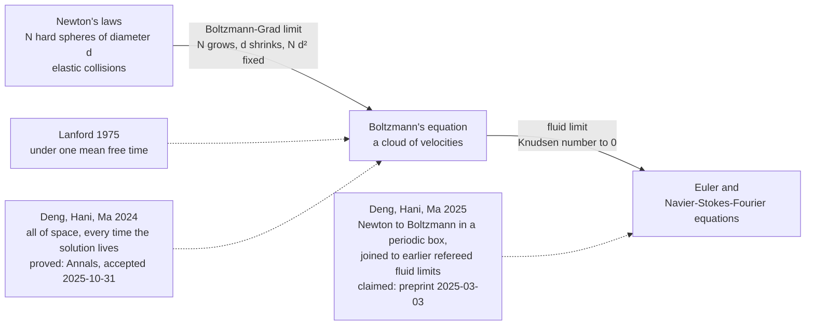
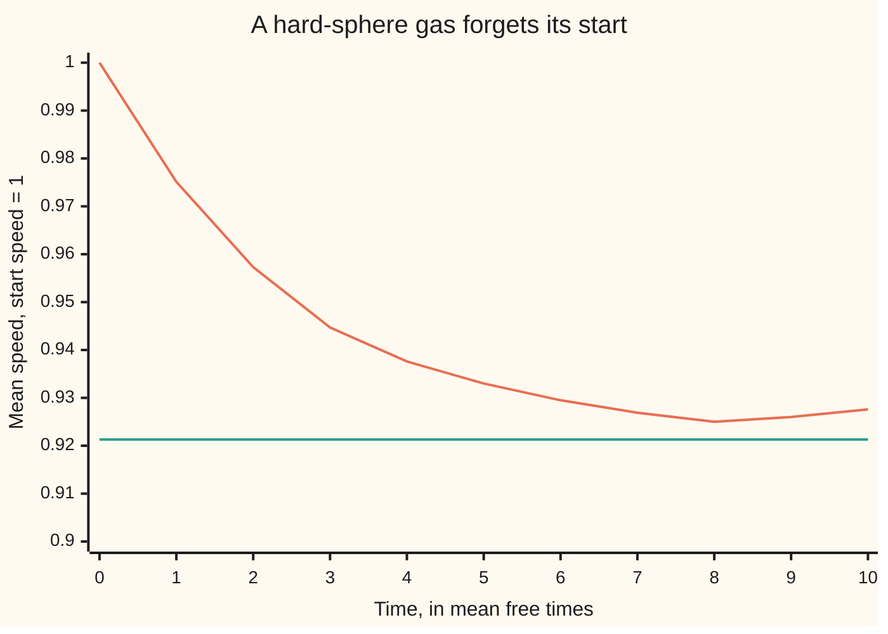

# Hilbert's sixth problem: fluid equations derived from colliding hard spheres

[Syllabus](../../../SYLLABUS.md) → [Frontier](../README.md) → [Analysis and Dynamics](../README.md#s05) → Hilbert's sixth problem

---

## General Overview

Take the air in a room at 20 °C and normal pressure. One cubic metre holds about $`2.5 \times 10^{25}`$ molecules. Each one moves at about 463 m/s on average and is hit about 6.8 billion times a second. Between hits it travels only about 68 nm, the **mean free path**.

An engineer ignores all of that. She describes the same air with a few smooth fields: density, velocity and temperature at each point, governed by the Euler or [Navier-Stokes](../../13-Engineering%20mathematics/08-Fluids%20and%20Heat/03-navier-stokes-and-the-reynolds-number.md) equations. Why is that allowed? The equations were guessed from experiments, not derived from the molecules.

In 1900 David Hilbert asked for the derivation. In his sixth problem he wrote that Boltzmann's work "suggests the problem of developing mathematically the limiting processes, there merely indicated, which lead from the atomistic view to the laws of motion of continua." The usual route has two steps:

1. **Newton to Boltzmann.** Model molecules as tiny hard balls that obey Newton's laws. Let their number grow and their size shrink. The share of molecules at each place with each velocity should then obey Boltzmann's equation, an equation for a gas as a cloud of velocities.
2. **Boltzmann to fluids.** Let collisions become very frequent compared with the size of the flow. The cloud should then settle into a smooth fluid that obeys the Euler or Navier-Stokes equations.

Step 1 was proved by Oscar Lanford in 1975, but only for a short time: less than one mean free time, the average time between hits. For room air that is under 146.6 picoseconds. In 2024 Yu Deng, Zaher Hani and Xiao Ma extended it, in all of space, to every time for which Boltzmann's equation has a regular solution. In a 2025 preprint they redid step 1 in a periodic box and joined it to earlier, refereed work on step 2, to complete the chain for hard spheres.

**Status, as of 2026-11-24.**

- **Newton to Boltzmann in all of space (dimension 2 and up), for every time the solution lives: proved.** The 2024 paper was accepted by the *Annals of Mathematics* on 2025-10-31. Deng's 2026 Fields Medal citation names it (2026-07-23).
- **Newton to Boltzmann in a periodic box (2-D and 3-D), and with it the full chain to the fluid equations: claimed.** The 2025 preprint (2025-03-03) has no refereed publication found. Its new mathematics is the periodic-box step; the Boltzmann-to-fluid limits it plugs in are earlier refereed work. The Fields citation names neither the box nor the fluid equations.
- **Hilbert's sixth problem as a whole: no status.** It asks for a programme, "axiomatise physics", not a yes-or-no statement.

**Hard spheres obeying Newton's laws, made more numerous and smaller with their total cross-section held fixed, follow Boltzmann's equation; let collisions dominate and Boltzmann's equation becomes the equations of fluids, which is the chain Hilbert asked for in 1900.**

**What kind of fact this is:** two theorems by kind, with the statuses above, outlined on this card with their sources; both are limit theorems, with no error bound at room-air values. The mean free path of 67.86 nm is a kinetic-theory computation from a model of air as hard spheres, checked against a gas run by Newton's laws.

### The picture: two limits, two statuses



Solid arrows are the two limits Hilbert asked for. Dotted arrows show who proved which step, and the status of each. The Navier-Stokes-Fourier equations are the Navier-Stokes equations for the velocity together with Fourier's law of heat flow for the temperature.

---

## The formula

This card introduces one new object. The **distribution** $`f(t, x, v)`$ counts molecules near position $`x`$ moving with velocity near $`v`$ at time $`t`$, per unit volume and per unit of velocity. Boltzmann's equation for hard spheres of diameter $`d`$ reads:

```math
\frac{\partial f}{\partial t} + v\cdot\nabla_x f = d^2 \int_{\mathbb{R}^3}\int_{S^2} \big[f(v')\,f(v_1') - f(v)\,f(v_1)\big]\,\big((v_1 - v)\cdot\omega\big)_+ \,d\omega\, dv_1
```

**Read it aloud:** the cloud at each velocity drifts in a straight line, and changes only through collisions; each collision adds molecules at the outgoing velocities and removes them at the incoming ones, at a rate set by the diameter squared and the speed of approach.

Here $`\nabla_x`$ is the gradient (the rate of change across space), $`S^2`$ the set of unit directions, $`(\cdot)_+`$ "the value if positive, else 0", and $`\omega`$ the direction joining the two centres at contact. The outgoing velocities swap the parts of the two velocities along $`\omega`$: $`v' = v + ((v_1 - v)\cdot\omega)\,\omega`$ and $`v_1' = v_1 - ((v_1 - v)\cdot\omega)\,\omega`$.

Two numbers come out of the right-hand side. In a gas at rest with $`n`$ molecules per unit volume, the **mean free path** and the **mean free time** are:

```math
\lambda = \frac{1}{\sqrt{2}\,\pi\, d^2\, n}, \qquad \tau = \frac{\lambda}{\bar v}
```

**Read it aloud:** the distance between hits is one over root two times the target area of one molecule times the number of molecules per unit volume; the time between hits is that distance over the mean speed.

For room air: $`\lambda`$ = 67.86 nm and $`\tau`$ = 146.6 ps. The **Knudsen number** $`\mathrm{Kn} = \lambda / L`$ compares the mean free path with the size $`L`$ of the flow. For a 4 m room it is $`1.696 \times 10^{-8}`$.

| Symbol | Plain meaning | In our example | Push it up and the answer… |
| --- | --- | --- | --- |
| $`f(t, x, v)`$ | the distribution: molecules per unit volume per unit of velocity | room air at rest, a bell-shaped (Maxwell) spread of velocities | — |
| $`t`$; $`x`$; $`v`$, $`v_1`$ | time; position; the velocities of two molecules about to collide | — | — |
| $`v'`$, $`v_1'`$; $`\omega`$ | the velocities after the collision; the unit direction joining the centres at contact | — | — |
| $`\nabla_x`$; $`\mathbb{R}^3`$, $`S^2`$; $`(\cdot)_+`$, $`\langle\cdot\rangle`$ | the gradient in position; all of space, and the set of all unit directions; "the value if positive, else 0", and an average over the gas | — | — |
| $`p`$; $`T`$; $`k`$; $`m`$ | pressure; temperature; Boltzmann's constant, $`1.380649 \times 10^{-23}`$ J/K (exact in SI); one molecule's mass, in u (the atomic mass unit, a twelfth of a carbon-12 atom) | 101,325 Pa; 293.15 K; —; 28.97 u | — |
| $`d`$ | sphere diameter | 0.364 nm, a typical hard-sphere size for nitrogen (illustrative) | shorter free path, as $`1/d^2`$ |
| $`N`$; $`n`$ | number of spheres; number per unit volume | $`n = 2.5035 \times 10^{25}`$ per m³ | shorter free path |
| $`\lambda`$ | mean free path: average distance between hits | 67.86 nm | — |
| $`\bar v`$; $`\tau`$ | mean molecular speed; mean free time, $`\lambda/\bar v`$ | 462.9 m/s; 146.6 ps | — |
| $`\phi`$ | volume fraction: the share of space the spheres fill, $`n\pi d^3/6`$ | $`6.322 \times 10^{-4}`$ | the gas is no longer dilute |
| $`\mathrm{Kn}`$; $`L`$ | Knudsen number $`\lambda/L`$; the size of the flow | $`1.696 \times 10^{-8}`$; a 4 m room | molecules matter, fluid equations fail |
| $`\varepsilon`$ | the papers' name for the diameter as it shrinks to 0; in a periodic box, in units of the box side | $`9.10 \times 10^{-11}`$ in a 4 m box | — |

### When it holds

- **Hard spheres, colliding elastically.** Real molecules attract weakly and repel softly. The theorems are for hard spheres; other short-range forces are covered for short times only (Gallagher, Saint-Raymond and Texier, 2014). The size 0.364 nm is a fit, not a law.
- **A dilute gas: $`N d^2`$ fixed while $`d`$ shrinks.** Then the volume fraction goes to 0. Water is not dilute, so the chain says nothing direct about liquids.
- **Independent molecules at the start.** The theorem assumes the initial positions and velocities are random and independent, apart from not overlapping. A prepared, correlated start can break Boltzmann's equation.
- **A regular Boltzmann solution.** The derivation runs as long as the Boltzmann solution stays bounded and smooth. If that solution breaks down, the theorem stops there.
- **For the fluid step: a periodic box and smooth fluid data.** The 2025 preprint works in a 2-D or 3-D periodic box (a torus), from data near a still gas or a smooth Euler solution. Rough data or other boxes are not covered.

---

## Why it works

This section outlines research proofs that run to hundreds of pages: statements, key steps and sources, not a proof.

### Step 0: collisions are rare, and partners are strangers

Boltzmann's equation rests on one assumption, **molecular chaos**: two molecules about to collide have never met, so their velocities are independent. Then the collision rate is a product, $`f(v)\,f(v_1)`$, and the equation closes.

In a real gas, molecules that collided once carry a memory of each other. They could meet again (a **recollision**), and then their velocities are not independent. The whole difficulty is to show that such memories are rare. Newton's laws run forward and backward equally well, while Boltzmann's equation has a direction in time. Some step must lose information, and molecular chaos is that step.

### Step 1: counting collisions gives the mean free path

A sphere of diameter $`d`$ hits another when their centres come within $`d`$. So, as it moves, it sweeps a tube of cross-section $`\pi d^2`$. Per unit time it meets the others at the rate $`\pi d^2 n`$ times their average speed of approach.

That speed of approach is the average of $`\lvert v - v_1\rvert`$. For two independent Maxwell velocities, the difference is again Maxwell-shaped, with twice the variance, so its mean is $`\sqrt{2}`$ times the mean speed. Distance per hit is then $`\bar v / (\sqrt{2}\,\pi d^2 n \bar v)`$, which is the formula for $`\lambda`$.

<details>
<summary>Why the factor is exactly root two</summary>

Each velocity component of a Maxwell gas is normal with mean 0 and variance $`kT/m`$, independently. The difference of two independent such components is normal with variance $`2kT/m`$. So $`v - v_1`$ has the same shape as $`\sqrt{2}\,v`$, and

$`\displaystyle \langle \lvert v - v_1\rvert \rangle = \sqrt{2}\,\langle\lvert v\rvert\rangle = \sqrt{2}\,\bar v .`$

The code checks this by drawing 100,000 random Maxwell pairs: the ratio comes out at 1.4169, against $`\sqrt{2}`$ = 1.4142. Dropping the $`\sqrt{2}`$ treats the other molecules as standing still.

</details>

### Step 2: the Boltzmann-Grad limit keeps the free path fixed

Written for the share of molecules, $`f/N`$, Boltzmann's equation depends on $`N`$ and $`d`$ only through $`N d^2`$. So it can be an exact limit only if $`N d^2`$, and with it the free path, stays the same as the molecules multiply. Harold Grad introduced this scaling; it is now called the **Boltzmann-Grad limit**.

In one cubic metre of air, halve $`d`$ three times and multiply $`N`$ by 4 each time:

| $`d`$ | $`N`$ | $`N d^2`$ | $`\lambda`$ | volume fraction $`\phi`$ |
| --- | --- | --- | --- | --- |
| 0.3640 nm | $`2.503 \times 10^{25}`$ | $`3.3170 \times 10^{6}`$ m² | 67.86 nm | $`6.322 \times 10^{-4}`$ |
| 0.1820 nm | $`1.001 \times 10^{26}`$ | $`3.3170 \times 10^{6}`$ m² | 67.86 nm | $`3.161 \times 10^{-4}`$ |
| 0.0910 nm | $`4.006 \times 10^{26}`$ | $`3.3170 \times 10^{6}`$ m² | 67.86 nm | $`1.580 \times 10^{-4}`$ |
| 0.0455 nm | $`1.602 \times 10^{27}`$ | $`3.3170 \times 10^{6}`$ m² | 67.86 nm | $`7.902 \times 10^{-5}`$ |

The free path stays put while the spheres fill less and less of space. Each sphere still hits about one other per mean free time, but the chance of hitting the same one twice shrinks. That is why molecular chaos can become exact in the limit.

### Step 3: Lanford's theorem, for a short time (1975)

Lanford wrote the state of the gas at time $`t`$ as a sum over **collision histories**: which spheres hit which, in what order, before time $`t`$. Each history is a tree of collisions traced backward from one sphere.

The number of such trees grows like a factorial of the number of collisions. Lanford could bound the sum only by a geometric series in the time elapsed, which converges only while $`t`$ is a fraction of the mean free time. Within that window, he showed that recollisions contribute nothing in the limit, and the sum converges to the solution of Boltzmann's equation.

For room air, the whole window is shorter than 146.6 ps, while one second holds $`6.821 \times 10^{9}`$ mean free times.

### Step 4: Deng, Hani and Ma reach every time the solution lives (2024)

The 2024 paper removes the short-time barrier. Its main theorem, in all of space of any dimension from 2 up: start $`N`$ hard spheres independently, with a density whose Boltzmann solution stays regular on a time interval $`[0, T]`$. Then, in the Boltzmann-Grad limit, the share of spheres at each position and velocity converges to that solution on all of $`[0, T]`$.

The key steps, as the paper and the independent Bourbaki exposition present them:

1. **Cumulants, not raw histories.** Instead of summing histories directly, the proof expands in **cumulants**: the parts of the joint statistics of several spheres that are not explained by smaller groups. These measure exactly the correlations that molecular chaos ignores.
2. **Molecules.** Each term is drawn as a diagram, which the authors call a **molecule**: collisions as atoms, the free flights between collisions as edges, and each sphere's whole path as a chain of edges (a particle line).
3. **A cutting algorithm.** A combinatorial procedure cuts each molecule into pieces whose integrals can be bounded. It shows that diagrams with many recollisions are small, without the factorial loss that stopped Lanford.

The result holds on any fixed time interval where Boltzmann's solution is regular. If that solution stays bounded for all time, the time reached can even grow as the diameter shrinks, but only very slowly.

These are limit theorems: the error goes to 0 as the diameter shrinks, but no bound applies at room-air values. The 2025 paper needs the collision rate times the time to stay well below the square root of $`\log\lvert\log\varepsilon\rvert`$, where $`\varepsilon`$ is the diameter in units of the periodic box's side. For room air in a 4 m box, $`\varepsilon`$ = $`9.10 \times 10^{-11}`$ and that square root is only 1.772, while the rate alone, $`N\varepsilon^2`$, is $`1.327 \times 10^{7}`$.

### Step 5: from Boltzmann to fluids (the 2025 preprint)

When the Knudsen number is small, collisions happen far more often than the flow changes. Each small region then settles to a bell-shaped Maxwell distribution with its own density, velocity and temperature. Averaging Boltzmann's equation over velocities gives conservation of mass, momentum and energy for those three fields: the compressible Euler equations. The first correction, from the small spread around the Maxwell shape, adds viscosity and heat conduction: the Navier-Stokes-Fourier equations.

This second limit had been studied for decades; the preprint plugs in earlier refereed results. What was missing was a first step lasting long enough to feed it. The 2025 preprint:

1. extends the 2024 theorem from all of space to a periodic box, in two and three dimensions, with a new cutting algorithm, since in a box a few spheres can meet again and again; this is its new, unrefereed mathematics;
2. starts the spheres from smooth fluid data: close to a gas at rest for Navier-Stokes-Fourier, and from any smooth Euler solution for Euler;
3. takes the Boltzmann-Grad limit, then lets the Knudsen number go to 0, or both together under a stated condition on how fast;
4. obtains the incompressible Navier-Stokes-Fourier equations, and in a second theorem the compressible Euler equations, for as long as the fluid solution stays smooth.

The Navier-Stokes-Fourier theorem starts from small, slow disturbances of a still gas, room air's low-speed regime; that is why its equations come out incompressible. The compressible Navier-Stokes equations are not derived.

That last clause links this card to [Navier-Stokes](../02-The%20Millennium%20Problems/04-navier-stokes-existence-and-smoothness.md). The derivation holds while the fluid solution is smooth. It says nothing about whether that solution blows up.

### Step 6: the status ledger

| Date | Event | Kind of record |
| --- | --- | --- |
| 1900 | Hilbert poses the sixth problem in Paris; printed in English in 1902 | problem statement |
| 1975 | Lanford proves Newton to Boltzmann for hard spheres, for a fraction of the mean free time | refereed: *Lecture Notes in Physics* 38 |
| 2014 | Gallagher, Saint-Raymond and Texier extend Lanford's theorem to short-range forces, still for short time | refereed book |
| 2024-08-14 | Deng, Hani and Ma post the long-time derivation of Boltzmann's equation in all of space, arXiv:2408.07818 | preprint |
| 2025-03-03 | Deng, Hani and Ma post the same derivation in a periodic box and, from it, the fluid equations, arXiv:2503.01800 | preprint |
| 2025-04-07 | A comment by Shan Gao accepts the mathematics but argues the sixth problem stays open: the limit describes a dilute gas, not a dense fluid | preprint, physical objection |
| 2025-10-31 | The long-time Boltzmann paper (all of space) is accepted by the *Annals of Mathematics* | refereed: Newton to Boltzmann in all of space **proved** |
| 2026-02-04 | Bodineau, Gallagher, Saint-Raymond and Simonella post a Bourbaki seminar exposition of the 2024 proof | independent exposition |
| 2026-07-23 | Deng receives a Fields Medal; the citation names "the rigorous derivation of the Boltzmann equation from hard-sphere dynamics for rarefied gases" | prize, for the Boltzmann step only |
| 2026-11-24 | No refereed publication of the 2025 paper found | periodic box and fluid chain: **claimed** |

The prize row follows the rule of [Prize citations](../01-How%20Research%20Works/08-reading-a-prize-citation.md): a citation counts as acceptance only for the results it names, with the scope it names. This one names the Boltzmann derivation, not a periodic box or the fluid equations, so it upgrades nothing in the 2025 paper.

As register rows:

| Row | Problem | Kind | Status | Since | Checked | Primary source |
| --- | --- | --- | --- | --- | --- | --- |
| HILB6B | Hilbert's sixth problem: Newton to Boltzmann in all of space | theorem | proved | 2025-10-31 | 2026-11-24 | [Annals page](https://annals.math.princeton.edu/articles/22284); [arXiv:2408.07818](https://arxiv.org/abs/2408.07818) |
| HILB6F | Hilbert's sixth problem: Newton to Boltzmann in a periodic box, and the fluid chain | theorem | claimed | 2025-03-03 | 2026-11-24 | [arXiv:2503.01800](https://arxiv.org/abs/2503.01800) |

---

## Worked numbers, by hand

Room air at 20 °C (293.15 K) and 101,325 Pa, modelled as hard spheres of diameter 0.364 nm and mass 28.97 u, air's average molecular mass.

| Step | Arithmetic | Value |
| --- | --- | --- |
| molecules per m³ | $`p/(kT)`$ = 101,325 ÷ ($`1.380649 \times 10^{-23}`$ × 293.15) | $`2.5035 \times 10^{25}`$ |
| target area | $`\pi d^2`$ = π × $`(0.364 \times 10^{-9})^2`$ | $`4.162 \times 10^{-19}`$ m² |
| mean free path | 1 ÷ ($`\sqrt{2}`$ × target area × $`n`$) | **67.86 nm** |
| mean speed | $`\sqrt{8kT/(\pi m)}`$ | 462.9 m/s |
| mean free time | 67.86 nm ÷ 462.9 m/s | 146.6 ps |
| hits per second | 1 ÷ mean free time | $`6.821 \times 10^{9}`$ |
| volume fraction | $`n \pi d^3/6`$ | $`6.322 \times 10^{-4}`$ |
| Knudsen number, 4 m room | 67.86 nm ÷ 4 m | $`1.696 \times 10^{-8}`$ |

A molecule of room air travels about 68 nm between hits, far more than its own size, and the spheres fill less than a thousandth of the space: the dilute regime the theorems describe.

### What breaks if you drop a piece

| Mistake | Comes out at | What went wrong |
| --- | --- | --- |
| Drop the $`\sqrt{2}`$ | 95.96 nm | Treats the other molecules as standing still; their own motion raises the rate of approach by $`\sqrt{2}`$ |
| Use the radius for the diameter in $`\pi d^2`$ | 271.42 nm | Centres collide at distance $`d`$, not $`d/2`$; the target area is four times larger than this gives |
| Shrink $`d`$ by 8 keeping $`N d^3`$ fixed instead of $`N d^2`$ | 8.48 nm, and falling to 0 | The packing stays fixed, the free path shrinks to 0, and the limit is a dense fluid: no Boltzmann equation |
| Read either theorem as a statement about one second of real air | $`6.821 \times 10^{9}`$ mean free times; Lanford reaches a fraction of one, and the 2025 condition allows rate times time only well below 1.772 | Both are limits as the diameter goes to 0, with no error bound at room-air values |

---

## A gas run by Newton's laws, watched by Boltzmann

The puzzle: Newton's laws keep every detail and run equally well backward. Boltzmann's equation forgets details and only runs forward. Can a gas of hard spheres, run exactly by Newton's laws, behave as Boltzmann's equation says?

The code runs one. It places 64 spheres of diameter 1 at random in a box of side 18.85, a packing of 0.0050. Every sphere starts at speed exactly 1, in a random direction. It then follows every collision exactly, by Newton's laws, and repeats this for 48 independent boxes.

### One force at a time: collisions

Boltzmann's formula predicts a mean free path of 23.93 diameters for this gas. The spheres, run by Newton's laws, travel 23.57 diameters per hit on average, over 17,951 free paths. Free paths are counted from 2 mean free times on, once the speeds have mostly spread, and only away from the walls, where a sphere has partners on every side.

```
Boltzmann's formula        ████████████████████████████████████████████████  23.93
Newton, measured           ███████████████████████████████████████████████   23.57
formula without root two   ████████████████████████████████████████████████████████████████████  33.84
```

The measured path is 1.5 percent shorter than the formula, a ratio of 1.0151. Boltzmann's equation treats the spheres as points. At this packing their own volume alone raises the collision rate by a factor of about 1.0126, the usual dense-gas correction $`(1 - \phi/2)/(1 - \phi)^3`$; the rest of the gap is the noise of a finite sample. Each box keeps its energy, the sum of the squared speeds: 64 at the start, 64.000000000 at the end.

### One force at a time: forgetting the start

All speeds start at 1. Collisions trade energy, so the speeds spread out while the total energy stays fixed. Boltzmann's equation predicts the spread ends at Maxwell's bell shape, whose mean speed is $`\sqrt{8/(3\pi)}`$ = 0.9213 for this energy.

| Time, in mean free times | 0 | 1 | 2 | 4 | 6 | 10 |
| --- | --- | --- | --- | --- | --- | --- |
| mean speed | 1.0000 | 0.9751 | 0.9573 | 0.9376 | 0.9295 | 0.9276 |



Orange: the mean speed of all 3,072 spheres run by Newton's laws. Green: Maxwell's value, 0.9213, where Boltzmann's equation says the gas ends.

The gas needs several mean free times to settle. Lanford's theorem covers only a fraction of the first one, at the far left of the chart. In the limit of many small spheres, the 2024 theorem covers the whole time span shown, and beyond. The wobble at the end, 0.9250, 0.9260, then 0.9276, is the noise of a finite sample.

---

## Code, from first principles, and it actually runs

The code takes two roads to the mean free path: Boltzmann's formula, and a hard-sphere gas run exactly by Newton's laws in an **event-driven** simulation, which jumps from one collision to the next and solves for each collision time exactly. A third road checks the root two on random Maxwell pairs, and every box must keep its energy. The random numbers come from SplitMix64, a small generator written out in both languages, so Python and Rust print the same output; the Box-Muller formula turns two of them into two bell-curve (normal) numbers.

### Python

```python
# Hilbert's sixth problem -- the check behind the card.  Standard library only.
# Roads: the mean free path from the formula and from a hard-sphere gas run by
# Newton's laws (written out); the root 2 from Maxwell pairs drawn at random.
import math
K, T, P, U = 1.380649e-23, 293.15, 101325.0, 1.66053906660e-27  # SI, exact or CODATA
D, MASS, ROOM = 3.64e-10, 28.97 * U, 4.0   # sphere diameter (illustrative), air's mass, room size
def mfp(n, d): return 1.0 / (math.sqrt(2.0) * math.pi * d * d * n)   # Boltzmann's mean free path
n = P / (K * T)
lam, vbar = mfp(n, D), math.sqrt(8.0 * K * T / (math.pi * MASS))
tau, phi = lam / vbar, n * math.pi * D * D * D / 6.0
print("air at 20 C, 1 atm; hard spheres of diameter 0.364 nm")
print(f"n from p/(kT)                {n:.4e} per m^3")
print(f"mean free path               {lam * 1e9:.2f} nm  (target area {math.pi * D * D:.3e} m^2)")
print(f"mean speed                   {vbar:.1f} m/s")
print(f"mean free time               {tau * 1e12:.1f} ps")
print(f"collisions per second each   {1.0 / tau:.3e}  (= mean free times in 1 s)")
print(f"volume fraction of spheres   {phi:.3e}")
print(f"Knudsen number, 4 m room     {lam / ROOM:.3e}")
print(f"periodic 4 m box: eps = d/L  {D / ROOM:.2e}  rate N eps^2 = {n * ROOM * D * D:.3e}"
      f"  (log|log eps|)^(1/2) = {math.sqrt(math.log(-math.log(D / ROOM))):.3f}")
assert abs(lam * 1e9 - 68.0) < 1.0          # quoted: about 68 nm
print("Boltzmann-Grad limit in 1 m^3: shrink d, keep N d^2 fixed")
for k in range(4):
    d, nk = D / 2 ** k, n * 4 ** k
    print(f"  d = {d * 1e9:.4f} nm  N = {nk:.3e}  N d^2 = {nk * d * d:.4e} m^2"
          f"  path = {mfp(nk, d) * 1e9:.2f} nm  fraction = {nk * math.pi * d * d * d / 6.0:.3e}")
print("what breaks")
print(f"  drop sqrt 2                 {lam * math.sqrt(2.0) * 1e9:.2f} nm")
print(f"  radius for diameter         {mfp(n, D / 2) * 1e9:.2f} nm")
print(f"  keep N d^3 fixed, d/8       {mfp(n * 8 ** 3, D / 8) * 1e9:.2f} nm")
# ---- random numbers (SplitMix64); Maxwell pairs; Newton's laws for hard spheres in a box ----
def splitmix(s):
    s = (s + 0x9E3779B97F4A7C15) & 0xFFFFFFFFFFFFFFFF
    z = ((s ^ (s >> 30)) * 0xBF58476D1CE4E5B9) & 0xFFFFFFFFFFFFFFFF
    z = ((z ^ (z >> 27)) * 0x94D049BB133111EB) & 0xFFFFFFFFFFFFFFFF
    return s, (z ^ (z >> 31)) >> 11

s, rel, spd, PAIRS = 7, 0.0, 0.0, 100000    # Maxwell pairs: normal components by Box-Muller
for _ in range(PAIRS):
    z = []
    while len(z) < 6:
        s, a = splitmix(s); s, b = splitmix(s)
        r, th = math.sqrt(-2.0 * math.log((a + 1) / 2.0 ** 53)), 2.0 * math.pi * b / 2.0 ** 53
        z += [r * math.cos(th), r * math.sin(th)]
    w = [z[0] - z[3], z[1] - z[4], z[2] - z[5]]
    rel += math.sqrt(w[0] * w[0] + w[1] * w[1] + w[2] * w[2]); spd += math.sqrt(z[0] * z[0] + z[1] * z[1] + z[2] * z[2])
print(f"Maxwell pairs, {PAIRS} drawn: mean |v - v1| / mean |v| = {rel / spd:.4f}  (sqrt 2 = {math.sqrt(2.0):.4f})")
assert abs(rel / spd - math.sqrt(2.0)) < 0.01

NP, BOX, REPS = 64, 18.85, 48              # spheres of diameter 1, box side, independent gases
VOL = BOX * BOX * BOX; PACK = NP * math.pi / 6.0 / VOL   # box volume; share the spheres fill
LAM = mfp((NP - 1) / VOL, 1.0)             # Boltzmann's mean free path, in diameters
VMAX = math.sqrt(8.0 / (3.0 * math.pi))    # Maxwell mean speed when every start speed is 1
TAU = LAM / VMAX
GRID = [float(k) for k in range(11)]       # times, in mean free times

def predict(i, x, v, now):
    best, who = math.inf, -1
    for a in range(3):
        if v[i][a] != 0.0:
            t = ((BOX if v[i][a] > 0.0 else 0.0) - x[i][a]) / v[i][a]
            if t < best: best, who = t, -1 - a
    for j in range(NP):
        if j == i: continue
        dr, dv = [x[i][a] - x[j][a] for a in range(3)], [v[i][a] - v[j][a] for a in range(3)]
        b = dr[0] * dv[0] + dr[1] * dv[1] + dr[2] * dv[2]
        if b >= 0.0: continue
        vv = dv[0] * dv[0] + dv[1] * dv[1] + dv[2] * dv[2]
        disc = b * b - vv * (dr[0] * dr[0] + dr[1] * dr[1] + dr[2] * dr[2] - 1.0)
        if disc < 0.0: continue
        t = max((-b - math.sqrt(disc)) / vv, 0.0)
        if t < best: best, who = t, j
    return (now + best, who)

def inside(p, w, dt):                      # path inside the core, one diameter from every wall
    t0, t1 = 0.0, dt
    for a in range(3):
        if w[a] == 0.0:
            if not 1.0 <= p[a] <= BOX - 1.0: return 0.0
            continue
        ta, tb = (1.0 - p[a]) / w[a], (BOX - 1.0 - p[a]) / w[a]
        t0, t1 = max(t0, min(ta, tb)), min(t1, max(ta, tb))
    if dt == 0.0: return 1 if t0 <= t1 else 0
    return max(t1 - t0, 0.0) * math.sqrt(w[0] * w[0] + w[1] * w[1] + w[2] * w[2])

def gas(seed, speed_sum, counts):
    s, x, v = seed, [], []
    while len(x) < NP:
        p = []
        for a in range(3):
            s, r = splitmix(s); p.append(BOX * r / 2.0 ** 53)
        if all((p[0] - q[0]) * (p[0] - q[0]) + (p[1] - q[1]) * (p[1] - q[1])
               + (p[2] - q[2]) * (p[2] - q[2]) > 1.0 for q in x): x.append(p)
    while len(v) < NP:
        w = []
        for a in range(3):
            s, r = splitmix(s); w.append(2.0 * r / 2.0 ** 53 - 1.0)
        r2 = w[0] * w[0] + w[1] * w[1] + w[2] * w[2]
        if 0.01 < r2 < 1.0: v.append([c / math.sqrt(r2) for c in w])
    ev, now, g, end = [predict(i, x, v, 0.0) for i in range(NP)], 0.0, 0, GRID[-1] * TAU
    while True:
        i = min(range(NP), key=lambda k: ev[k][0])
        te = min(ev[i][0], end)
        while g < len(GRID) and GRID[g] * TAU <= te:
            speed_sum[g] += sum(math.sqrt(w[0] * w[0] + w[1] * w[1] + w[2] * w[2]) for w in v); g += 1
        dt = te - now
        if now >= 2.0 * TAU:
            for k in range(NP): counts[1] += inside(x[k], v[k], dt)
        for k in range(NP): x[k] = [x[k][a] + v[k][a] * dt for a in range(3)]
        now = te
        if te >= end: return sum(w[0] * w[0] + w[1] * w[1] + w[2] * w[2] for w in v)   # energy, x2
        j = ev[i][1]
        if j < 0:
            v[i][-1 - j] = -v[i][-1 - j]; moved = [i]
        else:
            moved, dr, dv = [i, j], [x[i][a] - x[j][a] for a in range(3)], [v[i][a] - v[j][a] for a in range(3)]
            f = (dr[0] * dv[0] + dr[1] * dv[1] + dr[2] * dv[2]) / (dr[0] * dr[0] + dr[1] * dr[1] + dr[2] * dr[2])
            for a in range(3): v[i][a] -= f * dr[a]; v[j][a] += f * dr[a]
            if now >= 2.0 * TAU: counts[0] += inside(x[i], v[i], 0.0) + inside(x[j], v[j], 0.0)
        for k in moved: ev[k] = predict(k, x, v, now)
        for k in range(NP):
            if k not in moved and ev[k][1] in moved: ev[k] = predict(k, x, v, now)

speed_sum, counts = [0.0] * len(GRID), [0, 0.0]
energy = [gas(1000 + r, speed_sum, counts) for r in range(REPS)]
mean_speed, lam_sim = [s / (NP * REPS) for s in speed_sum], counts[1] / counts[0]
print(f"hard-sphere gas: {REPS} boxes of {NP} = {REPS * NP} spheres, packing {PACK:.4f}")
print(f"sum of v^2 in each box       {NP} at the start, {min(energy):.9f} to {max(energy):.9f} at the end")
print(f"Boltzmann mean free path     {LAM:.2f} diameters")
print(f"Newton, measured             {lam_sim:.2f} diameters from {counts[0]} free paths")
print(f"ratio Boltzmann/measured     {LAM / lam_sim:.4f}  (own-volume factor"
      f" {(1.0 - PACK / 2.0) / ((1.0 - PACK) * (1.0 - PACK) * (1.0 - PACK)):.4f})")
print(f"ratio without sqrt 2         {LAM * math.sqrt(2.0) / lam_sim:.4f}  (path {LAM * math.sqrt(2.0):.2f})")
print(f"Maxwell mean speed           {VMAX:.4f}")
for g in range(len(GRID)):
    print(f"t = {GRID[g]:4.1f} mean free times  mean speed {mean_speed[g]:.4f}")
assert abs(LAM / lam_sim - 1.0) < 0.04      # Boltzmann's formula against the Newton gas
assert abs(mean_speed[-1] - VMAX) < 0.02    # Maxwell's mean speed against the Newton gas
assert max(abs(e - NP) for e in energy) < 1e-9   # collisions keep the energy
print("ALL CHECKS PASS")
```

**Ran 2026-11-24 on macOS, Python 3.14.10, standard library only. All checks passed. Output, pasted from the run:**

```
air at 20 C, 1 atm; hard spheres of diameter 0.364 nm
n from p/(kT)                2.5035e+25 per m^3
mean free path               67.86 nm  (target area 4.162e-19 m^2)
mean speed                   462.9 m/s
mean free time               146.6 ps
collisions per second each   6.821e+09  (= mean free times in 1 s)
volume fraction of spheres   6.322e-04
Knudsen number, 4 m room     1.696e-08
periodic 4 m box: eps = d/L  9.10e-11  rate N eps^2 = 1.327e+07  (log|log eps|)^(1/2) = 1.772
Boltzmann-Grad limit in 1 m^3: shrink d, keep N d^2 fixed
  d = 0.3640 nm  N = 2.503e+25  N d^2 = 3.3170e+06 m^2  path = 67.86 nm  fraction = 6.322e-04
  d = 0.1820 nm  N = 1.001e+26  N d^2 = 3.3170e+06 m^2  path = 67.86 nm  fraction = 3.161e-04
  d = 0.0910 nm  N = 4.006e+26  N d^2 = 3.3170e+06 m^2  path = 67.86 nm  fraction = 1.580e-04
  d = 0.0455 nm  N = 1.602e+27  N d^2 = 3.3170e+06 m^2  path = 67.86 nm  fraction = 7.902e-05
what breaks
  drop sqrt 2                 95.96 nm
  radius for diameter         271.42 nm
  keep N d^3 fixed, d/8       8.48 nm
Maxwell pairs, 100000 drawn: mean |v - v1| / mean |v| = 1.4169  (sqrt 2 = 1.4142)
hard-sphere gas: 48 boxes of 64 = 3072 spheres, packing 0.0050
sum of v^2 in each box       64 at the start, 64.000000000 to 64.000000000 at the end
Boltzmann mean free path     23.93 diameters
Newton, measured             23.57 diameters from 17951 free paths
ratio Boltzmann/measured     1.0151  (own-volume factor 1.0126)
ratio without sqrt 2         1.4356  (path 33.84)
Maxwell mean speed           0.9213
t =  0.0 mean free times  mean speed 1.0000
t =  1.0 mean free times  mean speed 0.9751
t =  2.0 mean free times  mean speed 0.9573
t =  3.0 mean free times  mean speed 0.9447
t =  4.0 mean free times  mean speed 0.9376
t =  5.0 mean free times  mean speed 0.9330
t =  6.0 mean free times  mean speed 0.9295
t =  7.0 mean free times  mean speed 0.9269
t =  8.0 mean free times  mean speed 0.9250
t =  9.0 mean free times  mean speed 0.9260
t = 10.0 mean free times  mean speed 0.9276
ALL CHECKS PASS
```

### Rust

```rust
// Hilbert's sixth problem -- the check behind the card.  Rust std only.
// Roads: the mean free path from the formula and from a hard-sphere gas run by
// Newton's laws (written out); the root 2 from Maxwell pairs drawn at random.
use std::f64::consts::PI;
const K: f64 = 1.380649e-23; const T: f64 = 293.15; const P: f64 = 101325.0; const U: f64 = 1.66053906660e-27; // SI, exact or CODATA
const D: f64 = 3.64e-10; const ROOM: f64 = 4.0; // sphere diameter (illustrative), room size
const NP: usize = 64; const BOX: f64 = 18.85; const REPS: u64 = 48;
const GRID: [f64; 11] = [0.0, 1.0, 2.0, 3.0, 4.0, 5.0, 6.0, 7.0, 8.0, 9.0, 10.0]; // in mean free times

fn mfp(n: f64, d: f64) -> f64 { 1.0 / (2f64.sqrt() * PI * d * d * n) } // Boltzmann's mean free path
fn sci(x: f64, p: usize) -> String {     // Python-style e-notation: 2.5035e+25
    let s = format!("{:.*e}", p, x);
    let (m, e) = s.split_once('e').unwrap();
    let e: i32 = e.parse().unwrap();
    format!("{}e{}{:02}", m, if e < 0 { '-' } else { '+' }, e.abs())
}
fn splitmix(s: &mut u64) -> u64 {
    *s = s.wrapping_add(0x9E3779B97F4A7C15);
    let mut z = (*s ^ (*s >> 30)).wrapping_mul(0xBF58476D1CE4E5B9);
    z = (z ^ (z >> 27)).wrapping_mul(0x94D049BB133111EB);
    (z ^ (z >> 31)) >> 11
}
fn norm(w: &[f64; 3]) -> f64 { (w[0] * w[0] + w[1] * w[1] + w[2] * w[2]).sqrt() }

fn predict(i: usize, x: &[[f64; 3]], v: &[[f64; 3]], now: f64) -> (f64, i64) {
    let (mut best, mut who) = (f64::INFINITY, -1i64);
    for a in 0..3 {
        if v[i][a] == 0.0 { continue; }
        let t = ((if v[i][a] > 0.0 { BOX } else { 0.0 }) - x[i][a]) / v[i][a];
        if t < best { best = t; who = -1 - a as i64; }
    }
    for j in 0..NP {
        if j == i { continue; }
        let dr = [x[i][0] - x[j][0], x[i][1] - x[j][1], x[i][2] - x[j][2]];
        let dv = [v[i][0] - v[j][0], v[i][1] - v[j][1], v[i][2] - v[j][2]];
        let b = dr[0] * dv[0] + dr[1] * dv[1] + dr[2] * dv[2];
        if b >= 0.0 { continue; }
        let vv = dv[0] * dv[0] + dv[1] * dv[1] + dv[2] * dv[2];
        let disc = b * b - vv * (dr[0] * dr[0] + dr[1] * dr[1] + dr[2] * dr[2] - 1.0);
        if disc < 0.0 { continue; }
        let t = ((-b - disc.sqrt()) / vv).max(0.0);
        if t < best { best = t; who = j as i64; }
    }
    (now + best, who)
}

// path inside the core, one diameter from every wall (dt = 0: is the point inside?)
fn inside(p: &[f64; 3], w: &[f64; 3], dt: f64) -> f64 {
    let (mut t0, mut t1) = (0.0f64, dt);
    for a in 0..3 {
        if w[a] == 0.0 { if !(1.0 <= p[a] && p[a] <= BOX - 1.0) { return 0.0; } continue; }
        let (ta, tb) = ((1.0 - p[a]) / w[a], (BOX - 1.0 - p[a]) / w[a]);
        t0 = t0.max(ta.min(tb)); t1 = t1.min(ta.max(tb));
    }
    if dt == 0.0 { return if t0 <= t1 { 1.0 } else { 0.0 }; }
    (t1 - t0).max(0.0) * norm(w)
}

fn gas(seed: u64, tau: f64, speed_sum: &mut [f64], paths: &mut u64, length: &mut f64) -> f64 {
    let mut s = seed;
    let (mut x, mut v): (Vec<[f64; 3]>, Vec<[f64; 3]>) = (vec![], vec![]);
    while x.len() < NP {
        let mut p = [0.0; 3];
        for a in 0..3 { p[a] = BOX * splitmix(&mut s) as f64 / 2f64.powi(53); }
        if x.iter().all(|q| (p[0] - q[0]) * (p[0] - q[0]) + (p[1] - q[1]) * (p[1] - q[1])
            + (p[2] - q[2]) * (p[2] - q[2]) > 1.0) { x.push(p); }
    }
    while v.len() < NP {
        let mut w = [0.0; 3];
        for a in 0..3 { w[a] = 2.0 * splitmix(&mut s) as f64 / 2f64.powi(53) - 1.0; }
        let r2 = w[0] * w[0] + w[1] * w[1] + w[2] * w[2];
        if 0.01 < r2 && r2 < 1.0 { let r = r2.sqrt(); v.push([w[0] / r, w[1] / r, w[2] / r]); }
    }
    let mut ev: Vec<(f64, i64)> = (0..NP).map(|i| predict(i, &x, &v, 0.0)).collect();
    let (mut now, mut g, end) = (0.0f64, 0usize, GRID[10] * tau);
    loop {
        let mut i = 0; for k in 1..NP { if ev[k].0 < ev[i].0 { i = k; } }
        let te = ev[i].0.min(end);
        while g < GRID.len() && GRID[g] * tau <= te { speed_sum[g] += v.iter().fold(0.0, |acc, w| acc + norm(w)); g += 1; }
        let dt = te - now;
        if now >= 2.0 * tau { for k in 0..NP { *length += inside(&x[k], &v[k], dt); } }
        for k in 0..NP { for a in 0..3 { x[k][a] += v[k][a] * dt; } }
        now = te;
        if te >= end { return v.iter().fold(0.0, |acc, w| acc + (w[0] * w[0] + w[1] * w[1] + w[2] * w[2])); } // energy, x2
        let jj = ev[i].1;
        let moved: Vec<usize> = if jj < 0 {
            let a = (-1 - jj) as usize; v[i][a] = -v[i][a]; vec![i]
        } else {
            let j = jj as usize;
            let dr = [x[i][0] - x[j][0], x[i][1] - x[j][1], x[i][2] - x[j][2]];
            let dv = [v[i][0] - v[j][0], v[i][1] - v[j][1], v[i][2] - v[j][2]];
            let f = (dr[0] * dv[0] + dr[1] * dv[1] + dr[2] * dv[2]) / (dr[0] * dr[0] + dr[1] * dr[1] + dr[2] * dr[2]);
            for a in 0..3 { v[i][a] -= f * dr[a]; v[j][a] += f * dr[a]; }
            if now >= 2.0 * tau { *paths += (inside(&x[i], &v[i], 0.0) + inside(&x[j], &v[j], 0.0)) as u64; }
            vec![i, j]
        };
        for &k in &moved { ev[k] = predict(k, &x, &v, now); }
        for k in 0..NP {
            if !moved.contains(&k) && ev[k].1 >= 0 && moved.contains(&(ev[k].1 as usize)) {
                ev[k] = predict(k, &x, &v, now);
            }
        }
    }
}

fn main() {
    let n = P / (K * T);
    let (lam, vbar) = (mfp(n, D), (8.0 * K * T / (PI * (28.97 * U))).sqrt());
    let (tau, phi) = (lam / vbar, n * PI * D * D * D / 6.0);
    println!("air at 20 C, 1 atm; hard spheres of diameter 0.364 nm");
    println!("n from p/(kT)                {} per m^3", sci(n, 4));
    println!("mean free path               {:.2} nm  (target area {} m^2)", lam * 1e9, sci(PI * D * D, 3));
    println!("mean speed                   {:.1} m/s", vbar);
    println!("mean free time               {:.1} ps", tau * 1e12);
    println!("collisions per second each   {}  (= mean free times in 1 s)", sci(1.0 / tau, 3));
    println!("volume fraction of spheres   {}", sci(phi, 3));
    println!("Knudsen number, 4 m room     {}", sci(lam / ROOM, 3));
    println!("periodic 4 m box: eps = d/L  {}  rate N eps^2 = {}  (log|log eps|)^(1/2) = {:.3}",
             sci(D / ROOM, 2), sci(n * ROOM * D * D, 3), (-(D / ROOM).ln()).ln().sqrt());
    assert!((lam * 1e9 - 68.0).abs() < 1.0);  // quoted: about 68 nm
    println!("Boltzmann-Grad limit in 1 m^3: shrink d, keep N d^2 fixed");
    for k in 0..4 {
        let (d, nk) = (D / 2f64.powi(k), n * 4f64.powi(k));
        println!("  d = {:.4} nm  N = {}  N d^2 = {} m^2  path = {:.2} nm  fraction = {}",
                 d * 1e9, sci(nk, 3), sci(nk * d * d, 4), mfp(nk, d) * 1e9, sci(nk * PI * d * d * d / 6.0, 3));
    }
    println!("what breaks");
    println!("  drop sqrt 2                 {:.2} nm", lam * 2f64.sqrt() * 1e9);
    println!("  radius for diameter         {:.2} nm", mfp(n, D / 2.0) * 1e9);
    println!("  keep N d^3 fixed, d/8       {:.2} nm", mfp(n * 512.0, D / 8.0) * 1e9);
    // ---- Maxwell pairs: normal components by Box-Muller from SplitMix64 ----
    let (mut s, mut rel, mut spd, pairs) = (7u64, 0.0f64, 0.0f64, 100000);
    for _ in 0..pairs {
        let mut z = [0.0f64; 6];
        for k in 0..3 {
            let (a, b) = (splitmix(&mut s), splitmix(&mut s));
            let (r, th) = ((-2.0 * ((a + 1) as f64 / 2f64.powi(53)).ln()).sqrt(), 2.0 * PI * b as f64 / 2f64.powi(53));
            z[2 * k] = r * th.cos(); z[2 * k + 1] = r * th.sin();
        }
        rel += norm(&[z[0] - z[3], z[1] - z[4], z[2] - z[5]]); spd += norm(&[z[0], z[1], z[2]]);
    }
    println!("Maxwell pairs, {} drawn: mean |v - v1| / mean |v| = {:.4}  (sqrt 2 = {:.4})", pairs, rel / spd, 2f64.sqrt());
    assert!((rel / spd - 2f64.sqrt()).abs() < 0.01);
    // ---- Newton's laws for hard spheres: an event-driven gas in a box ----
    let vol = BOX * BOX * BOX;
    let pack = NP as f64 * PI / 6.0 / vol;                 // share of the box the spheres fill
    let lam_b = mfp((NP - 1) as f64 / vol, 1.0);           // Boltzmann's mean free path, in diameters
    let vmax = (8.0 / (3.0 * PI)).sqrt();                  // Maxwell mean speed when every start speed is 1
    let tau_b = lam_b / vmax;
    let (mut speed_sum, mut paths, mut length) = (vec![0.0; GRID.len()], 0u64, 0.0f64);
    let energy: Vec<f64> = (0..REPS).map(|r| gas(1000 + r, tau_b, &mut speed_sum, &mut paths, &mut length)).collect();
    let mean_speed: Vec<f64> = speed_sum.iter().map(|s| s / (NP as f64 * REPS as f64)).collect();
    let lam_sim = length / paths as f64;
    println!("hard-sphere gas: {} boxes of {} = {} spheres, packing {:.4}", REPS, NP, REPS * NP as u64, pack);
    let (emin, emax) = energy.iter().fold((f64::INFINITY, 0.0f64), |(a, b), &e| (a.min(e), b.max(e)));
    println!("sum of v^2 in each box       {} at the start, {:.9} to {:.9} at the end", NP, emin, emax);
    println!("Boltzmann mean free path     {:.2} diameters", lam_b);
    println!("Newton, measured             {:.2} diameters from {} free paths", lam_sim, paths);
    println!("ratio Boltzmann/measured     {:.4}  (own-volume factor {:.4})", lam_b / lam_sim,
             (1.0 - pack / 2.0) / ((1.0 - pack) * (1.0 - pack) * (1.0 - pack)));
    println!("ratio without sqrt 2         {:.4}  (path {:.2})", lam_b * 2f64.sqrt() / lam_sim, lam_b * 2f64.sqrt());
    println!("Maxwell mean speed           {:.4}", vmax);
    for g in 0..GRID.len() { println!("t = {:4.1} mean free times  mean speed {:.4}", GRID[g], mean_speed[g]); }
    assert!((lam_b / lam_sim - 1.0).abs() < 0.04);    // Boltzmann's formula against the Newton gas
    assert!((mean_speed[10] - vmax).abs() < 0.02);    // Maxwell's mean speed against the Newton gas
    assert!(energy.iter().all(|e| (e - NP as f64).abs() < 1e-9)); // collisions keep the energy
    println!("ALL CHECKS PASS");
}
```

**Ran 2026-11-24 on macOS, rustc 1.98.1, no crates. All checks passed. Output, pasted from the run:**

```
air at 20 C, 1 atm; hard spheres of diameter 0.364 nm
n from p/(kT)                2.5035e+25 per m^3
mean free path               67.86 nm  (target area 4.162e-19 m^2)
mean speed                   462.9 m/s
mean free time               146.6 ps
collisions per second each   6.821e+09  (= mean free times in 1 s)
volume fraction of spheres   6.322e-04
Knudsen number, 4 m room     1.696e-08
periodic 4 m box: eps = d/L  9.10e-11  rate N eps^2 = 1.327e+07  (log|log eps|)^(1/2) = 1.772
Boltzmann-Grad limit in 1 m^3: shrink d, keep N d^2 fixed
  d = 0.3640 nm  N = 2.503e+25  N d^2 = 3.3170e+06 m^2  path = 67.86 nm  fraction = 6.322e-04
  d = 0.1820 nm  N = 1.001e+26  N d^2 = 3.3170e+06 m^2  path = 67.86 nm  fraction = 3.161e-04
  d = 0.0910 nm  N = 4.006e+26  N d^2 = 3.3170e+06 m^2  path = 67.86 nm  fraction = 1.580e-04
  d = 0.0455 nm  N = 1.602e+27  N d^2 = 3.3170e+06 m^2  path = 67.86 nm  fraction = 7.902e-05
what breaks
  drop sqrt 2                 95.96 nm
  radius for diameter         271.42 nm
  keep N d^3 fixed, d/8       8.48 nm
Maxwell pairs, 100000 drawn: mean |v - v1| / mean |v| = 1.4169  (sqrt 2 = 1.4142)
hard-sphere gas: 48 boxes of 64 = 3072 spheres, packing 0.0050
sum of v^2 in each box       64 at the start, 64.000000000 to 64.000000000 at the end
Boltzmann mean free path     23.93 diameters
Newton, measured             23.57 diameters from 17951 free paths
ratio Boltzmann/measured     1.0151  (own-volume factor 1.0126)
ratio without sqrt 2         1.4356  (path 33.84)
Maxwell mean speed           0.9213
t =  0.0 mean free times  mean speed 1.0000
t =  1.0 mean free times  mean speed 0.9751
t =  2.0 mean free times  mean speed 0.9573
t =  3.0 mean free times  mean speed 0.9447
t =  4.0 mean free times  mean speed 0.9376
t =  5.0 mean free times  mean speed 0.9330
t =  6.0 mean free times  mean speed 0.9295
t =  7.0 mean free times  mean speed 0.9269
t =  8.0 mean free times  mean speed 0.9250
t =  9.0 mean free times  mean speed 0.9260
t = 10.0 mean free times  mean speed 0.9276
ALL CHECKS PASS
```

### Lean

Lean proves the exact algebra of the Boltzmann-Grad scaling and of one collision, for every value; it does not prove the research theorems.

- Take $`d`$ divided by a factor $`c`$ and $`n`$ multiplied by $`c^2`$, so $`N d^2`$ stays fixed. Then $`\lambda`$ does not change, and $`\phi`$ goes to 0 as $`c`$ grows.
- Take $`d`$ divided by $`c`$ and $`n`$ multiplied by $`c^3`$, so the packing stays fixed. Then $`\phi`$ does not change, and $`\lambda`$ goes to 0 as $`c`$ grows.
- Take a collision with unit direction $`\omega`$ that sends $`v`$, $`v_1`$ to $`v'`$, $`v_1'`$ as above. Then the total momentum $`v + v_1`$ and the energy $`\lvert v\rvert^2 + \lvert v_1\rvert^2`$ do not change.
- Take the table's three halvings of $`d`$, with $`N`$ multiplied by 4 each time. Then $`N d^2`$ stays the same.
- Take $`d`$ shrunk by 8 at fixed packing. Then $`N`$ grows 512 times.
- Take the radius in place of the diameter. Then the target area is a quarter of $`\pi d^2`$.
- The simulation's 48 boxes of 64 spheres hold 3,072 spheres.

The room-air numbers, the root two and the gas run by Newton's laws are left to the Python and Rust checks.

```lean
-- Hilbert's sixth problem: the exact pieces of the chain, namely that the Boltzmann-Grad scaling keeps the mean free path fixed while the volume fraction goes to 0, that keeping the packing fixed instead sends the free path to 0, and that a hard-sphere collision keeps momentum and energy.
import Mathlib.Analysis.InnerProductSpace.Basic
import Mathlib.Analysis.SpecialFunctions.Sqrt
import Mathlib.Analysis.SpecialFunctions.Trigonometric.Basic
import Mathlib.Order.Filter.AtTopBot.Basic
import Mathlib.Topology.Algebra.Order.Field

open Filter Topology

/-- Boltzmann's mean free path for hard spheres of diameter `d` at `n` spheres per unit volume:
`λ = 1 / (√2 π d² n)`. -/
noncomputable def meanFreePath (n d : ℝ) : ℝ := 1 / (Real.sqrt 2 * Real.pi * d ^ 2 * n)

/-- The volume fraction: the share of space filled by `n` spheres of diameter `d` per unit
volume, `φ = n π d³ / 6`. -/
noncomputable def volumeFraction (n d : ℝ) : ℝ := n * Real.pi * d ^ 3 / 6

/-- The Boltzmann-Grad limit: shrink the diameter by a factor `c` and multiply the number of
spheres by `c²`, so that `N d²` stays fixed. Then the mean free path `1 / (√2 π d² n)` does not
change at all, while the volume fraction `n π d³ / 6` goes to 0 as `c` grows: the gas becomes
dilute. -/
theorem boltzmann_grad_scaling_keeps_mean_free_path (n d : ℝ) :
    (∀ c : ℝ, c ≠ 0 → meanFreePath (c ^ 2 * n) (d / c) = meanFreePath n d) ∧
    Tendsto (fun c : ℝ => volumeFraction (c ^ 2 * n) (d / c)) atTop (𝓝 0) := by
  refine ⟨fun c hc => ?_, ?_⟩
  · unfold meanFreePath
    congr 1
    field_simp
  · have h : ∀ᶠ c : ℝ in atTop, (n * Real.pi * d ^ 3 / 6) / c =
        volumeFraction (c ^ 2 * n) (d / c) := by
      filter_upwards [eventually_gt_atTop 0] with c hc
      unfold volumeFraction
      field_simp
    exact (tendsto_const_nhds.div_atTop tendsto_id).congr' h

/-- What breaks: shrink the diameter by `c` but multiply the number of spheres by `c³`, keeping
`N d³` and so the packing fixed. Then the volume fraction does not change, and the mean free path
goes to 0: the limit is a dense fluid, not Boltzmann's gas. -/
theorem fixed_packing_sends_mean_free_path_to_zero (n d : ℝ) :
    (∀ c : ℝ, c ≠ 0 → volumeFraction (c ^ 3 * n) (d / c) = volumeFraction n d) ∧
    Tendsto (fun c : ℝ => meanFreePath (c ^ 3 * n) (d / c)) atTop (𝓝 0) := by
  refine ⟨fun c hc => ?_, ?_⟩
  · unfold volumeFraction
    field_simp
  · have h : ∀ᶠ c : ℝ in atTop, (1 / (Real.sqrt 2 * Real.pi * d ^ 2 * n)) / c =
        meanFreePath (c ^ 3 * n) (d / c) := by
      filter_upwards [eventually_gt_atTop 0] with c hc
      unfold meanFreePath
      rw [div_div]
      congr 1
      field_simp
    exact (tendsto_const_nhds.div_atTop tendsto_id).congr' h

/-- A hard-sphere collision with unit direction `ω` joining the centres sends `v, v₁` to
`v' = v + ((v₁ - v)·ω) ω` and `v₁' = v₁ - ((v₁ - v)·ω) ω`. It keeps the total momentum
`v + v₁` and the total kinetic energy `|v|² + |v₁|²` (equal masses). -/
theorem hard_sphere_collision_conserves_momentum_and_energy
    {E : Type*} [NormedAddCommGroup E] [InnerProductSpace ℝ E]
    (v v₁ ω : E) (hω : ‖ω‖ = 1) :
    (v + inner ℝ (v₁ - v) ω • ω) + (v₁ - inner ℝ (v₁ - v) ω • ω) = v + v₁ ∧
    ‖v + inner ℝ (v₁ - v) ω • ω‖ ^ 2 + ‖v₁ - inner ℝ (v₁ - v) ω • ω‖ ^ 2 =
      ‖v‖ ^ 2 + ‖v₁‖ ^ 2 := by
  have hω2 : inner ℝ ω ω = (1 : ℝ) := by
    rw [real_inner_self_eq_norm_sq, hω]; norm_num
  refine ⟨by abel, ?_⟩
  rw [norm_add_sq_real, norm_sub_sq_real, inner_smul_right, inner_smul_right, norm_smul,
    hω, Real.norm_eq_abs, mul_one, sq_abs]
  have : inner ℝ (v₁ - v) ω = inner ℝ v₁ ω - inner ℝ v ω := inner_sub_left _ _ _
  rw [this]
  ring

-- The card's table: halve d three times and multiply N by 4 each time; N d² does not change.
example : (4 : ℚ) ^ 1 * (1 / 2 ^ 1) ^ 2 = 1 ∧ (4 : ℚ) ^ 2 * (1 / 2 ^ 2) ^ 2 = 1 ∧
    (4 : ℚ) ^ 3 * (1 / 2 ^ 3) ^ 2 = 1 := by norm_num

-- What breaks: shrinking d by 8 with N d³ fixed multiplies N by 512.
example : (8 : ℕ) ^ 3 = 512 := by decide

-- What breaks: the radius in place of the diameter makes the target area 4 times smaller.
example : (1 / 2 : ℚ) ^ 2 = 1 / 4 := by norm_num

-- The simulation: 48 boxes of 64 spheres is 3,072 spheres.
example : 48 * 64 = 3072 := by decide

#print axioms boltzmann_grad_scaling_keeps_mean_free_path
#print axioms fixed_packing_sends_mean_free_path_to_zero
#print axioms hard_sphere_collision_conserves_momentum_and_energy
```

**Checked 2026-11-24 on macOS, Lean 4.36.0-rc2, Mathlib v4.36.0-rc2. Every proof is complete and uses only Lean's standard axioms. Output, pasted from the run:**

```
'boltzmann_grad_scaling_keeps_mean_free_path' depends on axioms: [propext, Classical.choice, Quot.sound]
'fixed_packing_sends_mean_free_path_to_zero' depends on axioms: [propext, Classical.choice, Quot.sound]
'hard_sphere_collision_conserves_momentum_and_energy' depends on axioms: [propext, Classical.choice, Quot.sound]
```

> [!TIP]
> **Try changing**
> - Guess first: halve the diameter `D` and keep the number of molecules fixed. Does the free path double or quadruple? Answer: it quadruples, to 271.42 nm, the "radius for diameter" row of the output.
> - Guess first: shrink `D` by 8 and multiply the molecules by 512, keeping the packing. Answer: 8.48 nm. That is the dense-fluid limit, not Boltzmann's.
> - Guess first: in `mfp`, delete `math.sqrt(2.0) *`. Which assert fails? Answer: the first, since the free path becomes 95.96 nm, not about 68.

---

## The usual mistake

> [!warning]
> **Saying "Hilbert's sixth problem is solved".** Hilbert asked for a programme, not one statement, so it has no yes-or-no status. What exists, as of 2026-11-24, is narrower: a refereed proof of Newton to Boltzmann in all of space, and a claimed proof of the same in a periodic box, which with earlier refereed fluid limits gives the fluid equations. Both hold in a limit, not at room-air values.
>
> Smaller traps, each with the wrong number it gives:
> - **Dropping the root two.** Treating other molecules as fixed targets gives 95.96 nm for air, not 67.86 nm. Against the Newton-run gas it is off by a factor of 1.4356.
> - **Radius for diameter.** Two spheres touch when their centres are $`d`$ apart. Using $`d/2`$ gives 271.42 nm.
> - **Reading the dilute limit as any fluid.** The theorems need the volume fraction to go to 0; air's is $`6.322 \times 10^{-4}`$, but water's is not small. Keeping the packing fixed gives 8.48 nm after three halvings, and no Boltzmann equation.
> - **Reading the derivation as settling Navier-Stokes smoothness.** It holds while the fluid solution is smooth. It cannot tell whether a smooth solution lasts for all time.

---

## Where you meet it in real life

- **Spacecraft re-entry.** High in the atmosphere the mean free path is no longer small next to the vehicle, so the Knudsen number is not small and the fluid equations fail. Engineers then solve Boltzmann's equation directly, usually by simulating sample molecules.
- **Micro-devices and vacuum equipment.** In a channel a few hundred nanometres wide, air's 67.86 nm free path is not small. Gas flow there needs kinetic corrections to the Navier-Stokes equations.
- **Weather and aircraft design.** Every flow code that uses the Navier-Stokes equations relies on air's tiny Knudsen number, $`1.696 \times 10^{-8}`$ for a room. This chain shows that, for a model gas and in the limit, the equations follow from the molecules.

> **Say it back**
> Hilbert asked in 1900 for a derivation of the laws of fluids from the motion of atoms. The route goes from Newton's laws for hard spheres to Boltzmann's equation, by letting the spheres multiply and shrink with $`N d^2`$ fixed, and then to the Euler and Navier-Stokes equations, by letting collisions dominate. Lanford proved the first step in 1975 for less than one mean free time, about 146.6 ps for room air. Deng, Hani and Ma proved it in all of space for every time the Boltzmann solution lives, accepted by the *Annals* on 2025-10-31 and named in Deng's 2026 Fields citation. Their 2025 extension to a periodic box, which completes the chain to the fluid equations, is claimed, not refereed, as of 2026-11-24.

---

## What this builds on

- [Navier-Stokes](../../13-Engineering%20mathematics/08-Fluids%20and%20Heat/03-navier-stokes-and-the-reynolds-number.md), in the engineering wing: the equation as Newton's law for a fluid parcel, and its warning that it fails when molecules cross the flow between collisions, the Knudsen number here.
- [Navier-Stokes](../02-The%20Millennium%20Problems/04-navier-stokes-existence-and-smoothness.md), on shelf 02: the Clay problem's exact statement, whether the smoothness this card's derivation needs lasts.
- [The September 2026 Navier-Stokes claim](01-navier-stokes-blow-up-claim-2026.md): the way this shelf keeps statement, artifact and status apart for a recent result, used here for the two 2024 and 2025 papers.

## Where this goes next

- [Hilbert's and Smale's lists](../06-Algebra%2C%20Logic%20and%20Computation/05-hilbert-and-smale-problems-selected.md), on shelf 06: all 23 of Hilbert's problems with their marks; its sixth-problem row is the programme this card follows one route through.
- [The status register](../07-Physics%2C%20Finance%20and%20Machines/05-the-status-register.md), on shelf 07: the dated rows for the whole wing; the HILB6B and HILB6F rows above are in its format.

The question this card leaves open: is the 2025 derivation of the fluid equations confirmed by refereeing, and can any version of the chain reach a dense fluid such as water, where the volume fraction does not go to 0?

---

## Sources

Verified 2026-11-24: every link below resolves to the publisher's page.

- Hilbert, David. "Mathematical problems." *Bulletin of the American Mathematical Society* 8 (1902): 437–479. [doi:10.1090/S0002-9904-1902-00923-3](https://doi.org/10.1090/S0002-9904-1902-00923-3). The sixth problem, in the English translation, including the sentence on Boltzmann's limiting processes.
- Lanford, Oscar E. "Time evolution of large classical systems." *Lecture Notes in Physics* 38 (1975): 1–111. [doi:10.1007/3-540-07171-7_1](https://doi.org/10.1007/3-540-07171-7_1). Newton to Boltzmann for a short time. With Gallagher, Isabelle, Laure Saint-Raymond and Benjamin Texier, *From Newton to Boltzmann: Hard Spheres and Short-range Potentials*, EMS, 2014, [doi:10.4171/129](https://doi.org/10.4171/129): the complete short-time proof and its extension to short-range forces.
- Deng, Yu, Zaher Hani and Xiao Ma. "Long time derivation of the Boltzmann equation from hard sphere dynamics." Preprint 2024-08-14, [arXiv:2408.07818](https://arxiv.org/abs/2408.07818); accepted 2025-10-31, [*Annals of Mathematics*](https://annals.math.princeton.edu/articles/22284). Newton to Boltzmann in all of space, for every time the solution lives. With Bodineau, Thierry, Isabelle Gallagher, Laure Saint-Raymond and Sergio Simonella, "Derivation of the Boltzmann equation from hard-sphere dynamics (after Y. Deng, Z. Hani, and X. Ma)," Séminaire Bourbaki, [arXiv:2602.04407](https://arxiv.org/abs/2602.04407): an independent exposition.
- Deng, Yu, Zaher Hani and Xiao Ma. "Hilbert's sixth problem: derivation of fluid equations via Boltzmann's kinetic theory." Preprint, 2025-03-03. [arXiv:2503.01800](https://arxiv.org/abs/2503.01800). The claimed derivation of Boltzmann's equation in a periodic box and, from it, of the Euler and Navier-Stokes-Fourier equations. With Gao, Shan, "Comment on 'Hilbert's Sixth Problem…' by Deng, Hani, and Ma," 2025-04-07, [arXiv:2504.06297](https://arxiv.org/abs/2504.06297): the dilute-gas objection.
- International Mathematical Union. "Fields Medals 2026." [mathunion.org](https://mathunion.org/imu-awards/fields-medal/fields-medals-2026). The 2026-07-23 citation for Yu Deng, which names the Boltzmann derivation and not the fluid step.
