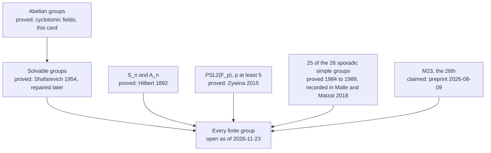

# The inverse Galois problem: is every finite group the Galois group of some extension of the rationals

[Syllabus](../../../SYLLABUS.md) → [Frontier](../README.md) → [Algebra, Logic and Computation](../README.md#s06) → The inverse Galois problem

---

## General Overview

The polynomial $`x^5 - x - 1`$ has five roots, and its Galois group is all 120 ways to shuffle them: the symmetric group $`S_5`$. [Solvable by radicals](../../21-Algebraic%20and%20analytic%20number%20theory/05-Fields%20and%20Galois%20Theory/07-solvability-by-radicals-and-the-quintic.md) computes that group from two remainder tests, mod 5 and mod 2. There the polynomial comes first and the group comes out.

The inverse Galois problem runs the other way. Pick a finite group first. Is there a polynomial with whole-number coefficients whose roots are shuffled by exactly that group? For $`S_5`$ the answer is yes, and $`x^5 - x - 1`$ is a witness. David Hilbert proved in 1892 that every symmetric group $`S_n`$ and every alternating group $`A_n`$ (the even shuffles) occurs.

For a group of order 9, the group $`\mathbb{Z}/3 \times \mathbb{Z}/3`$ of pairs of clock-3 hours added side by side, this card builds a witness from the 91st roots of 1:

```math
x^9 - x^8 - 22x^7 + x^6 + 91x^5 - 11x^4 - 71x^3 - 10x^2 + 8x + 1
```

The same method works for every abelian group, where order of combining never matters. In 1954 Igor Shafarevich extended the answer to every solvable group. For all finite groups the question is open.

**The inverse Galois problem asks whether every finite group is the symmetry group of some field built from the rationals by adjoining all roots of one polynomial; the answer is yes for abelian groups (proved on this card from roots of 1), yes for solvable groups (Shafarevich), and unknown in general.**

**What kind of fact this is:** the general question is a conjecture (expected answer: yes), open as of 2026-11-23. The abelian case is a theorem, proved on this card in Why it works. The solvable case is a theorem, proved by Shafarevich (1954) with a later repair, and stated here with its source. The Mathieu group $`M_{23}`$ is claimed (a 2026 preprint, not refereed as of 2026-11-23).

### The picture: what is known, with its status



Each arrow reads "is one part of". The open box is everything that no family above covers.

---

## The formula

Notation first, in words.

- A **Galois extension** $`K/\mathbb{Q}`$ is a field $`K`$ made by adjoining to the rationals $`\mathbb{Q}`$ all the roots of one polynomial with rational coefficients and no repeated roots ([The Galois correspondence](../../21-Algebraic%20and%20analytic%20number%20theory/05-Fields%20and%20Galois%20Theory/05-galois-groups-and-the-fundamental-theorem.md)).
- $`\mathrm{Gal}(K/\mathbb{Q})`$ is its **Galois group**: the reshuffles of $`K`$ that respect addition and multiplication.
- $`\cong`$ means "is the same group up to renaming": an **isomorphism**.
- A group $`G`$ **occurs over $`\mathbb{Q}`$** when some Galois extension has a group isomorphic to $`G`$.

The problem, stated exactly:

```math
\text{for every finite group } G \text{ there is a Galois extension } K/\mathbb{Q} \text{ with } \mathrm{Gal}(K/\mathbb{Q}) \cong G
```

**Read it aloud:** whatever finite group is named, some field built from the rationals has exactly that group of symmetries.

- Hypothesis: $`G`$ is finite.
- Conclusion: an extension exists. Nothing asks for a formula for it.
- Domain: the base field is $`\mathbb{Q}`$.
- Boundary case: the one-member group occurs as $`\mathbb{Q}`$ itself, the root of $`x - 1`$.

The abelian case is proved by one line:

```math
(\mathbb{Z} \bmod m)^{\times} \to G \text{ onto, with kernel } H \quad\Longrightarrow\quad \mathrm{Gal}\bigl(\mathbb{Q}(\zeta_m)^H/\mathbb{Q}\bigr) \cong (\mathbb{Z} \bmod m)^{\times}/H \cong G
```

**Read it aloud:** if the invertible remainders mod $`m`$ map onto $`G`$ (every member of $`G`$ is hit, and the **kernel** $`H`$ is the set that lands on the do-nothing member), then the numbers in the field of $`m`$th roots of 1 that the kernel leaves fixed form a field whose group is $`G`$.

The witness polynomial comes from one number in that field, a **Gaussian period**:

```math
\eta = \sum_{h \in H} \zeta_m^{\,h}
```

**Read it aloud:** eta is the sum of the $`m`$th roots of 1 whose exponents lie in $`H`$.

With $`m = 7`$ and $`H = \{1, 6\}`$: $`\eta = \zeta_7 + \zeta_7^{\,6} = 2\cos(2\pi/7) = 1.246980`$, a root of $`x^3 + x^2 - 2x - 1`$, whose group is $`\mathbb{Z}/3`$.

| Symbol | Plain meaning | In our example | Push it up and the answer… |
| --- | --- | --- | --- |
| $`G`$ | the group named in advance | $`\mathbb{Z}/3 \times \mathbb{Z}/3`$, 9 members | a bigger group needs a bigger field |
| $`K`$, $`\mathrm{Gal}(K/\mathbb{Q})`$ | the field sought; its group of symmetries | degree 9; 9 symmetries | — |
| $`\mathbb{Z}/n`$ | the clock with $`n`$ hours under addition, a cyclic group | $`\mathbb{Z}/3`$ | — |
| $`m`$, $`\zeta_m`$ | how many roots of 1; the first one, $`e^{2\pi i/m}`$ | 91; $`\zeta_{91}`$ | more roots, more room for quotients |
| $`(\mathbb{Z} \bmod m)^{\times}`$ | remainders mod $`m`$ with a multiplicative undo, the group of $`\mathbb{Q}(\zeta_m)`$; remainder $`k`$ is the symmetry $`\sigma_k`$ sending $`\zeta_m`$ to $`\zeta_m^{\,k}`$ | 72 members | — |
| $`H`$ | the kernel: remainders that map to the do-nothing member of $`G`$ | 8 members, from 1 to 90 | a bigger $`H`$, a smaller field |
| $`\mathbb{Q}(\zeta_m)^H`$ | numbers of $`\mathbb{Q}(\zeta_m)`$ that every member of $`H`$ fixes | degree 72 / 8 = 9 | — |
| $`k`$, $`g_i`$, $`n_i`$, $`a_i`$, $`p_i`$ | the number of clocks; a generator per clock, of order $`n_i`$; an hour on clock $`i`$; a prime per clock, with $`p_i - 1`$ a multiple of $`n_i`$ | 2; —; 3 and 3; 0 to 2; 7 and 13 | — |
| $`\eta`$, $`\eta_g`$ | a Gaussian period: a sum of roots of 1 over $`H`$; its image under $`\sigma_g`$ | 1.717344; nine values | — |
| $`S_n`$, $`A_n`$, $`M_{23}`$ | all shuffles of $`n`$ things; the even ones; a sporadic group (defined in Step 7) of 10,200,960 members; $`\mathrm{PSL}_2(\mathbb{F}_p)`$ is defined in Step 7 | $`S_5`$, 120 | — |
| $`p`$, pattern | a prime; the degrees of the factors of a polynomial mod $`p`$ | $`x^5 - x - 1`$ mod 3: (5) | — |
| $`\Phi_n(a)`$ | the $`n`$th cyclotomic polynomial (the factor of $`x^n - 1`$ whose roots are the roots of 1 of order exactly $`n`$), at a whole number $`a`$ | $`\Phi_3(2) = 7`$, $`\Phi_3(3) = 13`$ | more prime factors to choose from |

### When it holds

- **The base is the rationals.** Over the real numbers only the groups of size 1 and 2 occur, since the complex numbers have degree 2 over them. Over a finite field only cyclic groups occur ([Finite fields](../../21-Algebraic%20and%20analytic%20number%20theory/05-Fields%20and%20Galois%20Theory/09-finite-fields-and-frobenius.md)). The question is hard because $`\mathbb{Q}`$ sits between those cases.
- **The field is normal: it holds every root of its polynomial.** $`\mathbb{Q}(\sqrt[3]{2})`$ has degree 3 but only one symmetry, since its other two cube roots of 2 are not real. Its polynomial $`x^3 - 2`$ has group $`S_3`$, not $`\mathbb{Z}/3`$.
- **The group is matched up to renaming.** The question asks for the abstract group, not one way of shuffling roots. Demand a fixed shuffle and the answer depends on the polynomial: $`S_3`$ shuffles the 3 roots of $`x^3 - 2`$, and the 6 roots of a degree-6 polynomial for the same field.
- **Distinct primes for distinct clocks.** The abelian proof needs one prime per clock, all different. Reusing 7 twice gives $`m = 49`$, whose remainders form one cyclic group of 42 and have no quotient $`\mathbb{Z}/3 \times \mathbb{Z}/3`$.

---

## Why it works

### Step 0: the idea in words

The field of $`m`$th roots of 1 already has an abelian group: the invertible remainders mod $`m`$ ([Cyclotomic fields](../../21-Algebraic%20and%20analytic%20number%20theory/05-Fields%20and%20Galois%20Theory/08-cyclotomic-extensions-and-roots-of-unity.md)). The Galois correspondence turns every quotient of that group into the group of a smaller field. So the abelian case reduces to arithmetic: choose $`m`$ so that the remainders mod $`m`$ map onto the named group.

### Step 1: every finite abelian group is a quotient of clocks

Take $`k`$ generators $`g_1, \ldots, g_k`$ of $`G`$ (members whose combinations give all of $`G`$), with orders $`n_1, \ldots, n_k`$. Send hour $`a_i`$ on clock $`i`$ to $`g_1^{a_1} \cdots g_k^{a_k}`$. This is well defined, because $`g_i^{n_i}`$ is the do-nothing member, and it respects combining, because $`G`$ is abelian. It hits every member of $`G`$. So $`G`$ is a quotient of $`\mathbb{Z}/n_1 \times \cdots \times \mathbb{Z}/n_k`$ ([Direct products](../../03-Algebra/08-Groups/07-direct-products.md), [Normal subgroups and quotient groups](../../03-Algebra/08-Groups/06-normal-subgroups-and-quotient-groups.md)).

For $`\mathbb{Z}/3 \times \mathbb{Z}/3`$ this step does nothing: $`n_1 = n_2 = 3`$.

### Step 2: a prime for each clock

For each $`n_i`$, pick a prime $`p_i`$ that leaves remainder 1 on division by $`n_i`$, all primes different. There are infinitely many such primes for every $`n`$, with an elementary proof: every prime factor of $`\Phi_n(a)`$ (the cyclotomic polynomial at a whole number $`a`$) that does not divide $`n`$ leaves remainder 1 mod $`n`$.

For $`n = 3`$, $`\Phi_3(a) = a^2 + a + 1`$. At $`a = 2`$ it is 7, at $`a = 3`$ it is 13. Both leave remainder 1 mod 3. The code factors $`a^2 + a + 1`$ for $`a`$ from 1 to 12 and finds only such primes, apart from 3.

<details>
<summary>Detailed proof: infinitely many primes leave remainder 1 mod n</summary>

Let $`p`$ be a prime dividing $`\Phi_n(a)`$ but not $`n`$. Since $`\Phi_n`$ divides $`x^n - 1`$, we have $`a^n \equiv 1 \pmod p`$. Suppose the order of $`a`$ mod $`p`$ were a proper divisor $`d`$ of $`n`$. Then $`a`$ is a root mod $`p`$ of both $`x^d - 1`$ and $`\Phi_n`$, two different factors of $`x^n - 1`$, so $`a`$ is a repeated root of $`x^n - 1`$ mod $`p`$. A repeated root is also a root of the derivative $`n x^{n-1}`$, which mod $`p`$ vanishes only at 0. That is impossible, so the order of $`a`$ is exactly $`n`$.

By Fermat, $`a^{p-1} \equiv 1`$, so $`n`$ divides $`p - 1`$.

For infinitely many: given primes $`q_1, \ldots, q_r`$ of this kind, put $`a = t\,n\,q_1 \cdots q_r`$ with $`t`$ large. Then $`\Phi_n(a) \equiv \Phi_n(0) = 1`$ modulo $`n`$ and each $`q_j`$ (for $`n \ge 2`$), and $`\Phi_n(a) > 1`$. So it has a prime factor outside the list that does not divide $`n`$.

</details>

### Step 3: the remainders mod m map onto the clocks

Put $`m = p_1 \cdots p_k`$; here $`m = 7 \times 13 = 91`$. By the Chinese remainder theorem, a remainder mod 91 is a pair: a remainder mod 7 and one mod 13. So $`(\mathbb{Z} \bmod 91)^{\times}`$ is the direct product of the invertible remainders mod 7 (6 of them) and mod 13 (12 of them): 72 members.

The invertible remainders mod a prime $`p`$ form a cyclic group of $`p - 1`$ members ([Finite fields](../../21-Algebraic%20and%20analytic%20number%20theory/05-Fields%20and%20Galois%20Theory/09-finite-fields-and-frobenius.md)). A clock of $`p - 1`$ hours maps onto a clock of $`n`$ hours whenever $`n`$ divides $`p - 1`$: read the hour mod $`n`$. So the 72 remainders map onto $`\mathbb{Z}/3 \times \mathbb{Z}/3`$.

The kernel $`H`$ is the remainders that are a cube mod 7 and a cube mod 13. The cubes mod 7 are 1 and 6; mod 13 they are 1, 5, 8 and 12. So $`H`$ has $`2 \times 4 = 8`$ members: 1, 8, 27, 34, 57, 64, 83 and 90.

### Step 4: the fixed field has group G

The group of $`\mathbb{Q}(\zeta_{91})`$ is abelian, so every subgroup is normal. The Galois correspondence then says the fixed field $`K = \mathbb{Q}(\zeta_{91})^H`$ is Galois over $`\mathbb{Q}`$, of degree $`72 / 8 = 9`$, with group $`(\mathbb{Z} \bmod 91)^{\times}/H`$. By the first isomorphism theorem that quotient is $`\mathbb{Z}/3 \times \mathbb{Z}/3`$.

To name a polynomial, take the period $`\eta = \sum_{h \in H} \zeta_{91}^{\,h}`$. Every member of $`H`$ only reorders the terms, so $`\eta`$ lies in $`K`$. Its images under the 72 symmetries are 9 sums $`\eta_g = \sum_{h \in H} \zeta_{91}^{\,gh}`$, one per coset $`gH`$ (the remainders $`g`$ times each member of $`H`$). The code finds them all different. So the symmetries fixing $`\eta`$ are exactly $`H`$, and $`\eta`$ generates $`K`$. Multiplying out $`x - \eta_g`$ over the 9 images gives the degree-9 polynomial of the overview.

Since $`-1`$ lies in $`H`$, each $`\eta_g`$ is a sum of cosines and so a real number. That is why all nine roots are real.

### Step 5: what this proves, and what it does not

Steps 1 to 4 prove that every finite abelian group occurs over $`\mathbb{Q}`$, inside a cyclotomic field. The reverse, that every abelian Galois field over $`\mathbb{Q}`$ lies in some $`\mathbb{Q}(\zeta_m)`$, is the Kronecker–Weber theorem, not needed here.

Roots of 1 go no further: every field inside a cyclotomic field has an abelian group, so $`S_3`$ needs a field outside them all.

### Step 6: Shafarevich's theorem for solvable groups (recorded, not proved here)

**Statement.** Every finite solvable group occurs over $`\mathbb{Q}`$, and over every field of finite degree over $`\mathbb{Q}`$. A group is **solvable** when a chain of normal subgroups breaks it into abelian steps ([Solvable by radicals](../../21-Algebraic%20and%20analytic%20number%20theory/05-Fields%20and%20Galois%20Theory/07-solvability-by-radicals-and-the-quintic.md)).

**Key steps, in outline.**

1. Climb the chain one abelian step at a time. At each step a field with group $`G/N`$ is known, and a field with group $`G`$ is wanted on top of it. This is an **embedding problem**.
2. Reduce to steps where $`N`$ is a group of prime-power order (every solvable group has such a chain).
3. Solve each embedding problem with control over which primes ramify (divide the discriminant). Without that control, a later step can become impossible.

**History and status.** Shafarevich published the proof in 1954. A gap concerning the prime 2 was found later and repaired. Neukirch, Schmidt and Wingberg's *Cohomology of Number Fields* (Sources) gives a complete proof. Status: proved.

Shafarevich's proof shows a field exists. It does not hand over a short polynomial the way Step 4 does.

### Step 7: beyond solvable groups

The smallest group that is not solvable is $`A_5`$, with 60 members. So, by Shafarevich, every group of fewer than 60 members occurs over $`\mathbb{Q}`$. Above that, results come family by family:

| Groups | Status | Method and source |
| --- | --- | --- |
| $`S_n`$ and $`A_n`$, every $`n`$ | proved, 1892 | Hilbert's irreducibility theorem (Hilbert, Sources) |
| 25 of the 26 sporadic simple groups, the Monster among them | proved, 1984 to 1989 | the rigidity method (recorded in Malle and Matzat, 2018; dates from Huang and others, Sources) |
| $`\mathrm{PSL}_2(\mathbb{F}_p)`$, every prime $`p \ge 5`$ | proved, 2015 | modular forms (Zywina, Sources) |
| $`M_{23}`$, the 26th sporadic group | claimed, preprint 2026-08-09, revised 2026-10-07 | an explicit degree-23 polynomial (Huang and others, Sources) |
| every finite group | open as of 2026-11-23 | — |

$`\mathrm{PSL}_2(\mathbb{F}_p)`$ is the group of 2 by 2 matrices mod $`p`$ with determinant 1, with each matrix identified with its negative. A **simple** group has no normal subgroups but itself and the one-member group; the 26 **sporadic** ones fit no infinite family. The **rigidity method** builds a field over $`\mathbb{Q}(t)`$ from a suitable triple of group members, then fixes $`t`$ at a number by Hilbert's theorem. **Modular forms** are highly symmetric functions on the complex upper half-plane that carry Galois groups of 2 by 2 matrices mod $`p`$.

The $`M_{23}`$ preprint gives a polynomial, so its claim can be checked by computing that polynomial's group. No refereed version or independent published check was found as of 2026-11-23, so it stays claimed here.

### Step 8: why S5 is the easy case

A counting form of Hilbert's irreducibility theorem says more than "$`S_n`$ occurs": almost every polynomial of degree $`n`$ with whole-number coefficients has group $`S_n`$. The code tests all 36 trinomials $`x^5 + ax + b`$ with $`a`$ and $`b`$ from −3 to 3, not 0.

- 8 have a whole-number root, so they factor.
- 2 more factor as a quadratic times a cubic: $`x^5 + x + 1 = (x^2 + x + 1)(x^3 - x^2 + 1)`$, and $`x^5 + x - 1`$ likewise.
- The other 26 are proved to have group $`S_5`$, each from two primes below 200: one where it stays in one piece, giving a 5-cycle, and one giving a single swap. A 5-cycle and a swap make all 120 shuffles, by the lemma in [Solvable by radicals](../../21-Algebraic%20and%20analytic%20number%20theory/05-Fields%20and%20Galois%20Theory/07-solvability-by-radicals-and-the-quintic.md).

For $`x^5 - x - 1`$ itself the first such primes are 3 (pattern (5)) and 2 (pattern (3, 2), whose cube is a swap). [Solvable by radicals](../../21-Algebraic%20and%20analytic%20number%20theory/05-Fields%20and%20Galois%20Theory/07-solvability-by-radicals-and-the-quintic.md) uses 5 for the 5-cycle, which also works.

Every trinomial here that does not factor has the biggest possible group. Other groups are rare among random polynomials, so the inverse problem needs construction, not search.

---

## Worked numbers, by hand

The group of order 3, from the 7th roots of 1.

| Step | Arithmetic | Value |
| --- | --- | --- |
| cubes mod 7 | $`1^3, 2^3, \ldots, 6^3`$ = 1, 8, 27, 64, 125, 216, reduced mod 7 | 1, 1, 6, 1, 6, 6: so $`H = \{1, 6\}`$ |
| degree | 6 invertible remainders ÷ 2 in $`H`$ | 3 |
| periods | $`2\cos(2\pi k/7)`$ for $`k`$ = 1, 2, 3 | 1.246980, −0.445042, −1.801938 |
| their sum | $`1.246980 - 0.445042 - 1.801938`$ | −1 |
| the polynomial | multiply out the three $`(x - \eta)`$ | $`x^3 + x^2 - 2x - 1`$ |
| the group | $`\sigma_2`$ moves period 1 to 2, 2 to 3, 3 to 1 | **$`\mathbb{Z}/3`$** |

The order-9 group, $`\mathbb{Z}/3 \times \mathbb{Z}/3`$, from the 91st roots of 1.

| Step | Arithmetic | Value |
| --- | --- | --- |
| primes | $`\Phi_3(2) = 7`$, $`\Phi_3(3) = 13`$, both 1 mod 3 | $`m = 91`$ |
| kernel | cubes mod 7 (2) times cubes mod 13 (4) | $`\lvert H\rvert = 8`$ |
| degree | 72 ÷ 8 | 9 |
| largest period | sum of $`\cos(2\pi g h/91)`$ over $`H`$ | 4.777105 |
| the polynomial | multiply out nine $`(x - \eta)`$ | $`x^9 - x^8 - 22x^7 + \cdots + 8x + 1`$ |
| the symmetries | 72 remainders act on 9 roots | **9 permutations, commuting, each cubed the identity** |

An abelian group of 9 members in which every member cubed is the identity is $`\mathbb{Z}/3 \times \mathbb{Z}/3`$: the cyclic $`\mathbb{Z}/9`$ has a member of order 9. So the polynomial's group is the group named in advance.

A third road checks the same group through primes. A symmetry of an abelian Galois field acts on the roots with all cycles of one length, its order. So mod each good prime the polynomial factors into 9 linear pieces or 3 cubics, and splits exactly when $`p`$ mod 91 lies in $`H`$. Over the 163 usable primes below 1000, all match: 17 split (share 0.104, predicted 1/9 = 0.111) and 146 give (3, 3, 3). The shares are evidence for the prediction of [Chebotarev](../../21-Algebraic%20and%20analytic%20number%20theory/06-Algebraic%20Numbers/09-chebotarev-density-and-splitting-statistics.md); the rule "splits exactly when $`p`$ mod 91 is in $`H`$" is the theorem, checked here for each prime.

The example group, $`S_5`$, read off $`x^5 - x - 1`$ (Step 8):

| Step | Arithmetic | Value |
| --- | --- | --- |
| mod 3 | no root and no quadratic factor mod 3 | pattern (5): a 5-cycle |
| mod 2 | $`x^5 + x + 1 = (x^2 + x + 1)(x^3 + x^2 + 1)`$ mod 2 | pattern (3, 2): a 3-cycle beside a swap |
| cube it | the 3-cycle done 3 times moves nothing; the swap done 3 times is the swap | a single swap |
| the group | a 5-cycle and a swap make every shuffle | **$`S_5`$** |

Here the polynomial came first and the group came out: the direction the inverse problem reverses.

### What breaks if you drop a piece

| Mistake | Comes out at | What went wrong |
| --- | --- | --- |
| Reuse one prime: $`m = 7 \times 7 = 49`$ | 3 solutions of $`x^3 \equiv 1`$ mod 49, against 9 mod 91 | the 42 remainders mod 49 form one cycle, with no quotient $`\mathbb{Z}/3 \times \mathbb{Z}/3`$ |
| Take $`\mathbb{Q}(\sqrt[3]{2})`$ as a $`\mathbb{Z}/3`$ field | $`x^3 - 2`$ mod 5 has pattern (2, 1) | the group holds a swap, so it is $`S_3`$; the field is not normal |
| Read $`x^3 + x^2 - 2x - 1`$ mod 7 | $`(x - 2)^3`$ | 7 ramifies (divides the discriminant): the roots merge, and the pattern describes no symmetry |
| "Degree 5, so the group is $`S_5`$" | $`x^5 - 5x + 12`$: discriminant 64,000,000 = 8,000², patterns below 2000 only (1, 1, 1, 1, 1), (2, 2, 1), (5) | a square discriminant puts the group inside $`A_5`$, so it is not $`S_5`$ |

The code prints every entry. The primes 2, 3 and 281 also make two roots of the degree-9 polynomial meet, so they are skipped along with 7 and 13 ([Splitting and ramification](../../21-Algebraic%20and%20analytic%20number%20theory/06-Algebraic%20Numbers/08-splitting-and-ramification.md) explains when that happens).

---

## Code, from first principles, and it actually runs

The code builds each polynomial from its periods in floating point and checks the coefficients round to whole numbers within $`10^{-6}`$. It reads factor patterns mod primes by **distinct-degree factorisation**: it computes $`x^{p^d}`$ modulo the polynomial and takes a gcd with $`x^{p^d} - x`$, which collects every factor of degree $`d`$. Nothing imported knows any Galois theory. The group of order 9 is reached by **two independent roads**: the permutations the 72 remainders induce on the nine roots, and the factor patterns at 163 primes, each matched exactly against membership in $`H`$. The count of cube roots of 1 mod 91 only confirms that the quotient $`\mathbb{Z}/3 \times \mathbb{Z}/3`$ exists; it says nothing about the polynomial. The primes 1 mod 3 come by scanning and by factoring $`a^2 + a + 1`$. The $`S_5`$ verdicts come from pattern pairs, a test shown to fail on $`x^5 - 5x + 12`$, and the two non-$`S_5`$ trinomials from exact factorisations.

### Python

```python
# The inverse Galois problem: the check behind the card.  Standard library only.
# Builds polynomials with a chosen abelian group from roots of unity, then reads
# their factor patterns mod p by distinct-degree factorisation written out here.
from math import cos, pi

def trim(a):
    while a and a[-1] == 0: a.pop()
    return a
def pdivmod(a, b, p):                         # polynomials: coefficient lists, lowest power first
    a = trim([x % p for x in a]); q = [0] * max(len(a) - len(b) + 1, 1)
    inv = pow(b[-1], p - 2, p)                # Fermat: b^(p-2) undoes b mod p
    while len(a) >= len(b):
        c, s = a[-1] * inv % p, len(a) - len(b); q[s] = c
        for i, bi in enumerate(b): a[s + i] = (a[s + i] - c * bi) % p
        trim(a)
    return q, a
def pmul(a, b, p):
    r = [0] * (len(a) + len(b) - 1)
    for i, x in enumerate(a):
        for j, y in enumerate(b): r[i + j] = (r[i + j] + x * y) % p
    return trim(r)
def pgcd(a, b, p):
    a, b = trim([x % p for x in a]), trim([x % p for x in b])
    while b: a, b = b, pdivmod(a, b, p)[1]
    return a
def pattern(f, p):                            # factor degrees of f mod p, or None if a root repeats
    deriv = [i * c for i, c in enumerate(f)][1:]
    if len(pgcd(f, deriv, p)) > 1: return None
    g, h, d, degs = trim([x % p for x in f]), [0, 1], 0, []
    while len(g) - 1 >= 2 * (d + 1):
        d += 1; r, e, b = [1], p, pdivmod(h, g, p)[1]
        while e:                              # h <- h^p mod g, so h = x^(p^d) mod g
            if e & 1: r = pdivmod(pmul(r, b, p), g, p)[1]
            b, e = pdivmod(pmul(b, b, p), g, p)[1], e >> 1
        h = r; diff = h + [0] * (2 - len(h)); diff[1] -= 1
        c = pgcd(g, diff, p); k = len(c) - 1   # c holds every factor of degree d
        if k > 0: degs += [d] * (k // d); g = pdivmod(g, c, p)[0]; h = pdivmod(h, g, p)[1]
    if len(g) > 1: degs.append(len(g) - 1)
    return tuple(sorted(degs, reverse=True))
def primes(n): return [q for q in range(2, n) if all(q % r for r in range(2, int(q ** 0.5) + 1))]
def from_roots(roots):                        # multiply out (x - r), then round
    c = [1.0]
    for r in roots: c = [0.0] + c; c = [c[i] - r * c[i + 1] for i in range(len(c) - 1)] + [c[-1]]
    ints = [round(x) for x in c]
    return ints, max(abs(x - y) for x, y in zip(c, ints)) < 1e-6
def show(f): return " ".join(f"{c:+d}x^{i}" for i, c in reversed(list(enumerate(f))) if c)
def period_poly(m, H):                        # conjugates of the sum of zeta_m^h over H
    units = [k for k in range(1, m) if all(k % q for q in primes(m + 1) if m % q == 0)]
    reps, seen = [], set()
    for g in units:
        if g not in seen: reps.append(g); seen |= {g * h % m for h in H}
    roots = [sum(cos(2 * pi * g * h / m) for h in H) for g in reps]
    return units, reps, roots, *from_roots(roots)

print("1. a group of order 3 from the 7th roots of unity")
H7 = sorted({x ** 3 % 7 for x in range(1, 7)})
u7, r7, roots7, f7, ok7 = period_poly(7, H7)
print("cubes of 1..6:", [x ** 3 for x in range(1, 7)], "; mod 7:", [x ** 3 % 7 for x in range(1, 7)])
print("cubes mod 7:", H7, "; units", len(u7), "/ subgroup", len(H7), "=", len(r7), "conjugates")
print("conjugates:", " ".join(f"{r:.6f}" for r in roots7), "; sum", f"{sum(roots7):.6f}")
print("polynomial:", show(f7), "; integer coefficients", ok7)
assert f7 == [-1, -2, 1, 1] and ok7
print("2. primes leaving remainder 1 on division by 3, two roads")
scan = [q for q in primes(50) if q % 3 == 1]
found = sorted({q for a in range(1, 13) for q in primes(200) if (a * a + a + 1) % q == 0 and q != 3})
print("by scanning:", scan, "; prime factors of a^2+a+1, a = 1..12:", found)
assert all(q % 3 == 1 for q in found) and set(scan) <= set(found)
print("3. the group Z/3 x Z/3 from the 91st roots of unity, 91 = 7 x 13")
cube13 = {x ** 3 % 13 for x in range(1, 13)}
H = [k for k in range(1, 91) if k % 7 in H7 and k % 13 in cube13 and k % 7 and k % 13]
u, reps, roots, f, ok = period_poly(91, H)
print("cubes mod 13:", sorted(cube13), "; subgroup H has", len(H), "members:", H)
print("units mod 91:", len(u), "; index", len(u) // len(H), "; coset representatives", reps)
print("conjugates:", " ".join(f"{r:.6f}" for r in roots))
print("polynomial:", show(f), "; integer coefficients", ok)
coset = {g * h % 91: i for i, g in enumerate(reps) for h in H}
perms = {tuple(coset[k * g % 91] for g in reps) for k in u}   # where sigma_k sends each root
def comp(a, b): return tuple(a[i] for i in b)
idp = tuple(range(9))
commute = all(comp(a, b) == comp(b, a) for a in perms for b in perms)
cubed = all(comp(a, comp(a, a)) == idp for a in perms)
print("distinct permutations of the 9 roots:", len(perms), "; all commute", commute, "; every one cubed is the identity", cubed)
assert len(perms) == 9 and commute and cubed
assert all(abs(sum(c * r ** i for i, c in enumerate(f))) < 1e-6 for r in roots)
counts, bad, agree = {}, [], True
for q in primes(1000):
    pat = pattern(f, q)
    if pat is None: bad.append(q); continue
    counts[pat] = counts.get(pat, 0) + 1
    agree &= pat == ((1,) * 9 if q % 91 in H else (3, 3, 3))
n = sum(counts.values())
print("primes below 1000 with a repeated root mod p:", bad, "; primes used", n)
for pat, c in sorted(counts.items()):
    print(f"pattern {pat}: {c} primes, share {c / n:.3f}; predicted {'1/9 = 0.111' if pat[0] == 1 else '8/9 = 0.889'}")
print("every pattern matches 'splits exactly when p mod 91 is in H':", agree)
assert agree and bad == [2, 3, 7, 13, 281]
cubes1 = lambda m: sum(1 for x in range(1, m) if x ** 3 % m == 1)
print("solutions of x^3 = 1: mod 91", cubes1(91), "; mod 49", cubes1(49))
assert cubes1(91) == 9 and cubes1(49) == 3
print("4. S5 among the trinomials x^5 + ax + b, a and b from -3 to 3, not 0")
small, s5, rootd = primes(200), [], []
def s5_proof(f5):                             # a 5-cycle, and a swap: (2, 1, 1, 1), or (3, 2) cubed
    pats = [pattern(f5, q) for q in small]
    return (5,) in pats and ((2, 1, 1, 1) in pats or (3, 2) in pats)
for a in [-3, -2, -1, 1, 2, 3]:
    for b in [-3, -2, -1, 1, 2, 3]:
        f5 = [b, a, 0, 0, 0, 1]
        if any(sum(c * x ** i for i, c in enumerate(f5)) == 0 for x in range(-3, 4)): rootd.append((a, b)); continue
        if s5_proof(f5): s5.append((a, b))
print("trinomials 36; with a whole-number root", len(rootd), rootd)
print("proved S5 by primes below 200:", len(s5), "; not settled by those primes:",
      [ab for ab in [(a, b) for a in [-3, -2, -1, 1, 2, 3] for b in [-3, -2, -1, 1, 2, 3]] if ab not in s5 and ab not in rootd])
q5 = [q for q in small if pattern([-1, -1, 0, 0, 0, 1], q) == (5,)][0]
q2 = [q for q in small if pattern([-1, -1, 0, 0, 0, 1], q) in ((2, 1, 1, 1), (3, 2))][0]
P = 10 ** 9 + 7                               # a large prime, so mod P is exact for these small numbers
fac1 = pmul([1, 1, 1], [1, 0, -1, 1], P) == [1, 1, 0, 0, 0, 1]
fac2 = pmul([1, -1, 1], [-1, 0, 1, 1], P) == [P - 1, 1, 0, 0, 0, 1]
print("x^5 + x + 1 = (x^2 + x + 1)(x^3 - x^2 + 1):", fac1, "; x^5 + x - 1 = (x^2 - x + 1)(x^3 + x^2 - 1):", fac2)
assert fac1 and fac2
print("x^5 - x - 1: first pattern (5) at p =", q5, "; first transposition source at p =", q2,
      pattern([-1, -1, 0, 0, 0, 1], q2))
assert (-1, -1) in s5 and q5 == 3 and q2 == 2 and len(s5) == 26
d5 = [12, -5, 0, 0, 0, 1]
seen5 = sorted({pattern(d5, q) for q in primes(2000)} - {None})
print("x^5 - 5x + 12: discriminant", 5 ** 5 * 12 ** 4 + 4 ** 4 * (-5) ** 5, "= 8000^2; patterns below 2000:", seen5)
assert seen5 == [(1, 1, 1, 1, 1), (2, 2, 1), (5,)]
assert not s5_proof(d5)                       # it has a 5-cycle but no swap, so the S5 test must fail
print("5. what breaks")
cube7 = pmul(pmul([-2, 1], [-2, 1], 7), [-2, 1], 7) == [x % 7 for x in [-1, -2, 1, 1]]
print("x^3 - 2 mod 5:", pattern([-2, 0, 0, 1], 5), "; x^3 + x^2 - 2x - 1 mod 7 is (x - 2)^3:", cube7)
assert pattern([-2, 0, 0, 1], 5) == (2, 1) and cube7
print("ALL CHECKS PASS")
```

**Ran 2026-11-23 on macOS, Python 3.14.10, standard library only. All checks passed. Output, pasted from the run:**

```
1. a group of order 3 from the 7th roots of unity
cubes of 1..6: [1, 8, 27, 64, 125, 216] ; mod 7: [1, 1, 6, 1, 6, 6]
cubes mod 7: [1, 6] ; units 6 / subgroup 2 = 3 conjugates
conjugates: 1.246980 -0.445042 -1.801938 ; sum -1.000000
polynomial: +1x^3 +1x^2 -2x^1 -1x^0 ; integer coefficients True
2. primes leaving remainder 1 on division by 3, two roads
by scanning: [7, 13, 19, 31, 37, 43] ; prime factors of a^2+a+1, a = 1..12: [7, 13, 19, 31, 37, 43, 73, 157]
3. the group Z/3 x Z/3 from the 91st roots of unity, 91 = 7 x 13
cubes mod 13: [1, 5, 8, 12] ; subgroup H has 8 members: [1, 8, 27, 34, 57, 64, 83, 90]
units mod 91: 72 ; index 9 ; coset representatives [1, 2, 3, 4, 5, 6, 9, 15, 18]
conjugates: 1.717344 1.179848 4.777105 -0.493534 -0.612913 0.341536 -0.121893 -3.305859 -2.481634
polynomial: +1x^9 -1x^8 -22x^7 +1x^6 +91x^5 -11x^4 -71x^3 -10x^2 +8x^1 +1x^0 ; integer coefficients True
distinct permutations of the 9 roots: 9 ; all commute True ; every one cubed is the identity True
primes below 1000 with a repeated root mod p: [2, 3, 7, 13, 281] ; primes used 163
pattern (1, 1, 1, 1, 1, 1, 1, 1, 1): 17 primes, share 0.104; predicted 1/9 = 0.111
pattern (3, 3, 3): 146 primes, share 0.896; predicted 8/9 = 0.889
every pattern matches 'splits exactly when p mod 91 is in H': True
solutions of x^3 = 1: mod 91 9 ; mod 49 3
4. S5 among the trinomials x^5 + ax + b, a and b from -3 to 3, not 0
trinomials 36; with a whole-number root 8 [(-3, -2), (-3, 2), (-2, -1), (-2, 1), (1, -2), (1, 2), (2, -3), (2, 3)]
proved S5 by primes below 200: 26 ; not settled by those primes: [(1, -1), (1, 1)]
x^5 + x + 1 = (x^2 + x + 1)(x^3 - x^2 + 1): True ; x^5 + x - 1 = (x^2 - x + 1)(x^3 + x^2 - 1): True
x^5 - x - 1: first pattern (5) at p = 3 ; first transposition source at p = 2 (3, 2)
x^5 - 5x + 12: discriminant 64000000 = 8000^2; patterns below 2000: [(1, 1, 1, 1, 1), (2, 2, 1), (5,)]
5. what breaks
x^3 - 2 mod 5: (2, 1) ; x^3 + x^2 - 2x - 1 mod 7 is (x - 2)^3: True
ALL CHECKS PASS
```

### Rust

The same checks, the same output, line for line.

```rust
// The inverse Galois problem: the same check as inverse_galois_problem_check.py, in Rust.
// Standard library only, no crates.  Polynomials are coefficient lists, lowest power first.
use std::collections::{BTreeMap, BTreeSet};
type P = Vec<i64>;

fn trim(mut a: P) -> P { while a.last() == Some(&0) { a.pop(); } a }
fn modpow(mut b: i64, mut e: i64, p: i64) -> i64 {
    let mut r = 1; b = b.rem_euclid(p);
    while e > 0 { if e & 1 == 1 { r = r * b % p; } b = b * b % p; e >>= 1; }
    r
}
fn pdivmod(a: &P, b: &P, p: i64) -> (P, P) {
    let mut a = trim(a.iter().map(|x| x.rem_euclid(p)).collect());
    let mut q = vec![0; (a.len() as i64 - b.len() as i64 + 1).max(1) as usize];
    let inv = modpow(*b.last().unwrap(), p - 2, p); // Fermat: b^(p-2) undoes b mod p
    while a.len() >= b.len() {
        let (c, s) = (a[a.len() - 1] * inv % p, a.len() - b.len()); q[s] = c;
        for (i, bi) in b.iter().enumerate() { a[s + i] = (a[s + i] - c * bi).rem_euclid(p); }
        a = trim(a);
    }
    (q, a)
}
fn pmul(a: &P, b: &P, p: i64) -> P {
    let mut r = vec![0; a.len() + b.len() - 1];
    for (i, x) in a.iter().enumerate() { for (j, y) in b.iter().enumerate() {
        r[i + j] = (r[i + j] + x.rem_euclid(p) * y.rem_euclid(p)).rem_euclid(p); } }
    trim(r)
}
fn pgcd(a: &P, b: &P, p: i64) -> P {
    let mut a = trim(a.iter().map(|x| x.rem_euclid(p)).collect());
    let mut b = trim(b.iter().map(|x| x.rem_euclid(p)).collect());
    while !b.is_empty() { let r = pdivmod(&a, &b, p).1; a = b; b = r; }
    a
}
fn pattern(f: &P, p: i64) -> Option<Vec<usize>> {     // factor degrees mod p, None if a root repeats
    let deriv: P = f.iter().enumerate().skip(1).map(|(i, c)| i as i64 * c).collect();
    if pgcd(f, &deriv, p).len() > 1 { return None; }
    let (mut g, mut h, mut d, mut degs) = (trim(f.iter().map(|x| x.rem_euclid(p)).collect()), vec![0, 1], 0, vec![]);
    while g.len() - 1 >= 2 * (d + 1) {
        d += 1; let (mut r, mut e, mut b) = (vec![1], p, pdivmod(&h, &g, p).1);
        while e > 0 {                                  // h <- h^p mod g, so h = x^(p^d) mod g
            if e & 1 == 1 { r = pdivmod(&pmul(&r, &b, p), &g, p).1; }
            b = pdivmod(&pmul(&b, &b, p), &g, p).1; e >>= 1;
        }
        h = r; let mut diff = h.clone(); while diff.len() < 2 { diff.push(0); } diff[1] -= 1;
        let c = pgcd(&g, &diff, p); let k = c.len() - 1; // c holds every factor of degree d
        if k > 0 { for _ in 0..k / d { degs.push(d); } g = pdivmod(&g, &c, p).0; h = pdivmod(&h, &g, p).1; }
    }
    if g.len() > 1 { degs.push(g.len() - 1); }
    degs.sort_by(|a, b| b.cmp(a)); Some(degs)
}
fn primes(n: i64) -> Vec<i64> { (2..n).filter(|&q| (2..).take_while(|r| r * r <= q).all(|r| q % r != 0)).collect() }
fn from_roots(roots: &[f64]) -> (P, bool) {           // multiply out (x - r), then round
    let mut c = vec![1.0f64];
    for &r in roots { let mut s = vec![0.0]; s.extend(&c);
        c = (0..s.len() - 1).map(|i| s[i] - r * s[i + 1]).chain(std::iter::once(s[s.len() - 1])).collect(); }
    let ints: P = c.iter().map(|x| x.round() as i64).collect();
    let ok = c.iter().zip(&ints).all(|(x, y)| (x - *y as f64).abs() < 1e-6);
    (ints, ok)
}
fn show(f: &P) -> String { f.iter().enumerate().rev().filter(|(_, c)| **c != 0).map(|(i, c)| format!("{:+}x^{}", c, i)).collect::<Vec<_>>().join(" ") }
fn l<T: std::fmt::Display>(v: &[T]) -> String { format!("[{}]", v.iter().map(|x| x.to_string()).collect::<Vec<_>>().join(", ")) }
fn t(v: &[usize]) -> String { if v.len() == 1 { format!("({},)", v[0]) } else { format!("({})", v.iter().map(|x| x.to_string()).collect::<Vec<_>>().join(", ")) } }
fn tb(b: bool) -> &'static str { if b { "True" } else { "False" } }
fn pairs(v: &[(i64, i64)]) -> String { format!("[{}]", v.iter().map(|(a, b)| format!("({}, {})", a, b)).collect::<Vec<_>>().join(", ")) }
fn period_poly(m: i64, hs: &[i64]) -> (Vec<i64>, Vec<i64>, Vec<f64>, P, bool) {
    let ps: Vec<i64> = primes(m + 1).into_iter().filter(|q| m % q == 0).collect();
    let units: Vec<i64> = (1..m).filter(|k| ps.iter().all(|q| k % q != 0)).collect();
    let (mut reps, mut seen) = (vec![], BTreeSet::new());
    for &g in &units { if !seen.contains(&g) { reps.push(g); for h in hs { seen.insert(g * h % m); } } }
    let pi = std::f64::consts::PI;
    let roots: Vec<f64> = reps.iter().map(|&g| hs.iter().map(|&h| (2.0 * pi * (g * h) as f64 / m as f64).cos()).sum()).collect();
    let (f, ok) = from_roots(&roots); (units, reps, roots, f, ok)
}
fn ev(f: &P, x: i64) -> i64 { f.iter().enumerate().map(|(i, c)| c * x.pow(i as u32)).sum() }
fn comp(a: &[usize], b: &[usize]) -> Vec<usize> { b.iter().map(|&i| a[i]).collect() }

fn main() {
    println!("1. a group of order 3 from the 7th roots of unity");
    let h7: Vec<i64> = (1..7).map(|x: i64| x.pow(3) % 7).collect::<BTreeSet<_>>().into_iter().collect();
    let (u7, r7, roots7, f7, ok7) = period_poly(7, &h7);
    println!("cubes of 1..6: {} ; mod 7: {}", l(&(1..7).map(|x: i64| x.pow(3)).collect::<Vec<_>>()), l(&(1..7).map(|x: i64| x.pow(3) % 7).collect::<Vec<_>>()));
    println!("cubes mod 7: {} ; units {} / subgroup {} = {} conjugates", l(&h7), u7.len(), h7.len(), r7.len());
    let rs = |v: &[f64]| v.iter().map(|r| format!("{:.6}", r)).collect::<Vec<_>>().join(" ");
    println!("conjugates: {} ; sum {:.6}", rs(&roots7), roots7.iter().sum::<f64>());
    println!("polynomial: {} ; integer coefficients {}", show(&f7), tb(ok7));
    assert!(f7 == vec![-1, -2, 1, 1] && ok7);
    println!("2. primes leaving remainder 1 on division by 3, two roads");
    let scan: Vec<i64> = primes(50).into_iter().filter(|q| q % 3 == 1).collect();
    let found: Vec<i64> = (1..13).flat_map(|a: i64| primes(200).into_iter().filter(move |q| (a * a + a + 1) % q == 0 && *q != 3)).collect::<BTreeSet<_>>().into_iter().collect();
    println!("by scanning: {} ; prime factors of a^2+a+1, a = 1..12: {}", l(&scan), l(&found));
    assert!(found.iter().all(|q| q % 3 == 1) && scan.iter().all(|q| found.contains(q)));
    println!("3. the group Z/3 x Z/3 from the 91st roots of unity, 91 = 7 x 13");
    let cube13: BTreeSet<i64> = (1..13).map(|x: i64| x.pow(3) % 13).collect();
    let hs: Vec<i64> = (1..91).filter(|k| h7.contains(&(k % 7)) && cube13.contains(&(k % 13)) && k % 7 != 0 && k % 13 != 0).collect();
    let (u, reps, roots, f, ok) = period_poly(91, &hs);
    println!("cubes mod 13: {} ; subgroup H has {} members: {}", l(&cube13.iter().collect::<Vec<_>>()), hs.len(), l(&hs));
    println!("units mod 91: {} ; index {} ; coset representatives {}", u.len(), u.len() / hs.len(), l(&reps));
    println!("conjugates: {}", rs(&roots));
    println!("polynomial: {} ; integer coefficients {}", show(&f), tb(ok));
    let mut coset = BTreeMap::new();
    for (i, g) in reps.iter().enumerate() { for h in &hs { coset.insert(g * h % 91, i); } }
    let perms: BTreeSet<Vec<usize>> = u.iter().map(|k| reps.iter().map(|g| coset[&(k * g % 91)]).collect()).collect();
    let idp: Vec<usize> = (0..9).collect();
    let commute = perms.iter().all(|a| perms.iter().all(|b| comp(a, b) == comp(b, a)));
    let cubed = perms.iter().all(|a| comp(a, &comp(a, a)) == idp);
    println!("distinct permutations of the 9 roots: {} ; all commute {} ; every one cubed is the identity {}", perms.len(), tb(commute), tb(cubed));
    assert!(perms.len() == 9 && commute && cubed);
    assert!(roots.iter().all(|r| f.iter().enumerate().map(|(i, c)| *c as f64 * r.powi(i as i32)).sum::<f64>().abs() < 1e-6));
    let (mut counts, mut bad, mut agree) = (BTreeMap::new(), vec![], true);
    for q in primes(1000) {
        match pattern(&f, q) {
            None => bad.push(q),
            Some(pat) => { agree &= pat == if hs.contains(&(q % 91)) { vec![1; 9] } else { vec![3, 3, 3] };
                *counts.entry(pat).or_insert(0) += 1; }
        }
    }
    let n: i64 = counts.values().sum();
    println!("primes below 1000 with a repeated root mod p: {} ; primes used {}", l(&bad), n);
    for (pat, c) in &counts {
        println!("pattern {}: {} primes, share {:.3}; predicted {}", t(pat), c, *c as f64 / n as f64, if pat[0] == 1 { "1/9 = 0.111" } else { "8/9 = 0.889" });
    }
    println!("every pattern matches 'splits exactly when p mod 91 is in H': {}", tb(agree));
    assert!(agree && bad == vec![2, 3, 7, 13, 281]);
    let cubes1 = |m: i64| (1..m).filter(|x| x * x * x % m == 1).count();
    println!("solutions of x^3 = 1: mod 91 {} ; mod 49 {}", cubes1(91), cubes1(49));
    assert!(cubes1(91) == 9 && cubes1(49) == 3);
    println!("4. S5 among the trinomials x^5 + ax + b, a and b from -3 to 3, not 0");
    let (small, vals) = (primes(200), [-3i64, -2, -1, 1, 2, 3]);
    let s5_proof = |f5: &P| {                          // a 5-cycle, and a swap: (2, 1, 1, 1), or (3, 2) cubed
        let pats: Vec<Option<Vec<usize>>> = small.iter().map(|&q| pattern(f5, q)).collect();
        pats.contains(&Some(vec![5])) && (pats.contains(&Some(vec![2, 1, 1, 1])) || pats.contains(&Some(vec![3, 2])))
    };
    let (mut s5, mut rootd, mut all) = (vec![], vec![], vec![]);
    for &a in &vals { for &b in &vals {
        all.push((a, b)); let f5 = vec![b, a, 0, 0, 0, 1];
        if (-3..4).any(|x| ev(&f5, x) == 0) { rootd.push((a, b)); continue; }
        if s5_proof(&f5) { s5.push((a, b)); }
    } }
    println!("trinomials 36; with a whole-number root {} {}", rootd.len(), pairs(&rootd));
    let rest: Vec<(i64, i64)> = all.into_iter().filter(|ab| !s5.contains(ab) && !rootd.contains(ab)).collect();
    println!("proved S5 by primes below 200: {} ; not settled by those primes: {}", s5.len(), pairs(&rest));
    let big = 1_000_000_007;                           // a large prime, so mod P is exact for these small numbers
    let fac1 = pmul(&vec![1, 1, 1], &vec![1, 0, -1, 1], big) == vec![1, 1, 0, 0, 0, 1];
    let fac2 = pmul(&vec![1, -1, 1], &vec![-1, 0, 1, 1], big) == vec![big - 1, 1, 0, 0, 0, 1];
    println!("x^5 + x + 1 = (x^2 + x + 1)(x^3 - x^2 + 1): {} ; x^5 + x - 1 = (x^2 - x + 1)(x^3 + x^2 - 1): {}", tb(fac1), tb(fac2));
    assert!(fac1 && fac2);
    let fq = vec![-1, -1, 0, 0, 0, 1];
    let q5 = *small.iter().find(|&&q| pattern(&fq, q) == Some(vec![5])).unwrap();
    let q2 = *small.iter().find(|&&q| matches!(pattern(&fq, q).as_deref(), Some([2, 1, 1, 1]) | Some([3, 2]))).unwrap();
    println!("x^5 - x - 1: first pattern (5) at p = {} ; first transposition source at p = {} {}", q5, q2, t(&pattern(&fq, q2).unwrap()));
    assert!(s5.contains(&(-1, -1)) && q5 == 3 && q2 == 2 && s5.len() == 26);
    let d5 = vec![12, -5, 0, 0, 0, 1];
    let seen5: BTreeSet<Vec<usize>> = primes(2000).iter().filter_map(|&q| pattern(&d5, q)).collect();
    println!("x^5 - 5x + 12: discriminant {} = 8000^2; patterns below 2000: [{}]", 3125 * 12i64.pow(4) + 256 * (-5i64).pow(5),
        seen5.iter().map(|p| t(p)).collect::<Vec<_>>().join(", "));
    assert!(seen5.into_iter().collect::<Vec<_>>() == vec![vec![1; 5], vec![2, 2, 1], vec![5]]);
    assert!(!s5_proof(&d5));                           // it has a 5-cycle but no swap, so the S5 test must fail
    println!("5. what breaks");
    let cube7 = pmul(&pmul(&vec![-2, 1], &vec![-2, 1], 7), &vec![-2, 1], 7) == vec![6, 5, 1, 1];
    println!("x^3 - 2 mod 5: {} ; x^3 + x^2 - 2x - 1 mod 7 is (x - 2)^3: {}", t(&pattern(&vec![-2, 0, 0, 1], 5).unwrap()), tb(cube7));
    assert!(pattern(&vec![-2, 0, 0, 1], 5) == Some(vec![2, 1]) && cube7);
    println!("ALL CHECKS PASS");
}
```

**Ran 2026-11-23 on macOS, rustc 1.98.1, no crates. All checks passed. Output, pasted from the run:**

```
1. a group of order 3 from the 7th roots of unity
cubes of 1..6: [1, 8, 27, 64, 125, 216] ; mod 7: [1, 1, 6, 1, 6, 6]
cubes mod 7: [1, 6] ; units 6 / subgroup 2 = 3 conjugates
conjugates: 1.246980 -0.445042 -1.801938 ; sum -1.000000
polynomial: +1x^3 +1x^2 -2x^1 -1x^0 ; integer coefficients True
2. primes leaving remainder 1 on division by 3, two roads
by scanning: [7, 13, 19, 31, 37, 43] ; prime factors of a^2+a+1, a = 1..12: [7, 13, 19, 31, 37, 43, 73, 157]
3. the group Z/3 x Z/3 from the 91st roots of unity, 91 = 7 x 13
cubes mod 13: [1, 5, 8, 12] ; subgroup H has 8 members: [1, 8, 27, 34, 57, 64, 83, 90]
units mod 91: 72 ; index 9 ; coset representatives [1, 2, 3, 4, 5, 6, 9, 15, 18]
conjugates: 1.717344 1.179848 4.777105 -0.493534 -0.612913 0.341536 -0.121893 -3.305859 -2.481634
polynomial: +1x^9 -1x^8 -22x^7 +1x^6 +91x^5 -11x^4 -71x^3 -10x^2 +8x^1 +1x^0 ; integer coefficients True
distinct permutations of the 9 roots: 9 ; all commute True ; every one cubed is the identity True
primes below 1000 with a repeated root mod p: [2, 3, 7, 13, 281] ; primes used 163
pattern (1, 1, 1, 1, 1, 1, 1, 1, 1): 17 primes, share 0.104; predicted 1/9 = 0.111
pattern (3, 3, 3): 146 primes, share 0.896; predicted 8/9 = 0.889
every pattern matches 'splits exactly when p mod 91 is in H': True
solutions of x^3 = 1: mod 91 9 ; mod 49 3
4. S5 among the trinomials x^5 + ax + b, a and b from -3 to 3, not 0
trinomials 36; with a whole-number root 8 [(-3, -2), (-3, 2), (-2, -1), (-2, 1), (1, -2), (1, 2), (2, -3), (2, 3)]
proved S5 by primes below 200: 26 ; not settled by those primes: [(1, -1), (1, 1)]
x^5 + x + 1 = (x^2 + x + 1)(x^3 - x^2 + 1): True ; x^5 + x - 1 = (x^2 - x + 1)(x^3 + x^2 - 1): True
x^5 - x - 1: first pattern (5) at p = 3 ; first transposition source at p = 2 (3, 2)
x^5 - 5x + 12: discriminant 64000000 = 8000^2; patterns below 2000: [(1, 1, 1, 1, 1), (2, 2, 1), (5,)]
5. what breaks
x^3 - 2 mod 5: (2, 1) ; x^3 + x^2 - 2x - 1 mod 7 is (x - 2)^3: True
ALL CHECKS PASS
```

### Lean

Lean proves the abelian case for every finite abelian group and the one-line formula for every $`m`$, and checks the card's small numbers.

- Every finite abelian group occurs over $`\mathbb{Q}`$, in a Galois extension of finite degree.
- Suppose the invertible remainders mod $`m`$ map onto a group $`G`$ with kernel $`H`$. Then the numbers of $`\mathbb{Q}(\zeta_m)`$ fixed by $`H`$ form a Galois extension. Its group is isomorphic to $`(\mathbb{Z} \bmod m)^{\times}/H`$ and to $`G`$.
- Take any whole number $`n \ge 1`$. Then infinitely many primes leave remainder 1 on division by $`n`$.
- The cubes mod 7 are 1 and 6, and the cubes mod 13 are 1, 5, 8 and 12.
- Take $`\Phi_3(a) = a^2 + a + 1`$. Then $`\Phi_3(2) = 7`$ and $`\Phi_3(3) = 13`$ are primes, both 1 mod 3, with product 91.
- Take $`a`$ from 1 to 12. Then every factor of $`a^2 + a + 1`$ not divisible by 3 leaves remainder 1 mod 3.
- Mod 91, the remainders that are cubes mod 7 and mod 13 are 1, 8, 27, 34, 57, 64, 83 and 90.
- There are 72 invertible remainders mod 91, and 72 ÷ 8 = 9.
- The equation $`x^3 = 1`$ has 9 solutions mod 91 but only 3 mod 49.
- Mod 7, $`x^3 + x^2 - 2x - 1`$ is $`(x - 2)^3`$, since the two differ by $`7(x - 1)^2`$.
- The only root of $`x^3 - 2`$ mod 5 is 3.
- The first trinomial that factors: $`x^5 + x + 1 = (x^2 + x + 1)(x^3 - x^2 + 1)`$. The second: $`x^5 + x - 1 = (x^2 - x + 1)(x^3 + x^2 - 1)`$.
- The polynomial $`x^5 - x - 1`$ has no root mod 3 and no root mod 2.
- The card's discriminant sum for $`x^5 - 5x + 12`$ comes to 64,000,000, which is 8,000².
- $`S_5`$ has 120 members and $`A_5`$ has 60.

The periods, the degree-9 polynomial, the factor patterns mod primes and the $`S_5`$ verdicts are left to the Python and Rust checks.

```lean
-- The inverse Galois problem: every finite abelian group is the Galois group of some finite Galois extension of the rationals, found inside a field of roots of 1, using infinitely many primes leaving remainder 1 on division by n.
import Mathlib.NumberTheory.Cyclotomic.Gal
import Mathlib.NumberTheory.PrimesCongruentOne
import Mathlib.RingTheory.Polynomial.Cyclotomic.Roots
import Mathlib.FieldTheory.Galois.Basic
import Mathlib.Algebra.Group.Pi.Units
import Mathlib.GroupTheory.SpecificGroups.Alternating
import Mathlib.Tactic.NormNum.Prime

open Polynomial

/-- The field of m-th roots of 1 over ℚ is a cyclotomic extension (Mathlib's instance, made
findable for the statement below). -/
local instance (m : ℕ) [NeZero m] : IsCyclotomicExtension {m} ℚ (CyclotomicField m ℚ) :=
  CyclotomicField.isCyclotomicExtension m ℚ

/-- Helper: the fixed field of the image of the kernel is Galois over ℚ with group the
quotient, and so with group G (the same claim as the second theorem below, stated first so
the first theorem can use it). -/
theorem fixed_field_in_cyclotomic_field_aux
    (m : ℕ) [NeZero m] {G : Type} [Group G] (f : (ZMod m)ˣ →* G)
    (hf : Function.Surjective f) :
    let σ : (ZMod m)ˣ ≃* Gal(CyclotomicField m ℚ/ℚ) :=
      (IsCyclotomicExtension.autEquivPow (n := m) (K := ℚ) (CyclotomicField m ℚ)
        (cyclotomic.irreducible_rat (NeZero.pos m))).symm
    let K := IntermediateField.fixedField (f.ker.map σ.toMonoidHom)
    IsGalois ℚ K ∧ Nonempty (Gal(K/ℚ) ≃* (ZMod m)ˣ ⧸ f.ker) ∧ Nonempty (Gal(K/ℚ) ≃* G) := by
  intro σ K
  have : FiniteDimensional ℚ (CyclotomicField m ℚ) :=
    IsCyclotomicExtension.finiteDimensional {m} ℚ _
  have : IsGalois ℚ (CyclotomicField m ℚ) := IsCyclotomicExtension.isGalois {m} ℚ _
  have hN : (f.ker.map σ.toMonoidHom).Normal := (MonoidHom.normal_ker f).map _ σ.surjective
  have hmap : (f.ker.map σ.toMonoidHom).map σ.symm.toMonoidHom = f.ker := by
    rw [Subgroup.map_map]
    ext x
    simp
  have e1 : Gal(K/ℚ) ≃* (ZMod m)ˣ ⧸ f.ker :=
    (IsGalois.normalAutEquivQuotient (f.ker.map σ.toMonoidHom)).symm.trans
      (QuotientGroup.congr _ _ σ.symm hmap)
  exact ⟨IsGalois.of_fixedField_normal_subgroup _, ⟨e1⟩,
    ⟨e1.trans (QuotientGroup.quotientKerEquivOfSurjective f hf)⟩⟩

#print axioms fixed_field_in_cyclotomic_field_aux

/-- The abelian case of the inverse Galois problem: for every finite abelian group G there is a
field K, of finite degree over the rationals and Galois over them (it holds every root of its
polynomial), whose group of symmetries Gal(K/ℚ) is the same group as G up to renaming. -/
theorem every_finite_abelian_group_is_a_galois_group_over_rat
    (G : Type) [CommGroup G] [Finite G] :
    ∃ (K : Type) (_ : Field K) (_ : Algebra ℚ K),
      FiniteDimensional ℚ K ∧ IsGalois ℚ K ∧ Nonempty (Gal(K/ℚ) ≃* G) := by
  classical
  have : Fintype G := Fintype.ofFinite G
  have hn : Fintype.card G ≠ 0 := Fintype.card_ne_zero
  have hinf := Nat.infinite_setOfPred_prime_modEq_one hn
  let emb : G ↪ {p : ℕ | p.Prime ∧ p ≡ 1 [MOD Fintype.card G]} :=
    (Fintype.equivFin G).toEmbedding.trans (Fin.valEmbedding.trans hinf.natEmbedding)
  let p : G → ℕ := fun g => (emb g : ℕ)
  have hp : ∀ g, (p g).Prime ∧ p g ≡ 1 [MOD Fintype.card G] := fun g => (emb g).2
  have hpinj : Function.Injective p := Subtype.val_injective.comp emb.injective
  have hcop : Pairwise (Function.onFun Nat.Coprime p) := fun a b hab =>
    (Nat.coprime_primes (hp a).1 (hp b).1).2 (hpinj.ne hab)
  have hm : NeZero (∏ g, p g) :=
    ⟨Finset.prod_ne_zero_iff.2 fun g _ => (hp g).1.ne_zero⟩
  let e : (ZMod (∏ g, p g))ˣ ≃* Π g, (ZMod (p g))ˣ :=
    (Units.mapEquiv (ZMod.prodEquivPi p hcop).toMulEquiv).trans MulEquiv.piUnits
  have hφ : ∀ g : G, ∃ φ : (ZMod (p g))ˣ →* G, g ∈ φ.range := by
    intro g
    have : Fact (p g).Prime := ⟨(hp g).1⟩
    obtain ⟨z, hz⟩ := IsCyclic.exists_generator (α := (ZMod (p g))ˣ)
    have hdvd : orderOf g ∣ orderOf z := by
      rw [orderOf_eq_card_of_forall_mem_zpowers hz, Nat.card_eq_fintype_card, ZMod.card_units]
      exact (orderOf_dvd_card).trans
        ((Nat.modEq_iff_dvd' (hp g).1.one_lt.le).1 (hp g).2.symm)
    exact ⟨monoidHomOfForallMemZpowers hz hdvd, z, monoidHomOfForallMemZpowers_apply_gen hz hdvd⟩
  choose φ hφ using hφ
  let F : (Π g, (ZMod (p g))ˣ) →* G :=
    { toFun := fun x => ∏ g, φ g (x g)
      map_one' := by simp
      map_mul' := fun x y => by simp [Finset.prod_mul_distrib] }
  have hF : Function.Surjective F := by
    intro y
    obtain ⟨z, hz⟩ := hφ y
    refine ⟨Pi.mulSingle (M := fun g => (ZMod (p g))ˣ) y z, ?_⟩
    change ∏ g, φ g (Pi.mulSingle (M := fun g => (ZMod (p g))ˣ) y z g) = y
    rw [Fintype.prod_eq_single y (fun g hg => by simp [Pi.mulSingle_eq_of_ne hg])]
    simpa using hz
  have hf : Function.Surjective (F.comp e.toMonoidHom) := hF.comp e.surjective
  obtain ⟨hgal, -, ⟨iso⟩⟩ :=
    fixed_field_in_cyclotomic_field_aux _ (F.comp e.toMonoidHom) hf
  have : FiniteDimensional ℚ (CyclotomicField (∏ g, p g) ℚ) :=
    IsCyclotomicExtension.finiteDimensional {∏ g, p g} ℚ _
  exact ⟨_, inferInstance, inferInstance, inferInstance, hgal, ⟨iso⟩⟩

/-- The card's one-line formula: if the invertible remainders mod m map onto a group G, with
kernel H, then the numbers in the field of m-th roots of 1 that H leaves fixed form a field
that is Galois over ℚ, with group (ℤ mod m)ˣ / H, and so with group G. Here a remainder k acts
as the symmetry sending ζ_m to ζ_m^k. -/
theorem galois_group_of_fixed_field_in_cyclotomic_field
    (m : ℕ) [NeZero m] {G : Type} [Group G] (f : (ZMod m)ˣ →* G)
    (hf : Function.Surjective f) :
    let σ : (ZMod m)ˣ ≃* Gal(CyclotomicField m ℚ/ℚ) :=
      (IsCyclotomicExtension.autEquivPow (n := m) (K := ℚ) (CyclotomicField m ℚ)
        (cyclotomic.irreducible_rat (NeZero.pos m))).symm
    let K := IntermediateField.fixedField (f.ker.map σ.toMonoidHom)
    IsGalois ℚ K ∧ Nonempty (Gal(K/ℚ) ≃* (ZMod m)ˣ ⧸ f.ker) ∧ Nonempty (Gal(K/ℚ) ≃* G) := by
  exact fixed_field_in_cyclotomic_field_aux m f hf

/-- Step 2: for every whole number n ≥ 1 there are infinitely many primes p that leave
remainder 1 on division by n. -/
theorem infinitely_many_primes_one_mod (n : ℕ) (hn : n ≠ 0) :
    Set.Infinite {p : ℕ | p.Prime ∧ p ≡ 1 [MOD n]} := by
  exact Nat.infinite_setOfPred_prime_modEq_one hn

-- The cubes mod 7 are 1 and 6, so H = {1, 6} for the group of order 3 from the 7th roots of 1;
-- 6 invertible remainders divided by 2 in H gives degree 3.
example : (Finset.Icc 1 6).image (fun x => x ^ 3 % 7) = {1, 6} ∧ Nat.totient 7 / 2 = 3 := by
  decide
-- The cubes mod 13 are 1, 5, 8 and 12.
example : (Finset.Icc 1 12).image (fun x => x ^ 3 % 13) = {1, 5, 8, 12} := by decide
-- Φ_3(a) = a^2 + a + 1 gives the primes Φ_3(2) = 7 and Φ_3(3) = 13, both 1 mod 3.
example : (cyclotomic 3 ℤ).eval 2 = 7 ∧ (cyclotomic 3 ℤ).eval 3 = 13 := by
  norm_num [cyclotomic_three]
example : Nat.Prime 7 ∧ Nat.Prime 13 ∧ 7 % 3 = 1 ∧ 13 % 3 = 1 ∧ 7 * 13 = 91 := by norm_num
-- a^2 + a + 1 for a from 1 to 12 is 3, 7, 13, 21, 31, 43, 57, 73, 91, 111, 133, 157, and every
-- factor of these not divisible by 3 (the primes 7, 13, 19, 31, 37, 43, 73, 157 among them)
-- leaves remainder 1 mod 3.
example : (Finset.Icc 1 12).image (fun a => a ^ 2 + a + 1) =
      {3, 7, 13, 21, 31, 43, 57, 73, 91, 111, 133, 157} ∧
    ∀ a ∈ Finset.Icc 1 12, ∀ q ∈ Finset.Icc 1 157,
      q ∣ a ^ 2 + a + 1 → ¬ 3 ∣ q → q % 3 = 1 := by decide +kernel
-- There are 72 invertible remainders mod 91.
example : Nat.totient 91 = 72 := by decide
-- The kernel H: remainders that are a cube mod 7 and a cube mod 13; 8 members, degree 72 / 8 = 9.
example : (Finset.range 91).filter (fun k => k % 7 ∈ ({1, 6} : Finset ℕ) ∧
    k % 13 ∈ ({1, 5, 8, 12} : Finset ℕ)) = {1, 8, 27, 34, 57, 64, 83, 90} ∧ 72 / 8 = 9 := by
  decide
-- x^3 = 1 has 9 solutions mod 91 but only 3 mod 49: reusing the prime 7 breaks the quotient.
example : ((Finset.range 91).filter (fun x => x ^ 3 % 91 = 1)).card = 9 ∧
    ((Finset.range 49).filter (fun x => x ^ 3 % 49 = 1)).card = 3 := by decide
-- Mod 7, x^3 + x^2 - 2x - 1 is (x - 2)^3: the two differ by 7(x - 1)^2.
example : (X ^ 3 + X ^ 2 - 2 * X - 1 : ℤ[X]) = (X - 2) ^ 3 + 7 * (X - 1) ^ 2 := by ring
-- x^3 - 2 has exactly one root mod 5 (pattern (2, 1)), so its group holds a swap.
example : (Finset.range 5).filter (fun x => x ^ 3 % 5 = 2) = {3} := by decide
-- The two trinomials that factor as a quadratic times a cubic.
example : (X ^ 2 + X + 1) * (X ^ 3 - X ^ 2 + 1) = (X ^ 5 + X + 1 : ℤ[X]) := by ring
example : (X ^ 2 - X + 1) * (X ^ 3 + X ^ 2 - 1) = (X ^ 5 + X - 1 : ℤ[X]) := by ring
-- x^5 - x - 1 has no root mod 3; mod 2 it has none either, and splits as (x^2 + x + 1)(x^3 + x^2 + 1).
example : ∀ x : ZMod 3, x ^ 5 - x - 1 ≠ 0 := by decide
example : ∀ x : ZMod 2, x ^ 5 - x - 1 = (x ^ 2 + x + 1) * (x ^ 3 + x ^ 2 + 1) ∧ x ^ 5 - x - 1 ≠ 0 := by
  decide
-- x^5 - 5x + 12: discriminant 5^5 · 12^4 + 4^4 · (-5)^5 = 64,000,000 = 8,000^2, a square.
example : (5 : ℤ) ^ 5 * 12 ^ 4 + 4 ^ 4 * (-5) ^ 5 = 64000000 ∧ (64000000 : ℤ) = 8000 ^ 2 := by
  norm_num
-- S_5 has 120 members; A_5, the smallest group that is not solvable, has 60.
example : Fintype.card (Equiv.Perm (Fin 5)) = 120 ∧
    Fintype.card (alternatingGroup (Fin 5)) = 60 := by
  rw [Fintype.card_perm, card_alternatingGroup]; decide

#print axioms every_finite_abelian_group_is_a_galois_group_over_rat
#print axioms galois_group_of_fixed_field_in_cyclotomic_field
#print axioms infinitely_many_primes_one_mod
```

**Checked 2026-11-23 on macOS, Lean 4.36.0-rc2, Mathlib v4.36.0-rc2. Every proof is complete and uses only Lean's standard axioms. Output, pasted from the run:**

```
'fixed_field_in_cyclotomic_field_aux' depends on axioms: [propext, Classical.choice, Quot.sound]
'every_finite_abelian_group_is_a_galois_group_over_rat' depends on axioms: [propext, Classical.choice, Quot.sound]
'galois_group_of_fixed_field_in_cyclotomic_field' depends on axioms: [propext, Classical.choice, Quot.sound]
'infinitely_many_primes_one_mod' depends on axioms: [propext, Classical.choice, Quot.sound]
```

> [!TIP]
> **Try changing**
> - Guess first: does $`\mathbb{Z}/9`$ give the same polynomial as $`\mathbb{Z}/3 \times \mathbb{Z}/3`$? Use one prime, $`m = 19`$, with $`H`$ the ninth powers mod 19, which are 1 and 18. The polynomial becomes $`x^9 + x^8 - 8x^7 - 7x^6 + 21x^5 + 15x^4 - 20x^3 - 10x^2 + 5x + 1`$, and below 1000 the pattern (9) appears 112 times. A cyclic group shows itself through a 9-cycle; $`\mathbb{Z}/3 \times \mathbb{Z}/3`$ never does.
> - Guess first: does the second prime have to be 13? Replace 13 by 19 ($`m = 133`$, $`H`$ of 12 members). The polynomial changes to $`x^9 - x^8 - 32x^7 + \cdots - 343`$, but the patterns are again only all-linear (14 primes) and (3, 3, 3) (150 primes). Same group, different field.
> - Guess first: how many trinomials with $`a`$ and $`b`$ from −5 to 5 are proved $`S_5`$? Of 100, 16 have a whole-number root, 80 are proved $`S_5`$ by primes below 200, and 4 are not settled by those primes. All four factor as a quadratic times a cubic: $`x^5 + x \pm 1`$ and $`x^5 - 5x \pm 3`$.

---

## The usual mistake

> [!warning]
> **Treating "a polynomial with that group exists" as "a polynomial with that group has been found".** Shafarevich's theorem proves every solvable group occurs, but its proof climbs a chain of embedding problems and does not hand over a short polynomial. The abelian case here does: degree 9 for a group of 9. "Occurs over $`\mathbb{Q}`$" is an existence statement, and a witness is extra.
>
> Smaller traps:
> - **Reading a factor pattern at a bad prime.** Mod 7, $`x^3 + x^2 - 2x - 1`$ is $`(x - 2)^3`$. That is a ramified prime, not a symmetry with a triple cycle. Here 5 of the 168 primes below 1000 had to be skipped.
> - **Counting patterns as proof of a group.** 146 of 163 primes give (3, 3, 3), which fits $`\mathbb{Z}/3 \times \mathbb{Z}/3`$. Patterns at finitely many primes are evidence; the proof is Step 4.
> - **Upgrading a claim.** $`M_{23}`$ is claimed in a 2026 preprint with an explicit polynomial. Until a refereed version or an independent check appears, it is not listed as proved.

---

## Where you meet it in real life

- **Tables of number fields.** Researchers keep lists of fields with each small Galois group, for testing conjectures. A witness polynomial for each group is exactly what such a table stores.
- **Testing Galois group software.** A program that computes Galois groups is checked on polynomials whose group is known by construction, like the degree-9 polynomial here.
- **Modular forms.** Zywina's 2015 realisation of $`\mathrm{PSL}_2(\mathbb{F}_p)`$ reads the group off the symmetries attached to a modular form, the same objects behind the proof of Fermat's Last Theorem.
- **Large computations checked exactly.** The 2026 $`M_{23}`$ claim rests on a polynomial found by numerical computation, whose group is then computed with exact arithmetic.

> **Say it back**
> The inverse Galois problem names a finite group first and asks for a field over the rationals with exactly that group of symmetries. For abelian groups the field of $`m`$th roots of 1 does it: choose primes 1 mod each clock size, take the kernel $`H`$ of the map onto the group, and the numbers $`H`$ fixes form the field. For $`\mathbb{Z}/3 \times \mathbb{Z}/3`$ that gives a degree-9 polynomial from the 91st roots of 1. Shafarevich proved every solvable group occurs, and symmetric, alternating and many simple groups are known one family at a time. Whether every finite group occurs is open as of 2026-11-23.

---

## What this builds on

- [The Galois correspondence](../../21-Algebraic%20and%20analytic%20number%20theory/05-Fields%20and%20Galois%20Theory/05-galois-groups-and-the-fundamental-theorem.md): subgroups match fixed fields, and a normal subgroup's fixed field has the quotient group. Step 4 is this theorem applied once.
- [Cyclotomic fields](../../21-Algebraic%20and%20analytic%20number%20theory/05-Fields%20and%20Galois%20Theory/08-cyclotomic-extensions-and-roots-of-unity.md): the group of $`\mathbb{Q}(\zeta_m)`$ is the invertible remainders mod $`m`$. This card takes quotients of it.
- [Solvable by radicals](../../21-Algebraic%20and%20analytic%20number%20theory/05-Fields%20and%20Galois%20Theory/07-solvability-by-radicals-and-the-quintic.md): the group $`S_5`$ of $`x^5 - x - 1`$, the definition of solvable, and the 5-cycle-and-swap lemma used in Step 8.
- [Finite fields](../../21-Algebraic%20and%20analytic%20number%20theory/05-Fields%20and%20Galois%20Theory/09-finite-fields-and-frobenius.md): the invertible remainders mod a prime form a cycle, which Step 3 needs.
- [Direct products](../../03-Algebra/08-Groups/07-direct-products.md): clocks side by side, and the Chinese remainder theorem that splits remainders mod 91.

## Where this goes next

- [Chebotarev](../../21-Algebraic%20and%20analytic%20number%20theory/06-Algebraic%20Numbers/09-chebotarev-density-and-splitting-statistics.md): why the share of primes with each factor pattern tends to the share of group members with that cycle type, the 1/9 seen here.
- [Hilbert's and Smale's lists](05-hilbert-and-smale-problems-selected.md): Hilbert's twelfth problem asks for the analogue of roots of 1 over other base fields, the step this card's abelian proof takes over $`\mathbb{Q}`$.
- [Graph isomorphism](04-graph-isomorphism.md): another question about finite groups, asked of algorithms instead of fields.
- [The continuum hypothesis](02-continuum-hypothesis-and-independence.md): a question that turned out independent of the axioms, a different kind of answer from the "open" here.

The question this card leaves open: is there a finite group that is the symmetry group of no field over the rationals?

---

## Sources

Verified 2026-11-23: every link below resolves to the publisher's page.

- Hilbert, David. "Ueber die Irreducibilität ganzer rationaler Functionen mit ganzzahligen Coefficienten." *Journal für die reine und angewandte Mathematik* 110 (1892): 104–129. [doi:10.1515/crll.1892.110.104](https://doi.org/10.1515/crll.1892.110.104). The irreducibility theorem, and $`S_n`$ and $`A_n`$ over $`\mathbb{Q}`$.
- Neukirch, Jürgen, Alexander Schmidt, and Kay Wingberg. *Cohomology of Number Fields*, 2nd ed. Springer, 2008. [doi:10.1007/978-3-540-37889-1](https://doi.org/10.1007/978-3-540-37889-1). A complete proof of Shafarevich's theorem on solvable groups, with the repair.
- Malle, Gunter, and B. Heinrich Matzat. *Inverse Galois Theory*, 2nd ed. Springer, 2018. [doi:10.1007/978-3-662-55420-3](https://doi.org/10.1007/978-3-662-55420-3). The rigidity method and the status of the simple groups, the sporadic ones included.
- Zywina, David. "The inverse Galois problem for $`\mathrm{PSL}_2(\mathbb{F}_p)`$." *Duke Mathematical Journal* 164, no. 12 (2015): 2253–2292. [doi:10.1215/00127094-3129271](https://doi.org/10.1215/00127094-3129271). Every $`\mathrm{PSL}_2(\mathbb{F}_p)`$ with $`p \ge 5`$ occurs over $`\mathbb{Q}`$.
- Huang, Xiaoyu, Blake Jackson, Kyu-Hwan Lee, Bjorn Poonen, Rachel Pries, and Shaowu Zhang. "The Mathieu group $`M_{23}`$ is a Galois group over $`\mathbb{Q}`$." Preprint, 2026-08-09, revised 2026-10-07. [arXiv:2608.08538](https://arxiv.org/abs/2608.08538). The claim for the last sporadic group, with an explicit degree-23 polynomial.
