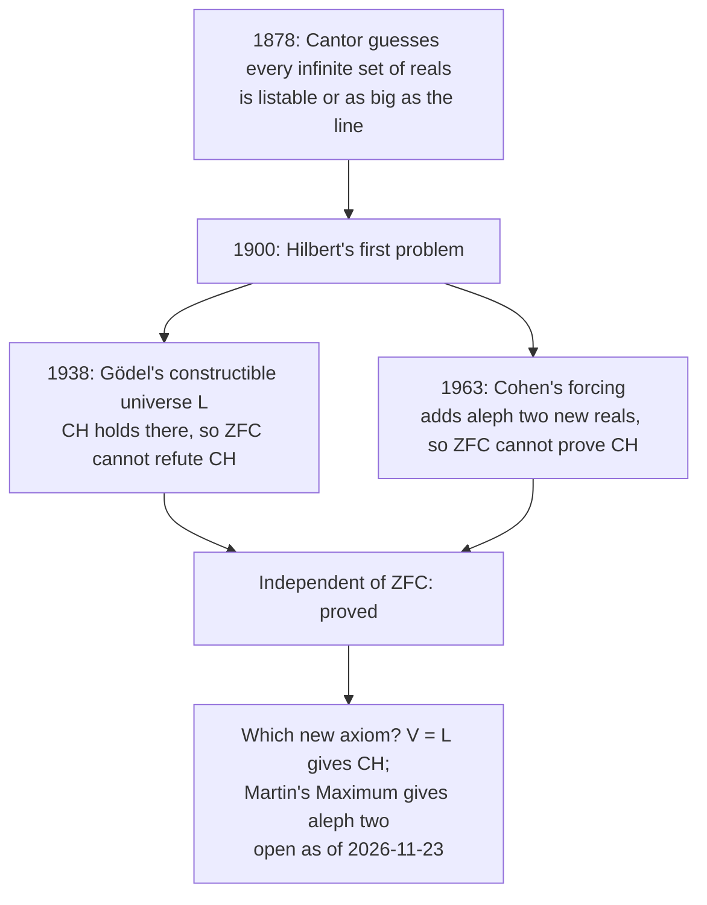

# The continuum hypothesis: no size between the integers and the reals, and why it cannot be settled

[Syllabus](../../../SYLLABUS.md) → [Frontier](../README.md) → [Algebra, Logic and Computation](../README.md#s06) → The continuum hypothesis

---

## General Overview

The counting numbers 0, 1, 2, 3, … can be listed one after another. Their size is called $`\aleph_0`$, read "aleph nought" (aleph is the first letter of the Hebrew alphabet). The points of the number line cannot be listed: every list misses one ([Cantor's diagonal](../../01-Foundations/09-Sizes%20of%20Infinity/03-cantors-diagonal-argument.md)).

The line has as many points as there are sets of counting numbers. That size is written $`2^{\aleph_0}`$, because a set of 6 things has $`2^6 = 64`$ subsets. Every set is smaller than its power set ([Comparing infinities](../../01-Foundations/09-Sizes%20of%20Infinity/04-comparing-infinities.md)), so the line is a bigger infinity than the list.

How much bigger? The first infinite size after $`\aleph_0`$ is called $`\aleph_1`$, "aleph one" ([Cardinal arithmetic](../../01-Foundations/09-Sizes%20of%20Infinity/09-cardinal-arithmetic.md) shows how these sizes add, multiply and climb). In 1878 Georg Cantor guessed that every infinite set of points of the line is either listable or as big as the line; in the language of alephs, that the line has exactly size $`\aleph_1`$. The guess is the **continuum hypothesis**, CH for short ("the continuum" is an old name for the line). David Hilbert put it first on his list of 23 problems in 1900 ([Hilbert's and Smale's lists](05-hilbert-and-smale-problems-selected.md)).

The answer came in two halves. Kurt Gödel built a universe of sets where CH is true (announced 1938, monograph 1940). In 1963 Paul Cohen built one where it is false and the line has at least $`\aleph_2`$ points. Both universes obey every axiom of standard set theory. So those axioms can never prove CH, and can never refute it.

**The continuum hypothesis says no infinite size lies between the counting numbers and the line; the standard axioms of set theory neither prove nor refute it, because Gödel built a world of sets where it holds and Cohen one where it fails.**

**What kind of fact this is:** a question whose answer is a theorem. Kind: a question about sizes. Status: independent of ZFC (the standard axioms, listed on [The ZFC axioms](../../01-Foundations/07-Sets/08-zfc-axioms.md) and in The formula), proved by Gödel (1938) and Cohen (1963), on the assumption that ZFC is consistent. Whether CH should count as true is a separate question about new axioms: open as of 2026-11-23, with no consensus.

### The picture: the route of the problem



---

## The formula

Notation first, in words. $`\aleph_0`$ is the size of the counting numbers. $`\aleph_1`$ is the smallest infinite size bigger than $`\aleph_0`$, and $`\aleph_2`$ the next one after that. $`2^{\aleph_0}`$ is the size of the set of all sets of counting numbers, which equals the number of points on the line.

```math
2^{\aleph_0} = \aleph_1
```

**Read it aloud:** the number of points on the line is the first infinite size after the counting numbers.

**ZFC** is the Zermelo–Fraenkel axioms plus the axiom of choice: about ten rules for building sets (pairs, unions, power sets, an infinite set, and so on), plus the right to pick one member from each of many boxes ([The axiom of choice](../../01-Foundations/09-Sizes%20of%20Infinity/05-axiom-of-choice.md)). **ZF** is the same list without choice. Almost all of mathematics can be written inside ZFC.

From [Godel's theorems](../../24-Computability%20and%20complexity/02-Computability%20and%20Logic/03-godels-incompleteness-in-outline.md): $`T \vdash \varphi`$ means "the axiom system $`T`$ proves the statement $`\varphi`$", and $`\mathrm{Con}(T)`$ means "$`T`$ never proves a contradiction". The two halves of the answer are:

```math
\mathrm{Con}(\mathrm{ZF}) \Rightarrow \mathrm{Con}(\mathrm{ZFC} + \mathrm{CH}) \qquad\text{and}\qquad \mathrm{Con}(\mathrm{ZF}) \Rightarrow \mathrm{Con}(\mathrm{ZFC} + \neg\mathrm{CH})
```

**Read it aloud:** if the plain axioms are free of contradiction, they stay free of contradiction when CH is added, and also when its denial is added.

Together they give **independence**: if ZFC is consistent, then $`\mathrm{ZFC} \nvdash \mathrm{CH}`$ and $`\mathrm{ZFC} \nvdash \neg\mathrm{CH}`$.

| Symbol | Plain meaning | In our example | Push it up and the answer… |
| --- | --- | --- | --- |
| $`\aleph_0`$ | the size of the counting numbers | the list 0, 1, 2, … | — |
| $`\aleph_1`$ | the smallest infinite size above $`\aleph_0`$ | the size CH gives the line | — |
| $`\aleph_2`$, $`\aleph_\omega`$ | the next size above $`\aleph_1`$; the first size above all of $`\aleph_1, \aleph_2, \aleph_3, \ldots`$ | the number of new reals Cohen adds; a size the line can never have | add more reals and the line grows to $`\aleph_3`$ and beyond |
| $`2^{\aleph_0}`$ | the number of sets of counting numbers; the number of points on the line | binary expansions such as 0.0110101… | — |
| CH | the claim $`2^{\aleph_0} = \aleph_1`$ | true in Gödel's L, false in Cohen's world | — |
| ZF, ZFC | the standard axioms for sets, without and with choice | the rules both worlds obey | add axioms and more is decided |
| $`T \vdash \varphi`$, $`T \nvdash \varphi`$ | $`T`$ proves $`\varphi`$; $`T`$ does not prove it | ZFC does not prove CH | — |
| $`\mathrm{Con}(T)`$ | $`T`$ never proves a contradiction | assumed for ZF | — |
| $`\neg`$ | "not" | $`\neg\mathrm{CH}`$: the line is bigger than $`\aleph_1`$ | — |
| $`L`$ | Gödel's constructible universe: only sets some formula describes | finite levels of 0, 1, 2, 4, 16, 65536 sets | — |
| $`p`$, $`g`$ | a forcing condition: a finite start of the new real's binary digits; Cohen's generic real, the new real the conditions build | 11; 0.11… | a longer $`p`$ decides more digits |
| M, M[G] | the countable model of ZFC Cohen starts from; the bigger model after the new reals are added | the six listed reals stand in for M | — |

### When it holds

- **ZFC is consistent.** A contradictory system proves CH and its denial alike. ZFC cannot prove its own consistency (Godel's second theorem), so every independence result is relative: "if ZFC is consistent, then …".
- **Choice is among the axioms.** Without choice, the points of the line may not line up in any aleph at all. Then "$`2^{\aleph_0} = \aleph_1`$" and "every infinite set of reals is listable or full-size" stop being the same statement.
- **The question is about sets of reals, not whole numbers.** Gödel's and Cohen's worlds share the same counting numbers. A statement only about whole numbers comes out the same in both, so CH can never decide one (Step 5).
- **The sets are arbitrary, not tame.** For closed sets of reals ZFC settles the question: every uncountable closed set has full size (the Cantor–Bendixson theorem). Independence lives among the wild sets that choice supplies.
- **The axioms are ZFC, not any axioms at all.** Add Gödel's axiom "every set is constructible" (written V = L) and CH becomes a theorem. Add the forcing axiom Martin's Maximum and $`2^{\aleph_0} = \aleph_2`$ becomes one.

---

## Why it works

### Step 0: to show a statement unprovable, build a world where it fails

A proof from axioms is true in every structure that obeys the axioms. Such a structure is a **model**. So one model of ZFC where CH holds shows that ZFC cannot refute CH. A second model where CH fails shows that ZFC cannot prove it.

ZFC cannot prove that even one model of itself exists. So each construction starts from a given model and builds another.

### Step 1: the gap Cantor left

Cantor's theorem gives $`2^{\aleph_0} > \aleph_0`$, so $`2^{\aleph_0} \ge \aleph_1`$. CH says the two are equal. Nothing in the diagonal argument says how far apart they are.

Finite sets are no guide. Strictly between 6 and $`2^6 = 64`$ lie 57 sizes; in general $`2^n - n - 1`$. CH asks whether the first infinite step has no such gap.

### Step 2: Gödel's constructible universe L

Gödel built sets in levels, keeping only what can be described.

1. Level 0 is empty.
2. Each next level holds every subset of the level before that some formula picks out, using members of that level as names.
3. At an infinite stage, pool all the levels so far.

At finite levels nothing is lost. A subset of a finite set is described by listing its members, so the levels hold 0, 1, 2, 4, 16, 65536 sets, the full power-set tower (its levels are written V_0 to V_5 in the output). The code builds this tower and compares it with $`2^{\text{previous}}`$.

The first infinite level is countable. Its power set has $`2^{\aleph_0}`$ members, but formulas are finite strings, so only countably many subsets get described. From here on L is thin.

That thinness is why CH holds in L. Every constructible set of counting numbers already appears at some level with a countable index. Each such level is countable and adds countably many sets. There are $`\aleph_1`$ countable indices, so at most $`\aleph_1 \times \aleph_0 = \aleph_1`$ sets of counting numbers exist in L.

Gödel proved that L obeys every axiom of ZF, and also choice and CH. So if ZF is consistent, so is ZFC + CH: ZFC cannot refute CH.

<details>
<summary>Outline of Gödel's argument, with its key lemma</summary>

Write $`L_\alpha`$ for level $`\alpha`$. The construction is

$`\displaystyle L_0 = \varnothing, \qquad L_{\alpha+1} = \{\, X \subseteq L_\alpha : X \text{ is definable over } L_\alpha \text{ with parameters} \,\}, \qquad L_\lambda = \bigcup_{\alpha < \lambda} L_\alpha`$

and L is the union of all levels. Three facts carry the proof (Jech, chapter 13).

(1) L satisfies every ZF axiom. Each axiom asks for a set; the required set is definable, so it appears at a later level.

(2) L has a definable well-ordering: order sets by the level where they first appear, then by the first formula and names that describe them. So choice holds in L.

(3) Condensation: if a set of counting numbers is in L, it is in some $`L_\alpha`$ with $`\alpha`$ countable. The proof shrinks a level containing the set to a countable piece that still describes it, then flattens that piece back into an earlier level.

A countable level has countably many formulas with countably many choices of names, so $`L_{\alpha+1}`$ adds countably many sets. Summing over the $`\aleph_1`$ countable levels gives at most $`\aleph_1`$ sets of counting numbers in L, which is CH.

</details>

### Step 3: Cohen's forcing adds one new real

Cohen worked the other way: start from a model M and grow it. Textbooks take M countable, so its members can be listed from outside.

The new real g is built from finite pieces. A **condition** p is a finite start of g's binary digits, such as 11. A **dense set** is a collection of conditions that every condition can be extended into. For each real r in M, "disagrees with r somewhere" is dense: any condition grows by one digit, the opposite of r's next digit, and then it disagrees with r.

A **generic** g meets every dense set that M can describe. M is countable, so there are countably many dense sets, and g is built by meeting them one at a time. The result differs from every real in M: it is new.

The code runs this on a ground list of six reals. Most dense sets are met for free. The generic is just 0.11…, two digits, while Cantor's diagonal needs six. These particular dense sets are large: at length 12, 4090 of the 4096 conditions already dodge all six reals. Density itself promises less: only that every condition can be extended into the set. Some dense sets are tiny, and a generic meets those too.

### Step 4: Cohen's forcing adds $`\aleph_2`$ new reals

Now take $`\aleph_2`$ columns of digits at once. A condition fixes finitely many digits in finitely many columns. Two kinds of dense sets are met:

- column $`\alpha`$ disagrees with each real of M, and
- column $`\alpha`$ disagrees with column $`\beta`$.

The code does this for 4 columns: 30 dense sets, 16 met for free and 14 by extending. All 6 pairs of new reals differ. Drop the second kind and all four columns come out as 0.11…: one new real, not four.

The hard part is keeping the alephs in place. If the new world counted M's $`\aleph_2`$ as only $`\aleph_1`$, the new reals would prove nothing. Cohen's conditions satisfy the **countable chain condition**: any uncountable collection of conditions holds two that agree where they overlap. That condition keeps every aleph of M an aleph in the new world.

So the new world, written M[G], has $`2^{\aleph_0} \ge \aleph_2`$. Cohen also proved the **forcing theorem**: what is true in M[G] is decided by conditions, which live in M. That lets M check that M[G] obeys every axiom of ZFC. So ZFC + ¬CH is consistent if ZF is: ZFC cannot prove CH.

<details>
<summary>Outline of Cohen's argument</summary>

Let P be the set of finite partial functions from $`\omega_2 \times \omega`$ to $`\{0, 1\}`$, where $`\omega_2`$ is M's version of $`\aleph_2`$ and $`\omega`$ is the counting numbers. A condition q extends p when q contains p. A filter G is generic over M when it meets every dense subset of P that lies in M; for countable M one exists, built as in Step 3. The union of G gives $`\aleph_2`$ functions from $`\omega`$ to $`\{0, 1\}`$, pairwise different by density.

Chain condition: given $`\aleph_1`$ conditions, their finite domains contain an uncountable Δ-system (a family of sets whose pairwise overlaps are one fixed set), and two conditions on it agree on that common root because the root has only finitely many 0/1 patterns. So every antichain is countable, and a counting argument shows no aleph of M collapses. In M[G]:

$`\displaystyle 2^{\aleph_0} \ge \aleph_2`$

(Jech, chapters 14 and 15, gives the full proof; Cohen's 1963 paper gives the original.)

</details>

### Step 5: what independence means for a working mathematician

- **A theorem "assuming CH" is a theorem of ZFC + CH.** It is a real proof from a stated extra axiom. The opposite assumption often gives the opposite theorem.
- **A natural question can be CH in disguise.** Wetzel's question about analytic functions, answered by Erdős in 1964 (Where you meet it), has the answer "yes" exactly when CH fails, so it is independent too.
- **Whole-number questions are immune.** If ZFC + CH proves a statement only about whole numbers, then ZFC alone proves it. The proof can be run inside L, where CH holds, and a statement about whole numbers means the same in L as anywhere (Jech, chapters 12 and 13). The same holds with ¬CH.
- **CH is not Gödel's sentence.** [Godel's theorems](../../24-Computability%20and%20complexity/02-Computability%20and%20Logic/03-godels-incompleteness-in-outline.md) builds a sentence that talks about its own proofs. CH is an ordinary question Cantor asked, and its independence needs models of set theory, not self-reference.

### Step 6: where the question stands

| Claim | Kind | Status as of 2026-11-23 | Source |
| --- | --- | --- | --- |
| ZFC cannot refute CH | theorem | proved, announced 1938, monograph 1940 | Gödel |
| ZFC cannot prove CH | theorem | proved, 1963 | Cohen |
| $`2^{\aleph_0}`$ can be $`\aleph_2`$, $`\aleph_3`$, …, but never $`\aleph_\omega`$ | theorem | proved | Jech, chapters 5 and 15 |
| Martin's Maximum++ (a strengthened form of Martin's Maximum) implies Woodin's axiom (*); both give $`2^{\aleph_0} = \aleph_2`$ | theorem | proved, published 2021 | Asperó and Schindler |
| CH is true, as settled by some new accepted axiom | question | open, no consensus | — |

Here $`\aleph_\omega`$ is the first aleph after all of $`\aleph_1, \aleph_2, \aleph_3, \ldots`$. König's theorem forbids $`2^{\aleph_0}`$ from being the limit of a countable climb of smaller sizes. Martin's Maximum and Woodin's (*) are proposed new axioms. Neither is part of ZFC, so the 2021 theorem does not settle CH; it shows that two leading proposals agree on $`\aleph_2`$.

---

## Worked numbers, by hand

The ground list: six reals between 0 and 1, by their binary digits.

| Step | Arithmetic | Value |
| --- | --- | --- |
| the six reals | 0, 1/3, 1/7, 2/5, √2 − 1, √3 − 1 | 0.0000…, 0.0101…, 0.0010…, 0.0110…, 0.0110…, 0.1011… |
| dodge 0 | the empty condition agrees with it; add the opposite of digit 1 | 1 |
| dodge 1/3, 1/7, 2/5, √2 − 1 | each starts with 0, the condition with 1 | met for free, 4 times |
| dodge √3 − 1 | it starts 10; add the opposite of its second digit | 11 |
| Cantor's diagonal | flip digit i of real i | 100101 |
| conditions of length 12 dodging all six | 4096 − 6 distinct starts | 4090 |
| four new reals side by side | 24 list dense sets + 6 pair dense sets | 30 met: 16 free, 14 extended |
| pairs of new reals that differ | checked digit by digit | **6 of 6** |

The generic 0.11… is new after two digits, because these dense sets are large. In Cohen's proof the list is the whole countable model and there are $`\aleph_2`$ columns, but each step is this one.

### What breaks if you drop a piece

| Mistake | Comes out at | What went wrong |
| --- | --- | --- |
| Taking finite sizes as evidence about CH | 57 sizes between 6 and 64 | Finite gaps say nothing about the first infinite step |
| Forcing over a list that holds every real | 0 of 16 conditions of length 4 dodge it | A generic must lie outside the ground model, so Cohen starts from a countable one |
| Meeting the list's dense sets but not the pair dense sets | 4 columns all 11; 0 of 6 pairs differ | Without "column α differs from column β", the new reals can coincide |

The code prints all three.

---

## Code, from first principles, and it actually runs

No program can test CH: it is independent of the axioms the program's mathematics rests on. The code instead checks the finite shadows of the two proofs. It takes these roads, each checked against a second one:

- the finite gaps, counted and by the formula $`2^n - n - 1`$;
- the listed reals' first 12 digits, by long division or the square root, and again by one division or by squaring the prefix;
- the conditions dodging the list, counted string by string and by subtracting the distinct starts;
- the generic real and Cantor's diagonal, each checked digit by digit against every listed real;
- the new reals, checked pair by pair;
- Gödel's finite levels, built as sets and by repeated powers of 2.

The reals' digits come from exact integer arithmetic: long division, and a written-out integer square root.

### Python

```python
# The continuum hypothesis -- the check behind the card.  Nothing is imported.
# CH itself is independent of the axioms, so no program can test it.  What the
# code checks are the finite shadows of the two proofs: Cohen's forcing (a new
# real built by meeting dense sets, dodging a ground list of reals) and Godel's
# levels (finite levels of the constructible universe are the full tower).
L, K = 40, 4                     # binary digits kept per real; new reals added

def isqrt(m):                    # floor square root by bisection, written out
    lo, hi = 0, 1
    while hi * hi <= m:
        hi *= 2
    while hi - lo > 1:
        mid = (lo + hi) // 2
        lo, hi = (mid, hi) if mid * mid <= m else (lo, mid)
    return lo

def frac_bits(p, q):             # first L binary digits of p/q, by long division
    out = ""
    for _ in range(L):
        p *= 2
        out += str(p // q)
        p %= q
    return out

def sqrt_bits(m):                # first L binary digits of sqrt(m) - 1
    s = isqrt(m * 4 ** L)
    assert s * s <= m * 4 ** L < (s + 1) * (s + 1)
    return format(s - 2 ** L, "b").zfill(L)

def yn(claim):
    return "yes" if claim else "no"

def flip(bit):
    return "1" if bit == "0" else "0"

def meet(p, r):                  # extend condition p into "disagrees with r somewhere"
    if not r.startswith(p):
        return p, "met for free"
    return p + flip(r[len(p)]), "extended by one digit"

def differ(a, b):                # road two: look for a digit where both are defined
    return any(x != y for x, y in zip(a, b))

def dodgers(n, reals):           # conditions of length n that agree with no listed real
    count = 0
    for v in range(2 ** n):
        s = format(v, "b").zfill(n)
        if all(differ(s, r) for r in reals):
            count += 1
    return count

GROUND = [("0", "0" * L), ("1/3", frac_bits(1, 3)), ("1/7", frac_bits(1, 7)),
          ("2/5", frac_bits(2, 5)), ("sqrt2-1", sqrt_bits(2)), ("sqrt3-1", sqrt_bits(3))]
reals = [r for _, r in GROUND]

between = [sum(1 for k in range(n + 1, 2 ** n)) for n in range(7)]
print(f"finite sizes strictly between n and 2^n, n = 0..6: {between}")
print(f"the same by 2^n - n - 1:                         {[2 ** n - n - 1 for n in range(7)]}")
print("ground list, first 12 binary digits:")
for name, r in GROUND:
    print(f"  {name:<8} 0.{r[:12]}...")
print("conditions that already dodge all six (counted / by formula):")
lengths = (1, 2, 3, 4, 6, 8, 12)
brute = [dodgers(n, reals) for n in lengths]
formula = [2 ** n - len({r[:n] for r in reals}) for n in lengths]
for n, b, f in zip(lengths, brute, formula):
    print(f"  length {n:>2}: {b:>4} / {f:>4} of {2 ** n}")
g = ""
print("one Cohen real, meeting one dense set per listed real:")
for name, r in GROUND:
    g, how = meet(g, r)
    print(f"  dodge {name:<8} {how:<22} condition now {g}")
diag = "".join(flip(r[i]) for i, r in enumerate(reals))
print(f"Cantor's diagonal for comparison: {diag}")
print(f"generic differs from every listed real: {yn(all(differ(g, r) for r in reals))}")
cols, steps = [""] * K, {"free": 0, "extended": 0}
for c in range(K):
    for r in reals:
        cols[c], how = meet(cols[c], r)
        steps["free" if how == "met for free" else "extended"] += 1
    for d in range(c):
        a, b = cols[c], cols[d]
        if differ(a, b):
            steps["free"] += 1
            continue
        steps["extended"] += 1
        if len(a) < len(b):
            cols[c] = a + flip(b[len(a)])
        elif len(a) > len(b):
            cols[d] = b + flip(a[len(b)])
        else:
            cols[c], cols[d] = a + "0", b + "1"
print(f"{K} Cohen reals added side by side:")
for c in range(K):
    print(f"  column {c}: {cols[c]}")
dense = K * len(reals) + K * (K - 1) // 2
pairs = sum(1 for c in range(K) for d in range(c) if differ(cols[c], cols[d]))
print(f"dense sets met: {steps['free'] + steps['extended']} of {dense}; "
      f"free {steps['free']}, extended {steps['extended']}")
print(f"pairs of new reals that differ: {pairs} of {K * (K - 1) // 2}")
only = []
for c in range(K):               # the same columns, dodging the list but not each other
    p = ""
    for r in reals:
        p, _ = meet(p, r)
    only.append(p)
same = sum(1 for c in range(K) for d in range(c) if differ(only[c], only[d]))
print(f"columns dodging only the list: {' '.join(only)}; pairs that differ {same} of {K * (K - 1) // 2}")
every = [format(v, "b").zfill(4) for v in range(16)]
print(f"ground list holding all 16 strings of length 4: dodgers {dodgers(4, every)}")
level, tower, sizes, codes_ok = [], 0, [(0, 0)], True
for n in range(5):
    picks = [0]
    for x in level:              # every subset of the level, as its Ackermann code
        picks = picks + [p + 2 ** x for p in picks]
    codes_ok = codes_ok and sorted(picks) == list(range(2 ** len(level)))
    level, tower = sorted(picks), 2 ** tower
    sizes.append((len(level), tower))
print(f"tower V_0..V_5 built / by 2^previous: {[s for s, _ in sizes]} / {[t for _, t in sizes]}")
assert between == [2 ** n - n - 1 for n in range(7)]               # two roads, finite gap
assert brute == formula and brute[0] == 0 and brute[-1] == 4096 - 6  # two roads, density
assert [r[:12] for r in reals[1:4]] == [format(p * 4096 // q, "b").zfill(12) for p, q in ((1, 3), (1, 7), (2, 5))]
assert all(n * n <= m * 4 ** 12 < (n + 1) ** 2      # road two for the roots: square the 12-digit prefix
           for m, n in ((2, 4096 + int(reals[4][:12], 2)), (3, 4096 + int(reals[5][:12], 2))))
assert g == "11" and diag == "100101"                               # the worked table, by hand
assert all(differ(g, r) for r in reals) and all(differ(diag, r) for r in reals)
assert pairs == K * (K - 1) // 2
assert dodgers(4, every) == 0 and codes_ok and same == 0
assert [s for s, _ in sizes] == [t for _, t in sizes] == [0, 1, 2, 4, 16, 65536]
print("ALL CHECKS PASS")
```

**Ran 2026-11-23 on macOS, Python 3.14.10, standard library only. All checks passed. Output, pasted from the run:**

```
finite sizes strictly between n and 2^n, n = 0..6: [0, 0, 1, 4, 11, 26, 57]
the same by 2^n - n - 1:                         [0, 0, 1, 4, 11, 26, 57]
ground list, first 12 binary digits:
  0        0.000000000000...
  1/3      0.010101010101...
  1/7      0.001001001001...
  2/5      0.011001100110...
  sqrt2-1  0.011010100000...
  sqrt3-1  0.101110110110...
conditions that already dodge all six (counted / by formula):
  length  1:    0 /    0 of 2
  length  2:    1 /    1 of 4
  length  3:    3 /    3 of 8
  length  4:   11 /   11 of 16
  length  6:   58 /   58 of 64
  length  8:  250 /  250 of 256
  length 12: 4090 / 4090 of 4096
one Cohen real, meeting one dense set per listed real:
  dodge 0        extended by one digit  condition now 1
  dodge 1/3      met for free           condition now 1
  dodge 1/7      met for free           condition now 1
  dodge 2/5      met for free           condition now 1
  dodge sqrt2-1  met for free           condition now 1
  dodge sqrt3-1  extended by one digit  condition now 11
Cantor's diagonal for comparison: 100101
generic differs from every listed real: yes
4 Cohen reals added side by side:
  column 0: 111
  column 1: 1101
  column 2: 11001
  column 3: 11000
dense sets met: 30 of 30; free 16, extended 14
pairs of new reals that differ: 6 of 6
columns dodging only the list: 11 11 11 11; pairs that differ 0 of 6
ground list holding all 16 strings of length 4: dodgers 0
tower V_0..V_5 built / by 2^previous: [0, 1, 2, 4, 16, 65536] / [0, 1, 2, 4, 16, 65536]
ALL CHECKS PASS
```

### Rust

Same numbers, same labels, built with `rustc --edition 2021 -O`.

```rust
// The continuum hypothesis -- the same check as the Python, in Rust.  No crates.
// CH itself is independent of the axioms, so no program can test it.  What the
// code checks are the finite shadows of the two proofs: Cohen's forcing (a new
// real built by meeting dense sets, dodging a ground list of reals) and Godel's
// levels (finite levels of the constructible universe are the full tower).
const L: usize = 40; // binary digits kept per real
const K: usize = 4; // new reals added

fn isqrt(m: u128) -> u128 { // floor square root by bisection, written out
    let (mut lo, mut hi) = (0u128, 1u128);
    while hi * hi <= m { hi *= 2 }
    while hi - lo > 1 {
        let mid = (lo + hi) / 2;
        if mid * mid <= m { lo = mid } else { hi = mid }
    }
    lo
}

fn frac_bits(mut p: u64, q: u64) -> String { // first L binary digits of p/q, by long division
    let mut out = String::new();
    for _ in 0..L {
        p *= 2;
        out.push_str(&(p / q).to_string());
        p %= q;
    }
    out
}

fn sqrt_bits(m: u128) -> String { // first L binary digits of sqrt(m) - 1
    let big = m << (2 * L);
    let s = isqrt(big);
    assert!(s * s <= big && big < (s + 1) * (s + 1));
    format!("{:0w$b}", s - (1u128 << L), w = L)
}

fn yn(claim: bool) -> &'static str { if claim { "yes" } else { "no" } }

fn flip(bit: char) -> char { if bit == '0' { '1' } else { '0' } }

fn meet(p: &str, r: &str) -> (String, &'static str) { // extend p into "disagrees with r somewhere"
    if !r.starts_with(p) { return (p.to_string(), "met for free") }
    (format!("{}{}", p, flip(r.as_bytes()[p.len()] as char)), "extended by one digit")
}

fn differ(a: &str, b: &str) -> bool { // road two: look for a digit where both are defined
    a.chars().zip(b.chars()).any(|(x, y)| x != y)
}

fn dodgers(n: usize, reals: &[String]) -> usize { // conditions of length n agreeing with no listed real
    let mut count = 0;
    for v in 0..(1usize << n) {
        let s = format!("{:0w$b}", v, w = n);
        if reals.iter().all(|r| differ(&s, r)) { count += 1 }
    }
    count
}

fn main() {
    let ground: Vec<(&str, String)> = vec![("0", "0".repeat(L)), ("1/3", frac_bits(1, 3)), ("1/7", frac_bits(1, 7)),
        ("2/5", frac_bits(2, 5)), ("sqrt2-1", sqrt_bits(2)), ("sqrt3-1", sqrt_bits(3))];
    let reals: Vec<String> = ground.iter().map(|(_, r)| r.clone()).collect();
    let between: Vec<i64> = (0..7u32).map(|n| ((n as i64 + 1)..(1i64 << n)).count() as i64).collect();
    let by_formula: Vec<i64> = (0..7u32).map(|n| (1i64 << n) - n as i64 - 1).collect();
    println!("finite sizes strictly between n and 2^n, n = 0..6: {:?}", between);
    println!("the same by 2^n - n - 1:                         {:?}", by_formula);
    println!("ground list, first 12 binary digits:");
    for (name, r) in &ground { println!("  {:<8} 0.{}...", name, &r[..12]) }
    println!("conditions that already dodge all six (counted / by formula):");
    let lengths = [1usize, 2, 3, 4, 6, 8, 12];
    let brute: Vec<usize> = lengths.iter().map(|&n| dodgers(n, &reals)).collect();
    let formula: Vec<usize> = lengths.iter().map(|&n| {
        let mut pre: Vec<&str> = reals.iter().map(|r| &r[..n]).collect();
        pre.sort();
        pre.dedup();
        (1usize << n) - pre.len()
    }).collect();
    for i in 0..lengths.len() {
        println!("  length {:>2}: {:>4} / {:>4} of {}", lengths[i], brute[i], formula[i], 1usize << lengths[i]);
    }
    let mut g = String::new();
    println!("one Cohen real, meeting one dense set per listed real:");
    for (name, r) in &ground {
        let (next, how) = meet(&g, r);
        g = next;
        println!("  dodge {:<8} {:<22} condition now {}", name, how, g);
    }
    let diag: String = reals.iter().enumerate().map(|(i, r)| flip(r.as_bytes()[i] as char)).collect();
    println!("Cantor's diagonal for comparison: {}", diag);
    println!("generic differs from every listed real: {}", yn(reals.iter().all(|r| differ(&g, r))));
    let mut cols: Vec<String> = vec![String::new(); K];
    let (mut free, mut extended) = (0usize, 0usize);
    for c in 0..K {
        for r in &reals {
            let (next, how) = meet(&cols[c], r);
            cols[c] = next;
            if how == "met for free" { free += 1 } else { extended += 1 }
        }
        for d in 0..c {
            let (a, b) = (cols[c].clone(), cols[d].clone());
            if differ(&a, &b) { free += 1; continue }
            extended += 1;
            if a.len() < b.len() {
                cols[c] = format!("{}{}", a, flip(b.as_bytes()[a.len()] as char));
            } else if a.len() > b.len() {
                cols[d] = format!("{}{}", b, flip(a.as_bytes()[b.len()] as char));
            } else {
                cols[c] = format!("{}0", a);
                cols[d] = format!("{}1", b);
            }
        }
    }
    println!("{} Cohen reals added side by side:", K);
    for c in 0..K { println!("  column {}: {}", c, cols[c]) }
    let dense = K * reals.len() + K * (K - 1) / 2;
    let mut pairs = 0;
    for c in 0..K { for d in 0..c { if differ(&cols[c], &cols[d]) { pairs += 1 } } }
    println!("dense sets met: {} of {}; free {}, extended {}", free + extended, dense, free, extended);
    println!("pairs of new reals that differ: {} of {}", pairs, K * (K - 1) / 2);
    let mut only: Vec<String> = Vec::new();
    for _ in 0..K { // the same columns, dodging the list but not each other
        let mut p = String::new();
        for r in &reals { p = meet(&p, r).0 }
        only.push(p);
    }
    let mut same = 0;
    for c in 0..K { for d in 0..c { if differ(&only[c], &only[d]) { same += 1 } } }
    println!("columns dodging only the list: {}; pairs that differ {} of {}", only.join(" "), same, K * (K - 1) / 2);
    let every: Vec<String> = (0..16usize).map(|v| format!("{:04b}", v)).collect();
    println!("ground list holding all 16 strings of length 4: dodgers {}", dodgers(4, &every));
    let (mut level, mut tower, mut codes_ok): (Vec<u64>, u64, bool) = (Vec::new(), 0, true);
    let (mut built, mut towers) = (vec![0u64], vec![0u64]);
    for _ in 0..5 {
        let mut picks: Vec<u64> = vec![0];
        for &x in &level { // every subset of the level, as its Ackermann code
            let more: Vec<u64> = picks.iter().map(|p| p + (1u64 << x)).collect();
            picks.extend(more);
        }
        picks.sort();
        codes_ok = codes_ok && picks == (0..(1u64 << level.len())).collect::<Vec<u64>>();
        level = picks;
        tower = 1u64 << tower;
        built.push(level.len() as u64);
        towers.push(tower);
    }
    println!("tower V_0..V_5 built / by 2^previous: {:?} / {:?}", built, towers);
    assert!(between == by_formula); // two roads, finite gap
    assert!(brute == formula && brute[0] == 0 && brute[6] == 4096 - 6); // two roads, density
    assert!(reals[1..4].iter().zip([(1u64, 3u64), (1, 7), (2, 5)]).all(|(r, (p, q))| r[..12] == format!("{:012b}", p * 4096 / q)));
    assert!([(2u128, 4usize), (3, 5)].iter().all(|&(m, i)| { // road two for the roots: square the 12-digit prefix
        let n = 4096 + u128::from_str_radix(&reals[i][..12], 2).unwrap();
        n * n <= m << 24 && m << 24 < (n + 1) * (n + 1) }));
    assert!(g == "11" && diag == "100101"); // the worked table, by hand
    assert!(reals.iter().all(|r| differ(&g, r)) && reals.iter().all(|r| differ(&diag, r)));
    assert!(pairs == K * (K - 1) / 2);
    assert!(dodgers(4, &every) == 0 && codes_ok && same == 0);
    assert!(built == towers && built == vec![0, 1, 2, 4, 16, 65536]);
    println!("ALL CHECKS PASS");
}
```

**Ran 2026-11-23 on macOS, rustc 1.98.1, no crates. All checks passed. Output, pasted from the run:**

```
finite sizes strictly between n and 2^n, n = 0..6: [0, 0, 1, 4, 11, 26, 57]
the same by 2^n - n - 1:                         [0, 0, 1, 4, 11, 26, 57]
ground list, first 12 binary digits:
  0        0.000000000000...
  1/3      0.010101010101...
  1/7      0.001001001001...
  2/5      0.011001100110...
  sqrt2-1  0.011010100000...
  sqrt3-1  0.101110110110...
conditions that already dodge all six (counted / by formula):
  length  1:    0 /    0 of 2
  length  2:    1 /    1 of 4
  length  3:    3 /    3 of 8
  length  4:   11 /   11 of 16
  length  6:   58 /   58 of 64
  length  8:  250 /  250 of 256
  length 12: 4090 / 4090 of 4096
one Cohen real, meeting one dense set per listed real:
  dodge 0        extended by one digit  condition now 1
  dodge 1/3      met for free           condition now 1
  dodge 1/7      met for free           condition now 1
  dodge 2/5      met for free           condition now 1
  dodge sqrt2-1  met for free           condition now 1
  dodge sqrt3-1  extended by one digit  condition now 11
Cantor's diagonal for comparison: 100101
generic differs from every listed real: yes
4 Cohen reals added side by side:
  column 0: 111
  column 1: 1101
  column 2: 11001
  column 3: 11000
dense sets met: 30 of 30; free 16, extended 14
pairs of new reals that differ: 6 of 6
columns dodging only the list: 11 11 11 11; pairs that differ 0 of 6
ground list holding all 16 strings of length 4: dodgers 0
tower V_0..V_5 built / by 2^previous: [0, 1, 2, 4, 16, 65536] / [0, 1, 2, 4, 16, 65536]
ALL CHECKS PASS
```

The two outputs match line for line.

### Lean

Lean proves the two forms of CH agree, the closed-set case and the bounds on the line's size, and checks the worked numbers.

- Take choice as an axiom, as Lean does. Then $`2^{\aleph_0} = \aleph_1`$ exactly when every set of reals is listable or as big as the line.
- Take a closed set of reals that cannot be listed. Then it is as big as the line (the Cantor–Bendixson theorem).
- The line has at least $`\aleph_1`$ points, and never exactly $`\aleph_\omega`$ (König's theorem).
- Take $`n`$ from 0 to 6. Then $`2^n - n - 1`$ sizes lie strictly between $`n`$ and $`2^n`$, counted one by one.
- The 12-digit starts of 1/3, 1/7 and 2/5 each come from one division.
- Squaring the 12-digit starts of √2 − 1 and √3 − 1 brackets 2 and 3, so those starts are right.
- The six listed reals have 6 different 12-digit starts. So 4096 − 6 = 4090 conditions of length 12 dodge them all.
- The generic 0.11… differs from every listed real in its first two digits.
- Four new reals side by side meet 4 × 6 + 6 = 30 dense sets.
- Gödel's finite levels hold 0, 1, 2, 4, 16 and 65536 sets, each 2 to the power of the one before.

Independence rests on Gödel's and Cohen's proofs; the forcing runs and the levels built as sets are left to the Python and Rust checks.

```lean
-- The continuum hypothesis: the card's two forms of CH agree, CH holds for closed sets of reals, and the line is at least aleph one but never aleph omega.
import Mathlib.Analysis.Real.Cardinality
import Mathlib.SetTheory.Cardinal.Continuum
import Mathlib.SetTheory.Cardinal.Regular
import Mathlib.Topology.MetricSpace.Perfect

open Cardinal

/-- The continuum hypothesis in its two forms says the same thing (with choice, which Lean
assumes): the number of points on the line, two to the aleph nought, is aleph one exactly when
every set of points of the line is either listable or as big as the line. -/
theorem continuum_hypothesis_iff_every_set_of_reals_listable_or_full_size :
    (2 : Cardinal.{0}) ^ ℵ₀ = ℵ₁ ↔ ∀ S : Set ℝ, S.Countable ∨ #S = #ℝ := by
  rw [← Cardinal.continuum, ← mk_real]
  constructor
  · intro h S
    by_cases hS : S.Countable
    · exact Or.inl hS
    · right
      have h1 : ℵ₁ ≤ #S := by
        rw [aleph_one_le_iff, lt_iff_not_ge, le_aleph0_iff_set_countable]
        exact hS
      have h2 : #S ≤ #ℝ := mk_set_le S
      rw [h] at h2 ⊢
      exact le_antisymm h2 h1
  · intro h
    have hle : ℵ₁ ≤ #(Set.univ : Set ℝ) := by
      rw [mk_univ, mk_real]; exact aleph_one_le_continuum
    obtain ⟨S, -, hS⟩ := le_mk_iff_exists_subset.1 hle
    have hnc : ¬ S.Countable := by
      rw [← le_aleph0_iff_set_countable, hS, not_le]
      exact aleph0_lt_aleph_one
    rcases h S with h' | h'
    · exact absurd h' hnc
    · rw [← h', hS]

/-- For closed sets of reals ZFC settles the question: every closed set of points of the line
that cannot be listed is as big as the line (the Cantor–Bendixson theorem). -/
theorem uncountable_closed_set_of_reals_has_full_size (C : Set ℝ) (hC : IsClosed C)
    (hunc : ¬ C.Countable) : #C = #ℝ := by
  obtain ⟨f, hfC, -, hf⟩ := hC.exists_nat_bool_injection_of_not_countable hunc
  refine le_antisymm (mk_set_le C) ?_
  rw [mk_real, ← two_power_aleph0]
  have hinj : Function.Injective (fun x : ℕ → Bool => (⟨f x, hfC ⟨x, rfl⟩⟩ : C)) := by
    intro x y hxy
    exact hf (congrArg Subtype.val hxy)
  have := mk_le_of_injective hinj
  simpa using this

/-- Cantor's gap and König's bound: the number of points on the line is at least aleph one,
and it is never aleph omega, the first aleph after aleph one, aleph two, aleph three, and so on. -/
theorem aleph_one_le_two_pow_aleph0_and_ne_aleph_omega :
    ℵ₁ ≤ (2 : Cardinal.{0}) ^ ℵ₀ ∧ (2 : Cardinal.{0}) ^ ℵ₀ ≠ ℵ_ Ordinal.omega0 := by
  refine ⟨aleph_one_le_continuum, fun h => ?_⟩
  have hk := lt_cof_ord_power (a := ℵ₀) (b := (2 : Cardinal.{0})) le_rfl one_lt_two
  rw [h, ord_aleph, Ordinal.cof_omega Ordinal.isSuccLimit_omega0, Ordinal.cof_omega0] at hk
  exact lt_irrefl _ hk

-- Finite sizes strictly between n and 2^n, for n = 0 to 6, counted and by 2^n - n - 1.
example : (List.range 7).map (fun n => (Finset.Ioo n (2 ^ n)).card) = [0, 0, 1, 4, 11, 26, 57] := by
  decide
example : (List.range 7).map (fun n => 2 ^ n - n - 1) = [0, 0, 1, 4, 11, 26, 57] := by
  decide

-- The ground list's first 12 binary digits: 1/3, 1/7 and 2/5 by one division.
example : 1 * 4096 / 3 = 0b010101010101 ∧ 1 * 4096 / 7 = 0b001001001001 ∧
    2 * 4096 / 5 = 0b011001100110 := by
  norm_num

-- sqrt 2 - 1 and sqrt 3 - 1: squaring the 12-digit prefix brackets 2 * 4^12 and 3 * 4^12.
example : (4096 + 0b011010100000) ^ 2 ≤ 2 * 4 ^ 12 ∧ 2 * 4 ^ 12 < (4096 + 0b011010100000 + 1) ^ 2 := by
  norm_num
example : (4096 + 0b101110110110) ^ 2 ≤ 3 * 4 ^ 12 ∧ 3 * 4 ^ 12 < (4096 + 0b101110110110 + 1) ^ 2 := by
  norm_num

-- Conditions of length 12 that dodge all six listed reals: the six starts are 6 different
-- strings of 12 digits (numbers below 4096), so 4096 minus 6 = 4090 conditions dodge them.
example : (∀ v ∈ [0, 0b010101010101, 0b001001001001, 0b011001100110, 0b011010100000,
      0b101110110110], v < 4096) ∧
    4096 - [0, 0b010101010101, 0b001001001001, 0b011001100110, 0b011010100000,
      0b101110110110].toFinset.card = 4090 := by
  decide

-- The generic 0.11... already differs from every listed real in its first two digits.
example : 0b11 ∉ [0, 0b010101010101, 0b001001001001, 0b011001100110, 0b011010100000,
    0b101110110110].map (· / 1024) := by
  decide

-- Four new reals: 4 × 6 list dense sets plus 6 pair dense sets make 30.
example : 4 * 6 + Nat.choose 4 2 = 30 := by
  decide

-- Gödel's finite levels: 0, 1, 2, 4, 16, 65536 sets, each two to the power of the one before.
example : (List.range 6).map (fun n => (fun k => 2 ^ k)^[n] 0) = [0, 1, 2, 4, 16, 65536] := by
  decide

#print axioms continuum_hypothesis_iff_every_set_of_reals_listable_or_full_size
#print axioms uncountable_closed_set_of_reals_has_full_size
#print axioms aleph_one_le_two_pow_aleph0_and_ne_aleph_omega
```

**Checked 2026-11-23 on macOS, Lean 4.36.0-rc2, Mathlib v4.36.0-rc2. Every proof is complete and uses only Lean's standard axioms. Output, pasted from the run:**

```
'continuum_hypothesis_iff_every_set_of_reals_listable_or_full_size' depends on axioms: [propext, Classical.choice, Quot.sound]
'uncountable_closed_set_of_reals_has_full_size' depends on axioms: [propext, Classical.choice, Quot.sound]
'aleph_one_le_two_pow_aleph0_and_ne_aleph_omega' depends on axioms: [propext, Classical.choice, Quot.sound]
```

> [!TIP]
> **Try changing**
> Guess first, then run it.
> - **Add a seventh real.** Append `("1", "1" * L)` to `GROUND`. The generic grows to 110, the diagonal to 1001010, and length 12 leaves 4089 dodgers. The density assert stops the run, since it is pinned to six reals.
> - **Add more new reals.** Set `K` to 6. The run meets 51 dense sets, 24 free and 27 extended, and all 15 pairs differ.
> - **Never take a free step.** In `meet`, change `if not r.startswith(p):` to `if False:`. The generic becomes 100101, exactly Cantor's diagonal: the diagonal is forcing that always extends. The run then stops at the assert that pins the generic to 11.

---

## The usual mistake

> [!warning]
> **Reading "independent" as "not known yet".** Goldbach's conjecture is open: a proof may appear tomorrow. CH is not open in that sense. It is proved that no proof from ZFC exists, either way. What stays open is whether mathematicians will adopt a new axiom that decides it.
>
> - **Hoping a computation will settle it.** Finite cases are no evidence: between 6 and 64 lie 57 sizes, and no finite search touches $`\aleph_1`$.
> - **Reading ¬CH as "the line has size $`\aleph_2`$".** Cohen's method gives $`\aleph_2`$, $`\aleph_3`$ and many more; only sizes such as $`\aleph_\omega`$ are ruled out.
> - **Forgetting the pair dense sets.** Dodging the ground list alone gives 4 identical columns, 0 of 6 pairs different.
> - **Expecting CH to matter for whole numbers.** No statement about whole numbers is decided by CH or by its denial.

---

## Where you meet it in real life

- **Complex analysis.** Take a family of entire functions (analytic on the whole complex plane) that at every point takes only countably many values. Must the family be countable? Wetzel asked; Erdős showed in 1964 that the answer is yes exactly when CH fails.
- **Number theory and computer science.** Goldbach's conjecture, P versus NP and other statements about whole numbers can never hinge on CH. A proof that uses CH can always be rewritten without it.
- **Research in set theory.** The live debate is between axioms that give CH (Gödel's V = L and its modern successors) and forcing axioms that give $`\aleph_2`$. The 2021 Asperó–Schindler theorem joined two of the forcing-side proposals.

> **Say it back**
> The counting numbers have size aleph nought, and the line has size two to the aleph nought, which is bigger. The continuum hypothesis says the line is the very next size, aleph one. Gödel built a universe of describable sets where that is true. Cohen added aleph two new reals by meeting dense sets, keeping every aleph in place, and got a universe where it is false. Both obey ZFC, so ZFC neither proves nor refutes CH, and no statement about whole numbers depends on it.

---

## What this builds on

- [Comparing infinities](../../01-Foundations/09-Sizes%20of%20Infinity/04-comparing-infinities.md): every set is smaller than its power set, so the line outranks the counting numbers, and CH asks by how much.
- [Cantor's diagonal](../../01-Foundations/09-Sizes%20of%20Infinity/03-cantors-diagonal-argument.md): the move that builds a real off any list; forcing is a patient version of it.
- [The axiom of choice](../../01-Foundations/09-Sizes%20of%20Infinity/05-axiom-of-choice.md): the axiom that lines every size up as an aleph, and that Gödel showed is consistent too.
- [Godel's theorems](../../24-Computability%20and%20complexity/02-Computability%20and%20Logic/03-godels-incompleteness-in-outline.md): what "proves" and "consistent" mean, and why ZFC cannot prove its own consistency.

## Where this goes next

- [Hilbert's and Smale's lists](05-hilbert-and-smale-problems-selected.md): CH as problem 1, beside the problems still open.
- [Graph isomorphism](04-graph-isomorphism.md): the shelf's third house example, a question about finite objects that CH cannot touch.
- [The unique games conjecture](03-unique-games-conjecture.md): an open hardness assumption, open in the ordinary sense that a proof may yet be found.
- [The inverse Galois problem](01-inverse-galois-problem.md): the shelf's first house example, the quintic, and an open question of algebra.

The question this card leaves open: is there a new axiom that mathematicians will accept as readily as the axioms of ZFC, and does it make the line $`\aleph_1`$ or $`\aleph_2`$?

---

## Sources

Verified 2026-11-23: every link below resolves to the publisher's page.

- Gödel, Kurt. "The Consistency of the Axiom of Choice and of the Generalized Continuum-Hypothesis." *PNAS* 24, no. 12 (1938): 556–557. [doi:10.1073/pnas.24.12.556](https://doi.org/10.1073/pnas.24.12.556). The constructible universe and the first half of independence.
- Cohen, Paul J. "The Independence of the Continuum Hypothesis." *PNAS* 50, no. 6 (1963): 1143–1148. [doi:10.1073/pnas.50.6.1143](https://doi.org/10.1073/pnas.50.6.1143). Forcing, and the second half.
- Erdős, Paul. "An Interpolation Problem Associated with the Continuum Hypothesis." *Michigan Mathematical Journal* 11, no. 1 (1964): 9–10. [doi:10.1307/mmj/1028999028](https://doi.org/10.1307/mmj/1028999028). Answers Wetzel's analytic-function question: yes exactly when CH fails.
- Asperó, David, and Ralf Schindler. "Martin's Maximum++ Implies Woodin's Axiom (*)." *Annals of Mathematics* 193, no. 3 (2021): 793–835. [doi:10.4007/annals.2021.193.3.3](https://doi.org/10.4007/annals.2021.193.3.3). Two proposed new axioms joined, both giving $`2^{\aleph_0} = \aleph_2`$.
- Jech, Thomas. *Set Theory*, third millennium edition. Springer, 2003. [doi:10.1007/3-540-44761-X](https://doi.org/10.1007/3-540-44761-X). Full proofs: König's theorem (chapter 5), absoluteness and L (chapters 12 and 13), forcing and the possible sizes of the line (chapters 14 and 15).
