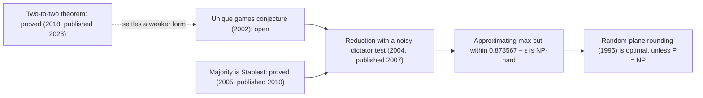
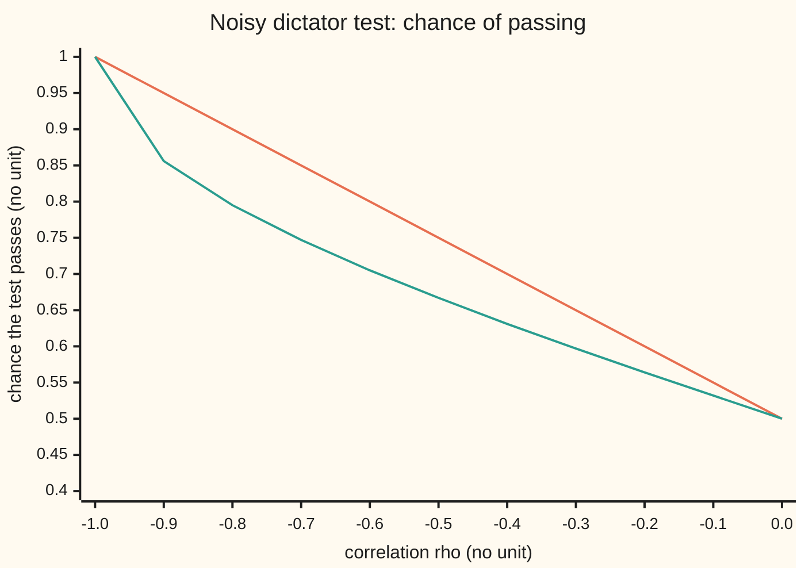

# The unique games conjecture: one hardness assumption that would settle many approximation questions

[Syllabus](../../../SYLLABUS.md) → [Frontier](../README.md) → [Algebra, Logic and Computation](../README.md#s06) → The unique games conjecture

---

## General Overview

Five cameras stand in a ring around a statue. Each is turned to one of three positions, 0, 120 or 240 degrees: the labels 0, 1 and 2. Nobody knows the labels, but comparing two neighbouring photos measures how far apart the cameras are turned. Each measurement is one rule on one link: "the next label is this label plus c, counted round a clock of 3".

The five measurements read c = 1, 2, 0, 1, 2. Fix camera 0 at label 0, and the rules force every other label in turn: 1, then 0, then 0, then 1. The last rule closes the ring correctly, because 1 + 2 + 0 + 1 + 2 = 6, a multiple of 3. All five rules hold.

Now one measurement is wrong: the last reads 1 instead of 2. The offsets add to 5, which is not a multiple of 3, so no labelling meets all five rules. The best labellings meet 4 of 5. Trying all 243 labellings finds 15 of them, one for each choice of the broken link and the label of camera 0.

That puzzle is a **unique game**: a network, a set of k labels (or colours), and one rule per link that pairs each label at one end with exactly one label at the other. In 2002 Subhash Khot conjectured that for large k, telling a game where almost every rule can be met from one where almost none can is NP-hard, as hard as the hardest problems whose answers can be checked quickly. If so, the best known ratios (a fast method's guaranteed multiple of the best answer) for max-cut and vertex cover cannot be beaten by any fast method, unless P = NP. Max-cut splits a network's nodes into two sides to cut as many links as possible. Vertex cover picks the fewest nodes that touch every link.

**The unique games conjecture says that, with enough labels, telling a nearly satisfiable unique game from a nearly hopeless one is NP-hard; if it is true, the 0.878567 ratio of random-plane rounding (the 1995 Goemans–Williamson method, Step 2) for max-cut is the best any fast method can promise, unless P = NP.**

**What kind of fact this is:** a conjecture, open as of 2026-11-23: no accepted proof or disproof. Its consequence for max-cut is a theorem: the implication is proved (2004 to 2010, in Sources), but the conclusion holds only if the conjecture does. The 2018 two-to-two theorem, proved and refereed, settles a weaker form.

### The picture: the route from the conjecture to max-cut



Schematic. Solid arrows are proved implications; the dotted arrow is partial progress, not a proof.

---

## The formula

The [Approximation](../../24-Computability%20and%20complexity/04-Beyond%20Worst%20Case/01-approximation-and-hardness-of-approximation.md) card defines an approximation ratio (a method's proved worst-case multiple of the best answer) and proves limits on ratios with a gap: inputs whose best is either high or low, never in between.

A unique game G has a network with nodes V and links E, a label set of size k, and on each link (u, v) a one-to-one rule $`\sigma_{uv}`$. A labelling x gives each node v a label $`x_v`$. The game's **value** is the largest share of rules any labelling meets:

```math
\mathrm{val}(G) \;=\; \max_{x}\ \frac{1}{\lvert E\rvert}\ \#\{(u, v) \in E : x_v = \sigma_{uv}(x_u)\}
```

**Read it aloud:** over every way of labelling the nodes, take the largest fraction of links whose rule is met.

The conjecture (Khot, 2002):

```math
\forall\, \varepsilon, \delta > 0\ \ \exists\, k:\quad \text{telling } \mathrm{val}(G) \ge 1 - \varepsilon \text{ from } \mathrm{val}(G) \le \delta \text{ is NP-hard for unique games with } k \text{ labels}
```

**Read it aloud:** however small the allowances ε and δ, with enough labels no fast method can tell games where all but a sliver of rules can be met from games where only a sliver can, unless P = NP.

Its consequence for max-cut (Khot, Kindler, Mossel and O'Donnell, with Majority is Stablest):

```math
\alpha_{GW} \;=\; \min_{0 < \theta \le \pi}\ \frac{\theta/\pi}{(1 - \cos\theta)/2} \;\approx\; 0.878567, \qquad \text{UGC} \;\Rightarrow\; \text{max-cut within } \alpha_{GW} + \varepsilon \text{ is NP-hard}
```

**Read it aloud:** the Goemans–Williamson constant is the worst ratio of a random plane's chance of splitting two vectors at angle θ to the relaxation's credit for that pair; if the unique games conjecture (UGC) holds, no fast method promises more for max-cut, unless P = NP.

| Symbol | Plain meaning | In our example | Push it up and the answer… |
| --- | --- | --- | --- |
| $`G`$, $`V`$, $`E`$ | the game; its nodes; its links | the camera ring: 5 nodes, 5 links | — |
| $`k`$ | the number of labels | 3 (0, 120, 240 degrees) | the conjecture needs k to grow as ε and δ shrink |
| $`x_v`$ | the label given to node v | camera 0 at 0 | — |
| $`\sigma_{uv}`$ | the rule on link (u, v): a one-to-one map from labels at u to labels at v | add c and count round a clock of 3 | — |
| $`c`$ | the offset in a rule of the form $`x_v = x_u + c`$ (mod k) | 1, 2, 0, 1, 2; the wrong reading makes the last 1 | — |
| $`\mathrm{val}(G)`$ | the value: the largest share of rules met | 4/5 = 0.800000 | — |
| $`\varepsilon`$, $`\delta`$ | small allowances: "almost all" is at least 1 − ε, "almost none" at most δ | any fixed small numbers | larger allowances make the gap easier to tell |
| $`\theta`$, $`\theta^*`$ | the angle between two nodes' vectors in the max-cut relaxation; the worst angle | θ* = 2.331122 rad, 133.56° | — |
| $`\alpha_{GW}`$ | the Goemans–Williamson ratio | 0.878567 | — |
| $`\rho`$, $`\rho^*`$, $`q`$ | the correlation in the dictator test: the average of $`s_i \times t_i`$, +1 for always equal, −1 for always opposite; ρ* = cos θ*; q = (1 − ρ)/2, the chance a bit flips | ρ* = −0.689158, q = 0.844579 | the test is passed less often |
| $`f`$, $`n`$, $`s`$, $`t`$, $`\mathrm{Maj}_n`$ | a rule that turns n bits of ±1 into one bit; a random string s and its noisy copy t; majority vote of n bits | $`\mathrm{Maj}_{81}`$ passes 0.743910 | more bits bring majority nearer the limit |

Here π is the circle constant, 3.14159…, and NP-hard means at least as hard as every problem in NP, the class of yes-or-no questions whose yes-answers can be checked quickly ([P and NP](../../24-Computability%20and%20complexity/03-Time%20Complexity/02-p-and-np.md)).

### When it holds

- **The rules must be one-to-one.** Then one label fixes its neighbour's. With the rule "differ" and 3 colours, each label allows 2 at the other end; the ring then has 30 colourings that meet every rule, and nothing is forced. That problem, 3-colouring, is NP-hard even when it can be fully met.
- **The game must be only nearly satisfiable.** A game whose rules can all be met is solved fast by forcing labels along the links. The hard side of the conjecture is 1 − ε, never 1.
- **The labels must be many.** For fixed small k the conjecture says nothing. Max-cut is the two-label case, and it is fast to approximate within 0.878567.
- **The conclusions are conditional twice.** Every consequence needs the conjecture, and means "no fast method" only if P ≠ NP. Both are about the worst case: a given game, like the camera ring, may be easy.

---

## Why it works

### Step 0: why a unique game is the right starting point

A hardness proof for max-cut must turn a hard gap problem into graphs. Max-cut can only ask about two nodes at a time: are they on different sides? So the starting problem must also be checkable two nodes at a time.

A unique game is exactly that: each rule involves two nodes, and one label decides the other. What is missing is a proof that its gap problem is hard. That missing step is the conjecture.

### Step 1: a game whose rules can all be met is easy

This is proved, and it is why the conjecture says 1 − ε and not 1.

1. Pick one node in each connected piece of the network, and try each of the k labels on it.
2. Walk outwards along the links. Each rule is one-to-one, so it forces the next label.
3. Check every rule. If some starting label meets them all, the game is fully satisfiable; if none does, it is not.

This takes k passes over the network. On the consistent camera ring it finds 3 full labellings, the same 3 that brute force over all 243 labellings finds. On the ring with the wrong measurement it finds none. On a ring, the test reduces to one sum: the rules can all be met exactly when the offsets add to a multiple of k.

### Step 2: max-cut is the unique game with two labels

Give each node a side, 0 or 1. The max-cut rule on a link is "the sides differ", that is $`x_v = x_u + 1`$ (mod 2). That is one-to-one, so max-cut is a unique game with k = 2.

The [Semidefinite programs](../../15-Optimization/06-Conic%2C%20Quadratic%20and%20Stochastic%20Programs/05-semidefinite-programs-and-relaxations.md) card relaxes max-cut to a semidefinite program and rounds with a random plane. That rounding promises an expected cut of at least $`\alpha_{GW}`$ = 0.878567 times the best. On the ring of five its numbers are: the best cut is 4 of 5 links, in 10 best splits; the relaxation's bound is 4.522542; their ratio is 0.884458; the random plane's expected cut is 4.000000.

### Step 3: the constant 0.878567, found three ways

A link whose two vectors meet at angle θ earns $`(1 - \cos\theta)/2`$ in the relaxation, and the random plane cuts it with chance θ/π. The guarantee is the worst ratio of the two. Setting the ratio's slope to zero gives $`1 - \cos\theta = \theta \sin\theta`$, whose root is θ* = 2.331122 radians, 133.56°.

The checks find the minimum three ways: a golden-section search on the ratio, bisection on the slope equation, and a grid of 100,000 values of ρ = cos θ. All three give 0.878567. At θ*, ρ* = cos θ* = −0.689158.

### Step 4: the noisy dictator test

Take a rule f that turns n bits, each +1 or −1, into one bit. Draw a random string s of n bits. Build its noisy copy t by flipping each bit of s with chance $`q = (1 - \rho)/2`$, so that the average of $`s_i \times t_i`$ (bit i of s times bit i of t) is ρ: their correlation, +1 for always equal, −1 for always opposite. For negative ρ most bits flip. **The test passes when f(s) ≠ f(t).**

- **A dictator** copies one bit: $`f(s) = s_i`$, the i-th bit of s. It passes exactly when bit i flipped, with chance (1 − ρ)/2. At ρ* that is 0.844579.
- **A rule with no strong voter** cannot do as well. Majority is Stablest, proved by Mossel, O'Donnell and Oleszkiewicz (2005, published 2010), says: a rule in which every bit has a small influence (rarely decides the answer alone) passes with chance at most arccos(ρ)/π plus a term that vanishes as the influences shrink. At ρ* that is 0.742019.
- **Majority vote reaches that limit.** The checks compute its pass chance exactly by counting:

```
majority of  1 bits   ##########################################  0.844579
majority of  3 bits   ########################################    0.799348
majority of  9 bits   ######################################      0.761566
majority of 27 bits   #####################################       0.747850
majority of 81 bits   #####################################       0.743910
limit arccos(rho)/pi  #####################################       0.742019
```

The limit arccos(ρ)/π is the random-plane chance again. A majority of many bits behaves like the sign of a bell-curve variable, and two such variables with correlation ρ fall on different sides of zero with chance arccos(ρ)/π. That is why the same angle appears in the rounding and in the hardness.

The two pass chances, against ρ:



Orange: a dictator, (1 − ρ)/2. Teal: the most any rule with small influences can manage, arccos(ρ)/π. The ratio of teal to orange is smallest at ρ* = −0.689158, where it is 0.878567.

### Step 5: from the test to max-cut, in outline

This is a research proof, outlined here with its key steps; the full argument is in Khot, Kindler, Mossel and O'Donnell (Sources).

1. **Start** from a unique game with k labels, near value 1 − ε or below δ.
2. **Replace each node** by a cloud of $`2^k`$ points, one for each string of k bits, one bit per label. A cut of the new graph gives each node a rule f from k bits to one bit.
3. **Add links** between the clouds of two nodes that share a neighbour in the game, weighted by the dictator test at ρ, with the game's rules on the two links through that neighbour used to line up the bits.
4. **Completeness:** if the game has value at least 1 − ε, let each node's rule be the dictator of its label. Almost every link then passes with chance (1 − ρ)/2, so the best cut is at least about (1 − ρ)/2.
5. **Soundness:** if some cut beats arccos(ρ)/π by a fixed margin, Majority is Stablest says many nodes' rules have a strongly influential bit. Reading those bits off as labels meets a fixed share of the game's rules, more than δ once δ is chosen small enough. So a game of value at most δ gives cuts of at most about arccos(ρ)/π.
6. **The gap:** telling cut (1 − ρ)/2 from arccos(ρ)/π would tell 1 − ε from δ. Choose ρ = ρ*: the ratio is $`\alpha_{GW}`$ = 0.878567. A fast method promising $`\alpha_{GW}`$ + ε for max-cut would solve the unique games gap fast.

The proof uses the two-place shape of a unique game at step 3: one link of the new graph reads one bit at each end, and the rule $`\sigma_{uv}`$ must say which bit matches which. A rule that allowed two labels would blur that matching.

### Step 6: the 2018 two-to-two theorem

A **two-to-two game** relaxes "unique": each label at one end allows two labels at the other, matched in pairs. Khot conjectured in 2002 that such games are hard too.

In 2018 Khot, Minzer and Safra, building on work with Dinur and Kindler that year, proved it with imperfect completeness: telling two-to-two games of value near 1 from value near 0 is NP-hard. The key is a theorem on expansion in Grassmann graphs (graphs whose nodes are subspaces of a vector space), published in 2023.

The status ledger:

| Claim | Kind | Status as of 2026-11-23 | Source |
| --- | --- | --- | --- |
| Two-to-two games, near 1 against near 0, NP-hard | theorem | proved: refereed, 2023 | Khot, Minzer, Safra |
| Unique games, about one half against near 0, NP-hard | theorem | proved, as a consequence | Khot, Minzer, Safra |
| Vertex cover within √2 − ε is NP-hard | theorem | proved, as a consequence | Khot, Minzer, Safra |
| Unique games, 1 − ε against δ, NP-hard (the UGC) | conjecture | open | Khot, 2002 |
| Max-cut within 0.878567 + ε is NP-hard | theorem given UGC | conditional on UGC | Khot, Kindler, Mossel, O'Donnell |
| Vertex cover within 2 − ε is NP-hard | theorem given UGC | conditional on UGC | Khot and Regev |

The gap between "about one half" and "1 − ε" is the whole conjecture. The max-cut reduction needs games of value near 1, so 0.878567 is still only conditionally optimal.

---

## Worked numbers, by hand

| Step | Arithmetic | Value |
| --- | --- | --- |
| consistent offsets round the ring | 1 + 2 + 0 + 1 + 2 = 6; 6 mod 3 | 0: all 5 rules can hold |
| labels forced from camera 0 at 0 | 0 + 1, 1 + 2, 0 + 0, 0 + 1, all mod 3 | 1, 0, 0, 1 |
| full labellings | one per starting label | 3 |
| offsets after the wrong reading | 1 + 2 + 0 + 1 + 1 = 5; 5 mod 3 | 2: some rule must fail |
| best share | drop any one link | 4/5 = 0.800000 |
| best labellings | 5 links to drop × 3 starting labels | 15 |
| max-cut on the ring, as a 2-label game | an odd ring cannot alternate all the way | 4/5 |
| worst angle | root of 1 − cos θ = θ sin θ | 2.331122 rad |
| dictator at ρ* = cos θ* = −0.689158 | (1 + 0.689158) / 2 | 0.844579 |
| many-bit limit | θ*/π = 2.331122/π | 0.742019 |
| **the ratio** | 0.742019 / 0.844579 | **0.878567** |

Under the conjecture, 0.878567 is the best ratio any fast method can promise for max-cut, and random-plane rounding already reaches it.

### What breaks if you drop a piece

| Mistake | Comes out at | What went wrong |
| --- | --- | --- |
| Read "no full labelling" as "worthless" | 0 claimed; the broken ring has value 0.800000 | Propagation tests full satisfiability only; it does not measure the best share |
| Allow two labels per label (3-colouring's "differ") | 30 full colourings of the ring; no label is forced | The rule is not one-to-one, so propagation cannot force labels; the 3-colouring problem is NP-hard even when it can be fully met |
| Treat 3-bit majority as a rule with small influences | passes 0.799348, above the limit 0.742019 | Each bit decides the vote whenever the other two disagree; the bound needs every influence small |
| Run the test at ρ = −1 | dictator 1.000000, majority of 81 bits 1.000000 | With every bit flipped, any rule whose answer flips with its inputs passes; no gap, so ρ must lie strictly between −1 and 0 |

The code prints all four.

---

## Code, from first principles, and it actually runs

No graph or optimisation library is used. The camera ring's value is found **two independent ways**: brute force over all 243 labellings, and propagation from each starting label, checked against the offset-sum rule. The ring's max-cut bound 4.522542 is found two ways: from vectors at angle 4π/5, and as a dual bound, 5/4 times the top eigenvalue of the ring's Laplacian (links per node on the diagonal, −1 per link off it), found by power iteration. The constant 0.878567 is found **three ways**: golden-section search, bisection on the slope, and a grid over ρ. Majority's pass chance is found two ways: exact binomial sums, and brute force over every input and flip pattern for 1, 3 and 5 bits. The checks verify instances and identities only, never the conjecture.

### Python

```python
# Unique games conjecture -- the check behind the card.  Standard library only.
# A small unique game solved two ways, max-cut as the two-label case, and the
# dictator test behind "UGC makes 0.878 optimal" computed exactly.
from math import cos, sin, acos, pi
from itertools import product

def met(edges, k, lab):  # how many edge rules lab[v] = lab[u] + c (mod k) hold
    return sum(1 for u, v, c in edges if (lab[v] - lab[u] - c) % k == 0)

def brute(n, edges, k, ok=met):  # road 1: try every labelling
    scores = [ok(edges, k, lab) for lab in product(range(k), repeat=n)]
    return max(scores), scores.count(max(scores))

def propagate(n, edges, k):  # road 2: fix node 0, each rule forces the next label
    best, full = 0, 0
    for start in range(k):
        lab = [start] + [0] * (n - 1)
        for u, v, c in edges[:n - 1]:
            lab[v] = (lab[u] + c) % k
        s = met(edges, k, lab)
        best, full = max(best, s), full + (s == len(edges))
    return best, full

def ring(offsets):
    n = len(offsets)
    return [(i, (i + 1) % n, c) for i, c in enumerate(offsets)]

good, bad = ring([1, 2, 0, 1, 2]), ring([1, 2, 0, 1, 1])
for name, g in (("consistent ring", good), ("one rule changed", bad)):
    bb, bc = brute(5, g, 3)
    pb, pf = propagate(5, g, 3)
    print(f"{name:17s} offsets sum mod 3 = {sum(c for _, _, c in g) % 3}  "
          f"best {bb}/5 = {bb / 5:.6f}  best labellings {bc} of {3 ** 5}  propagation full {pf}")
    assert bb == pb and (bb == 5) == (sum(c for _, _, c in g) % 3 == 0)
lab = [0]
for u, v, c in good[:4]:
    lab.append((lab[-1] + c) % 3)
print("labels forced on the consistent ring from camera 0 at 0:", *lab)
assert brute(5, bad, 3) == (4, 15) and propagate(5, good, 3) == (5, 3)

# max-cut is the unique game with 2 labels and every rule "differ" (offset 1)
cut, ncut = brute(5, ring([1] * 5), 2)
sdp = 5 * (1 - cos(4 * pi / 5)) / 2  # the ring's relaxation, from the SDP card
print(f"max-cut on the 5-ring: best {cut}/5 ({ncut} best splits), SDP bound {sdp:.6f}, "
      f"ratio {cut / sdp:.6f}, GW expected cut {5 * (4 * pi / 5) / pi:.6f}")
lap = lambda v: [2 * v[i] - v[i - 1] - v[(i + 1) % 5] for i in range(5)]  # the ring's Laplacian times v
v = [1.0, 0.0, 0.0, 0.0, 0.0]  # road 2 for the bound: power iteration finds the top eigenvalue
for _ in range(200):
    w = lap(v)
    v = [x / max(abs(y) for y in w) for x in w]
top = sum(a * b for a, b in zip(lap(v), v)) / sum(x * x for x in v)
print(f"dual bound: top Laplacian eigenvalue {top:.6f}, times 5/4 = {5 * top / 4:.6f}")
assert (cut, ncut) == (5 - 1, 2 * 5)  # odd ring: one link left uncut (5 ways), two colourings each
assert abs(sdp - 5 * top / 4) < 1e-9  # primal vectors and dual prices meet, so 4.522542 is the optimum

# a rule that is not unique: 'differ' with 3 colours (proper 3-colouring)
neq = lambda edges, k, lab: sum(1 for u, v, _ in edges if lab[u] != lab[v])
full3, cnt3 = brute(5, ring([0] * 5), 3, neq)
print(f"'differ' with 3 colours on the ring: {cnt3} labellings meet all {full3} rules; "
      f"each rule leaves 2 choices, so nothing is forced")
assert cnt3 == 2 ** 5 - 2  # chromatic polynomial of a 5-cycle at 3: (k-1)^5 - (k-1)

# alpha_GW = min over theta of (theta/pi) / ((1 - cos theta)/2), three roads
r = lambda t: 2 * t / (pi * (1 - cos(t)))
lo, hi = 0.5, pi  # road 1: golden-section search
for _ in range(200):
    m1, m2 = hi - (hi - lo) / 1.618033988749895, lo + (hi - lo) / 1.618033988749895
    lo, hi = (lo, m2) if r(m1) < r(m2) else (m1, hi)
t_gold = (lo + hi) / 2
lo, hi = 2.0, 3.0  # road 2: bisection on the slope's zero, (1 - cos t) = t sin t
for _ in range(100):
    mid = (lo + hi) / 2
    lo, hi = (mid, hi) if (1 - cos(mid)) - mid * sin(mid) < 0 else (lo, mid)
t_bis = (lo + hi) / 2
grid = min((acos(-i / 100000) / pi) / ((1 + i / 100000) / 2) for i in range(1, 100001))
alpha, rho = r(t_bis), cos(t_bis)  # road 3 above: a grid over rho, -1 < rho <= 0
print(f"theta* {t_bis:.6f} rad = {t_bis * 180 / pi:.4f} deg, rho* {rho:.6f}")
print(f"alpha_GW: golden {r(t_gold):.6f}  bisection {alpha:.6f}  rho grid {grid:.6f}")
assert abs(t_gold - t_bis) < 1e-6 and abs(grid - alpha) < 1e-8 and grid >= alpha - 1e-12

# the dictator test at correlation rho: x uniform in {-1,1}^n, each bit of y is
# x's bit flipped with chance q = (1 - rho)/2; f passes when f(x) != f(y)
def maj_pass(n, rho):  # exact, by counting +1s: a in x, j of them flipped, l of the rest
    q, C = (1 - rho) / 2, [[1]]
    for i in range(n):
        C.append([1] + [C[i][j] + C[i][j + 1] for j in range(i)] + [1])
    b = lambda m, j: C[m][j] * q ** j * (1 - q) ** (m - j)
    return sum(C[n][a] / 2 ** n * b(a, j) * b(n - a, l) for a in range(n + 1)
               for j in range(a + 1) for l in range(n - a + 1)
               if (2 * a > n) != (2 * (a - j + l) > n))

def maj_brute(n, rho):  # every x and every flip pattern, weighted
    q, tot = (1 - rho) / 2, 0.0
    for x in product((-1, 1), repeat=n):
        for f in product((0, 1), repeat=n):
            y = [-xi if fi else xi for xi, fi in zip(x, f)]
            if (sum(x) > 0) != (sum(y) > 0):
                tot += q ** sum(f) * (1 - q) ** (n - sum(f)) / 2 ** n
    return tot

limit = acos(rho) / pi  # Sheppard: majority of many bits, the random-plane chance
for n in (1, 3, 9, 27, 81):
    print(f"majority of {n:2d} bits passes {maj_pass(n, rho):.6f}")
for n in (1, 3, 5):
    assert abs(maj_pass(n, rho) - maj_brute(n, rho)) < 1e-12
print(f"dictator passes (1-rho)/2 = {(1 - rho) / 2:.6f}; many-bit limit arccos(rho)/pi = "
      f"{limit:.6f}; ratio {limit / ((1 - rho) / 2):.6f}")
assert abs(maj_pass(1, rho) - (1 - rho) / 2) < 1e-12
assert maj_pass(3, rho) > maj_pass(81, rho) > limit and maj_pass(81, rho) - limit < 0.01
print(f"rho = -1: dictator {maj_pass(1, -1.0):.6f}, majority of 81 {maj_pass(81, -1.0):.6f}, "
      f"limit {acos(-1.0) / pi:.6f}: no gap")
rs = [-1 + i / 10 for i in range(11)]
print("chart dictator", " ".join(f"{(1 - x) / 2:.3f}" for x in rs))
print("chart majority-limit", " ".join(f"{acos(x) / pi:.3f}" for x in rs))
print("ALL CHECKS PASS")
```

**Ran 2026-11-23 on macOS, Python 3.14.10, standard library only. All checks passed. Output, pasted from the run:**

```
consistent ring   offsets sum mod 3 = 0  best 5/5 = 1.000000  best labellings 3 of 243  propagation full 3
one rule changed  offsets sum mod 3 = 2  best 4/5 = 0.800000  best labellings 15 of 243  propagation full 0
labels forced on the consistent ring from camera 0 at 0: 0 1 0 0 1
max-cut on the 5-ring: best 4/5 (10 best splits), SDP bound 4.522542, ratio 0.884458, GW expected cut 4.000000
dual bound: top Laplacian eigenvalue 3.618034, times 5/4 = 4.522542
'differ' with 3 colours on the ring: 30 labellings meet all 5 rules; each rule leaves 2 choices, so nothing is forced
theta* 2.331122 rad = 133.5635 deg, rho* -0.689158
alpha_GW: golden 0.878567  bisection 0.878567  rho grid 0.878567
majority of  1 bits passes 0.844579
majority of  3 bits passes 0.799348
majority of  9 bits passes 0.761566
majority of 27 bits passes 0.747850
majority of 81 bits passes 0.743910
dictator passes (1-rho)/2 = 0.844579; many-bit limit arccos(rho)/pi = 0.742019; ratio 0.878567
rho = -1: dictator 1.000000, majority of 81 1.000000, limit 1.000000: no gap
chart dictator 1.000 0.950 0.900 0.850 0.800 0.750 0.700 0.650 0.600 0.550 0.500
chart majority-limit 1.000 0.856 0.795 0.747 0.705 0.667 0.631 0.597 0.564 0.532 0.500
ALL CHECKS PASS
```

### Rust

```rust
// Unique games conjecture -- the check behind the card.  std only.
// A small unique game solved two ways, max-cut as the two-label case, and the
// dictator test behind "UGC makes 0.878 optimal" computed exactly.
use std::f64::consts::PI;
type Edges = Vec<(usize, usize, usize)>;

fn met(e: &Edges, k: usize, lab: &[usize]) -> usize { // rules lab[v] = lab[u] + c (mod k)
    e.iter().filter(|&&(u, v, c)| (lab[v] + 2 * k - lab[u] - c) % k == 0).count()
}
fn neq(e: &Edges, _k: usize, lab: &[usize]) -> usize {
    e.iter().filter(|&&(u, v, _)| lab[u] != lab[v]).count()
}
fn brute(n: usize, e: &Edges, k: usize, ok: fn(&Edges, usize, &[usize]) -> usize) -> (usize, usize) {
    let mut scores = vec![]; // road 1: try every labelling
    for code in 0..k.pow(n as u32) {
        let mut lab = vec![0; n];
        let mut c = code;
        for i in (0..n).rev() { lab[i] = c % k; c /= k; }
        scores.push(ok(e, k, &lab));
    }
    let best = *scores.iter().max().unwrap();
    (best, scores.iter().filter(|&&s| s == best).count())
}
fn propagate(n: usize, e: &Edges, k: usize) -> (usize, usize) {
    let (mut best, mut full) = (0, 0); // road 2: fix node 0, each rule forces the next label
    for start in 0..k {
        let mut lab = vec![0; n];
        lab[0] = start;
        for &(u, v, c) in &e[..n - 1] { lab[v] = (lab[u] + c) % k; }
        let s = met(e, k, &lab);
        best = best.max(s);
        if s == e.len() { full += 1; }
    }
    (best, full)
}
fn ring(off: &[usize]) -> Edges {
    let n = off.len();
    off.iter().enumerate().map(|(i, &c)| (i, (i + 1) % n, c)).collect()
}
fn r(t: f64) -> f64 { 2.0 * t / (PI * (1.0 - t.cos())) }

fn maj_pass(n: usize, rho: f64) -> f64 { // exact, by counting +1s: a in x, j flipped, l of the rest
    let q = (1.0 - rho) / 2.0;
    let mut c: Vec<Vec<f64>> = vec![vec![1.0]];
    for i in 0..n {
        let mut row = vec![1.0];
        for j in 0..i { row.push(c[i][j] + c[i][j + 1]); }
        row.push(1.0);
        c.push(row);
    }
    let b = |m: usize, j: usize| c[m][j] * q.powi(j as i32) * (1.0 - q).powi((m - j) as i32);
    let mut tot = 0.0;
    for a in 0..=n { for j in 0..=a { for l in 0..=(n - a) {
        if (2 * a > n) != (2 * (a - j + l) > n) {
            tot += c[n][a] / 2f64.powi(n as i32) * b(a, j) * b(n - a, l);
        }
    } } }
    tot
}
fn maj_brute(n: usize, rho: f64) -> f64 { // every x and every flip pattern, weighted
    let q = (1.0 - rho) / 2.0;
    let mut tot = 0.0;
    for xs in 0..(1usize << n) { for fs in 0..(1usize << n) {
        let (mut sx, mut sy, nf) = (0i32, 0i32, fs.count_ones() as i32);
        for i in 0..n {
            let x = if xs >> i & 1 == 1 { 1 } else { -1 };
            sx += x;
            sy += if fs >> i & 1 == 1 { -x } else { x };
        }
        if (sx > 0) != (sy > 0) {
            tot += q.powi(nf) * (1.0 - q).powi(n as i32 - nf) / 2f64.powi(n as i32);
        }
    } }
    tot
}

fn main() {
    let (good, bad) = (ring(&[1, 2, 0, 1, 2]), ring(&[1, 2, 0, 1, 1]));
    for (name, g) in [("consistent ring", &good), ("one rule changed", &bad)] {
        let (bb, bc) = brute(5, g, 3, met);
        let (pb, pf) = propagate(5, g, 3);
        let s = g.iter().map(|x| x.2).sum::<usize>() % 3;
        println!("{:17} offsets sum mod 3 = {}  best {}/5 = {:.6}  best labellings {} of {}  propagation full {}",
                 name, s, bb, bb as f64 / 5.0, bc, 3usize.pow(5), pf);
        assert!(bb == pb && (bb == 5) == (s == 0));
    }
    let mut lab = vec![0usize];
    for &(_, _, c) in &good[..4] { let l = (lab[lab.len() - 1] + c) % 3; lab.push(l); }
    println!("labels forced on the consistent ring from camera 0 at 0: {}",
             lab.iter().map(|l| l.to_string()).collect::<Vec<_>>().join(" "));
    assert!(brute(5, &bad, 3, met) == (4, 15) && propagate(5, &good, 3) == (5, 3));

    let (cut, ncut) = brute(5, &ring(&[1; 5]), 2, met);
    let sdp = 5.0 * (1.0 - (4.0 * PI / 5.0).cos()) / 2.0;
    println!("max-cut on the 5-ring: best {}/5 ({} best splits), SDP bound {:.6}, ratio {:.6}, GW expected cut {:.6}",
             cut, ncut, sdp, cut as f64 / sdp, 5.0 * (4.0 * PI / 5.0) / PI);
    let lap = |v: &[f64; 5]| -> [f64; 5] { std::array::from_fn(|i| 2.0 * v[i] - v[(i + 4) % 5] - v[(i + 1) % 5]) };
    let mut v = [1.0f64, 0.0, 0.0, 0.0, 0.0]; // road 2 for the bound: power iteration finds the top eigenvalue
    for _ in 0..200 { let w = lap(&v); let m = w.iter().fold(0.0f64, |a, x| a.max(x.abs())); v = w.map(|x| x / m); }
    let top = lap(&v).iter().zip(&v).map(|(a, b)| a * b).sum::<f64>() / v.iter().map(|x| x * x).sum::<f64>();
    println!("dual bound: top Laplacian eigenvalue {:.6}, times 5/4 = {:.6}", top, 5.0 * top / 4.0);
    assert!((cut, ncut) == (5 - 1, 2 * 5)); // odd ring: one link left uncut (5 ways), two colourings each
    assert!((sdp - 5.0 * top / 4.0).abs() < 1e-9); // primal vectors and dual prices meet, so 4.522542 is the optimum

    let (full3, cnt3) = brute(5, &ring(&[0; 5]), 3, neq);
    println!("'differ' with 3 colours on the ring: {} labellings meet all {} rules; each rule leaves 2 choices, so nothing is forced",
             cnt3, full3);
    assert!(cnt3 == 32 - 2);

    let (mut lo, mut hi) = (0.5f64, PI); // road 1: golden-section search
    for _ in 0..200 {
        let (m1, m2) = (hi - (hi - lo) / 1.618033988749895, lo + (hi - lo) / 1.618033988749895);
        if r(m1) < r(m2) { hi = m2; } else { lo = m1; }
    }
    let t_gold = (lo + hi) / 2.0;
    let (mut lo, mut hi) = (2.0f64, 3.0f64); // road 2: bisection on (1 - cos t) = t sin t
    for _ in 0..100 {
        let mid = (lo + hi) / 2.0;
        if (1.0 - mid.cos()) - mid * mid.sin() < 0.0 { lo = mid; } else { hi = mid; }
    }
    let t_bis = (lo + hi) / 2.0;
    let grid = (1..=100000).map(|i| { let x = -(i as f64) / 100000.0; (x.acos() / PI) / ((1.0 - x) / 2.0) })
        .fold(f64::INFINITY, f64::min); // road 3: a grid over rho
    let (alpha, rho) = (r(t_bis), t_bis.cos());
    println!("theta* {:.6} rad = {:.4} deg, rho* {:.6}", t_bis, t_bis * 180.0 / PI, rho);
    println!("alpha_GW: golden {:.6}  bisection {:.6}  rho grid {:.6}", r(t_gold), alpha, grid);
    assert!((t_gold - t_bis).abs() < 1e-6 && (grid - alpha).abs() < 1e-8 && grid >= alpha - 1e-12);

    let limit = rho.acos() / PI;
    for n in [1, 3, 9, 27, 81] { println!("majority of {:2} bits passes {:.6}", n, maj_pass(n, rho)); }
    for n in [1, 3, 5] { assert!((maj_pass(n, rho) - maj_brute(n, rho)).abs() < 1e-12); }
    println!("dictator passes (1-rho)/2 = {:.6}; many-bit limit arccos(rho)/pi = {:.6}; ratio {:.6}",
             (1.0 - rho) / 2.0, limit, limit / ((1.0 - rho) / 2.0));
    assert!((maj_pass(1, rho) - (1.0 - rho) / 2.0).abs() < 1e-12);
    assert!(maj_pass(3, rho) > maj_pass(81, rho) && maj_pass(81, rho) > limit && maj_pass(81, rho) - limit < 0.01);
    println!("rho = -1: dictator {:.6}, majority of 81 {:.6}, limit {:.6}: no gap",
             maj_pass(1, -1.0), maj_pass(81, -1.0), (-1f64).acos() / PI);
    let rs: Vec<f64> = (0..11).map(|i| -1.0 + i as f64 / 10.0).collect();
    println!("chart dictator {}", rs.iter().map(|x| format!("{:.3}", (1.0 - x) / 2.0)).collect::<Vec<_>>().join(" "));
    println!("chart majority-limit {}", rs.iter().map(|x| format!("{:.3}", x.acos() / PI)).collect::<Vec<_>>().join(" "));
    println!("ALL CHECKS PASS");
}
```

**Ran 2026-11-23 on macOS, rustc 1.98.1, no crates. All checks passed. Output, pasted from the run:**

```
consistent ring   offsets sum mod 3 = 0  best 5/5 = 1.000000  best labellings 3 of 243  propagation full 3
one rule changed  offsets sum mod 3 = 2  best 4/5 = 0.800000  best labellings 15 of 243  propagation full 0
labels forced on the consistent ring from camera 0 at 0: 0 1 0 0 1
max-cut on the 5-ring: best 4/5 (10 best splits), SDP bound 4.522542, ratio 0.884458, GW expected cut 4.000000
dual bound: top Laplacian eigenvalue 3.618034, times 5/4 = 4.522542
'differ' with 3 colours on the ring: 30 labellings meet all 5 rules; each rule leaves 2 choices, so nothing is forced
theta* 2.331122 rad = 133.5635 deg, rho* -0.689158
alpha_GW: golden 0.878567  bisection 0.878567  rho grid 0.878567
majority of  1 bits passes 0.844579
majority of  3 bits passes 0.799348
majority of  9 bits passes 0.761566
majority of 27 bits passes 0.747850
majority of 81 bits passes 0.743910
dictator passes (1-rho)/2 = 0.844579; many-bit limit arccos(rho)/pi = 0.742019; ratio 0.878567
rho = -1: dictator 1.000000, majority of 81 1.000000, limit 1.000000: no gap
chart dictator 1.000 0.950 0.900 0.850 0.800 0.750 0.700 0.650 0.600 0.550 0.500
chart majority-limit 1.000 0.856 0.795 0.747 0.705 0.667 0.631 0.597 0.564 0.532 0.500
ALL CHECKS PASS
```

### Lean

Lean proves the ring facts of Steps 1 and 2 for rings of every size, and checks the camera ring's numbers.

- Take a unique game on a ring of any size, with k labels and rules "add c". Then every rule can be met exactly when the offsets add to a multiple of k.
- When they do, exactly k labellings meet every rule, one for each label of the first node. Otherwise no labelling does.
- Take max-cut on a ring with an odd number of nodes. Then no split cuts every link, and the best splits cut all links but one.
- The camera ring's offsets add to 6, a multiple of 3. After the wrong reading they add to 5, which leaves 2.
- Camera 0 at label 0 forces the labels 0, 1, 0, 0, 1, and all 5 rules hold.
- On the consistent ring, 3 of the 243 labellings meet all 5 rules. After the wrong reading, none does, and 15 meet 4.
- With the rule "differ" and 3 colours, 30 colourings of the ring meet every rule.
- On the ring of five, no split cuts more than 4 links, and 10 splits cut 4.

The constant 0.878567, the dictator test and the relaxation's bound are left to the Python and Rust checks; the conjecture itself stays open.

```lean
-- The unique games conjecture: a unique game on a ring with shift rules can meet every rule exactly when its offsets add to a multiple of k, and then in exactly k ways, and max-cut on an odd ring cuts every link but one.
import Mathlib.Data.ZMod.Basic
import Mathlib.Data.Fintype.Pi
import Mathlib.Algebra.BigOperators.Fin
import Mathlib.Tactic.Ring

open Finset

/-- One step round the ring raises the value by one, except at the last node. -/
theorem zmod_val_add_one_of_lt {n : ℕ} [NeZero n] (i : ZMod n) (h : i.val + 1 < n) :
    (i + 1).val = i.val + 1 := by
  rw [ZMod.val_add, ZMod.val_one_eq_one_mod, Nat.add_mod_mod, Nat.mod_eq_of_lt h]

/-- Summing over the ring is summing over the indices 0, ..., n - 1. -/
theorem zmod_sum_eq_sum_range {n : ℕ} [NeZero n] {M : Type*} [AddCommMonoid M]
    (f : ZMod n → M) : ∑ i, f i = ∑ t ∈ range n, f (t : ZMod n) := by
  refine Finset.sum_nbij' (fun i => i.val) (fun t => (t : ZMod n)) ?_ ?_ ?_ ?_ ?_
  · intro i _; simpa using ZMod.val_lt i
  · intro t _; simp
  · intro i _; exact ZMod.natCast_zmod_val i
  · intro t ht; exact ZMod.val_cast_of_lt (by simpa using ht)
  · intro i _; show f i = f ((i.val : ℕ) : ZMod n); rw [ZMod.natCast_zmod_val]

/-- A labelling that does not change across any link is constant. -/
theorem zmod_const_of_step {n : ℕ} [NeZero n] {α : Type*} (d : ZMod n → α)
    (h : ∀ i, d (i + 1) = d i) (i : ZMod n) : d i = d 0 := by
  have key : ∀ j : ℕ, d (j : ZMod n) = d 0 := by
    intro j
    induction j with
    | zero => simp
    | succ j ih => rw [Nat.cast_succ, h, ih]
  rw [← ZMod.natCast_zmod_val i]
  exact key _

/-- A unique game on a ring of n nodes with k labels, where the rule on link i says
"the label of node i + 1 is the label of node i plus c i, counted round a clock of k",
can have all its rules met exactly when the offsets c i add up to a multiple of k. -/
theorem ring_game_all_rules_met_iff_offsets_sum_zero (n k : ℕ) [NeZero n]
    (c : ZMod n → ZMod k) :
    (∃ x : ZMod n → ZMod k, ∀ i, x (i + 1) = x i + c i) ↔ ∑ i, c i = 0 := by
  constructor
  · rintro ⟨x, hx⟩
    have hc : ∀ i, c i = x (i + 1) - x i := fun i => by rw [hx]; ring
    simp only [hc, Finset.sum_sub_distrib]
    rw [sub_eq_zero]
    exact Fintype.sum_equiv (Equiv.addRight 1) _ _ (fun _ => rfl)
  · intro hsum
    refine ⟨fun j => ∑ t ∈ range j.val, c (t : ZMod n), fun i => ?_⟩
    have hi := ZMod.val_lt i
    rcases Nat.lt_or_ge (i.val + 1) n with h | h
    · simp only [zmod_val_add_one_of_lt i h, Finset.sum_range_succ, ZMod.natCast_zmod_val]
    · have hn : i.val + 1 = n := by omega
      have h0 : i + 1 = 0 := by
        have := congrArg (Nat.cast : ℕ → ZMod n) hn
        push_cast [ZMod.natCast_zmod_val, ZMod.natCast_self] at this
        exact this
      simp only [h0, ZMod.val_zero, Finset.sum_range_zero]
      have := Finset.sum_range_succ (fun t => c (t : ZMod n)) i.val
      simp only [ZMod.natCast_zmod_val] at this
      rw [← this, hn, ← zmod_sum_eq_sum_range, hsum]

/-- Fixing one node's label forces all the others, so a ring game with k labels has exactly
k labellings that meet every rule when its offsets add to a multiple of k, and none otherwise. -/
theorem ring_game_full_labellings_count (n k : ℕ) [NeZero n] [NeZero k]
    (c : ZMod n → ZMod k) :
    (univ.filter fun x : ZMod n → ZMod k => ∀ i, x (i + 1) = x i + c i).card
      = if ∑ i, c i = 0 then k else 0 := by
  split_ifs with hsum
  · obtain ⟨x₀, hx₀⟩ := (ring_game_all_rules_met_iff_offsets_sum_zero n k c).2 hsum
    have himg : (univ.filter fun x : ZMod n → ZMod k => ∀ i, x (i + 1) = x i + c i)
        = univ.image (fun a : ZMod k => fun j => x₀ j + a) := by
      ext x
      simp only [mem_filter, mem_univ, true_and, mem_image]
      constructor
      · intro hx
        refine ⟨x 0 - x₀ 0, funext fun j => ?_⟩
        have := zmod_const_of_step (fun j => x j - x₀ j)
          (fun i => by simp only [hx, hx₀]; ring) j
        rw [← this]; ring
      · rintro ⟨a, rfl⟩ i
        show x₀ (i + 1) + a = x₀ i + a + c i
        rw [hx₀]; ring
    rw [himg, Finset.card_image_of_injective, card_univ, ZMod.card]
    intro a b hab
    have := congrFun hab 0
    simpa using this
  · rw [Finset.card_eq_zero, Finset.filter_eq_empty_iff]
    intro x _ hx
    exact hsum ((ring_game_all_rules_met_iff_offsets_sum_zero n k c).1 ⟨x, hx⟩)

/-- Max-cut is the unique game with two labels and the rule "the sides differ": on a ring
with an odd number 2m + 1 of nodes, no split cuts every link, and the best splits cut 2m. -/
theorem odd_ring_max_cut (m : ℕ) :
    (∀ x : ZMod (2 * m + 1) → ZMod 2, (univ.filter fun i => x (i + 1) ≠ x i).card ≤ 2 * m) ∧
    ∃ x : ZMod (2 * m + 1) → ZMod 2, (univ.filter fun i => x (i + 1) ≠ x i).card = 2 * m := by
  constructor
  · intro x
    have hle : (univ.filter fun i => x (i + 1) ≠ x i).card ≤ 2 * m + 1 := by
      simpa [ZMod.card] using Finset.card_filter_le (univ : Finset (ZMod (2 * m + 1)))
        (fun i => x (i + 1) ≠ x i)
    by_contra hgt
    have heq : (univ.filter fun i => x (i + 1) ≠ x i) = univ := by
      apply Finset.eq_univ_of_card
      rw [ZMod.card]; omega
    have hall : ∀ i, x (i + 1) = x i + 1 := by
      intro i
      have hi : i ∈ (univ.filter fun i => x (i + 1) ≠ x i) := by rw [heq]; exact mem_univ i
      have hne : x (i + 1) ≠ x i := (mem_filter.1 hi).2
      have key : ∀ a b : ZMod 2, a ≠ b → a = b + 1 := by decide
      exact key _ _ hne
    have hs := (ring_game_all_rules_met_iff_offsets_sum_zero (2 * m + 1) 2
      (fun _ => 1)).1 ⟨x, hall⟩
    rw [Finset.sum_const, Finset.card_univ, ZMod.card, nsmul_eq_mul, mul_one,
      ZMod.natCast_eq_zero_iff_even] at hs
    exact (Nat.not_even_two_mul_add_one m) hs
  · refine ⟨fun i => (i.val : ZMod 2), ?_⟩
    have hset : (univ.filter fun i : ZMod (2 * m + 1) =>
        ((i + 1).val : ZMod 2) ≠ (i.val : ZMod 2)) = univ.erase (-1) := by
      ext i
      simp only [mem_filter, mem_univ, true_and, mem_erase, and_true]
      have hi := ZMod.val_lt i
      have hneg : (-1 : ZMod (2 * m + 1)).val = 2 * m := ZMod.val_neg_one (2 * m)
      rcases Nat.lt_or_ge (i.val + 1) (2 * m + 1) with h | h
      · have hne : i ≠ -1 := by
          intro e; rw [e, hneg] at h; omega
        have key : ∀ a : ZMod 2, a + 1 ≠ a := by decide
        rw [zmod_val_add_one_of_lt i h, Nat.cast_succ]
        exact ⟨fun _ => hne, fun _ => key _⟩
      · have he : i = -1 := by
          apply ZMod.val_injective; rw [hneg]; omega
        subst he
        simp only [ne_eq, not_true_eq_false, iff_false, not_not, neg_add_cancel, ZMod.val_zero,
          Nat.cast_zero, hneg]
        rw [eq_comm, ZMod.natCast_eq_zero_iff_even]
        exact even_two_mul m
    simp only at hset ⊢
    rw [hset, Finset.card_erase_of_mem (mem_univ _), Finset.card_univ, ZMod.card]
    omega

/-! The camera ring: 5 cameras, 3 labels, offsets 1, 2, 0, 1, 2; then the last reading wrong. -/

def goodOffsets : ZMod 5 → ZMod 3 := ![1, 2, 0, 1, 2]
def badOffsets : ZMod 5 → ZMod 3 := ![1, 2, 0, 1, 1]
def forcedLabels : ZMod 5 → ZMod 3 := ![0, 1, 0, 0, 1]
/-- How many of the ring's 5 rules the labelling x meets. -/
def metCount (c : ZMod 5 → ZMod 3) (x : ZMod 5 → ZMod 3) : ℕ :=
  (univ.filter fun i : ZMod 5 => x (i + 1) = x i + c i).card

-- 1 + 2 + 0 + 1 + 2 = 6, a multiple of 3; 1 + 2 + 0 + 1 + 1 = 5, which leaves 2
example : ∑ i, goodOffsets i = 0 := by decide
example : ∑ i, badOffsets i = 2 := by decide
-- 3^5 = 243 labellings in all
example : Fintype.card (ZMod 5 → ZMod 3) = 243 := by simp
-- camera 0 at 0 forces 0, 1, 0, 0, 1, and all 5 rules hold
example : metCount goodOffsets forcedLabels = 5 := by decide
-- the consistent ring: 3 labellings meet all 5 rules
example : (univ.filter fun x : ZMod 5 → ZMod 3 => metCount goodOffsets x = 5).card = 3 := by
  decide
-- one rule changed: none meets all 5, and 15 meet 4 of 5
example : (univ.filter fun x : ZMod 5 → ZMod 3 => metCount badOffsets x = 5).card = 0 := by
  decide
example : (univ.filter fun x : ZMod 5 → ZMod 3 => metCount badOffsets x = 4).card = 15 := by
  decide
-- 'differ' with 3 colours is not one-to-one: 30 colourings of the ring meet every rule
example : (univ.filter fun x : ZMod 5 → ZMod 3 => ∀ i : ZMod 5, x (i + 1) ≠ x i).card = 30 := by
  decide
-- max-cut on the 5-ring: no split cuts more than 4 links, and 10 splits cut 4
example : ∀ x : ZMod 5 → ZMod 2, (univ.filter fun i : ZMod 5 => x (i + 1) ≠ x i).card ≤ 4 := by
  decide
example : (univ.filter fun x : ZMod 5 → ZMod 2 =>
    (univ.filter fun i : ZMod 5 => x (i + 1) ≠ x i).card = 4).card = 10 := by
  decide

#print axioms zmod_val_add_one_of_lt
#print axioms zmod_sum_eq_sum_range
#print axioms zmod_const_of_step
#print axioms ring_game_all_rules_met_iff_offsets_sum_zero
#print axioms ring_game_full_labellings_count
#print axioms odd_ring_max_cut
```

**Checked 2026-11-23 on macOS, Lean 4.36.0-rc2, Mathlib v4.36.0-rc2. Every proof is complete and uses only Lean's standard axioms. Output, pasted from the run:**

```
'zmod_val_add_one_of_lt' depends on axioms: [propext, Quot.sound]
'zmod_sum_eq_sum_range' depends on axioms: [propext, Classical.choice, Quot.sound]
'zmod_const_of_step' depends on axioms: [propext, Quot.sound]
'ring_game_all_rules_met_iff_offsets_sum_zero' depends on axioms: [propext, Classical.choice, Quot.sound]
'ring_game_full_labellings_count' depends on axioms: [propext, Classical.choice, Quot.sound]
'odd_ring_max_cut' depends on axioms: [propext, Classical.choice, Quot.sound]
```

> [!TIP]
> **Try changing**
> - Guess first: does a fourth label help the broken ring? Call `brute(5, bad, 4)`. The best is still **4/5**, now in **20** labellings: the offsets add to 5, not a multiple of 4.
> - Guess first: how close does a majority of 243 bits come to the limit? Call `maj_pass(243, rho)`. It passes **0.742645**, against the limit 0.742019.
> - Guess first: is ρ = −0.5 a better test than ρ*? Compute `(1 + 0.5) / 2` and `acos(-0.5) / pi`. The dictator passes **0.750000**, the limit is **0.666667**, and the ratio is **0.888889**: above 0.878567, so a weaker hardness result.
> - Guess first: is a ring of 7 nearer the worst case? Call `brute(7, ring([1] * 7), 2)` and set the bound to `7 * (1 - cos(6 * pi / 7)) / 2`. The best cut is **6**, the bound **6.653391**, the ratio **0.901796**: further from 0.878567 than the ring of 5.

---

## The usual mistake

> [!warning]
> **Quoting "max-cut cannot be approximated beyond 0.878" as a theorem.** It rests on the unique games conjecture, which is open as of 2026-11-23, and then on P ≠ NP. The proved, unconditional statement is that if the conjecture holds, the ratio is optimal.
>
> - **Calling the conjecture proved in 2018.** The two-to-two theorem gives unique games hardness at about one half against near 0, not at 1 − ε against δ. The max-cut reduction needs games of value near 1.
> - **Thinking a fully satisfiable unique game is hard.** Propagation solves it in k passes: the consistent camera ring gives its 3 labellings at once. And a game that fails propagation is not worthless: the broken ring has value 0.800000.
> - **Using a small majority as the "no strong voter" case.** Three-bit majority passes 0.799348, well above the limit 0.742019; only many bits come close, like 81 bits at 0.743910.

---

## Where you meet it in real life

- **Camera and sensor alignment.** Stitching photos, or aligning molecule images in cryo-electron microscopy, recovers each piece's rotation from noisy pairwise offsets. With rotations in k steps, that is a unique game, and noise makes "nearly satisfiable" the real case.
- **Algorithm design.** Under the conjecture, the semidefinite relaxation plus rounding is the best fast method for max-cut, so the conjecture tells designers when to stop seeking a better ratio.
- **Monitoring networks.** Choosing the fewest monitoring points so every link is watched is vertex cover, with a simple factor-2 method. The conjecture would make 2 the limit; the 2018 theorem proves √2.
- **Property testing.** Deciding quickly, from a few random queries, whether a rule copies one of its inputs is the noisy dictator test of Step 4.

> **Say it back**
> A unique game is a network with k labels and a one-to-one rule on each link, so one label decides its neighbour's. A game whose rules can all be met is solved fast by forcing labels, but the conjecture says that with enough labels, telling a nearly satisfiable game from a nearly hopeless one is NP-hard. If that holds, a noisy dictator test turns unique games into max-cut instances with a gap of (1 − ρ)/2 against arccos(ρ)/π. At the worst angle, 133.56°, the ratio is 0.878567, so random-plane rounding would be the best possible. The conjecture is open as of 2026-11-23; the 2018 two-to-two theorem proves a weaker form.

---

## What this builds on

- [Approximation](../../24-Computability%20and%20complexity/04-Beyond%20Worst%20Case/01-approximation-and-hardness-of-approximation.md): approximation ratios, and gap problems as the tool that proves a ratio cannot be beaten.
- [Semidefinite programs](../../15-Optimization/06-Conic%2C%20Quadratic%20and%20Stochastic%20Programs/05-semidefinite-programs-and-relaxations.md): the max-cut relaxation and random-plane rounding with its proved 0.878567 guarantee, which this card shows is optimal under the conjecture.

## Where this goes next

- [Graph isomorphism](04-graph-isomorphism.md): the next card, another problem on the edge of NP, with Babai's 2015 quasipolynomial algorithm and its January 2017 correction.
- [The continuum hypothesis](02-continuum-hypothesis-and-independence.md): a question proved independent of the usual axioms, a different kind of answer from "open".
- [The inverse Galois problem](01-inverse-galois-problem.md) and [Hilbert's and Smale's lists](05-hilbert-and-smale-problems-selected.md): the shelf's open problems from algebra and from the great problem lists.
- [MIP* = RE](09-mip-star-equals-re-and-connes-embedding.md): entangled provers can certify any halting question, and Connes' embedding problem falls.

The two-to-two theorem reached hardness at about one half; whether the gap closes all the way to 1 − ε, or a fast method for nearly satisfiable unique games exists, is the question this card leaves open.

---

## Sources

Verified 2026-11-23: every link below resolves to the publisher's page.

- Khot, Subhash. "On the power of unique 2-prover 1-round games." *Proceedings of the 34th Annual ACM Symposium on Theory of Computing*, 2002, 767–775. [doi:10.1145/509907.510017](https://doi.org/10.1145/509907.510017). States the unique games conjecture and the two-to-two conjecture.
- Khot, Subhash, Guy Kindler, Elchanan Mossel, and Ryan O'Donnell. "Optimal inapproximability results for MAX-CUT and other 2-variable CSPs?" *SIAM Journal on Computing* 37, no. 1 (2007): 319–357. [doi:10.1137/S0097539705447372](https://doi.org/10.1137/S0097539705447372). The noisy dictator test and the reduction showing the conjecture makes 0.878567 optimal for max-cut.
- Mossel, Elchanan, Ryan O'Donnell, and Krzysztof Oleszkiewicz. "Noise stability of functions with low influences: invariance and optimality." *Annals of Mathematics* 171, no. 1 (2010): 295–341. [doi:10.4007/annals.2010.171.295](https://doi.org/10.4007/annals.2010.171.295). Proves Majority is Stablest, the bound arccos(ρ)/π used in Step 4.
- Khot, Subhash, and Oded Regev. "Vertex cover might be hard to approximate to within 2 − ε." *Journal of Computer and System Sciences* 74, no. 3 (2008): 335–349. [doi:10.1016/j.jcss.2007.06.019](https://doi.org/10.1016/j.jcss.2007.06.019). The conjecture implies vertex cover cannot be approximated within 2 − ε.
- Khot, Subhash, Dor Minzer, and Muli Safra. "Pseudorandom sets in Grassmann graph have near-perfect expansion." *Annals of Mathematics* 198, no. 1 (2023): 1–92. [doi:10.4007/annals.2023.198.1.1](https://doi.org/10.4007/annals.2023.198.1.1). Completes the proof of the two-to-two games conjecture with imperfect completeness, with its consequences for vertex cover and unique games.
