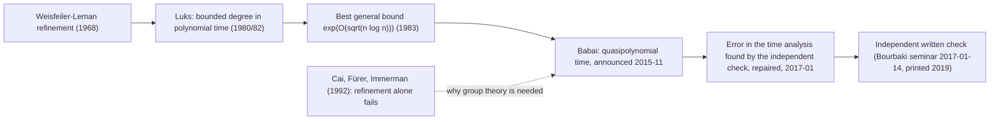

# Graph isomorphism: are two drawings the same graph, and Babai's quasipolynomial algorithm

[Syllabus](../../../SYLLABUS.md) → [Frontier](../README.md) → [Algebra, Logic and Computation](../README.md#s06) → Graph isomorphism

---

## General Overview

A 20-sided die is an icosahedron: 12 corners, 30 edges, and 5 edges at every corner. Two people number its corners and write down which pairs are joined by an edge.

The first numbers the corners ring by ring: 0 on top, 1 to 5 round the upper ring, 6 to 10 round the lower ring, 11 at the bottom. The second uses the letters a to l in no special order. Their two lists of 30 pairs look unrelated. Read corner 0 as a, corner 1 as b, and so on, and only 12 of the 30 edges line up.

Are the two lists the same graph? Here yes: some renaming of the letters turns the second list into the first. Finding it by trying every renaming means up to 12! = 479,001,600 tries. A search that renames one corner at a time, and backs out at the first broken edge, finds one at step 13: one step to start, then one per corner, with no backing out at all. Listing every renaming takes 1,273 steps: 120 renamings work, one for each symmetry of the die.

That is the **graph isomorphism problem**: given two graphs, decide whether one is the other with its vertices renamed. A short proof of "yes" is easy to check: hand over the renaming and test all 66 pairs of corners. Nobody knows a fast method that always finds it. In November 2015 László Babai announced an algorithm whose running time grows only a little faster than any polynomial. An error in its time analysis, still present in the refereed 2016 version, was found in January 2017 by Harald Helfgott while he prepared an independent written check. Babai repaired it that month, and the check was printed in 2019.

**Deciding whether two graphs are the same up to renaming is in NP, is not known to be in P, is believed not to be NP-complete, and, by Babai's 2015 algorithm, takes only quasipolynomial time: 2 raised to a fixed power of the logarithm of n, where n is the number of vertices.**

**What kind of fact this is:** a status card. That the problem is in NP is a theorem, proved in Why it works. The quasipolynomial algorithm is a theorem, outlined here, not proved. Its status, proved, rests on Helfgott's independent check (2017, printed 2019), which found the error that Babai repaired; the refereed 2016 extended abstract still contained it. Whether the problem is in P is open as of 2026-11-23.

### The picture: the route to Babai's algorithm



Schematic. Solid arrows are the order of results. The dotted arrow is an obstacle the algorithm had to get round.

---

## The formula

The [Graphs](../../04-Combinatorics%20and%20graphs/09-Graphs%20-%20Dots%20and%20Lines/01-graphs-vertices-and-edges.md) card defines a graph G = (V, E), a set V of vertices and a set E of joined pairs, and calls two drawings **isomorphic** when a renaming of the vertices turns one pair list into the other. This card asks how hard it is to decide that.

```math
(G_1, G_2) \in \mathrm{GI} \iff \exists\, f : V_1 \to V_2 \text{ one-to-one and onto, with } \{u, v\} \in E_1 \iff \{f(u), f(v)\} \in E_2
```

**Read it aloud:** the pair of graphs is a yes-instance of graph isomorphism exactly when some renaming f of the first graph's vertices makes a pair joined in the first graph exactly when its renamed pair is joined in the second.

Babai's result is about running time. This card introduces **quasipolynomial time**: a number of steps at most 2 raised to a fixed power of $`\log_2 n`$.

```math
T(n) \le 2^{(\log_2 n)^{c}} \quad \text{for one fixed } c \text{ and every large } n
```

**Read it aloud:** the steps needed for graphs with n vertices are at most 2 to the power of log base 2 of n, raised to some fixed power c.

With c = 1 this is n steps. Any polynomial $`n^d = 2^{d \log_2 n}`$ fits under c = 2 for large n. With c = 2 it is $`n^{\log_2 n}`$, which outgrows every polynomial. It still grows far slower than $`2^{n^{\epsilon}}`$ for any fixed $`\epsilon > 0`$. Babai proved some fixed c works; his papers write the bound as $`\exp((\log n)^{O(1)})`$. Helfgott's independent check works it out as $`\exp(O((\log n)^3))`$, so c is about 3.

| Symbol | Plain meaning | In our example | Push it up and the answer… |
| --- | --- | --- | --- |
| $`G_1`$, $`G_2`$ | the two graphs | graph A (corners 0 to 11) and graph B (corners a to l) | — |
| $`V_1`$, $`V_2`$ | their vertex sets | 12 corners each | — |
| $`E_1`$, $`E_2`$ | their sets of joined pairs | 30 edges each | — |
| $`n`$ | number of vertices | 12 | the search space n! explodes |
| $`f`$ | a renaming: one-to-one and onto | 0→a, 1→c, 2→h, … (the search's first) | — |
| $`u`$, $`v`$ | two vertices of $`G_1`$ | corners 0 and 1 | — |
| GI | the problem: all yes-pairs | (A, B) is in it | — |
| $`T(n)`$ | worst-case steps on n-vertex graphs | — | — |
| $`c`$ | the fixed power in the quasipolynomial bound | not stated by Babai; Helfgott's check gives $`\exp(O((\log n)^3))`$, so c is about 3 | larger c, slower bound |
| $`\epsilon`$ | any fixed positive number | — | — |
| $`d`$ | the degree (top power) of a polynomial $`n^d`$ | 3 in the growth table | steeper polynomial, still under c = 2 |
| $`k`$ | the size of the vertex groups Babai's refinement colours (Step 4) | — | about $`\log n`$ in his algorithm |

### When it holds

- **Worst case over all graphs.** P, NP and quasipolynomial time all bound the slowest input of each size. Colour refinement (below) tells many graphs apart quickly; the open question is about the hardest ones.
- **Size measured in vertices.** Writing a graph down takes about $`n^2`$ bits, one per pair. Measured either way, a polynomial stays polynomial and a quasipolynomial stays quasipolynomial.
- **Plain graphs, or with extras.** Directed edges, colours on vertices or labels on edges reduce to plain graphs in polynomial time, so the bounds carry over. Asking instead whether $`G_1`$ appears inside a larger $`G_2`$ is subgraph isomorphism, a different problem: it contains the clique problem and is NP-complete.
- **Constants hidden.** The bound fixes the shape of growth, not the step count. A quasipolynomial algorithm can be slower than an exponential one on small graphs: in the table in Why it works, the c = 3 bound at n = 16 is $`10^{19.3}`$ steps, against $`10^{4.8}`$ for $`2^n`$.

---

## Why it works

### Step 0: a renaming is a short certificate, so GI is in NP

The [P and NP](../../24-Computability%20and%20complexity/03-Time%20Complexity/02-p-and-np.md) card defines NP: yes-answers have a short **certificate** (evidence) that a fast **verifier** checks. For GI the certificate is the renaming f: n names, about $`n \log_2 n`$ bits. The verifier tests each of the $`n(n-1)/2`$ pairs. For the die that is 66 pairs, all of which agree, and 30 edges land on edges. So GI is in NP.

### Step 1: invariants refute, but never confirm

An **invariant** is a number a renaming cannot change: the edge count, the list of degrees (edges at each vertex), the triangle count. If one differs, the graphs differ. Graphs A and B agree on all three: 30 edges, degree 5 everywhere, 20 triangles. That proves nothing. K(3,3) and the triangular prism both have six vertices of degree 3. K(3,3) has 0 triangles, the prism 2, so they differ, but their degree lists are identical.

### Step 2: colour refinement, and where it stops

This card introduces **colour refinement**. Give every vertex one colour. Then repeat: give each vertex a new colour that records its old colour and the sorted list of its neighbours' colours. Stop when the number of colours no longer grows. Renaming cannot change the result, so two graphs ending with different colour counts are not isomorphic. Weisfeiler and Leman (1968) studied the stronger version that colours pairs of vertices.

Refinement splits graphs whose vertices differ in their surroundings. It cannot split a **regular** graph, one where every vertex has the same degree: each vertex sees the same list, so all keep one colour. Graphs A and B both end with 1 colour. So do K(3,3) and the prism, which are not isomorphic.

### Step 3: individualise and refine

To break the tie, give one vertex a colour of its own and refine again. Mark corner 0 of the die: refinement splits the rest into cells of sizes 1, 5, 5 and 1 (corner 0, its 5 neighbours, the 5 corners next to those, the opposite corner). Then mark one of the 5 neighbours, and so on, until every vertex has its own colour. That order is a candidate naming. Try every choice at every level, keep the smallest resulting adjacency string, and that string is a **canonical form**: two graphs are isomorphic exactly when their canonical forms are equal.

For the die the tree has 12 × 5 × 2 = 120 leaves, and every leaf gives the same form. Graphs A and B give equal forms; K(3,3) and the prism do not. Branching is the cost. On highly symmetric graphs the tree can grow exponentially, and Cai, Fürer and Immerman (1992) built graphs that fool refinement of any fixed dimension. A fast method needs more than refinement.

### Step 4: Babai's algorithm, in outline

This is a research proof, outlined with its key steps and source; it is not proved here.

- **Group theory from Luks.** The renamings form a group, and Luks (1980/82) decided GI for graphs of bounded degree in polynomial time by splitting that group into smaller pieces.
- **The obstacle.** Luks's splitting stalls when a piece acts like the full group of all permutations of a large set, where no structure is left to exploit.
- **Local certificates.** Babai tests small subsets of that set for symmetry. Either the local symmetries combine into global symmetries of the graph, or their failures pick out a structure that renaming must respect.
- **Split or descend.** That structure is coloured and refined (on k-tuples: ordered lists of k vertices, with k about $`\log n`$) until either the colours split the set, or a large symmetric pattern appears. Babai shows the only such patterns are **Johnson graphs**: vertices are the subsets of one fixed size drawn from a set, joined by how much they overlap. Each Johnson graph is handled directly on a much smaller set.
- **The count.** Each split or descent costs at most quasipolynomially many branches and shrinks the problem enough that the recursion stays short. The total is quasipolynomial.

<details>
<summary>The status ledger, line by line</summary>

| Claim | Kind | Status as of 2026-11-23 | Source |
| --- | --- | --- | --- |
| GI is in NP | theorem | proved | Step 0 |
| GI for bounded degree is in P | theorem | proved, 1980/82 | Luks, as cited by Babai and Helfgott |
| best general bound before 2015: $`\exp(O(\sqrt{n \log n}))`$ | theorem | proved, 1983 | Luks, as cited by Babai |
| refinement of fixed dimension decides GI | conjecture | refuted, 1992 | Cai, Fürer and Immerman |
| GI in quasipolynomial time | theorem | proved: preprint 2015-12-11, refereed extended abstract 2016-06; error in the time analysis, still in that abstract, found by the independent check and repaired 2017-01; check printed 2019 | Babai; Helfgott |
| GI is in P | question | open | — |
| GI is NP-complete | question | open; if yes, the polynomial hierarchy collapses to its second level, and all of NP runs in quasipolynomial time | Babai, section 13.2 |

The full version of Babai's paper is the arXiv preprint. The correction is recorded in Helfgott's check: preparing it "led me to find a non-trivial error in the time analysis, but Babai was able to repair it by simplifying the algorithm."

</details>

### Step 5: where GI sits between P and NP-complete

[Hierarchy and Ladner](../../24-Computability%20and%20complexity/03-Time%20Complexity/09-time-hierarchy-and-ladners-theorem.md) proves that if P ≠ NP, NP holds problems that are neither in P nor NP-complete. GI is the leading natural candidate, for two reasons.

- **Interactive proofs.** "Not isomorphic" has a short randomised proof, so if GI were NP-complete the polynomial hierarchy (the tower of classes above NP, on [Above NP](../../24-Computability%20and%20complexity/03-Time%20Complexity/08-conp-pspace-and-the-polynomial-hierarchy.md)) would collapse to its second level (Goldreich, Micali and Wigderson, 1986, as Babai summarises). Most researchers expect it does not collapse.
- **Babai's bound.** If GI were NP-complete, every NP problem would reduce to GI in polynomial time, then run in quasipolynomial time. No NP-complete problem is known to run that fast.

Neither reason is a proof. If P = NP, GI is in P and there is no middle ground.

The growth rates, in log10 of the step count with every constant set to 1 (illustrative). The quasipolynomial with c = 2 is a sample; c = 3 matches the exponent in Helfgott's analysis of Babai's algorithm:

```
log10 of steps at n = 1,000, one # per 6
n^3              |##                                       9.0
n^(log2 n)       |#####                                   29.9
e^sqrt(n ln n)   |######                                  36.1
2^((log2 n)^3)   |##################################...  298.0
2^n              |##################################...  301.0
```

At n = 16, $`n^{\log_2 n}`$ and $`2^n`$ both equal $`10^{4.8}`$, and the old bound $`e^{\sqrt{n \ln n}}`$, at $`10^{2.9}`$, is below $`n^3`$ at $`10^{3.6}`$. With c = 3 the bound is $`10^{19.3}`$ at n = 16 and $`10^{88.3}`$ at n = 100, far above $`2^n`$; by n = 1,000 it has only just dropped below, $`10^{298.0}`$ against $`10^{301.0}`$. Growth rates only separate for large n.

---

## Worked numbers, by hand

| Step | Arithmetic | Value |
| --- | --- | --- |
| edges in A and in B | 12 corners × 5 ÷ 2 | 30 and 30 |
| triangles in A and in B | the die's faces | 20 and 20 |
| colour refinement | every corner has degree 5 | 1 colour each: no verdict |
| mark corner 0 of A, refine | itself, neighbours, next ring, opposite | cells 1, 5, 5, 1 |
| blind search | 12! renamings | 479,001,600 |
| search with backing out, to the first renaming | one step to start, then one per corner, no dead end | step 13 |
| search with backing out, to list all 120 | 1 + 12 + 12 × 5, then 120 at each of 10 more corners | 1,273 steps |
| renamings that work | found by the search | **120** |
| by hand | 12 places for corner 0 × 5 for corner 1 × 2 turning directions | 120 |
| certificate check | 66 pairs tested for the first renaming | 66 agree, 30 edges on edges |

**The two drawings are the same graph, and exactly 120 renamings show it, one for each symmetry of the die.**

The secret renaming used to build B (0→h, 1→c, 2→k, …) is one of the 120. The search found a different one first.

### What breaks if you drop a piece

| Mistake | Comes out at | What went wrong |
| --- | --- | --- |
| Reading the labels as already matched (corner i is letter i) | 12 of 30 edges line up | The names carry no information; only the renaming does |
| Matching degree lists only | K(3,3) and the prism both read 3, 3, 3, 3, 3, 3 | Triangles 0 and 2: an invariant can only refute |
| Trusting colour refinement alone | K(3,3) and the prism both end with 1 colour | Regular graphs never split; the search finds 0 renamings |
| Trying all renamings blind | 479,001,600 for 12 vertices | n! grows faster than any exponential $`2^{cn}`$ |

The code prints every row.

---

## Code, from first principles, and it actually runs

The code builds graph A from the die's rings and graph B by a secret renaming, with no graph library. It takes **three independent roads** to "isomorphic, in 120 ways".

- **Road 1, search.** Rename A's corners one at a time, backing out at the first pair that disagrees, and count every complete renaming. The search's steps are checked against the prefixes of the renamings it finds, length by length: equal totals mean it never entered a dead end.
- **Road 2, canonical form.** Individualise and refine each graph separately, as in Step 3, and compare the smallest adjacency strings. The leaves giving that string count the symmetries a second way.
- **Road 3, by hand.** 12 × 5 × 2 = 120.

It then shows colour refinement failing on K(3,3) against the prism, and prints the growth table.

### Python

```python
# Graph isomorphism -- the check behind the card.  Standard library only; no
# graph library.  Graph A is the 20-sided die's corner network (an icosahedron:
# 12 corners, 30 edges) numbered ring by ring; graph B is the same network under
# a secret renaming, written with letters.  Three roads say "the same graph":
# a backtracking search, an individualise-and-refine canonical form, and the
# hand count 12 x 5 x 2 of the die's symmetries.  Both programs print the same.
import math

def icosahedron():
    e = [(0, i) for i in range(1, 6)] + [(11, 6 + j) for j in range(5)]
    e += [(1 + j, 1 + (j + 1) % 5) for j in range(5)] + [(6 + j, 6 + (j + 1) % 5) for j in range(5)]
    e += [(1 + j, 6 + j) for j in range(5)] + [(1 + j, 6 + (j + 1) % 5) for j in range(5)]
    return e

def adjacency(n, edges):
    a = [[False] * n for _ in range(n)]
    for u, v in edges:
        a[u][v] = a[v][u] = True
    return a

def nbrs(a, v):
    return [u for u in range(len(a)) if a[v][u]]

def refine(a, col):                       # colour refinement: a colour plus the
    k = -1                                 # sorted colours of the neighbours
    while True:
        sig = [(col[v], sorted(col[u] for u in nbrs(a, v))) for v in range(len(a))]
        names = sorted(set((c, tuple(s)) for c, s in sig))
        col = [names.index((c, tuple(s))) for c, s in sig]
        if len(names) == k:
            return col
        k = len(names)

def canon(a, col):            # road 2: individualise one vertex, refine, recurse
    col = refine(a, col)      # returns (smallest form, leaves giving it, leaves)
    n = len(a)
    if len(set(col)) == n:
        order = sorted(range(n), key=lambda v: col[v])
        form = "".join("1" if a[order[i]][order[j]] else "0" for i in range(n) for j in range(i + 1, n))
        return form, 1, 1
    c = min(x for x in set(col) if col.count(x) > 1)
    best, hits, leaves = None, 0, 0
    for v in [u for u in range(n) if col[u] == c]:
        new = [2 * col[u] + (1 if col[u] == c and u != v else 0) for u in range(n)]
        f, h, l = canon(a, new)
        leaves += l
        if best is None or f < best:
            best, hits = f, h
        elif f == best:
            hits += h
    return best, hits, leaves

def search(a, b):                  # road 1: map A's vertices 0, 1, 2, ... in turn
    n, found, nodes, f = len(a), [], [0, 0], []   # nodes: count, and the count at the first find
    def go(i):
        nodes[0] += 1
        if i == n:
            found.append(list(f)); nodes[1] = nodes[1] or nodes[0]; return
        for w in range(n):
            if w not in f and all(a[i][u] == b[w][f[u]] for u in range(i)):
                f.append(w); go(i + 1); f.pop()
    go(0)
    return found, nodes[0], nodes[1]

def triangles(a):
    n = len(a)
    return sum(a[i][j] and a[j][k] and a[i][k] for i in range(n) for j in range(i) for k in range(j))

L = "abcdefghijkl"
secret = [7, 2, 10, 4, 11, 0, 9, 5, 1, 8, 3, 6]          # A's corner i is B's letter L[secret[i]]
A = adjacency(12, icosahedron())
B = adjacency(12, [(secret[u], secret[v]) for u, v in icosahedron()])
for name, g, lab in (("A", A, str), ("B", B, lambda v: L[v])):
    d = [len(nbrs(g, v)) for v in range(12)]
    print(f"graph {name}: 12 corners, {sum(d) // 2} edges, every degree {min(d)} to {max(d)}, triangles {triangles(g)}")
    print("  " + "; ".join(lab(v) + ": " + " ".join(lab(u) for u in nbrs(g, v)) for v in range(12)))
union = [[False] * 24 for _ in range(24)]
for i in range(12):
    for j in range(12):
        union[i][j], union[12 + i][12 + j] = A[i][j], B[i][j]
cr = refine(union, [0] * 24)
print(f"colour refinement on A and B: {len(set(cr[:12]))} colour in A, {len(set(cr[12:]))} in B: {'it cannot tell' if sorted(cr[:12]) == sorted(cr[12:]) else 'they differ'}")
cA, cB = refine(A, [0] + [1] * 11), refine(B, [0] + [1] * 11)
print(f"after marking corner 0, refinement gives cells of sizes {[cA.count(c) for c in sorted(set(cA))]}")
isos, nodes, first = search(A, B)
print(f"road 1, search: {len(isos)} renamings work; the first at search node {first}; all listed after {nodes} nodes, against 12! = {math.factorial(12)}")
depth = [len({tuple(p[:i]) for p in isos}) for i in range(13)]   # prefixes of the renamings, by length
print("  prefixes of the renamings, length 0 to 12: " + " ".join(map(str, depth)) + f"; sum {sum(depth)}")
f = isos[0]
print("  first one: " + " ".join(f"{i}{L[f[i]]}" for i in range(12)))
checks = sum(A[i][j] == B[f[i]][f[j]] for i in range(12) for j in range(i + 1, 12))
print(f"verifier: {checks} of 66 pairs agree, {sum(A[i][j] and B[f[i]][f[j]] for i in range(12) for j in range(12)) // 2} edges land on edges")
print("secret renaming: " + " ".join(f"{i}{L[secret[i]]}" for i in range(12)) + f"; among the 120: {'yes' if secret in isos else 'no'}")
fa, ha, la = canon(A, [0] * 12)
fb, hb, lb = canon(B, [0] * 12)
print(f"road 2, canonical forms equal: {'yes' if fa == fb else 'no'}; tree leaves {la} and {lb}; leaves giving the form {ha} and {hb}")
print(f"road 3, by hand: 12 corners x 5 neighbours x 2 turns = {12 * 5 * 2}")
naive = sum(A[i][j] and B[i][j] for i in range(12) for j in range(i + 1, 12))
both = {frozenset(e) for e in icosahedron()} & {frozenset((secret[u], secret[v])) for u, v in icosahedron()}
print(f"mistake, reading the labels as matched (corner i = letter i): {naive} of 30 edges land on edges")
k33 = adjacency(6, [(i, j) for i in range(3) for j in range(3, 6)])
prism = adjacency(6, [(0, 1), (1, 2), (0, 2), (3, 4), (4, 5), (3, 5), (0, 3), (1, 4), (2, 5)])
u2 = [[False] * 12 for _ in range(12)]
for i in range(6):
    for j in range(6):
        u2[i][j], u2[6 + i][6 + j] = k33[i][j], prism[i][j]
c2 = refine(u2, [0] * 12)
print(f"K(3,3) against prism: degrees {sorted(len(nbrs(k33, v)) for v in range(6))} and {sorted(len(nbrs(prism, v)) for v in range(6))}")
print(f"  refinement colours {len(set(c2[:6]))} and {len(set(c2[6:]))}, the same: it cannot tell")
print(f"  triangles {triangles(k33)} and {triangles(prism)}; search finds {len(search(k33, prism)[0])} renamings; forms equal: {'yes' if canon(k33, [0] * 6)[0] == canon(prism, [0] * 6)[0] else 'no'}")
print("log10 of step counts, constants set to 1 (illustrative):")
print("        n   n^3  n^(log2 n)  2^((log2 n)^3)  e^sqrt(n ln n)    2^n")
for n in (16, 100, 1000, 1000000):
    lg = lambda x: f"{x:.1f}"
    print(f"{n:>9} {lg(3 * math.log10(n)):>5} {lg(math.log2(n) ** 2 * math.log10(2)):>11} {lg(math.log2(n) ** 3 * math.log10(2)):>15}"
          f" {lg(math.sqrt(n * math.log(n)) / math.log(10)):>15} {lg(n * math.log10(2)):>6}")
assert len(isos) == 120 and secret in isos and checks == 66     # road 1, verified
assert sum(depth) == nodes and first == len(A) + 1              # no dead end; first find with no backing out
assert fa == fb and ha == hb == len(isos)                       # road 2 agrees
assert 12 * 5 * 2 == len(isos) and naive == len(both)           # road 3 agrees; shared labels counted twice
assert len(set(cr)) == 1 and c2[:6] == c2[6:] and len(search(k33, prism)[0]) == 0   # refinement is fooled
assert triangles(A) == triangles(B) == 20 and triangles(prism) == 2
print("ALL CHECKS PASS")
```

**Ran 2026-11-23 on macOS, Python 3.14.10, standard library only. All checks passed. Output, pasted from the run:**

```
graph A: 12 corners, 30 edges, every degree 5 to 5, triangles 20
  0: 1 2 3 4 5; 1: 0 2 5 6 7; 2: 0 1 3 7 8; 3: 0 2 4 8 9; 4: 0 3 5 9 10; 5: 0 1 4 6 10; 6: 1 5 7 10 11; 7: 1 2 6 8 11; 8: 2 3 7 9 11; 9: 3 4 8 10 11; 10: 4 5 6 9 11; 11: 6 7 8 9 10
graph B: 12 corners, 30 edges, every degree 5 to 5, triangles 20
  a: c d h j l; b: e f g i k; c: a f h j k; d: a g i j l; e: b h i k l; f: b c g j k; g: b d f i j; h: a c e k l; i: b d e g l; j: a c d f g; k: b c e f h; l: a d e h i
colour refinement on A and B: 1 colour in A, 1 in B: it cannot tell
after marking corner 0, refinement gives cells of sizes [1, 5, 5, 1]
road 1, search: 120 renamings work; the first at search node 13; all listed after 1273 nodes, against 12! = 479001600
  prefixes of the renamings, length 0 to 12: 1 12 60 120 120 120 120 120 120 120 120 120 120; sum 1273
  first one: 0a 1c 2h 3l 4d 5j 6f 7k 8e 9i 10g 11b
verifier: 66 of 66 pairs agree, 30 edges land on edges
secret renaming: 0h 1c 2k 3e 4l 5a 6j 7f 8b 9i 10d 11g; among the 120: yes
road 2, canonical forms equal: yes; tree leaves 120 and 120; leaves giving the form 120 and 120
road 3, by hand: 12 corners x 5 neighbours x 2 turns = 120
mistake, reading the labels as matched (corner i = letter i): 12 of 30 edges land on edges
K(3,3) against prism: degrees [3, 3, 3, 3, 3, 3] and [3, 3, 3, 3, 3, 3]
  refinement colours 1 and 1, the same: it cannot tell
  triangles 0 and 2; search finds 0 renamings; forms equal: no
log10 of step counts, constants set to 1 (illustrative):
        n   n^3  n^(log2 n)  2^((log2 n)^3)  e^sqrt(n ln n)    2^n
       16   3.6         4.8            19.3             2.9    4.8
      100   6.0        13.3            88.3             9.3   30.1
     1000   9.0        29.9           298.0            36.1  301.0
  1000000  18.0       119.6          2383.6          1614.2 301030.0
ALL CHECKS PASS
```

### Rust

Same numbers, same labels, built with `rustc --edition 2021 -O`.

```rust
// Graph isomorphism -- the same check as the Python, in Rust.  No crates; no
// graph library.  Graph A is the 20-sided die's corner network (an icosahedron:
// 12 corners, 30 edges) numbered ring by ring; graph B is the same network under
// a secret renaming, written with letters.  Three roads say "the same graph":
// a backtracking search, an individualise-and-refine canonical form, and the
// hand count 12 x 5 x 2 of the die's symmetries.  Both programs print the same.
type G = Vec<Vec<bool>>;

fn icosahedron() -> Vec<(usize, usize)> {
    let mut e: Vec<(usize, usize)> = (1..6).map(|i| (0, i)).collect();
    e.extend((0..5).map(|j| (11, 6 + j)));
    e.extend((0..5).map(|j| (1 + j, 1 + (j + 1) % 5)));
    e.extend((0..5).map(|j| (6 + j, 6 + (j + 1) % 5)));
    e.extend((0..5).map(|j| (1 + j, 6 + j)));
    e.extend((0..5).map(|j| (1 + j, 6 + (j + 1) % 5)));
    e
}

fn adjacency(n: usize, edges: &[(usize, usize)]) -> G {
    let mut a = vec![vec![false; n]; n];
    for &(u, v) in edges { a[u][v] = true; a[v][u] = true; }
    a
}

fn nbrs(a: &G, v: usize) -> Vec<usize> { (0..a.len()).filter(|&u| a[v][u]).collect() }

fn distinct(col: &[usize]) -> usize { let mut c = col.to_vec(); c.sort(); c.dedup(); c.len() }

fn refine(a: &G, start: &[usize]) -> Vec<usize> {   // colour refinement: a colour plus
    let mut col = start.to_vec();                    // the sorted colours of the neighbours
    let mut k = usize::MAX;
    loop {
        let sig: Vec<(usize, Vec<usize>)> = (0..a.len()).map(|v| {
            let mut s: Vec<usize> = nbrs(a, v).iter().map(|&u| col[u]).collect();
            s.sort();
            (col[v], s)
        }).collect();
        let mut names = sig.clone();
        names.sort();
        names.dedup();
        col = sig.iter().map(|s| names.iter().position(|x| x == s).unwrap()).collect();
        if names.len() == k { return col; }
        k = names.len();
    }
}

fn canon(a: &G, start: &[usize]) -> (String, usize, usize) {   // road 2: individualise, refine, recurse
    let col = refine(a, start);
    let n = a.len();
    if distinct(&col) == n {
        let mut order: Vec<usize> = (0..n).collect();
        order.sort_by_key(|&v| col[v]);
        let mut form = String::new();
        for i in 0..n { for j in i + 1..n { form.push(if a[order[i]][order[j]] { '1' } else { '0' }); } }
        return (form, 1, 1);
    }
    let c = (0..n).map(|v| col[v]).filter(|&x| col.iter().filter(|&&y| y == x).count() > 1).min().unwrap();
    let (mut best, mut hits, mut leaves): (Option<String>, usize, usize) = (None, 0, 0);
    for v in (0..n).filter(|&u| col[u] == c) {
        let new: Vec<usize> = (0..n).map(|u| 2 * col[u] + if col[u] == c && u != v { 1 } else { 0 }).collect();
        let (f, h, l) = canon(a, &new);
        leaves += l;
        if best.is_none() || f < *best.as_ref().unwrap() { best = Some(f); hits = h; }
        else if Some(&f) == best.as_ref() { hits += h; }
    }
    (best.unwrap(), hits, leaves)
}

fn go(a: &G, b: &G, i: usize, f: &mut Vec<usize>, found: &mut Vec<Vec<usize>>, nodes: &mut (usize, usize)) {
    nodes.0 += 1;                                    // road 1: map A's vertices 0, 1, 2, ... in turn
    if i == a.len() { found.push(f.clone()); if nodes.1 == 0 { nodes.1 = nodes.0; } return; }
    for w in 0..a.len() {
        if !f.contains(&w) && (0..i).all(|u| a[i][u] == b[w][f[u]]) {
            f.push(w); go(a, b, i + 1, f, found, nodes); f.pop();
        }
    }
}

fn search(a: &G, b: &G) -> (Vec<Vec<usize>>, usize, usize) {   // nodes, and the count at the first find
    let (mut found, mut nodes) = (Vec::new(), (0, 0));
    go(a, b, 0, &mut Vec::new(), &mut found, &mut nodes);
    (found, nodes.0, nodes.1)
}

fn triangles(a: &G) -> usize {
    (0..a.len()).map(|i| (0..i).map(|j| (0..j).filter(|&k| a[i][j] && a[j][k] && a[i][k]).count()).sum::<usize>()).sum()
}

fn union(x: &G, y: &G) -> G {
    let n = x.len();
    let mut u = vec![vec![false; 2 * n]; 2 * n];
    for i in 0..n { for j in 0..n { u[i][j] = x[i][j]; u[n + i][n + j] = y[i][j]; } }
    u
}

fn yn(b: bool) -> &'static str { if b { "yes" } else { "no" } }

fn main() {
    let lt: Vec<char> = "abcdefghijkl".chars().collect();
    let secret = [7usize, 2, 10, 4, 11, 0, 9, 5, 1, 8, 3, 6];   // A's corner i is B's letter lt[secret[i]]
    let a = adjacency(12, &icosahedron());
    let eb: Vec<(usize, usize)> = icosahedron().iter().map(|&(u, v)| (secret[u], secret[v])).collect();
    let b = adjacency(12, &eb);
    for (name, g, letters) in [("A", &a, false), ("B", &b, true)] {
        let lab = |v: usize| if letters { lt[v].to_string() } else { v.to_string() };
        let d: Vec<usize> = (0..12).map(|v| nbrs(g, v).len()).collect();
        println!("graph {}: 12 corners, {} edges, every degree {} to {}, triangles {}", name,
                 d.iter().sum::<usize>() / 2, d.iter().min().unwrap(), d.iter().max().unwrap(), triangles(g));
        let rows: Vec<String> = (0..12).map(|v| format!("{}: {}", lab(v),
            nbrs(g, v).iter().map(|&u| lab(u)).collect::<Vec<_>>().join(" "))).collect();
        println!("  {}", rows.join("; "));
    }
    let cr = refine(&union(&a, &b), &vec![0; 24]);
    let (mut s1, mut s2) = (cr[..12].to_vec(), cr[12..].to_vec()); s1.sort(); s2.sort();
    println!("colour refinement on A and B: {} colour in A, {} in B: {}", distinct(&cr[..12]), distinct(&cr[12..]), if s1 == s2 { "it cannot tell" } else { "they differ" });
    let mut m = vec![1usize; 12]; m[0] = 0;
    let ca = refine(&a, &m);
    let mut cells: Vec<usize> = ca.clone(); cells.sort(); cells.dedup();
    let sizes: Vec<usize> = cells.iter().map(|&c| ca.iter().filter(|&&x| x == c).count()).collect();
    println!("after marking corner 0, refinement gives cells of sizes {:?}", sizes);
    let (isos, nodes, first) = search(&a, &b);
    println!("road 1, search: {} renamings work; the first at search node {}; all listed after {} nodes, against 12! = {}",
             isos.len(), first, nodes, (1..=12u64).product::<u64>());
    let depth: Vec<usize> = (0..13).map(|i| { let mut v: Vec<&[usize]> = isos.iter().map(|p| &p[..i]).collect(); v.sort(); v.dedup(); v.len() }).collect();
    println!("  prefixes of the renamings, length 0 to 12: {}; sum {}", depth.iter().map(|d| d.to_string()).collect::<Vec<_>>().join(" "), depth.iter().sum::<usize>());
    let f = &isos[0];
    let show = |p: &[usize]| (0..12).map(|i| format!("{}{}", i, lt[p[i]])).collect::<Vec<_>>().join(" ");
    println!("  first one: {}", show(f));
    let (mut checks, mut landed) = (0, 0);
    for i in 0..12 { for j in i + 1..12 {
        if a[i][j] == b[f[i]][f[j]] { checks += 1; }
        if a[i][j] && b[f[i]][f[j]] { landed += 1; }
    } }
    println!("verifier: {} of 66 pairs agree, {} edges land on edges", checks, landed);
    let has_secret = isos.iter().any(|p| p[..] == secret[..]);
    println!("secret renaming: {}; among the 120: {}", show(&secret), yn(has_secret));
    let (fa, ha, la) = canon(&a, &vec![0; 12]);
    let (fb, hb, lb) = canon(&b, &vec![0; 12]);
    println!("road 2, canonical forms equal: {}; tree leaves {} and {}; leaves giving the form {} and {}", yn(fa == fb), la, lb, ha, hb);
    println!("road 3, by hand: 12 corners x 5 neighbours x 2 turns = {}", 12 * 5 * 2);
    let naive: usize = (0..12).map(|i| (i + 1..12).filter(|&j| a[i][j] && b[i][j]).count()).sum();
    let ea: Vec<(usize, usize)> = icosahedron().iter().map(|&(u, v)| (u.min(v), u.max(v))).collect();
    let both = eb.iter().filter(|&&(u, v)| ea.contains(&(u.min(v), u.max(v)))).count();
    println!("mistake, reading the labels as matched (corner i = letter i): {} of 30 edges land on edges", naive);
    let e33: Vec<(usize, usize)> = (0..3).flat_map(|i| (3..6).map(move |j| (i, j))).collect();
    let k33 = adjacency(6, &e33);
    let prism = adjacency(6, &[(0, 1), (1, 2), (0, 2), (3, 4), (4, 5), (3, 5), (0, 3), (1, 4), (2, 5)]);
    let c2 = refine(&union(&k33, &prism), &vec![0; 12]);
    let deg = |g: &G| { let mut d: Vec<usize> = (0..6).map(|v| nbrs(g, v).len()).collect(); d.sort(); d };
    println!("K(3,3) against prism: degrees {:?} and {:?}", deg(&k33), deg(&prism));
    println!("  refinement colours {} and {}, the same: it cannot tell", distinct(&c2[..6]), distinct(&c2[6..]));
    let kp = search(&k33, &prism).0.len();
    println!("  triangles {} and {}; search finds {} renamings; forms equal: {}", triangles(&k33), triangles(&prism), kp,
             yn(canon(&k33, &vec![0; 6]).0 == canon(&prism, &vec![0; 6]).0));
    println!("log10 of step counts, constants set to 1 (illustrative):");
    println!("        n   n^3  n^(log2 n)  2^((log2 n)^3)  e^sqrt(n ln n)    2^n");
    for n in [16.0f64, 100.0, 1000.0, 1000000.0] {
        println!("{:>9} {:>5} {:>11} {:>15} {:>15} {:>6}", n as u64, format!("{:.1}", 3.0 * n.log10()),
                 format!("{:.1}", n.log2().powi(2) * 2f64.log10()), format!("{:.1}", n.log2().powi(3) * 2f64.log10()),
                 format!("{:.1}", (n * n.ln()).sqrt() / 10f64.ln()), format!("{:.1}", n * 2f64.log10()));
    }
    assert!(isos.len() == 120 && has_secret && checks == 66);   // road 1, verified
    assert!(depth.iter().sum::<usize>() == nodes && first == a.len() + 1); // no dead end; first find with no backing out
    assert!(fa == fb && ha == hb && ha == isos.len());          // road 2 agrees
    assert!(12 * 5 * 2 == isos.len() && naive == both);         // road 3 agrees; shared labels counted twice
    assert!(distinct(&cr) == 1 && c2[..6] == c2[6..] && kp == 0); // refinement is fooled
    assert!(triangles(&a) == 20 && triangles(&b) == 20 && triangles(&prism) == 2);
    println!("ALL CHECKS PASS");
}
```

**Ran 2026-11-23 on macOS, rustc 1.98.1, no crates. All checks passed. Output, pasted from the run:**

```
graph A: 12 corners, 30 edges, every degree 5 to 5, triangles 20
  0: 1 2 3 4 5; 1: 0 2 5 6 7; 2: 0 1 3 7 8; 3: 0 2 4 8 9; 4: 0 3 5 9 10; 5: 0 1 4 6 10; 6: 1 5 7 10 11; 7: 1 2 6 8 11; 8: 2 3 7 9 11; 9: 3 4 8 10 11; 10: 4 5 6 9 11; 11: 6 7 8 9 10
graph B: 12 corners, 30 edges, every degree 5 to 5, triangles 20
  a: c d h j l; b: e f g i k; c: a f h j k; d: a g i j l; e: b h i k l; f: b c g j k; g: b d f i j; h: a c e k l; i: b d e g l; j: a c d f g; k: b c e f h; l: a d e h i
colour refinement on A and B: 1 colour in A, 1 in B: it cannot tell
after marking corner 0, refinement gives cells of sizes [1, 5, 5, 1]
road 1, search: 120 renamings work; the first at search node 13; all listed after 1273 nodes, against 12! = 479001600
  prefixes of the renamings, length 0 to 12: 1 12 60 120 120 120 120 120 120 120 120 120 120; sum 1273
  first one: 0a 1c 2h 3l 4d 5j 6f 7k 8e 9i 10g 11b
verifier: 66 of 66 pairs agree, 30 edges land on edges
secret renaming: 0h 1c 2k 3e 4l 5a 6j 7f 8b 9i 10d 11g; among the 120: yes
road 2, canonical forms equal: yes; tree leaves 120 and 120; leaves giving the form 120 and 120
road 3, by hand: 12 corners x 5 neighbours x 2 turns = 120
mistake, reading the labels as matched (corner i = letter i): 12 of 30 edges land on edges
K(3,3) against prism: degrees [3, 3, 3, 3, 3, 3] and [3, 3, 3, 3, 3, 3]
  refinement colours 1 and 1, the same: it cannot tell
  triangles 0 and 2; search finds 0 renamings; forms equal: no
log10 of step counts, constants set to 1 (illustrative):
        n   n^3  n^(log2 n)  2^((log2 n)^3)  e^sqrt(n ln n)    2^n
       16   3.6         4.8            19.3             2.9    4.8
      100   6.0        13.3            88.3             9.3   30.1
     1000   9.0        29.9           298.0            36.1  301.0
  1000000  18.0       119.6          2383.6          1614.2 301030.0
ALL CHECKS PASS
```

The two outputs match line for line.

### Lean

Lean proves the invariant rule for all finite graphs, settles K(3,3) against the prism and the die, and checks the worked numbers.

- Take any renaming that turns one finite graph into another. Then the edge count, the list of degrees and the triangle count all stay the same.
- K(3,3) and the triangular prism both have every degree equal to 3. Yet no renaming turns one into the other.
- Graphs A and B are the same graph. The secret renaming (0→h, 1→c, 2→k, …) turns A into B.
- Both drawings have 30 edges, degree 5 at every corner and 20 triangles.
- Under the secret renaming all 66 pairs agree. The search's first renaming (0→a, 1→c, 2→h, …) works too.
- Read as already matched, corner i as letter i, only 12 of 30 edges line up.
- K(3,3) has 0 triangles and the prism has 2.
- Take a blind search over 12 corners. Then it faces 12! = 479,001,600 renamings, and the hand count 12 × 5 × 2 gives 120.

The count of exactly 120 renamings, the search steps, colour refinement, canonical forms and the growth table are left to the Python and Rust checks.

```lean
-- Graph isomorphism: a renaming keeps the edge count, the degree list and the triangle count, K(3,3) and the prism share degrees but are not isomorphic, and the die's two corner lists are the same graph under the card's secret renaming.
import Mathlib.Combinatorics.SimpleGraph.Maps
import Mathlib.Combinatorics.SimpleGraph.Finite
import Mathlib.Combinatorics.SimpleGraph.Clique
import Mathlib.Combinatorics.SimpleGraph.CycleGraph
import Mathlib.Combinatorics.SimpleGraph.Prod
import Mathlib.Data.Nat.Factorial.Basic
import Mathlib.Data.Fin.VecNotation

open SimpleGraph

namespace GraphIsomorphismCard

/-! ## The die's two corner lists -/

/-- Graph A: the 20-sided die's corners, numbered ring by ring
(0 on top, 1 to 5 the upper ring, 6 to 10 the lower ring, 11 at the bottom). -/
def edgesA : List (Fin 12 × Fin 12) :=
  [(0, 1), (0, 2), (0, 3), (0, 4), (0, 5), (11, 6), (11, 7), (11, 8), (11, 9), (11, 10),
   (1, 2), (2, 3), (3, 4), (4, 5), (5, 1), (6, 7), (7, 8), (8, 9), (9, 10), (10, 6),
   (1, 6), (2, 7), (3, 8), (4, 9), (5, 10), (1, 7), (2, 8), (3, 9), (4, 10), (5, 6)]

/-- Graph B: the second person's list, with letters a to l written as 0 to 11. -/
def edgesB : List (Fin 12 × Fin 12) :=
  [(0, 2), (0, 3), (0, 7), (0, 9), (0, 11), (1, 4), (1, 5), (1, 6), (1, 8), (1, 10),
   (2, 5), (2, 7), (2, 9), (2, 10), (3, 6), (3, 8), (3, 9), (3, 11), (4, 7), (4, 8),
   (4, 10), (4, 11), (5, 6), (5, 9), (5, 10), (6, 8), (6, 9), (7, 10), (7, 11), (8, 11)]

/-- Graph A as a simple graph on 12 vertices. -/
def A : SimpleGraph (Fin 12) := SimpleGraph.fromRel (fun u v => (u, v) ∈ edgesA)

/-- Graph B as a simple graph on 12 vertices. -/
def B : SimpleGraph (Fin 12) := SimpleGraph.fromRel (fun u v => (u, v) ∈ edgesB)

instance : DecidableRel A.Adj := fun u v =>
  inferInstanceAs (Decidable (u ≠ v ∧ ((u, v) ∈ edgesA ∨ (v, u) ∈ edgesA)))

instance : DecidableRel B.Adj := fun u v =>
  inferInstanceAs (Decidable (u ≠ v ∧ ((u, v) ∈ edgesB ∨ (v, u) ∈ edgesB)))

/-- The secret renaming used to build B: corner i of A is letter `secret i` of B
(0h 1c 2k 3e 4l 5a 6j 7f 8b 9i 10d 11g). -/
def secret : Fin 12 → Fin 12 := ![7, 2, 10, 4, 11, 0, 9, 5, 1, 8, 3, 6]

/-- The first renaming the card's search finds
(0a 1c 2h 3l 4d 5j 6f 7k 8e 9i 10g 11b). -/
def firstFound : Fin 12 → Fin 12 := ![0, 2, 7, 11, 3, 9, 5, 10, 4, 8, 6, 1]

/-! ## K(3,3) and the triangular prism -/

/-- K(3,3), Mathlib's complete bipartite graph on two sides of 3. -/
abbrev K33 : SimpleGraph (Fin 3 ⊕ Fin 3) := completeBipartiteGraph (Fin 3) (Fin 3)

instance : DecidableRel K33.Adj := fun v w =>
  inferInstanceAs (Decidable (v.isLeft ∧ w.isRight ∨ v.isRight ∧ w.isLeft))

/-- The triangular prism: a triangle (the 3-cycle) times an edge (K₂), as a box product. -/
abbrev prism : SimpleGraph (Fin 3 × Fin 2) := cycleGraph 3 □ (⊤ : SimpleGraph (Fin 2))

instance : DecidableRel prism.Adj := fun x y =>
  inferInstanceAs (Decidable ((cycleGraph 3).Adj x.1 y.1 ∧ x.2 = y.2 ∨
    (⊤ : SimpleGraph (Fin 2)).Adj x.2 y.2 ∧ x.1 = y.1))

/-! ## Helper lemmas -/

/-- A graph isomorphism carries n-cliques to n-cliques. -/
theorem iso_isNClique_map_iff {V W : Type*} [DecidableEq V] [DecidableEq W]
    {G : SimpleGraph V} {H : SimpleGraph W} (e : G ≃g H) (n : ℕ) (s : Finset V) :
    H.IsNClique n (s.map e.toEquiv.toEmbedding) ↔ G.IsNClique n s := by
  rw [isNClique_iff, isNClique_iff, Finset.card_map]
  refine and_congr_left' ?_
  simp only [IsClique, Finset.coe_map, Set.Pairwise, Set.mem_image, Finset.mem_coe]
  constructor
  · intro h a ha b hb hab
    have := h ⟨a, ha, rfl⟩ ⟨b, hb, rfl⟩ (by simpa using hab)
    simpa [e.map_adj_iff] using this
  · rintro h _ ⟨a, ha, rfl⟩ _ ⟨b, hb, rfl⟩ hab
    have := h ha hb (fun h' => hab (by rw [h']))
    simpa [e.map_adj_iff] using this

/-- A graph isomorphism keeps the number of n-cliques. -/
theorem iso_cliqueFinset_card_eq {V W : Type*} [Fintype V] [Fintype W]
    [DecidableEq V] [DecidableEq W] {G : SimpleGraph V} {H : SimpleGraph W}
    [DecidableRel G.Adj] [DecidableRel H.Adj] (e : G ≃g H) (n : ℕ) :
    (G.cliqueFinset n).card = (H.cliqueFinset n).card := by
  refine Finset.card_bij' (fun s _ => s.map e.toEquiv.toEmbedding)
    (fun t _ => t.map e.symm.toEquiv.toEmbedding) ?_ ?_ ?_ ?_
  · intro s hs
    rw [mem_cliqueFinset_iff] at hs ⊢
    exact (iso_isNClique_map_iff e n s).2 hs
  · intro t ht
    rw [mem_cliqueFinset_iff] at ht ⊢
    exact (iso_isNClique_map_iff e.symm n t).2 ht
  · intro s _
    rw [Finset.map_map]
    have h : e.toEquiv.toEmbedding.trans e.symm.toEquiv.toEmbedding =
        Function.Embedding.refl _ := Function.Embedding.ext (fun x => e.symm_apply_apply x)
    rw [h, Finset.map_refl]
  · intro t _
    rw [Finset.map_map]
    have h : e.symm.toEquiv.toEmbedding.trans e.toEquiv.toEmbedding =
        Function.Embedding.refl _ := Function.Embedding.ext (fun x => e.apply_symm_apply x)
    rw [h, Finset.map_refl]

#print axioms iso_isNClique_map_iff
#print axioms iso_cliqueFinset_card_eq

/-! ## The theorems -/

/-- Invariants: a renaming that turns one graph into the other cannot change the number of
edges, the list of degrees (edges at each vertex), or the number of triangles. So if any of
these differs, the two graphs are not isomorphic. -/
theorem iso_preserves_edges_degrees_triangles {V W : Type*} [Fintype V] [Fintype W]
    [DecidableEq V] [DecidableEq W] {G : SimpleGraph V} {H : SimpleGraph W}
    [DecidableRel G.Adj] [DecidableRel H.Adj] (e : G ≃g H) :
    G.edgeFinset.card = H.edgeFinset.card ∧
      Multiset.map (fun v => G.degree v) Finset.univ.val =
        Multiset.map (fun w => H.degree w) Finset.univ.val ∧
      (G.cliqueFinset 3).card = (H.cliqueFinset 3).card := by
  refine ⟨e.card_edgeFinset_eq, ?_, iso_cliqueFinset_card_eq e 3⟩
  have h1 : (fun v => G.degree v) = (fun w => H.degree w) ∘ e := by
    funext v; simp
  rw [h1, ← Multiset.map_map]
  congr 1
  have h2 := congrArg Finset.val (Finset.map_univ_equiv e.toEquiv)
  rw [Finset.map_val] at h2
  exact h2

/-- K(3,3) and the triangular prism both have every degree equal to 3,
yet they are not isomorphic: no renaming turns one into the other. -/
theorem k33_prism_same_degrees_not_isomorphic :
    K33.IsRegularOfDegree 3 ∧ prism.IsRegularOfDegree 3 ∧ IsEmpty (K33 ≃g prism) := by
  refine ⟨fun v => by revert v; decide, fun v => by revert v; decide, ⟨fun e => ?_⟩⟩
  have h := (iso_preserves_edges_degrees_triangles e).2.2
  have h0 : (K33.cliqueFinset 3).card = 0 := by decide
  have h2 : (prism.cliqueFinset 3).card = 2 := by decide
  omega

/-- The die's two corner lists are the same graph: the secret renaming is an isomorphism
from graph A to graph B. -/
theorem die_drawings_isomorphic : ∃ e : A ≃g B, ∀ i, e i = secret i := by
  have hb : Function.Bijective secret := by decide
  have hadj : ∀ i j, B.Adj (secret i) (secret j) ↔ A.Adj i j := by decide
  exact ⟨⟨Equiv.ofBijective secret hb, fun {i j} => hadj i j⟩, fun i => rfl⟩

/-! ## The card's worked numbers -/

-- Both drawings: 30 edges, degree 5 at every corner, 20 triangles.
set_option maxRecDepth 20000 in
example : A.edgeFinset.card = 30 := by decide
set_option maxRecDepth 20000 in
example : B.edgeFinset.card = 30 := by decide
set_option maxRecDepth 20000 in
example : ∀ v, A.degree v = 5 := by decide
set_option maxRecDepth 20000 in
example : ∀ v, B.degree v = 5 := by decide
example : (A.cliqueFinset 3).card = 20 := by decide +kernel
example : (B.cliqueFinset 3).card = 20 := by decide +kernel

-- The certificate check: under the secret renaming, all 66 pairs agree.
example : ∀ i j, A.Adj i j ↔ B.Adj (secret i) (secret j) := by decide
example : Function.Bijective secret := by decide

-- The search's first renaming also works.
example : ∀ i j, A.Adj i j ↔ B.Adj (firstFound i) (firstFound j) := by decide
example : Function.Bijective firstFound := by decide

-- Reading the labels as already matched (corner i = letter i): 12 of 30 edges line up.
example : (Finset.univ.filter
    (fun p : Fin 12 × Fin 12 => p.1 < p.2 ∧ A.Adj p.1 p.2 ∧ B.Adj p.1 p.2)).card = 12 := by
  decide

-- Blind search: 12! renamings; by hand, 12 × 5 × 2 = 120 symmetries.
example : Nat.factorial 12 = 479001600 := by decide
example : 12 * 5 * 2 = 120 := by decide

-- K(3,3): 0 triangles; the prism: 2 triangles.
example : (K33.cliqueFinset 3).card = 0 := by decide
example : (prism.cliqueFinset 3).card = 2 := by decide

#print axioms iso_preserves_edges_degrees_triangles
#print axioms k33_prism_same_degrees_not_isomorphic
#print axioms die_drawings_isomorphic

end GraphIsomorphismCard
```

**Checked 2026-11-23 on macOS, Lean 4.36.0-rc2, Mathlib v4.36.0-rc2. Every proof is complete and uses only Lean's standard axioms. Output, pasted from the run:**

```
'GraphIsomorphismCard.iso_isNClique_map_iff' depends on axioms: [propext, Classical.choice, Quot.sound]
'GraphIsomorphismCard.iso_cliqueFinset_card_eq' depends on axioms: [propext, Classical.choice, Quot.sound]
'GraphIsomorphismCard.iso_preserves_edges_degrees_triangles' depends on axioms: [propext, Classical.choice, Quot.sound]
'GraphIsomorphismCard.k33_prism_same_degrees_not_isomorphic' depends on axioms: [propext, Classical.choice, Quot.sound]
'GraphIsomorphismCard.die_drawings_isomorphic' depends on axioms: [propext, Classical.choice, Quot.sound]
```

> [!TIP]
> **Try changing**
> Guess first, then run it. The asserts are pinned to the die, so expect one to stop the program.
> - **A different secret.** Set `secret` to `[3, 9, 0, 11, 6, 1, 8, 2, 10, 5, 7, 4]`. Guess: still 120 renamings, the first at step 13 and all in 1,273 steps; the forms still agree, and all checks pass. B's list, the first renaming and the label count change: 15 of 30 edges now line up by name.
> - **Move one edge of B.** Build B from `icosahedron()[1:] + [(0, 6)]`, dropping one edge and adding a non-edge. Guess: degrees now run 4 to 6, triangles fall to 19, the search finds 0 renamings in 677 steps, and the program stops on the empty list.
> - **Compare K(3,3) with itself.** Set `prism = k33`. Guess: triangles 0 and 0, the search finds 72 renamings, the forms agree, and the "refinement is fooled" assert stops the run.

---

## The usual mistake

> [!warning]
> **Reading "quasipolynomial" as "solved" or as "in P".** A quasipolynomial bound grows faster than every polynomial. With c = 2, $`n^{\log_2 n}`$ at n = 1,000 is about $`10^{29.9}`$ steps, against $`10^{9}`$ for $`n^3`$. With c = 3, the exponent in Helfgott's analysis, it is about $`10^{298.0}`$, barely below $`2^n`$ (every constant set to 1, illustrative). Whether GI is in P is open as of 2026-11-23.
>
> - **Calling GI NP-complete.** It is in NP, but no reduction from an NP-complete problem is known, and one would collapse the polynomial hierarchy.
> - **Treating matching invariants as proof.** K(3,3) and the prism agree on every degree and on colour refinement, yet differ: 0 triangles against 2.
> - **Matching names instead of structure.** Reading corner i as letter i lines up 12 of 30 edges; the true renaming lines up all 30.
> - **Dropping the correction.** The 2015 announcement, and the refereed 2016 abstract, had an error in the time analysis. The independent check found it in January 2017 and Babai repaired it; cite the repaired result and the check, not the announcement alone.

---

## Where you meet it in real life

- **Chemical databases.** Is a newly drawn molecule already registered? Atoms are vertices and bonds are edges, and the question is graph isomorphism; Helfgott's check names molecule lookup as a use.
- **Chip design.** Checking that a circuit's layout wires the same components the same way as its schematic compares two graphs up to renaming.
- **Symmetry finding.** The 120 renamings of the die onto itself are its **automorphisms**, its symmetries. Programs that find a graph's symmetries use the individualise-and-refine search of Step 3.
- **Complexity theory.** GI is the standard example of a natural problem that may lie strictly between P and the NP-complete problems.

> **Say it back**
> Graph isomorphism asks whether one graph is another with its vertices renamed. A renaming is a short certificate, so the problem is in NP, and it is not believed to be NP-complete. Colour refinement splits many graphs but cannot split regular ones, like the two 12-corner drawings of a die or K(3,3) and the prism. Babai's algorithm, announced in 2015 and repaired in 2017 after an independent check found an error, runs in quasipolynomial time. Whether the problem is in P is still open.

---

## What this builds on

- [P and NP](../../24-Computability%20and%20complexity/03-Time%20Complexity/02-p-and-np.md): certificates, verifiers and the class NP that GI belongs to.
- [Graphs](../../04-Combinatorics%20and%20graphs/09-Graphs%20-%20Dots%20and%20Lines/01-graphs-vertices-and-edges.md): vertices, edges, K(3,3), and isomorphic drawings.
- [Hierarchy and Ladner](../../24-Computability%20and%20complexity/03-Time%20Complexity/09-time-hierarchy-and-ladners-theorem.md): why problems between P and NP-complete must exist if P ≠ NP.

## Where this goes next

- [Hilbert's and Smale's lists](05-hilbert-and-smale-problems-selected.md): the next card on this shelf, the problem lists that frame its open questions.

Earlier on this shelf:

- [The unique games conjecture](03-unique-games-conjecture.md): another problem whose exact place in complexity is open, with a conjecture in place of an algorithm.
- [The continuum hypothesis](02-continuum-hypothesis-and-independence.md): a question settled in a different way, by proof that it cannot be settled.
- [The inverse Galois problem](01-inverse-galois-problem.md): groups of symmetries again, as the answer rather than the tool.

The question this card leaves open: is there a polynomial-time algorithm for graph isomorphism, or is it truly between P and NP-complete?

---

## Sources

Verified 2026-11-23: every link below resolves to the publisher's page.

- Babai, László. "Graph Isomorphism in Quasipolynomial Time [extended abstract]." *Proceedings of the 48th Annual ACM Symposium on Theory of Computing* (2016): 684–697. [doi:10.1145/2897518.2897542](https://doi.org/10.1145/2897518.2897542). The result; the full version is [arXiv:1512.03547](https://arxiv.org/abs/1512.03547) (2015-12-11), whose section 13.2 places GI between P and NP-complete.
- Helfgott, Harald Andrés. "Isomorphismes de graphes en temps quasi-polynomial (d'après Babai et Luks, Weisfeiler-Leman, ...)." *Astérisque* 407 (2019): 135–182, Séminaire Bourbaki no. 1125. [doi:10.24033/ast.1063](https://doi.org/10.24033/ast.1063). The independent check, which found and records the repaired error.
- Helfgott, Harald Andrés, Jitendra Bajpai and Daniele Dona. "Graph isomorphisms in quasi-polynomial time." 2017. [doi:10.48550/arXiv.1710.04574](https://doi.org/10.48550/arXiv.1710.04574). The English translation of the check, with worked exercises.
- Cai, Jin-Yi, Martin Fürer and Neil Immerman. "An optimal lower bound on the number of variables for graph identification." *Combinatorica* 12 (1992): 389–410. [doi:10.1007/BF01305232](https://doi.org/10.1007/BF01305232). Graphs that defeat refinement of any fixed dimension.
