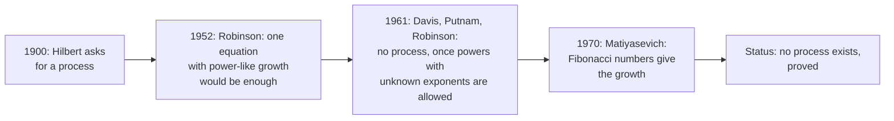

# Hilbert's and Smale's lists: the problems that shaped a century, and the ones still open

[Syllabus](../../../SYLLABUS.md) → [Frontier](../README.md) → [Algebra, Logic and Computation](../README.md#s06) → Hilbert's and Smale's lists

---

## General Overview

On 8 August 1900, at the International Congress of Mathematicians in Paris, David Hilbert presented problems for the new century. The printed version, translated in 1902, has 23. In 1998 Stephen Smale published a second list of 18, written for the next century.

Take Hilbert's tenth. It asks for a process: one fixed method that takes any polynomial equation with whole-number coefficients and decides, in finitely many steps, whether it has a whole-number solution. In 1970 Yuri Matiyasevich, then 22, completed the answer: no such process exists. The last missing piece was a fact about Fibonacci numbers.

So "solved" does not mean "answered yes". The question is settled because its answer, "no", is proved. This card reads both lists that way, marks every problem, and picks three from each that this library builds towards.

**A problem on a list is marked by the status of its answer, dated and sourced: proved (whether the answer is yes, no or "independent"), refuted, claimed or open, case by case when a problem splits; a question too vague for one answer gets a note on its kind instead of a status.**

**What kind of fact this is:** a dated status record, as of 2026-11-23. The statuses are this card's reading of the named results, not proofs. One theorem is proved here in full: Matiyasevich's Fibonacci lemma, in Why it works.

### The picture: how Hilbert's tenth got its status



Each box is a published result. The status on the right holds because every arrow is a refereed proof, checked by others since, for example in Davis's 1973 survey.

---

## The formula

The status rule comes first, because it governs every line of both lists.

- A **status** is one of four words. **Open**: no accepted proof or disproof. **Claimed**: a primary source asserts one, not yet accepted. **Proved** or **refuted**: refereed, or checked by people independent of the authors.
- A question takes its answer's status. "Is there a process?" with the answer "no", proved, is marked "no process exists: proved".
- A problem that splits into cases or readings gets one status per case. The tallies below sum such a row up as "partly", which is not a fifth status.
- A **kind note** replaces the status when the problem is a programme of work, not a yes-or-no question. Some sources call these "ill-posed". That is a remark about the question's shape, not a failure.

The mathematics behind the example is one divisibility fact. Some notation first: $`F_m`$ is the m-th **Fibonacci number** (0, 1, 1, 2, 3, 5, 8, …, each the sum of the two before it, so $`F_0 = 0`$ and $`F_1 = 1`$). The bar $`a \mid b`$ means "a divides b": b is a whole-number multiple of a.

```math
F_n^2 \mid F_m \iff n\,F_n \mid m \qquad \text{for } n \ge 3
```

**Read it aloud:** the square of the n-th Fibonacci number divides the m-th one exactly when n times the n-th Fibonacci number divides m.

The engine inside it is a remainder formula. The sign $`\equiv \pmod{N}`$ means "leaves the same remainder on division by N":

```math
F_{nk} \equiv k\,F_n\,F_{n-1}^{\,k-1} \pmod{F_n^2}
```

**Read it aloud:** the Fibonacci number at position n times k leaves the same remainder, on division by the square of $`F_n`$, as k times $`F_n`$ times $`F_{n-1}`$ to the power k − 1.

With n = 5: $`F_5 = 5`$ and $`F_4 = 3`$. For k = 3 the formula gives 3 × 5 × 9 = 135, remainder 10 on division by 25. Directly, $`F_{15} = 610`$, and 610 leaves 10 too.

| Symbol | Plain meaning | In our example | Push it up and the answer… |
| --- | --- | --- | --- |
| $`F_m`$ | the m-th Fibonacci number | $`F_{25}`$ = 75,025 | grows by a nearly fixed factor each step, like a power |
| $`n`$, $`k`$, $`m`$ | whole numbers: a position n of at least 3, a multiplier k, a position m | n = 5, k = 5, m = 25 | — |
| $`a \mid b`$ | a divides b | 25 divides 75,025 | — |
| $`\equiv \pmod{N}`$ | same remainder on division by N | 610 and 135, both 10 mod 25 | — |
| $`H(n)`$ | the Hilbert number: the most limit cycles any polynomial field of degree n can have | H(1) = 0; H(2) at least 4 | known lower bounds grow faster than $`n^2`$ |
| $`P(s)`$ | the radial factor of this card's degree-7 field | $`(1-s)(4-s)(9-s)/10`$ | each positive root adds a cycle |
| $`x`$, $`y`$, $`r`$, $`s`$ | a point's coordinates (a dash, $`x'`$, is its rate of change), its distance r from the origin, and $`s = r^2`$ | cycles at r = 1, 2, 3 | — |
| $`d(r)`$ | the return displacement: distance gained in one full turn | d(0.55) = 0.450 | its sign changes mark cycles |
| $`f(x)`$, $`x^*`$ | the quintic $`x^5 - x - 1`$ and its one real root | $`x^*`$ = 1.167303978261 | — |
| $`e_j`$ | the error of Newton's j-th guess | $`e_3`$ = 2.33 × 10⁻⁴ | the next error is about 1.92 × its square |
| $`Q`$, $`I`$ | the Fibonacci step matrix, rows (1, 1) and (1, 0), and the identity matrix | $`Q^n`$ has rows $`(F_{n+1}, F_n)`$ and $`(F_n, F_{n-1})`$ | — |
| $`\gcd(a, b)`$ | the greatest common divisor: the largest whole number dividing both | $`\gcd(F_a, F_b) = F_{\gcd(a, b)}`$, proved in Step 4's fold | — |

### When it holds

- **The lemma needs n of at least 3.** At n = 2, $`F_2 = 1`$ divides everything: it divides $`F_3 = 2`$ though 2 does not divide 3.
- **The square is the point.** Without it, $`F_n`$ divides every $`F_{nk}`$: all 3,600 pairs checked. Plain divisibility sees no growth.
- **A status carries a date.** Degree-2 fields were claimed in 1955–57 to have at most 3 limit cycles; examples with 4 appeared in 1979. A status line without a date can silently go stale.
- **The question must be exact before it gets a status.** Hilbert's sixth, "axiomatise physics", has no yes or no, so it gets a kind note.
- **"Solved" is the answer's status, never its direction.** Hilbert's tenth was settled by a no; his first, by a proof that the usual axioms cannot decide it.

---

## Why it works

### Step 0: a question inherits the status of its answer

A list problem is a question. Once an answer is proved, the question is settled, whatever the answer says. That single rule turns a famous list into a ledger: one dated line per problem, each with a status word and a source.

The second idea is the one that broke Hilbert's tenth. Equations can describe programs only if one equation can force its solutions to grow like powers. Fibonacci numbers grow like powers, and the lemma above lets a divisibility condition capture that growth.

### Step 1: mark each line of both lists

The procedure for each problem:

1. State the question exactly, in the author's words where possible.
2. Ask whether it has a yes-or-no answer. If not, write a kind note and stop.
3. Find the result that answers it, with its year and a primary source.
4. Write the answer's status: proved, refuted, claimed or open. If the problem splits into cases or readings, give each its own status.

Codes for the tallies below: **S** answered and proved, **M** partly (a summary: one case or reading settled, another open, each named in the row), **O** open, **V** kind note.

**Hilbert's 23 (1900).**

| # | The question, short | Status as of 2026-11-23 |
| --- | --- | --- |
| 1 | A size between the whole numbers and the reals? (the continuum hypothesis) | S: independent of the usual axioms, ZFC: proved, Gödel 1938 and Cohen 1963 |
| 2 | Prove arithmetic consistent | M: no proof inside arithmetic, Gödel 1931; a proof by transfinite induction, Gentzen 1936; which one Hilbert meant is debated |
| 3 | Can solids of equal volume always be cut into the same pieces? | S: no, Dehn 1900 |
| 4 | All geometries whose straight lines are shortest paths | V: too broad for one answer |
| 5 | Are continuous groups automatically smooth? | S: yes, Gleason and Montgomery–Zippin 1952 |
| 6 | Axiomatise physics | V: a programme; probability was axiomatised by Kolmogorov in 1933 |
| 7 | Is $`a^b`$ transcendental (a root of no polynomial) for algebraic a ≠ 0, 1 and irrational algebraic b? | S: yes, Gelfond and Schneider 1934 |
| 8 | The Riemann hypothesis, Goldbach, twin primes | M: the Riemann hypothesis, proved 2026-11-21 by a formal proof certified by others ([The Riemann hypothesis](../02-The%20Millennium%20Problems/01-riemann-hypothesis.md)); Goldbach and twin primes, open |
| 9 | The most general reciprocity law | M: abelian case, Artin 1927; beyond, open |
| 10 | A process to decide whole-number solvability | S: no process exists, Matiyasevich 1970 |
| 11 | Quadratic forms over number fields | M: over the fields, Hasse 1923; over their whole numbers, partly open |
| 12 | Extend the Kronecker–Weber theorem to every number field | M: imaginary quadratic fields, by complex multiplication; in general, open |
| 13 | Solve the degree-7 equation with functions of two variables | M: continuous version, yes, Kolmogorov and Arnold 1957; algebraic version, open |
| 14 | Are rings of invariants always finitely generated? | S: no, Nagata 1959 |
| 15 | Make Schubert's counting calculus rigorous | V: a programme, largely carried out |
| 16 | Ovals of real curves; limit cycles of polynomial fields | O: both halves open in general; for curves, degree 6 was settled by Gudkov in 1969; the limit-cycle half, the one Smale repeated, is open even for degree 2 |
| 17 | Is every nonnegative polynomial a sum of squares of fractions? | S: yes, Artin 1927 |
| 18 | Crystal groups; space-filling tiles; densest sphere packing | S: Bieberbach 1911, Reinhardt 1928, Hales 2005 |
| 19 | Are solutions of regular variational problems analytic? | S: yes, De Giorgi 1957 and Nash 1958 |
| 20 | Do boundary-value problems always have solutions? | V: answered by widening "solution"; no single yes or no |
| 21 | Linear differential equations with given monodromy | S: no in general, Bolibrukh 1989 |
| 22 | Uniformise analytic curves | S: yes, Koebe and Poincaré 1907 |
| 23 | Develop the calculus of variations | V: a programme |

**Smale's 18 (1998).**

| # | The question, short | Status as of 2026-11-23 |
| --- | --- | --- |
| 1 | The Riemann hypothesis | S: proved 2026-11-21, by a formal proof certified by others; no refereed paper yet, and Clay still says "Active" (part of Hilbert's 8th) |
| 2 | The Poincaré conjecture | S: proved, Perelman 2002–03; Clay prize awarded 2010, declined ([The Poincare conjecture, solved](../02-The%20Millennium%20Problems/07-poincare-conjecture-solved.md)) |
| 3 | P versus NP | O |
| 4 | Integer zeros of a polynomial (the tau conjecture) | O |
| 5 | Height bounds for Diophantine curves | O |
| 6 | Finitely many relative equilibria in the n-body problem? | M: 4 bodies, Hampton and Moeckel 2006; general, open |
| 7 | Spreading points evenly on the sphere | O |
| 8 | Dynamics in economic theory | V: a programme |
| 9 | Linear programming in strongly polynomial time | O |
| 10 | Pugh's closing lemma for smooth maps | M: Hamiltonian surface maps, Asaoka and Irie 2016; all area-preserving surface maps, 2021–22; general, open |
| 11 | Is one-dimensional dynamics generically hyperbolic? | M: the stated question, for complex polynomials, open even at degree 2; Smale's parallel real question, proved for the real quadratic family, 1997 |
| 12 | Centralisers of diffeomorphisms | M: the $`C^1`$ case (once continuously differentiable maps), Bonatti, Crovisier and Wilkinson 2009; smoother, open |
| 13 | Hilbert's 16th, limit-cycle half | O |
| 14 | Is the Lorenz attractor a strange attractor? | S: yes, Tucker 2002, computer-assisted |
| 15 | Navier–Stokes | O: Clay's versions A and B, without a driving force, open; versions C and D, with one, claimed in September 2026 and unrefereed (see the picks below) |
| 16 | The Jacobian conjecture | M: refuted for three or more variables, 2026-07, by a counterexample with an independent formal proof; two variables, open ([The Jacobian conjecture](../05-Analysis%20and%20Dynamics/04-jacobian-conjecture.md)) |
| 17 | Approximate roots of polynomial systems in average polynomial time | S: yes, Beltrán and Pardo 2009, Lairez 2017 |
| 18 | Limits of intelligence | V: a programme |

The rows other than the six picks below name a result and a year as leads. Their primary sources are not audited on this card.

### Step 2: the tally, and the three picks from each list

```
Hilbert, 23   proved   ########### 11
              partly   ######       6
              open     #            1
              note     #####        5
Smale, 18     proved   ####         4
              partly   #####        5
              open     #######      7
              note     ##           2
```

Two problems sit on both lists: Smale 1, the Riemann hypothesis, is part of Hilbert 8, and Hilbert 16 is Smale 13. After 126 years, 11 of Hilbert's 23 are settled outright. After 28 years, 4 of Smale's 18 are, the Riemann hypothesis since 2026-11-21, and a fifth, the Jacobian conjecture, is refuted for three or more variables (2026-07) and open for two.

The picks are the problems this library's earlier wings lead straight to:

- **Hilbert 8**, the Riemann hypothesis: proved, 2026-11-21, by a formal proof certified by others; Goldbach and twin primes, the rest of Hilbert 8, are open. Stated on wing 21's [The Riemann hypothesis](../../21-Algebraic%20and%20analytic%20number%20theory/02-The%20Zeta%20Function%20and%20the%20Prime%20Number%20Theorem/09-riemann-hypothesis-statement-and-equivalents.md); its dated status is on this wing's [The Riemann hypothesis](../02-The%20Millennium%20Problems/01-riemann-hypothesis.md).
- **Hilbert 10**, the example: no process exists, proved 1970.
- **Hilbert 16**, limit cycles: open, even for degree 2.
- **Smale 3**, P versus NP: open. The statement and the barriers are on wing 24's [P versus NP](../../24-Computability%20and%20complexity/04-Beyond%20Worst%20Case/08-p-versus-np-what-is-known.md); its dated status is on this wing's [P versus NP](../02-The%20Millennium%20Problems/03-p-versus-np.md).
- **Smale 15**, Navier–Stokes: open as of 2026-11-23. A September 2026 claim of forced blow-up, for Clay's versions C and D, is unrefereed ([The September 2026 Navier-Stokes claim](../05-Analysis%20and%20Dynamics/01-navier-stokes-blow-up-claim-2026.md)). The dated status is on [Navier-Stokes](../02-The%20Millennium%20Problems/04-navier-stokes-existence-and-smoothness.md); the gap is on [The energy inequality, and the gap it leaves in three dimensions](../../19-Partial%20differential%20equations/07-Nonlinear%20PDE%20and%20Fluids/03-energy-inequality-and-the-regularity-question.md).
- **Smale 17**, polynomial roots on average: proved, 2009 randomised and 2017 deterministic.

### Step 3: Hilbert's tenth, the route to "no"

[Hilbert's tenth problem](../../24-Computability%20and%20complexity/02-Computability%20and%20Logic/04-hilberts-tenth-problem.md) proves the answer: a test for equations would decide whether programs stop, which no program can do. It takes Pell's equation for the growth step. Matiyasevich's own 1970 route used Fibonacci numbers, and that step is new here.

The missing piece in 1961 was one equation whose solutions grow like powers, but not faster. Julia Robinson had shown in 1952 that such an equation would be enough. Fibonacci numbers can enter an equation at all because of one classical identity: whole numbers 0 ≤ a ≤ b are neighbouring Fibonacci numbers exactly when $`(b^2 - ab - a^2)^2 = 1`$. The code finds the 16 solutions with b up to 1,000, and each is a neighbouring pair. The lemma supplies the growth: if $`F_n^2`$ divides $`F_m`$, then m is a multiple of $`n F_n`$. At n = 20 that forces m to be a multiple of 135,300. A polynomial condition, "this divides that", has forced a number exponentially larger than n.

The status of the remaining question is also recorded. Over the numbers 0, 1, 2, …: one unknown is decidable (test the divisors of the constant term); nine unknowns are enough for undecidability (Matiyasevich, written up by Jones in 1982); for two to eight unknowns it is open.

### Step 4: prove the remainder formula

The Fibonacci step $`F_{m+1} = F_m + F_{m-1}`$ is a 2-by-2 matrix multiply. Raising that matrix to the power n gives a sum of two pieces, one carrying a factor $`F_n`$.

Raise that sum to the power k with the binomial theorem. Every term with two or more factors of $`F_n`$ is a multiple of $`F_n^2`$, so it leaves no remainder. Only two terms survive, and reading off one matrix entry gives the formula.

<details>
<summary>Detailed proof: the remainder formula, and the lemma from it</summary>

Let Q be the matrix with rows (1, 1) and (1, 0). By induction its n-th power has rows $`(F_{n+1}, F_n)`$ and $`(F_n, F_{n-1})`$. So, with I the identity matrix:

$`\displaystyle Q^n = F_{n-1}\, I + F_n\, Q`$

The two pieces commute. The binomial theorem gives:

$`\displaystyle Q^{nk} = \sum_{i=0}^{k} \binom{k}{i} F_{n-1}^{\,k-i} F_n^{\,i} Q^i \equiv F_{n-1}^{\,k} I + k\,F_{n-1}^{\,k-1} F_n\, Q \pmod{F_n^2}`$

The top-right entry of $`Q^{nk}`$ is $`F_{nk}`$; that of I is 0 and that of Q is 1. So $`F_{nk} \equiv k F_n F_{n-1}^{k-1}`$ modulo $`F_n^2`$.

Hence $`F_n^2`$ divides $`F_{nk}`$ exactly when $`F_n`$ divides $`k F_{n-1}^{k-1}`$. Neighbouring Fibonacci numbers share no factor, since Euclid's algorithm on them steps down to $`F_1 = 1`$. So this happens exactly when $`F_n`$ divides k.

For the first form, use the classical fact $`\gcd(F_a, F_b) = F_{\gcd(a, b)}`$, which the matrices also prove. The top-right entry of $`Q^{a+b} = Q^a Q^b`$ gives $`F_{a+b} = F_{a+1} F_b + F_a F_{b-1}`$. So $`\gcd(F_{a+b}, F_b) = \gcd(F_a F_{b-1}, F_b) = \gcd(F_a, F_b)`$, because $`F_{b-1}`$ and $`F_b`$ share no factor. Taking one index from the other leaves the gcd unchanged, as in Euclid's algorithm on a and b, which ends at $`\gcd(F_{\gcd(a, b)}, F_0) = F_{\gcd(a, b)}`$. For n of at least 3 it makes $`F_n \mid F_m`$ equivalent to $`n \mid m`$. So $`F_n^2 \mid F_m`$ forces m = nk, and then $`F_n \mid k`$: together, $`n F_n \mid m`$.

</details>

### Step 5: Hilbert's 16th in miniature

A **limit cycle** is a closed loop that nearby paths spiral onto or away from ([Limit cycles](../../08-Differential%20equations%20and%20dynamics/06-Nonlinear%20Dynamics%20in%20the%20Plane/08-limit-cycles-and-van-der-pol.md)). Hilbert asked how many a polynomial field of degree n can have. That maximum is H(n).

This card's field turns at a steady rate and pushes outward by $`r\,P(r^2)`$:

```math
x' = -y + x\,P(x^2 + y^2), \qquad y' = x + y\,P(x^2 + y^2), \qquad P(s) = \tfrac{1}{10}(1-s)(4-s)(9-s)
```

It has degree 7. Between r = 0.55 and r = 1.45, paths cross both rims into the ring and there is no rest point inside. [Poincare-Bendixson](../../08-Differential%20equations%20and%20dynamics/06-Nonlinear%20Dynamics%20in%20the%20Plane/09-poincare-bendixson-and-bendixsons-criterion.md) then guarantees a loop in that ring. The code finds all three loops without the formula, from sign changes of the return displacement d(r).

What is known, from Ilyashenko's 2002 survey:

- **Each single field has finitely many limit cycles.** Dulac claimed this in 1923; a gap was found in the 1980s; Ilyashenko (1991) and Écalle (1992) proved it independently.
- **H(1) = 0.** Linear fields have no isolated loops.
- **Degree 2 has at least 4.** Petrovskii and Landis claimed at most 3 in 1955–57. Chen and Wang (1979) and Shi (1980) built examples with 4.
- **Open:** whether H(2) is finite at all.

### Step 6: Smale's 17th in miniature

[Newton's method](../../06-Calculus%20and%20analysis/03-What%20Derivatives%20Tell%20You/06-newtons-method.md) improves a guess x to $`x - f(x)/f'(x)`$. Near a simple root (one where the slope $`f'`$ is not zero) the error roughly squares each step, with $`f''`$ the second derivative and $`x^*`$ the root: the next error is about $`f''(x^*)/(2f'(x^*))`$ times the square of this one.

The quintic $`x^5 - x - 1`$ has no formula in radicals, the shelf's house example. Newton from 1 reaches 12 correct digits in 5 steps. Newton from 0 never arrives: it falls into a repeating loop of three points.

Smale called a start an **approximate zero** when Newton converges quadratically from it at once. His 17th asks for an algorithm that finds one, for a random system of n equations, in time polynomial in the input size on average. **Homotopy continuation**, which slides from a system with known roots to the target, supplies such starts. Beltrán and Pardo did it with a random algorithm in 2009; Lairez removed the randomness in 2017.

---

## Worked numbers, by hand

The Fibonacci lemma at n = 5, where $`F_5 = 5`$, $`F_5^2 = 25`$ and $`F_4 = 3`$.

| Step | Arithmetic | Value |
| --- | --- | --- |
| k = 1 | $`F_5`$ = 5; formula 1 × 5 × 1 = 5 | remainder 5 |
| k = 2 | $`F_{10}`$ = 55; formula 2 × 5 × 3 = 30 | remainder 5 |
| k = 3 | $`F_{15}`$ = 610; formula 3 × 5 × 9 = 135 | remainder 10 |
| k = 4 | $`F_{20}`$ = 6,765; formula 4 × 5 × 27 = 540 | remainder 15 |
| k = 5 | $`F_{25}`$ = 75,025 = 3,001 × 25; formula 5 × 5 × 81 = 2,025 | **remainder 0** |
| the rule | 25 divides $`F_m`$ exactly when n × $`F_5`$ = 25 divides m | first at m = 25 |

The square of $`F_5`$ first divides at position 25: divisibility by $`F_n^2`$ pins the position to a multiple of $`n F_n`$, which grows like a power.

### What breaks if you drop a piece

| Mistake | Comes out at | What went wrong |
| --- | --- | --- |
| Drop the square: test $`F_n \mid F_{nk}`$ | true for 3,600 of 3,600 pairs | Plain divisibility holds for every k, so it sees no growth |
| Use n = 2 in "$`F_n`$ divides $`F_m`$ exactly when n divides m" | $`F_2`$ = 1 divides $`F_3`$ = 2, though 2 does not divide 3 | The rule needs n of at least 3 |
| Sample the return map at r = 0.55, 2.65, 3.55 only | 1 sign change, so 1 cycle, not 3 | The pair at r = 1 and 2 cancels between samples |
| Start Newton at 0 | no convergence in 1,000 steps; a loop through −1.0003, −0.7503, 0.0834 | 0 is not an approximate zero |

The third row is an analogy: cycles that come in close pairs are easy to miss, as the 1955–57 claim did, though there the cause was a gap in the proof.

---

## Code, from first principles, and it actually runs

The code first keeps the ledger. Each list's statuses are typed twice, row by row and as problem numbers under each status, so a slip in either copy stops the run; then it tallies them and checks the six picks against them. That is bookkeeping, not a road to a result. The computations follow, each against a second road. It lists every solution of $`(b^2 - ab - a^2)^2 = 1`$ with b up to 1,000 and compares them with the neighbouring Fibonacci pairs. For 3 ≤ n ≤ 20 and 1 ≤ k ≤ 200 it checks that the remainder formula gives the true remainder, then tests the lemma three ways: the remainder itself, the formula, and the rule "$`F_n`$ divides k". It integrates the degree-7 field by the Runge–Kutta method, written out, and compares the cycles found against the exact radii 1, 2, 3. It runs Newton on the quintic against a bisection root, and checks the squared-error ratio against $`f''(x^*)/(2f'(x^*))`$.

### Python

```python
# Hilbert's and Smale's lists -- the check behind the card.  Standard library only.
# The ledger: both lists' statuses, typed twice (row by row, and as problem numbers
# under each status) and cross-checked, then tallied.  Then three computations, each
# against a second road: Matiyasevich's 1970 Fibonacci lemma, by direct remainders and
# by the card's formula; limit cycles of a degree-7 field, by a computed return map
# against the exact radii; Newton's method on x^5 - x - 1 against bisection.
import math
HIL = "SMSVSVSMMSMMMSVOSSSVSSV"   # S answered: proved, M partly, O open, V kind note
SMA = "SSOOOMOVOMMMOSOMSV"
BY_STATUS = {"hilbert": ("1 3 5 7 10 14 17 18 19 21 22", "2 8 9 11 12 13", "16", "4 6 15 20 23"),
             "smale": ("1 2 14 17", "6 10 11 12 16", "3 4 5 7 9 13 15", "8 18")}   # typed again, by status
PICKS = [("Hilbert 8", "M", "Riemann hypothesis, Goldbach, twin primes", "RH proved 2026-11-21; Goldbach, twin primes open"),
         ("Hilbert 10", "S", "a test for whole-number solutions", "no test exists: proved 1970"),
         ("Hilbert 16", "O", "most limit cycles at degree n", "open; degree 2 has at least 4, 1979"),
         ("Smale 3", "O", "P versus NP", "open"),
         ("Smale 15", "O", "Navier-Stokes smooth for all time", "open; a 2026-09 forced blow-up claim is unrefereed"),
         ("Smale 17", "S", "polynomial roots fast on average", "proved: randomised 2009, deterministic 2017")]
for name, codes in (("hilbert", HIL), ("smale", SMA)):
    t = [codes.count(c) for c in "SMOV"]
    print(f"{name:<7} 1-{len(codes)}: {' '.join(codes)}")
    print(f"{name:<7} tally: proved {t[0]}, partly {t[1]}, open {t[2]}, kind note {t[3]}, total {sum(t)}")
    rows = [" ".join(str(i + 1) for i, x in enumerate(codes) if x == c) for c in "SMOV"]
    assert sum(t) == len(codes) and tuple(rows) == BY_STATUS[name]   # the two typings agree
print("on both lists: Hilbert 8 includes Smale 1 (Riemann), Hilbert 16 = Smale 13 (limit cycles)")
assert (HIL[7], SMA[0]) == ("M", "S") and HIL[15] == SMA[12]   # Smale 1 is the settled part of Hilbert 8
for name, code, what, status in PICKS:
    lst, num = name.split()
    assert (HIL if lst == "Hilbert" else SMA)[int(num) - 1] == code   # lines match ledger
    print(f"{name:<11}{what:<43}{status}")
print("unknowns over 0,1,2,...: 1 decidable; 9 undecidable; 2 to 8 open")

def fib(m):                                   # exact Fibonacci number F_m
    a, b = 0, 1
    for _ in range(m): a, b = b, a + b
    return a
sols = [(a, b) for b in range(1, 1001) for a in range(b + 1) if (b * b - a * b - a * a) ** 2 == 1]
nbr = [(fib(k), fib(k + 1)) for k in range(30) if fib(k + 1) <= 1000]
print(f"(b^2 - ab - a^2)^2 = 1 with 0 <= a <= b <= 1000: {len(sols)} solutions, (F_k, F_k+1) for k = 0..{len(nbr) - 1}")
assert sols == nbr                            # neighbouring Fibonacci pairs, and nothing else
print("F_5k for k = 1..5:", " ".join(str(fib(5 * k)) for k in range(1, 6)),
      "| remainders mod 25:", " ".join(str(fib(5 * k) % 25) for k in range(1, 6)))
form = [k * 5 * 3 ** (k - 1) for k in range(1, 6)]
print("formula k F_5 F_4^(k-1):", " ".join(map(str, form)), "| mod 25:", " ".join(str(v % 25) for v in form),
      f"| F_25 = 25 x {fib(25) // 25}")
N_MAX, K_MAX = 20, 200
road1 = road2 = rule = plain = 0
for n in range(3, N_MAX + 1):
    fn, fm1 = fib(n), fib(n - 1)
    sq, a, b = fn * fn, 0, 1                  # F_m mod F_n^2, stepping m upward
    for m in range(1, n * K_MAX + 1):
        a, b = b, (a + b) % sq
        if m % n: continue
        k = m // n
        d1 = a == 0                           # road 1: the remainder itself
        rem = k * fn * pow(fm1, k - 1, sq) % sq   # road 2: the card's formula
        d2 = rem == 0
        d3 = k % fn == 0                      # the rule: F_n divides k
        assert rem == a and d1 == d2 == d3   # formula = true remainder
        road1 += d1; road2 += d2; rule += d3; plain += a % fn == 0
pairs = (N_MAX - 2) * K_MAX
print(f"pairs 3 <= n <= {N_MAX}, 1 <= k <= {K_MAX}: {pairs}; F_n^2 | F_nk in {road1} (remainder), "
      f"{road2} (formula), {rule} (F_n | k)")
print(f"square dropped: F_n | F_nk in {plain} of {pairs}")
print(f"n = 2: F_2 = {fib(2)} divides F_3 = {fib(3)}, but 2 does not divide 3")
print(f"n = {N_MAX}: F_n = {fib(N_MAX)}, so F_n^2 | F_m forces m to be a multiple of {N_MAX * fib(N_MAX)}")
assert rule == sum(K_MAX // fib(n) for n in range(3, N_MAX + 1)) and plain == pairs
assert fib(25) == 25 * 3001 and fib(2) == 1

TWO_PI = 6.283185307179586
def P(s): return (1 - s) * (4 - s) * (9 - s) / 10
def field(x, y):
    p = P(x * x + y * y)
    return -y + x * p, x + y * p
def turn(r0, steps=2000):                     # one full turn: theta' = 1, time 2 pi
    x, y, h = r0, 0.0, TWO_PI / steps
    for _ in range(steps):                    # classical Runge-Kutta, written out
        k1 = field(x, y)
        k2 = field(x + h / 2 * k1[0], y + h / 2 * k1[1])
        k3 = field(x + h / 2 * k2[0], y + h / 2 * k2[1])
        k4 = field(x + h * k3[0], y + h * k3[1])
        x += h / 6 * (k1[0] + 2 * k2[0] + 2 * k3[0] + k4[0])
        y += h / 6 * (k1[1] + 2 * k2[1] + 2 * k3[1] + k4[1])
    return math.sqrt(x * x + y * y) - r0     # return-map displacement d(r0)
grid = [0.55 + 0.3 * i for i in range(11)]
d = [turn(r) for r in grid]
print("r on the ray:", " ".join(f"{r:.2f}" for r in grid))
print("d(r) after one turn:", " ".join(f"{v:.3f}" for v in d))
cycles = []
for i in range(len(grid) - 1):
    if (d[i] > 0) != (d[i + 1] > 0):          # a sign change: a cycle in between
        lo, hi = grid[i], grid[i + 1]
        for _ in range(40):
            mid = (lo + hi) / 2
            if (turn(mid) > 0) == (d[i] > 0): lo = mid
            else: hi = mid
        cycles.append(((lo + hi) / 2, "stable" if d[i] > 0 else "unstable"))
print("degree-7 field, cycles found:", "; ".join(f"r = {r:.6f} {s}" for r, s in cycles))
coarse = [turn(r) > 0 for r in (0.55, 2.65, 3.55)]
print("coarse ray r = 0.55, 2.65, 3.55: sign changes", sum(coarse[i] != coarse[i + 1] for i in range(2)))
assert len(cycles) == 3 and all(abs(r - (j + 1)) < 1e-6 for j, (r, _) in enumerate(cycles))

def sci(v):                                   # 3 significant digits, same in Rust
    e = 0
    while v < 1: v, e = v * 10, e - 1
    return f"{v:.2f}e{e}"
f = lambda x: x * x * x * x * x - x - 1
lo, hi = 1.0, 2.0
for _ in range(60):                           # bisection: f(1) < 0 < f(2)
    mid = (lo + hi) / 2
    if f(mid) < 0: lo = mid
    else: hi = mid
root = lo
def newton(x, tol=1e-12):
    errs = [abs(x - root)]
    while errs[-1] > tol and len(errs) <= 1000:
        x -= f(x) / (5 * x * x * x * x - 1)
        errs.append(abs(x - root))
    return errs, x
e, _ = newton(1.0)
c = 10 * root * root * root / (5 * root * root * root * root - 1)   # f''/(2 f') at the root
print(f"x^5 - x - 1: root by bisection {root:.12f}")
print("Newton from 1, errors:", " ".join(sci(v) for v in e[:5]))
print(f"e4 / e3^2 = {e[4] / (e[3] * e[3]):.4f}, predicted f''/(2f') = {c:.4f}")
z, x = newton(0.0)
loop = [x]
while len(loop) < 10 and (len(loop) < 2 or abs(loop[-1] - loop[0]) > 1e-9):
    loop.append(loop[-1] - f(loop[-1]) / (5 * loop[-1] * loop[-1] * loop[-1] * loop[-1] - 1))
print(f"steps to 1e-12: from 1, {len(e) - 1}; from 0, none in {len(z) - 1}: it repeats",
      " ".join(f"{v:.4f}" for v in loop[:-1]))
assert abs(f(root)) < 1e-12 and abs(e[4] / (e[3] * e[3]) - c) < 0.02 * c and len(loop) == 4
print("ALL CHECKS PASS")
```

**Ran 2026-11-23 on macOS, Python 3.14.10, standard library only. All checks passed. Output, pasted from the run:**

```
hilbert 1-23: S M S V S V S M M S M M M S V O S S S V S S V
hilbert tally: proved 11, partly 6, open 1, kind note 5, total 23
smale   1-18: S S O O O M O V O M M M O S O M S V
smale   tally: proved 4, partly 5, open 7, kind note 2, total 18
on both lists: Hilbert 8 includes Smale 1 (Riemann), Hilbert 16 = Smale 13 (limit cycles)
Hilbert 8  Riemann hypothesis, Goldbach, twin primes  RH proved 2026-11-21; Goldbach, twin primes open
Hilbert 10 a test for whole-number solutions          no test exists: proved 1970
Hilbert 16 most limit cycles at degree n              open; degree 2 has at least 4, 1979
Smale 3    P versus NP                                open
Smale 15   Navier-Stokes smooth for all time          open; a 2026-09 forced blow-up claim is unrefereed
Smale 17   polynomial roots fast on average           proved: randomised 2009, deterministic 2017
unknowns over 0,1,2,...: 1 decidable; 9 undecidable; 2 to 8 open
(b^2 - ab - a^2)^2 = 1 with 0 <= a <= b <= 1000: 16 solutions, (F_k, F_k+1) for k = 0..15
F_5k for k = 1..5: 5 55 610 6765 75025 | remainders mod 25: 5 5 10 15 0
formula k F_5 F_4^(k-1): 5 30 135 540 2025 | mod 25: 5 5 10 15 0 | F_25 = 25 x 3001
pairs 3 <= n <= 20, 1 <= k <= 200: 3600; F_n^2 | F_nk in 266 (remainder), 266 (formula), 266 (F_n | k)
square dropped: F_n | F_nk in 3600 of 3600
n = 2: F_2 = 1 divides F_3 = 2, but 2 does not divide 3
n = 20: F_n = 6765, so F_n^2 | F_m forces m to be a multiple of 135300
r on the ray: 0.55 0.85 1.15 1.45 1.75 2.05 2.35 2.65 2.95 3.25 3.55
d(r) after one turn: 0.450 0.150 -0.150 -0.450 -0.750 0.950 0.650 0.350 0.050 -0.250 -0.550
degree-7 field, cycles found: r = 1.000000 stable; r = 2.000000 unstable; r = 3.000000 stable
coarse ray r = 0.55, 2.65, 3.55: sign changes 1
x^5 - x - 1: root by bisection 1.167303978261
Newton from 1, errors: 1.67e-1 8.27e-2 1.12e-2 2.33e-4 1.05e-7
e4 / e3^2 = 1.9192, predicted f''/(2f') = 1.9202
steps to 1e-12: from 1, 5; from 0, none in 1000: it repeats -1.0003 -0.7503 0.0834
ALL CHECKS PASS
```

### Rust

Same numbers, same labels, built with `rustc --edition 2021 -O`.

```rust
// Hilbert's and Smale's lists -- the same check as the Python, in Rust.  No crates.
// The ledger: both lists' statuses, typed twice (row by row, and as problem numbers
// under each status) and cross-checked, then tallied.  Then three computations, each
// against a second road: Matiyasevich's 1970 Fibonacci lemma, by direct remainders and
// by the card's formula; limit cycles of a degree-7 field, by a computed return map
// against the exact radii; Newton's method on x^5 - x - 1 against bisection.
const HIL: &str = "SMSVSVSMMSMMMSVOSSSVSSV"; // S answered: proved, M partly, O open, V kind note
const SMA: &str = "SSOOOMOVOMMMOSOMSV";
const BY_STATUS: [[&str; 4]; 2] = [["1 3 5 7 10 14 17 18 19 21 22", "2 8 9 11 12 13", "16", "4 6 15 20 23"],
                                   ["1 2 14 17", "6 10 11 12 16", "3 4 5 7 9 13 15", "8 18"]]; // typed again, by status
const PICKS: [(&str, char, &str, &str); 6] = [
    ("Hilbert 8", 'M', "Riemann hypothesis, Goldbach, twin primes", "RH proved 2026-11-21; Goldbach, twin primes open"),
    ("Hilbert 10", 'S', "a test for whole-number solutions", "no test exists: proved 1970"),
    ("Hilbert 16", 'O', "most limit cycles at degree n", "open; degree 2 has at least 4, 1979"),
    ("Smale 3", 'O', "P versus NP", "open"),
    ("Smale 15", 'O', "Navier-Stokes smooth for all time", "open; a 2026-09 forced blow-up claim is unrefereed"),
    ("Smale 17", 'S', "polynomial roots fast on average", "proved: randomised 2009, deterministic 2017")];
const TWO_PI: f64 = 6.283185307179586;

fn fib(m: u64) -> u64 { let (mut a, mut b) = (0u64, 1u64); for _ in 0..m { let t = a + b; a = b; b = t; } a }
fn pow_mod(mut b: u64, mut e: u64, m: u64) -> u64 {
    let mut r = 1 % m; b %= m;
    while e > 0 { if e & 1 == 1 { r = r * b % m; } b = b * b % m; e >>= 1; }
    r
}
fn p_of(s: f64) -> f64 { (1.0 - s) * (4.0 - s) * (9.0 - s) / 10.0 }
fn field(x: f64, y: f64) -> (f64, f64) { let p = p_of(x * x + y * y); (-y + x * p, x + y * p) }
fn turn(r0: f64) -> f64 {                       // one full turn: theta' = 1, time 2 pi
    let steps = 2000;
    let (mut x, mut y, h) = (r0, 0.0f64, TWO_PI / steps as f64);
    for _ in 0..steps {                         // classical Runge-Kutta, written out
        let k1 = field(x, y);
        let k2 = field(x + h / 2.0 * k1.0, y + h / 2.0 * k1.1);
        let k3 = field(x + h / 2.0 * k2.0, y + h / 2.0 * k2.1);
        let k4 = field(x + h * k3.0, y + h * k3.1);
        x += h / 6.0 * (k1.0 + 2.0 * k2.0 + 2.0 * k3.0 + k4.0);
        y += h / 6.0 * (k1.1 + 2.0 * k2.1 + 2.0 * k3.1 + k4.1);
    }
    (x * x + y * y).sqrt() - r0                 // return-map displacement d(r0)
}
fn sci(mut v: f64) -> String {                  // 3 significant digits, same as Python
    let mut e = 0;
    while v < 1.0 { v *= 10.0; e -= 1; }
    format!("{:.2}e{}", v, e)
}
fn f(x: f64) -> f64 { x * x * x * x * x - x - 1.0 }
fn step(x: f64) -> f64 { x - f(x) / (5.0 * x * x * x * x - 1.0) }
fn newton(mut x: f64, root: f64) -> (Vec<f64>, f64) {
    let mut errs = vec![(x - root).abs()];
    while errs[errs.len() - 1] > 1e-12 && errs.len() <= 1000 { x = step(x); errs.push((x - root).abs()); }
    (errs, x)
}
fn join<T: std::fmt::Display>(v: &[T]) -> String { v.iter().map(|t| t.to_string()).collect::<Vec<_>>().join(" ") }

fn main() {
    for (li, (name, codes)) in [("hilbert", HIL), ("smale", SMA)].into_iter().enumerate() {
        let t: Vec<usize> = "SMOV".chars().map(|c| codes.chars().filter(|&x| x == c).count()).collect();
        let spaced: Vec<String> = codes.chars().map(|c| c.to_string()).collect();
        println!("{:<7} 1-{}: {}", name, codes.len(), spaced.join(" "));
        println!("{:<7} tally: proved {}, partly {}, open {}, kind note {}, total {}",
                 name, t[0], t[1], t[2], t[3], t.iter().sum::<usize>());
        let rows: Vec<String> = "SMOV".chars().map(|c| codes.chars().enumerate().filter(|&(_, x)| x == c)
            .map(|(i, _)| (i + 1).to_string()).collect::<Vec<_>>().join(" ")).collect();
        assert!(t.iter().sum::<usize>() == codes.len() && rows == BY_STATUS[li]); // the two typings agree
    }
    println!("on both lists: Hilbert 8 includes Smale 1 (Riemann), Hilbert 16 = Smale 13 (limit cycles)");
    let (h, s): (Vec<char>, Vec<char>) = (HIL.chars().collect(), SMA.chars().collect());
    assert!(h[7] == 'M' && s[0] == 'S' && h[15] == s[12]); // Smale 1 is the settled part of Hilbert 8
    for (name, code, what, status) in PICKS {
        let mut parts = name.split(' ');
        let (lst, num) = (parts.next().unwrap(), parts.next().unwrap().parse::<usize>().unwrap());
        assert!((if lst == "Hilbert" { &h } else { &s })[num - 1] == code); // lines match ledger
        println!("{:<11}{:<43}{}", name, what, status);
    }
    println!("unknowns over 0,1,2,...: 1 decidable; 9 undecidable; 2 to 8 open");
    let sols: Vec<(u64, u64)> = (1..=1000u64).flat_map(|b| (0..=b).map(move |a| (a, b)))
        .filter(|&(a, b)| (b * b + 1 == a * b + a * a) || (b * b == a * b + a * a + 1)).collect();
    let nbr: Vec<(u64, u64)> = (0..30).filter(|&k| fib(k + 1) <= 1000).map(|k| (fib(k), fib(k + 1))).collect();
    println!("(b^2 - ab - a^2)^2 = 1 with 0 <= a <= b <= 1000: {} solutions, (F_k, F_k+1) for k = 0..{}", sols.len(), nbr.len() - 1);
    assert!(sols == nbr);                       // neighbouring Fibonacci pairs, and nothing else

    let f5: Vec<u64> = (1..=5).map(|k| fib(5 * k)).collect();
    let r5: Vec<u64> = f5.iter().map(|v| v % 25).collect();
    println!("F_5k for k = 1..5: {} | remainders mod 25: {}", join(&f5), join(&r5));
    let form: Vec<u64> = (1..=5u64).map(|k| k * 5 * 3u64.pow(k as u32 - 1)).collect();
    let fm: Vec<u64> = form.iter().map(|v| v % 25).collect();
    println!("formula k F_5 F_4^(k-1): {} | mod 25: {} | F_25 = 25 x {}", join(&form), join(&fm), fib(25) / 25);
    let (n_max, k_max) = (20u64, 200u64);
    let (mut road1, mut road2, mut rule, mut plain) = (0u64, 0u64, 0u64, 0u64);
    for n in 3..=n_max {
        let (fn_, fm1) = (fib(n), fib(n - 1));
        let sq = fn_ * fn_;
        let (mut a, mut b) = (0u64, 1u64);       // F_m mod F_n^2, stepping m upward
        for m in 1..=n * k_max {
            let t = (a + b) % sq; a = b; b = t;
            if m % n != 0 { continue; }
            let k = m / n;
            let d1 = a == 0;                     // road 1: the remainder itself
            let rem = k * fn_ % sq * pow_mod(fm1, k - 1, sq) % sq; // road 2: the formula
            let d2 = rem == 0;
            let d3 = k % fn_ == 0;               // the rule: F_n divides k
            assert!(rem == a && d1 == d2 && d2 == d3); // formula = true remainder
            road1 += d1 as u64; road2 += d2 as u64; rule += d3 as u64; plain += (a % fn_ == 0) as u64;
        }
    }
    let pairs = (n_max - 2) * k_max;
    println!("pairs 3 <= n <= {}, 1 <= k <= {}: {}; F_n^2 | F_nk in {} (remainder), {} (formula), {} (F_n | k)",
             n_max, k_max, pairs, road1, road2, rule);
    println!("square dropped: F_n | F_nk in {} of {}", plain, pairs);
    println!("n = 2: F_2 = {} divides F_3 = {}, but 2 does not divide 3", fib(2), fib(3));
    println!("n = {}: F_n = {}, so F_n^2 | F_m forces m to be a multiple of {}", n_max, fib(n_max), n_max * fib(n_max));
    assert!(rule == (3..=n_max).map(|n| k_max / fib(n)).sum::<u64>() && plain == pairs);
    assert!(fib(25) == 25 * 3001 && fib(2) == 1);

    let grid: Vec<f64> = (0..11).map(|i| 0.55 + 0.3 * i as f64).collect();
    let d: Vec<f64> = grid.iter().map(|&r| turn(r)).collect();
    println!("r on the ray: {}", grid.iter().map(|r| format!("{:.2}", r)).collect::<Vec<_>>().join(" "));
    println!("d(r) after one turn: {}", d.iter().map(|v| format!("{:.3}", v)).collect::<Vec<_>>().join(" "));
    let mut cycles: Vec<(f64, &str)> = vec![];
    for i in 0..grid.len() - 1 {
        if (d[i] > 0.0) != (d[i + 1] > 0.0) {   // a sign change: a cycle in between
            let (mut lo, mut hi) = (grid[i], grid[i + 1]);
            for _ in 0..40 {
                let mid = (lo + hi) / 2.0;
                if (turn(mid) > 0.0) == (d[i] > 0.0) { lo = mid; } else { hi = mid; }
            }
            cycles.push(((lo + hi) / 2.0, if d[i] > 0.0 { "stable" } else { "unstable" }));
        }
    }
    println!("degree-7 field, cycles found: {}",
             cycles.iter().map(|(r, s)| format!("r = {:.6} {}", r, s)).collect::<Vec<_>>().join("; "));
    let coarse: Vec<bool> = [0.55, 2.65, 3.55].iter().map(|&r| turn(r) > 0.0).collect();
    println!("coarse ray r = 0.55, 2.65, 3.55: sign changes {}", (0..2).filter(|&i| coarse[i] != coarse[i + 1]).count());
    assert!(cycles.len() == 3 && cycles.iter().enumerate().all(|(j, (r, _))| (r - (j as f64 + 1.0)).abs() < 1e-6));

    let (mut lo, mut hi) = (1.0f64, 2.0f64);
    for _ in 0..60 {                            // bisection: f(1) < 0 < f(2)
        let mid = (lo + hi) / 2.0;
        if f(mid) < 0.0 { lo = mid; } else { hi = mid; }
    }
    let root = lo;
    let (e, _) = newton(1.0, root);
    let c = 10.0 * root * root * root / (5.0 * root * root * root * root - 1.0); // f''/(2 f') at the root
    println!("x^5 - x - 1: root by bisection {:.12}", root);
    println!("Newton from 1, errors: {}", e[..5].iter().map(|&v| sci(v)).collect::<Vec<_>>().join(" "));
    println!("e4 / e3^2 = {:.4}, predicted f''/(2f') = {:.4}", e[4] / (e[3] * e[3]), c);
    let (z, x) = newton(0.0, root);
    let mut lp = vec![x];
    while lp.len() < 10 && (lp.len() < 2 || (lp[lp.len() - 1] - lp[0]).abs() > 1e-9) { lp.push(step(lp[lp.len() - 1])); }
    println!("steps to 1e-12: from 1, {}; from 0, none in {}: it repeats {}", e.len() - 1, z.len() - 1,
             lp[..lp.len() - 1].iter().map(|v| format!("{:.4}", v)).collect::<Vec<_>>().join(" "));
    assert!(f(root).abs() < 1e-12 && (e[4] / (e[3] * e[3]) - c).abs() < 0.02 * c && lp.len() == 4);
    println!("ALL CHECKS PASS");
}
```

**Ran 2026-11-23 on macOS, rustc 1.98.1, no crates. All checks passed. Output, pasted from the run:**

```
hilbert 1-23: S M S V S V S M M S M M M S V O S S S V S S V
hilbert tally: proved 11, partly 6, open 1, kind note 5, total 23
smale   1-18: S S O O O M O V O M M M O S O M S V
smale   tally: proved 4, partly 5, open 7, kind note 2, total 18
on both lists: Hilbert 8 includes Smale 1 (Riemann), Hilbert 16 = Smale 13 (limit cycles)
Hilbert 8  Riemann hypothesis, Goldbach, twin primes  RH proved 2026-11-21; Goldbach, twin primes open
Hilbert 10 a test for whole-number solutions          no test exists: proved 1970
Hilbert 16 most limit cycles at degree n              open; degree 2 has at least 4, 1979
Smale 3    P versus NP                                open
Smale 15   Navier-Stokes smooth for all time          open; a 2026-09 forced blow-up claim is unrefereed
Smale 17   polynomial roots fast on average           proved: randomised 2009, deterministic 2017
unknowns over 0,1,2,...: 1 decidable; 9 undecidable; 2 to 8 open
(b^2 - ab - a^2)^2 = 1 with 0 <= a <= b <= 1000: 16 solutions, (F_k, F_k+1) for k = 0..15
F_5k for k = 1..5: 5 55 610 6765 75025 | remainders mod 25: 5 5 10 15 0
formula k F_5 F_4^(k-1): 5 30 135 540 2025 | mod 25: 5 5 10 15 0 | F_25 = 25 x 3001
pairs 3 <= n <= 20, 1 <= k <= 200: 3600; F_n^2 | F_nk in 266 (remainder), 266 (formula), 266 (F_n | k)
square dropped: F_n | F_nk in 3600 of 3600
n = 2: F_2 = 1 divides F_3 = 2, but 2 does not divide 3
n = 20: F_n = 6765, so F_n^2 | F_m forces m to be a multiple of 135300
r on the ray: 0.55 0.85 1.15 1.45 1.75 2.05 2.35 2.65 2.95 3.25 3.55
d(r) after one turn: 0.450 0.150 -0.150 -0.450 -0.750 0.950 0.650 0.350 0.050 -0.250 -0.550
degree-7 field, cycles found: r = 1.000000 stable; r = 2.000000 unstable; r = 3.000000 stable
coarse ray r = 0.55, 2.65, 3.55: sign changes 1
x^5 - x - 1: root by bisection 1.167303978261
Newton from 1, errors: 1.67e-1 8.27e-2 1.12e-2 2.33e-4 1.05e-7
e4 / e3^2 = 1.9192, predicted f''/(2f') = 1.9202
steps to 1e-12: from 1, 5; from 0, none in 1000: it repeats -1.0003 -0.7503 0.0834
ALL CHECKS PASS
```

The two outputs match line for line.

### Lean

Lean proves the card's three Fibonacci facts for all whole numbers, and checks the worked numbers at n = 2, 5 and 20.

- Take n of at least 3 and any m. Then $`F_n^2 \mid F_m`$ exactly when $`n F_n \mid m`$.
- Take any whole numbers n and k. Then $`F_{nk}`$ and $`k F_n F_{n-1}^{k-1}`$ leave the same remainder on division by $`F_n^2`$.
- Take whole numbers 0 ≤ a ≤ b. Then a and b are neighbouring Fibonacci numbers exactly when $`(b^2 - ab - a^2)^2 = 1`$.
- $`F_{15}`$ = 610 and the formula's 3 × 5 × 9 = 135 both leave 10 on division by 25.
- $`F_{25}`$ = 75,025 = 25 × 3,001.
- At n = 2 the lemma breaks: $`F_2`$ = 1 divides $`F_3`$ = 2, though 2 does not divide 3.
- $`F_{20}`$ = 6,765 and 20 × 6,765 = 135,300.

The ledger, the 3,600-pair sweep, the limit cycles and Newton's method are left to the Python and Rust checks.

```lean
-- Hilbert's and Smale's lists: Matiyasevich's Fibonacci lemma, that the square of the n-th Fibonacci number divides the m-th exactly when n times the n-th Fibonacci number divides m (for n at least 3), with its remainder formula and the equation picking out neighbouring Fibonacci pairs.
import Mathlib.Data.Nat.Fib.Basic
import Mathlib.Data.Nat.ModEq
import Mathlib.Tactic.NormNum
import Mathlib.Data.ZMod.Basic
import Mathlib.Tactic.LinearCombination
import Mathlib.Tactic.Linarith

open Nat

theorem fib_mul_zmod (p j : ℕ) :
    ((fib ((p + 1) * (j + 1)) : ZMod (fib (p + 1) ^ 2)) =
        ((j + 1 : ℕ) : ZMod (fib (p + 1) ^ 2)) * fib (p + 1) * fib p ^ j) ∧
    ((fib ((p + 1) * (j + 1) + 1) : ZMod (fib (p + 1) ^ 2)) =
        fib p ^ (j + 1) + ((j + 1 : ℕ) : ZMod (fib (p + 1) ^ 2)) * fib (p + 1) * fib p ^ j) := by
  have hF2 : ((fib (p + 1) : ZMod (fib (p + 1) ^ 2))) ^ 2 = 0 := by
    rw [← Nat.cast_pow, ZMod.natCast_self]
  induction j with
  | zero =>
    refine ⟨by simp, ?_⟩
    have : (p + 1) * (0 + 1) + 1 = p + 2 := by ring
    rw [this, fib_add_two]; push_cast; ring
  | succ j ih =>
    obtain ⟨h1, h2⟩ := ih
    have e1 : fib ((p + 1) * (j + 1 + 1)) =
        fib ((p + 1) * (j + 1)) * fib p + fib ((p + 1) * (j + 1) + 1) * fib (p + 1) := by
      have : (p + 1) * (j + 1 + 1) = (p + 1) * (j + 1) + p + 1 := by ring
      rw [this, fib_add]
    have e2 : fib ((p + 1) * (j + 1 + 1) + 1) =
        fib ((p + 1) * (j + 1)) * fib (p + 1) + fib ((p + 1) * (j + 1) + 1) * fib (p + 2) := by
      have : (p + 1) * (j + 1 + 1) + 1 = (p + 1) * (j + 1) + (p + 1) + 1 := by ring
      rw [this, fib_add]
    rw [fib_add_two] at e2
    constructor
    · rw [e1]; push_cast at h1 h2 ⊢; rw [h1, h2]
      linear_combination ((j + 1 : ZMod _) * fib p ^ j) * hF2
    · rw [e2]; push_cast at h1 h2 ⊢; rw [h1, h2]
      linear_combination ((j + 1 : ZMod _) * fib p ^ j + (j + 1 : ZMod _) * fib p ^ j) * hF2

#print axioms fib_mul_zmod

theorem fib_mul_modEq_aux (n k : ℕ) :
    fib (n * k) ≡ k * fib n * fib (n - 1) ^ (k - 1) [MOD fib n ^ 2] := by
  rcases n with _ | p
  · simp
  rcases k with _ | j
  · simpa using Nat.ModEq.refl 0
  rw [← ZMod.natCast_eq_natCast_iff]
  simp only [Nat.add_sub_cancel]
  rw [(fib_mul_zmod p j).1]
  push_cast; ring

#print axioms fib_mul_modEq_aux

theorem dvd_of_fib_dvd_fib {n m : ℕ} (hn : 3 ≤ n) (h : fib n ∣ fib m) : n ∣ m := by
  have hg : fib (Nat.gcd n m) = fib n := by
    rw [fib_gcd]; exact Nat.gcd_eq_left h
  have hle : Nat.gcd n m ≤ n := Nat.gcd_le_left _ (by omega)
  have heq : Nat.gcd n m = n := by
    by_contra hne
    have hlt : Nat.gcd n m < n := lt_of_le_of_ne hle hne
    by_cases h2 : 2 ≤ Nat.gcd n m
    · have := (fib_lt_fib h2).2 hlt
      omega
    · have h3 : fib 3 ≤ fib n := fib_mono hn
      have f3 : fib 3 = 2 := rfl
      rcases (by omega : Nat.gcd n m = 0 ∨ Nat.gcd n m = 1) with h0 | h0 <;>
        rw [h0] at hg <;> simp at hg <;> omega
  exact heq ▸ Nat.gcd_dvd_right n m

#print axioms dvd_of_fib_dvd_fib

theorem cassini_sq (k : ℕ) :
    ((fib (k + 1) : ℤ) ^ 2 - fib k * fib (k + 1) - fib k ^ 2) ^ 2 = 1 := by
  induction k with
  | zero => simp
  | succ k ih =>
    have e : (fib (k + 2) : ℤ) = fib k + fib (k + 1) := by exact_mod_cast fib_add_two
    rw [show k + 1 + 1 = k + 2 by ring, e]
    linear_combination ih

#print axioms cassini_sq

theorem neighbouring_fwd (s : ℕ) : ∀ a b : ℕ, a + b = s → a ≤ b →
    ((b : ℤ) ^ 2 - a * b - a ^ 2) ^ 2 = 1 → ∃ k, a = fib k ∧ b = fib (k + 1) := by
  induction s using Nat.strong_induction_on with
  | _ s ih =>
  intro a b hs hab h
  rcases Nat.eq_zero_or_pos a with rfl | ha
  · have h4 : b ^ 4 = 1 := by
      have : ((b : ℤ) ^ 4) = 1 := by linear_combination h
      exact_mod_cast this
    have hb : b = 1 := by simpa using h4
    exact ⟨0, by simp, by simp [hb]⟩
  · have hb2 : b ≤ 2 * a := by
      by_contra hc
      have hc' : (2 * a + 1 : ℤ) ≤ b := by exact_mod_cast (by omega : 2 * a + 1 ≤ b)
      have ha' : (1 : ℤ) ≤ a := by exact_mod_cast ha
      have hx : (b : ℤ) ^ 2 - a * b - a ^ 2 ≤ 1 := by
        nlinarith [sq_nonneg ((b : ℤ) ^ 2 - a * b - a ^ 2 - 1)]
      have ht : (0 : ℤ) ≤ b - (2 * a + 1) := by linarith
      nlinarith [mul_nonneg ht ht, mul_nonneg (by linarith : (0 : ℤ) ≤ a) ht]
    obtain ⟨k, hk1, hk2⟩ := ih b (by omega) (b - a) a (by omega) (by omega) (by
      push_cast [hab]
      linear_combination h)
    refine ⟨k + 1, hk2, ?_⟩
    rw [fib_add_two, ← hk1, ← hk2]; omega

#print axioms neighbouring_fwd

/-- Matiyasevich's lemma: for n at least 3, the square of the n-th Fibonacci number
divides the m-th Fibonacci number exactly when n times the n-th Fibonacci number
divides m. -/
theorem fib_sq_dvd_fib_iff (n m : ℕ) (hn : 3 ≤ n) :
    fib n ^ 2 ∣ fib m ↔ n * fib n ∣ m := by
  have hFpos : 0 < fib n := fib_pos.2 (by omega)
  constructor
  · intro h
    have h1 : fib n ∣ fib m := (dvd_pow_self _ two_ne_zero).trans h
    obtain ⟨k, rfl⟩ := dvd_of_fib_dvd_fib hn h1
    have hmod := fib_mul_modEq_aux n k
    have h0 : k * fib n * fib (n - 1) ^ (k - 1) ≡ 0 [MOD fib n ^ 2] :=
      hmod.symm.trans ((Nat.modEq_zero_iff_dvd).2 h)
    rw [Nat.modEq_zero_iff_dvd] at h0
    have h2 : fib n * fib n ∣ fib n * (k * fib (n - 1) ^ (k - 1)) := by
      rw [← pow_two]; convert h0 using 1; ring
    have h3 : fib n ∣ k * fib (n - 1) ^ (k - 1) := Nat.dvd_of_mul_dvd_mul_left hFpos h2
    have hcop : Nat.Coprime (fib n) (fib (n - 1)) := by
      have := fib_coprime_fib_succ (n - 1)
      rw [Nat.sub_add_cancel (by omega)] at this
      exact this.symm
    have h4 : fib n ∣ k := (Nat.Coprime.pow_right (k - 1) hcop).dvd_of_dvd_mul_right h3
    exact Nat.mul_dvd_mul_left n h4
  · rintro ⟨j, rfl⟩
    have hmod := fib_mul_modEq_aux n (fib n * j)
    rw [← mul_assoc] at hmod
    apply (Nat.modEq_zero_iff_dvd).1
    refine hmod.trans ((Nat.modEq_zero_iff_dvd).2 ?_)
    exact ⟨j * fib (n - 1) ^ (fib n * j - 1), by ring⟩

/-- The remainder formula: the Fibonacci number at position n times k leaves the same
remainder on division by the square of the n-th Fibonacci number as
k times the n-th Fibonacci number times the (n − 1)-th to the power k − 1. -/
theorem fib_mul_modEq (n k : ℕ) :
    fib (n * k) ≡ k * fib n * fib (n - 1) ^ (k - 1) [MOD fib n ^ 2] := by
  exact fib_mul_modEq_aux n k

/-- Whole numbers 0 ≤ a ≤ b are neighbouring Fibonacci numbers exactly when
(b² − ab − a²)² = 1. -/
theorem neighbouring_fib_iff (a b : ℕ) (hab : a ≤ b) :
    ((b : ℤ) ^ 2 - a * b - a ^ 2) ^ 2 = 1 ↔ ∃ k, a = fib k ∧ b = fib (k + 1) := by
  constructor
  · exact neighbouring_fwd (a + b) a b rfl hab
  · rintro ⟨k, rfl, rfl⟩
    exact cassini_sq k

-- n = 5, k = 3: F_15 = 610 and the formula's 3 × 5 × 3² = 135 both leave 10 on division by 25.
example : fib 5 = 5 ∧ fib 4 = 3 ∧ fib 15 = 610 := by decide
example : 3 * 5 * 3 ^ 2 = 135 ∧ 610 % 25 = 10 ∧ 135 % 25 = 10 := by norm_num
-- F_25 = 75,025 = 25 × 3,001.
example : fib 25 = 75025 ∧ 75025 = 25 * 3001 := by decide
-- n = 2 breaks the lemma: F_2 = 1 divides F_3 = 2, but 2 does not divide 3.
example : fib 2 = 1 ∧ fib 3 = 2 ∧ fib 2 ^ 2 ∣ fib 3 ∧ ¬ (2 * fib 2 ∣ 3) := by decide
-- n = 20: F_20 = 6,765, so m must be a multiple of 20 × 6,765 = 135,300.
example : fib 20 = 6765 ∧ 20 * fib 20 = 135300 := by decide

#print axioms fib_sq_dvd_fib_iff
#print axioms fib_mul_modEq
#print axioms neighbouring_fib_iff
```

**Checked 2026-11-23 on macOS, Lean 4.36.0-rc2, Mathlib v4.36.0-rc2. Every proof is complete and uses only Lean's standard axioms. Output, pasted from the run:**

```
'fib_mul_zmod' depends on axioms: [propext, Quot.sound]
'fib_mul_modEq_aux' depends on axioms: [propext, Classical.choice, Quot.sound]
'dvd_of_fib_dvd_fib' depends on axioms: [propext, Classical.choice, Quot.sound]
'cassini_sq' depends on axioms: [propext, Classical.choice, Quot.sound]
'neighbouring_fwd' depends on axioms: [propext, Classical.choice, Quot.sound]
'fib_sq_dvd_fib_iff' depends on axioms: [propext, Classical.choice, Quot.sound]
'fib_mul_modEq' depends on axioms: [propext, Classical.choice, Quot.sound]
'neighbouring_fib_iff' depends on axioms: [propext, Classical.choice, Quot.sound]
```

> [!TIP]
> **Try changing**
> Guess first, then run it.
> - **Twice the multipliers.** Set `K_MAX = 400`. How many pairs pass? 538 by all three roads, and every assert still holds.
> - **Move a cycle.** Replace `(4 - s)` with `(2 - s)` in `P`. The middle cycle moves to r = 1.414214, the square root of 2, and the radius assert stops the run.
> - **A better start.** Start the second Newton run at 0.7 instead of 0. It leaps to 8.34 first, then converges in 15 steps, and the last assert stops the run because no loop appears.
> - **A finer coarse ray.** Add 1.45 to the coarse ray and loop over three gaps. It finds 3 sign changes.

---

## The usual mistake

> [!warning]
> **Reading "solved" as "answered yes".** Hilbert's tenth is solved by a no: no process exists. His first is solved by "neither": the usual axioms cannot decide it. The status belongs to the answer, so "solved" says nothing about which way the answer went.
>
> - **Counting a claim as a proof.** Degree-2 fields were claimed in 1955–57 to have at most 3 limit cycles; examples with 4 followed in 1979. A claim stays "claimed" until others check it.
> - **Reading "checked up to" as "true".** A search that finds no fourth loop in one family proves nothing about H(2).
> - **Reading Smale 17 as "polynomial systems are easy".** It is an average over random coefficients. Newton from the wrong start, such as 0 for the quintic, never arrives.
> - **Counting 23 problems as 23 questions.** Hilbert's 8th is at least three problems, and his 18th three more.

---

## Where you meet it in real life

- **Prize lists.** The Clay Institute's seven Millennium Problems of 2000 copy Hilbert's format; one, the Poincaré conjecture, is solved.
- **Program verification.** Tools that check integer arithmetic in code restrict the polynomial constraints they accept. Hilbert's tenth says no general solver can exist.
- **Oscillators.** Electronic, chemical and biological rhythms are limit cycles. How many a polynomial model can hold is Hilbert's 16th.
- **Robotics and chemistry.** Homotopy continuation, the method behind Smale's 17th, finds all positions of a robot arm or all equilibria of a reaction network.
- **Reading research news.** Any headline "a famous problem solved" can be tested against the rule here: which question, which answer, what status, which source, what date.

> **Say it back**
> Hilbert listed 23 problems in 1900 and Smale 18 in 1998. Each is marked by the status of its answer: proved, refuted, claimed or open, case by case when a problem splits, or a kind note when it is not a yes-or-no question. Hilbert's tenth is settled because "no process exists" is proved, Matiyasevich 1970. His key step was that $`F_n^2`$ divides $`F_m`$ only when $`n F_n`$ divides m, which turns divisibility into power-like growth. Of the six picks, Hilbert 10 and Smale 17 are proved; Hilbert 8 is partly settled, its Riemann hypothesis proved in 2026 and Goldbach and twin primes open; Hilbert 16 and Smale 3 and 15 are open.

---

## What this builds on

- [Hilbert's tenth problem](../../24-Computability%20and%20complexity/02-Computability%20and%20Logic/04-hilberts-tenth-problem.md): the full proof that no process exists, through Pell's equation; this card adds the 1970 Fibonacci route and the status line.
- [Poincare-Bendixson](../../08-Differential%20equations%20and%20dynamics/06-Nonlinear%20Dynamics%20in%20the%20Plane/09-poincare-bendixson-and-bendixsons-criterion.md): why a trapping ring with no rest point holds a loop, the tool behind the limit-cycle count.

## Where this goes next

- [The inverse Galois problem](01-inverse-galois-problem.md): the quintic's symmetries, and which symmetry groups occur over the rationals.
- [The continuum hypothesis](02-continuum-hypothesis-and-independence.md): Hilbert's first, and why "independent" is its proved status.
- [The unique games conjecture](03-unique-games-conjecture.md): an open hardness assumption, in the spirit of Smale's 3rd.
- [Graph isomorphism](04-graph-isomorphism.md): a decision question whose best algorithm sits between easy and hard.
- [P versus NP](../../24-Computability%20and%20complexity/04-Beyond%20Worst%20Case/08-p-versus-np-what-is-known.md): Smale's 3rd, stated exactly.

Left open: is H(2), the most limit cycles a degree-2 field can have, even finite?

---

## Sources

Verified 2026-11-23: every link below resolves to the publisher's page, and each DOI's title and first author were checked.

- Hilbert, David. "Mathematical problems." Translated by Mary Winston Newson. *Bulletin of the American Mathematical Society* 8 (1902), 437–479. [doi:10.1090/S0002-9904-1902-00923-3](https://doi.org/10.1090/S0002-9904-1902-00923-3). The 23 problems in Hilbert's words.
- Smale, Steve. "Mathematical problems for the next century." *The Mathematical Intelligencer* 20, no. 2 (1998), 7–15. [doi:10.1007/BF03025291](https://doi.org/10.1007/BF03025291). The 18 problems, including the 17th's wording.
- Davis, Martin. "Hilbert's Tenth Problem is Unsolvable." *The American Mathematical Monthly* 80 (1973), 233–269. [doi:10.1080/00029890.1973.11993265](https://doi.org/10.1080/00029890.1973.11993265). The route from Robinson 1952 to Matiyasevich 1970, with the growth step done by Pell's equation.
- Ilyashenko, Yu. "Centennial history of Hilbert's 16th problem." *Bulletin of the American Mathematical Society* 39 (2002), 301–355. [doi:10.1090/S0273-0979-02-00946-1](https://doi.org/10.1090/S0273-0979-02-00946-1). Dulac's gap, the finiteness theorem, and the degree-2 claim and its refutation.
- Lairez, Pierre. "A deterministic algorithm to compute approximate roots of polynomial systems in polynomial average time." *Foundations of Computational Mathematics* 17 (2017), 1265–1292. [doi:10.1007/s10208-016-9319-7](https://doi.org/10.1007/s10208-016-9319-7). The deterministic answer to Smale's 17th, with the 2009 randomised one as its starting point.
