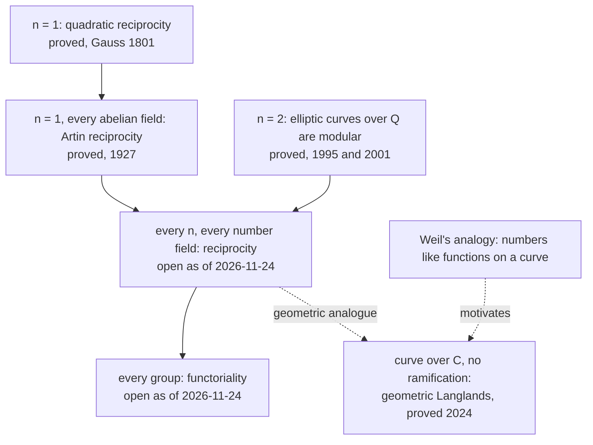
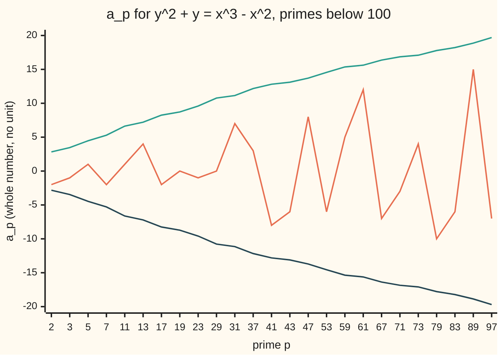

# The Langlands program: matching Galois representations with automorphic forms, and the 2024 geometric proof

[Syllabus](../../../SYLLABUS.md) → [Frontier](../README.md) → [Algebra, Logic and Computation](../README.md#s06) → The Langlands program

---

## General Overview

Take the number field $`\mathbb{Q}(\sqrt{5})`$: all numbers $`a + b\sqrt{5}`$ with rational $`a`$ and $`b`$. Ask, for each odd prime $`p`$ other than 5, whether 5 has a square root on the $`p`$-hour clock (arithmetic mod $`p`$: remainders on division by $`p`$). If it does, $`p`$ **splits** in the field: it breaks into two prime factors there. If not, $`p`$ **stays prime**.

For 11 the answer is yes: $`4 \times 4 = 16`$, which reads 5 on the 11-clock. For 7 it is no. The pattern is short. A prime splits exactly when it leaves remainder 1 or 4 on division by 5. So 11 and 19 split; 7 and 13 do not.

The question used a different clock for every prime, yet one fixed clock, mod 5, answers it. A rule of this shape is called **reciprocity**.

The same thing happens one level up. Count the solutions of $`y^2 + y = x^3 - x^2`$ on the $`p`$-clock, and take $`p`$ minus the count: $`-2`$ at 2, $`-1`$ at 3, $`1`$ at 5, $`-2`$ at 7. These are the coefficients of $`q^2`$, $`q^3`$, $`q^5`$, $`q^7`$ in one infinite product, a **modular form**:

```math
q \prod_{n \ge 1} (1 - q^n)^2 (1 - q^{11 n})^2 = q - 2q^2 - q^3 + 2q^4 + q^5 + 2q^6 - 2q^7 + \cdots
```

In 1967 Robert Langlands proposed that both facts are first cases of one dictionary. On one side sit **Galois representations**: the symmetries of the roots of polynomials, written as matrices. On the other sit **automorphic forms**: highly symmetric functions such as the product above. Each prime gives a number on both sides, and the conjecture says the numbers match.

In 2024 nine mathematicians posted a proof of a geometric version, with the rational numbers replaced by a curve over the complex numbers. That version is now accepted. The arithmetic version is still open.

**The Langlands program conjectures that Galois representations and automorphic forms match one to one, with equal numbers at each prime; its geometric analogue was proved in 2024, and the arithmetic program is open.**

**What kind of fact this is:** several claims, each with its own kind and status.

| Claim | Kind | Status |
| --- | --- | --- |
| A prime splits in $`\mathbb{Q}(\sqrt{5})`$ exactly when it is 1 or 4 mod 5 | theorem | proved on this card in Why it works, from quadratic reciprocity |
| $`y^2 + y = x^3 - x^2`$ matches the product above at every prime | theorem | proved (a case of modularity); checked here for every prime below 100 |
| Unramified geometric Langlands, characteristic 0 | theorem | proved: five preprints, 2024-05-06 to 2024-09-15; cited by the 2025 Breakthrough Prize; outlined here, not proved |
| Reciprocity for $`n`$-by-$`n`$ Galois representations over $`\mathbb{Q}`$, every $`n`$ | conjecture | open as of 2026-11-24 |
| Functoriality, the transfer between groups | conjecture | open as of 2026-11-24, many cases proved |

### The picture: what is proved and what is open



Solid arrows mean "is one case of". Dotted arrows are not implications; their labels say how the boxes are linked. The geometric box does not imply the arithmetic boxes.

---

## The formula

Notation first, in words.

- A **Galois representation** of dimension $`n`$ is a rule $`\rho`$ that turns each symmetry of the algebraic numbers into an invertible $`n`$-by-$`n`$ matrix, respecting composition ([The Galois correspondence](../../21-Algebraic%20and%20analytic%20number%20theory/05-Fields%20and%20Galois%20Theory/05-galois-groups-and-the-fundamental-theorem.md)).
- For each prime $`p`$ (outside a finite set of **ramified** primes, where the symmetry is blurred) there is a special symmetry $`\mathrm{Frob}_p`$, the **Frobenius**. It acts like raising to the power $`p`$ on the $`p`$-clock.
- An **automorphic representation** $`\pi`$ of $`\mathrm{GL}_n`$ is the symmetry type of an automorphic form, a function with a large group of symmetries. For $`n = 1`$ the ones of finite order are the **Dirichlet characters**, each a rule that gives every number prime to a fixed $`N`$ a root of 1, depending only on its remainder mod $`N`$, and giving 0 to the other numbers. For $`n = 2`$ it includes the modular forms of [Modular forms](../../21-Algebraic%20and%20analytic%20number%20theory/07-Diophantine%20and%20Modular/07-modular-forms-in-outline.md).
- Each $`\pi`$ has a number $`a_p(\pi)`$ at each prime: its **Hecke eigenvalue**, the factor by which the Hecke operator at $`p`$ scales it ([Hecke operators](../../21-Algebraic%20and%20analytic%20number%20theory/07-Diophantine%20and%20Modular/11-hecke-operators-and-eigenforms.md)).

The reciprocity conjecture, stated exactly:

```math
\text{for each suitable } \rho \text{ there is one } \pi \text{ (and conversely) with } \mathrm{tr}\,\rho(\mathrm{Frob}_p) = a_p(\pi) \text{ for all but finitely many primes } p
```

**Read it aloud:** the trace (sum of the diagonal entries) of the Frobenius matrix equals the Hecke eigenvalue, prime by prime.

"Suitable" means **geometric**: the representation comes from counting solutions of polynomial equations, as both examples do. Hypothesis: $`\rho`$ is irreducible (it does not break into smaller representations) and geometric. Conclusion: a matching $`\pi`$ exists. Domain: the base field is $`\mathbb{Q}`$ here, any number field in general. Boundary case: $`n = 1`$, where the conjecture is a theorem.

The two cases on this card:

```math
n = 1: \quad p \text{ splits in } \mathbb{Q}(\sqrt{5}) \iff \chi_5(p) = +1 \iff p \equiv 1 \text{ or } 4 \pmod 5
```

**Read it aloud:** the Frobenius at $`p`$ fixes $`\sqrt{5}`$ exactly when the character mod 5 gives $`+1`$, and that happens exactly for remainders 1 and 4.

```math
n = 2: \quad a_p = p - \#\{(x, y) \bmod p : y^2 + y \equiv x^3 - x^2\} = \text{coefficient of } q^p \text{ in } q \prod_{n \ge 1} (1 - q^n)^2 (1 - q^{11 n})^2
```

**Read it aloud:** $`p`$ minus the number of solutions on the $`p`$-clock equals the $`p`$th coefficient of the level-11 form.

The geometric theorem of 2024, for a curve $`X`$ over the complex numbers and a reductive group $`G`$ (defined under When it holds):

```math
\mathbb{L}_G : \mathrm{D\text{-}mod}(\mathrm{Bun}_G) \xrightarrow{\ \sim\ } \mathrm{IndCoh}_{\mathrm{Nilp}}(\mathrm{LocSys}_{\check{G}})
```

**Read it aloud:** the D-modules on the space of $`G`$-bundles on $`X`$ form the same category as a class of coherent sheaves on the space of $`\check{G}`$-local systems on $`X`$. Step 5 says what each piece means.

| Symbol | Plain meaning | In our example | Push it up and the answer… |
| --- | --- | --- | --- |
| $`p`$ | a prime, the size of the clock | 7, 11, 13, 19 | — |
| $`\mathbb{Q}(\sqrt{5})`$, $`\omega`$ | the numbers $`a + b\sqrt{5}`$, $`a`$ and $`b`$ rational; $`\omega = (1 + \sqrt{5})/2`$, a root of $`x^2 - x - 1`$ | splits at 11 and 19; $`\omega`$ is 4 or 8 mod 11 | — |
| $`\chi_5(p)`$ | the character mod 5: $`+1`$ if $`p`$ is 1 or 4 mod 5, $`-1`$ if 2 or 3, 0 at 5 | $`\chi_5(11) = +1`$ | — |
| $`E`$ | the elliptic curve $`y^2 + y = x^3 - x^2`$ | 4 solutions mod 3 | — |
| $`a_p`$ | $`p`$ minus the solutions mod $`p`$; also the $`q^p`$ coefficient | $`a_3 = -1`$ | stays within $`\pm 2\sqrt{p}`$ |
| $`q`$, $`f`$, $`N`$ | the series variable $`e^{2\pi i z}`$; the modular form; its level | $`f = q - 2q^2 - \cdots`$, $`N = 11`$ | — |
| $`\rho`$, $`n`$ | a Galois representation; its matrix size | $`n = 1`$, then $`n = 2`$ | bigger $`n`$, fewer cases proved |
| $`\mathrm{Frob}_p`$, $`\mathrm{tr}`$, $`\alpha`$, $`\beta`$ | the Frobenius symmetry at $`p`$; the trace of a matrix; the Frobenius matrix's two eigenvalues, with $`\alpha + \beta = a_p`$ and $`\alpha\beta = p`$ | trace $`-1`$ at 3 | — |
| $`\pi`$, $`a_p(\pi)`$ | an automorphic representation; its Hecke eigenvalue at $`p`$ | $`\chi_5`$; the form $`f`$ | — |
| $`G`$, $`\check{G}`$, $`H`$, $`\check{H}`$ | a reductive group; its Langlands dual, whose Cartan matrix is the transpose; a second group and its dual, in functoriality | $`\mathrm{SO}(7)`$, $`\mathrm{Sp}(6)`$; types B3 and C3 | — |
| $`X`$, $`x`$, $`\mathrm{Bun}_G`$ | a curve over $`\mathbb{C}`$; a point of it, in Step 5 (elsewhere $`x`$ and $`y`$ are the unknowns of an equation); the space of all $`G`$-bundles on it | — | — |
| $`\mathbb{L}_G`$, $`\mathrm{D\text{-}mod}`$, $`\mathrm{LocSys}_{\check{G}}`$, $`\mathrm{IndCoh}_{\mathrm{Nilp}}`$ | the 2024 functor; D-modules on $`\mathrm{Bun}_G`$; the space of $`\check{G}`$-local systems on $`X`$; a category of sheaves on it | — | — |

### When it holds

- **The base field.** The arithmetic conjecture is over $`\mathbb{Q}`$ or a number field. The 2024 theorem is over a curve $`X`$ that is smooth, projective and connected, over a field of characteristic 0 such as $`\mathbb{C}`$. Move the curve to a finite field and the 2024 proof does not apply.
- **Unramified.** The 2024 theorem allows no marked points on $`X`$ where bundles or local systems may degenerate. That is the analogue of a Galois representation with no ramified primes. The ramified version is not covered.
- **A reductive group.** $`G`$ must be **reductive**: a matrix group such as $`\mathrm{GL}_n`$, $`\mathrm{SO}(n)`$ or $`\mathrm{Sp}(2n)`$ whose representations split into irreducible pieces. Its dual $`\check{G}`$ swaps roots and coroots (Step 4). Use $`G`$ in place of $`\check{G}`$ and the two sides no longer match: $`\mathrm{SO}(7)`$ needs $`\mathrm{Sp}(6)`$.
- **Good primes only, for the matching rule.** At the level's prime 11 the curve degenerates, and the rule $`a_{p^2} = a_p^2 - p`$ fails: $`a_{121} = 1`$, not $`-10`$.

---

## Why it works

### Step 0: the idea in words

Both sides produce a list of numbers indexed by primes. A Galois representation gives the trace of each Frobenius: a count of roots or solutions mod $`p`$. An automorphic form gives its Hecke eigenvalues. Reciprocity claims that the two families of lists are the same family.

A list determines its object on both sides. Two cuspidal automorphic representations of $`\mathrm{GL}_n`$ (the basic pieces, from which the rest are built) that agree at all but finitely many primes are equal (strong multiplicity one, recorded in Gelbart, Sources). So matching the lists matches the objects.

### Step 1: n = 1, quadratic reciprocity

The field $`\mathbb{Q}(\sqrt{5})`$ has two symmetries: do nothing, and swap $`\sqrt{5}`$ with $`-\sqrt{5}`$. Its Galois representation is 1-by-1: $`+1`$ and $`-1`$. The Frobenius at $`p`$ is $`+1`$ when $`p`$ splits and $`-1`$ when it stays prime ([Splitting and ramification](../../21-Algebraic%20and%20analytic%20number%20theory/06-Algebraic%20Numbers/08-splitting-and-ramification.md)).

The whole numbers of the field are the combinations $`a + b\,\omega`$ with $`a`$, $`b`$ integers and $`\omega = (1 + \sqrt{5})/2`$, a root of $`x^2 - x - 1`$. For a prime $`p`$ other than 5, $`p`$ splits exactly when this polynomial has two roots mod $`p`$. For odd $`p`$ that happens exactly when 5 is a square mod $`p`$.

Now [Quadratic reciprocity by counting dots](../../02-Number%20theory/04-Powers%20on%20the%20Clock/13-quadratic-reciprocity-by-lattice-points.md) does the work. Since 5 leaves remainder 1 on division by 4, "5 is a square mod $`p`$" has the same answer as "$`p`$ is a square mod 5". The squares mod 5 are 1 and 4. The prime 2 fits too: $`x^2 - x - 1`$ has no root mod 2, and 2 is 2 mod 5.

So the Frobenius at $`p`$ equals $`\chi_5(p)`$, a Dirichlet character mod 5. That character is the automorphic side for $`n = 1`$. The general $`n = 1`$ statement, for every abelian field over every number field, is [Artin reciprocity](../../21-Algebraic%20and%20analytic%20number%20theory/09-Local%20Fields%20and%20Class%20Field%20Theory/05-artin-reciprocity-and-the-hilbert-class-field.md), proved in 1927.

### Step 2: n = 2, the curve of level 11

An elliptic curve $`E`$ over $`\mathbb{Q}`$ carries a 2-dimensional Galois representation. Its Frobenius at a good prime has trace $`a_p`$ and determinant $`p`$. The trace is read off by counting: the curve has $`p + 1 - a_p`$ points mod $`p`$, counting one point at infinity, so $`a_p`$ is $`p`$ minus the solutions.

[Modularity](../../21-Algebraic%20and%20analytic%20number%20theory/07-Diophantine%20and%20Modular/08-modularity-and-the-proof-of-fermat.md) says these traces are the coefficients of one weight-2 modular form, whose level is the curve's **conductor** (the product of its bad primes, with exponents). For $`y^2 + y = x^3 - x^2`$ the conductor is 11. Level 11 is the first level that has a weight-2 **cusp form** (a form that tends to 0 at the boundary points of the half plane, the cusps), and it has exactly one: the product in the Overview. For this curve the match was known long before 1995, because the curve is itself built from the level-11 symmetry group.

The two sides agree on more than single primes. Write the Frobenius eigenvalues as $`\alpha`$ and $`\beta`$, so $`\alpha + \beta = a_p`$ and $`\alpha\beta = p`$. Then

```math
a_{p^2} = \alpha^2 + \alpha\beta + \beta^2 = (\alpha + \beta)^2 - \alpha\beta = a_p^2 - p
```

**Read it aloud:** the coefficient at $`p`$ squared equals the coefficient at $`p`$, squared, minus $`p`$.

The modular form satisfies the same rule because it is a Hecke eigenform. The code checks it at 2, 3 and 7: $`a_4 = 2`$, $`a_9 = -2`$, $`a_{49} = -3`$. At 11 the determinant is 0, so $`a_{121} = a_{11}^2 = 1`$.

### Step 3: the general conjecture, and what "automorphic" means there

For $`n \ge 3`$ there are no classical modular forms. Automorphic representations then live on $`\mathrm{GL}_n`$ of the **adeles**, a ring holding every $`p`$-adic completion of $`\mathbb{Q}`$ at once ([Adeles and ideles](../../21-Algebraic%20and%20analytic%20number%20theory/09-Local%20Fields%20and%20Class%20Field%20Theory/06-adeles-and-ideles.md)). Each prime gives a local piece, where the Hecke eigenvalue is read.

Both sides also carry an L-function ([The L-function of a modular form](../../21-Algebraic%20and%20analytic%20number%20theory/07-Diophantine%20and%20Modular/12-l-functions-of-modular-forms.md)): a product over primes of factors made from $`a_p`$. Matching lists means equal L-functions.

### Step 4: other groups need the dual group

Langlands also asked about groups $`G`$ other than $`\mathrm{GL}_n`$. His answer: the data at each prime of an automorphic representation of $`G`$ is a conjugacy class (an element up to a change of basis, which keeps its eigenvalues) in a different group, the **Langlands dual** $`\check{G}`$. This is the Satake isomorphism, stated here and recorded in Langlands 1970 (Sources).

The dual is built by swapping roots and coroots. A **root** is a direction in which $`G`$ acts; its **coroot** is the matching direction measured by twice the root over its squared length ([Root systems and Dynkin diagrams](../../23-Differential%20geometry%20and%20Lie%20groups/08-Roots%2C%20Weights%20and%20Representations/03-root-systems-and-dynkin-diagrams.md)). Swapping them transposes the Cartan matrix and swaps long roots with short ones.

| $`G`$ | Type | $`\check{G}`$ | What the swap does |
| --- | --- | --- | --- |
| $`\mathrm{GL}_n`$ | A | $`\mathrm{GL}_n`$ | nothing: all roots have one length |
| $`\mathrm{SL}_n`$ | A | $`\mathrm{PGL}_n`$ | same roots, the lattice changes |
| $`\mathrm{SO}(7)`$ | B3 | $`\mathrm{Sp}(6)`$ | 6 short and 12 long become 12 short and 6 long |
| $`G_2`$ | G2 | $`G_2`$ | 6 short and 6 long: transpose equals the original with nodes swapped |

The code builds the 18 roots of B3 and of C3 by reflections and confirms the swap. No node order makes B3 equal to C3. **Functoriality** predicts that each map $`\check{H} \to \check{G}`$ of dual groups moves automorphic representations of $`H`$ to ones of $`G`$. Reciprocity is the case where $`H`$ is the Galois group itself.

### Step 5: the geometric version, in words

André Weil noticed that the rational numbers behave like functions on a curve: primes play the role of points, and the Galois group the role of loops. Geometric Langlands moves to a curve $`X`$ over the complex numbers, where geometry is strongest.

| Arithmetic side | Geometric side over $`X`$ |
| --- | --- |
| a prime $`p`$ | a point $`x`$ of $`X`$ |
| Galois representation into $`\check{G}`$ | **local system**: a $`\check{G}`$-bundle with a flat connection, a way to transport along loops in $`X`$ |
| automorphic form on $`G`$ | a **D-module** on $`\mathrm{Bun}_G`$: a sheaf that solves linear differential equations, on the space of all $`G`$-bundles on $`X`$ |
| Hecke operator at $`p`$ | modify a bundle at the point $`x`$ |
| Hecke eigenform | Hecke eigensheaf |

A **sheaf** records data on every open piece of a space, glued along overlaps ([Sheaves](../../22-Algebraic%20geometry/05-Cohomology%20and%20the%20Hodge%20Conjecture/01-sheaves-in-outline.md)). A **category** is a collection of such objects with the maps between them. A **functor** sends the objects and maps of one category to those of another, and an **equivalence** is a functor that matches two categories completely.

The conjecture says the whole category of D-modules on $`\mathrm{Bun}_G`$ equals a category of sheaves on $`\mathrm{LocSys}_{\check{G}}`$. Each irreducible local system then matches one Hecke eigensheaf, as each Galois representation should match one automorphic form. The subscript Nilp is a technical condition on where sheaves may be supported; without it the two sides differ.

### Step 6: the 2024 proof, in outline

This is an outline of the research proof, with its sources. It is not proved here.

- **Statement.** For $`G`$ reductive and $`X`$ smooth, projective and connected over a field of characteristic 0, the functor $`\mathbb{L}_G`$ is an equivalence.
- **Paper I** (Gaitsgory and Raskin, arXiv 2024-05-06): construct $`\mathbb{L}_G`$ from the automorphic side to the spectral side, and show several forms of the conjecture are equivalent.
- **Paper II** (nine authors, 2024-05-06): Kac–Moody localization (turning representations of a Kac–Moody algebra, an infinite-dimensional relative of the Lie algebra of $`G`$ attached to one point, into D-modules on $`\mathrm{Bun}_G`$) and the fundamental local equivalence, the local input at one point.
- **Paper III** (seven authors, 2024-09-11): compatibility with parabolic induction (building objects for $`G`$ from those of a smaller group inside it), the analogue of Eisenstein series (automorphic forms built the same way).
- **Paper IV** (eight authors, 2024-09-13): ambidexterity: the functor's left and right adjoints (its best approximate inverses from each side) agree.
- **Paper V** (Gaitsgory and Raskin, 2024-09-15, revised 2026-01-16): the multiplicity one theorem, which finishes the equivalence.

Status: the arXiv pages list no journal reference as of 2026-11-24. The 2025 Breakthrough Prize in Mathematics cites Dennis Gaitsgory for "the proof of the geometric Langlands conjecture in characteristic 0" (the prize's words). Under this wing's rule, a prize independent of the authors counts as acceptance, so the status is proved.

### Step 7: what the proof does not settle

- It says nothing directly about $`\mathbb{Q}`$. A curve over $`\mathbb{C}`$ has no Frobenius and no primes.
- It does not cover the ramified case, curves over finite fields, or number fields.
- Arithmetic reciprocity for $`\mathrm{GL}_n`$ over $`\mathbb{Q}`$ is proved for $`n = 1`$ and for many 2-dimensional cases, elliptic curves among them. For general $`n`$ it is open as of 2026-11-24.

---

## Worked numbers, by hand

The 1-by-1 case: which primes split in $`\mathbb{Q}(\sqrt{5})`$.

| Step | Arithmetic | Value |
| --- | --- | --- |
| $`p = 11`$: roots of $`x^2 - x - 1`$ | $`4^2 - 4 - 1 = 11`$, $`8^2 - 8 - 1 = 55`$, both 0 mod 11 | roots 4 and 8: splits |
| $`p = 11`$: mod 5 | $`11 = 2 \times 5 + 1`$ | remainder 1: rule says splits |
| $`p = 7`$: Euler's test | $`5^3 = 125 = 17 \times 7 + 6`$ | $`-1`$: 5 is no square, stays prime |
| $`p = 19`$ | roots 5 and 15; $`19 = 3 \times 5 + 4`$ | splits, remainder 4 |
| $`p = 13`$ | no roots; remainder 3 | stays prime |
| all primes below 1000 but 5 | three tests at the 166 odd primes, two at $`p = 2`$ | **all agree: 78 split, 89 stay prime** |

So one clock answers a question asked on 167 different clocks. The share 0.467 that split is near the 1/2 that [Chebotarev](../../21-Algebraic%20and%20analytic%20number%20theory/06-Algebraic%20Numbers/09-chebotarev-density-and-splitting-statistics.md) predicts.

The 2-by-2 case at $`p = 3`$.

| Step | Arithmetic | Value |
| --- | --- | --- |
| $`y^2 + y`$ for $`y = 0, 1, 2`$ | $`0, 2, 6`$ mod 3 | 0, 2, 0 |
| $`x^3 - x^2`$ for $`x = 0, 1, 2`$ | $`0, 0, 4`$ mod 3 | 0, 0, 1 |
| solutions | value 0 is hit twice, value 1 never | 2 + 2 + 0 = 4 |
| $`a_3`$ from the curve | $`3 - 4`$ | $`-1`$ |
| the product to $`q^3`$ | $`q(1 - q)^2(1 - q^2)^2 = q(1 - 2q - q^2 + \cdots)`$ | $`q - 2q^2 - q^3`$ |
| $`a_3`$ from the form | coefficient of $`q^3`$ | **$`-1`$: they match** |

The code repeats the match for all 25 primes below 100. The largest $`|a_p|`$ is 15, at 89, within Hasse's bound $`2\sqrt{89} \approx 18.87`$.



Orange: $`a_p`$, equal to the form's coefficient at every point. Teal and dark: the bounds $`+2\sqrt{p}`$ and $`-2\sqrt{p}`$.

### What breaks if you drop a piece

| Mistake | Comes out at | What went wrong |
| --- | --- | --- |
| "p splits in $`\mathbb{Q}(\sqrt{7})`$ iff p is a square mod 7" | fails first at $`p = 3`$, and at 86 of 166 primes below 1000 | 7 leaves 3 on division by 4, so reciprocity adds a sign; the true rule is mod 28 |
| Count $`a_2`$ as $`p + 1 -`$ solutions | $`-1`$, not $`-2`$ | the $`+1`$ is the point at infinity, which the solution count leaves out |
| Use $`a_{p^2} = a_p^2 - p`$ at $`p = 11`$ | $`-10`$, not $`a_{121} = 1`$ | 11 is the bad prime: the Frobenius determinant there is 0, not $`p`$ |
| Match the form with $`y^2 = x^3 - x`$ instead | $`a_3 = 0`$, not $`-1`$ | that curve has conductor 32, so it matches a level-32 form |
| Take $`\mathrm{SO}(7)`$ as its own dual | B3 equals C3 in some node order: False | the swap turns 6 short and 12 long roots into 12 short and 6 long |

---

## Code, from first principles, and it actually runs

The code takes three independent roads. Road A tests each prime below 1000 but 5 three ways: brute-force roots of $`x^2 - x - 1`$, Euler's power test, and the remainder mod 5. Euler's test needs an odd prime, so $`p = 2`$ gets the other two. Road B counts solutions of the curve mod each prime below 100 by brute force and, separately, multiplies out the infinite product far enough to read $`a_{121}`$, with whole-number arithmetic; it then checks the Hecke rules and Hasse's bound on the result. Road C builds every root of A2, G2, B3 and C3 by repeated reflection, measures their lengths, and checks that transposing the Cartan matrix swaps long and short. Nothing imported knows any number theory.

### Python

```python
# The Langlands program: the check behind the card.  Standard library only.
# Road A: primes in Q(sqrt 5), by roots mod p, by Euler's test and by p mod 5.
# Road B: points on y^2 + y = x^3 - x^2 mod p, against the coefficients of
#         q * prod (1 - q^n)^2 (1 - q^(11n))^2, multiplied out here.
# Road C: Langlands dual root systems by transposing Cartan matrices.
from itertools import permutations
from math import sqrt

def primes_below(n):
    s = [True] * n; s[0] = s[1] = False
    for i in range(2, n):
        if s[i]:
            for j in range(i * i, n, i): s[j] = False
    return [i for i in range(n) if s[i]]
def roots_mod(f, p): return sum(1 for x in range(p) if f(x) % p == 0)

print("== Road A: which primes split in Q(sqrt 5) ==")
splits, agree, total = 0, 0, 0
for p in primes_below(1000):
    if p == 5: continue
    r = roots_mod(lambda x: x * x - x - 1, p)            # x^2 - x - 1 has roots (1 +- sqrt 5)/2
    rule = 2 if p % 5 in (1, 4) else 0
    e = 1 if p == 2 else pow(5, (p - 1) // 2, p)      # Euler: 1 if 5 is a square mod p, else p - 1
    euler = 2 if e == 1 else 0
    if p in (7, 11, 13, 19):
        rts = [x for x in range(p) if (x * x - x - 1) % p == 0]
        print(f"p={p}: p mod 5 = {p % 5}, roots of x^2 - x - 1 mod p: {rts}, "
              f"5^((p-1)/2) mod p = {1 if e == 1 else -1}, {'splits' if r == 2 else 'stays prime'}")
    total += 1; splits += r == 2
    agree += r == rule and (p == 2 or euler == r)
assert agree == total == 167                        # three roads agree at every prime below 1000
print(f"primes below 1000 except 5: {total}; the tests agree at {agree} (three at the {total - 1} odd primes, two at p=2)")
print(f"split: {splits} of {total}, stay prime: {total - splits}, share split {splits / total:.3f} (Chebotarev predicts 1/2)")
bad7 = [p for p in primes_below(1000) if p not in (2, 7)
        and (roots_mod(lambda x: x * x - 7, p) == 2) != (p % 7 in (1, 2, 4))]
assert bad7[0] == 3
print(f"wrong rule 'p splits in Q(sqrt 7) iff p is a square mod 7': fails first at p={bad7[0]}, "
      f"fails at {len(bad7)} of {len(primes_below(1000)) - 2} primes below 1000")

print("== Road B: y^2 + y = x^3 - x^2 against a modular form of level 11 ==")
N = 130
def mul(a, b):
    c = [0] * N
    for i, x in enumerate(a):
        if x:
            for j in range(N - i): c[i + j] += x * b[j]
    return c
form = [0] * N; form[1] = 1                          # q
for n in range(1, N):
    for step in (n, 11 * n):
        if step < N:
            fac = [0] * N; fac[0] = 1; fac[step] = -1
            form = mul(mul(form, fac), fac)          # times (1 - q^step)^2
print("form coefficients a_1..a_12:", " ".join(str(form[n]) for n in range(1, 13)))
def a_count(p):                                      # p minus the affine solutions mod p
    return p - sum(1 for x in range(p) for y in range(p) if (y * y + y - x ** 3 + x * x) % p == 0)
ps = primes_below(100)
by_x = [sum(1 for y in range(3) if (y * y + y - x ** 3 + x * x) % 3 == 0) for x in range(3)]
print("p=3 by hand: solutions with x = 0, 1, 2:", " ".join(map(str, by_x)))
for p in (2, 3, 5, 7, 11, 13):
    print(f"p={p}: solutions mod p = {p - a_count(p)}, a_p = p - solutions = {a_count(p)}, "
          f"coefficient of q^{p} = {form[p]}")
match = sum(1 for p in ps if a_count(p) == form[p])
assert match == len(ps) == 25                        # point counts equal the coefficients
print(f"primes below 100: {len(ps)}; point count equals coefficient at {match} (checked for p < 100)")
ratio = max(abs(form[p]) / (2 * sqrt(p)) for p in ps)
assert ratio <= 1                                    # Hasse: |a_p| <= 2 sqrt p
print(f"Hasse bound: largest |a_p| / (2 sqrt p) for p < 100 = {ratio:.6f}")
for p in (2, 3, 7):
    assert form[p * p] == form[p] ** 2 - p           # Hecke relation at a good prime
    print(f"a_{p * p} = {form[p * p]}, a_{p}^2 - {p} = {form[p] ** 2 - p}")
assert form[6] == form[2] * form[3] and form[10] == form[2] * form[5]
print(f"a_6 = {form[6]} = a_2 a_3; a_10 = {form[10]} = a_2 a_5")
assert form[121] == form[11] ** 2 == 1                # bad prime: a_121 = a_11^2, not a_11^2 - 11
print(f"bad prime 11: a_121 = {form[121]}; the good-prime rule would give {form[11] ** 2 - 11}")
print(f"forget the point at infinity at p=2: p + 1 - solutions = {2 + 1 - (2 - a_count(2))}, not {a_count(2)}")
a3_32 = 3 - sum(1 for x in range(3) for y in range(3) if (y * y - x ** 3 + x) % 3 == 0)
print(f"wrong curve y^2 = x^3 - x (level 32): a_3 = {a3_32}, not {form[3]}")
print("chart, p:", " ".join(str(p) for p in ps))
print("chart, a_p:", " ".join(str(form[p]) for p in ps))
print("chart, 2 sqrt p:", " ".join(f"{2 * sqrt(p):.2f}" for p in ps))
print("chart, -2 sqrt p:", " ".join(f"{-2 * sqrt(p):.2f}" for p in ps))

print("== Road C: the Langlands dual swaps roots and coroots ==")
CARTAN = {"A2": [[2, -1], [-1, 2]], "G2": [[2, -1], [-3, 2]],  # row i, column j: 2(a_i, a_j)/(a_j, a_j)
          "B3": [[2, -1, 0], [-1, 2, -2], [0, -1, 2]], "C3": [[2, -1, 0], [-1, 2, -1], [0, -2, 2]]}
def transpose(m): return [list(r) for r in zip(*m)]
def det(m):
    if len(m) == 1: return m[0][0]
    return sum((-1) ** j * m[0][j] * det([r[:j] + r[j + 1:] for r in m[1:]]) for j in range(len(m)))
def roots(m):                                        # orbit of simple roots under reflections
    k = len(m); seen = {tuple(int(i == j) for j in range(k)) for i in range(k)}; todo = list(seen)
    while todo:
        b = todo.pop()
        for i in range(k):
            c = sum(b[j] * m[j][i] for j in range(k))       # 2(beta, a_i)/(a_i, a_i)
            nb = tuple(b[j] - c * (j == i) for j in range(k))
            if nb not in seen: seen.add(nb); todo.append(nb)
    return seen
def short_long(m):                                   # squared lengths from m[i][j] l_j = m[j][i] l_i
    k = len(m); l = [0] * k; l[0] = 6
    while 0 in l:
        for i in range(k):
            for j in range(k):
                if l[i] and not l[j] and m[i][j]: l[j] = m[j][i] * l[i] // m[i][j]
    sq = [sum(b[i] * b[j] * m[i][j] * l[j] // 2 for i in range(k) for j in range(k)) for b in roots(m)]
    return sum(1 for x in sq if x == min(sq)), sum(1 for x in sq if x > min(sq))
def same_up_to_order(a, b):
    k = len(a)
    return k == len(b) and any(all(a[s[i]][s[j]] == b[i][j] for i in range(k) for j in range(k))
                               for s in permutations(range(k)))
for name, m in CARTAN.items():
    t = transpose(m)
    dual = next(n for n, x in CARTAN.items() if same_up_to_order(x, t))
    (s, lg), (ds, dl) = short_long(m), short_long(t)
    print(f"{name}: Cartan {m}, det {det(m)}, roots {len(roots(m))} ({s} short, {lg} long); "
          f"dual {dual}: {ds} short, {dl} long")
    assert len(roots(m)) == len(roots(t))               # a root system and its dual have equally many roots
    assert (s, lg) == ((dl, ds) if lg else (ds, dl))  # the dual swaps short and long roots
b3, c3 = CARTAN["B3"], CARTAN["C3"]
assert next(n for n, x in CARTAN.items() if same_up_to_order(x, transpose(b3))) == "C3" and not same_up_to_order(b3, c3)
assert len(roots(CARTAN["B3"])) == 18 and short_long(CARTAN["B3"]) == (6, 12)
print(f"B3 equals C3 in some node order: {same_up_to_order(CARTAN['B3'], CARTAN['C3'])}")
print("ALL CHECKS PASS")
```

**Ran 2026-11-24 on macOS, Python 3.14.10, standard library only. All checks passed. Output, pasted from the run:**

```
== Road A: which primes split in Q(sqrt 5) ==
p=7: p mod 5 = 2, roots of x^2 - x - 1 mod p: [], 5^((p-1)/2) mod p = -1, stays prime
p=11: p mod 5 = 1, roots of x^2 - x - 1 mod p: [4, 8], 5^((p-1)/2) mod p = 1, splits
p=13: p mod 5 = 3, roots of x^2 - x - 1 mod p: [], 5^((p-1)/2) mod p = -1, stays prime
p=19: p mod 5 = 4, roots of x^2 - x - 1 mod p: [5, 15], 5^((p-1)/2) mod p = 1, splits
primes below 1000 except 5: 167; the tests agree at 167 (three at the 166 odd primes, two at p=2)
split: 78 of 167, stay prime: 89, share split 0.467 (Chebotarev predicts 1/2)
wrong rule 'p splits in Q(sqrt 7) iff p is a square mod 7': fails first at p=3, fails at 86 of 166 primes below 1000
== Road B: y^2 + y = x^3 - x^2 against a modular form of level 11 ==
form coefficients a_1..a_12: 1 -2 -1 2 1 2 -2 0 -2 -2 1 -2
p=3 by hand: solutions with x = 0, 1, 2: 2 2 0
p=2: solutions mod p = 4, a_p = p - solutions = -2, coefficient of q^2 = -2
p=3: solutions mod p = 4, a_p = p - solutions = -1, coefficient of q^3 = -1
p=5: solutions mod p = 4, a_p = p - solutions = 1, coefficient of q^5 = 1
p=7: solutions mod p = 9, a_p = p - solutions = -2, coefficient of q^7 = -2
p=11: solutions mod p = 10, a_p = p - solutions = 1, coefficient of q^11 = 1
p=13: solutions mod p = 9, a_p = p - solutions = 4, coefficient of q^13 = 4
primes below 100: 25; point count equals coefficient at 25 (checked for p < 100)
Hasse bound: largest |a_p| / (2 sqrt p) for p < 100 = 0.794998
a_4 = 2, a_2^2 - 2 = 2
a_9 = -2, a_3^2 - 3 = -2
a_49 = -3, a_7^2 - 7 = -3
a_6 = 2 = a_2 a_3; a_10 = -2 = a_2 a_5
bad prime 11: a_121 = 1; the good-prime rule would give -10
forget the point at infinity at p=2: p + 1 - solutions = -1, not -2
wrong curve y^2 = x^3 - x (level 32): a_3 = 0, not -1
chart, p: 2 3 5 7 11 13 17 19 23 29 31 37 41 43 47 53 59 61 67 71 73 79 83 89 97
chart, a_p: -2 -1 1 -2 1 4 -2 0 -1 0 7 3 -8 -6 8 -6 5 12 -7 -3 4 -10 -6 15 -7
chart, 2 sqrt p: 2.83 3.46 4.47 5.29 6.63 7.21 8.25 8.72 9.59 10.77 11.14 12.17 12.81 13.11 13.71 14.56 15.36 15.62 16.37 16.85 17.09 17.78 18.22 18.87 19.70
chart, -2 sqrt p: -2.83 -3.46 -4.47 -5.29 -6.63 -7.21 -8.25 -8.72 -9.59 -10.77 -11.14 -12.17 -12.81 -13.11 -13.71 -14.56 -15.36 -15.62 -16.37 -16.85 -17.09 -17.78 -18.22 -18.87 -19.70
== Road C: the Langlands dual swaps roots and coroots ==
A2: Cartan [[2, -1], [-1, 2]], det 3, roots 6 (6 short, 0 long); dual A2: 6 short, 0 long
G2: Cartan [[2, -1], [-3, 2]], det 1, roots 12 (6 short, 6 long); dual G2: 6 short, 6 long
B3: Cartan [[2, -1, 0], [-1, 2, -2], [0, -1, 2]], det 2, roots 18 (6 short, 12 long); dual C3: 12 short, 6 long
C3: Cartan [[2, -1, 0], [-1, 2, -1], [0, -2, 2]], det 2, roots 18 (12 short, 6 long); dual B3: 6 short, 12 long
B3 equals C3 in some node order: False
ALL CHECKS PASS
```

### Rust

```rust
// The Langlands program: the check behind the card.  std only, no crates.
// Road A: primes in Q(sqrt 5), by roots mod p, by Euler's test and by p mod 5.
// Road B: points on y^2 + y = x^3 - x^2 mod p, against the coefficients of
//         q * prod (1 - q^n)^2 (1 - q^(11n))^2, multiplied out here.
// Road C: Langlands dual root systems by transposing Cartan matrices.
use std::collections::HashSet;

fn primes_below(n: usize) -> Vec<i64> {
    let mut s = vec![true; n];
    s[0] = false; s[1] = false;
    for i in 2..n {
        if s[i] {
            let mut j = i * i;
            while j < n { s[j] = false; j += i; }
        }
    }
    (0..n).filter(|&i| s[i]).map(|i| i as i64).collect()
}
fn roots_mod(f: impl Fn(i64) -> i64, p: i64) -> i64 { (0..p).filter(|&x| f(x).rem_euclid(p) == 0).count() as i64 }
fn powmod(mut b: i64, mut e: i64, m: i64) -> i64 {
    let mut r = 1 % m; b %= m;
    while e > 0 { if e & 1 == 1 { r = r * b % m; } b = b * b % m; e >>= 1; }
    r
}
type M = Vec<Vec<i64>>;
fn transpose(m: &M) -> M { (0..m.len()).map(|j| m.iter().map(|r| r[j]).collect()).collect() }
fn det(m: &M) -> i64 {
    if m.len() == 1 { return m[0][0]; }
    (0..m.len()).map(|j| {
        let minor: M = m[1..].iter().map(|r| r.iter().enumerate().filter(|&(c, _)| c != j).map(|(_, &v)| v).collect()).collect();
        (if j % 2 == 0 { 1 } else { -1 }) * m[0][j] * det(&minor)
    }).sum()
}
fn roots(m: &M) -> HashSet<Vec<i64>> {
    let k = m.len();
    let mut seen: HashSet<Vec<i64>> = (0..k).map(|i| (0..k).map(|j| (i == j) as i64).collect()).collect();
    let mut todo: Vec<Vec<i64>> = seen.iter().cloned().collect();
    while let Some(b) = todo.pop() {
        for i in 0..k {
            let c: i64 = (0..k).map(|j| b[j] * m[j][i]).sum();
            let nb: Vec<i64> = (0..k).map(|j| b[j] - if j == i { c } else { 0 }).collect();
            if seen.insert(nb.clone()) { todo.push(nb); }
        }
    }
    seen
}
fn short_long(m: &M) -> (usize, usize) {
    let k = m.len();
    let mut l = vec![0i64; k]; l[0] = 6;
    while l.contains(&0) {
        for i in 0..k { for j in 0..k {
            if l[i] != 0 && l[j] == 0 && m[i][j] != 0 { l[j] = m[j][i] * l[i] / m[i][j]; }
        } }
    }
    let sq: Vec<i64> = roots(m).iter().map(|b| {
        let mut t = 0;
        for i in 0..k { for j in 0..k { t += b[i] * b[j] * m[i][j] * l[j] / 2; } }
        t
    }).collect();
    let mn = *sq.iter().min().unwrap();
    (sq.iter().filter(|&&x| x == mn).count(), sq.iter().filter(|&&x| x > mn).count())
}
fn perms(k: usize) -> Vec<Vec<usize>> {
    if k == 0 { return vec![vec![]]; }
    let mut out = vec![];
    for p in perms(k - 1) { for pos in 0..k { let mut q = p.clone(); q.insert(pos, k - 1); out.push(q); } }
    out
}
fn same_up_to_order(a: &M, b: &M) -> bool {
    let k = a.len();
    k == b.len() && perms(k).iter().any(|s| (0..k).all(|i| (0..k).all(|j| a[s[i]][s[j]] == b[i][j])))
}

fn main() {
    println!("== Road A: which primes split in Q(sqrt 5) ==");
    let (mut splits, mut agree, mut total) = (0, 0, 0);
    for &p in primes_below(1000).iter() {
        if p == 5 { continue; }
        let r = roots_mod(|x| x * x - x - 1, p);
        let rule = if p % 5 == 1 || p % 5 == 4 { 2 } else { 0 };
        let e = if p == 2 { 1 } else { powmod(5, (p - 1) / 2, p) };
        let euler = if e == 1 { 2 } else { 0 };
        if [7, 11, 13, 19].contains(&p) {
            let rts: Vec<i64> = (0..p).filter(|&x| (x * x - x - 1).rem_euclid(p) == 0).collect();
            println!("p={}: p mod 5 = {}, roots of x^2 - x - 1 mod p: {:?}, 5^((p-1)/2) mod p = {}, {}",
                     p, p % 5, rts, if e == 1 { 1 } else { -1 }, if r == 2 { "splits" } else { "stays prime" });
        }
        total += 1;
        if r == 2 { splits += 1; }
        if r == rule && (p == 2 || euler == r) { agree += 1; }
    }
    assert!(agree == total && total == 167);
    println!("primes below 1000 except 5: {}; the tests agree at {} (three at the {} odd primes, two at p=2)", total, agree, total - 1);
    println!("split: {} of {}, stay prime: {}, share split {:.3} (Chebotarev predicts 1/2)", splits, total, total - splits, splits as f64 / total as f64);
    let bad7: Vec<i64> = primes_below(1000).into_iter().filter(|&p| p != 2 && p != 7
        && ((roots_mod(|x| x * x - 7, p) == 2) != [1, 2, 4].contains(&(p % 7)))).collect();
    assert!(bad7[0] == 3);
    println!("wrong rule 'p splits in Q(sqrt 7) iff p is a square mod 7': fails first at p={}, fails at {} of {} primes below 1000",
             bad7[0], bad7.len(), primes_below(1000).len() - 2);

    println!("== Road B: y^2 + y = x^3 - x^2 against a modular form of level 11 ==");
    const N: usize = 130;
    let mut form = vec![0i64; N]; form[1] = 1;
    for n in 1..N {
        for step in [n, 11 * n] {
            if step < N {
                for _ in 0..2 { for i in (step..N).rev() { form[i] -= form[i - step]; } }
            }
        }
    }
    let first: Vec<String> = (1..13).map(|n| form[n].to_string()).collect();
    println!("form coefficients a_1..a_12: {}", first.join(" "));
    let a_count = |p: i64| -> i64 {
        let mut c = 0;
        for x in 0..p { for y in 0..p { if (y * y + y - x * x * x + x * x).rem_euclid(p) == 0 { c += 1; } } }
        p - c
    };
    let ps = primes_below(100);
    let by_x: Vec<String> = (0..3i64).map(|x| (0..3i64).filter(|&y| (y * y + y - x * x * x + x * x).rem_euclid(3) == 0).count().to_string()).collect();
    println!("p=3 by hand: solutions with x = 0, 1, 2: {}", by_x.join(" "));
    for p in [2i64, 3, 5, 7, 11, 13] {
        println!("p={}: solutions mod p = {}, a_p = p - solutions = {}, coefficient of q^{} = {}",
                 p, p - a_count(p), a_count(p), p, form[p as usize]);
    }
    let matched = ps.iter().filter(|&&p| a_count(p) == form[p as usize]).count();
    assert!(matched == ps.len() && matched == 25);
    println!("primes below 100: {}; point count equals coefficient at {} (checked for p < 100)", ps.len(), matched);
    let ratio = ps.iter().map(|&p| form[p as usize].abs() as f64 / (2.0 * (p as f64).sqrt())).fold(0.0, f64::max);
    assert!(ratio <= 1.0);
    println!("Hasse bound: largest |a_p| / (2 sqrt p) for p < 100 = {:.6}", ratio);
    for p in [2usize, 3, 7] {
        assert!(form[p * p] == form[p] * form[p] - p as i64);
        println!("a_{} = {}, a_{}^2 - {} = {}", p * p, form[p * p], p, p, form[p] * form[p] - p as i64);
    }
    assert!(form[6] == form[2] * form[3] && form[10] == form[2] * form[5]);
    println!("a_6 = {} = a_2 a_3; a_10 = {} = a_2 a_5", form[6], form[10]);
    assert!(form[121] == form[11] * form[11] && form[121] == 1);
    println!("bad prime 11: a_121 = {}; the good-prime rule would give {}", form[121], form[11] * form[11] - 11);
    println!("forget the point at infinity at p=2: p + 1 - solutions = {}, not {}", 2 + 1 - (2 - a_count(2)), a_count(2));
    let mut s32 = 0;
    for x in 0..3i64 { for y in 0..3i64 { if (y * y - x * x * x + x).rem_euclid(3) == 0 { s32 += 1; } } }
    println!("wrong curve y^2 = x^3 - x (level 32): a_3 = {}, not {}", 3 - s32, form[3]);
    let j = |v: Vec<String>| v.join(" ");
    println!("chart, p: {}", j(ps.iter().map(|p| p.to_string()).collect()));
    println!("chart, a_p: {}", j(ps.iter().map(|&p| form[p as usize].to_string()).collect()));
    println!("chart, 2 sqrt p: {}", j(ps.iter().map(|&p| format!("{:.2}", 2.0 * (p as f64).sqrt())).collect()));
    println!("chart, -2 sqrt p: {}", j(ps.iter().map(|&p| format!("{:.2}", -2.0 * (p as f64).sqrt())).collect()));

    println!("== Road C: the Langlands dual swaps roots and coroots ==");
    let cartan: Vec<(&str, M)> = vec![
        ("A2", vec![vec![2, -1], vec![-1, 2]]), ("G2", vec![vec![2, -1], vec![-3, 2]]),
        ("B3", vec![vec![2, -1, 0], vec![-1, 2, -2], vec![0, -1, 2]]),
        ("C3", vec![vec![2, -1, 0], vec![-1, 2, -1], vec![0, -2, 2]])];
    for (name, m) in cartan.iter() {
        let t = transpose(m);
        let dual = cartan.iter().find(|(_, x)| same_up_to_order(x, &t)).unwrap().0;
        let ((s, lg), (ds, dl)) = (short_long(m), short_long(&t));
        println!("{}: Cartan {:?}, det {}, roots {} ({} short, {} long); dual {}: {} short, {} long",
                 name, m, det(m), roots(m).len(), s, lg, dual, ds, dl);
        assert!(roots(m).len() == roots(&t).len());
        assert!((s, lg) == if lg > 0 { (dl, ds) } else { (ds, dl) });
    }
    let (b3, c3) = (&cartan[2].1, &cartan[3].1);
    assert!(cartan.iter().find(|(_, x)| same_up_to_order(x, &transpose(b3))).unwrap().0 == "C3" && !same_up_to_order(b3, c3));
    assert!(roots(b3).len() == 18 && short_long(b3) == (6, 12));
    println!("B3 equals C3 in some node order: {}", if same_up_to_order(b3, c3) { "True" } else { "False" });
    println!("ALL CHECKS PASS");
}
```

**Ran 2026-11-24 on macOS, rustc 1.98.1, no crates. All checks passed. Output, pasted from the run:**

```
== Road A: which primes split in Q(sqrt 5) ==
p=7: p mod 5 = 2, roots of x^2 - x - 1 mod p: [], 5^((p-1)/2) mod p = -1, stays prime
p=11: p mod 5 = 1, roots of x^2 - x - 1 mod p: [4, 8], 5^((p-1)/2) mod p = 1, splits
p=13: p mod 5 = 3, roots of x^2 - x - 1 mod p: [], 5^((p-1)/2) mod p = -1, stays prime
p=19: p mod 5 = 4, roots of x^2 - x - 1 mod p: [5, 15], 5^((p-1)/2) mod p = 1, splits
primes below 1000 except 5: 167; the tests agree at 167 (three at the 166 odd primes, two at p=2)
split: 78 of 167, stay prime: 89, share split 0.467 (Chebotarev predicts 1/2)
wrong rule 'p splits in Q(sqrt 7) iff p is a square mod 7': fails first at p=3, fails at 86 of 166 primes below 1000
== Road B: y^2 + y = x^3 - x^2 against a modular form of level 11 ==
form coefficients a_1..a_12: 1 -2 -1 2 1 2 -2 0 -2 -2 1 -2
p=3 by hand: solutions with x = 0, 1, 2: 2 2 0
p=2: solutions mod p = 4, a_p = p - solutions = -2, coefficient of q^2 = -2
p=3: solutions mod p = 4, a_p = p - solutions = -1, coefficient of q^3 = -1
p=5: solutions mod p = 4, a_p = p - solutions = 1, coefficient of q^5 = 1
p=7: solutions mod p = 9, a_p = p - solutions = -2, coefficient of q^7 = -2
p=11: solutions mod p = 10, a_p = p - solutions = 1, coefficient of q^11 = 1
p=13: solutions mod p = 9, a_p = p - solutions = 4, coefficient of q^13 = 4
primes below 100: 25; point count equals coefficient at 25 (checked for p < 100)
Hasse bound: largest |a_p| / (2 sqrt p) for p < 100 = 0.794998
a_4 = 2, a_2^2 - 2 = 2
a_9 = -2, a_3^2 - 3 = -2
a_49 = -3, a_7^2 - 7 = -3
a_6 = 2 = a_2 a_3; a_10 = -2 = a_2 a_5
bad prime 11: a_121 = 1; the good-prime rule would give -10
forget the point at infinity at p=2: p + 1 - solutions = -1, not -2
wrong curve y^2 = x^3 - x (level 32): a_3 = 0, not -1
chart, p: 2 3 5 7 11 13 17 19 23 29 31 37 41 43 47 53 59 61 67 71 73 79 83 89 97
chart, a_p: -2 -1 1 -2 1 4 -2 0 -1 0 7 3 -8 -6 8 -6 5 12 -7 -3 4 -10 -6 15 -7
chart, 2 sqrt p: 2.83 3.46 4.47 5.29 6.63 7.21 8.25 8.72 9.59 10.77 11.14 12.17 12.81 13.11 13.71 14.56 15.36 15.62 16.37 16.85 17.09 17.78 18.22 18.87 19.70
chart, -2 sqrt p: -2.83 -3.46 -4.47 -5.29 -6.63 -7.21 -8.25 -8.72 -9.59 -10.77 -11.14 -12.17 -12.81 -13.11 -13.71 -14.56 -15.36 -15.62 -16.37 -16.85 -17.09 -17.78 -18.22 -18.87 -19.70
== Road C: the Langlands dual swaps roots and coroots ==
A2: Cartan [[2, -1], [-1, 2]], det 3, roots 6 (6 short, 0 long); dual A2: 6 short, 0 long
G2: Cartan [[2, -1], [-3, 2]], det 1, roots 12 (6 short, 6 long); dual G2: 6 short, 6 long
B3: Cartan [[2, -1, 0], [-1, 2, -2], [0, -1, 2]], det 2, roots 18 (6 short, 12 long); dual C3: 12 short, 6 long
C3: Cartan [[2, -1, 0], [-1, 2, -1], [0, -2, 2]], det 2, roots 18 (12 short, 6 long); dual B3: 6 short, 12 long
B3 equals C3 in some node order: False
ALL CHECKS PASS
```

### Lean

Lean proves the splitting rule for every prime, the eigenvalue identity and the dual-group swap, and it checks the card's small numbers.

- Take a prime $`p`$ other than 5. Then $`x^2 - x - 1`$ has two roots mod $`p`$ exactly when $`p`$ leaves remainder 1 or 4 on division by 5.
- Suppose the Frobenius eigenvalues satisfy $`\alpha + \beta = a_p`$ and $`\alpha\beta = p`$. Then $`\alpha^2 + \alpha\beta + \beta^2 = a_p^2 - p`$.
- Transposing the Cartan matrix of type B gives type C, in every size. No order of the nodes makes B3 equal to C3.
- Mod 11 the roots of $`x^2 - x - 1`$ are 4 and 8, and mod 19 they are 5 and 15. Mod 7, 13 and 2 there are none.
- Euler's test at 7: $`5^3 = 125`$ leaves 6, that is $`-1`$, on division by 7.
- The square-mod-7 rule for $`\mathbb{Q}(\sqrt{7})`$ fails at 3. There $`x^2 - 7`$ has two roots mod 3, yet 3 is no square mod 7.
- On $`y^2 + y = x^3 - x^2`$ there are 4 solutions mod 3. The point counts give $`a_2 = -2`$, $`a_3 = -1`$, $`a_5 = 1`$ and $`a_7 = -2`$.
- Forgetting the point at infinity gives $`-1`$ at 2, not $`-2`$. The wrong curve $`y^2 = x^3 - x`$ gives $`a_3 = 0`$, not $`-1`$.
- The rule $`a_{p^2} = a_p^2 - p`$ gives $`a_4 = 2`$, $`a_9 = -2`$ and $`a_{49} = -3`$. At 11 it would give $`-10`$, not $`a_{121} = 1`$.
- The products $`a_2 a_3`$ and $`a_2 a_5`$ come to 2 and $`-2`$, the card's $`a_6`$ and $`a_{10}`$.
- Hasse's bound holds at 89: $`15^2 = 225`$ is at most $`4 \times 89 = 356`$.

The match with the level-11 form and the counts over many primes are left to the Python and Rust checks.

```lean
-- The Langlands program: a prime other than 5 splits in Q(sqrt 5) (x^2 - x - 1 has two roots mod p) exactly when it leaves remainder 1 or 4 on division by 5, the Frobenius eigenvalues give the Hecke rule a_(p^2) = a_p^2 - p, the Langlands dual swaps type B with type C, and the card's whole-number examples are exact.
import Mathlib.Data.ZMod.Basic
import Mathlib.Data.Fintype.Prod
import Mathlib.Data.Fintype.Perm
import Mathlib.LinearAlgebra.Matrix.Cartan.Basic
import Mathlib.NumberTheory.LegendreSymbol.QuadraticReciprocity
import Mathlib.Tactic.LinearCombination
import Mathlib.Tactic.FieldSimp

/-- The smallest case of reciprocity, on the card: for a prime p other than 5, p splits in
Q(sqrt 5), meaning x^2 - x - 1 (whose root is (1 + sqrt 5)/2) has exactly two roots mod p,
exactly when p leaves remainder 1 or 4 on division by 5. -/
theorem prime_splits_in_Q_sqrt_five_iff_mod_five (p : ℕ) [Fact p.Prime] (h5 : p ≠ 5) :
    (Finset.univ.filter (fun x : ZMod p => x ^ 2 - x - 1 = 0)).card = 2 ↔
      p % 5 = 1 ∨ p % 5 = 4 := by
  have hp := (Fact.out : p.Prime)
  by_cases h2 : p = 2
  · subst h2
    simp only [Nat.reduceMod]
    decide +revert
  have two_ne : (2 : ZMod p) ≠ 0 := by
    intro h
    have : ((2 : ℕ) : ZMod p) = 0 := by exact_mod_cast h
    rw [ZMod.natCast_eq_zero_iff] at this
    have := (Nat.prime_dvd_prime_iff_eq hp Nat.prime_two).1 this
    exact h2 this
  have five_ne : (5 : ZMod p) ≠ 0 := by
    intro h
    have : ((5 : ℕ) : ZMod p) = 0 := by exact_mod_cast h
    rw [ZMod.natCast_eq_zero_iff] at this
    have := (Nat.prime_dvd_prime_iff_eq hp Nat.prime_five).1 this
    exact h5 this
  have recip : IsSquare ((5 : ℕ) : ZMod p) ↔ IsSquare ((p : ℕ) : ZMod 5) := by
    have : Fact (Nat.Prime 5) := ⟨Nat.prime_five⟩
    exact (ZMod.exists_sq_eq_prime_iff_of_mod_four_eq_one (p := 5) (q := p) rfl h2).symm
  have mod5 : IsSquare ((p : ℕ) : ZMod 5) ↔ p % 5 = 1 ∨ p % 5 = 4 := by
    have hp5 : p % 5 ≠ 0 := by
      intro h
      have : 5 ∣ p := Nat.dvd_of_mod_eq_zero h
      have := (Nat.prime_dvd_prime_iff_eq Nat.prime_five hp).1 this
      exact h5 this.symm
    have : ((p : ℕ) : ZMod 5) = ((p % 5 : ℕ) : ZMod 5) := by
      rw [ZMod.natCast_mod]
    rw [this]
    have hlt : p % 5 < 5 := Nat.mod_lt _ (by norm_num)
    generalize p % 5 = r at hp5 hlt ⊢
    interval_cases r <;> first | exact absurd rfl hp5 | decide
  rw [← mod5, ← recip]
  push_cast
  constructor
  · intro hc
    obtain ⟨x, hx⟩ : (Finset.univ.filter (fun x : ZMod p => x ^ 2 - x - 1 = 0)).Nonempty := by
      rw [← Finset.card_pos, hc]; norm_num
    simp only [Finset.mem_filter, Finset.mem_univ, true_and] at hx
    exact ⟨2 * x - 1, by linear_combination (-4 : ZMod p) * hx⟩
  · rintro ⟨s, hs⟩
    have s_ne : s ≠ 0 := by rintro rfl; apply five_ne; simpa using hs
    rw [Finset.card_eq_two]
    refine ⟨(1 + s) / 2, (1 - s) / 2, ?_, ?_⟩
    · intro h
      apply s_ne
      field_simp at h
      have : (2 : ZMod p) * s = 0 := by linear_combination h
      rcases mul_eq_zero.1 this with h' | h'
      · exact absurd h' two_ne
      · exact h'
    · ext x
      simp only [Finset.mem_filter, Finset.mem_univ, true_and, Finset.mem_insert,
        Finset.mem_singleton]
      constructor
      · intro hx
        have : (2 * x - 1 - s) * (2 * x - 1 + s) = 0 := by
          linear_combination (4 : ZMod p) * hx + hs
        rcases mul_eq_zero.1 this with h | h
        · left; field_simp; linear_combination h
        · right; field_simp; linear_combination h
      · rintro (rfl | rfl)
        · field_simp; linear_combination (-1 : ZMod p) * hs
        · field_simp; linear_combination (-1 : ZMod p) * hs

/-- The Hecke rule at a good prime, from the Frobenius eigenvalues: if α + β = a_p and
α β = p, then a_(p^2) = α^2 + α β + β^2 equals a_p^2 - p. -/
theorem hecke_rule_from_frobenius_eigenvalues {R : Type*} [CommRing R] (α β a p : R)
    (hsum : α + β = a) (hprod : α * β = p) :
    α ^ 2 + α * β + β ^ 2 = a ^ 2 - p := by
  linear_combination (α + β + a) * hsum - hprod

/-- The Langlands dual swaps roots and coroots, which transposes the Cartan matrix: the dual of
type B_n (SO(2n+1)) is type C_n (Sp(2n)); and B3 is not C3 in any order of its nodes, so SO(7)
is not its own dual. -/
theorem langlands_dual_of_type_B_is_type_C (n : ℕ) :
    (CartanMatrix.B n).transpose = CartanMatrix.C n ∧
      ∀ σ : Equiv.Perm (Fin 3),
        (CartanMatrix.B 3).submatrix σ σ ≠ CartanMatrix.C 3 := by
  refine ⟨CartanMatrix.B_transpose n, ?_⟩
  decide

/-! The card's whole-number examples. -/

-- 11 and 19 split in Q(sqrt 5): x^2 - x - 1 has the roots 4 and 8 mod 11, and 5 and 15 mod 19.
example : (Finset.univ.filter (fun x : ZMod 11 => x ^ 2 - x - 1 = 0)) = {4, 8} := by decide
example : (Finset.univ.filter (fun x : ZMod 19 => x ^ 2 - x - 1 = 0)) = {5, 15} := by decide
-- 7 and 13 stay prime: no roots.
example : (Finset.univ.filter (fun x : ZMod 7 => x ^ 2 - x - 1 = 0)).card = 0 := by decide
example : (Finset.univ.filter (fun x : ZMod 13 => x ^ 2 - x - 1 = 0)).card = 0 := by decide
-- 2 fits too: no root mod 2, and 2 leaves remainder 2 on division by 5.
example : (Finset.univ.filter (fun x : ZMod 2 => x ^ 2 - x - 1 = 0)).card = 0 := by decide
-- Euler's test at 7: 5^3 = 125 = 17 × 7 + 6, so 5^3 is -1 mod 7.
example : 5 ^ 3 % 7 = 6 := by norm_num
-- The wrong rule for Q(sqrt 7) fails at 3: x^2 - 7 has two roots mod 3, yet 3 is not a square mod 7.
example : (Finset.univ.filter (fun x : ZMod 3 => x ^ 2 - 7 = 0)).card = 2 := by decide
example : ¬ IsSquare (3 : ZMod 7) := by decide

-- Point counts on y^2 + y = x^3 - x^2: 4 solutions mod 3, and a_p = p - solutions is
-- -2, -1, 1, -2 at p = 2, 3, 5, 7.
example : (Finset.univ.filter
    (fun q : ZMod 3 × ZMod 3 => q.2 ^ 2 + q.2 = q.1 ^ 3 - q.1 ^ 2)).card = 4 := by decide
example : (2 : ℤ) - (Finset.univ.filter
    (fun q : ZMod 2 × ZMod 2 => q.2 ^ 2 + q.2 = q.1 ^ 3 - q.1 ^ 2)).card = -2 := by decide
example : (3 : ℤ) - (Finset.univ.filter
    (fun q : ZMod 3 × ZMod 3 => q.2 ^ 2 + q.2 = q.1 ^ 3 - q.1 ^ 2)).card = -1 := by decide
example : (5 : ℤ) - (Finset.univ.filter
    (fun q : ZMod 5 × ZMod 5 => q.2 ^ 2 + q.2 = q.1 ^ 3 - q.1 ^ 2)).card = 1 := by decide
example : (7 : ℤ) - (Finset.univ.filter
    (fun q : ZMod 7 × ZMod 7 => q.2 ^ 2 + q.2 = q.1 ^ 3 - q.1 ^ 2)).card = -2 := by decide
-- Forgetting the point at infinity at p = 2: p + 1 - solutions gives -1, not -2.
example : (2 : ℤ) + 1 - (Finset.univ.filter
    (fun q : ZMod 2 × ZMod 2 => q.2 ^ 2 + q.2 = q.1 ^ 3 - q.1 ^ 2)).card = -1 := by decide
-- The wrong curve y^2 = x^3 - x has a_3 = 0, not -1.
example : (3 : ℤ) - (Finset.univ.filter
    (fun q : ZMod 3 × ZMod 3 => q.2 ^ 2 = q.1 ^ 3 - q.1)).card = 0 := by decide

-- The Hecke rule at good primes 2, 3, 7 (a_4 = 2, a_9 = -2, a_49 = -3), the product rule
-- a_6 = a_2 a_3 and a_10 = a_2 a_5, and the bad prime 11, where a_121 = 1, not 1 - 11 = -10.
example : (-2 : ℤ) ^ 2 - 2 = 2 ∧ (-1 : ℤ) ^ 2 - 3 = -2 ∧ (-2 : ℤ) ^ 2 - 7 = -3 := by norm_num
example : (-2 : ℤ) * (-1) = 2 ∧ (-2 : ℤ) * 1 = -2 := by norm_num
example : (1 : ℤ) ^ 2 = 1 ∧ (1 : ℤ) ^ 2 - 11 = -10 := by norm_num
-- Hasse's bound at 89: |a_89| = 15 and 15^2 = 225 ≤ 4 × 89 = 356, so 15 ≤ 2 sqrt 89.
example : (15 : ℤ) ^ 2 ≤ 4 * 89 := by norm_num

#print axioms prime_splits_in_Q_sqrt_five_iff_mod_five
#print axioms hecke_rule_from_frobenius_eigenvalues
#print axioms langlands_dual_of_type_B_is_type_C
```

**Checked 2026-11-24 on macOS, Lean 4.36.0-rc2, Mathlib v4.36.0-rc2. Every proof is complete and uses only Lean's standard axioms. Output, pasted from the run:**

```
'prime_splits_in_Q_sqrt_five_iff_mod_five' depends on axioms: [propext, Classical.choice, Quot.sound]
'hecke_rule_from_frobenius_eigenvalues' depends on axioms: [propext]
'langlands_dual_of_type_B_is_type_C' depends on axioms: [propext, Classical.choice, Quot.sound]
```

> [!TIP]
> **Try changing**
> - Guess first: how often does the "square mod 7" rule fail for $`\mathbb{Q}(\sqrt{7})`$? Run the "wrong rule" line: it fails at 86 of 166 primes, about half, so it is no better than a coin.
> - Guess first: in Road B, change `11 * n` to `10 * n`. Does the curve still match? No: the match assert fails, because the new product is not the level-11 form.
> - Guess first: add type B2, `[[2, -2], [-1, 2]]`, to the Cartan list. Is it its own dual? Yes, up to node order: $`\mathrm{SO}(5)`$ and $`\mathrm{Sp}(4)`$ share one root system, though B3 and C3 do not.
> - Guess first: in `a_count`, change the curve to $`y^2 + y = x^3 - x^2 - 10x - 20`$, another curve of conductor 11. Does it match the same form? Yes, at all 25 primes: the two curves are linked by a map (an **isogeny**), and linked curves share every $`a_p`$.

---

## The usual mistake

> [!warning]
> **Reading "geometric Langlands is proved" as "the Langlands program is proved".** The 2024 theorem is about a curve over the complex numbers. There are no primes and no Frobenius there, so it implies nothing directly about $`\mathbb{Q}`$. Reciprocity over $`\mathbb{Q}`$ for general $`n`$, and functoriality in general, are open as of 2026-11-24.
>
> Smaller traps:
> - **Using the wrong clock.** The rule "$`p`$ splits when it is a square mod 5" works for $`\mathbb{Q}(\sqrt{5})`$ because 5 is 1 mod 4. The same rule mod 7 for $`\mathbb{Q}(\sqrt{7})`$ fails first at 3.
> - **Forgetting the point at infinity.** $`p + 1`$ minus the solutions gives $`a_2 = -1`$; the right value is $`-2`$.
> - **Applying good-prime rules at a bad prime.** At 11 the rule $`a_{p^2} = a_p^2 - p`$ gives $`-10`$; the true $`a_{121}`$ is 1.
> - **Treating 25 matching primes as the proof.** The match below 100 is evidence. The proof is modularity.

---

## Where you meet it in real life

- **Fermat's last theorem.** Wiles proved it in 1995 by proving a case of $`n = 2`$ reciprocity: semistable elliptic curves are modular ([Fermat's last theorem, proved in 1995 and reported formalised in 2026](../03-Primes%20and%20Numbers/06-fermats-last-theorem-formalised.md)).
- **Elliptic-curve cryptography.** A curve mod a large prime has $`p + 1 - a_p`$ points. Designers pick curves whose point count has a large prime factor, so $`a_p`$ is the number they compute first.
- **Databases of curves and forms.** Number theorists list elliptic curves next to modular forms of the same level, matched by their $`a_p`$. The curve here sits in the first isogeny class, conductor 11, label 11a3 in Cremona's tables.
- **Physics.** Kapustin and Witten (2007) read the swap of $`G`$ and $`\check{G}`$ as electric–magnetic duality in four-dimensional gauge theory, a link that shaped the geometric program.

> **Say it back**
> The Langlands program says Galois representations and automorphic forms match one to one, with equal numbers at each prime. For $`n = 1`$ that is reciprocity: a prime splits in $`\mathbb{Q}(\sqrt{5})`$ exactly when it is 1 or 4 mod 5. For $`n = 2`$ it is modularity: $`p`$ minus the solutions of $`y^2 + y = x^3 - x^2`$ mod $`p`$ is the $`p`$th coefficient of the level-11 form. Groups other than $`\mathrm{GL}_n`$ need the dual group, made by swapping roots and coroots. The geometric version over a complex curve was proved in 2024, while reciprocity over $`\mathbb{Q}`$ in general is open as of 2026-11-24.

---

## What this builds on

- [Fermat's last theorem, proved in 1995 and reported formalised in 2026](../03-Primes%20and%20Numbers/06-fermats-last-theorem-formalised.md): the best-known consequence of a Langlands case, and this wing's model for separating a proof from its checks.
- [Quadratic reciprocity by counting dots](../../02-Number%20theory/04-Powers%20on%20the%20Clock/13-quadratic-reciprocity-by-lattice-points.md): the theorem that gives the mod-5 rule in Step 1.
- [Modularity](../../21-Algebraic%20and%20analytic%20number%20theory/07-Diophantine%20and%20Modular/08-modularity-and-the-proof-of-fermat.md): elliptic curves over $`\mathbb{Q}`$ match weight-2 forms, the $`n = 2`$ case of Step 2.
- [Modular forms](../../21-Algebraic%20and%20analytic%20number%20theory/07-Diophantine%20and%20Modular/07-modular-forms-in-outline.md): what the level-11 product is, and why a few coefficients fix it.
- [The Galois correspondence](../../21-Algebraic%20and%20analytic%20number%20theory/05-Fields%20and%20Galois%20Theory/05-galois-groups-and-the-fundamental-theorem.md): the symmetry groups that Galois representations turn into matrices.
- [Artin reciprocity](../../21-Algebraic%20and%20analytic%20number%20theory/09-Local%20Fields%20and%20Class%20Field%20Theory/05-artin-reciprocity-and-the-hilbert-class-field.md): the full $`n = 1`$ case, every abelian field.
- [The L-function of a modular form](../../21-Algebraic%20and%20analytic%20number%20theory/07-Diophantine%20and%20Modular/12-l-functions-of-modular-forms.md): the product over primes that both sides share.
- [Adeles and ideles](../../21-Algebraic%20and%20analytic%20number%20theory/09-Local%20Fields%20and%20Class%20Field%20Theory/06-adeles-and-ideles.md): the ring on which automorphic representations of $`\mathrm{GL}_n`$ live.
- [Sheaves](../../22-Algebraic%20geometry/05-Cohomology%20and%20the%20Hodge%20Conjecture/01-sheaves-in-outline.md): the data-glued-on-pieces language of the geometric side.
- [Highest weights](../../23-Differential%20geometry%20and%20Lie%20groups/08-Roots%2C%20Weights%20and%20Representations/04-highest-weight-theorem-and-weyl-dimension-formula.md): weights and roots, which the dual group swaps with coweights and coroots.

## Where this goes next

- [Hilbert's tenth problem beyond the integers](07-hilberts-tenth-problem-over-number-fields.md): elliptic curves, the $`n = 2`$ objects here, are the main tool for deciding equations over number fields.
- [Andre-Oort and o-minimality](08-andre-oort-and-o-minimality.md): special points on the spaces where automorphic forms live.
- [MIP* = RE](09-mip-star-equals-re-and-connes-embedding.md): another recent proof, there in logic and computation, with its own route from claim to acceptance.

The question this card leaves open: is every irreducible geometric Galois representation over $`\mathbb{Q}`$, of every dimension, matched by an automorphic form?

---

## Sources

Verified 2026-11-24: every link below resolves to the publisher's page.

- Langlands, Robert P. "Problems in the theory of automorphic forms." In *Lectures in Modern Analysis and Applications III*, Lecture Notes in Mathematics 170, Springer, 1970, 18–61. [doi:10.1007/BFb0079065](https://doi.org/10.1007/BFb0079065). The conjectures as first published: L-functions, the dual group and functoriality.
- Gelbart, Stephen. "An elementary introduction to the Langlands program." *Bulletin of the American Mathematical Society* 10 (1984): 177–219. [doi:10.1090/S0273-0979-1984-15237-6](https://doi.org/10.1090/S0273-0979-1984-15237-6). Reciprocity from quadratic reciprocity to $`\mathrm{GL}_n`$, class field theory and strong multiplicity one.
- Breuil, Christophe, Brian Conrad, Fred Diamond, and Richard Taylor. "On the modularity of elliptic curves over $`\mathbf{Q}`$: wild 3-adic exercises." *Journal of the American Mathematical Society* 14 (2001): 843–939. [doi:10.1090/S0894-0347-01-00370-8](https://doi.org/10.1090/S0894-0347-01-00370-8). Every elliptic curve over $`\mathbb{Q}`$ is modular.
- Gaitsgory, Dennis, and Sam Raskin. "Proof of the geometric Langlands conjecture I: construction of the functor." Preprint, 2024-05-06, revised 2025-09-30. [arXiv:2405.03599](https://arxiv.org/abs/2405.03599). The first of five papers; the last is Gaitsgory and Raskin, "V: the multiplicity one theorem," [arXiv:2409.09856](https://arxiv.org/abs/2409.09856).
- Breakthrough Prize Foundation. "Dennis Gaitsgory, 2025 Breakthrough Prize in Mathematics." [breakthroughprize.org](https://breakthroughprize.org/Laureates/3/L3979). The citation naming the proof of the geometric Langlands conjecture in characteristic 0.
