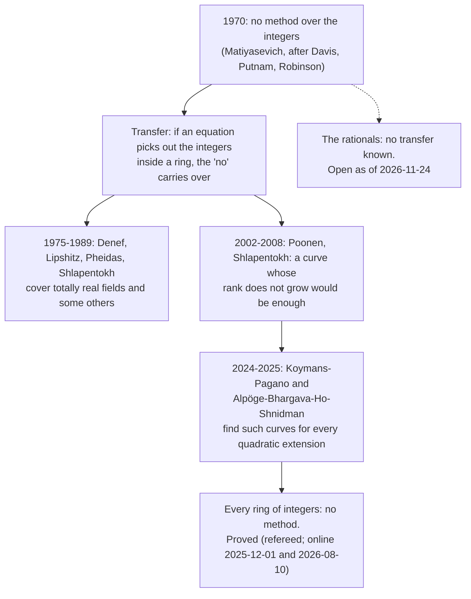

# Hilbert's tenth problem beyond the integers: undecidable over every ring of integers, still open over the rationals

[Syllabus](../../../SYLLABUS.md) → [Frontier](../README.md) → [Algebra, Logic and Computation](../README.md#s06) → Hilbert's tenth problem beyond the integers

---

## General Overview

Over the integers, "x is 0 or more" is an equation. By Lagrange's four-square theorem, x ≥ 0 exactly when x = a² + b² + c² + d² for some integers a, b, c, d. Seven needs all four: 7 = 4 + 1 + 1 + 1, and no three squares make 7.

Equations like that are the tools of [Hilbert's tenth problem](../../24-Computability%20and%20complexity/02-Computability%20and%20Logic/04-hilberts-tenth-problem.md). Hilbert asked in 1900 for one method that decides whether any polynomial equation has a solution in integers. In 1970 the answer was completed: no such method exists.

Now widen the numbers. The ring $`\mathbb{Z}[\sqrt{2}]`$ holds every number of the form integer plus integer times $`\sqrt{2}`$, such as $`3 + 2\sqrt{2}`$. A **ring** is a set where adding, subtracting and multiplying never leave it. Ask Hilbert's question there: is there a method that decides whether an equation has a solution in $`\mathbb{Z}[\sqrt{2}]`$?

The "no" does not carry over by itself. A bigger ring has more possible solutions, so an equation with no integer solution may gain one. To carry the "no" across, one needs an equation that picks out the ordinary integers inside the bigger ring. Four squares no longer do it: $`(1 + \sqrt{2})^2 = 3 + 2\sqrt{2}`$ is a square, but not an integer.

The tool that works is an **elliptic curve**: a curve $`y^2 = x^3 + ux + w`$, with u and w fixed numbers, whose points can be added like numbers. The one needed has a supply of points that does not grow when $`\sqrt{2}`$ is allowed. For the curve $`y^2 = x^3 - 25x`$ that is a theorem, checked on this card. Proofs posted in December 2024 and January 2025 found such a curve, or a higher-dimensional cousin, for every case needed. Over the fractions $`\mathbb{Q}`$, the same question is still open.

**Hilbert's tenth problem has a negative answer over the integers of every number field (the fractions with finitely many roots of polynomials added), because an equation can pick out the ordinary integers there, built from a curve whose rank (its count of independent points of infinite order) does not grow in the bigger field; over the rationals no such equation is known, and a conjecture of Mazur says none exists.**

**What kind of fact this is:** a status card, as of 2026-11-24.

- Over the ring of integers of every number field: proved. The proof of Alpöge, Bhargava, Ho and Shnidman (arXiv 2025-01-30) is refereed and published in *Inventiones mathematicae* 243 (2026). The proof is outlined on this card, not given in full.
- A second, independent proof by Koymans and Pagano (arXiv 2024-12-02): proved, refereed and published in *Journal of the American Mathematical Society* 40 (2027), online 2026-08-10. It proves more: every infinite ring finitely generated over the integers.
- For $`\mathbb{Z}[\sqrt{2}]`$ itself: proved long before, by Denef in 1975 for every quadratic ring (the integers of a field with one square root added), and in 1980 for every totally real field (a field whose every copy inside the complex numbers lies on the real line).
- Over the rationals $`\mathbb{Q}`$: open as of 2026-11-24.
- The rank facts for the curves on this card are theorems, proved on this card from Tunnell's 1983 criterion.

### The picture: the route from the integers to every ring of integers



Solid arrows are published steps. The dotted arrow is the step nobody has made.

---

## The formula

Some words first.

- A **number field** K is a field (a ring where every nonzero member can be divided by) made by adding finitely many roots of polynomials to the fractions. $`\mathbb{Q}(\sqrt{2})`$, the numbers $`p + q\sqrt{2}`$ with p and q fractions, is one.
- Its **ring of integers** $`O_K`$ is the set of its algebraic integers ([Algebraic integers](../../21-Algebraic%20and%20analytic%20number%20theory/06-Algebraic%20Numbers/01-algebraic-integers-and-number-fields.md)): roots of a polynomial with leading coefficient 1 and integer coefficients. For $`\mathbb{Q}(\sqrt{2})`$ it is $`\mathbb{Z}[\sqrt{2}]`$.
- A subset A of a ring R is **Diophantine** over R when one polynomial equation, with extra unknowns, carves it out: t is in A exactly when the equation has a solution in R with that t.

The first formula is the integers' own example, Lagrange's theorem as a Diophantine definition of the numbers 0, 1, 2, …:

```math
t \ge 0 \iff \text{some } a, b, c, d \in \mathbb{Z} \text{ have } t = a^2 + b^2 + c^2 + d^2
```

**Read it aloud:** an integer t is zero or more exactly when it is a sum of four integer squares.

The second formula is the transfer. Suppose a polynomial f carves the integers out of $`O_K`$:

```math
t \in \mathbb{Z} \iff \text{some } x_1, \ldots, x_m \in O_K \text{ have } f(t, x_1, \ldots, x_m) = 0
```

**Read it aloud:** an element t of the ring is an ordinary integer exactly when f, with t put in, has a solution among the ring's integers.

The third formula is the tool that builds f. For an elliptic curve E with rational coefficients, write $`\mathrm{rank}\, E(K)`$ for the number of independent points of infinite order with coordinates in K ([Rational points on a cubic](../../21-Algebraic%20and%20analytic%20number%20theory/07-Diophantine%20and%20Modular/05-elliptic-curves-over-q-and-mordell-weil.md)). For $`K = \mathbb{Q}(\sqrt{2})`$:

```math
\mathrm{rank}\, E(\mathbb{Q}(\sqrt{2})) = \mathrm{rank}\, E(\mathbb{Q}) + \mathrm{rank}\, E^{(2)}(\mathbb{Q})
```

**Read it aloud:** the rank over the bigger field is the rank over the fractions plus the rank of the twist by 2.

The **twist by 2** of $`E : y^2 = x^3 + ux + w`$ is the curve $`E^{(2)} : 2y^2 = x^3 + ux + w`$. When the twist has rank 0, the rank does not grow: that is **rank stability**. For $`E_5 : y^2 = x^3 - 25x`$, the twist is the curve $`E_{10} : y^2 = x^3 - 100x`$ after rescaling, which has rank 0. So the rank of $`E_5`$ over $`\mathbb{Q}(\sqrt{2})`$ equals its rank over $`\mathbb{Q}`$.

| Symbol | Plain meaning | In our example | Push it up and the answer… |
| --- | --- | --- | --- |
| $`K`$; $`O_K`$; p, q | a number field; its ring of integers; the fractions in $`p + q\sqrt{2}`$, a member of $`\mathbb{Q}(\sqrt{2})`$ | $`\mathbb{Q}(\sqrt{2})`$; $`\mathbb{Z}[\sqrt{2}]`$ | a bigger field gives more room for solutions |
| $`t`$ | the element being tested | 7, or $`3 + 2\sqrt{2}`$ | — |
| $`a, b, c, d`$; $`e, s`$ | the four squares' roots; the counters in $`4^e(8s + 7)`$ | 2, 1, 1, 1 for t = 7; e = s = 0 | — |
| $`f`$; $`x_1, \ldots, x_m`$ ($`\vec{x}_i`$ for one list); $`g`$ | the polynomial that carves out the integers; its extra unknowns; any integer equation | f built from the curve $`E_5`$ | — |
| $`E_n`$ | the curve $`y^2 = x^3 - n^2 x`$ | $`E_5`$, $`E_{10}`$; $`E_3`$, $`E_6`$ for the failure; $`E_{41}`$ to test Tunnell's counts | — |
| $`E`$; u, w; $`E^{(2)}`$ | an elliptic curve $`y^2 = x^3 + ux + w`$; its fixed coefficients; its twist by 2, $`2y^2 = x^3 + ux + w`$ | for $`E_5`$, the curve $`E_{10}`$ after X = 2x, Y = 4v (v stands for y) | — |
| $`P`$; $`kP`$ | a point; P added to itself k times | P = (−4, 6) on $`E_5`$ | the coordinates of kP get longer |
| $`d_k`$ | the denominator of kP: its x is a fraction over $`d_k^2`$ | $`d_2 = 12`$, $`d_3 = 2257`$ | grows fast: 25 digits at k = 8 |
| $`\mathrm{rank}`$ | count of independent points of infinite order | rank of $`E_{10}`$ over $`\mathbb{Q}`$ is 0 | positive rank in the twist breaks stability |
| A, B | Tunnell's two counts of integer triples | A = 4, B = 4 for $`E_{10}`$ | A ≠ 2B forces rank 0 |
| $`\sigma`$ | the swap $`\sqrt{2} \to -\sqrt{2}`$ | sends $`3 + 2\sqrt{2}`$ to $`3 - 2\sqrt{2}`$ | — |
| L/F; ℓ | a field F and F with one square root added; an odd prime | $`\mathbb{Q}(\sqrt{2})`$ over $`\mathbb{Q}`$; ℓ = 3 gives curves $`y^2 = x^3 + n`$ | — |

### When it holds

- **The ring must be a ring of integers of a number field.** For $`\mathbb{Q}`$ itself, the transfer is unknown. Over the real numbers, the question is decidable (Tarski, see [Decidable theories](../../24-Computability%20and%20complexity/02-Computability%20and%20Logic/14-decidable-theories-presburger-and-tarski.md)).
- **The definition must use only the ring's own elements.** Lagrange's four squares define 0, 1, 2, … in $`\mathbb{Z}`$. In $`\mathbb{Z}[\sqrt{2}]`$ the same test lets in $`3 + 2\sqrt{2}`$.
- **Rank stability needs a twist of rank 0.** For $`E_3 : y^2 = x^3 - 9x`$, rank 0 over $`\mathbb{Q}`$, the twist $`E_6`$ has a point of infinite order. Over $`\mathbb{Q}(\sqrt{2})`$, $`E_3`$ gains the point $`(-3/2, \tfrac{9}{4}\sqrt{2})`$, and stability fails.
- **The rank must also be positive.** A rank-0 curve has finitely many points, too few to build infinitely many integers. $`E_5`$ passes: P = (−4, 6) has infinite order.
- **Undecidability is about one method for all equations.** It says nothing against any single equation, which still has solutions or has none.

---

## Why it works

### Step 0: borrow the integers' "no"

Over the integers, no method decides solvability (1970). If the integers can be described by an equation inside a bigger ring, every integer equation becomes a question about the bigger ring. A method for the bigger ring would then decide the integers, which is impossible. All the work is in finding the describing equation.

### Step 1: over the integers, four squares carry the "no" between 0, 1, 2, … and all integers

[Four squares and beyond](../../21-Algebraic%20and%20analytic%20number%20theory/07-Diophantine%20and%20Modular/03-four-squares-and-warings-problem.md) proves that every number 0, 1, 2, … is a sum of four squares. Squares are never negative, so the four-square test is exactly "t ≥ 0". This lets a statement about 0, 1, 2, … be rewritten over all integers, by replacing each unknown with a sum of four squares.

The checks count the signed, ordered ways. Seven has 64 ways as four squares and 0 as three. Up to 60, the numbers that need four are 7, 15, 23, 28, 31, 39, 47, 55 and 60: exactly those of the form $`4^e(8s + 7)`$.

### Step 2: a definition of the integers transfers the "no"

Take any integer equation $`g(t_1, \ldots, t_k) = 0`$. Over $`O_K`$, ask instead for a solution of the system

```math
g(t_1, \ldots, t_k) = 0, \quad f(t_1, \vec{x}_1) = 0, \quad \ldots, \quad f(t_k, \vec{x}_k) = 0
```

**Read it aloud:** g is zero, and each $`t_i`$ passes the integer test f with its own extra unknowns.

The extra equations force every $`t_i`$ to be an ordinary integer. So the system has a solution in $`O_K`$ exactly when g has one in $`\mathbb{Z}`$. A list of equations folds into one (the sum of squares trick from [Hilbert's tenth problem](../../24-Computability%20and%20complexity/02-Computability%20and%20Logic/04-hilberts-tenth-problem.md), which works in a ring inside the real numbers; in other rings a norm form does the same job). A method for $`O_K`$ would decide every integer equation. There is none, so there is no method for $`O_K`$.

### Step 3: the easy definitions fail in the bigger ring

In $`\mathbb{Z}[\sqrt{2}]`$, $`(1 + \sqrt{2})^2 = 3 + 2\sqrt{2}`$. So the four-square test passes an element that is not an integer. Its **norm**, $`3^2 - 2 \times 2^2 = 1`$, shows it is a unit (a member with an inverse in the ring), and the units $`(1 + \sqrt{2})^k`$ never run out.

An integer is an element that the swap $`\sigma`$ (sending $`\sqrt{2}`$ to $`-\sqrt{2}`$) leaves alone, but that is not an equation over the ring. The way in is a solution set that the field's extra numbers cannot enlarge.

### Step 4: a curve whose points do not grow

Take $`E_5 : y^2 = x^3 - 25x`$. The point P = (−4, 6) lies on it, since $`6^2 = 36`$ and $`(-4)^3 - 25(-4) = 36`$. Doubling it by the tangent rule gives $`2P = (1681/144, -62279/1728)`$. Points of finite order on such a curve have integer coordinates (the Nagell–Lutz theorem). 2P does not, so P has infinite order and the rank over $`\mathbb{Q}`$ is at least 1.

Over $`\mathbb{Q}(\sqrt{2})`$, could new independent points appear? The rank formula says: only if the twist $`E_{10}`$ has positive rank. Tunnell's 1983 theorem settles that with a count. For even n, let A count the integer triples with $`x^2 + 4y^2 + 8z^2 = n/2`$ and B those with $`x^2 + 4y^2 + 32z^2 = n/2`$. If $`E_n`$ has positive rank, then A = 2B. For odd n, use $`2y^2`$ in place of $`4y^2`$ and n in place of n/2. For n = 10, A = 4 and B = 4, so A ≠ 2B and $`E_{10}`$ has rank 0. (The direction used here is unconditional: Tunnell ties A − 2B to the value of the curve's L-function at 1, and Coates and Wiles proved in 1977 that a nonzero value forces rank 0.)

So the rank of $`E_5`$ is the same over $`\mathbb{Q}`$ and over $`\mathbb{Q}(\sqrt{2})`$. More precisely, every point P of $`E_5`$ over $`\mathbb{Q}(\sqrt{2})`$ has 4P with rational coordinates.

<details>
<summary>Detailed proof: the rank formula, and why 4P is rational</summary>

Let P be a point of E with coordinates in $`\mathbb{Q}(\sqrt{2})`$. The swap $`\sigma`$ respects the curve's equation and the chord and tangent rule, so $`\sigma(P)`$ is a point too, and $`\sigma`$ turns sums into sums.

The point $`P + \sigma(P)`$ is left alone by $`\sigma`$, so its coordinates are rational: it is in $`E(\mathbb{Q})`$.

The point $`P - \sigma(P)`$ is sent by $`\sigma`$ to its own negative. On this curve the negative of (x, y) is (x, −y). So its x is rational and its y is a rational number times $`\sqrt{2}`$. Write y = $`v\sqrt{2}`$: then $`2v^2 = x^3 - n^2 x`$, a point of the twist. Rescaling X = 2x, Y = 4v turns it into $`Y^2 = X^3 - 4n^2 X`$, which is $`E_{2n}`$.

Adding the two pieces gives

$`\displaystyle 2P = \bigl(P + \sigma(P)\bigr) + \bigl(P - \sigma(P)\bigr)`$

so, up to the finitely many points of order 2, the points over $`\mathbb{Q}(\sqrt{2})`$ split into a rational part and a twist part. Their ranks add.

For $`E_5`$ the twist part comes from $`E_{10}(\mathbb{Q})`$, which has rank 0. Its finite part is O and the three points with y = 0, all of order at most 2. So $`2(P - \sigma(P)) = O`$, and $`4P = 2(P + \sigma(P))`$ has rational coordinates.

</details>

### Step 5: from rational points to the integers, in outline

The condition "(x, y) is 4 times a point of $`E_5`$ over $`\mathbb{Q}(\sqrt{2})`$" is written with equations over the bigger field. By Step 4 every solution is rational. So the curve hands over an infinite set of rational numbers, cut out by equations over the bigger ring.

The multiples kP turn that set into a copy of the counting numbers. Write the x of kP as a fraction over $`d_k^2`$. The checks compute $`d_k`$ by the division-polynomial recursion and test it two ways: against adding points with exact fractions up to k = 4, and against an identity the recursion never uses up to k = 8. The values run 1, 12, 2257, 1494696, and on to 25 digits at k = 8. Two facts make them useful:

- **They divide like their indices.** $`d_j`$ divides $`d_k`$ exactly when j divides k, checked for j, k ≤ 8.
- **They grow very fast.** The number of digits grows roughly like $`k^2`$.

Divisibility and size can both be stated with equations. From them one rebuilds the indices k with their addition and multiplication, and so the integers. That step is due to Poonen (2002, for a curve of rank 1 over both fields). Poonen and Shlapentokh, then Shlapentokh, widened it to any positive rank that does not grow. It is outlined here and sourced to Poonen's survey, not proved.

### Step 6: the 2024-2025 proofs supply the curve everywhere

Shlapentokh's criterion asks for more than one field. For every quadratic extension L/F of number fields (L is F with one square root added), it needs a curve or abelian variety over F of positive rank whose rank does not grow in L. An **abelian variety** is a higher-dimensional cousin of an elliptic curve whose points also add. With that supply, Hilbert's tenth problem has a negative answer over every ring of integers.

Two groups supplied it, by different methods:

| Proof | Posted | Object | Method | Status as of 2026-11-24 |
| --- | --- | --- | --- | --- |
| Koymans and Pagano | arXiv 2024-12-02 | elliptic curves with all three points of order 2 rational, like $`E_5`$ | 2-descent with additive combinatorics: Selmer groups, finite computable groups that bound the rank, are controlled across many twists | proved: *J. Amer. Math. Soc.* 40 (2027) 195–234, online 2026-08-10 |
| Alpöge, Bhargava, Ho and Shnidman | arXiv 2025-01-30 | Jacobians of curves $`y^2 = x^\ell + n`$, ℓ an odd prime | Selmer groups of an ℓ-isogeny (an ℓ-to-one map that respects adding points), plus a twist with a found point | proved: *Inventiones mathematicae* 243 (2026) 1129–1139 |

In both, the hard part is the same as on this card: make the twist's rank 0 while the curve's rank stays positive. On $`E_5`$ a single count did it; for every field at once it took new counting methods.

### Step 7: why the rationals stay open

Over $`\mathbb{Q}`$ there is no bigger-ring trick to undo. One would need a Diophantine definition of $`\mathbb{Z}`$ inside $`\mathbb{Q}`$, or a copy of it. Mazur's conjecture (1992) says that for every variety over $`\mathbb{Q}`$, the closure of its rational points in the real points has finitely many connected pieces.

A Diophantine subset of $`\mathbb{Q}`$ is a shadow of such a variety's rational points, so it too would have finitely many pieces in its closure. The integers are infinitely many separated points. So, if Mazur's conjecture holds, $`\mathbb{Z}`$ is not Diophantine over $`\mathbb{Q}`$, and Cornelissen and Zahidi showed it would rule out a Diophantine copy of $`\mathbb{Z}`$ too.

That blocks the standard route, not the question: the answer over $`\mathbb{Q}`$ could still be no by another route, or yes. Mazur's conjecture is known for curves and abelian varieties. A stronger version he also asked about was refuted in 1997 by Colliot-Thélène, Skorobogatov and Swinnerton-Dyer.

How close can one get? Poonen proved in 2003 that there are rings between $`\mathbb{Z}`$ and $`\mathbb{Q}`$, allowing denominators from a set of primes of density 1, where the answer is no. The last step, to every denominator, is open as of 2026-11-24.

---

## Worked numbers, by hand

| Step | Arithmetic | Value |
| --- | --- | --- |
| seven as squares | 4 + 1 + 1 + 1; three squares cannot | four needed |
| a square in $`\mathbb{Z}[\sqrt{2}]`$ | $`(1 + \sqrt{2})^2 = 1 + 2\sqrt{2} + 2`$ | $`3 + 2\sqrt{2}`$, not an integer |
| P on $`E_5`$ | $`6^2`$ against $`(-4)^3 + 100`$ | 36 = 36 |
| tangent slope at P | $`(3 \times 16 - 25)/(2 \times 6)`$ | 23/12 |
| x of 2P | $`(23/12)^2 + 4 + 4`$ | 1681/144, so P has infinite order |
| Tunnell for $`E_{10}`$ | $`x^2 + 4y^2 = 5`$ has (±1, ±1): A = 4; the same four for B | A = 4 ≠ 2B = 8 |
| rank of the twist | A ≠ 2B | 0 |
| rank over $`\mathbb{Q}(\sqrt{2})`$ | rank over $`\mathbb{Q}`$ + 0 | **the same as over $`\mathbb{Q}`$** |

The curve $`E_5`$ gains no new independent points when $`\sqrt{2}`$ is allowed. That is the rank stability the general proofs find for every quadratic extension.

### What breaks if you drop a piece

| Mistake | Comes out at | What went wrong |
| --- | --- | --- |
| Three squares in place of four | 7 has 0 forms; 9 numbers up to 60 missed | Lagrange needs four; $`4^e(8s + 7)`$ escapes three |
| Four squares inside $`\mathbb{Z}[\sqrt{2}]`$ | $`3 + 2\sqrt{2}`$ passes | the bigger ring has more squares, so the test lets non-integers in |
| $`E_3`$ in place of $`E_5`$ | $`(-3/2, \tfrac{9}{4}\sqrt{2})`$ appears: x³ − 9x = 81/8 = y² | the twist $`E_6`$ has rank at least 1: its point (−3, 9) doubles to x = 25/4, not whole; so the rank grows |

The code prints all three.

---

## Code, from first principles, and it actually runs

The code uses exact integer and fraction arithmetic only. It takes four pairs of independent roads. The four-square counts are found by brute force and by Jacobi's divisor formula, and the numbers needing four squares by brute force and by the form $`4^e(8s + 7)`$. The denominators $`d_k`$ come from the division-polynomial recursion, checked against adding points with fractions up to k = 4 and against an identity the recursion never uses up to k = 8. Each curve's rank verdict comes from Tunnell's counts and, separately, from a search for points. A fifth curve, $`E_{41}`$, is a control: only there do the $`8z^2`$ and $`32z^2`$ terms count, so a wrong coefficient in Tunnell's counts would show.

### Python

```python
# Hilbert's tenth problem over number fields -- the check behind the card.
# Standard library only.  Part 1: Lagrange's four squares pick out 0, 1, 2, ...
# inside the integers, counted by brute force and by Jacobi's divisor formula.
# Part 2: in Z[sqrt2] a square need not be a whole number.  Part 3: the curve
# E5: y^2 = x^3 - 25x and its point P = (-4, 6); the denominators of kP come
# by adding points and by the division-polynomial recursion.  Part 4: the twist
# by 2 decides whether the rank grows in Q(sqrt2): Tunnell's counts against a
# search for points.  Both programs print the same lines.
from fractions import Fraction as Fr
from math import isqrt

N, R = 60, range(-8, 9)

def r3(n):                              # signed, ordered ways as three squares
    return sum(1 for a in R for b in R for c in R if a*a + b*b + c*c == n)

def r4(n):                              # the same, as four squares
    return sum(r3(n - d*d) for d in R if d*d <= n)

def jacobi(n):                          # 8 times the divisors not divisible by 4
    return 8 * sum(d for d in range(1, n + 1) if n % d == 0 and d % 4 != 0)

def form_8t7(n):                        # n = 4^e (8s + 7)?
    while n > 0 and n % 4 == 0:
        n //= 4
    return n % 8 == 7

def zmul(u, v):                         # (u0 + u1 sqrt2)(v0 + v1 sqrt2)
    return (u[0]*v[0] + 2*u[1]*v[1], u[0]*v[1] + u[1]*v[0])

def add(P, Q, n):                       # chord and tangent on y^2 = x^3 - n^2 x
    (x1, y1), (x2, y2) = P, Q
    lam = (3*x1*x1 - n*n) / (2*y1) if P == Q else (y2 - y1) / (x2 - x1)
    x3 = lam*lam - x1 - x2
    return (x3, lam*(x1 - x3) - y1)

def psi(K):                             # division polynomials of E5 at x = -4, y = 6
    a, x, y = -25, -4, 6
    p = [0, 1, 2*y, 3*x**4 + 6*a*x*x - a*a,
         4*y*(x**6 + 5*a*x**4 - 5*a*a*x*x - a**3)]
    for k in range(5, K + 1):
        m = k // 2
        if k % 2:
            p.append(p[m+2]*p[m]**3 - p[m-1]*p[m+1]**3)
        else:
            p.append(p[m]*(p[m+2]*p[m-1]**2 - p[m-2]*p[m+1]**2) // p[2])
    return p

def tunnell(n):                         # Tunnell's two counts for y^2 = x^3 - n^2 x
    m, c = (n, 2) if n % 2 else (n // 2, 4)
    T = range(-isqrt(m), isqrt(m) + 1)
    A = sum(1 for x in T for y in T for z in T if x*x + c*y*y + 8*z*z == m)
    B = sum(1 for x in T for y in T for z in T if x*x + c*y*y + 32*z*z == m)
    return A, B

def search(n, amax=2000, emax=12):      # points x = a/e^2, y = b/e^3 with y > 0
    found = []
    for e in range(1, emax + 1):
        for a in range(-amax, amax + 1):
            if Fr(a, e*e).denominator != e*e:
                continue
            v = a**3 - n*n*a*e**4
            if v > 0 and isqrt(v)**2 == v:
                found.append((a, e))
    return found

print("part 1: the whole numbers 0, 1, 2, ... picked out by four squares")
print(f"7 = 4 + 1 + 1 + 1; signed ways to write 7: three squares {r3(7)}, four squares {r4(7)}")
counts = [r4(n) for n in range(1, N + 1)]
jac_ok = counts == [jacobi(n) for n in range(1, N + 1)]
print(f"four-square counts agree with Jacobi's divisor formula for n <= {N}: {'yes' if jac_ok else 'no'}")
need4 = [n for n in range(N + 1) if r3(n) == 0]
print(f"n <= {N} needing four squares: {need4}")
print(f"the same list from the form 4^e(8s + 7): {'yes' if need4 == [n for n in range(N + 1) if form_8t7(n)] else 'no'}")
print(f"n <= {N} with no four-square form: {sum(1 for c in counts if c == 0)}")
print("part 2: four squares fail in Z[sqrt2]")
a, b = zmul((1, 1), (1, 1))             # (1 + sqrt2) times itself, in Z[sqrt2]
print(f"(1 + sqrt2)^2 = {a} + {b} sqrt2, a square that is not a whole number; norm {a*a - 2*b*b}")
print("part 3: E5: y^2 = x^3 - 25x and the point P = (-4, 6)")
P = (Fr(-4), Fr(6))
print(f"check: 6^2 = {6*6} and (-4)^3 - 25(-4) = {(-4)**3 + 100}")
Q2 = add(P, P, 5)
print(f"2P = ({Q2[0]}, {Q2[1]}), not whole, so P has infinite order (Nagell-Lutz)")
p = psi(8)
mult, Q = [P], P
for k in range(2, 5):
    Q = add(Q, P, 5)
    mult.append(Q)
road1 = [isqrt(M[0].denominator) for M in mult]
d = [abs(v) for v in p]
print("k, d_k by adding points, d_k by the division-polynomial recursion, its digits")
for k in range(1, 9):
    print(f"{k} {road1[k-1] if k <= 4 else '-'} {d[k]} {len(str(d[k]))}")
strong = all((d[k] % d[j] == 0) == (k % j == 0) for j in range(1, 9) for k in range(1, 9))
print(f"d_j divides d_k exactly when j divides k, checked for j, k <= 8: {'yes' if strong else 'no'}")
eds = all(p[m+n]*p[m-n] == p[m+1]*p[m-1]*p[n]**2 - p[n+1]*p[n-1]*p[m]**2 for m, n in ((5, 2), (6, 2)))
print(f"second road to d_5..d_8: psi(m+n)psi(m-n) = psi(m+1)psi(m-1)psi(n)^2 - psi(n+1)psi(n-1)psi(m)^2"
      f" at (m, n) = (5, 2), (6, 2), pairs the recursion never uses: {'yes' if eds else 'no'}")
print("part 4: does the rank grow in Q(sqrt2)? ask the twist by 2")
res = {}
for n in (3, 5, 6, 10, 41):              # at 41 the z terms count, testing 8 and 32
    A, B = tunnell(n)
    pts = search(n)
    res[n] = (A, B, pts)
    verdict = "A = 2B: rank may be positive" if A == 2*B else "A != 2B: rank 0 (Tunnell, Coates-Wiles)"
    first = f"first x = {Fr(pts[0][0], pts[0][1]**2)}" if pts else "none"
    print(f"E{n}: A = {A}, B = {B}, {verdict}; search finds {len(pts)} points, {first}")
print("rank E5 over Q(sqrt2) = rank E5 over Q + rank E10 over Q = rank E5 over Q + 0")
print("part 5: what breaks")
print(f"mistake 1, three squares instead of four: 7 has {r3(7)} forms; {len(need4)} numbers <= {N} missed")
print(f"mistake 2, four squares in Z[sqrt2]: {a} + {b} sqrt2 passes and is not a whole number")
X, Y = Fr(-3), Fr(9)                      # E6's point (-3, 9) becomes (X/2, Y sqrt2/4) on E3
x3, ysq = X / 2, (Y / 4)**2 * 2
print(f"mistake 3, E3 in place of E5: rank 0 over Q, but ({x3}, {Y/4} sqrt2) lies on it over Q(sqrt2): "
      f"x^3 - 9x = {x3**3 - 9*x3}, y^2 = {ysq}")
print(f"  that point has infinite order: 2(-3, 9) on E6 has x = {add((X, Y), (X, Y), 6)[0]}")
assert jac_ok and r4(7) == 64 and r3(7) == 0                    # brute force against Jacobi
assert need4 == [n for n in range(N + 1) if form_8t7(n)]       # brute force against Legendre's form
assert road1 == d[1:5] and strong                               # two roads to the denominators
assert eds                                                      # the identity checks d_5 to d_8
assert all((res[n][0] == 2*res[n][1]) == bool(res[n][2]) for n in res)   # Tunnell against search
assert x3**3 - 9*x3 == ysq and Q2[0].denominator != 1
print("ALL CHECKS PASS")
```

**Ran 2026-11-24 on macOS, Python 3.14.10, standard library only. All checks passed. Output, pasted from the run:**

```
part 1: the whole numbers 0, 1, 2, ... picked out by four squares
7 = 4 + 1 + 1 + 1; signed ways to write 7: three squares 0, four squares 64
four-square counts agree with Jacobi's divisor formula for n <= 60: yes
n <= 60 needing four squares: [7, 15, 23, 28, 31, 39, 47, 55, 60]
the same list from the form 4^e(8s + 7): yes
n <= 60 with no four-square form: 0
part 2: four squares fail in Z[sqrt2]
(1 + sqrt2)^2 = 3 + 2 sqrt2, a square that is not a whole number; norm 1
part 3: E5: y^2 = x^3 - 25x and the point P = (-4, 6)
check: 6^2 = 36 and (-4)^3 - 25(-4) = 36
2P = (1681/144, -62279/1728), not whole, so P has infinite order (Nagell-Lutz)
k, d_k by adding points, d_k by the division-polynomial recursion, its digits
1 1 1 1
2 12 12 2
3 2257 2257 4
4 1494696 1494696 7
5 - 8914433905 10
6 - 178761481355556 15
7 - 62419747600438859233 20
8 - 5354229862821602092291248 25
d_j divides d_k exactly when j divides k, checked for j, k <= 8: yes
second road to d_5..d_8: psi(m+n)psi(m-n) = psi(m+1)psi(m-1)psi(n)^2 - psi(n+1)psi(n-1)psi(m)^2 at (m, n) = (5, 2), (6, 2), pairs the recursion never uses: yes
part 4: does the rank grow in Q(sqrt2)? ask the twist by 2
E3: A = 4, B = 4, A != 2B: rank 0 (Tunnell, Coates-Wiles); search finds 0 points, none
E5: A = 0, B = 0, A = 2B: rank may be positive; search finds 5 points, first x = -4
E6: A = 0, B = 0, A = 2B: rank may be positive; search finds 8 points, first x = -3
E10: A = 4, B = 4, A != 2B: rank 0 (Tunnell, Coates-Wiles); search finds 0 points, none
E41: A = 32, B = 16, A = 2B: rank may be positive; search finds 6 points, first x = -9
rank E5 over Q(sqrt2) = rank E5 over Q + rank E10 over Q = rank E5 over Q + 0
part 5: what breaks
mistake 1, three squares instead of four: 7 has 0 forms; 9 numbers <= 60 missed
mistake 2, four squares in Z[sqrt2]: 3 + 2 sqrt2 passes and is not a whole number
mistake 3, E3 in place of E5: rank 0 over Q, but (-3/2, 9/4 sqrt2) lies on it over Q(sqrt2): x^3 - 9x = 81/8, y^2 = 81/8
  that point has infinite order: 2(-3, 9) on E6 has x = 25/4
ALL CHECKS PASS
```

### Rust

Same numbers, same labels, built with `rustc --edition 2021 -O`.

```rust
// Hilbert's tenth problem over number fields -- the same check as the Python,
// in Rust.  No crates.  Part 1: Lagrange's four squares pick out 0, 1, 2, ...
// inside the integers, counted by brute force and by Jacobi's divisor formula.
// Part 2: in Z[sqrt2] a square need not be a whole number.  Part 3: the curve
// E5: y^2 = x^3 - 25x and its point P = (-4, 6); the denominators of kP come
// by adding points and by the division-polynomial recursion.  Part 4: the twist
// by 2 decides whether the rank grows in Q(sqrt2): Tunnell's counts against a
// search for points.  Both programs print the same lines.
const N: i64 = 60;

fn gcd(a: i128, b: i128) -> i128 { if b == 0 { a.abs() } else { gcd(b, a % b) } }

#[derive(Clone, Copy, PartialEq)]
struct Fr { n: i128, d: i128 }               // a fraction in lowest terms, d > 0
fn fr(n: i128, d: i128) -> Fr {
    let g = gcd(n, d) * d.signum();
    Fr { n: n / g, d: d / g }
}
fn sub(a: Fr, b: Fr) -> Fr { fr(a.n * b.d - b.n * a.d, a.d * b.d) }
fn mul(a: Fr, b: Fr) -> Fr { fr(a.n * b.n, a.d * b.d) }
fn div(a: Fr, b: Fr) -> Fr { fr(a.n * b.d, a.d * b.n) }
fn show(a: Fr) -> String { if a.d == 1 { format!("{}", a.n) } else { format!("{}/{}", a.n, a.d) } }

fn isqrt(v: i128) -> i128 {                  // floor square root by Newton's method
    if v < 2 { return v }
    let (mut x, mut y) = (v, (v + 1) / 2);
    while y < x { x = y; y = (x + v / x) / 2 }
    x
}

fn r3(n: i64) -> i64 {                       // signed, ordered ways as three squares
    let mut c = 0;
    for a in -8..9i64 { for b in -8..9i64 { for d in -8..9i64 { if a*a + b*b + d*d == n { c += 1 } } } }
    c
}
fn r4(n: i64) -> i64 { (-8..9i64).filter(|d| d * d <= n).map(|d| r3(n - d * d)).sum() }
fn jacobi(n: i64) -> i64 { 8 * (1..=n).filter(|d| n % d == 0 && d % 4 != 0).sum::<i64>() }
fn form_8t7(mut n: i64) -> bool {            // n = 4^e (8s + 7)?
    while n > 0 && n % 4 == 0 { n /= 4 }
    n % 8 == 7
}
fn zmul(u: (i64, i64), v: (i64, i64)) -> (i64, i64) { (u.0 * v.0 + 2 * u.1 * v.1, u.0 * v.1 + u.1 * v.0) }

fn add(p: (Fr, Fr), q: (Fr, Fr), n: i128) -> (Fr, Fr) {   // chord and tangent on y^2 = x^3 - n^2 x
    let lam = if p == q {
        div(sub(mul(fr(3, 1), mul(p.0, p.0)), fr(n * n, 1)), mul(fr(2, 1), p.1))
    } else { div(sub(q.1, p.1), sub(q.0, p.0)) };
    let x3 = sub(sub(mul(lam, lam), p.0), q.0);
    (x3, sub(mul(lam, sub(p.0, x3)), p.1))
}

fn psi(k_max: usize) -> Vec<i128> {          // division polynomials of E5 at x = -4, y = 6
    let (a, x, y): (i128, i128, i128) = (-25, -4, 6);
    let mut p = vec![0, 1, 2 * y, 3 * x.pow(4) + 6 * a * x * x - a * a,
                     4 * y * (x.pow(6) + 5 * a * x.pow(4) - 5 * a * a * x * x - a.pow(3))];
    for k in 5..=k_max {
        let m = k / 2;
        let v = if k % 2 == 1 { p[m+2] * p[m].pow(3) - p[m-1] * p[m+1].pow(3) }
                else { p[m] * (p[m+2] * p[m-1].pow(2) - p[m-2] * p[m+1].pow(2)) / p[2] };
        p.push(v);
    }
    p
}

fn tunnell(n: i64) -> (i64, i64) {           // Tunnell's two counts for y^2 = x^3 - n^2 x
    let (m, c) = if n % 2 == 1 { (n, 2) } else { (n / 2, 4) };
    let r = isqrt(m as i128) as i64;
    let (mut a, mut b) = (0, 0);
    for x in -r..=r { for y in -r..=r { for z in -r..=r {
        if x*x + c*y*y + 8*z*z == m { a += 1 }
        if x*x + c*y*y + 32*z*z == m { b += 1 }
    } } }
    (a, b)
}

fn search(n: i128) -> Vec<(i128, i128)> {   // points x = a/e^2, y = b/e^3 with y > 0
    let mut found = Vec::new();
    for e in 1..=12i128 { for a in -2000..=2000i128 {
        if gcd(a, e) != 1 { continue }
        let v = a.pow(3) - n * n * a * e.pow(4);
        if v > 0 && isqrt(v).pow(2) == v { found.push((a, e)) }
    } }
    found
}

fn yn(b: bool) -> &'static str { if b { "yes" } else { "no" } }

fn main() {
    println!("part 1: the whole numbers 0, 1, 2, ... picked out by four squares");
    println!("7 = 4 + 1 + 1 + 1; signed ways to write 7: three squares {}, four squares {}", r3(7), r4(7));
    let counts: Vec<i64> = (1..=N).map(r4).collect();
    let jac_ok = counts == (1..=N).map(jacobi).collect::<Vec<i64>>();
    println!("four-square counts agree with Jacobi's divisor formula for n <= {}: {}", N, yn(jac_ok));
    let need4: Vec<i64> = (0..=N).filter(|&n| r3(n) == 0).collect();
    let legendre: Vec<i64> = (0..=N).filter(|&n| form_8t7(n)).collect();
    println!("n <= {} needing four squares: {:?}", N, need4);
    println!("the same list from the form 4^e(8s + 7): {}", yn(need4 == legendre));
    println!("n <= {} with no four-square form: {}", N, counts.iter().filter(|&&c| c == 0).count());
    println!("part 2: four squares fail in Z[sqrt2]");
    let (a, b) = zmul((1, 1), (1, 1));       // (1 + sqrt2) times itself, in Z[sqrt2]
    println!("(1 + sqrt2)^2 = {} + {} sqrt2, a square that is not a whole number; norm {}", a, b, a * a - 2 * b * b);
    println!("part 3: E5: y^2 = x^3 - 25x and the point P = (-4, 6)");
    let p = (fr(-4, 1), fr(6, 1));
    println!("check: 6^2 = {} and (-4)^3 - 25(-4) = {}", 6 * 6, (-4i64).pow(3) + 100);
    let q2 = add(p, p, 5);
    println!("2P = ({}, {}), not whole, so P has infinite order (Nagell-Lutz)", show(q2.0), show(q2.1));
    let ps = psi(8);
    let mut road1 = vec![isqrt(p.0.d)];
    let mut q = p;
    for _ in 2..5 { q = add(q, p, 5); road1.push(isqrt(q.0.d)) }
    let d: Vec<i128> = ps.iter().map(|v| v.abs()).collect();
    println!("k, d_k by adding points, d_k by the division-polynomial recursion, its digits");
    for k in 1..9 {
        let r = if k <= 4 { road1[k - 1].to_string() } else { "-".to_string() };
        println!("{} {} {} {}", k, r, d[k], d[k].to_string().len());
    }
    let strong = (1..9).all(|j| (1..9).all(|k| (d[k] % d[j] == 0) == (k % j == 0)));
    println!("d_j divides d_k exactly when j divides k, checked for j, k <= 8: {}", yn(strong));
    let md = |v: i128| v.rem_euclid(1_000_000_007);      // the identity, checked modulo a prime
    let r: Vec<i128> = ps.iter().map(|&v| md(v)).collect();
    let eds = [(5usize, 2usize), (6, 2)].iter().all(|&(m, n)| md(r[m+n] * r[m-n])
        == md(md(md(r[m+1] * r[m-1]) * md(r[n] * r[n])) - md(md(r[n+1] * r[n-1]) * md(r[m] * r[m]))));
    println!("second road to d_5..d_8: psi(m+n)psi(m-n) = psi(m+1)psi(m-1)psi(n)^2 - psi(n+1)psi(n-1)psi(m)^2 at (m, n) = (5, 2), (6, 2), pairs the recursion never uses: {}", yn(eds));
    println!("part 4: does the rank grow in Q(sqrt2)? ask the twist by 2");
    let mut agree = true;
    for n in [3i64, 5, 6, 10, 41] {        // at 41 the z terms count, testing 8 and 32
        let (ta, tb) = tunnell(n);
        let pts = search(n as i128);
        agree &= (ta == 2 * tb) == !pts.is_empty();
        let verdict = if ta == 2 * tb { "A = 2B: rank may be positive" } else { "A != 2B: rank 0 (Tunnell, Coates-Wiles)" };
        let first = if pts.is_empty() { "none".to_string() } else { format!("first x = {}", show(fr(pts[0].0, pts[0].1 * pts[0].1))) };
        println!("E{}: A = {}, B = {}, {}; search finds {} points, {}", n, ta, tb, verdict, pts.len(), first);
    }
    println!("rank E5 over Q(sqrt2) = rank E5 over Q + rank E10 over Q = rank E5 over Q + 0");
    println!("part 5: what breaks");
    println!("mistake 1, three squares instead of four: 7 has {} forms; {} numbers <= {} missed", r3(7), need4.len(), N);
    println!("mistake 2, four squares in Z[sqrt2]: {} + {} sqrt2 passes and is not a whole number", a, b);
    let (bx, by) = (fr(-3, 1), fr(9, 1));    // E6's point (-3, 9) becomes (X/2, Y sqrt2/4) on E3
    let x3 = div(bx, fr(2, 1));
    let y4 = div(by, fr(4, 1));
    let ysq = mul(mul(y4, y4), fr(2, 1));
    let lhs = sub(mul(x3, mul(x3, x3)), mul(fr(9, 1), x3));
    println!("mistake 3, E3 in place of E5: rank 0 over Q, but ({}, {} sqrt2) lies on it over Q(sqrt2): x^3 - 9x = {}, y^2 = {}",
             show(x3), show(y4), show(lhs), show(ysq));
    println!("  that point has infinite order: 2(-3, 9) on E6 has x = {}", show(add((bx, by), (bx, by), 6).0));
    assert!(jac_ok && r4(7) == 64 && r3(7) == 0);                 // brute force against Jacobi
    assert!(need4 == legendre);                                  // brute force against Legendre's form
    assert!(road1[..] == d[1..5] && strong);                     // two roads to the denominators
    assert!(eds);                                                // the identity checks d_5 to d_8
    assert!(agree);                                              // Tunnell against search
    assert!(lhs == ysq && q2.0.d != 1);
    println!("ALL CHECKS PASS");
}
```

**Ran 2026-11-24 on macOS, rustc 1.98.1, no crates. All checks passed. Output, pasted from the run:**

```
part 1: the whole numbers 0, 1, 2, ... picked out by four squares
7 = 4 + 1 + 1 + 1; signed ways to write 7: three squares 0, four squares 64
four-square counts agree with Jacobi's divisor formula for n <= 60: yes
n <= 60 needing four squares: [7, 15, 23, 28, 31, 39, 47, 55, 60]
the same list from the form 4^e(8s + 7): yes
n <= 60 with no four-square form: 0
part 2: four squares fail in Z[sqrt2]
(1 + sqrt2)^2 = 3 + 2 sqrt2, a square that is not a whole number; norm 1
part 3: E5: y^2 = x^3 - 25x and the point P = (-4, 6)
check: 6^2 = 36 and (-4)^3 - 25(-4) = 36
2P = (1681/144, -62279/1728), not whole, so P has infinite order (Nagell-Lutz)
k, d_k by adding points, d_k by the division-polynomial recursion, its digits
1 1 1 1
2 12 12 2
3 2257 2257 4
4 1494696 1494696 7
5 - 8914433905 10
6 - 178761481355556 15
7 - 62419747600438859233 20
8 - 5354229862821602092291248 25
d_j divides d_k exactly when j divides k, checked for j, k <= 8: yes
second road to d_5..d_8: psi(m+n)psi(m-n) = psi(m+1)psi(m-1)psi(n)^2 - psi(n+1)psi(n-1)psi(m)^2 at (m, n) = (5, 2), (6, 2), pairs the recursion never uses: yes
part 4: does the rank grow in Q(sqrt2)? ask the twist by 2
E3: A = 4, B = 4, A != 2B: rank 0 (Tunnell, Coates-Wiles); search finds 0 points, none
E5: A = 0, B = 0, A = 2B: rank may be positive; search finds 5 points, first x = -4
E6: A = 0, B = 0, A = 2B: rank may be positive; search finds 8 points, first x = -3
E10: A = 4, B = 4, A != 2B: rank 0 (Tunnell, Coates-Wiles); search finds 0 points, none
E41: A = 32, B = 16, A = 2B: rank may be positive; search finds 6 points, first x = -9
rank E5 over Q(sqrt2) = rank E5 over Q + rank E10 over Q = rank E5 over Q + 0
part 5: what breaks
mistake 1, three squares instead of four: 7 has 0 forms; 9 numbers <= 60 missed
mistake 2, four squares in Z[sqrt2]: 3 + 2 sqrt2 passes and is not a whole number
mistake 3, E3 in place of E5: rank 0 over Q, but (-3/2, 9/4 sqrt2) lies on it over Q(sqrt2): x^3 - 9x = 81/8, y^2 = 81/8
  that point has infinite order: 2(-3, 9) on E6 has x = 25/4
ALL CHECKS PASS
```

The two outputs match line for line. The search is evidence only: finding no point on $`E_{10}`$ up to the bound proves nothing alone. The proof of rank 0 is Tunnell's count; the assert checks that both roads agree on all five curves.

### Lean

Lean proves the facts behind Steps 1 and 3 in general, and checks the card's small numbers.

- Take any integer t. Then t ≥ 0 exactly when t is a sum of four integer squares.
- Take $`3 + 2\sqrt{2}`$ in $`\mathbb{Z}[\sqrt{2}]`$. Then it is a sum of four squares there, but not an ordinary integer.
- Take any element of $`\mathbb{Z}[\sqrt{2}]`$. Then it is an ordinary integer exactly when the swap $`\sigma`$ leaves it alone.
- Seven is 4 + 1 + 1 + 1, and no three integer squares make 7.
- Seven has 64 signed, ordered ways as four squares, with each root from −2 to 2, since 3² is more than 7.
- Up to 60, the numbers that are not a sum of three squares are 7, 15, 23, 28, 31, 39, 47, 55 and 60.
- Take $`(1 + \sqrt{2})^2`$. Then it equals $`3 + 2\sqrt{2}`$, and the norm $`3^2 - 2 \times 2^2`$ is 1.
- Take P = (−4, 6). Then P lies on $`E_5`$, the tangent there has slope 23/12, and 2P = (1681/144, −62279/1728).
- The x of 2P has denominator 144, so 2P is not whole.
- Take $`d_2 = 12`$, $`d_3 = 2257`$ and $`d_4 = 1494696`$. Then $`d_2`$ divides $`d_4`$, and $`d_3`$ does not.
- Take $`E_{10}`$, counting x, y and z from −2 to 2. Then Tunnell's counts are A = 4 and B = 4.
- Take $`E_3`$, counting x, y and z from −1 to 1. Then A = 4 and B = 4 as well.
- Take the point $`(-3/2, \tfrac{9}{4}\sqrt{2})`$. Then both sides of the equation of $`E_3`$ equal 81/8, so the point lies on $`E_3`$.
- Take the point (−3, 9). Then it lies on $`E_6`$, and the x of its double is 25/4, not whole.

The recursion for $`d_k`$, the other curves' counts and the point searches are left to the Python and Rust checks.

```lean
-- Hilbert's tenth problem beyond the integers: four squares pick out the integers 0 or more inside ℤ, the same test lets the non-integer 3 + 2√2 through in ℤ[√2], the integers of ℤ[√2] are exactly the elements the swap √2 ↦ −√2 leaves alone, and the card's small worked numbers check exactly.
import Mathlib.NumberTheory.SumFourSquares
import Mathlib.NumberTheory.Zsqrtd.Basic
import Mathlib.Analysis.Real.Sqrt
import Mathlib.Data.Int.Interval
import Mathlib.Data.Rat.Defs

/-- Lagrange's theorem as a Diophantine definition: an integer t is zero or more
exactly when it is a sum of four integer squares. -/
theorem nonneg_iff_sum_four_squares (t : ℤ) :
    0 ≤ t ↔ ∃ a b c d : ℤ, t = a ^ 2 + b ^ 2 + c ^ 2 + d ^ 2 := by
  constructor
  · intro ht
    obtain ⟨a, b, c, d, h⟩ := Nat.sum_four_squares t.toNat
    refine ⟨a, b, c, d, ?_⟩
    have h' : ((a ^ 2 + b ^ 2 + c ^ 2 + d ^ 2 : ℕ) : ℤ) = (t.toNat : ℤ) := by rw [h]
    push_cast at h'
    rw [h', Int.toNat_of_nonneg ht]
  · rintro ⟨a, b, c, d, rfl⟩
    positivity

/-- In ℤ[√2] the four-square test no longer picks out integers: 3 + 2√2 is a sum
of four squares there (it is (1 + √2)²), but it is not an ordinary integer. -/
theorem four_squares_pass_non_integer_in_zsqrt2 :
    (∃ a b c d : ℤ√2, (⟨3, 2⟩ : ℤ√2) = a ^ 2 + b ^ 2 + c ^ 2 + d ^ 2) ∧
      ∀ n : ℤ, (⟨3, 2⟩ : ℤ√2) ≠ (n : ℤ√2) := by
  refine ⟨⟨⟨1, 1⟩, 0, 0, 0, ?_⟩, ?_⟩
  · ext <;> simp [sq, Zsqrtd.re_mul, Zsqrtd.im_mul]
  · intro n h
    have := congrArg Zsqrtd.im h
    simp at this

/-- The ordinary integers inside ℤ[√2] are exactly the elements that the swap σ,
sending √2 to −√2, leaves alone. -/
theorem swap_fixed_iff_integer (x : ℤ√2) : star x = x ↔ ∃ n : ℤ, x = (n : ℤ√2) := by
  constructor
  · intro h
    refine ⟨x.re, ?_⟩
    have := congrArg Zsqrtd.im h
    simp at this
    ext <;> simp
    omega
  · rintro ⟨n, rfl⟩
    ext <;> simp

-- Seven is a sum of four squares, 7 = 4 + 1 + 1 + 1, and no three squares make 7.
example : (7 : ℤ) = 2 ^ 2 + 1 ^ 2 + 1 ^ 2 + 1 ^ 2 := by norm_num
example : ¬ ∃ a b c : ℤ, a ^ 2 + b ^ 2 + c ^ 2 = 7 := by
  rintro ⟨a, b, c, h⟩
  have ha1 : a ≤ 2 := by nlinarith [sq_nonneg b, sq_nonneg c, sq_nonneg (a - 3)]
  have ha2 : -2 ≤ a := by nlinarith [sq_nonneg b, sq_nonneg c, sq_nonneg (a + 3)]
  have hb1 : b ≤ 2 := by nlinarith [sq_nonneg a, sq_nonneg c, sq_nonneg (b - 3)]
  have hb2 : -2 ≤ b := by nlinarith [sq_nonneg a, sq_nonneg c, sq_nonneg (b + 3)]
  have hc1 : c ≤ 2 := by nlinarith [sq_nonneg b, sq_nonneg a, sq_nonneg (c - 3)]
  have hc2 : -2 ≤ c := by nlinarith [sq_nonneg b, sq_nonneg a, sq_nonneg (c + 3)]
  interval_cases a <;> interval_cases b <;> interval_cases c <;> omega

-- Seven has 64 signed, ordered ways as four squares (every entry lies in −2..2).
example : ((Finset.Icc (-2 : ℤ) 2 ×ˢ Finset.Icc (-2 : ℤ) 2 ×ˢ Finset.Icc (-2 : ℤ) 2 ×ˢ
    Finset.Icc (-2 : ℤ) 2).filter
      (fun p => p.1 ^ 2 + p.2.1 ^ 2 + p.2.2.1 ^ 2 + p.2.2.2 ^ 2 = 7)).card = 64 := by decide +kernel

-- Up to 60, the numbers that are not a sum of three squares (roots 0..7 suffice, as 8² > 60).
example : (List.range 61).filter (fun n => ∀ a ∈ List.range 8, ∀ b ∈ List.range 8,
    ∀ c ∈ List.range 8, a ^ 2 + b ^ 2 + c ^ 2 ≠ n) = [7, 15, 23, 28, 31, 39, 47, 55, 60] := by
  decide +kernel

-- (1 + √2)² = 3 + 2√2 in ℤ[√2], and its norm 3² − 2 × 2² is 1.
example : ((⟨1, 1⟩ : ℤ√2)) ^ 2 = ⟨3, 2⟩ := by
  ext <;> simp [sq, Zsqrtd.re_mul, Zsqrtd.im_mul]
example : Zsqrtd.norm (⟨3, 2⟩ : ℤ√2) = 1 := by simp [Zsqrtd.norm_def]

-- P = (−4, 6) lies on E5: y² = x³ − 25x.
example : (6 : ℤ) ^ 2 = (-4) ^ 3 - 25 * (-4) := by norm_num

-- The tangent at P has slope 23/12, and 2P = (1681/144, −62279/1728), not whole.
example : ((3 * (-4) ^ 2 - 25) / (2 * 6) : ℚ) = 23 / 12 := by norm_num
example : ((23 / 12) ^ 2 - 2 * (-4) : ℚ) = 1681 / 144 := by norm_num
example : ((23 / 12) * (-4 - 1681 / 144) - 6 : ℚ) = -62279 / 1728 := by norm_num
example : ((1681 : ℚ) / 144).den = 144 := by decide +kernel

-- Denominators of kP: d_2 = 12 divides d_4 = 1494696, and d_3 = 2257 does not.
example : (12 : ℕ) ∣ 1494696 ∧ ¬ (2257 : ℕ) ∣ 1494696 := by decide

-- Tunnell's counts for E10 (n/2 = 5): A counts x² + 4y² + 8z² = 5, B counts x² + 4y² + 32z² = 5.
example : ((Finset.Icc (-2 : ℤ) 2 ×ˢ Finset.Icc (-2 : ℤ) 2 ×ˢ Finset.Icc (-2 : ℤ) 2).filter
    (fun p => p.1 ^ 2 + 4 * p.2.1 ^ 2 + 8 * p.2.2 ^ 2 = 5)).card = 4 := by decide +kernel
example : ((Finset.Icc (-2 : ℤ) 2 ×ˢ Finset.Icc (-2 : ℤ) 2 ×ˢ Finset.Icc (-2 : ℤ) 2).filter
    (fun p => p.1 ^ 2 + 4 * p.2.1 ^ 2 + 32 * p.2.2 ^ 2 = 5)).card = 4 := by decide +kernel

-- Tunnell's counts for E3 (odd n = 3): A counts x² + 2y² + 8z² = 3, B counts x² + 2y² + 32z² = 3.
example : ((Finset.Icc (-1 : ℤ) 1 ×ˢ Finset.Icc (-1 : ℤ) 1 ×ˢ Finset.Icc (-1 : ℤ) 1).filter
    (fun p => p.1 ^ 2 + 2 * p.2.1 ^ 2 + 8 * p.2.2 ^ 2 = 3)).card = 4 := by decide +kernel
example : ((Finset.Icc (-1 : ℤ) 1 ×ˢ Finset.Icc (-1 : ℤ) 1 ×ˢ Finset.Icc (-1 : ℤ) 1).filter
    (fun p => p.1 ^ 2 + 2 * p.2.1 ^ 2 + 32 * p.2.2 ^ 2 = 3)).card = 4 := by decide +kernel

-- What breaks: E3: y² = x³ − 9x gains (−3/2, (9/4)√2) over ℚ(√2); both sides are 81/8.
example : ((9 / 4 : ℝ) * Real.sqrt 2) ^ 2 = (-3 / 2 : ℝ) ^ 3 - 9 * (-3 / 2) := by
  rw [mul_pow, Real.sq_sqrt (by norm_num)]; norm_num
example : ((-3 / 2 : ℚ)) ^ 3 - 9 * (-3 / 2) = 81 / 8 := by norm_num

-- The twist E6: y² = x³ − 36x has (−3, 9), and 2(−3, 9) has x = 25/4, not whole.
example : (9 : ℤ) ^ 2 = (-3) ^ 3 - 36 * (-3) := by norm_num
example : (((3 * (-3) ^ 2 - 36) / (2 * 9)) ^ 2 - 2 * (-3) : ℚ) = 25 / 4 := by norm_num

#print axioms nonneg_iff_sum_four_squares
#print axioms four_squares_pass_non_integer_in_zsqrt2
#print axioms swap_fixed_iff_integer
```

**Checked 2026-11-24 on macOS, Lean 4.36.0-rc2, Mathlib v4.36.0-rc2. Every proof is complete and uses only Lean's standard axioms. Output, pasted from the run:**

```
'nonneg_iff_sum_four_squares' depends on axioms: [propext, Classical.choice, Quot.sound]
'four_squares_pass_non_integer_in_zsqrt2' depends on axioms: [propext]
'swap_fixed_iff_integer' depends on axioms: [propext, Quot.sound]
```

> [!TIP]
> **Try changing**
> Guess first, then run it.
> - **Twist $`E_7`$ instead.** Add 7 and 14 to the tuple `(3, 5, 6, 10, 41)` in part 4. Guess: both give A = 0, B = 0, both searches find 4 points (first x = 25 and x = 18), and every assert still passes. Both ranks are positive, so $`E_7`$ gains rank in $`\mathbb{Q}(\sqrt{2})`$.
> - **Ask which numbers four squares miss.** Change `if r3(n) == 0` to `if r4(n) == 0`. Guess: the list is empty, and the Legendre assert stops the run.
> - **Break the recursion.** Flip the sign of `5*a*a*x*x` in `psi`. Guess: the second road's $`d_4`$ no longer matches 1494696, and the two-roads assert stops the run.

---

## The usual mistake

> [!warning]
> **Reading "undecidable over every ring of integers" as "undecidable over the rationals".** The rationals are the field of fractions, not a ring of integers. Their question is open as of 2026-11-24, and Mazur's conjecture would block the method that settled the rings.
>
> - **Assuming the integers' "no" transfers for free.** A bigger ring has more solutions: $`3 + 2\sqrt{2}`$ passes the four-square test there.
> - **Treating a search as a rank proof.** The search finds no point on $`E_{10}`$ up to its bound, which is evidence. Tunnell's count, A = 4 ≠ 8, is the proof.
> - **Thinking any curve will do.** $`E_3`$ has rank 0 over $`\mathbb{Q}`$ but gains $`(-3/2, \tfrac{9}{4}\sqrt{2})`$ over $`\mathbb{Q}(\sqrt{2})`$.
> - **Dating the theorem by its preprints.** The December 2024 and January 2025 postings were claims. The theorem counts as proved from refereed publication: *Inventiones* online 2025-12-01, *J. Amer. Math. Soc.* online 2026-08-10.

---

## Where you meet it in real life

- **Quantum circuit design.** Exact gate synthesis for the Clifford+T gate set works in the ring $`\mathbb{Z}[1/\sqrt{2}, i]`$. That is not a ring of integers, since $`1/\sqrt{2}`$ is not an algebraic integer. Synthesis solves one special family, norm equations, which has its own algorithm. Koymans and Pagano's wider result, for every infinite finitely generated ring, says no single solver can handle every polynomial equation over such rings.
- **Lattice cryptography.** Ring-based schemes compute in rings of integers of cyclotomic fields. Their security rests on specific hard problems, not on undecidability. The theorem marks the outer limit: no general equation solver exists over those rings.
- **Number theory research.** Rank stability under twists is now a working tool for how ranks behave across families of curves.

> **Say it back**
> Over the integers no method decides polynomial equations, and four squares pick out the numbers 0 or more. In a bigger ring like $`\mathbb{Z}[\sqrt{2}]`$ the "no" carries over once an equation picks out the ordinary integers, but four squares no longer do it. A curve whose rank does not grow in the bigger field does: $`y^2 = x^3 - 25x`$ keeps its rank in $`\mathbb{Q}(\sqrt{2})`$ because its twist has rank 0, by Tunnell's count 4 ≠ 8. Proofs of 2024 and 2025 found such curves for every quadratic extension, so every ring of integers is settled; both proofs are now refereed and published. Over the rationals the question is open, and Mazur's conjecture would block this route.

---

## What this builds on

- [Hilbert's and Smale's lists](05-hilbert-and-smale-problems-selected.md): the status of Hilbert's tenth over the integers; this card adds the number-field version.
- [Four squares and beyond](../../21-Algebraic%20and%20analytic%20number%20theory/07-Diophantine%20and%20Modular/03-four-squares-and-warings-problem.md): Lagrange's theorem, the integers' Diophantine definition of 0, 1, 2, ….
- [Algebraic integers](../../21-Algebraic%20and%20analytic%20number%20theory/06-Algebraic%20Numbers/01-algebraic-integers-and-number-fields.md): number fields and their rings of integers.
- [Rational points on a cubic](../../21-Algebraic%20and%20analytic%20number%20theory/07-Diophantine%20and%20Modular/05-elliptic-curves-over-q-and-mordell-weil.md): the group of points, torsion and rank.
- [Hilbert's tenth problem](../../24-Computability%20and%20complexity/02-Computability%20and%20Logic/04-hilberts-tenth-problem.md): the proof that no method exists over the integers.
- [Decidable theories](../../24-Computability%20and%20complexity/02-Computability%20and%20Logic/14-decidable-theories-presburger-and-tarski.md): where decision methods do exist, such as the real numbers.
- [The Langlands program](06-langlands-program-and-geometric-langlands.md): the L-functions of elliptic curves, which Tunnell's count reads at 1.

## Where this goes next

- [Andre-Oort and o-minimality](08-andre-oort-and-o-minimality.md): the next card on this shelf, where logic (o-minimal structures) proves theorems about special points on varieties.
- [MIP* = RE](09-mip-star-equals-re-and-connes-embedding.md): another problem settled by undecidability, there for games played with entangled provers.

The question this card leaves open: is there a method that decides whether a polynomial equation has a solution in the rational numbers?

---

## Sources

Verified 2026-11-24: every link below resolves to the publisher's page.

- Alpöge, Levent, Manjul Bhargava, Wei Ho and Ari Shnidman. "Rank stability in quadratic extensions and Hilbert's tenth problem for the ring of integers of a number field." *Inventiones mathematicae* 243 (2026), 1129–1139. [doi:10.1007/s00222-025-01392-3](https://doi.org/10.1007/s00222-025-01392-3). The refereed proof; preprint [arXiv:2501.18774](https://arxiv.org/abs/2501.18774), 2025-01-30.
- Koymans, Peter, and Carlo Pagano. "Hilbert's tenth problem via additive combinatorics." *Journal of the American Mathematical Society* 40 (2027), 195–234, online 2026-08-10. [doi:10.1090/jams/1081](https://doi.org/10.1090/jams/1081). The independent proof with elliptic curves of full 2-torsion, for every infinite finitely generated ring; preprint [arXiv:2412.01768](https://arxiv.org/abs/2412.01768), 2024-12-02.
- Poonen, Bjorn. "Hilbert's Tenth Problem over rings of number-theoretic interest." Notes for the Arizona Winter School, 2003, updated 2010. [Author's page](https://math.mit.edu/~poonen/papers/aws2003.pdf). The transfer, Mazur's conjecture and its consequence for $`\mathbb{Q}`$, Denef's fields, and the rank criterion.
- Poonen, Bjorn. "Hilbert's Tenth Problem and Mazur's Conjecture for large subrings of $`\mathbb{Q}`$." *Journal of the American Mathematical Society* 16 (2003), 981–990. [doi:10.1090/S0894-0347-03-00433-8](https://doi.org/10.1090/S0894-0347-03-00433-8). The rings with prime denominators of density 1 where the answer is no.
- Tunnell, J. B. "A classical Diophantine problem and modular forms of weight 3/2." *Inventiones mathematicae* 72 (1983), 323–334. [doi:10.1007/BF01389327](https://doi.org/10.1007/BF01389327). The counts A and B that prove $`E_{10}`$ and $`E_3`$ have rank 0.
