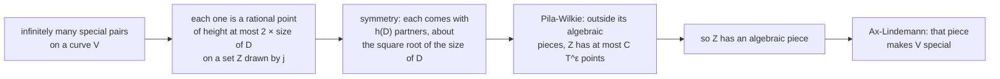

# Andre-Oort and o-minimality: special points on modular curves, counted with logic

[Syllabus](../../../SYLLABUS.md) → [Frontier](../README.md) → [Algebra, Logic and Computation](../README.md#s06) → Andre-Oort and o-minimality

---

## General Overview

The number 1728 is a value of the **j-function**. This function is built from the modular forms of wing 21, and it takes a point τ (read "tau") in the upper half of the complex plane. At most points its value is a messy transcendental number: one that solves no polynomial equation with whole-number coefficients.

At a few points it is not. Take τ = i, the square root of −1: then j(i) = 1728. Take τ = (1 + √−3)/2: then j = 0. Take τ = (1 + √−163)/2: then j = −262,537,412,640,768,000, an 18-digit whole number. These τ solve quadratic equations with whole-number coefficients. They are called **special points**, or **CM points** (from "complex multiplication").

Now take pairs of j-values, (j(τ₁), j(τ₂)), as points of a plane, and draw a curve in that plane. When can the curve pass through infinitely many **special pairs**, pairs where both τ₁ and τ₂ are special? The diagonal line "first value = second value" does: it holds every pair (j(τ), j(τ)). In 1998 Yves André proved that only a short list of **special curves** can. The **André–Oort conjecture**, posed by André and by Frans Oort, asks the same for any number of coordinates, and for wider spaces called **Shimura varieties**: spaces whose points sort objects such as elliptic curves and their higher-dimensional cousins, abelian varieties.

In 2011 Jonathan Pila proved it for any number of coordinates. His tool came from logic: a theorem that counts rational points on sets drawn by **o-minimal** functions, functions that cannot wiggle infinitely often. In 2026 the International Mathematical Union gave Jacob Tsimerman a Fields Medal, citing in its words "the recasting of o-minimality as a fundamental method of arithmetic and complex algebraic geometry".

**A curve, or a higher-dimensional variety, that holds infinitely many special points must itself be special; Pila's proof turns special points into rational points of small height on a set drawn by the j-function, uses their symmetry to show there are too many of them, and uses o-minimal counting to force them onto algebraic pieces, which turn out to be special.**

**What kind of fact this is:** theorems with dated statuses, as of 2026-11-24. For curves in the plane: proved, André 1998. For any number of coordinates: proved, Pila 2011, refereed. For one family of Shimura varieties, Siegel modular varieties: proved, Tsimerman 2018, refereed. For all Shimura varieties: claimed, in a 2021 preprint revised in 2024, with no journal version found. The research proofs are outlined here, not proved. The code checks the special values, the class numbers, the special curve of level 2 and the point counts.

### The picture: the route of the proof



Each arrow is one step of "Why it works". The tension is in the middle: Galois symmetry gives a power of the height, and o-minimality allows less than any power.

---

## The formula

Notation first.

- A **special point** τ is a point of the upper half plane ℍ that solves $`a\tau^2 + b\tau + c = 0`$ with whole numbers a, b, c sharing no common factor. Its **discriminant** is $`D = b^2 - 4ac`$, which is negative.
- The **j-function** is $`j = E_4^3/\Delta`$, with $`E_4`$ and $`\Delta`$ the Eisenstein series and cusp form of [Modular forms](../../21-Algebraic%20and%20analytic%20number%20theory/07-Diophantine%20and%20Modular/07-modular-forms-in-outline.md). In the variable $`q = e^{2\pi i\tau}`$ it begins $`1/q + 744 + 196884q + \dots`$.
- A **special pair** is $`(j(\tau_1), j(\tau_2))`$ with both $`\tau_1`$ and $`\tau_2`$ special.
- A **special curve** in the plane with coordinates (X, Y) is one of three kinds: a line $`X = j(\tau_0)`$ or $`Y = j(\tau_0)`$ with $`\tau_0`$ special; or a **modular curve** $`\Phi_\ell(X, Y) = 0`$. Here $`\Phi_\ell`$ is the polynomial that links $`j(\tau)`$ and $`j(\ell\tau)`$, and $`\Phi_1 = X - Y`$ gives the diagonal.

André's theorem, the case of the plane:

```math
V \subset \mathbb{C}^2 \text{ an irreducible algebraic curve with infinitely many special pairs} \;\Longrightarrow\; V \text{ is special}
```

**Read it aloud:** if a curve, not split into smaller curves, holds infinitely many special pairs, then it is a line at a special value or a modular curve.

The counting theorem behind Pila's proof is the **Pila–Wilkie theorem** (2006). The **height** of a fraction a/b in lowest terms is the larger of |a| and |b|; the height of a point is the largest height of its coordinates. For a set Z in $`\mathbb{R}^n`$, $`N(Z, T)`$ counts the points of Z with rational coordinates and height at most T.

```math
N\big(Z^{\mathrm{tr}}, T\big) \le C(Z, \varepsilon)\, T^{\varepsilon} \qquad \text{for every } \varepsilon > 0 \text{ and every } T \ge 1
```

**Read it aloud:** take a set drawn in an o-minimal structure and remove every curved piece of it that a polynomial equation can describe; what is left has fewer rational points of height at most T than any fixed power of T, however small, times a constant.

| Symbol | Plain meaning | In our example | Push it up and the answer… |
| --- | --- | --- | --- |
| $`\tau`$, ℍ | a point of the upper half plane (positive imaginary part) | τ = i | larger imaginary part, smaller q |
| a, b, c; D | whole-number coefficients of τ's quadratic; its discriminant $`b^2 - 4ac`$ | $`\tau^2 + 1 = 0`$: D = −4 | more negative D, more special points |
| j(τ); q | the j-function; the series variable $`e^{2\pi i\tau}`$ | j(i) = 1728; q = 0.00186744 at τ = i | — |
| h(D) | the **class number**: how many special points of discriminant D, one per reduced form | h(−15) = 2 | grows roughly like $`\lvert D\rvert^{1/2}`$ |
| X, Y; V | coordinates of the plane of j-pairs; a curve in it | V: X = Y | — |
| $`\Phi_\ell`$; γ | the modular polynomial of level ℓ; a matrix with rational entries that moves $`\tau_1`$ to $`\tau_2`$ | $`\Phi_2(1728, 287496) = 0`$; rows (2, 0) and (0, 1) send τ to 2τ | higher degree, larger coefficients |
| H(x) | the height of a rational number or point | H(15/16) = 16 | — |
| T; N(Z, T) | a height bound; how many rational points of Z have height at most T | y = x², T = 10⁶: 304,193 | for the algebraic part, grows like a power of T |
| Z; $`Z^{\mathrm{alg}}`$, $`Z^{\mathrm{tr}}`$ | a definable set; the union of its connected semialgebraic pieces of positive dimension (arcs, surfaces and so on); the rest of Z | y = 2^x on [0, 1] has empty algebraic part | — |
| $`E_4`$, $`E_6`$, $`\Delta`$; F; ρ | the Eisenstein series of weights 4 and 6 and the cusp form, from wing 21; the fundamental region; the corner $`(-1 + \sqrt{-3})/2`$ | $`E_6(i) = 0`$; $`E_4(\rho) = 0`$ | — |
| $`\mathcal{A}_g`$; g | the Siegel modular variety, sorting abelian varieties of dimension g | g = 1 gives the j-line | — |
| ε; C(Z, ε) | any small positive exponent; a constant fixed by Z and ε | y = 2^x: 2 points for every T | smaller ε, larger constant |

### When it holds

- **The structure must be o-minimal.** The curve y = sin(πx), x ≥ 0, has no algebraic piece, yet holds (0, 0), (1, 0), (2, 0), …: at least 1,000,001 points of height at most 10⁶ from the whole numbers alone, and more at half-integers such as (1/2, 1).
- **The algebraic part must be removed.** The parabola y = x² on [0, 1] has 304,193 rational points of height at most 10⁶: a power of T.
- **The j-function must be cut down to one fundamental region.** On all of ℍ, j repeats under the shift τ ↦ τ + 1, like sine, so it is not definable in any o-minimal structure. On the fundamental region F of the modular forms card it is (Peterzil and Starchenko, 2004), and every orbit of the moves meets F.
- **"Infinitely many" is essential.** The line X + Y = 1728 is not special, yet it passes through the special pairs (0, 1728) and (1728, 0). André's theorem allows finitely many.
- **The constants are not computed.** C(Z, ε) and the class-number constant of Step 5 have no known formula, so the proof shows finiteness without a list. For plane curves, later proofs by other methods do give a computable bound (Kühne, 2012; Bilu, Masser and Zannier, 2013).

---

## Why it works

### Step 0: too many points for a set that cannot wiggle

Two counts collide. Symmetry says a special point with large discriminant D comes with about $`\lvert D\rvert^{1/2}`$ partners, all of height at most $`2\lvert D\rvert`$. O-minimality says a set with no algebraic piece has fewer than any power of the height. So, for large D, the set must have an algebraic piece. A separate theorem then says such a piece exists only on special curves.

### Step 1: why j takes whole-number values at special points

The value j(i) = 1728 follows from symmetry. The flip τ ↦ −1/τ fixes τ = i, and $`E_6`$ has weight 6, so $`E_6(i) = i^6 E_6(i) = -E_6(i)`$. Hence $`E_6(i) = 0`$. Since $`E_4^3 - E_6^2 = 1728\,\Delta`$, the value is $`j(i) = 1728`$. The same argument at the corner ρ = (−1 + √−3)/2, fixed by a move of order 3, gives $`E_4(\rho) = 0`$ and so $`j(\rho) = 0`$.

For other D the reason is algebra. The special points of discriminant D in the fundamental region correspond one-to-one to the **reduced forms** (a, b, c): $`b^2 - 4ac = D`$ with $`\lvert b\rvert \le a \le c`$. Their number is the class number h(D) of [Class groups](../../21-Algebraic%20and%20analytic%20number%20theory/06-Algebraic%20Numbers/05-class-groups-and-the-minkowski-bound.md). The theory of complex multiplication ([Complex multiplication](../../22-Algebraic%20geometry/04-Elliptic%20Curves/12-complex-multiplication.md)) proves:

- j(τ) is an algebraic integer: a root of a polynomial with whole-number coefficients and leading coefficient 1.
- Its Galois conjugates (the other roots of that polynomial) are exactly the j-values at the h(D) reduced forms.

So when h(D) = 1, j(τ) is a whole number. The code counts the reduced forms for every D from −3 to −2000 and finds class number 1 for exactly 13 discriminants. For each it evaluates the q-series and matches the whole number to 1 part in 10⁹. For D = −15, with h = 2, the two values are −191,657.8329 and 632.8329. Neither is whole, but their sum is −191,025 and their product −121,287,375: the coefficients of a degree-2 polynomial.

### Step 2: the special curves come from the moves

The matrix with rows (2, 0) and (0, 1) sends τ to 2τ. The pair (j(τ), j(2τ)) satisfies a fixed polynomial equation, $`\Phi_2(X, Y) = 0`$, for every τ:

```math
\Phi_2 = X^3 + Y^3 - X^2Y^2 + 1488(X^2Y + XY^2) - 162000(X^2 + Y^2) + 40773375XY + 8748000000(X + Y) - 157464000000000
```

**Read it aloud:** the level-2 modular polynomial, whose zero set is every pair of j-values at τ and 2τ.

If τ is special, so is 2τ. So the curve $`\Phi_2 = 0`$ holds infinitely many special pairs. The code tests the coefficients numerically at τ = 1.1i. That point is special too: it solves $`100\tau^2 + 121 = 0`$, so D = −48,400. The test still works, because the equation holds at every τ, and j(1.1i) ≈ 1966.11 is not one of the whole-number values used next. Then the code checks exactly, in whole numbers, which of the 11 special values of size under 10⁹ pair up on it. It finds 9 pairs, including (1728, 287496) = (j(i), j(2i)), and the diagonal pairs (1728, 1728), (−3375, −3375) and (8000, 8000).

### Step 3: o-minimality, from Tarski's real field

A **structure** on the real numbers fixes a collection of **definable sets**: the sets that first-order formulas can describe from some basic functions, using "and", "or", "not", "there is" and "for all". It is **o-minimal** when every definable subset of the line is a finite union of points and intervals.

- **Semialgebraic sets.** With plus, times and "less than", the definable sets are those cut out by polynomial equations and inequalities. Tarski's quantifier elimination, on [Decidable theories](../../24-Computability%20and%20complexity/02-Computability%20and%20Logic/14-decidable-theories-presburger-and-tarski.md), shows this structure is o-minimal: one-variable polynomial conditions change sign finitely often.
- **With the exponential.** Adding $`e^x`$ keeps o-minimality (Wilkie, 1996). Adding all functions given by power series on bounded boxes also keeps it (van den Dries, 1986, from Gabrielov's work), and both together too (van den Dries, Macintyre and Marker, 1994).
- **Not with sine on the whole line.** The set where sin(πx) = 0 is every whole number: infinitely many points.

O-minimality is a property of first-order sentences. Every structure with the same sentences is o-minimal too (Knight, Pillay and Steinhorn, 1986). The proof runs through [Compactness and Lowenheim-Skolem](../../24-Computability%20and%20complexity/02-Computability%20and%20Logic/13-compactness-and-lowenheim-skolem.md). It gives **uniform finiteness**: in a definable family of sets, the number of pieces is bounded across the whole family. That uniformity is what point counting needs.

### Step 4: the Pila–Wilkie count, in outline

The proof covers the rational points of height at most T by a few algebraic hypersurfaces (zero sets of single polynomials) of low degree.

1. **Parametrise.** Cut a definable set into finitely many pieces, each the image of a cube under a map with bounded derivatives up to a chosen order. O-minimality makes this possible.
2. **Determinant method.** On a small enough piece, the rational points of height at most T all satisfy one polynomial equation of fixed degree. A determinant of monomial values at those points is a fraction whose denominator is at most a fixed power $`T^{c}`$, so if it is not zero it is at least $`T^{-c}`$. The bounded derivatives make it smaller than that, so it is zero. This step goes back to Bombieri and Pila (1989).
3. **Count.** The number of small pieces needed grows like a tiny power of T. Each point off the algebraic part sits on a hypersurface that meets the set in a smaller-dimensional definable set. Induction on dimension finishes the count.

The code shows the two sides of the theorem. The graph of $`y = 2^x`$ on [0, 1] is definable with the exponential and has no algebraic piece. Its rational points are only (0, 1) and (1, 2): if $`2^{a/b}`$ were a fraction p/r in lowest terms, then $`2^a r^b = p^b`$ forces r = 1 and p a power of 2, so b divides a. The code tests every rational point of height at most 25 on the graph, in exact whole numbers, and finds only these two. The parabola, all algebraic part, has 304,193 points at T = 10⁶.

### Step 5: Pila's proof for curves in the plane

1. **Pull back.** Let V be the curve. Let Z be the set of pairs $`(\tau_1, \tau_2)`$ in F × F with $`(j(\tau_1), j(\tau_2))`$ on V. Write each τ as x + iy and record (x, y²). Then Z is definable in the structure with power series and the exponential.
2. **Heights.** A special point with reduced form (a, b, c) has $`x = -b/(2a)`$ and $`y^2 = \lvert D\rvert/(4a^2)`$: rational, of height at most $`2\lvert D\rvert`$. For D = −1,000,003 the largest height over all 105 points is 1,094,116.
3. **Many partners.** V is defined over a number field, so a Galois symmetry sends a special pair on V to special pairs on one of finitely many conjugate curves. Siegel's theorem (1935) gives $`h(D) \ge c(\varepsilon)\lvert D\rvert^{1/2 - \varepsilon}`$. So a special pair with large D gives at least about $`\lvert D\rvert^{1/2 - \varepsilon}`$ rational points of height at most $`2\lvert D\rvert`$ on Z or a conjugate.
4. **Collide.** Infinitely many special pairs force D to be unbounded, since each D gives finitely many. For large D the count in step 3 beats $`C T^{\varepsilon}`$ with ε below 1/2. So Z has a semialgebraic arc.
5. **Ax–Lindemann.** Pila proved, in the form needed for the plane: if an algebraic arc in F × F maps into V under j, then along it $`\tau_2 = \gamma\tau_1`$ for a matrix γ with rational entries, or one coordinate is constant. A relation $`\tau_2 = \gamma\tau_1`$ makes V a modular curve $`\Phi_\ell = 0`$. A constant coordinate makes V a line, and the special points on it make that value special.

The code's table shows the growth in step 3: h(D) = 2, 5, 4, 12, 39, 105 for |D| from 15 to 1,000,003, with $`h/\sqrt{\lvert D\rvert}`$ between 0.1050 and 0.5164.

### Step 6: the status ledger

| Statement | Status as of 2026-11-24 | Source |
| --- | --- | --- |
| Curves in the plane of j-pairs | proved, 1998 | André, *J. reine angew. Math.* |
| Any number of coordinates, $`\mathbb{C}^n`$ | proved, 2011, refereed | Pila, *Annals of Mathematics* |
| Siegel modular varieties $`\mathcal{A}_g`$ (the spaces sorting abelian varieties of dimension g) | proved, 2018, refereed | [Tsimerman, *Annals* 187](https://doi.org/10.4007/annals.2018.187.2.2) |
| All Shimura varieties | claimed: preprint 2021-09-18, revised 2024-12-17; no journal version found | Pila, Shankar and Tsimerman, arXiv:2109.08788 |
| Griffiths' conjecture: images of period maps are algebraic | proved, 2023, refereed | [Bakker, Brunebarbe and Tsimerman, *Inventiones* 232](https://doi.org/10.1007/s00222-022-01166-1) |
| Prize | Fields Medal 2026, Tsimerman; the citation names the $`\mathcal{A}_g`$ case and Griffiths' conjecture, not the general case | International Mathematical Union |

A **period map** records how the Hodge structure of an algebraic variety (the shape of its holes, measured by integrals) changes as the variety moves in a family. Bakker, Brunebarbe and Tsimerman proved its image is algebraic with an o-minimal version of the link between analytic and algebraic geometry.

Results named with a year only (Siegel, Wilkie, Peterzil and Starchenko and others) are background used by the cited papers; their sources are not audited on this card.

---

## Worked numbers, by hand

The q-series of j at τ = i. There $`q = e^{-2\pi} = 0.00186744`$, and the coefficients come from $`E_4^3/\Delta`$.

| Step | Arithmetic | Value |
| --- | --- | --- |
| 1/q | 1 ÷ 0.00186744 | 535.4917 |
| + 744 | 535.4917 + 744 | 1279.4917 |
| + 196884 q | 1279.4917 + 196884 × 0.00186744 | 1647.1613 |
| + 21493760 q² | 1647.1613 + 21493760 × 0.00186744² | 1722.1173 |
| + 864299970 q³ | 1722.1173 + 864299970 × 0.00186744³ | 1727.7460 |
| + 20245856256 q⁴ | 1727.7460 + 20245856256 × 0.00186744⁴ | 1727.9922 |
| + 333202640600 q⁵ | 1727.9922 + 333202640600 × 0.00186744⁵ | **1727.9998, closing on 1728** |

The partial sums close in on j(i) = 1728, the whole number that the symmetry argument of Step 1 predicts.

### What breaks if you drop a piece

| Mistake | Comes out at | What went wrong |
| --- | --- | --- |
| Count on y = sin(πx), x ≥ 0, a set that is not o-minimal | at least 1,000,001 points of height at most 10⁶ (its zeros 0 to 10⁶ alone) | Its zero set is infinitely many points, so no $`T^{\varepsilon}`$ bound holds |
| Keep the algebraic part: count on y = x², 0 ≤ x ≤ 1 | 304,193 at T = 10⁶; count / T = 0.3042, near 3/π² = 0.3040 | Semialgebraic pieces can hold a power of T |
| Expect every special j-value to be whole: D = −15 | −191,657.8329 and 632.8329 | j(τ) has degree h(D) = 2; only class number 1 gives whole numbers |
| Treat a finite scan as André's theorem: the line X + Y = 1728 | 2 special pairs among the 11 values tested | A scan proves nothing about special pairs with other D; the theorem says finitely many, not how many |

---

## Code, from first principles, and it actually runs

The code takes two roads to each result, in five parts. It builds $`E_4`$, $`E_6`$ and $`\Delta`$ as exact whole-number series and checks $`E_4^3/\Delta = 1728 + E_6^2/\Delta`$. It evaluates j numerically at each class-number-1 point and compares with the exact whole number, and it confirms $`E_4^3/\Delta`$ and $`1728 + E_6^2/\Delta`$ agree there. It counts reduced forms for every D from −3 to −2000, and for six fundamental discriminants it checks the count against Dirichlet's formula $`h = -\tfrac{1}{m}\sum_{n<m} \left(\tfrac{n}{m}\right) n`$, with m = |D| and $`\left(\tfrac{n}{m}\right)`$ the Jacobi symbol. It tests $`\Phi_2`$ numerically at τ = 1.1i, then exactly on special pairs. It counts rational points on the parabola two ways: a grid search that tests every pair of fractions in [0, 1] of height at most 100 against y = x² by cross-multiplication, and Euler's totient sum, $`1 + \sum_{b \le \sqrt{T}} \varphi(b)`$, where φ(b) counts the numbers up to b that share no factor with b. The two agree at T = 100, and the sum gives the counts at 10⁴ and 10⁶. On $`y = 2^x`$ it tests every rational point (x, y) of height at most 25, with x = a/b, against $`y^b = 2^a`$ in exact whole numbers.

### Python

```python
# Andre-Oort and o-minimality -- the check behind the card.  Standard library only.
# Five parts, each by two roads: (1) j = E4^3/Delta as an exact q-series, against
# 1728 + E6^2/Delta; (2) j at CM points from the series, against exact integers, with
# class numbers counted from reduced forms; (3) the level-2 modular polynomial, exactly
# at special pairs and numerically at tau = 1.1i; (4) class numbers by forms
# against Dirichlet's sum, and CM-point heights; (5) rational points of bounded height.
import math
def sigma(k, n): return sum(d ** k for d in range(1, n + 1) if n % d == 0)
def sci(v):                                   # 12 significant digits, same in Rust
    s, e, v = "-" if v < 0 else "", 0, abs(v)
    while v >= 10: v, e = v / 10, e + 1
    while v < 1: v, e = v * 10, e - 1
    return f"{s}{v:.11f}e{e}"
M = 12                                        # exact series to q^M
def mul(a, b): return [sum(a[i] * b[n - i] for i in range(n + 1)) for n in range(M + 1)]
E4 = [1] + [240 * sigma(3, n) for n in range(1, M + 1)]
E6 = [1] + [-504 * sigma(5, n) for n in range(1, M + 1)]
P = [1] + [0] * M                             # 1 / prod (1 - q^n)^24, so Delta = q / P
for n in range(1, M + 1):
    g = [1 if k % n == 0 else 0 for k in range(M + 1)]   # 1 / (1 - q^n)
    for _ in range(24): P = mul(P, g)
J = mul(mul(mul(E4, E4), E4), P)             # J[k] is the coefficient of q^(k-1) in j
J2 = mul(mul(E6, E6), P); J2[1] += 1728       # road 2: j = 1728 + E6^2 / Delta
print("j = 1/q +", " + ".join(f"{c} q^{k - 1}" for k, c in enumerate(J[1:7], 1)).replace(" q^0", "").replace("q^1 ", "q "), "+ ...")
assert J == J2 and J[0] == 1
N = 40                                        # numeric series to q^N
def cm(a, b): return (a[0] * b[0] - a[1] * b[1], a[0] * b[1] + a[1] * b[0])
def cdiv(a, b):
    d = b[0] * b[0] + b[1] * b[1]
    return ((a[0] * b[0] + a[1] * b[1]) / d, (a[1] * b[0] - a[0] * b[1]) / d)
def ev(x, y):                                 # E4, E6, Delta at tau = x + iy
    r = math.exp(-2 * math.pi * y)
    q = (r * math.cos(2 * math.pi * x), r * math.sin(2 * math.pi * x))
    e4, e6, pr, qn = (1.0, 0.0), (1.0, 0.0), (1.0, 0.0), (1.0, 0.0)
    for n in range(1, N + 1):
        qn = cm(qn, q)
        e4 = (e4[0] + 240 * sigma(3, n) * qn[0], e4[1] + 240 * sigma(3, n) * qn[1])
        e6 = (e6[0] - 504 * sigma(5, n) * qn[0], e6[1] - 504 * sigma(5, n) * qn[1])
        f = (1 - qn[0], -qn[1])
        for _ in range(24): pr = cm(pr, f)
    return e4, e6, cm(q, pr)
def jval(x, y):
    e4, e6, d = ev(x, y)
    return cdiv(cm(cm(e4, e4), e4), d), cdiv(cm(e6, e6), d)
qi = math.exp(-2 * math.pi)
part, s = [], 1 / qi
for k in range(7):
    if k: s += J[k] * qi ** (k - 1)
    part.append(s)
print(f"tau = i: q = {qi:.8f}; partial sums", " ".join(f"{v:.4f}" for v in part))
e4i, e6i, _ = ev(0.0, 1.0); e4r, e6r, _ = ev(-0.5, math.sqrt(3) / 2)
print(f"|E6(i)| < 1e-12: {abs(e6i[0]) + abs(e6i[1]) < 1e-12}; |E4(rho)| < 1e-12: {abs(e4r[0]) + abs(e4r[1]) < 1e-12}")
assert abs(part[-1] - 1728) < 0.01 and abs(e6i[0]) + abs(e6i[1]) < 1e-12 and abs(e4r[0]) + abs(e4r[1]) < 1e-12
def forms(D):                                 # primitive reduced forms of discriminant D
    out, a = [], 1
    while 3 * a * a <= -D:
        for b in range(-a + 1, a + 1):
            if (b * b - D) % (4 * a): continue
            c = (b * b - D) // (4 * a)
            if c >= a and not (c == a and b < 0) and math.gcd(math.gcd(a, b), c) == 1: out.append((a, b, c))
        a += 1
    return out
JX = {-3: 0, -4: 1728, -7: -3375, -8: 8000, -11: -32768, -12: 54000, -16: 287496, -19: -884736,
      -27: -12288000, -28: 16581375, -43: -884736000, -67: -147197952000, -163: -262537412640768000}
print("    D  h               exact j(tau_D)   from the series")
for D, jx in JX.items():
    (a, b, c), = forms(D)
    (jr, ji), (kr, _) = jval(-b / (2 * a), math.sqrt(-D) / (2 * a))
    print(f"{D:>5}  1 {jx:>24}   {sci(jr) if abs(jr) > 1e-6 else 'below 1e-6'}")
    assert abs(jr - jx) <= 1e-9 * max(1, abs(jx)) and abs(ji) <= 1e-9 * max(1, abs(jx)) and abs(kr + 1728 - jr) <= 1e-9 * max(1, abs(jx))
one = [D for D in range(-3, -2001, -1) if D % 4 in (0, 1) and len(forms(D)) == 1]
print(f"class number 1 for -2000 <= D <= -3: {len(one)} discriminants, the 13 above: {one == list(JX)}")
assert one == list(JX)
j15 = [jval(-b / (2 * a), math.sqrt(15) / (2 * a))[0] for a, b, c in forms(-15)]
print(f"D = -15, forms {forms(-15)}: j = {j15[0][0]:.4f}, {j15[1][0]:.4f}; sum {j15[0][0] + j15[1][0]:.3f}, product {j15[0][0] * j15[1][0]:.1f}")
assert abs(j15[0][0] + j15[1][0] + 191025) < 1e-3 and abs(j15[0][0] * j15[1][0] + 121287375) < 1
def phi2(X, Y): return [X**3, Y**3, -X*X*Y*Y, 1488*X*X*Y, 1488*X*Y*Y, -162000*X*X, -162000*Y*Y,
                        40773375*X*Y, 8748000000*X, 8748000000*Y, -157464000000000]
x0, y0 = 0.0, 1.1                             # road 2 for the coefficients: Phi_2 vanishes at every tau
ja, jb = jval(x0, y0)[0][0], jval(2 * x0, 2 * y0)[0][0]
t = phi2(ja, jb)
print(f"tau = 1.1i: j(tau) = {sci(ja)}, j(2 tau) = {sci(jb)}, |Phi_2| / largest term < 1e-10: {abs(sum(t)) < 1e-10 * max(map(abs, t))}")
assert abs(sum(t)) < 1e-10 * max(map(abs, t))
print(f"tau = 1.1i is special too: 100 tau^2 + 121 = 0, and (100, 0, 121) is a reduced form of D = -48400: {(100, 0, 121) in forms(-48400)}")
small = [v for v in JX.values() if abs(v) < 10**9]
on2 = [(X, Y) for X in small for Y in small if sum(phi2(X, Y)) == 0]
print(f"special pairs among the {len(small)} values under 10^9 in size: on Phi_2 = 0: {len(on2)}; on X = Y: {len(small)};"
      f" on X + Y = 1728: {sum(X + Y == 1728 for X in small for Y in small)}")
print("on Phi_2 = 0:", " ".join(f"({X},{Y})" for X, Y in on2 if X <= Y))
assert (1728, 287496) in on2 and (0, 54000) in on2 and (-3375, 16581375) in on2
def jac(n, m):                                # Jacobi symbol (n/m), m odd
    n, r = n % m, 1
    while n:
        while n % 2 == 0:
            n //= 2
            if m % 8 in (3, 5): r = -r
        n, m = m, n
        if n % 4 == 3 and m % 4 == 3: r = -r
        n %= m
    return r if m == 1 else 0
print("       D      h  h/sqrt|D|  max height of (Re tau, Im tau^2)")
for m in (15, 103, 1003, 10003, 100003, 1000003):   # D = -m, fundamental, D = 1 mod 4
    F = forms(-m)
    hd = -sum(jac(n, m) * n for n in range(1, m)) // m   # Dirichlet: h = -(1/m) sum chi(n) n
    ht = max(max(abs(b) // math.gcd(b, 2 * a), 2 * a // math.gcd(b, 2 * a), m // math.gcd(m, 4 * a * a), 4 * a * a // math.gcd(m, 4 * a * a)) for a, b, c in F)
    print(f"{-m:>8} {len(F):>6}  {len(F) / math.sqrt(m):.4f}  {ht}")
    assert hd == len(F) and ht <= 2 * m
def phi(n): return sum(1 for a in range(1, n + 1) if math.gcd(a, n) == 1)
def rats(T, lo, hi): return [(p, r) for r in range(1, T + 1) for p in range(lo * r, min(hi * r, T) + 1) if math.gcd(p, r) == 1]
X = rats(100, 0, 1)                           # every fraction in [0, 1] of height <= 100
grid = sum(1 for a, b in X for p, r in X if p * b * b == a * a * r)   # every (x, y) pair, y = x^2 by cross-multiplication
count = {T: 1 + sum(phi(b) for b in range(1, math.isqrt(T) + 1)) for T in (100, 10000, 1000000)}
print("      T  y = x^2: grid search  sum of phi  count / T  sin(pi x) = 0, x = 0..T")
for T, form in count.items():
    print(f"{T:>7}  {grid if T == 100 else '-':>20}  {form:>10}  {form / T:.4f}  {T + 1:>8}")
    assert abs(form / T - 3 / math.pi ** 2) < 0.03
assert grid == count[100]                     # the grid search against the totient sum
Y = rats(25, 1, 2)                            # every y = p/r in [1, 2] of height <= 25
two = [(a, b, p, r) for a, b in X if b <= 25 for p, r in Y if p ** b == 2 ** a * r ** b]   # (p/r)^b = 2^a
print(f"y = 2^x on [0, 1], every rational (x, y) of height <= 25 tested by y^b = 2^a: {len(two)} points, x = 0 and 1; 3/pi^2 = {3 / math.pi ** 2:.4f}")
assert two == [(0, 1, 1, 1), (1, 1, 2, 1)]
print("ALL CHECKS PASS")
```

**Ran 2026-11-24 on macOS, Python 3.14.10, standard library only. All checks passed. Output, pasted from the run:**

```
j = 1/q + 744 + 196884 q + 21493760 q^2 + 864299970 q^3 + 20245856256 q^4 + 333202640600 q^5 + ...
tau = i: q = 0.00186744; partial sums 535.4917 1279.4917 1647.1613 1722.1173 1727.7460 1727.9922 1727.9998
|E6(i)| < 1e-12: True; |E4(rho)| < 1e-12: True
    D  h               exact j(tau_D)   from the series
   -3  1                        0   below 1e-6
   -4  1                     1728   1.72800000000e3
   -7  1                    -3375   -3.37500000000e3
   -8  1                     8000   8.00000000000e3
  -11  1                   -32768   -3.27680000000e4
  -12  1                    54000   5.40000000000e4
  -16  1                   287496   2.87496000000e5
  -19  1                  -884736   -8.84736000000e5
  -27  1                -12288000   -1.22880000000e7
  -28  1                 16581375   1.65813750000e7
  -43  1               -884736000   -8.84736000000e8
  -67  1            -147197952000   -1.47197952000e11
 -163  1      -262537412640768000   -2.62537412641e17
class number 1 for -2000 <= D <= -3: 13 discriminants, the 13 above: True
D = -15, forms [(1, 1, 4), (2, 1, 2)]: j = -191657.8329, 632.8329; sum -191025.000, product -121287375.0
tau = 1.1i: j(tau) = 1.96611107566e3, j(2 tau) = 1.00826948702e6, |Phi_2| / largest term < 1e-10: True
tau = 1.1i is special too: 100 tau^2 + 121 = 0, and (100, 0, 121) is a reduced form of D = -48400: True
special pairs among the 11 values under 10^9 in size: on Phi_2 = 0: 9; on X = Y: 11; on X + Y = 1728: 2
on Phi_2 = 0: (0,54000) (1728,1728) (1728,287496) (-3375,-3375) (-3375,16581375) (8000,8000)
       D      h  h/sqrt|D|  max height of (Re tau, Im tau^2)
     -15      2  0.5164  16
    -103      5  0.4927  103
   -1003      4  0.1263  1003
  -10003     12  0.1200  10003
 -100003     39  0.1233  100003
-1000003    105  0.1050  1094116
      T  y = x^2: grid search  sum of phi  count / T  sin(pi x) = 0, x = 0..T
    100                    33          33  0.3300       101
  10000                     -        3045  0.3045     10001
1000000                     -      304193  0.3042   1000001
y = 2^x on [0, 1], every rational (x, y) of height <= 25 tested by y^b = 2^a: 2 points, x = 0 and 1; 3/pi^2 = 0.3040
ALL CHECKS PASS
```

### Rust

Same numbers, same labels, built with `rustc --edition 2021 -O`.

```rust
// Andre-Oort and o-minimality -- the same check as the Python, in Rust.  No crates.
// Five parts, each by two roads: (1) j = E4^3/Delta as an exact q-series, against
// 1728 + E6^2/Delta; (2) j at CM points from the series, against exact integers, with
// class numbers counted from reduced forms; (3) the level-2 modular polynomial, exactly
// at special pairs and numerically at tau = 1.1i; (4) class numbers by forms
// against Dirichlet's sum, and CM-point heights; (5) rational points of bounded height.
use std::f64::consts::PI;
const M: usize = 12; // exact series to q^M
const N: u64 = 40; // numeric series to q^N
type C = (f64, f64);
fn sigma(k: u32, n: u64) -> u64 { (1..=n).filter(|d| n % d == 0).map(|d| d.pow(k)).sum() }
fn sci(x: f64) -> String { // 12 significant digits, same as Python
    let (s, mut e, mut v) = (if x < 0.0 { "-" } else { "" }, 0, x.abs());
    while v >= 10.0 { v /= 10.0; e += 1; }
    while v < 1.0 { v *= 10.0; e -= 1; }
    format!("{}{:.11}e{}", s, v, e)
}
fn mul(a: &[i128], b: &[i128]) -> Vec<i128> { (0..=M).map(|n| (0..=n).map(|i| a[i] * b[n - i]).sum()).collect() }
fn cm(a: C, b: C) -> C { (a.0 * b.0 - a.1 * b.1, a.0 * b.1 + a.1 * b.0) }
fn cdiv(a: C, b: C) -> C { let d = b.0 * b.0 + b.1 * b.1; ((a.0 * b.0 + a.1 * b.1) / d, (a.1 * b.0 - a.0 * b.1) / d) }
fn ev(x: f64, y: f64) -> (C, C, C) { // E4, E6, Delta at tau = x + iy
    let r = (-2.0 * PI * y).exp();
    let q = (r * (2.0 * PI * x).cos(), r * (2.0 * PI * x).sin());
    let (mut e4, mut e6, mut pr, mut qn) = ((1.0, 0.0), (1.0, 0.0), (1.0, 0.0), (1.0, 0.0));
    for n in 1..=N {
        qn = cm(qn, q);
        let (s3, s5) = ((240 * sigma(3, n)) as f64, (504 * sigma(5, n)) as f64);
        e4 = (e4.0 + s3 * qn.0, e4.1 + s3 * qn.1);
        e6 = (e6.0 - s5 * qn.0, e6.1 - s5 * qn.1);
        let f = (1.0 - qn.0, -qn.1);
        for _ in 0..24 { pr = cm(pr, f); }
    }
    (e4, e6, cm(q, pr))
}
fn jval(x: f64, y: f64) -> (C, C) { let (e4, e6, d) = ev(x, y); (cdiv(cm(cm(e4, e4), e4), d), cdiv(cm(e6, e6), d)) }
fn gcd(a: i64, b: i64) -> i64 { if b == 0 { a.abs() } else { gcd(b, a % b) } }
fn forms(d: i64) -> Vec<(i64, i64, i64)> { // primitive reduced forms of discriminant d
    let (mut out, mut a) = (vec![], 1i64);
    while 3 * a * a <= -d {
        for b in -a + 1..=a {
            if (b * b - d) % (4 * a) != 0 { continue; }
            let c = (b * b - d) / (4 * a);
            if c >= a && !(c == a && b < 0) && gcd(gcd(a, b), c) == 1 { out.push((a, b, c)); }
        }
        a += 1;
    }
    out
}
fn phi2(x: f64, y: f64) -> [f64; 11] { [x * x * x, y * y * y, -x * x * y * y, 1488.0 * x * x * y, 1488.0 * x * y * y, -162000.0 * x * x,
    -162000.0 * y * y, 40773375.0 * x * y, 8748000000.0 * x, 8748000000.0 * y, -157464000000000.0] }
fn phi2_exact(x: i128, y: i128) -> i128 { x * x * x + y * y * y - x * x * y * y + 1488 * x * x * y + 1488 * x * y * y - 162000 * x * x
    - 162000 * y * y + 40773375 * x * y + 8748000000 * x + 8748000000 * y - 157464000000000 }
fn jac(n: i64, m: i64) -> i64 { // Jacobi symbol (n/m), m odd
    let (mut n, mut m, mut r) = (n % m, m, 1);
    while n != 0 {
        while n % 2 == 0 { n /= 2; if m % 8 == 3 || m % 8 == 5 { r = -r; } }
        std::mem::swap(&mut n, &mut m);
        if n % 4 == 3 && m % 4 == 3 { r = -r; }
        n %= m;
    }
    if m == 1 { r } else { 0 }
}
fn main() {
    let e4: Vec<i128> = (0..=M as u64).map(|n| if n == 0 { 1 } else { 240 * sigma(3, n) as i128 }).collect();
    let e6: Vec<i128> = (0..=M as u64).map(|n| if n == 0 { 1 } else { -504 * sigma(5, n) as i128 }).collect();
    let mut p: Vec<i128> = (0..=M).map(|k| (k == 0) as i128).collect(); // 1 / prod (1 - q^n)^24
    for n in 1..=M {
        let g: Vec<i128> = (0..=M).map(|k| (k % n == 0) as i128).collect(); // 1 / (1 - q^n)
        for _ in 0..24 { p = mul(&p, &g); }
    }
    let j = mul(&mul(&mul(&e4, &e4), &e4), &p); // j[k] is the coefficient of q^(k-1)
    let mut j2 = mul(&mul(&e6, &e6), &p); j2[1] += 1728; // road 2: j = 1728 + E6^2 / Delta
    let terms: Vec<String> = (1..7).map(|k| match k { 1 => j[1].to_string(), 2 => format!("{} q", j[2]), _ => format!("{} q^{}", j[k], k - 1) }).collect();
    println!("j = 1/q + {} + ...", terms.join(" + "));
    assert!(j == j2 && j[0] == 1);
    let qi = (-2.0 * PI).exp();
    let (mut part, mut s) = (vec![], 1.0 / qi);
    for k in 0..7 { if k > 0 { s += j[k] as f64 * qi.powf((k - 1) as f64); } part.push(s); }
    println!("tau = i: q = {:.8}; partial sums {}", qi, part.iter().map(|v| format!("{:.4}", v)).collect::<Vec<_>>().join(" "));
    let (_, e6i, _) = ev(0.0, 1.0); let (e4r, _, _) = ev(-0.5, 3f64.sqrt() / 2.0);
    let (z6, z4) = (e6i.0.abs() + e6i.1.abs() < 1e-12, e4r.0.abs() + e4r.1.abs() < 1e-12);
    println!("|E6(i)| < 1e-12: {}; |E4(rho)| < 1e-12: {}", if z6 { "True" } else { "False" }, if z4 { "True" } else { "False" });
    assert!((part[6] - 1728.0).abs() < 0.01 && z6 && z4);
    let jx: [(i64, i128); 13] = [(-3, 0), (-4, 1728), (-7, -3375), (-8, 8000), (-11, -32768), (-12, 54000), (-16, 287496), (-19, -884736),
        (-27, -12288000), (-28, 16581375), (-43, -884736000), (-67, -147197952000), (-163, -262537412640768000)];
    println!("    D  h               exact j(tau_D)   from the series");
    for &(d, x) in jx.iter() {
        let (a, b, _) = forms(d)[0];
        assert!(forms(d).len() == 1);
        let ((jr, ji), (kr, _)) = jval(-b as f64 / (2 * a) as f64, ((-d) as f64).sqrt() / (2 * a) as f64);
        let shown = if jr.abs() > 1e-6 { sci(jr) } else { "below 1e-6".to_string() };
        println!("{:>5}  1 {:>24}   {}", d, x, shown);
        let tol = 1e-9 * (x as f64).abs().max(1.0);
        assert!((jr - x as f64).abs() <= tol && ji.abs() <= tol && (kr + 1728.0 - jr).abs() <= tol);
    }
    let one: Vec<i64> = (3..=2000i64).map(|m| -m).filter(|d| d.rem_euclid(4) <= 1 && forms(*d).len() == 1).collect();
    let same = one == jx.iter().map(|t| t.0).collect::<Vec<_>>();
    println!("class number 1 for -2000 <= D <= -3: {} discriminants, the 13 above: {}", one.len(), if same { "True" } else { "False" });
    assert!(same);
    let f15 = forms(-15);
    let j15: Vec<f64> = f15.iter().map(|&(a, b, _)| jval(-b as f64 / (2 * a) as f64, 15f64.sqrt() / (2 * a) as f64).0 .0).collect();
    println!("D = -15, forms {:?}: j = {:.4}, {:.4}; sum {:.3}, product {:.1}", f15, j15[0], j15[1], j15[0] + j15[1], j15[0] * j15[1]);
    assert!((j15[0] + j15[1] + 191025.0).abs() < 1e-3 && (j15[0] * j15[1] + 121287375.0).abs() < 1.0);
    let (ja, jb) = (jval(0.0, 1.1).0 .0, jval(0.0, 2.2).0 .0); // road 2 for the coefficients: Phi_2 vanishes at every tau
    let t = phi2(ja, jb);
    let ok = t.iter().sum::<f64>().abs() < 1e-10 * t.iter().fold(0.0f64, |m, v| m.max(v.abs()));
    println!("tau = 1.1i: j(tau) = {}, j(2 tau) = {}, |Phi_2| / largest term < 1e-10: {}", sci(ja), sci(jb), if ok { "True" } else { "False" });
    assert!(ok);
    println!("tau = 1.1i is special too: 100 tau^2 + 121 = 0, and (100, 0, 121) is a reduced form of D = -48400: {}", if forms(-48400).contains(&(100, 0, 121)) { "True" } else { "False" });
    let small: Vec<i128> = jx.iter().map(|t| t.1).filter(|v| v.abs() < 1_000_000_000).collect();
    let on2: Vec<(i128, i128)> = small.iter().flat_map(|&x| small.iter().map(move |&y| (x, y))).filter(|&(x, y)| phi2_exact(x, y) == 0).collect();
    let line = small.iter().flat_map(|&x| small.iter().map(move |&y| x + y)).filter(|&s| s == 1728).count();
    println!("special pairs among the {} values under 10^9 in size: on Phi_2 = 0: {}; on X = Y: {}; on X + Y = 1728: {}", small.len(), on2.len(), small.len(), line);
    println!("on Phi_2 = 0: {}", on2.iter().filter(|p| p.0 <= p.1).map(|p| format!("({},{})", p.0, p.1)).collect::<Vec<_>>().join(" "));
    assert!(on2.contains(&(1728, 287496)) && on2.contains(&(0, 54000)) && on2.contains(&(-3375, 16581375)));
    println!("       D      h  h/sqrt|D|  max height of (Re tau, Im tau^2)");
    for m in [15i64, 103, 1003, 10003, 100003, 1000003] { // D = -m, fundamental, D = 1 mod 4
        let f = forms(-m);
        let hd = -(1..m).map(|n| jac(n, m) * n).sum::<i64>() / m; // Dirichlet: h = -(1/m) sum chi(n) n
        let ht = f.iter().map(|&(a, b, _)| { let (g, h) = (gcd(b, 2 * a), gcd(m, 4 * a * a));
            (b.abs() / g).max(2 * a / g).max(m / h).max(4 * a * a / h) }).max().unwrap();
        println!("{:>8} {:>6}  {:.4}  {}", -m, f.len(), f.len() as f64 / (m as f64).sqrt(), ht);
        assert!(hd == f.len() as i64 && ht <= 2 * m);
    }
    let phi = |n: i64| (1..=n).filter(|&a| gcd(a, n) == 1).count() as i64;
    let rats = |t: i64, lo: i64, hi: i64| -> Vec<(i64, i64)> {
        (1..=t).flat_map(|r| (lo * r..=(hi * r).min(t)).map(move |p| (p, r))).filter(|&(p, r)| gcd(p, r) == 1).collect() };
    let x = rats(100, 0, 1); // every fraction in [0, 1] of height <= 100
    let grid = x.iter().map(|&(a, b)| x.iter().filter(|&&(p, r)| p * b * b == a * a * r).count() as i64).sum::<i64>(); // y = x^2
    println!("      T  y = x^2: grid search  sum of phi  count / T  sin(pi x) = 0, x = 0..T");
    let mut c100 = 0;
    for t in [100i64, 10000, 1000000] {
        let form = 1 + (1..=t).take_while(|b| b * b <= t).map(phi).sum::<i64>();
        if t == 100 { c100 = form; }
        println!("{:>7}  {:>20}  {:>10}  {:.4}  {:>8}", t, if t == 100 { grid.to_string() } else { "-".to_string() }, form, form as f64 / t as f64, t + 1);
        assert!((form as f64 / t as f64 - 3.0 / (PI * PI)).abs() < 0.03);
    }
    assert!(grid == c100); // the grid search against the totient sum
    let y = rats(25, 1, 2); // every y = p/r in [1, 2] of height <= 25; p^b <= 25^25 < 2^128, and an overflowing side is larger
    let two: Vec<(i64, i64, i64, i64)> = x.iter().filter(|&&(_, b)| b <= 25).flat_map(|&(a, b)| y.iter().map(move |&(p, r)| (a, b, p, r)))
        .filter(|&(a, b, p, r)| Some((p as u128).pow(b as u32)) == (r as u128).checked_pow(b as u32).and_then(|v| v.checked_mul(1u128 << a))).collect();
    println!("y = 2^x on [0, 1], every rational (x, y) of height <= 25 tested by y^b = 2^a: {} points, x = 0 and 1; 3/pi^2 = {:.4}", two.len(), 3.0 / PI.powf(2.0));
    assert!(two == vec![(0, 1, 1, 1), (1, 1, 2, 1)]);
    println!("ALL CHECKS PASS");
}
```

**Ran 2026-11-24 on macOS, rustc 1.98.1, no crates. All checks passed. Output, pasted from the run:**

```
j = 1/q + 744 + 196884 q + 21493760 q^2 + 864299970 q^3 + 20245856256 q^4 + 333202640600 q^5 + ...
tau = i: q = 0.00186744; partial sums 535.4917 1279.4917 1647.1613 1722.1173 1727.7460 1727.9922 1727.9998
|E6(i)| < 1e-12: True; |E4(rho)| < 1e-12: True
    D  h               exact j(tau_D)   from the series
   -3  1                        0   below 1e-6
   -4  1                     1728   1.72800000000e3
   -7  1                    -3375   -3.37500000000e3
   -8  1                     8000   8.00000000000e3
  -11  1                   -32768   -3.27680000000e4
  -12  1                    54000   5.40000000000e4
  -16  1                   287496   2.87496000000e5
  -19  1                  -884736   -8.84736000000e5
  -27  1                -12288000   -1.22880000000e7
  -28  1                 16581375   1.65813750000e7
  -43  1               -884736000   -8.84736000000e8
  -67  1            -147197952000   -1.47197952000e11
 -163  1      -262537412640768000   -2.62537412641e17
class number 1 for -2000 <= D <= -3: 13 discriminants, the 13 above: True
D = -15, forms [(1, 1, 4), (2, 1, 2)]: j = -191657.8329, 632.8329; sum -191025.000, product -121287375.0
tau = 1.1i: j(tau) = 1.96611107566e3, j(2 tau) = 1.00826948702e6, |Phi_2| / largest term < 1e-10: True
tau = 1.1i is special too: 100 tau^2 + 121 = 0, and (100, 0, 121) is a reduced form of D = -48400: True
special pairs among the 11 values under 10^9 in size: on Phi_2 = 0: 9; on X = Y: 11; on X + Y = 1728: 2
on Phi_2 = 0: (0,54000) (1728,1728) (1728,287496) (-3375,-3375) (-3375,16581375) (8000,8000)
       D      h  h/sqrt|D|  max height of (Re tau, Im tau^2)
     -15      2  0.5164  16
    -103      5  0.4927  103
   -1003      4  0.1263  1003
  -10003     12  0.1200  10003
 -100003     39  0.1233  100003
-1000003    105  0.1050  1094116
      T  y = x^2: grid search  sum of phi  count / T  sin(pi x) = 0, x = 0..T
    100                    33          33  0.3300       101
  10000                     -        3045  0.3045     10001
1000000                     -      304193  0.3042   1000001
y = 2^x on [0, 1], every rational (x, y) of height <= 25 tested by y^b = 2^a: 2 points, x = 0 and 1; 3/pi^2 = 0.3040
ALL CHECKS PASS
```

The two outputs match line for line.

### Lean

Lean proves the card's point counts and height bounds for every T and every reduced form, and checks the worked numbers.

- Take a height bound $`T \ge 1`$. Then y = x² on [0, 1] has exactly $`1 + \sum_{b \le \sqrt{T}} \varphi(b)`$ rational points of height at most T.
- The only rational points of $`y = 2^x`$ on [0, 1] are (0, 1) and (1, 2).
- Take a reduced form (a, b, c) with $`b^2 - 4ac = D < 0`$. Then $`x = -b/(2a)`$ and $`y^2 = \lvert D\rvert/(4a^2)`$ have height at most $`2\lvert D\rvert`$.
- The totient sum gives 33 points at T = 100 and 3045 at T = 10⁴.
- The pairs (1728, 287496), (0, 54000) and (−3375, 16581375) lie on $`\Phi_2 = 0`$. So do (1728, 1728), (−3375, −3375) and (8000, 8000).
- Among the 11 special values of size under 10⁹, exactly 9 ordered pairs lie on $`\Phi_2 = 0`$, and 2 on X + Y = 1728.
- For D = −15, the reduced form (2, 1, 2) gives x = −1/4 and y² = 15/16, of heights 4 and 16.

The j-values, the class numbers and the number 304,193 at T = 10⁶ are left to the Python and Rust checks.

```lean
-- Andre-Oort and o-minimality: this file proves that the parabola y = x^2 on [0, 1] has 1 + phi(1) + ... + phi(floor(sqrt T)) rational points of height at most T, that y = 2^x on [0, 1] has only the rational points (0, 1) and (1, 2), and that special points give rational coordinates of height at most 2|D|.
import Mathlib.Analysis.SpecialFunctions.Pow.Real
import Mathlib.Data.Nat.Totient
import Mathlib.Data.Set.Card
import Mathlib.NumberTheory.Padics.PadicVal.Basic

/-- The height of a fraction in lowest terms: the larger of the size of its top and its bottom. -/
def height (x : ℚ) : ℕ := max x.num.natAbs x.den

/-- The level-2 modular polynomial `Φ₂(X, Y)`, which vanishes at every pair `(j(τ), j(2τ))`. -/
def phi2 (X Y : ℤ) : ℤ :=
  X ^ 3 + Y ^ 3 - X ^ 2 * Y ^ 2 + 1488 * (X ^ 2 * Y + X * Y ^ 2) - 162000 * (X ^ 2 + Y ^ 2)
    + 40773375 * X * Y + 8748000000 * (X + Y) - 157464000000000

lemma unit_height_max (x : ℚ) (h0 : 0 ≤ x) (h1 : x ≤ 1) :
    max (height x) (height (x ^ 2)) = x.den ^ 2 := by
  have hn : 0 ≤ x.num := Rat.num_nonneg.mpr h0
  have hle : x.num ≤ x.den := by
    have hq : x * (x.den : ℚ) = x.num := Rat.mul_den_eq_num x
    have hd : (0 : ℚ) < x.den := by exact_mod_cast x.den_pos
    have : (x.num : ℚ) ≤ x.den := by rw [← hq]; nlinarith
    exact_mod_cast this
  have h1' : x.num.natAbs ≤ x.den := by omega
  have h2' : (x.num ^ 2).natAbs ≤ x.den ^ 2 := by
    rw [Int.natAbs_pow]; exact Nat.pow_le_pow_left h1' 2
  unfold height
  rw [Rat.num_pow, Rat.den_pow, max_eq_right h1', max_eq_right h2']
  exact max_eq_right (by nlinarith [x.den_pos])

lemma coprime_div_num_den (b a : ℕ) (hb : 0 < b) (h : b.Coprime a) :
    ((a : ℚ) / (b : ℚ)).num = a ∧ ((a : ℚ) / (b : ℚ)).den = b := by
  have e : ((a : ℚ) / (b : ℚ)) = (((a : ℤ) : ℚ) / ((b : ℤ) : ℚ)) := by push_cast; rfl
  have hc : Nat.Coprime (a : ℤ).natAbs (b : ℤ).natAbs := by simpa using h.symm
  have hb' : (0 : ℤ) < b := by exact_mod_cast hb
  rw [e]
  refine ⟨Rat.num_div_eq_of_coprime hb' hc, ?_⟩
  have := Rat.den_div_eq_of_coprime hb' hc
  exact_mod_cast this

#print axioms unit_height_max
#print axioms coprime_div_num_den

lemma height_intDiv_le (n d : ℤ) (hd : 0 < d) :
    height ((n : ℚ) / (d : ℚ)) ≤ max n.natAbs d.natAbs := by
  rw [← Rat.divInt_eq_div]
  unfold height
  have h1 := Rat.num_dvd n hd.ne'
  have h2 := Rat.den_dvd n d
  apply max_le_max
  · rcases eq_or_ne n 0 with rfl | hn
    · simp
    · exact Nat.le_of_dvd (Int.natAbs_pos.mpr hn) (Int.natAbs_dvd_natAbs.mpr h1)
  · have := Int.le_of_dvd hd h2
    omega

#print axioms height_intDiv_le

lemma two_rpow_den_eq_one (x y : ℚ) (h0 : 0 ≤ x) (h : (2 : ℝ) ^ (x : ℝ) = (y : ℝ)) :
    x.den = 1 := by
  have hn : 0 ≤ x.num := Rat.num_nonneg.mpr h0
  have hq : x * (x.den : ℚ) = ((x.num.natAbs : ℕ) : ℚ) := by
    rw [Rat.mul_den_eq_num, Nat.cast_natAbs, abs_of_nonneg hn]
  have hr : (x : ℝ) * (x.den : ℝ) = ((x.num.natAbs : ℕ) : ℝ) := by exact_mod_cast hq
  have hyR : (y : ℝ) ^ x.den = (2 : ℝ) ^ x.num.natAbs := by
    rw [← h, ← Real.rpow_mul_natCast (by norm_num), hr, Real.rpow_natCast]
  have hyQ : y ^ x.den = (2 : ℚ) ^ x.num.natAbs := by exact_mod_cast hyR
  have hnum : y.num ^ x.den = (2 : ℤ) ^ x.num.natAbs := by
    have := congrArg Rat.num hyQ
    rw [Rat.num_pow] at this
    rw [this]
    have e : (2 : ℚ) ^ x.num.natAbs = ((2 ^ x.num.natAbs : ℤ) : ℚ) := by push_cast; rfl
    rw [e, Rat.num_intCast]
  have hnat : y.num.natAbs ^ x.den = 2 ^ x.num.natAbs := by
    have := congrArg Int.natAbs hnum
    simpa [Int.natAbs_pow] using this
  have hv := congrArg (padicValNat 2) hnat
  rw [padicValNat.pow, padicValNat.prime_pow] at hv
  have hdvd : x.den ∣ x.num.natAbs := ⟨_, hv.symm⟩
  exact Nat.Coprime.eq_one_of_dvd x.reduced.symm hdvd

#print axioms two_rpow_den_eq_one

/-- The algebraic part keeps a power of `T`: for every `T ≥ 1`, the parabola `y = x²` with
`0 ≤ x ≤ 1` has exactly `1 + φ(1) + φ(2) + ... + φ(⌊√T⌋)` rational points `(x, y)` of height
at most `T`, where `φ` is Euler's totient. -/
theorem parabola_rational_points_count (T : ℕ) (hT : 1 ≤ T) :
    Set.ncard {p : ℚ × ℚ | 0 ≤ p.1 ∧ p.1 ≤ 1 ∧ p.2 = p.1 ^ 2 ∧
        max (height p.1) (height p.2) ≤ T} =
      1 + ∑ b ∈ Finset.Icc 1 (Nat.sqrt T), b.totient := by
  set N := Nat.sqrt T
  let A : Set ℚ := {x | 0 ≤ x ∧ x ≤ 1 ∧ x.den ≤ N}
  have hS : {p : ℚ × ℚ | 0 ≤ p.1 ∧ p.1 ≤ 1 ∧ p.2 = p.1 ^ 2 ∧
        max (height p.1) (height p.2) ≤ T} = (fun x : ℚ => (x, x ^ 2)) '' A := by
    ext ⟨x, y⟩
    simp only [Set.mem_ofPred_eq, Set.mem_image, Prod.mk.injEq, A]
    constructor
    · rintro ⟨h0, h1, rfl, hT'⟩
      refine ⟨x, ⟨h0, h1, ?_⟩, rfl, rfl⟩
      rw [unit_height_max x h0 h1] at hT'
      exact Nat.le_sqrt'.mpr hT'
    · rintro ⟨z, ⟨h0, h1, hz⟩, rfl, rfl⟩
      refine ⟨h0, h1, rfl, ?_⟩
      rw [unit_height_max z h0 h1]
      exact Nat.le_sqrt'.mp hz
  let F : Finset (Σ _ : ℕ, ℕ) :=
    (Finset.Icc 1 N).sigma (fun b => (Finset.range b).filter (fun a => b.Coprime a))
  let g : (Σ _ : ℕ, ℕ) → ℚ := fun p => (p.2 : ℚ) / (p.1 : ℚ)
  have memF : ∀ p ∈ F, 1 ≤ p.1 ∧ p.1 ≤ N ∧ p.2 < p.1 ∧ p.1.Coprime p.2 := by
    intro p hp
    simp only [F, Finset.mem_sigma, Finset.mem_Icc, Finset.mem_filter, Finset.mem_range] at hp
    exact ⟨hp.1.1, hp.1.2, hp.2.1, hp.2.2⟩
  have hA : A = insert 1 (g '' (F : Set (Σ _ : ℕ, ℕ))) := by
    ext x
    simp only [Set.mem_insert_iff, Set.mem_image, Finset.mem_coe, A, Set.mem_ofPred_eq]
    constructor
    · rintro ⟨h0, h1, hd⟩
      rcases eq_or_lt_of_le h1 with e | hlt
      · exact Or.inl e
      right
      have hn : 0 ≤ x.num := Rat.num_nonneg.mpr h0
      have hlt' : x.num < x.den := by
        have hq : x * (x.den : ℚ) = x.num := Rat.mul_den_eq_num x
        have hd : (0 : ℚ) < x.den := by exact_mod_cast x.den_pos
        have : (x.num : ℚ) < x.den := by rw [← hq]; nlinarith
        exact_mod_cast this
      refine ⟨⟨x.den, x.num.natAbs⟩, ?_, ?_⟩
      · simp only [F, Finset.mem_sigma, Finset.mem_Icc, Finset.mem_filter, Finset.mem_range]
        exact ⟨⟨x.den_pos, hd⟩, by omega, x.reduced.symm⟩
      · simp only [g]
        rw [Nat.cast_natAbs, abs_of_nonneg hn]
        exact Rat.num_div_den x
    · rintro (rfl | ⟨p, hp, rfl⟩)
      · refine ⟨zero_le_one, le_rfl, ?_⟩
        simpa using Nat.le_sqrt'.mpr (by simpa using hT)
      · obtain ⟨hb1, hbN, hab, hc⟩ := memF p hp
        have hb : 0 < p.1 := hb1
        have hbQ : (0 : ℚ) < p.1 := by exact_mod_cast hb
        refine ⟨by simp only [g]; positivity, ?_, ?_⟩
        · simp only [g]
          rw [div_le_one hbQ]
          exact_mod_cast hab.le
        · simp only [g]
          rw [(coprime_div_num_den p.1 p.2 hb hc).2]
          exact hbN
  have hinj : Set.InjOn g (F : Set (Σ _ : ℕ, ℕ)) := by
    rintro ⟨b, a⟩ hp ⟨b', a'⟩ hp' he
    obtain ⟨hb1, -, -, hc⟩ := memF _ hp
    obtain ⟨hb1', -, -, hc'⟩ := memF _ hp'
    simp only [g] at he
    have k := coprime_div_num_den b a hb1 hc
    have k' := coprime_div_num_den b' a' hb1' hc'
    rw [he] at k
    have e1 : b = b' := k.2.symm.trans k'.2
    have e2 : (a : ℤ) = a' := k.1.symm.trans k'.1
    have e2' : a = a' := by exact_mod_cast e2
    subst e1; subst e2'; rfl
  have h1 : (1 : ℚ) ∉ g '' (F : Set (Σ _ : ℕ, ℕ)) := by
    rintro ⟨p, hp, he⟩
    obtain ⟨hb1, -, hab, -⟩ := memF p hp
    simp only [g] at he
    have hbQ : (0 : ℚ) < p.1 := by exact_mod_cast hb1
    rw [div_eq_one_iff_eq hbQ.ne'] at he
    have : p.2 = p.1 := by exact_mod_cast he
    omega
  rw [hS, Set.ncard_image_of_injective _ (fun x y h => (Prod.mk.inj h).1), hA,
    Set.ncard_insert_of_notMem h1, hinj.ncard_image, Set.ncard_coe_finset,
    Finset.card_sigma, add_comm]
  rfl

/-- The graph of `y = 2^x` on `[0, 1]` has no algebraic piece, and its only rational points
are `(0, 1)` and `(1, 2)`: if `2^(a/b)` were a fraction, then `b` divides `a`. -/
theorem two_pow_rational_points :
    {p : ℚ × ℚ | 0 ≤ p.1 ∧ p.1 ≤ 1 ∧ (2 : ℝ) ^ (p.1 : ℝ) = (p.2 : ℝ)} = {(0, 1), (1, 2)} := by
  ext ⟨x, y⟩
  simp only [Set.mem_ofPred_eq, Set.mem_insert_iff, Set.mem_singleton_iff, Prod.mk.injEq]
  constructor
  · rintro ⟨h0, h1, h⟩
    have hd := two_rpow_den_eq_one x y h0 h
    have hx : (x.num : ℚ) = x := (Rat.den_eq_one_iff x).mp hd
    have hn0 : 0 ≤ x.num := Rat.num_nonneg.mpr h0
    have hn1 : x.num ≤ 1 := by
      have : (x.num : ℚ) ≤ 1 := hx ▸ h1
      exact_mod_cast this
    have : x.num = 0 ∨ x.num = 1 := by omega
    rcases this with e | e
    · rw [e] at hx
      have hx0 : x = 0 := by rw [← hx]; simp
      subst hx0
      left
      refine ⟨rfl, ?_⟩
      simp at h
      exact_mod_cast h.symm
    · rw [e] at hx
      have hx1 : x = 1 := by rw [← hx]; simp
      subst hx1
      right
      refine ⟨rfl, ?_⟩
      simp at h
      exact_mod_cast h.symm
  · rintro (⟨rfl, rfl⟩ | ⟨rfl, rfl⟩) <;> norm_num

/-- A special point with reduced form `(a, b, c)`, so `b² - 4ac = D < 0` and `|b| ≤ a ≤ c`,
gives the rational point `(x, y²) = (-b/(2a), |D|/(4a²))`, and both coordinates have height
at most `2|D|`. -/
theorem special_point_height_le (a b c D : ℤ) (hD : b ^ 2 - 4 * a * c = D) (hneg : D < 0)
    (hba : |b| ≤ a) (hac : a ≤ c) :
    height ((-b : ℚ) / (2 * a)) ≤ 2 * D.natAbs ∧
      height ((|D| : ℚ) / (4 * a ^ 2)) ≤ 2 * D.natAbs := by
  have hb0 : 0 ≤ |b| := abs_nonneg b
  have hb2 : b ^ 2 ≤ a ^ 2 := by
    rw [← sq_abs]; exact pow_le_pow_left₀ hb0 hba 2
  have ha : 0 < a := by
    rcases lt_or_ge 0 a with h | h
    · exact h
    · exfalso
      have : b = 0 := abs_nonpos_iff.mp (le_trans hba h)
      subst this
      have : a = 0 := le_antisymm h (by simpa using hba)
      subst this
      simp at hD; omega
  have hac' : a * a ≤ a * c := mul_le_mul_of_nonneg_left hac ha.le
  have hDabs : (D.natAbs : ℤ) = -D := by omega
  have h3 : 3 * a ^ 2 ≤ -D := by nlinarith
  have ha1 : a ≤ a ^ 2 := by nlinarith
  constructor
  · have e : ((-b : ℚ) / (2 * a)) = (((-b : ℤ) : ℚ) / ((2 * a : ℤ) : ℚ)) := by push_cast; ring
    rw [e]
    refine le_trans (height_intDiv_le _ _ (by omega)) (max_le ?_ ?_)
    · have : ((-b).natAbs : ℤ) = |b| := by simp
      omega
    · have : ((2 * a).natAbs : ℤ) = 2 * a := by omega
      omega
  · have e : ((|D| : ℚ) / (4 * a ^ 2)) = (((-D : ℤ) : ℚ) / ((4 * a ^ 2 : ℤ) : ℚ)) := by
      rw [abs_of_neg (by exact_mod_cast hneg)]; push_cast; ring
    rw [e]
    refine le_trans (height_intDiv_le _ _ (by positivity)) (max_le ?_ ?_)
    · omega
    · have : ((4 * a ^ 2).natAbs : ℤ) = 4 * a ^ 2 := by
        rw [Int.natAbs_of_nonneg (by positivity)]
      omega

/-! Worked examples from the card, checked exactly. -/

-- The parabola count: 33 points at T = 100 and 3045 at T = 10^4.
example : 1 + ∑ b ∈ Finset.Icc 1 (Nat.sqrt 100), b.totient = 33 := by decide +kernel
example : 1 + ∑ b ∈ Finset.Icc 1 (Nat.sqrt 10000), b.totient = 3045 := by decide +kernel

-- Special pairs on Φ₂ = 0: (j(i), j(2i)) = (1728, 287496), and others from the card.
example : phi2 1728 287496 = 0 := by decide
example : phi2 0 54000 = 0 := by decide
example : phi2 (-3375) 16581375 = 0 := by decide
example : phi2 1728 1728 = 0 := by decide
example : phi2 (-3375) (-3375) = 0 := by decide
example : phi2 8000 8000 = 0 := by decide

-- Among the 11 special values of size under 10^9, 9 ordered pairs lie on Φ₂ = 0,
-- and 2 lie on the line X + Y = 1728.
def smallSpecial : List ℤ :=
  [0, 1728, -3375, 8000, -32768, 54000, 287496, -884736, -12288000, 16581375, -884736000]

example : ((smallSpecial.product smallSpecial).filter (fun p => phi2 p.1 p.2 = 0)).length = 9 := by
  decide
example : ((smallSpecial.product smallSpecial).filter (fun p => p.1 + p.2 = 1728)).length = 2 := by
  decide

-- D = -15: the reduced form (2, 1, 2) gives (x, y²) = (-1/4, 15/16), of height 16.
example : height ((-1 : ℚ) / 4) = 4 ∧ height ((15 : ℚ) / 16) = 16 := by decide +kernel

#print axioms parabola_rational_points_count
#print axioms two_pow_rational_points
#print axioms special_point_height_le
```

**Checked 2026-11-24 on macOS, Lean 4.36.0-rc2, Mathlib v4.36.0-rc2. Every proof is complete and uses only Lean's standard axioms. Output, pasted from the run:**

```
'unit_height_max' depends on axioms: [propext, Classical.choice, Quot.sound]
'coprime_div_num_den' depends on axioms: [propext, Classical.choice, Quot.sound]
'height_intDiv_le' depends on axioms: [propext, Classical.choice, Quot.sound]
'two_rpow_den_eq_one' depends on axioms: [propext, Classical.choice, Quot.sound]
'parabola_rational_points_count' depends on axioms: [propext, Classical.choice, Quot.sound]
'two_pow_rational_points' depends on axioms: [propext, Classical.choice, Quot.sound]
'special_point_height_le' depends on axioms: [propext, Classical.choice, Quot.sound]
```

> [!TIP]
> **Try changing**
> - **Guess first:** change the j-value for D = −163 by 1, to `-262537412640768001`. Does the run catch it? No. Floating-point numbers cannot hold all 18 digits, and the test asks for agreement to 1 part in 10⁹, so only an exact method could see that last digit.
> - **Guess first:** change the coefficient `40773375` in `phi2` to `40773376`. Answer: the test at τ = 1.1i fails and stops the run, so the test at 1.1i really pins the coefficients.
> - **Guess first:** build Δ with the power 23 instead of 24 (`range(24)` to `range(23)` in the exact series). Answer: $`E_4^3/\Delta`$ and $`1728 + E_6^2/\Delta`$ no longer agree, and the first assert stops the run.

---

## The usual mistake

> [!warning]
> **Reading "transcendental" as "few rational points".** The curve y = sin(πx) is transcendental and has at least 1,000,001 rational points of height at most 10⁶. The $`T^{\varepsilon}`$ bound needs o-minimality, which sine on the whole line lacks. Pila's proof works only because j is cut down to one fundamental region first.
>
> - **Forgetting the algebraic part.** The parabola has 304,193 points at T = 10⁶; the bound applies only to what is left.
> - **Expecting whole numbers at every special point.** At D = −15, j is −191,657.8329 or 632.8329.
> - **Upgrading the general case.** The 2021 preprint for all Shimura varieties is claimed, not refereed, as of 2026-11-24. The Fields citation names the Siegel case $`\mathcal{A}_g`$, not the general one.
> - **Reading finiteness as a list.** Pila's proof shows a non-special curve has finitely many special pairs, but its constants are not computed, so it does not say which. For plane curves the later effective proofs do.

---

## Where you meet it in real life

- **Elliptic-curve cryptography.** The complex-multiplication method builds elliptic curves with a chosen number of points from the j-values at special points. The class-number-1 values on this card are the simplest inputs.
- **Primality proofs.** Elliptic-curve primality proving uses the same special j-values to build certificates that a large number is prime.
- **Model theory as a tool.** O-minimality began with Tarski's real algebra. Pila's proof moved it into number theory, and the 2026 Fields citation names that move.

> **Say it back**
> The j-function takes whole-number values at special points of class number 1: 1728 at i, 0 at (1 + √−3)/2, and −262,537,412,640,768,000 at (1 + √−163)/2. André's theorem says a plane curve with infinitely many special pairs is special: a line at a special value or a modular curve such as X = Y or $`\Phi_2 = 0`$. Pila's proof turns special points into rational points of height at most 2|D| on a set drawn by j. Symmetry gives about $`\lvert D\rvert^{1/2}`$ of them, while the Pila–Wilkie theorem allows fewer than $`T^{\varepsilon}`$ off the algebraic part, so an algebraic part exists and makes the curve special. Proved for any number of coordinates in 2011 and for Siegel modular varieties in 2018; claimed for all Shimura varieties.

---

## What this builds on

- [Modular forms](../../21-Algebraic%20and%20analytic%20number%20theory/07-Diophantine%20and%20Modular/07-modular-forms-in-outline.md): $`E_4`$, $`E_6`$, $`\Delta`$ and the fundamental region F, from which this card builds j.
- [Class groups](../../21-Algebraic%20and%20analytic%20number%20theory/06-Algebraic%20Numbers/05-class-groups-and-the-minkowski-bound.md): the class number h(D) and the nine fundamental discriminants with h = 1; this card adds the four others (−12, −16, −27, −28) and uses h(D) to count special points.
- [Complex multiplication](../../22-Algebraic%20geometry/04-Elliptic%20Curves/12-complex-multiplication.md): why j at a special point is an algebraic integer whose conjugates are the j-values at the reduced forms.
- [Decidable theories](../../24-Computability%20and%20complexity/02-Computability%20and%20Logic/14-decidable-theories-presburger-and-tarski.md): Tarski's quantifier elimination, which makes semialgebraic sets the first o-minimal structure.
- [Compactness and Lowenheim-Skolem](../../24-Computability%20and%20complexity/02-Computability%20and%20Logic/13-compactness-and-lowenheim-skolem.md): the compactness behind uniform finiteness in definable families.
- [The Langlands program](06-langlands-program-and-geometric-langlands.md): modular forms and Shimura varieties as the setting for a wider web of conjectures.

## Where this goes next

- [MIP* = RE](09-mip-star-equals-re-and-connes-embedding.md): another place where logic and computation settle a question from analysis.

For plane curves the special pairs can be listed by an algorithm: [Kühne (2012)](https://doi.org/10.4007/annals.2012.176.1.13) and [Bilu, Masser and Zannier (2013)](https://doi.org/10.1017/s0305004112000461) made André's theorem effective. In higher dimension the best published bounds, from [Binyamini (2019)](https://doi.org/10.1515/crelle-2019-0028), still leave out one possible exceptional imaginary quadratic field, the one the Siegel–Tatuzawa theorem cannot rule out. Left open: can the special points on every subvariety of $`\mathbb{C}^n`$ be bounded by an algorithm?

---

## Sources

Verified 2026-11-24: every link below resolves to the publisher's page, and each DOI's title and first author were checked.

- André, Yves. "Finitude des couples d'invariants modulaires singuliers sur une courbe algébrique plane non modulaire." *Journal für die reine und angewandte Mathematik* 505 (1998), 203–208. [doi:10.1515/crll.1998.505.203](https://doi.org/10.1515/crll.1998.505.203). The theorem for curves in the plane.
- Pila, Jonathan, and Alex J. Wilkie. "The rational points of a definable set." *Duke Mathematical Journal* 133 (2006), 591–616. [doi:10.1215/S0012-7094-06-13336-7](https://doi.org/10.1215/S0012-7094-06-13336-7). The $`T^{\varepsilon}`$ counting theorem.
- Pila, Jonathan. "O-minimality and the André-Oort conjecture for $`\mathbb{C}^n`$." *Annals of Mathematics* 173 (2011), 1779–1840. [doi:10.4007/annals.2011.173.3.11](https://doi.org/10.4007/annals.2011.173.3.11). The proof for any number of coordinates, with the hyperbolic Ax–Lindemann theorem.
- Pila, Jonathan, Ananth N. Shankar and Jacob Tsimerman, with Hélène Esnault and Michael Groechenig. "Canonical heights on Shimura varieties and the André-Oort conjecture." Preprint, [arXiv:2109.08788](https://arxiv.org/abs/2109.08788), version 1 2021-09-18, version 4 2024-12-17. The claimed general case; no journal reference on the page as of 2026-11-24.
- International Mathematical Union. "Fields Medals 2026." [mathunion.org](https://www.mathunion.org/imu-awards/fields-medal/fields-medals-2026). The citation for Jacob Tsimerman, quoted in General Overview.
