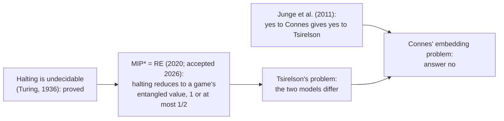

# MIP* = RE: entangled provers can certify any halting question, and Connes' embedding problem falls

[Syllabus](../../../SYLLABUS.md) → [Frontier](../README.md) → [Algebra, Logic and Computation](../README.md#s06) → MIP* = RE

---

## General Overview

Two players sit in separate rooms. A referee sends each one a random bit, x to the first and y to the second. Each answers one bit, a and b. They win when a XOR b equals x AND y: their answers must agree, except when both were sent 1, when they must differ. This is the **CHSH game** (named for Clauser, Horne, Shimony and Holt), taught on [Arthur-Merlin and two provers](../../24-Computability%20and%20complexity/05-Algebraic%2C%20Interactive%20and%20Quantum/10-arthur-merlin-and-multi-prover-interactive-proofs.md).

Players with fixed answer tables win at most 3 rounds in 4: 0.750000. Players who share an entangled pair of qubits (two quantum bits whose measurements stay linked however far apart they are) win 0.853553 of rounds, which is $`\cos^2(\pi/8)`$. No quantum strategy does better.

For CHSH both numbers are easy to compute. In January 2020, Zhengfeng Ji, Anand Natarajan, Thomas Vidick, John Wright and Henry Yuen posted a proof that for games in general this is impossible. No program can read a game's rules and say whether entangled players can win it always or at most half the time.

The reason is that such games can encode any halting question: "does this program ever stop?" A referee who questions entangled players can be convinced of every true claim of that kind. The result is written **MIP\* = RE**. On 2026-10-16 the authors' fourth arXiv version recorded that the full paper is accepted to the *Annals of Mathematics*.

Two old questions fall with it. **Tsirelson's problem** asked whether two ways of modelling "separate quantum labs" give the same results. **Connes' embedding problem** (Alain Connes, 1976) asked whether every algebra of operators with a finite trace (a II₁ factor, Step 5) can be imitated by large matrices. Both answers are no.

**MIP\* = RE says that a fast referee questioning entangled provers can check exactly the claims a program can confirm by running, halting included; so the best entangled winning chance of a game cannot be computed, and that forces "no" to both Tsirelson's problem and Connes' embedding problem.**

**What kind of fact this is:** a theorem, MIP\* = RE, outlined on this card, not proved here. Status as of 2026-11-24: proved, refereed: the full paper is accepted to the *Annals of Mathematics* (arXiv version 4, 2026-10-16), not yet in print. The negative answers to Tsirelson's problem and Connes' embedding problem follow from it by proved implications. The CHSH squeeze in Why it works is proved on this card.

### The picture: from halting to Connes



Schematic. Every arrow is a proved implication.

---

## The formula

Notation first, in words. A **game** G is a referee's rule: which question pairs (x, y) it sends, with what chance, and which answer pairs (a, b) win. A **strategy** is how the players answer. Its **value** is the best winning chance over a class of strategies.

Three classes matter:

- **Classical:** each player answers from a fixed table, possibly after sharing random coins. Value $`\omega(G)`$.
- **Entangled, tensor model:** the players share a quantum state, and each measures only their own part of it. The parts may be of any finite size. Value $`\omega^*(G)`$, the best value over all sizes.
- **Entangled, commuting model:** one shared quantum system, where each of the first player's measurements commutes with each of the second's: doing them in either order gives the same statistics. Value $`\omega^{\mathrm{co}}(G)`$.

A tensor strategy is a commuting strategy, so the values climb in order:

```math
\omega(G) \;\le\; \omega^*(G) \;\le\; \omega^{\mathrm{co}}(G)
```

**Read it aloud:** shared randomness wins no more than shared entanglement in separate parts, and that wins no more than entanglement where only commuting is required.

**MIP\*** is the class of yes-or-no claims that a referee running in polynomial time (a fixed power of the input length) can check by questioning two entangled provers, in the tensor model. True claims are accepted with chance 1; false claims with chance at most 1/2. **RE** is the class of semidecidable claims ([Decidable and semidecidable](../../24-Computability%20and%20complexity/02-Computability%20and%20Logic/01-decidable-and-semidecidable-sets.md)): a program halts with "yes" on every true claim, and may run forever on a false one. The theorem:

```math
\mathrm{MIP}^* = \mathrm{RE}: \quad \text{program } M \;\longmapsto\; \text{game } G_M, \qquad M \text{ halts} \Rightarrow \omega^*(G_M) = 1, \qquad M \text{ runs forever} \Rightarrow \omega^*(G_M) \le \tfrac{1}{2}
```

**Read it aloud:** there is a mechanical way to turn any program into a game, so that entangled players can always win if the program halts, and win at most half the time if it never does.

For CHSH, write the answers as ±1 numbers. The first player's two measurements are $`A_0, A_1`$; the second player's are $`B_0, B_1`$. Each squares to the identity $`I`$ (the "do nothing" operator), since a ±1 answer squared is 1. The **CHSH operator** and the winning chance are

```math
W = A_0B_0 + A_0B_1 + A_1B_0 - A_1B_1, \qquad \Pr[\text{win}] = \tfrac{1}{2} + \tfrac{1}{8}\langle W\rangle
```

**Read it aloud:** add the four agreement scores, with a minus sign on the pair that must disagree; the winning chance is one half plus an eighth of the average of that sum.

The upper bound comes from one identity, a sum of squares:

```math
2\sqrt2\, I - W \;=\; \tfrac{1}{\sqrt2}\Big[\big(A_0 - \tfrac{B_0 + B_1}{\sqrt2}\big)^2 + \big(A_1 - \tfrac{B_0 - B_1}{\sqrt2}\big)^2\Big]
```

**Read it aloud:** two times root two, minus the CHSH operator, equals a positive multiple of two squares, so it is never negative.

| Symbol | Plain meaning | In our example | Push it up and the answer… |
| --- | --- | --- | --- |
| $`G`$ | a game: questions, their chances, and the winning answers | CHSH: 4 question pairs, each with chance 1/4 | — |
| $`x, y`$; $`a, b`$ | the questions to the first and second player; their answers | one bit each; win when a XOR b = x AND y | — |
| $`\omega(G)`$ | classical value: best over fixed answer tables | 0.750000 | — |
| $`\omega^*(G)`$ | entangled value, tensor model | 0.853553 | — |
| $`\omega^{\mathrm{co}}(G)`$ | entangled value, commuting model | 0.853553 | — |
| $`A_x, B_y`$ | the players' ±1 measurements for questions x and y | angles 0 or π/4; π/8 or −π/8 | — |
| $`I`$ | the identity operator: changes nothing | — | — |
| $`W`$, $`\langle W\rangle`$ | the CHSH operator; its average on the shared state | ⟨W⟩ = 2.828427 = 2√2 | a higher ⟨W⟩ wins more often |
| $`M`$, $`G_M`$ | a program; the game built from it | any program | — |
| $`\mathrm{MIP}^*`$, $`\mathrm{RE}`$ | claims checkable with entangled provers; semidecidable claims | equal classes | — |
| $`A_n`$, $`n`$ | Huang's signed matrix of the n-dimensional cube; the cube's dimension (in the primality checks, n is the number tested) | n = 3 and 4; $`A_n^2 = nI`$ | a larger n forces a corner of higher degree, at least √n |
| r; R | the AKS modulus: polynomials are reduced modulo $`x^r - 1`$, with x a plain variable there; the II₁ factor of Step 5, a limit of $`2^n \times 2^n`$ matrices | r = 29 for 31, r = 107 for 561 | — |

Here π is the circle constant and ⟨ ⟩ means an average over the shared state's measurement outcomes.

### When it holds

- **Two provers who cannot talk.** If the second player sees x, the answer b = a XOR (x AND y) wins every round. Without separation there is no game.
- **The tensor model.** In the commuting model the class changes: Junqiao Lin proved MIP<sup>co</sup> = coRE (refereed at a 2026 conference), the complements of semidecidable claims. The two models really differ.
- **A gap of 1 against 1/2.** The theorem separates value 1 from value at most 1/2. It says nothing fast about telling 0.853553 from 0.853554 for a given game.
- **The worst case, not every game.** CHSH's value is known exactly. Uncomputable means no single program handles every game.

---

## Why it works

### Step 0: the squeeze

Any game's entangled value can be approached from both sides.

- **From below:** list finite strategies, ever larger and finer, and keep the best winning chance found. These lower bounds climb towards $`\omega^*(G)`$.
- **From above:** look for sums of squares like the one in The formula. They prove upper bounds using only "each answer squares to 1" and "the two players' measurements commute". A ladder of such certificates (the NPA hierarchy, Navascués, Pironio and Acín, 2008) descends towards $`\omega^{\mathrm{co}}(G)`$.

If the two limits always met, running both ladders would pin down any game's value. MIP\* = RE says the value cannot be pinned down. So the limits do not always meet. That is the whole argument, and Steps 1 to 5 fill it in.

### Step 1: CHSH from below

The checks search every measuring angle that is a multiple of π/m, for all four measurements.

| Angle step | Best winning chance found |
| --- | --- |
| π/2 | 0.750000 |
| π/4 | 0.750000 |
| π/8 | 0.853553 |
| π/16 | 0.853553 |

The best strategy measures the first player's qubit at angle 0 or π/4 and the second's at π/8 or −π/8. It wins 0.853553390593, equal to $`\cos^2(\pi/8)`$ and to $`(2 + \sqrt2)/4`$. Its ⟨W⟩ is 2.828427, which is 2√2.

### Step 2: CHSH from above

Expand the right side of the sum-of-squares identity. Use only $`A_x^2 = B_y^2 = I`$ and $`A_xB_y = B_yA_x`$. The cross terms $`B_0B_1`$ and $`B_1B_0`$ cancel between the two squares, and exactly $`2\sqrt2\, I - W`$ is left. The checks do this expansion in exact arithmetic on numbers of the form p + q√2, with no rounding.

A square of a self-adjoint operator (one equal to its own mirror image, as a measurement is) is never negative on average. So $`\langle W\rangle \le 2\sqrt2`$, and the winning chance is at most 1/2 + 2√2/8 = 0.853553390593.

The lower and upper bounds agree to 12 decimal places. For CHSH, $`\omega^* = \omega^{\mathrm{co}}`$ = 0.853553, and Tsirelson's 1980 bound is exact.

The identity needs commuting. Without $`A_xB_y = B_yA_x`$, the expansion leaves 9 distinct terms instead of 5, and this identity no longer holds.

### Step 3: MIP\* = RE, in outline

This is a research proof of about 250 pages, outlined here with its key steps; the full argument is in Ji, Natarajan, Vidick, Wright and Yuen (Sources).

1. **MIP\* sits inside RE.** If a claim is true, its entangled value is 1, so some finite strategy wins with chance above 1/2. Searching strategies ever larger and finer eventually finds one, and the search then says yes. A false claim never passes 1/2, so the search runs forever. That is semidecidable.
2. **Rigidity.** Some games, like CHSH, can be won at the top value only by essentially one strategy. A referee can use such tests to force the provers to hold many entangled pairs and to measure them as told.
3. **Compression.** Using rigidity, a referee who would ask long questions can be replaced by a much faster referee. The provers generate the long questions themselves from shared entanglement ("introspection"), and prove their long answers with a short probabilistic check (a PCP, from [Interactive proofs](../../24-Computability%20and%20complexity/05-Algebraic%2C%20Interactive%20and%20Quantum/04-interactive-proofs-ip-pspace-and-the-pcp-theorem.md)). The entangled value is kept: value 1 stays 1, and a low value stays low.
4. **Recursion.** Build a referee that runs program M for a while; if M has halted, it accepts. Otherwise it plays the compressed version of itself, one level deeper. A self-reference trick, like the one in the halting proof, makes this referee exist.
5. **Read the result.** If M halts at some depth, the provers can play perfectly down to that depth: value 1. If M never halts, the soundness of every level (its guarantee that false claims pass with chance at most 1/2) keeps the value at most 1/2.

The paper has four arXiv versions. The second (2020-09-29) changed which earlier result it builds on. The fourth (2026-10-16) is the accepted text, with corrections the authors list as "multiple". It also adds a link to a Lean formalization of the main result; nobody here has compiled it.

### Step 4: Tsirelson's problem falls

Suppose the tensor and commuting models always gave the same value. Take any program M and its game $`G_M`$. Run both ladders of Step 0 side by side.

- If M halts, the value is 1, and the lower ladder eventually passes 1/2.
- If M never halts, the value is at most 1/2, and the upper ladder eventually drops below 1.

Exactly one of these happens in finite time, so this procedure decides whether M halts. No program can do that ([Universal machines](../../24-Computability%20and%20complexity/01-Models%20of%20Computation/09-universal-machines-and-the-halting-problem.md)). So the assumption is false: some game has $`\omega^*(G) < \omega^{\mathrm{co}}(G)`$.

Tsirelson's problem asked whether the two sets of correlations (tables of answer chances for each question pair) are the same, allowing limits of tensor strategies. The answer is no. The proof does not hand over a small game with a visible gap; it shows one must exist.

### Step 5: Connes' embedding problem falls

A **von Neumann algebra** is a family of operators on a space, closed under adding, multiplying and taking limits. A **II₁ factor** is one with a trace: a way to measure the "size" of each operator that runs from 0 to 1, like a normalised count of matrix diagonal entries. [Factors in outline](../../18-Functional%20analysis/06-Banach%20Algebras%20and%20Fixed%20Points/09-von-neumann-algebras-and-factors-in-outline.md) builds one, R, as a limit of $`2^n \times 2^n`$ matrices.

Connes asked in 1976 whether every II₁ factor (of countable size) sits inside an **ultrapower** of R. In plain words: can any finite collection of its operators be imitated by large matrices, matching every trace of every product to any accuracy?

Junge, Navascués, Palazuelos, Pérez-García, Scholz and Werner proved in 2011: if Connes' answer is yes, Tsirelson's answer is yes. Commuting strategies could then be imitated by matrices, which are tensor strategies. Step 4 shows Tsirelson's answer is no. So Connes' answer is no.

### Step 6: beside the neighbours

Two other complexity questions settled in this century give the ledger its scale.

**Sensitivity.** The [Boolean functions](../../24-Computability%20and%20complexity/04-Beyond%20Worst%20Case/12-boolean-functions-fourier-and-sensitivity.md) card proves Hao Huang's 2019 theorem. Its core: any $`2^{n-1} + 1`$ corners of the n-dimensional cube include a corner joined to at least √n of the others. The key tool is a signed matrix $`A_n`$: the cube's adjacency table (1 where two corners share an edge) with some entries flipped to −1. The checks confirm $`A_n^2 = nI`$ for n = 3 and 4, and search every subset: any 5 corners of the 3-cube have a corner of degree at least 2, and so do any 9 corners of the 4-cube.

**Primality and P versus BPP.** BPP is the class of claims a fast program with random coins decides with error at most 1/3 ([BPP](../../24-Computability%20and%20complexity/04-Beyond%20Worst%20Case/03-randomised-complexity-and-bpp.md)). Primality testing was the flagship example: [The Miller-Rabin test](../../02-Number%20theory/06-Codes%20and%20Secrets/05-miller-rabin.md) is fast and random. In 2002 Agrawal, Kayal and Saxena (AKS) gave a deterministic polynomial-time test, published in 2004. The checks run all three roads.

- On 31, AKS picks the modulus r = 29 (it computes with polynomials whose powers of x wrap round modulo r) and passes 30 polynomial tests: prime.
- On 561 = 3 × 11 × 17, AKS picks r = 107 and finds the factor 3: composite.
- From 1 to 100 the factor step settles every composite, so there the polynomial test meets only primes. Run alone on 561 with r = 107, it fails at once: $`(x + 1)^{561}`$ differs from $`x^{561} + 1`$, and the tests with x + 2 and x + 3 fail too.
- From 1 to 100, trial division, Miller-Rabin and AKS agree on all 25 primes.
- Only 10 of the 560 bases fool Miller-Rabin on 561, a share of 0.017857, inside the proved bound of 1/4.

One problem leaving BPP for P is evidence that P = BPP, not a proof. [Pseudorandomness](../../24-Computability%20and%20complexity/04-Beyond%20Worst%20Case/04-derandomisation-and-pseudorandomness.md) shows the route a proof would take.

The status ledger, as of 2026-11-24:

| Claim | Kind | Status | Source |
| --- | --- | --- | --- |
| MIP = NEXP (nondeterministic exponential time): two classical provers | theorem | proved, 1991 | [Arthur-Merlin and two provers](../../24-Computability%20and%20complexity/05-Algebraic%2C%20Interactive%20and%20Quantum/10-arthur-merlin-and-multi-prover-interactive-proofs.md) |
| MIP\* = RE | theorem | proved: accepted to *Annals of Mathematics* (arXiv v4, 2026-10-16), not yet in print | Ji, Natarajan, Vidick, Wright, Yuen |
| Tsirelson's problem | question | answered no: follows from MIP\* = RE | same |
| Connes' embedding problem | question | answered no: follows, with Junge et al. 2011 | Junge et al.; Ji et al. |
| MIP<sup>co</sup> = coRE | theorem | proved: refereed conference paper, 2026-06; journal version not found | Lin |
| Sensitivity conjecture | conjecture | proved: *Annals of Mathematics*, 2019 | Huang |
| Primality is in P | theorem | proved: announced 2002, *Annals of Mathematics* 2004 | Agrawal, Kayal, Saxena |
| P = BPP | conjecture | open: no accepted proof or disproof | [Pseudorandomness](../../24-Computability%20and%20complexity/04-Beyond%20Worst%20Case/04-derandomisation-and-pseudorandomness.md) |
| P ≠ NP | conjecture | open | [P versus NP](../02-The%20Millennium%20Problems/03-p-versus-np.md) |

---

## Worked numbers, by hand

| Step | Arithmetic | Value |
| --- | --- | --- |
| classical CHSH | 16 answer tables; 8 of them win 3 of 4 | 0.750000 |
| entangled CHSH, best angles | $`\cos^2(\pi/8) = (2 + \sqrt2)/4`$ | 0.853553 |
| ⟨W⟩ at those angles | 8 × (0.853553 − 1/2) | 2.828427 = 2√2 |
| upper bound, commuting model | 1/2 + 2√2/8 | 0.853553 |
| **CHSH squeeze** | upper − lower | **0.000000000000** |
| a game built from a program | halts: value 1; runs forever: at most 1/2 | gap 1/2 |
| AKS on 31 | r = 29; 30 polynomial tests | prime |
| Fermat on 561, base 2 | 2^560 mod 561 | 1: fooled |
| Miller-Rabin on 561 | 10 strong liars of 560 bases | 0.017857 |
| 4-cube, 9 of 16 corners | Huang: max degree at least √4 | 2 |

For CHSH the two ladders meet at 0.853553; MIP\* = RE says there are games where no algorithm can make them meet closely enough to tell 1 from 1/2.

### What breaks if you drop a piece

| Mistake | Comes out at | What went wrong |
| --- | --- | --- |
| Use the classical bound against entangled provers | 0.750000 claimed; 0.853553 reached | Entanglement beats fixed tables, so classical soundness proofs fail |
| Read a coarse search as the value | steps of π/4 give 0.750000 | A lower bound only climbs; it does not say when it has arrived |
| Drop commuting between the players | the identity fails: 9 terms against 5 | The sum of squares needs $`A_xB_y = B_yA_x`$ |
| Trust Fermat's test on 561 | 2^560 mod 561 = 1, "prime" | 561 is a Carmichael number (composite, yet it passes Fermat's test for every base coprime to it); Miller-Rabin base 2 catches it |
| Take half the cube, not one more | 8 corners of the 4-cube with max degree 0 | Huang's bound needs $`2^{n-1} + 1`$ corners |

The code prints all five.

---

## Code, from first principles, and it actually runs

Nothing is imported beyond basic maths. The CHSH value is reached by **three independent roads**: a state-vector search over measuring angles from below, an exact sum-of-squares expansion from above, and the closed forms $`\cos^2(\pi/8)`$ and $`(2 + \sqrt2)/4`$. Primality takes three roads: trial division, Miller-Rabin and AKS, written out. The factor step of AKS settles every composite up to 100, so its polynomial test is also run alone on 561, where it must fail. Huang's bound is checked by building the signed matrix and by searching every subset of corners. The checks verify instances and identities only, never MIP\* = RE itself.

### Python

```python
# MIP* = RE and Connes' embedding -- the check behind the card.  Standard library only.
# Part 1: the CHSH game, squeezed from below (strategy search) and above (an exact
# sum of squares).  Part 2: primality three ways, and Huang's theorem on small cubes.
from math import cos, sin, pi, sqrt, gcd, isqrt
from itertools import product
# ---- part 1a: classical strategies, all 16 answer tables a[x], b[y]
tables = [sum((t[x] ^ t[2 + y]) == (x & y) for x in (0, 1) for y in (0, 1))
          for t in product((0, 1), repeat=4)]  # win when a XOR b = x AND y
classical = max(tables) / 4
print(f"classical: 16 answer tables, {tables.count(3)} win 3 of 4, best {classical:.6f}")
# ---- part 1b: entangled lower bounds, state vector of (|00> + |11>)/sqrt2
def basis(t, a):  # outcome a of a measurement at angle t, as a real 2-vector
    return (cos(t), sin(t)) if a == 0 else (-sin(t), cos(t))
def win(al, be):  # al[x], be[y] are the measuring angles; returns the win chance
    tot = 0.0
    for x, y, a, b in product((0, 1), repeat=4):
        u, v = basis(al[x], a), basis(be[y], b)
        amp = (u[0] * v[0] + u[1] * v[1]) / sqrt(2)
        tot += amp * amp * ((a ^ b) == (x & y)) / 4
    return tot
lower = {}
for m in (2, 4, 8, 16):  # try every angle k*pi/m for each of the four settings
    g = [k * pi / m for k in range(m)]
    lower[m] = max(win((p, q), (r, s)) for p, q, r, s in product(g, repeat=4))
    print(f"lower bound, angles in steps of pi/{m:<2}: best win {lower[m]:.6f}")
best = win((0, pi / 4), (pi / 8, -pi / 8))
print(f"strategy A at 0 or pi/4, B at pi/8 or -pi/8: win {best:.12f}")
print(f"<W> = 8 x (win - 1/2) = {8 * (best - 0.5):.6f}; 2*sqrt2 = {2 * sqrt(2):.6f}")
print(f"cos^2(pi/8) = {cos(pi / 8) ** 2:.12f}, (2 + sqrt2)/4 = {(2 + sqrt(2)) / 4:.12f}")
# ---- part 1c: upper bound.  A coefficient (p, q) means (p + q*sqrt2)/4
def red(w, commute):  # each observable squares to I; A's pass B's if they commute
    parts = [[t for t in w if t[0] == s] for s in "AB"] if commute else [list(w)]
    out = []
    for part in parts:
        st = []
        for t in part:
            st.pop() if st and st[-1] == t else st.append(t)
        out += st
    return tuple(out)
def mul(P, Q, commute=True):
    R = {}
    for (w1, (p1, q1)), (w2, (p2, q2)) in product(P.items(), Q.items()):
        p, q = p1 * p2 + 2 * q1 * q2, p1 * q2 + q1 * p2
        assert p % 4 == 0 and q % 4 == 0
        w = red(w1 + w2, commute); o = R.get(w, (0, 0)); R[w] = (o[0] + p // 4, o[1] + q // 4)
    return {w: c for w, c in R.items() if c != (0, 0)}
def add(P, Q):
    R = dict(P)
    for w, (p, q) in Q.items(): o = R.get(w, (0, 0)); R[w] = (o[0] + p, o[1] + q)
    return {w: c for w, c in R.items() if c != (0, 0)}
X0 = {("A0",): (4, 0), ("B0",): (0, -2), ("B1",): (0, -2)}  # A0 - (B0 + B1)/sqrt2
X1 = {("A1",): (4, 0), ("B0",): (0, -2), ("B1",): (0, 2)}   # A1 - (B0 - B1)/sqrt2
def sos(c):  # (1/sqrt2) (X0^2 + X1^2)
    return mul({(): (0, 2)}, add(mul(X0, X0, c), mul(X1, X1, c)), c)
lhs = {(): (0, 8), ("A0", "B0"): (-4, 0), ("A0", "B1"): (-4, 0),
       ("A1", "B0"): (-4, 0), ("A1", "B1"): (4, 0)}         # 2 sqrt2 I - W
yn = lambda c: "yes" if c else "no"
print(f"sum of squares equals 2*sqrt2 - W, exactly: {yn(sos(True) == lhs)}")
upper = 0.5 + 2 * sqrt(2) / 8
print(f"upper bound for commuting operators: 1/2 + 2*sqrt2/8 = {upper:.12f}")
print(f"CHSH squeeze: |upper - lower| = {abs(upper - lower[16]):.12f}")
print(f"same identity if A's need not commute with B's: {yn(sos(False) == lhs)}, "
      f"{len(sos(False))} terms against {len(lhs)}")
# ---- part 2a: primality, by trial division, Miller-Rabin and AKS
trial = lambda n: n > 1 and all(n % d for d in range(2, isqrt(n) + 1))
def strong(n, a):  # a passes the Miller-Rabin round for odd n
    d, s = n - 1, 0
    while d % 2 == 0:
        d, s = d // 2, s + 1
    x = pow(a, d, n)
    for _ in range(s):
        if x == 1 or x == n - 1:
            return x == n - 1 or _ == 0
        x = x * x % n
    return False
mr = lambda n: n in (2, 3) or (n > 3 and n % 2 == 1 and strong(n, 2) and strong(n, 3))  # exact below 1,373,653
def mulp(f, g, n, r):  # product modulo x^r - 1 and modulo n
    h = [0] * r
    for i, j in product(range(r), range(r)):
        h[(i + j) % r] = (h[(i + j) % r] + f[i] * g[j]) % n
    return h
def congruent(n, r, a):  # (x + a)^n = x^n + a modulo x^r - 1 and n? by repeated squaring
    res, base, e = [1] + [0] * (r - 1), [a % n, 1] + [0] * (r - 2), n
    while e: res, base, e = (mulp(res, base, n, r) if e & 1 else res), mulp(base, base, n, r), e >> 1
    want = [0] * r; want[n % r] = 1; want[0] = (want[0] + a) % n
    return res == want
def aks(n):  # log2 n is replaced by n's bit length l, which only adds work
    l = n.bit_length()
    if n < 2 or any(c ** b == n for b in range(2, l + 1) for c in range(2, isqrt(n) + 1)):
        return False, 0, "below 2 or a perfect power"
    r = 2  # the least r with n's order modulo r above l^2
    while gcd(r, n) != 1 or any(pow(n, k, r) == 1 for k in range(1, l * l + 1)):
        r += 1
    for a in range(2, min(r, n - 1) + 1):
        if 1 < gcd(a, n) < n:
            return False, r, f"factor {gcd(a, n)} found"
    if n <= r:
        return True, r, "n <= r"
    lim = (isqrt(sum(gcd(k, r) == 1 for k in range(1, r))) + 1) * l
    for a in range(1, lim + 1):
        if not congruent(n, r, a): return False, r, f"(x + {a})^n test failed"
    return True, r, f"{lim} polynomial tests passed"
N = 100
agree = all(trial(n) == mr(n) == aks(n)[0] for n in range(1, N + 1))
print(f"n = 1 to {N}: trial division, Miller-Rabin and AKS agree: {yn(agree)}; "
      f"{sum(map(trial, range(N + 1)))} primes")
for n in (31, 561):
    v, r, why = aks(n)
    print(f"AKS on {n}: r = {r}, {why}, verdict {'prime' if v else 'composite'}")
alone = [a for a in range(1, 4) if not congruent(561, aks(561)[1], a)]  # the factor step skipped
print(f"AKS on 561, factor step skipped: r = {aks(561)[1]}, the (x + a)^561 test fails for a = {alone}")
liars = [a for a in range(1, 561) if strong(561, a)]
print(f"561 = 3 x 11 x 17: Fermat base 2 gives 2^560 mod 561 = {pow(2, 560, 561)}; "
      f"Miller-Rabin base 2 passes: {yn(strong(561, 2))}")
print(f"561: strong liars {len(liars)} of 560 bases, share {len(liars) / 560:.6f} (bound 1/4)")
# ---- part 2b: Huang's signed cube matrix, and induced subgraphs of the n-cube
for n in (3, 4):
    A = [[0]]
    for _ in range(n):  # A_n = [[A, I], [I, -A]]
        k = len(A)
        A = [[A[i][j] if i < k and j < k else -A[i - k][j - k] if i >= k and j >= k
              else int(i % k == j % k) for j in range(2 * k)] for i in range(2 * k)]
    k = len(A)
    sq = all(sum(A[i][t] * A[t][j] for t in range(k)) == n * (i == j)
             for i in range(k) for j in range(k))
    def maxdeg(mask):  # the most neighbours any chosen corner has among the chosen
        return max(sum(mask >> (v ^ (1 << b)) & 1 for b in range(n))
                   for v in range(k) if mask >> v & 1)
    h1, h0 = [min(maxdeg(m) for m in range(1 << k) if bin(m).count("1") == size)
              for size in (k // 2 + 1, k // 2)]
    print(f"{n}-cube: A^2 = {n} I: {yn(sq)}; any {k // 2 + 1} corners have "
          f"max degree >= {h1} (sqrt {n} = {sqrt(n):.6f}); {k // 2} corners can have {h0}")
    assert sq and h1 >= sqrt(n) and h0 == 0
assert classical == 0.75 and tables.count(3) == 8
assert abs(lower[8] - (2 + sqrt(2)) / 4) < 1e-12 and abs(best - cos(pi / 8) ** 2) < 1e-12
assert lower[4] < lower[8]
assert sos(True) == lhs and sos(False) != lhs and abs(upper - lower[16]) < 1e-12
assert agree and not aks(561)[0] and aks(31) == (True, 29, "30 polynomial tests passed") and 1 in alone
assert pow(2, 560, 561) == 1 and len(liars) <= 560 // 4
print("ALL CHECKS PASS")
```

**Ran 2026-11-24 on macOS, Python 3.14.10, standard library only. All checks passed. Output, pasted from the run:**

```
classical: 16 answer tables, 8 win 3 of 4, best 0.750000
lower bound, angles in steps of pi/2 : best win 0.750000
lower bound, angles in steps of pi/4 : best win 0.750000
lower bound, angles in steps of pi/8 : best win 0.853553
lower bound, angles in steps of pi/16: best win 0.853553
strategy A at 0 or pi/4, B at pi/8 or -pi/8: win 0.853553390593
<W> = 8 x (win - 1/2) = 2.828427; 2*sqrt2 = 2.828427
cos^2(pi/8) = 0.853553390593, (2 + sqrt2)/4 = 0.853553390593
sum of squares equals 2*sqrt2 - W, exactly: yes
upper bound for commuting operators: 1/2 + 2*sqrt2/8 = 0.853553390593
CHSH squeeze: |upper - lower| = 0.000000000000
same identity if A's need not commute with B's: no, 9 terms against 5
n = 1 to 100: trial division, Miller-Rabin and AKS agree: yes; 25 primes
AKS on 31: r = 29, 30 polynomial tests passed, verdict prime
AKS on 561: r = 107, factor 3 found, verdict composite
AKS on 561, factor step skipped: r = 107, the (x + a)^561 test fails for a = [1, 2, 3]
561 = 3 x 11 x 17: Fermat base 2 gives 2^560 mod 561 = 1; Miller-Rabin base 2 passes: no
561: strong liars 10 of 560 bases, share 0.017857 (bound 1/4)
3-cube: A^2 = 3 I: yes; any 5 corners have max degree >= 2 (sqrt 3 = 1.732051); 4 corners can have 0
4-cube: A^2 = 4 I: yes; any 9 corners have max degree >= 2 (sqrt 4 = 2.000000); 8 corners can have 0
ALL CHECKS PASS
```

### Rust

Same numbers, same labels, built with `rustc --edition 2021 -O`.

```rust
// MIP* = RE and Connes' embedding -- the same check as the Python, in Rust.  No crates.
// Part 1: the CHSH game, squeezed from below (strategy search) and above (an exact
// sum of squares).  Part 2: primality three ways, and Huang's theorem on small cubes.
use std::collections::BTreeMap;
use std::f64::consts::PI;
type Poly = BTreeMap<Vec<String>, (i64, i64)>; // coefficient (p, q) means (p + q*sqrt2)/4

fn win(al: [f64; 2], be: [f64; 2]) -> f64 {    // win chance on (|00> + |11>)/sqrt2
    let basis = |t: f64, a: usize| if a == 0 { (t.cos(), t.sin()) } else { (-t.sin(), t.cos()) };
    let mut tot = 0.0;
    for code in 0..16 {
        let (x, y, a, b) = (code >> 3 & 1, code >> 2 & 1, code >> 1 & 1, code & 1);
        let (u, v) = (basis(al[x], a), basis(be[y], b));
        let amp = (u.0 * v.0 + u.1 * v.1) / 2f64.sqrt();
        if (a ^ b) == (x & y) { tot += amp * amp / 4.0 }
    }
    tot
}
fn red(w: &[String], commute: bool) -> Vec<String> { // each observable squares to I
    let parts: Vec<Vec<String>> = if commute {
        ["A", "B"].iter().map(|s| w.iter().filter(|t| t.starts_with(s)).cloned().collect()).collect()
    } else { vec![w.to_vec()] };
    let mut out = Vec::new();
    for part in parts {
        let mut st: Vec<String> = Vec::new();
        for t in part { if st.last() == Some(&t) { st.pop(); } else { st.push(t) } }
        out.extend(st);
    }
    out
}
fn mul(pp: &Poly, qq: &Poly, commute: bool) -> Poly {
    let mut r = Poly::new();
    for (w1, &(p1, q1)) in pp { for (w2, &(p2, q2)) in qq {
        let (p, q) = (p1 * p2 + 2 * q1 * q2, p1 * q2 + q1 * p2);
        assert!(p % 4 == 0 && q % 4 == 0);
        let w = red(&[w1.clone(), w2.clone()].concat(), commute);
        let o = r.entry(w).or_insert((0, 0));
        *o = (o.0 + p / 4, o.1 + q / 4);
    } }
    r.retain(|_, c| *c != (0, 0)); r
}
fn add(pp: &Poly, qq: &Poly) -> Poly {
    let mut r = pp.clone();
    for (w, &(p, q)) in qq { let o = r.entry(w.clone()).or_insert((0, 0)); *o = (o.0 + p, o.1 + q); }
    r.retain(|_, c| *c != (0, 0)); r
}
fn poly(terms: &[(&[&str], i64, i64)]) -> Poly {
    terms.iter().map(|(w, p, q)| (w.iter().map(|s| s.to_string()).collect(), (*p, *q))).collect()
}
fn sos(c: bool) -> Poly {                       // (1/sqrt2) (X0^2 + X1^2)
    let x0 = poly(&[(&["A0"], 4, 0), (&["B0"], 0, -2), (&["B1"], 0, -2)]); // A0 - (B0 + B1)/sqrt2
    let x1 = poly(&[(&["A1"], 4, 0), (&["B0"], 0, -2), (&["B1"], 0, 2)]);  // A1 - (B0 - B1)/sqrt2
    mul(&poly(&[(&[], 0, 2)]), &add(&mul(&x0, &x0, c), &mul(&x1, &x1, c)), c)
}
fn yn(c: bool) -> &'static str { if c { "yes" } else { "no" } }
fn gcd(a: u64, b: u64) -> u64 { if b == 0 { a } else { gcd(b, a % b) } }
fn isqrt(n: u64) -> u64 { let mut c = 0; while (c + 1) * (c + 1) <= n { c += 1 } c }
fn powmod(mut a: u64, mut e: u64, n: u64) -> u64 {
    let mut r = 1 % n; a %= n;
    while e > 0 { if e & 1 == 1 { r = r * a % n } a = a * a % n; e >>= 1 }
    r
}
fn trial(n: u64) -> bool { n > 1 && (2..=isqrt(n)).all(|d| n % d != 0) }
fn strong(n: u64, a: u64) -> bool {             // a passes the Miller-Rabin round for odd n
    let (mut d, mut s) = (n - 1, 0);
    while d % 2 == 0 { d /= 2; s += 1 }
    let mut x = powmod(a, d, n);
    for i in 0..s {
        if x == 1 || x == n - 1 { return x == n - 1 || i == 0 }
        x = x * x % n;
    }
    false
}
fn mr(n: u64) -> bool { n == 2 || n == 3 || (n > 3 && n % 2 == 1 && strong(n, 2) && strong(n, 3)) }
fn mulp(f: &[u64], g: &[u64], n: u64, r: usize) -> Vec<u64> { // modulo x^r - 1 and n
    let mut h = vec![0; r];
    for i in 0..r { for j in 0..r { h[(i + j) % r] = (h[(i + j) % r] + f[i] * g[j]) % n } }
    h
}
fn congruent(n: u64, r: u64, a: u64) -> bool {  // (x + a)^n = x^n + a modulo x^r - 1 and n?
    let ru = r as usize; let (mut res, mut base, mut e) = (vec![0u64; ru], vec![0u64; ru], n);
    res[0] = 1; base[0] = a % n; base[1] = 1;
    while e > 0 { if e & 1 == 1 { res = mulp(&res, &base, n, ru) } base = mulp(&base, &base, n, ru); e >>= 1; }
    let mut want = vec![0u64; ru]; want[(n % r) as usize] = 1; want[0] = (want[0] + a) % n;
    res == want
}
fn aks(n: u64) -> (bool, u64, String) {         // log2 n replaced by the bit length l
    let l = 64 - n.leading_zeros() as u64;
    if n < 2 || (2..=l).any(|b| (2..=isqrt(n)).any(|c| c.checked_pow(b as u32) == Some(n))) {
        return (false, 0, "below 2 or a perfect power".to_string());
    }
    let mut r = 2;                              // the least r with n's order mod r above l^2
    while gcd(r, n) != 1 || (1..=l * l).any(|k| powmod(n, k, r) == 1) { r += 1 }
    for a in 2..=r.min(n - 1) {
        let g = gcd(a, n);
        if 1 < g && g < n { return (false, r, format!("factor {} found", g)) }
    }
    if n <= r { return (true, r, "n <= r".to_string()) }
    let lim = (isqrt((1..r).filter(|&k| gcd(k, r) == 1).count() as u64) + 1) * l;
    for a in 1..=lim { if !congruent(n, r, a) { return (false, r, format!("(x + {})^n test failed", a)) } }
    (true, r, format!("{} polynomial tests passed", lim))
}
fn main() {
    let mut tables = Vec::new();                // all 16 answer tables a[x], b[y]
    for t in 0..16usize {
        let (a, b) = ([t >> 3 & 1, t >> 2 & 1], [t >> 1 & 1, t & 1]);
        tables.push((0..4).filter(|&q| (a[q >> 1] ^ b[q & 1]) == ((q >> 1) & (q & 1))).count());
    }
    let (classical, n3) = (*tables.iter().max().unwrap() as f64 / 4.0, tables.iter().filter(|&&w| w == 3).count());
    println!("classical: 16 answer tables, {} win 3 of 4, best {:.6}", n3, classical);
    let mut lower = BTreeMap::new();
    for m in [2usize, 4, 8, 16] {               // try every angle k*pi/m for each setting
        let g: Vec<f64> = (0..m).map(|k| k as f64 * PI / m as f64).collect();
        let mut b = 0.0f64;
        for &p in &g { for &q in &g { for &r in &g { for &s in &g { b = b.max(win([p, q], [r, s])) } } } }
        lower.insert(m, b);
        println!("lower bound, angles in steps of pi/{:<2}: best win {:.6}", m, b);
    }
    let best = win([0.0, PI / 4.0], [PI / 8.0, -PI / 8.0]);
    println!("strategy A at 0 or pi/4, B at pi/8 or -pi/8: win {:.12}", best);
    println!("<W> = 8 x (win - 1/2) = {:.6}; 2*sqrt2 = {:.6}", 8.0 * (best - 0.5), 2.0 * 2f64.sqrt());
    println!("cos^2(pi/8) = {:.12}, (2 + sqrt2)/4 = {:.12}", (PI / 8.0).cos().powi(2), (2.0 + 2f64.sqrt()) / 4.0);
    let lhs = poly(&[(&[], 0, 8), (&["A0", "B0"], -4, 0), (&["A0", "B1"], -4, 0),
                     (&["A1", "B0"], -4, 0), (&["A1", "B1"], 4, 0)]); // 2 sqrt2 I - W
    println!("sum of squares equals 2*sqrt2 - W, exactly: {}", yn(sos(true) == lhs));
    let upper = 0.5 + 2.0 * 2f64.sqrt() / 8.0;
    println!("upper bound for commuting operators: 1/2 + 2*sqrt2/8 = {:.12}", upper);
    println!("CHSH squeeze: |upper - lower| = {:.12}", (upper - lower[&16]).abs());
    println!("same identity if A's need not commute with B's: {}, {} terms against {}",
             yn(sos(false) == lhs), sos(false).len(), lhs.len());
    let agree = (1..=100u64).all(|n| trial(n) == mr(n) && mr(n) == aks(n).0);
    println!("n = 1 to {}: trial division, Miller-Rabin and AKS agree: {}; {} primes",
             100, yn(agree), (0..=100u64).filter(|&n| trial(n)).count());
    for n in [31u64, 561] {
        let (v, r, why) = aks(n);
        println!("AKS on {}: r = {}, {}, verdict {}", n, r, why, if v { "prime" } else { "composite" });
    }
    let alone: Vec<u64> = (1..4).filter(|&a| !congruent(561, aks(561).1, a)).collect(); // the factor step skipped
    println!("AKS on 561, factor step skipped: r = {}, the (x + a)^561 test fails for a = {:?}", aks(561).1, alone);
    let liars = (1..561).filter(|&a| strong(561, a)).count();
    println!("561 = 3 x 11 x 17: Fermat base 2 gives 2^560 mod 561 = {}; Miller-Rabin base 2 passes: {}",
             powmod(2, 560, 561), yn(strong(561, 2)));
    println!("561: strong liars {} of 560 bases, share {:.6} (bound 1/4)", liars, liars as f64 / 560.0);
    for n in [3usize, 4] {
        let mut a: Vec<Vec<i64>> = vec![vec![0]];
        for _ in 0..n {                         // A_n = [[A, I], [I, -A]]
            let k = a.len();
            a = (0..2 * k).map(|i| (0..2 * k).map(|j| {
                if i < k && j < k { a[i][j] } else if i >= k && j >= k { -a[i - k][j - k] }
                else { (i % k == j % k) as i64 } }).collect()).collect();
        }
        let k = a.len();
        let sq = (0..k).all(|i| (0..k).all(|j|
            (0..k).map(|t| a[i][t] * a[t][j]).sum::<i64>() == if i == j { n as i64 } else { 0 }));
        let maxdeg = |mask: usize| (0..k).filter(|&v| mask >> v & 1 == 1)
            .map(|v| (0..n).filter(|&b| mask >> (v ^ (1 << b)) & 1 == 1).count()).max().unwrap();
        let mindeg = |size: u32| (0..1usize << k).filter(|m| m.count_ones() == size)
            .map(|m| maxdeg(m)).min().unwrap();
        let (h1, h0) = (mindeg(k as u32 / 2 + 1), mindeg(k as u32 / 2));
        println!("{}-cube: A^2 = {} I: {}; any {} corners have max degree >= {} (sqrt {} = {:.6}); {} corners can have {}",
                 n, n, yn(sq), k / 2 + 1, h1, n, (n as f64).sqrt(), k / 2, h0);
        assert!(sq && h1 as f64 >= (n as f64).sqrt() && h0 == 0);
    }
    assert!(classical == 0.75 && n3 == 8);
    assert!((lower[&8] - (2.0 + 2f64.sqrt()) / 4.0).abs() < 1e-12 && (best - (PI / 8.0).cos().powi(2)).abs() < 1e-12);
    assert!(lower[&4] < lower[&8] && sos(true) == lhs && sos(false) != lhs && (upper - lower[&16]).abs() < 1e-12);
    assert!(agree && !aks(561).0 && aks(31) == (true, 29, "30 polynomial tests passed".to_string()) && alone.contains(&1));
    assert!(powmod(2, 560, 561) == 1 && liars <= 560 / 4);
    println!("ALL CHECKS PASS");
}
```

**Ran 2026-11-24 on macOS, rustc 1.98.1, no crates. All checks passed. Output, pasted from the run:**

```
classical: 16 answer tables, 8 win 3 of 4, best 0.750000
lower bound, angles in steps of pi/2 : best win 0.750000
lower bound, angles in steps of pi/4 : best win 0.750000
lower bound, angles in steps of pi/8 : best win 0.853553
lower bound, angles in steps of pi/16: best win 0.853553
strategy A at 0 or pi/4, B at pi/8 or -pi/8: win 0.853553390593
<W> = 8 x (win - 1/2) = 2.828427; 2*sqrt2 = 2.828427
cos^2(pi/8) = 0.853553390593, (2 + sqrt2)/4 = 0.853553390593
sum of squares equals 2*sqrt2 - W, exactly: yes
upper bound for commuting operators: 1/2 + 2*sqrt2/8 = 0.853553390593
CHSH squeeze: |upper - lower| = 0.000000000000
same identity if A's need not commute with B's: no, 9 terms against 5
n = 1 to 100: trial division, Miller-Rabin and AKS agree: yes; 25 primes
AKS on 31: r = 29, 30 polynomial tests passed, verdict prime
AKS on 561: r = 107, factor 3 found, verdict composite
AKS on 561, factor step skipped: r = 107, the (x + a)^561 test fails for a = [1, 2, 3]
561 = 3 x 11 x 17: Fermat base 2 gives 2^560 mod 561 = 1; Miller-Rabin base 2 passes: no
561: strong liars 10 of 560 bases, share 0.017857 (bound 1/4)
3-cube: A^2 = 3 I: yes; any 5 corners have max degree >= 2 (sqrt 3 = 1.732051); 4 corners can have 0
4-cube: A^2 = 4 I: yes; any 9 corners have max degree >= 2 (sqrt 4 = 2.000000); 8 corners can have 0
ALL CHECKS PASS
```

The two outputs match line for line.

### Lean

Lean proves the CHSH squeeze from above for any commuting measurements, the classical bound for every answer table, and the card's whole-number checks.

- Suppose $`A_0, A_1, B_0, B_1`$ each square to $`I`$, and each A commutes with each B. Then the sum-of-squares identity of The formula holds exactly.
- Suppose also that each of the four measurements is self-adjoint. Then $`2\sqrt2\, I - W`$ is never negative, so $`\langle W\rangle \le 2\sqrt2`$.
- Take any fixed answer tables for the two players. Then they win at most 3 of the 4 question pairs.
- Of the 16 answer tables, exactly 8 win 3 of the 4 question pairs.
- Take 561 = 3 × 11 × 17, which is not prime. Then Fermat's base-2 test still gives 2^560 mod 561 = 1.
- 31 is prime, and from 1 to 100 there are 25 primes.

The angle search, the decimal winning chances, the 9-term failure, Miller-Rabin, AKS and Huang's cubes are left to the Python and Rust checks.

```lean
-- MIP* = RE: for the CHSH game, entangled players whose measurements commute have CHSH sum at most 2√2 (by an exact sum of squares), players with fixed answer tables win at most 3 of 4 rounds, and the card's whole-number examples are exact.
import Mathlib.Algebra.Star.CHSH
import Mathlib.Data.Fintype.Pi
import Mathlib.Data.Nat.Prime.Basic
import Mathlib.Tactic.NormNum.Prime
import Mathlib.Tactic.Module
import Mathlib.Tactic.LinearCombination
import Mathlib.Tactic.FieldSimp

/-- Tsirelson's bound, the CHSH squeeze from above (the card's Step 2): in any ordered
\*-algebra over ℝ (such as the operators on a quantum system), if the four measurements
A₀, A₁, B₀, B₁ are self-adjoint, each squares to the identity, and each A commutes with
each B, then the CHSH operator W = A₀B₀ + A₀B₁ + A₁B₀ − A₁B₁ is at most 2√2 times the
identity. So entangled players win the CHSH game with chance at most 1/2 + 2√2/8. -/
theorem chsh_operator_le_two_sqrt_two {R : Type*} [Ring R] [PartialOrder R] [StarRing R]
    [StarOrderedRing R] [Algebra ℝ R] [IsOrderedModule ℝ R] [StarModule ℝ R]
    (A₀ A₁ B₀ B₁ : R)
    (hA₀ : A₀ ^ 2 = 1) (hA₁ : A₁ ^ 2 = 1) (hB₀ : B₀ ^ 2 = 1) (hB₁ : B₁ ^ 2 = 1)
    (sA₀ : star A₀ = A₀) (sA₁ : star A₁ = A₁) (sB₀ : star B₀ = B₀) (sB₁ : star B₁ = B₁)
    (c₀₀ : A₀ * B₀ = B₀ * A₀) (c₀₁ : A₀ * B₁ = B₁ * A₀)
    (c₁₀ : A₁ * B₀ = B₀ * A₁) (c₁₁ : A₁ * B₁ = B₁ * A₁) :
    A₀ * B₀ + A₀ * B₁ + A₁ * B₀ - A₁ * B₁ ≤ (2 * √2) • (1 : R) := by
  have h := tsirelson_inequality A₀ A₁ B₀ B₁
    ⟨hA₀, hA₁, hB₀, hB₁, sA₀, sA₁, sB₀, sB₁, c₀₀, c₀₁, c₁₀, c₁₁⟩
  have e : √2 ^ 3 = 2 * √2 := by
    rw [pow_succ, Real.sq_sqrt (by norm_num : (0:ℝ) ≤ 2)]
  rwa [e] at h

/-- The card's sum-of-squares identity: if each of A₀, A₁, B₀, B₁ squares to the identity
and each A commutes with each B, then
2√2 I − W = (1/√2) [ (A₀ − (B₀ + B₁)/√2)² + (A₁ − (B₀ − B₁)/√2)² ]. -/
theorem chsh_sum_of_squares {R : Type*} [Ring R] [Algebra ℝ R] (A₀ A₁ B₀ B₁ : R)
    (hA₀ : A₀ ^ 2 = 1) (hA₁ : A₁ ^ 2 = 1) (hB₀ : B₀ ^ 2 = 1) (hB₁ : B₁ ^ 2 = 1)
    (c₀₀ : A₀ * B₀ = B₀ * A₀) (c₀₁ : A₀ * B₁ = B₁ * A₀)
    (c₁₀ : A₁ * B₀ = B₀ * A₁) (c₁₁ : A₁ * B₁ = B₁ * A₁) :
    (2 * √2) • (1 : R) - (A₀ * B₀ + A₀ * B₁ + A₁ * B₀ - A₁ * B₁) =
      (√2)⁻¹ • ((A₀ - (√2)⁻¹ • (B₀ + B₁)) ^ 2 + (A₁ - (√2)⁻¹ • (B₀ - B₁)) ^ 2) := by
  have h2 : √2 * √2 = 2 := Real.mul_self_sqrt (by norm_num)
  have hne : √2 ≠ 0 := by positivity
  have hs : 2 * √2 = 4 * (√2)⁻¹ := by field_simp; linarith
  have hss : (√2)⁻¹ * (√2)⁻¹ = 1 / 2 := by
    rw [← mul_inv, h2]; norm_num
  rw [hs]
  generalize (√2)⁻¹ = s at hss ⊢
  simp only [sq, sub_mul, mul_sub, add_mul, mul_add, smul_add, smul_sub]
  simp only [Algebra.mul_smul_comm, Algebra.smul_mul_assoc, ← mul_smul]
  simp only [← sq, hA₀, hA₁, hB₀, hB₁]
  simp only [← c₀₀, ← c₀₁, ← c₁₀, ← c₁₁]
  have q2 : s ^ 2 = 1 / 2 := by rw [sq, hss]
  have q3 : s ^ 3 = s / 2 := by rw [pow_succ, q2]; ring
  match_scalars <;> ring_nf <;> simp only [q2, q3] <;> ring

/-- The classical CHSH bound: whatever fixed answer tables a (first player, question x)
and b (second player, question y) the players use, at most 3 of the 4 question pairs
(x, y) are won, where a pair is won when a x XOR b y equals x AND y. -/
theorem chsh_classical_wins_le_three (a b : Bool → Bool) :
    (Finset.univ.filter (fun q : Bool × Bool => (a q.1 ^^ b q.2) = (q.1 && q.2))).card ≤ 3 := by
  revert a b
  decide

-- Worked numbers: of the 16 answer tables, exactly 8 win 3 of the 4 question pairs.
example : (Finset.univ.filter (fun ab : (Bool → Bool) × (Bool → Bool) =>
    (Finset.univ.filter (fun q : Bool × Bool =>
      (ab.1 q.1 ^^ ab.2 q.2) = (q.1 && q.2))).card = 3)).card = 8 := by
  decide

-- 561 = 3 × 11 × 17 is composite, yet Fermat's base-2 test gives 2^560 mod 561 = 1.
example : 561 = 3 * 11 * 17 ∧ ¬ Nat.Prime 561 ∧ 2 ^ 560 % 561 = 1 := by
  refine ⟨by norm_num, by norm_num, by decide +kernel⟩

-- 31 is prime; from 1 to 100 there are 25 primes.
example : Nat.Prime 31 ∧ ((Finset.range 101).filter Nat.Prime).card = 25 := by
  refine ⟨by norm_num, by decide +kernel⟩

#print axioms chsh_operator_le_two_sqrt_two
#print axioms chsh_sum_of_squares
#print axioms chsh_classical_wins_le_three
```

**Checked 2026-11-24 on macOS, Lean 4.36.0-rc2, Mathlib v4.36.0-rc2. Every proof is complete and uses only Lean's standard axioms. Output, pasted from the run:**

```
'chsh_operator_le_two_sqrt_two' depends on axioms: [propext, Classical.choice, Quot.sound]
'chsh_sum_of_squares' depends on axioms: [propext, Classical.choice, Quot.sound]
'chsh_classical_wins_le_three' depends on axioms: [propext, Classical.choice, Quot.sound]
```

> [!TIP]
> **Try changing**
> - **Guess first: what if the second player uses one angle for both questions?** In `best`, change `(pi / 8, -pi / 8)` to `(pi / 8, pi / 8)`. The strategy now wins 0.676776695297, worse than a fixed table's 0.750000.
> - **Guess first: does a sign matter in the sum of squares?** In `X1`, change `("B1",): (0, 2)` to `("B1",): (0, -2)`. The identity now prints "no" and an assert stops the run.
> - **Guess first: does Huang's bound hold on the square?** Change `for n in (3, 4)` to `for n in (2, 3, 4)`. Any 3 corners of the 2-cube have max degree at least 2, above √2 = 1.414214; 2 corners can have 0.

---

## The usual mistake

> [!warning]
> **Reading MIP\* = RE as "quantum computers solve the halting problem".** They do not. The referee is an ordinary fast program. The provers are all-powerful and entangled, and a true halting claim is one they can prove. Deciding a game's value is what becomes impossible, for anyone.
>
> - **Thinking every game's value is uncomputable.** CHSH's value is 0.853553, pinned from both sides; the gap |upper − lower| is 0.000000000000.
> - **Mixing the two models.** With the commuting model the class is coRE, not RE. The sum of squares bounds the commuting value; strategy search bounds the tensor value.
> - **Upgrading a fast random test to a proof.** Fermat's base-2 test calls 561 prime, since 2^560 mod 561 = 1. Miller-Rabin is right with high chance, and AKS is right always.
> - **Reading AKS as P = BPP.** One problem moved from BPP into P. P = BPP is open as of 2026-11-24.

---

## Where you meet it in real life

- **Bell tests and certified randomness.** Labs play CHSH with particles far apart. A win rate above 0.750000 proves the outcomes were not fixed in advance.
- **Testing quantum devices.** Rigidity, the tool of Step 3, lets a classical user check that untrusted quantum hardware does what it claims, by its answers alone.
- **Generating keys.** Encryption software still tests primes with random Miller-Rabin rounds, not AKS, because the random test is much faster in practice.
- **Operator algebras.** Results that assumed a yes to Connes' question now need another proof or a different assumption.

> **Say it back**
> In the CHSH game, fixed answer tables win 0.750000 of rounds and entangled players win 0.853553. For CHSH that number is pinned from below by searching strategies and from above by a sum of squares. MIP\* = RE says a fast referee with entangled provers can check any halting claim, so no program can compute every game's value. If the tensor and commuting models always agreed, the two bounds would decide halting; so they differ, and Tsirelson's problem has answer no. A yes to Connes' embedding problem would give a yes to Tsirelson's, so Connes' answer is no too.

---

## What this builds on

- [P versus NP](../02-The%20Millennium%20Problems/03-p-versus-np.md): polynomial time, and how this wing records an open question's status.
- [Arthur-Merlin and two provers](../../24-Computability%20and%20complexity/05-Algebraic%2C%20Interactive%20and%20Quantum/10-arthur-merlin-and-multi-prover-interactive-proofs.md): the CHSH game, its 0.750000 bound, and MIP = NEXP.
- [Quantum limits](../../24-Computability%20and%20complexity/05-Algebraic%2C%20Interactive%20and%20Quantum/11-quantum-lower-bounds-and-qma.md): verifying with quantum proofs, and what quantum strategies cannot beat.
- [Boolean functions](../../24-Computability%20and%20complexity/04-Beyond%20Worst%20Case/12-boolean-functions-fourier-and-sensitivity.md): Huang's sensitivity theorem, proved.
- [Pseudorandomness](../../24-Computability%20and%20complexity/04-Beyond%20Worst%20Case/04-derandomisation-and-pseudorandomness.md): how hardness would give P = BPP.
- [Universal machines](../../24-Computability%20and%20complexity/01-Models%20of%20Computation/09-universal-machines-and-the-halting-problem.md): why no program decides halting, the fact Step 4 leans on.
- [Factors in outline](../../18-Functional%20analysis/06-Banach%20Algebras%20and%20Fixed%20Points/09-von-neumann-algebras-and-factors-in-outline.md): the II₁ factor R that Connes' question is about.
- [The unique games conjecture](03-unique-games-conjecture.md): another game whose value is hard to approximate, open where this one is settled.

## Where this goes next

- [Quantum advantage](../07-Physics%2C%20Finance%20and%20Machines/01-quantum-supremacy-and-bqp.md): what quantum machines can compute, as opposed to what entangled provers can prove.
- [The status register](../07-Physics%2C%20Finance%20and%20Machines/05-the-status-register.md): the wing's ledger, where MIP\* = RE, Tsirelson, Connes, sensitivity and P versus BPP take their rows.

No small game with a visible gap between the tensor and commuting values is known from the sources read here: how small can such a game be?

---

## Sources

Verified 2026-11-24: every link below resolves to the publisher's page.

- Ji, Zhengfeng, Anand Natarajan, Thomas Vidick, John Wright and Henry Yuen. "MIP* = RE." *Communications of the ACM* 64(11), 2021, 131–138. [doi:10.1145/3485628](https://doi.org/10.1145/3485628); full version [arXiv:2001.04383](https://arxiv.org/abs/2001.04383), version 4 of 2026-10-16 noting acceptance to the *Annals of Mathematics*. The theorem, the proof's route, and both consequences.
- Junge, M., M. Navascués, C. Palazuelos, D. Pérez-García, V. B. Scholz and R. F. Werner. "Connes' embedding problem and Tsirelson's problem." *Journal of Mathematical Physics* 52, 012102, 2011. [doi:10.1063/1.3514538](https://doi.org/10.1063/1.3514538). A yes to Connes gives a yes to Tsirelson.
- Lin, Junqiao. "MIP^co = coRE." *Proceedings of the 58th Annual ACM Symposium on Theory of Computing*, 2026. [doi:10.1145/3798129.3800751](https://doi.org/10.1145/3798129.3800751). The commuting model gives the complementary class.
- Huang, Hao. "Induced subgraphs of hypercubes and a proof of the Sensitivity Conjecture." *Annals of Mathematics* 190, 2019, 949–955. [doi:10.4007/annals.2019.190.3.6](https://doi.org/10.4007/annals.2019.190.3.6). The signed cube matrix and the √n bound.
- Agrawal, Manindra, Neeraj Kayal and Nitin Saxena. "PRIMES is in P." *Annals of Mathematics* 160, 2004, 781–793. [doi:10.4007/annals.2004.160.781](https://doi.org/10.4007/annals.2004.160.781). The deterministic primality test run in the checks.
