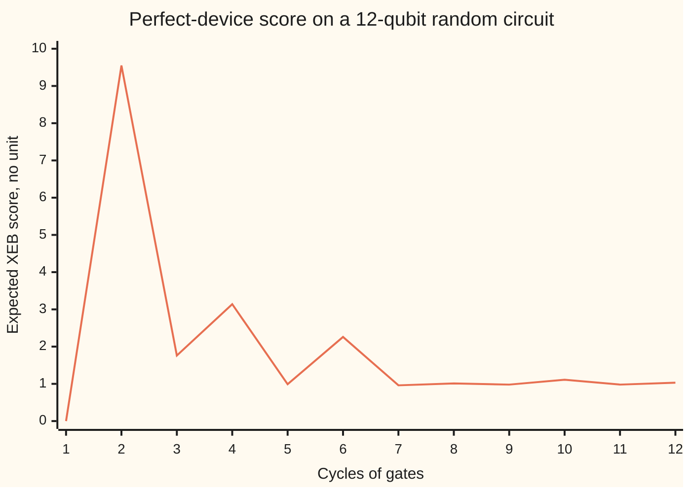

# Quantum advantage: what BQP can do that classical machines cannot, as far as anyone knows

[Syllabus](../../../SYLLABUS.md) → [Frontier](../README.md) → [Physics, Finance and Machines](../README.md#s07) → Quantum advantage

---

## General Overview

In December 2001 a team split 15 into 3 × 5 on a quantum device: seven atomic nuclei in one molecule, steered by radio pulses. It was the first hardware run of Shor's factoring algorithm. The circuit was simplified using the known answer, so the run showed the steps, not a speed-up.

In July 2013 three researchers took that shortcut to its end. If the factors are known in advance, a "compiled" circuit of two qubits can "factor" any product of two different odd primes. The quantum part is one fair coin flip. This card repeats their trick on a 19-digit one, 9,223,372,021,822,390,277.

That is the pattern of this card: a claim, a check, and a dated status. In October 2019 a 53-qubit chip called Sycamore sampled a random circuit a million times in 200 seconds. Its team estimated 10,000 years for a classical supercomputer. In August 2022 a classical team did the same task in 15 hours on 512 graphics processors (GPUs). The chip did what it said; the 10,000-year estimate fell. Larger sampling runs since then, at 67 qubits in 2024 and 83 in 2025, are still claimed beyond classical reach.

**Quantum advantage is a dated race, not a theorem: a device does one task, a team estimates the best classical cost, and the claim stands only until a classical method catches up; no one has proved that any quantum advantage is permanent.**

**What kind of fact this is:** this card holds several claims, each with its own kind and status. BQP is a definition. "Factoring is in BQP" is a theorem (Shor). "BQP is bigger than BPP" is a conjecture, open as of 2026-11-23. Each hardware advantage is an experimental claim with a cost estimate; the ledger in Why it works gives each one's status, date and source. The test-score identity is a theorem, proved here, about a noise model.

### The picture: one task, three times

The task is the 2019 one: a million samples from one 53-qubit random circuit at the chip's fidelity. Time in seconds, as log10, two blocks per power of ten. Both checks print these bars:

```
  claim 2019, 10000 years   #######################  log10 s = 11.50
  classical 2022, 15 hours  #########                log10 s = 4.73
  chip 2019, 200 seconds    #####                    log10 s = 2.30
```

The top bar is an estimate. The other two are runs. The gap the 2019 claim rested on, 1,577,880,000 times, shrank to 270 times in three years.

---

## The formula

[BQP](../../24-Computability%20and%20complexity/05-Algebraic%2C%20Interactive%20and%20Quantum/06-quantum-computation-and-bqp.md) is the class of yes-or-no problems a polynomial-size quantum circuit answers correctly at least 2 times in 3. It contains BPP, the problems a coin-flipping classical computer solves fast. [Shor and Grover](../../24-Computability%20and%20complexity/05-Algebraic%2C%20Interactive%20and%20Quantum/07-shors-and-grovers-algorithms.md) puts factoring in BQP by finding the period of the powers of a base. Both cards prove their results; this card uses them.

A **quantum advantage claim** has four parts: a task, a device's time on it, the best classical time known on a stated date, and a test showing the device really did the task. For random circuit sampling the test is the **linear cross-entropy benchmark** (XEB). A classical computer works out the ideal chance p(x) of each output string x. The device's samples are then scored:

```math
F_{\mathrm{XEB}} = \frac{2^n}{k} \sum_{i=1}^{k} p(x_i) - 1
```

**Read it aloud:** average the ideal chances of the strings the device produced, multiply by the number of possible strings, and subtract 1.

A uniform random guesser scores 0 on average. A device that samples the ideal distribution lands more often on likely strings, so it scores more. Under the noise model below, the average score is the device's fidelity:

```math
\mathbb{E}[F_{\mathrm{XEB}}] = f \Big( 2^n \sum_{x} p(x)^2 - 1 \Big) \approx f, \qquad \text{standard error} \approx \frac{1}{\sqrt{k}}
```

**Read it aloud:** the expected value $`\mathbb{E}`$ (the long-run average) of the score is the fidelity times a perfect device's score, which is close to 1; the noise in one batch of k samples is about 1 over the square root of k.

The factoring trick has its own one-line formula. Write ≡ for "leaves the same remainder":

```math
a \equiv 1 \ (\mathrm{mod}\ s), \quad a \equiv -1 \ (\mathrm{mod}\ t) \;\Longrightarrow\; a^2 \equiv 1 \ (\mathrm{mod}\ st), \quad \gcd(a - 1, st) = s, \quad \gcd(a + 1, st) = t
```

**Read it aloud:** build a base that is 1 more than a multiple of one prime and 1 less than a multiple of the other; its period is 2, and the two greatest common divisors hand back the primes.

| Symbol | Plain meaning | In our example | Push it up and the answer… |
| --- | --- | --- | --- |
| $`n`$ | qubits in the circuit | 12 here; 53 in 2019 | classical memory doubles per qubit |
| $`x`$, $`x_i`$ | one output string of n bits, read as a whole number; $`x_i`$ is the i-th sample | one of 4,096 | — |
| $`p(x)`$ | the ideal chance of string x, computed classically | 37.21% of strings have $`2^n p(x) > 1`$ | — |
| $`k`$ | samples taken from the device | 20,000 here; 30,000,000 in 2019 | the standard error shrinks as $`1/\sqrt{k}`$ |
| $`\mathbb{E}`$ | expected value: the long-run average over many batches | — | — |
| $`F_{\mathrm{XEB}}`$ | the test score | 1.0437 for a perfect device here | — |
| $`f`$ | fidelity: the share of runs with no error, in the noise model | 0.05 here; about 0.002 in 2019 | the score rises in step |
| $`2^n \sum_x p(x)^2 - 1`$ | the perfect device's expected score | 1.03 after 12 cycles | — |
| $`N`$ | the number to split | 15; then 9,223,372,021,822,390,277 | — |
| $`a`$ | the base whose powers repeat | 2 to 14 for 15; 6,148,914,678,351,615,323 for the big N | — |
| $`r`$ | the period of a: steps until its powers return to 1 | 2 or 4 for 15 | more counting bits matter |
| $`s`$, $`t`$ | the two primes, known before the run | 2,147,483,647 and 4,294,967,291 | — |

### When it holds

- **The score needs the ideal chances p(x).** Only a classical simulation gives them. At 53 qubits the 2019 team could not compute them for the hardest circuits, so it checked easier versions and extrapolated. Without that, the score cannot be computed at all.
- **The circuit must be deep enough to spread the chances.** After one cycle every string is equally likely, and a perfect device scores 0.00, the same as a guesser.
- **The noise must act like the mix model**: with chance f a perfect run, otherwise a uniform random string. Real noise only approximates this, so "score = fidelity" is a model, not a law.
- **There must be enough samples.** At f = 0.002, 20,000 samples give 0.0064 with a standard error of 0.0072: no signal. Five errors above zero needs about 6,250,000.
- **"Best classical time" carries a date.** A new classical method changes it, as in 2022.

---

## Why it works

### Step 0: the classical cost is a moving target

A state of n qubits is a list of $`2^n`$ amplitudes ([BQP](../../24-Computability%20and%20complexity/05-Algebraic%2C%20Interactive%20and%20Quantum/06-quantum-computation-and-bqp.md) defines them). A classical program can copy a device by storing that list. At 53 qubits, with 8 bytes per amplitude, that is 72,057,594,037,927,936 bytes, about 72 petabytes.

Classical programs need not store the list. Tensor-network methods treat the circuit as a network of small tables of numbers and sum it in a clever order, trading memory for time. So the classical cost of a task is the cost of the best method found so far. That is why every advantage claim carries a date.

There is also a hard ceiling on what can be proved. BPP ⊆ BQP ⊆ PSPACE, from the BQP card. If BPP were equal to PSPACE, BQP would be squeezed equal to BPP. So a proof that BQP is bigger than BPP would also prove BPP ≠ PSPACE, itself a famous open problem.

### Step 1: what a hardware run on 15 really needs

Shor's circuit writes $`a^x \bmod 15`$ beside every x in a counting register, then reads the period ([Shor and Grover](../../24-Computability%20and%20complexity/05-Algebraic%2C%20Interactive%20and%20Quantum/07-shors-and-grovers-algorithms.md) does this in full). The textbook layout for 15 uses 8 counting qubits and 4 work qubits: 12 in all.

But every base of 15 has period 2 or 4. Then $`a^x \bmod 15`$ depends only on the last 1 or 2 bits of x. The code checks this for all 256 values of x and all seven usable bases. So a device can skip most of the multiplier and wire just those bits. The 2001 run used 7 qubits. The 2016 ion-trap run used 7 qubits plus 4 "cache" qubits, with success over 90%; its authors call the method scalable, following a design by Kitaev.

Each run is real physics, but none shows the hardware could factor a large number. On 15 the period is at most 4, so the circuit only ever finds a 2-bit pattern.

### Step 2: a coin flip that "factors" a 19-digit number

Smolin, Smith and Vargo (2013) made the point sharp. Pick the base from the answer. Take the primes s = 2,147,483,647 and t = 4,294,967,291, so N = s × t = 9,223,372,021,822,390,277. Build a with a ≡ 1 (mod s) and a ≡ −1 (mod t). The code finds a = 6,148,914,678,351,615,323.

<details>
<summary>Detailed proof: such a base has period 2 and its gcds are the primes</summary>

Since a ≡ 1 (mod s), s divides a − 1. Since a ≡ −1 (mod t), t divides a + 1. So st divides $`(a - 1)(a + 1) = a^2 - 1`$, which says $`a^2 \equiv 1 \pmod{st}`$.

t does not divide a − 1: otherwise t would divide (a + 1) − (a − 1) = 2, and t is an odd prime. So gcd(a − 1, st) = s. In the same way s does not divide a + 1, so gcd(a + 1, st) = t.

To build a, write a = 1 + s·m and ask that 1 + s·m ≡ −1 (mod t). That gives m ≡ −2 × (the inverse of s mod t). The inverse is $`s^{t-2} \bmod t`$, by Fermat's little theorem.

</details>

Now the "quantum" part. The counting register needs one qubit, because the period is 2. A Hadamard gate (the gate that sends 0 to an even mix of 0 and 1) puts it in an even mix. A controlled step writes $`a^x`$ for x = 0 or 1 into one work qubit. A last Hadamard and a reading give 0 or 1, each with chance 0.5000: a fair coin. Reading 1 gives the fraction 1/2, so r = 2, and the gcds return 2,147,483,647 and 4,294,967,291. Both are prime by trial division.

The work was done when a was chosen, and that needed the factors. Their lesson: judge a factoring run by the length of the period it found, not by the size of N.

### Step 3: random circuit sampling, the 2019 task

Random circuit sampling asks a device for strings drawn from the output of a random circuit. The code builds one on 12 qubits in a 3 by 4 grid. Each cycle puts a random gate on every qubit, chosen from three "square root" gates (the square roots of X, Y and W, as on the 2019 chip). Then it applies controlled-Z gates (a sign flip when both qubits read 1) on one of four patterns of neighbours. Random choices come from SplitMix64, a small written-out generator, with seed 20191023.

After enough cycles the chances p(x) take a typical shape, called **Porter–Thomas**. The scaled chance $`2^n p(x)`$ behaves like a draw from an exponential distribution with mean 1. A test of that shape is the share of strings with $`2^n p(x) > 1`$: the exponential predicts $`e^{-1}`$ = 0.3679, and the 12-qubit circuit gives 0.3721.

The perfect device's score settles near 1 as the cycles add up. It starts at 0, because after one cycle every string is equally likely:



Orange: the perfect device's expected score, $`2^n \sum_x p(x)^2 - 1`$, after each cycle. Early cycles leave the chances lumpy, with a few strings very likely, so the score jumps around. From cycle 7 on it stays within 0.11 of 1, the Porter–Thomas value.

### Step 4: why the score measures fidelity

In the mix model, a noisy device returns an ideal sample with chance f and a uniform random string otherwise. The score's average then splits into those two parts.

<details>
<summary>Detailed proof: the expected score is f times the perfect score, and close to f</summary>

One sample from the noisy device lands on x with chance

$`\displaystyle q(x) = f\, p(x) + (1 - f)\, 2^{-n}`$

The expected score is $`2^n \sum_x q(x)\, p(x) - 1`$. Put in q(x) and use $`\sum_x p(x) = 1`$:

$`\displaystyle 2^n \sum_x \big(f\, p(x) + (1 - f) 2^{-n}\big) p(x) - 1 = f \Big(2^n \sum_x p(x)^2 - 1\Big) + f + (1 - f) - 1`$

The last three terms cancel, which leaves f times the perfect score. If $`2^n p(x)`$ is exponential with mean 1, its average square is 2. Now $`2^n \sum_x p(x)^2`$ is that average square taken over all $`2^n`$ strings, so it is close to 2, and the perfect score is close to 1.

Each sample adds $`2^n p(x_i)`$, whose spread is about 1 for a noisy device that mostly guesses. So the mean of k samples has a standard error of about $`1/\sqrt{k}`$, the usual square-root law for averages.

</details>

The code checks the identity by sampling. With 20,000 samples per device:

| Device | Score | Standard error | Expected |
| --- | ---: | ---: | ---: |
| perfect, f = 1 | 1.0437 | 0.0105 | 1.0293 |
| noisy, f = 0.05 | 0.0422 | 0.0076 | 0.0515 |
| uniform guesser, f = 0 | −0.0033 | 0.0072 | 0.0000 |
| noisy, f = 0.002 | 0.0064 | 0.0072 | 0.0021 |

The first three land within 2 standard errors of the formula. The last cannot be told from the guesser. That is why the 2019 team took 30,000,000 samples: the standard error is $`1/\sqrt{30{,}000{,}000}`$ = 0.000183. Their measured score, 0.00224, sits 12.3 of those errors above zero. It was measured on "elided" circuits: the same 53 qubits and 20 cycles with a few two-qubit gates removed, so a classical computer could still find p(x). Counting systematic errors too, they reported a fidelity above 0.1% with 5-sigma confidence. For the full circuits the score could not be computed; the team inferred a similar fidelity.

### Step 5: how a claim falls

The 2019 paper took about 200 seconds for a million samples at 53 qubits and 20 cycles. Its classical estimate was 10,000 years "on a million cores". The ratio is 1,577,880,000.

In 2022 Pan, Chen and Zhang contracted the circuit's tensor network once and drew a million samples from it. Their samples had fidelity about 0.0037, higher than the chip's. It took about 15 hours on 512 GPUs: 54,000 seconds, 270 times the chip's 200. They also estimated a few dozen seconds on an exascale supercomputer, which would beat the chip; that part is an estimate, not a run.

So the device's measurement stands, and the 10,000-year estimate is refuted. "Supremacy" for that task lasted until a better classical method arrived.

### Step 6: the ledger

The status fields are those of [Kinds of claim](../01-How%20Research%20Works/02-theorem-conjecture-model-approximation.md): what kind of claim, and its dated status. **Open** means no accepted answer; **claimed** means a primary source asserts it, with no independent check yet; **proved** or **refuted** means refereed or independently confirmed. An experiment's run is recorded as performed, in the Kind column. Only a claim drawn from it, such as a speed-up or a classical cost, carries one of the four status words; a run with no such claim shows —. A classical cost estimate can be refuted by a faster classical run, as in 2022, but not proved, since that would need a proof that no faster method exists. So a standing estimate stays claimed, refereed or not.

| Claim | Kind | Status | Source |
| --- | --- | --- | --- |
| Factoring is in BQP | theorem | proved, 1994 (journal 1997) | on Shor and Grover |
| Some problem in BQP is outside BPP | conjecture | open as of 2026-11-23 | on BQP |
| Factoring is outside BPP | conjecture | open as of 2026-11-23 | on Shor and Grover |
| 15 = 3 × 5 on a 7-qubit device, with a circuit simplified by the known answer, 2001-12 | experiment, performed | — (no speed-up claimed) | Vandersypen and others, on Shor and Grover |
| A compiled run can "factor" any product of two different odd primes with 2 qubits, 2013-07-10 | theorem | proved, and rerun on this card | Smolin, Smith and Vargo |
| 15 by a Shor circuit its authors call scalable, 2016-03-04 | experiment, performed | "scalable": claimed, untested at larger N in this card's sources | Monz and others |
| 53-qubit sampling at fidelity 0.00224 (measured on elided circuits), 2019-10-23 | experiment, performed | — (its claim is the next row) | Arute and others |
| The same task takes 10,000 years classically, 2019-10-23 | cost estimate | refuted 2022-08-22: 15 hours on 512 GPUs | Arute and others; Pan, Chen and Zhang |
| Boson sampling: up to 76 photon detector clicks, at a rate about 10^14 times the best classical simulation, 2020-12-18 | experiment, performed, and cost estimate | claimed; disputed since 2024-06-25, when a classical sampler beat the largest photon experiments of this kind on the benchmarks used as evidence | [Zhong and others](https://doi.org/10.1126/science.abe8770); against: [Oh and others](https://doi.org/10.1038/s41567-024-02535-8) |
| Random circuit sampling at 67 qubits and 32 cycles, beyond existing supercomputers even with noise, 2024-10-09 | experiment, performed, and cost estimate | claimed as of 2026-11-23 | [Morvan and others](https://doi.org/10.1038/s41586-024-07998-6) |
| Random circuit sampling at 83 qubits and 32 cycles: a million samples in a few hundred seconds, against about 6.4 × 10^9 years estimated on the Frontier supercomputer, 2025-03-03 | experiment, performed, and cost estimate | claimed as of 2026-11-23 | [Gao and others](https://doi.org/10.1103/PhysRevLett.134.090601) |
| A quantum annealer (a chip that slowly tunes a network of qubits) tracks spin-glass dynamics more accurately than several leading classical methods can in reasonable time, 2025-04-11 | experiment, performed, and cost estimate | claimed; disputed since 2026-05-21, when a tensor-network simulation reported state-of-the-art accuracy with modest resources | [King and others](https://doi.org/10.1126/science.ado6285); against: [Tindall and others](https://doi.org/10.1126/science.adx2728) |
| 65-qubit echo measurements beyond classical reach, about 13,000 times, 2025-10-22 | experiment, performed, and cost estimate | claimed as of 2026-11-23 | Abanin and others |

On the last row: the 2025 team measured an "echo" quantity (a second-order out-of-time-order correlator, which tracks how a small disturbance spreads when the circuit is run forward and back). For 65-qubit circuits they estimate 3.2 years on the Frontier supercomputer against 2.1 hours of data collection: a ratio of 13,358. This card found no classical match in its sources but did not survey every 2026 paper, so the status stays "claimed".

---

## Worked numbers, by hand

| Step | Arithmetic | Value |
| --- | --- | --- |
| powers of 11 on the 15-clock | 11, then 11 × 11 = 121 = 8 × 15 + 1 | period r = 2 |
| what the oracle needs for a = 11 | $`11^x \bmod 15`$ is 1 for even x, 11 for odd x | last 1 bit of x |
| gcds for a = 11 | gcd(10, 15) and gcd(12, 15) | 5 and 3 |
| coin-flip base | a ≡ 1 (mod s), a ≡ −1 (mod t) | 6,148,914,678,351,615,323 |
| its square | $`a^2 \bmod N`$ | 1 |
| the coin | Hadamard, controlled step, Hadamard | 0.5000 and 0.5000 |
| factors returned | gcd(a − 1, N) and gcd(a + 1, N) | 2,147,483,647 and 4,294,967,291 |
| 2019 standard error | $`1/\sqrt{30{,}000{,}000}`$ | 0.000183 |
| 2019 signal | 0.00224 ÷ 0.000183 | **12.3 standard errors** |
| 2019 claimed ratio | 10,000 × 365.25 × 86,400 ÷ 200 | 1,577,880,000 |
| 2022 run against the chip | 15 × 3,600 ÷ 200 | **270** |

The chip's test on the elided circuits sits 12.3 statistical errors above zero, so it really sampled them, with an error rate expected to carry over to the full circuits. What fell was the classical cost: from a ratio of 1,577,880,000 to 270.

### What breaks if you drop a piece

| Mistake | Comes out at | What went wrong |
| --- | --- | --- |
| Base a = 14 on 15 | period 2, gcds 1 and 15 | the halfway power is 14 = 15 − 1, so the factors stay hidden |
| Base chosen from the known factors | a 19-digit N "factored" by a coin: 0.5000 and 0.5000 | the period 2 was built in; no period was found |
| Scoring a circuit of one cycle | perfect device scores 0.00 | every string is equally likely, so device and guesser look the same |
| f = 0.002 with only 20,000 samples | 0.0064, standard error 0.0072 | signal below the noise; about 6,250,000 samples are needed |
| Taking the 2019 cost estimate as fixed | 10,000 years against 15 hours | a better classical method appeared in 2022 |

The code prints all five.

---

## Code, from first principles, and it actually runs

The code has three parts. Part 1 finds every period of 15 by multiplying and checks that the oracle needs only the last bits of x; then it builds the coin-flip base from s and t and simulates its two-qubit circuit. Part 2 simulates the 12-qubit random circuit gate by gate as a list of 4,096 complex amplitudes and scores four kinds of device. Part 3 turns the published 2019, 2022 and 2025 figures into the ratios on this card. The independent roads are: the coin-flip factors against primality by trial division; the oracle shortcut against direct powers for all 256 values of x; the exact XEB sum against sampled scores, for three devices; and the Porter–Thomas share against $`e^{-1}`$. No quantum simulator or number theory library is used.

### Python

```python
# Quantum advantage -- the check behind the card.  Standard library only: math
# gives sqrt, exp and log10; bisect finds a place in a sorted list.
# Part 1: what a hardware run on 15 really needs, and "factoring" by coin flip.
# Part 2: random circuits on 12 qubits and the cross-entropy test (XEB).
# Part 3: the 2019 claim and the 2022 classical answer, in numbers.
from bisect import bisect_right
from math import exp, log10, sqrt

def gcd(a, b):                                   # Euclid's algorithm, written out
    while b:
        a, b = b, a % b
    return a

def powmod(a, e, n):                             # square and multiply, wrapped at n
    r, a = 1, a % n
    while e:
        if e & 1:
            r = r * a % n
        a, e = a * a % n, e >> 1
    return r

def order(a, n):                                 # multiply until the powers return to 1
    r, x = 1, a % n
    while x != 1:
        x, r = x * a % n, r + 1
    return r

def tot(xs):                                     # plain left-to-right sum, as in Rust
    acc = 0.0
    for x in xs:
        acc += x
    return acc

def is_prime(m):                                 # trial division, an independent road
    d = 3
    while d * d <= m:
        if m % d == 0:
            return False
        d += 2
    return m == 2 or (m > 2 and m % 2 == 1)

print("Part 1: Shor's circuit for N = 15, base by base")
good = 0
for a in [b for b in range(2, 15) if gcd(b, 15) == 1]:
    r = order(a, 15)
    bits = r.bit_length() - 1                    # the oracle needs only the last log2(r) bits of x
    assert all(powmod(a, x, 15) == powmod(a, x % r, 15) for x in range(256))
    h = powmod(a, r // 2, 15)
    g1, g2 = gcd(h - 1, 15), gcd(h + 1, 15)
    good += g1 not in (1, 15)
    print(f"  a = {a:2}: period {r}, oracle uses the last {bits} bit(s) of x, gcds {g1} and {g2}{'  (fails)' if g1 == 1 else ''}")
t = (15 * 15 - 1).bit_length()
print(f"textbook circuit: {t} counting + 4 work = {t + 4} qubits; bases that split 15: {good} of 7")
print("quoted runs on 15: 2001 NMR, 7 qubits; 2016 ion trap, 7 qubits + 4 cache, success over 90%")
p, q = 2147483647, 4294967291                    # the answer, known before the run
N = p * q
a = 1 + p * ((q - 2) * powmod(p, q - 2, q) % q)  # a = 1 mod p and a = -1 mod q: built from the answer
s = 1 / sqrt(2)
v = [s, 0.0, s, 0.0]                             # index 2c + w; H on the counting qubit c
v[2], v[3] = v[3], v[2]                          # c = 1 multiplies by a: work bit w goes 1 -> a
v = [s * (v[0] + v[2]), s * (v[1] + v[3]), s * (v[0] - v[2]), s * (v[1] - v[3])]
pc = [v[0] * v[0] + v[1] * v[1], v[2] * v[2] + v[3] * v[3]]
g1, g2 = gcd(a - 1, N), gcd(a + 1, N)
print(f"pretend run, 2 qubits: N = {N}, a = {a}, a^2 mod N = {powmod(a, 2, N)}")
print(f"  counting qubit reads 0 with chance {pc[0]:.4f}, 1 with chance {pc[1]:.4f}: a fair coin")
print(f"  reading 1 gives 1/2, period 2: gcd(a - 1, N) = {g1}, gcd(a + 1, N) = {g2}, both prime by trial division: {'yes' if is_prime(g1) and is_prime(g2) else 'no'}")
assert powmod(a, 2, N) == 1 and a not in (1, N - 1) and g1 * g2 == N and is_prime(g1) and is_prime(g2)

M64 = (1 << 64) - 1
S = [20191023]
def rnd():                                       # SplitMix64, the same stream in Rust
    S[0] = (S[0] + 0x9E3779B97F4A7C15) & M64
    z = S[0]
    z = ((z ^ (z >> 30)) * 0xBF58476D1CE4E5B9) & M64
    z = ((z ^ (z >> 27)) * 0x94D049BB133111EB) & M64
    return z ^ (z >> 31)

n, D, CYC = 12, 1 << 12, 12                      # 12 qubits on a 3 by 4 grid, 12 cycles
G = [(complex(.5, .5), complex(.5, -.5), complex(.5, -.5), complex(.5, .5)),     # square root of X
     (complex(.5, .5), complex(-.5, -.5), complex(.5, .5), complex(.5, .5)),     # square root of Y
     (complex(s, 0), complex(-.5, -.5), complex(.5, -.5), complex(s, 0))]        # square root of W
PAIRS = [[(4 * r, 4 * r + 1) for r in range(3)] + [(4 * r + 2, 4 * r + 3) for r in range(3)],
         [(4 * r + 1, 4 * r + 2) for r in range(3)], [(c, 4 + c) for c in range(4)], [(4 + c, 8 + c) for c in range(4)]]
amp, prev, E = [complex(1, 0)] + [complex(0, 0)] * (D - 1), [3] * n, []
for cyc in range(CYC):
    for k in range(n):
        g = rnd() % 3 if prev[k] == 3 else (prev[k] + 1 + rnd() % 2) % 3
        prev[k], m, b = g, G[g], 1 << k
        for i in range(D):
            if not i & b:
                x, y = amp[i], amp[i | b]
                amp[i], amp[i | b] = m[0] * x + m[1] * y, m[2] * x + m[3] * y
    for (j, k) in PAIRS[cyc % 4]:                # controlled-Z: flip the sign when both qubits are 1
        for i in range(D):
            if i >> j & 1 and i >> k & 1:
                amp[i] = -amp[i]
    P = [z.real * z.real + z.imag * z.imag for z in amp]
    E.append(max(D * tot(x * x for x in P) - 1, 0.0))   # XEB a perfect device scores: 2^n sum p^2 - 1
print(f"Part 2: random circuit, {n} qubits, {CYC} cycles; total probability {tot(P):.4f}")
print("  exact XEB of a perfect device after each cycle: " + ", ".join(f"{e:.2f}" for e in E))
cdf, acc = [], 0.0
for x in P:
    acc += x
    cdf.append(acc)
def draw():                                      # one sample from the ideal distribution
    return min(bisect_right(cdf, (rnd() >> 11) / 9007199254740992), D - 1)
def device(f):                                   # right with chance f, else a uniform random string
    return draw() if (rnd() >> 11) / 9007199254740992 < f else rnd() % D
def xeb(xs):                                     # estimate and its standard error
    vals = [D * P[x] for x in xs]
    mu = tot(vals) / len(vals)
    var = tot((y - mu) * (y - mu) for y in vals) / (len(vals) - 1)
    return mu - 1, sqrt(var / len(vals))
K = 20000
res = {}
for name, f in [("perfect device", 1.0), ("noisy device, f = 0.05", 0.05), ("uniform guesser", 0.0), ("noisy device, f = 0.002", 0.002)]:
    res[f] = xeb([device(f) for _ in range(K)])
    print(f"  {name}, {K} samples: XEB {res[f][0]:.4f}, standard error {res[f][1]:.4f}, expected {f * E[-1]:.4f}")
share = sum(1 for x in P if D * x > 1) / D
print(f"  share of strings with 2^n p > 1: {share:.4f}; Porter-Thomas predicts exp(-1) = {exp(-1):.4f}")
for f in (1.0, 0.05, 0.0):
    assert abs(res[f][0] - f * E[-1]) < 5 * res[f][1]   # sampled XEB against the exact sum
assert abs(share - exp(-1)) < 0.03                    # Porter-Thomas shape against the exact list
assert E[0] < 1e-9 < E[1]                             # one layer of gates leaves every string equally likely
assert abs(tot(P) - 1) < 1e-9                         # the gates keep total probability 1

yr = 365.25 * 86400
claim, chip, gpu = 10000 * yr, 200, 15 * 3600
print("Part 3: the 2019 claim, 53 qubits, 20 cycles, a million samples")
print(f"  2^53 = {2 ** 53} amplitudes; at 8 bytes each {8 * 2 ** 53} bytes")
print(f"  claimed classical time / chip time: {claim / chip:.0f}; 2022 run, 512 GPUs: {gpu} s, {gpu / chip:.0f} times the chip")
for lab, sec in [("claim 2019, 10000 years", claim), ("classical 2022, 15 hours", gpu), ("chip 2019, 200 seconds", chip)]:
    print(f"  {lab:25} {'#' * round(2 * log10(sec)):24} log10 s = {log10(sec):.2f}")
se = 1 / sqrt(30e6)
print(f"  XEB 0.00224 from 30000000 samples: standard error {se:.6f}, {0.00224 / se:.1f} errors above 0")
print(f"  samples to see f = 0.002 at 5 errors: (5/0.002)^2 = {(5 / 0.002) * (5 / 0.002):.0f}")
print("  later claims, quoted: 2020 photons, up to 76 clicks, 1e14 times; 2024 sampling, 67 qubits, 32 cycles; 2025 sampling, 83 qubits, 32 cycles, 6.4e9 years")
print(f"  2025 claim, 65 qubits: 3.2 years / 2.1 hours = {3.2 * yr / (2.1 * 3600):.0f}; 2^65 amplitudes at 8 bytes = {8 * 2 ** 65} bytes")
print("ALL CHECKS PASS")
```

**Ran 2026-11-23 on macOS, Python 3.14.10, standard library only. All checks passed. Output, pasted from the run:**

```
Part 1: Shor's circuit for N = 15, base by base
  a =  2: period 4, oracle uses the last 2 bit(s) of x, gcds 3 and 5
  a =  4: period 2, oracle uses the last 1 bit(s) of x, gcds 3 and 5
  a =  7: period 4, oracle uses the last 2 bit(s) of x, gcds 3 and 5
  a =  8: period 4, oracle uses the last 2 bit(s) of x, gcds 3 and 5
  a = 11: period 2, oracle uses the last 1 bit(s) of x, gcds 5 and 3
  a = 13: period 4, oracle uses the last 2 bit(s) of x, gcds 3 and 5
  a = 14: period 2, oracle uses the last 1 bit(s) of x, gcds 1 and 15  (fails)
textbook circuit: 8 counting + 4 work = 12 qubits; bases that split 15: 6 of 7
quoted runs on 15: 2001 NMR, 7 qubits; 2016 ion trap, 7 qubits + 4 cache, success over 90%
pretend run, 2 qubits: N = 9223372021822390277, a = 6148914678351615323, a^2 mod N = 1
  counting qubit reads 0 with chance 0.5000, 1 with chance 0.5000: a fair coin
  reading 1 gives 1/2, period 2: gcd(a - 1, N) = 2147483647, gcd(a + 1, N) = 4294967291, both prime by trial division: yes
Part 2: random circuit, 12 qubits, 12 cycles; total probability 1.0000
  exact XEB of a perfect device after each cycle: 0.00, 9.55, 1.76, 3.14, 0.99, 2.26, 0.96, 1.01, 0.98, 1.11, 0.98, 1.03
  perfect device, 20000 samples: XEB 1.0437, standard error 0.0105, expected 1.0293
  noisy device, f = 0.05, 20000 samples: XEB 0.0422, standard error 0.0076, expected 0.0515
  uniform guesser, 20000 samples: XEB -0.0033, standard error 0.0072, expected 0.0000
  noisy device, f = 0.002, 20000 samples: XEB 0.0064, standard error 0.0072, expected 0.0021
  share of strings with 2^n p > 1: 0.3721; Porter-Thomas predicts exp(-1) = 0.3679
Part 3: the 2019 claim, 53 qubits, 20 cycles, a million samples
  2^53 = 9007199254740992 amplitudes; at 8 bytes each 72057594037927936 bytes
  claimed classical time / chip time: 1577880000; 2022 run, 512 GPUs: 54000 s, 270 times the chip
  claim 2019, 10000 years   #######################  log10 s = 11.50
  classical 2022, 15 hours  #########                log10 s = 4.73
  chip 2019, 200 seconds    #####                    log10 s = 2.30
  XEB 0.00224 from 30000000 samples: standard error 0.000183, 12.3 errors above 0
  samples to see f = 0.002 at 5 errors: (5/0.002)^2 = 6250000
  later claims, quoted: 2020 photons, up to 76 clicks, 1e14 times; 2024 sampling, 67 qubits, 32 cycles; 2025 sampling, 83 qubits, 32 cycles, 6.4e9 years
  2025 claim, 65 qubits: 3.2 years / 2.1 hours = 13358; 2^65 amplitudes at 8 bytes = 295147905179352825856 bytes
ALL CHECKS PASS
```

### Rust

Same numbers, same labels, built with `rustc --edition 2021 -O`. It carries its own small complex-number type and the same SplitMix64 stream, so the 80,000 samples match the Python ones exactly.

```rust
// Quantum advantage -- the same check as the Python, in Rust.  No crates.
// Part 1: what a hardware run on 15 really needs, and "factoring" by coin flip.
// Part 2: random circuits on 12 qubits and the cross-entropy test (XEB).
// Part 3: the 2019 claim and the 2022 classical answer, in numbers.
#[derive(Clone, Copy)]
struct C { re: f64, im: f64 }                        // a small complex number
fn c(re: f64, im: f64) -> C { C { re, im } }
fn mul(a: C, b: C) -> C { c(a.re * b.re - a.im * b.im, a.re * b.im + a.im * b.re) }
fn add(a: C, b: C) -> C { c(a.re + b.re, a.im + b.im) }

fn gcd(mut a: u128, mut b: u128) -> u128 {           // Euclid's algorithm, written out
    while b != 0 { let t = a % b; a = b; b = t; }
    a
}
fn powmod(a: u128, mut e: u128, n: u128) -> u128 {   // square and multiply, wrapped at n
    let (mut r, mut a) = (1u128, a % n);
    while e > 0 {
        if e & 1 == 1 { r = r * a % n; }
        a = a * a % n;
        e >>= 1;
    }
    r
}
fn order(a: u128, n: u128) -> u128 {                 // multiply until the powers return to 1
    let (mut r, mut x) = (1u128, a % n);
    while x != 1 { x = x * a % n; r += 1; }
    r
}
fn tot(xs: &[f64]) -> f64 { let mut acc = 0.0; for x in xs { acc += x; } acc }
fn is_prime(m: u128) -> bool {                       // trial division, an independent road
    let mut d = 3u128;
    while d * d <= m { if m % d == 0 { return false; } d += 2; }
    m == 2 || (m > 2 && m % 2 == 1)
}
struct Rng(u64);
impl Rng {                                           // SplitMix64, the same stream as the Python
    fn next(&mut self) -> u64 {
        self.0 = self.0.wrapping_add(0x9E3779B97F4A7C15);
        let mut z = self.0;
        z = (z ^ (z >> 30)).wrapping_mul(0xBF58476D1CE4E5B9);
        z = (z ^ (z >> 27)).wrapping_mul(0x94D049BB133111EB);
        z ^ (z >> 31)
    }
    fn unif(&mut self) -> f64 { (self.next() >> 11) as f64 / 9007199254740992.0 }
}

fn main() {
    println!("Part 1: Shor's circuit for N = 15, base by base");
    let mut good = 0;
    for a in (2..15u128).filter(|&b| gcd(b, 15) == 1) {
        let r = order(a, 15);
        let bits = 127 - r.leading_zeros();            // the oracle needs only the last log2(r) bits of x
        assert!((0..256u128).all(|x| powmod(a, x, 15) == powmod(a, x % r, 15)));
        let h = powmod(a, r / 2, 15);
        let (g1, g2) = (gcd(h - 1, 15), gcd(h + 1, 15));
        if g1 != 1 && g1 != 15 { good += 1; }
        println!("  a = {:2}: period {}, oracle uses the last {} bit(s) of x, gcds {} and {}{}", a, r, bits, g1, g2,
                 if g1 == 1 { "  (fails)" } else { "" });
    }
    let t = 128 - (15u128 * 15 - 1).leading_zeros();
    println!("textbook circuit: {} counting + 4 work = {} qubits; bases that split 15: {} of 7", t, t + 4, good);
    println!("quoted runs on 15: 2001 NMR, 7 qubits; 2016 ion trap, 7 qubits + 4 cache, success over 90%");
    let (p, q) = (2147483647u128, 4294967291u128);  // the answer, known before the run
    let n = p * q;
    let a = 1 + p * ((q - 2) * powmod(p, q - 2, q) % q); // a = 1 mod p and a = -1 mod q: built from the answer
    let s = 1.0 / 2f64.sqrt();
    let mut v = [s, 0.0, s, 0.0];                    // index 2c + w; H on the counting qubit c
    v.swap(2, 3);                                    // c = 1 multiplies by a: work bit w goes 1 -> a
    v = [s * (v[0] + v[2]), s * (v[1] + v[3]), s * (v[0] - v[2]), s * (v[1] - v[3])];
    let pc = [v[0] * v[0] + v[1] * v[1], v[2] * v[2] + v[3] * v[3]];
    let (g1, g2) = (gcd(a - 1, n), gcd(a + 1, n));
    println!("pretend run, 2 qubits: N = {}, a = {}, a^2 mod N = {}", n, a, powmod(a, 2, n));
    println!("  counting qubit reads 0 with chance {:.4}, 1 with chance {:.4}: a fair coin", pc[0], pc[1]);
    println!("  reading 1 gives 1/2, period 2: gcd(a - 1, N) = {}, gcd(a + 1, N) = {}, both prime by trial division: {}", g1, g2,
             if is_prime(g1) && is_prime(g2) { "yes" } else { "no" });
    assert!(powmod(a, 2, n) == 1 && a != 1 && a != n - 1 && g1 * g2 == n && is_prime(g1) && is_prime(g2));

    let mut rng = Rng(20191023);
    let (nq, dd, cyc_n) = (12usize, 1usize << 12, 12usize); // 12 qubits on a 3 by 4 grid, 12 cycles
    let g: [[C; 4]; 3] = [[c(0.5, 0.5), c(0.5, -0.5), c(0.5, -0.5), c(0.5, 0.5)],     // square root of X
                          [c(0.5, 0.5), c(-0.5, -0.5), c(0.5, 0.5), c(0.5, 0.5)],     // square root of Y
                          [c(s, 0.0), c(-0.5, -0.5), c(0.5, -0.5), c(s, 0.0)]];       // square root of W
    let mut pairs: Vec<Vec<(usize, usize)>> = vec![vec![]; 4];
    for r in 0..3 { pairs[0].push((4 * r, 4 * r + 1)); }
    for r in 0..3 { pairs[0].push((4 * r + 2, 4 * r + 3)); }
    for r in 0..3 { pairs[1].push((4 * r + 1, 4 * r + 2)); }
    for col in 0..4 { pairs[2].push((col, 4 + col)); pairs[3].push((4 + col, 8 + col)); }
    let (mut amp, mut prev, mut e) = (vec![c(0.0, 0.0); dd], vec![3u64; nq], vec![]);
    amp[0] = c(1.0, 0.0);
    let mut pr = vec![0.0; dd];
    for cyc in 0..cyc_n {
        for k in 0..nq {
            let gi = if prev[k] == 3 { rng.next() % 3 } else { (prev[k] + 1 + rng.next() % 2) % 3 };
            prev[k] = gi;
            let (m, b) = (g[gi as usize], 1usize << k);
            for i in 0..dd {
                if i & b == 0 {
                    let (x, y) = (amp[i], amp[i | b]);
                    amp[i] = add(mul(m[0], x), mul(m[1], y));
                    amp[i | b] = add(mul(m[2], x), mul(m[3], y));
                }
            }
        }
        for &(j, k) in &pairs[cyc % 4] {             // controlled-Z: flip the sign when both qubits are 1
            for i in 0..dd { if (i >> j) & 1 == 1 && (i >> k) & 1 == 1 { amp[i] = c(-amp[i].re, -amp[i].im); } }
        }
        pr = amp.iter().map(|z| z.re * z.re + z.im * z.im).collect();
        let sq: Vec<f64> = pr.iter().map(|x| x * x).collect();
        e.push((dd as f64 * tot(&sq) - 1.0).max(0.0)); // XEB a perfect device scores: 2^n sum p^2 - 1
    }
    println!("Part 2: random circuit, {} qubits, {} cycles; total probability {:.4}", nq, cyc_n, tot(&pr));
    let es: Vec<String> = e.iter().map(|x| format!("{:.2}", x)).collect();
    println!("  exact XEB of a perfect device after each cycle: {}", es.join(", "));
    let mut cdf = Vec::with_capacity(dd);
    let mut acc = 0.0;
    for x in &pr { acc += x; cdf.push(acc); }
    let kk = 20000usize;
    let mut res = std::collections::HashMap::new();
    for (name, f) in [("perfect device", 1.0), ("noisy device, f = 0.05", 0.05), ("uniform guesser", 0.0), ("noisy device, f = 0.002", 0.002)] {
        let mut vals = Vec::with_capacity(kk);
        for _ in 0..kk {                             // right with chance f, else a uniform random string
            let x = if rng.unif() < f { let u = rng.unif(); cdf.partition_point(|&cv| cv <= u).min(dd - 1) }
                    else { (rng.next() % dd as u64) as usize };
            vals.push(dd as f64 * pr[x]);
        }
        let mu = tot(&vals) / kk as f64;
        let dev: Vec<f64> = vals.iter().map(|y| (y - mu) * (y - mu)).collect();
        let se = (tot(&dev) / (kk - 1) as f64 / kk as f64).sqrt();
        println!("  {}, {} samples: XEB {:.4}, standard error {:.4}, expected {:.4}", name, kk, mu - 1.0, se, f * e[cyc_n - 1]);
        res.insert(name, (f, mu - 1.0, se));
    }
    let share = pr.iter().filter(|&&x| dd as f64 * x > 1.0).count() as f64 / dd as f64;
    println!("  share of strings with 2^n p > 1: {:.4}; Porter-Thomas predicts exp(-1) = {:.4}", share, (-1f64).exp());
    for name in ["perfect device", "noisy device, f = 0.05", "uniform guesser"] {
        let (f, x, se) = res[name];
        assert!((x - f * e[cyc_n - 1]).abs() < 5.0 * se);  // sampled XEB against the exact sum
    }
    assert!((share - (-1f64).exp()).abs() < 0.03);
    assert!(e[0] < 1e-9 && 1e-9 < e[1]);
    assert!((tot(&pr) - 1.0).abs() < 1e-9);

    let yr = 365.25 * 86400.0;
    let (claim, chip, gpu) = (10000.0 * yr, 200.0f64, 15u64 * 3600);
    println!("Part 3: the 2019 claim, 53 qubits, 20 cycles, a million samples");
    println!("  2^53 = {} amplitudes; at 8 bytes each {} bytes", 1u64 << 53, 8u64 << 53);
    println!("  claimed classical time / chip time: {:.0}; 2022 run, 512 GPUs: {} s, {:.0} times the chip", claim / chip, gpu, gpu as f64 / chip);
    for (lab, sec) in [("claim 2019, 10000 years", claim), ("classical 2022, 15 hours", gpu as f64), ("chip 2019, 200 seconds", chip)] {
        println!("  {:25} {:24} log10 s = {:.2}", lab, "#".repeat((2.0 * sec.log10()).round() as usize), sec.log10());
    }
    let se = 1.0 / 30e6f64.sqrt();
    println!("  XEB 0.00224 from 30000000 samples: standard error {:.6}, {:.1} errors above 0", se, 0.00224 / se);
    println!("  samples to see f = 0.002 at 5 errors: (5/0.002)^2 = {:.0}", (5.0 / 0.002) * (5.0 / 0.002));
    println!("  later claims, quoted: 2020 photons, up to 76 clicks, 1e14 times; 2024 sampling, 67 qubits, 32 cycles; 2025 sampling, 83 qubits, 32 cycles, 6.4e9 years");
    println!("  2025 claim, 65 qubits: 3.2 years / 2.1 hours = {:.0}; 2^65 amplitudes at 8 bytes = {} bytes", 3.2 * yr / (2.1 * 3600.0), 8u128 << 65);
    println!("ALL CHECKS PASS");
}
```

**Ran 2026-11-23 on macOS, rustc 1.98.1, no crates. All checks passed. Output, pasted from the run:**

```
Part 1: Shor's circuit for N = 15, base by base
  a =  2: period 4, oracle uses the last 2 bit(s) of x, gcds 3 and 5
  a =  4: period 2, oracle uses the last 1 bit(s) of x, gcds 3 and 5
  a =  7: period 4, oracle uses the last 2 bit(s) of x, gcds 3 and 5
  a =  8: period 4, oracle uses the last 2 bit(s) of x, gcds 3 and 5
  a = 11: period 2, oracle uses the last 1 bit(s) of x, gcds 5 and 3
  a = 13: period 4, oracle uses the last 2 bit(s) of x, gcds 3 and 5
  a = 14: period 2, oracle uses the last 1 bit(s) of x, gcds 1 and 15  (fails)
textbook circuit: 8 counting + 4 work = 12 qubits; bases that split 15: 6 of 7
quoted runs on 15: 2001 NMR, 7 qubits; 2016 ion trap, 7 qubits + 4 cache, success over 90%
pretend run, 2 qubits: N = 9223372021822390277, a = 6148914678351615323, a^2 mod N = 1
  counting qubit reads 0 with chance 0.5000, 1 with chance 0.5000: a fair coin
  reading 1 gives 1/2, period 2: gcd(a - 1, N) = 2147483647, gcd(a + 1, N) = 4294967291, both prime by trial division: yes
Part 2: random circuit, 12 qubits, 12 cycles; total probability 1.0000
  exact XEB of a perfect device after each cycle: 0.00, 9.55, 1.76, 3.14, 0.99, 2.26, 0.96, 1.01, 0.98, 1.11, 0.98, 1.03
  perfect device, 20000 samples: XEB 1.0437, standard error 0.0105, expected 1.0293
  noisy device, f = 0.05, 20000 samples: XEB 0.0422, standard error 0.0076, expected 0.0515
  uniform guesser, 20000 samples: XEB -0.0033, standard error 0.0072, expected 0.0000
  noisy device, f = 0.002, 20000 samples: XEB 0.0064, standard error 0.0072, expected 0.0021
  share of strings with 2^n p > 1: 0.3721; Porter-Thomas predicts exp(-1) = 0.3679
Part 3: the 2019 claim, 53 qubits, 20 cycles, a million samples
  2^53 = 9007199254740992 amplitudes; at 8 bytes each 72057594037927936 bytes
  claimed classical time / chip time: 1577880000; 2022 run, 512 GPUs: 54000 s, 270 times the chip
  claim 2019, 10000 years   #######################  log10 s = 11.50
  classical 2022, 15 hours  #########                log10 s = 4.73
  chip 2019, 200 seconds    #####                    log10 s = 2.30
  XEB 0.00224 from 30000000 samples: standard error 0.000183, 12.3 errors above 0
  samples to see f = 0.002 at 5 errors: (5/0.002)^2 = 6250000
  later claims, quoted: 2020 photons, up to 76 clicks, 1e14 times; 2024 sampling, 67 qubits, 32 cycles; 2025 sampling, 83 qubits, 32 cycles, 6.4e9 years
  2025 claim, 65 qubits: 3.2 years / 2.1 hours = 13358; 2^65 amplitudes at 8 bytes = 295147905179352825856 bytes
ALL CHECKS PASS
```

### Lean

Lean proves the score identity, the coin-flip trick and the periods of 15 in general, then checks the worked numbers.

- Take the mix model with fidelity $`f`$ from 0 to 1, and ideal chances $`p(x)`$ that sum to 1. Then the expected score is $`f`$ times the perfect device's score.
- Take two different odd primes $`s`$ and $`t`$, and a base $`a`$ with a ≡ 1 (mod s) and a ≡ −1 (mod t). Then $`a^2 \equiv 1 \pmod{st}`$, and the period of $`a`$ modulo $`st`$ is exactly 2.
- Take the same $`s`$, $`t`$ and $`a`$. Then gcd(a − 1, st) = s and gcd(a + 1, st) = t.
- Take any base of 15 other than 1. Then its period is 2 or 4.
- Take the same base $`a`$ and any whole number $`x`$. Then $`a^x \bmod 15`$ depends only on the last 2 bits of $`x`$.
- The seven usable bases of 15 are 2, 4, 7, 8, 11, 13 and 14.
- Base 11 has period 2 and gcds 5 and 3; base 7 has period 4 and gcds 3 and 5.
- Base 14 has period 2, but its gcds are the trivial factors 1 and 15.
- The textbook circuit for 15 uses 8 counting qubits and 4 work qubits, 12 in all.
- In the 19-digit coin-flip run, $`s`$ and $`t`$ are prime, $`a^2 \bmod N = 1`$, and the gcds return $`s`$ and $`t`$.
- The 2019 claimed ratio is 1,577,880,000, and the 2022 run took 270 times the chip's 200 seconds.
- At 53 qubits the list of amplitudes takes 72,057,594,037,927,936 bytes; at 65 qubits, 295,147,905,179,352,825,856 bytes.
- Seeing f = 0.002 at 5 standard errors needs 6,250,000 samples.

The random circuit, the sampled scores and their standard errors, the Porter–Thomas share and the coin's chances are left to the Python and Rust checks.

```lean
-- Quantum advantage: under the mix noise model the expected cross-entropy score is the fidelity times a perfect device's score, a base built from two known odd primes has period 2 and its gcds return the primes, and every base of 15 other than 1 has period 2 or 4.
import Mathlib.Algebra.BigOperators.Ring.Finset
import Mathlib.Basic.Real.Basic
import Mathlib.Data.Fintype.Pi
import Mathlib.Data.ZMod.Basic
import Mathlib.Data.Int.GCD
import Mathlib.GroupTheory.OrderOfElement
import Mathlib.Tactic.NormNum.GCD
import Mathlib.Tactic.NormNum.Prime
import Mathlib.Tactic.NormNum.PowMod
import Mathlib.Tactic.Ring
import Mathlib.Tactic.FieldSimp
import Mathlib.Tactic.IntervalCases

open Finset

namespace QuantumAdvantage

/-- A prime that divides both `a - 1` and `a + 1` divides 2, so it is 2. -/
theorem prime_dvd_sub_one_and_add_one_eq_two (p : ℕ) (hp : p.Prime) (a : ℤ)
    (h1 : (p : ℤ) ∣ a - 1) (h2 : (p : ℤ) ∣ a + 1) : p = 2 := by
  have h : (p : ℤ) ∣ 2 := by
    have := dvd_sub h2 h1
    rwa [show a + 1 - (a - 1) = 2 by ring] at this
  have h' : p ∣ 2 := by exact_mod_cast h
  exact (Nat.prime_dvd_prime_iff_eq hp Nat.prime_two).mp h'

/-- Every unit of `ZMod 15` has fourth power 1. -/
theorem unit_pow_four_mod_fifteen (a : ZMod 15) (ha : IsUnit a) : a ^ 4 = 1 := by
  obtain ⟨u, rfl⟩ := ha
  have hc := ZMod.val_coe_unit_coprime u
  generalize (u : ZMod 15) = b at hc ⊢
  revert b
  decide


/-- The test-score identity (linear cross-entropy benchmark, XEB). Let `p x` be the ideal chance
of the `n`-bit string `x`. In the mix noise model a device returns an ideal sample with chance `f`
and a uniform random string otherwise, so it lands on `x` with chance
`q x = f p(x) + (1 − f) 2^(−n)`. Then the expected score `2^n ∑ₓ q(x) p(x) − 1` equals `f` times a
perfect device's score `2^n ∑ₓ p(x)² − 1`. -/
theorem xeb_expected_score_eq_fidelity_mul_perfect_score (n : ℕ) (p : (Fin n → Bool) → ℝ)
    (hp : ∀ x, 0 ≤ p x) (hsum : ∑ x, p x = 1) (f : ℝ) (hf0 : 0 ≤ f) (hf1 : f ≤ 1) :
    (2 : ℝ) ^ n * ∑ x, (f * p x + (1 - f) * ((2 : ℝ) ^ n)⁻¹) * p x - 1
      = f * ((2 : ℝ) ^ n * ∑ x, p x ^ 2 - 1) := by
  have h2 : (2 : ℝ) ^ n ≠ 0 := by positivity
  have hs : ∑ x, (f * p x + (1 - f) * ((2 : ℝ) ^ n)⁻¹) * p x
      = f * ∑ x, p x ^ 2 + (1 - f) * ((2 : ℝ) ^ n)⁻¹ * ∑ x, p x := by
    rw [Finset.mul_sum, Finset.mul_sum, ← Finset.sum_add_distrib]
    exact Finset.sum_congr rfl (fun x _ => by ring)
  rw [hs, hsum]
  field_simp
  ring

/-- The compiled-factoring trick (Smolin, Smith and Vargo, 2013). Take two different odd primes
`s` and `t` and a base `a` with `a ≡ 1 (mod s)` and `a ≡ −1 (mod t)`. Then `a² ≡ 1 (mod s t)`, the
period of `a` modulo `s t` is exactly 2, `gcd(a − 1, s t) = s` and `gcd(a + 1, s t) = t`: the base
was built from the answer, and the gcds hand the primes back. -/
theorem compiled_base_has_period_two_and_gcds_return_primes (s t : ℕ) (hs : s.Prime)
    (ht : t.Prime) (hs2 : s ≠ 2) (ht2 : t ≠ 2) (hst : s ≠ t) (a : ℤ)
    (has : a ≡ 1 [ZMOD s]) (hat : a ≡ -1 [ZMOD t]) :
    a ^ 2 ≡ 1 [ZMOD (s * t : ℕ)] ∧ orderOf (a : ZMod (s * t)) = 2 ∧
      Int.gcd (a - 1) (s * t : ℕ) = s ∧ Int.gcd (a + 1) (s * t : ℕ) = t := by
  have hsd : (s : ℤ) ∣ a - 1 := (Int.ModEq.dvd has.symm)
  have htd : (t : ℤ) ∣ a + 1 := by
    have := Int.ModEq.dvd hat.symm
    rwa [sub_neg_eq_add] at this
  have hcop : s.Coprime t := (Nat.coprime_primes hs ht).mpr hst
  have hsq : a ^ 2 ≡ 1 [ZMOD (s * t : ℕ)] := by
    rw [Nat.cast_mul, ← Int.modEq_and_modEq_iff_modEq_mul (by simpa using hcop)]
    constructor
    · simpa using has.pow 2
    · simpa using hat.pow 2
  have hnt : ¬ (t : ℤ) ∣ a - 1 := fun h => ht2 (prime_dvd_sub_one_and_add_one_eq_two t ht a h htd)
  have hns : ¬ (s : ℤ) ∣ a + 1 := fun h => hs2 (prime_dvd_sub_one_and_add_one_eq_two s hs a hsd h)
  refine ⟨hsq, ?_, ?_, ?_⟩
  · have : Fact (Nat.Prime 2) := ⟨Nat.prime_two⟩
    apply orderOf_eq_prime
    · have := (ZMod.intCast_eq_intCast_iff (a ^ 2) 1 (s * t)).mpr hsq
      push_cast at this
      exact this
    · intro h
      have h' : ((a : ℤ) : ZMod (s * t)) = ((1 : ℤ) : ZMod (s * t)) := by simpa using h
      rw [ZMod.intCast_eq_intCast_iff] at h'
      have h3 : (t : ℤ) ∣ a - 1 := by
        have := Int.ModEq.dvd h'.symm
        have hd : ((t : ℕ) : ℤ) ∣ ((s * t : ℕ) : ℤ) := by
          exact_mod_cast Nat.dvd_mul_left t s
        exact hd.trans this
      exact hnt h3
  · rw [Int.gcd_eq_natAbs, Int.natAbs_natCast, Nat.Coprime.gcd_mul _ hcop]
    have e1 : Nat.gcd (a - 1).natAbs s = s := Nat.gcd_eq_right (Int.natCast_dvd.mp hsd)
    have e2 : Nat.gcd (a - 1).natAbs t = 1 := by
      apply Nat.Coprime.symm
      rw [Nat.Prime.coprime_iff_not_dvd ht]
      intro h
      exact hnt (Int.natCast_dvd.mpr h)
    rw [e1, e2, mul_one]
  · rw [Int.gcd_eq_natAbs, Int.natAbs_natCast, Nat.Coprime.gcd_mul _ hcop]
    have e1 : Nat.gcd (a + 1).natAbs t = t := Nat.gcd_eq_right (Int.natCast_dvd.mp htd)
    have e2 : Nat.gcd (a + 1).natAbs s = 1 := by
      apply Nat.Coprime.symm
      rw [Nat.Prime.coprime_iff_not_dvd hs]
      intro h
      exact hns (Int.natCast_dvd.mpr h)
    rw [e1, e2, one_mul]

/-- What a hardware run on 15 really needs: every base `a` of 15 (a unit modulo 15) other than 1
has period 2 or 4, so `a^x mod 15` depends only on `x mod 4`, the last 2 bits of `x`. -/
theorem every_base_of_fifteen_has_period_two_or_four (a : ZMod 15) (ha : IsUnit a)
    (h1 : a ≠ 1) :
    (orderOf a = 2 ∨ orderOf a = 4) ∧ ∀ x : ℕ, a ^ x = a ^ (x % 4) := by
  have h4 : a ^ 4 = 1 := unit_pow_four_mod_fifteen a ha
  refine ⟨?_, ?_⟩
  · have hd : orderOf a ∣ 2 ^ 2 := orderOf_dvd_of_pow_eq_one h4
    obtain ⟨k, hk, hk'⟩ := (Nat.dvd_prime_pow Nat.prime_two).mp hd
    interval_cases k
    · exact absurd (orderOf_eq_one_iff.mp (by simpa using hk')) h1
    · left; simpa using hk'
    · right; simpa using hk'
  · intro x
    conv_lhs => rw [← Nat.div_add_mod x 4, pow_add, pow_mul, h4, one_pow, one_mul]

end QuantumAdvantage

/-- The usable bases of 15: seven numbers from 2 to 14 share no factor with 15. -/
example : ((Finset.range 15).filter fun a => 2 ≤ a ∧ Nat.gcd a 15 = 1) = {2, 4, 7, 8, 11, 13, 14} := by
  decide

/-- Base 11 on 15: `11² = 121 = 8 × 15 + 1`, period 2, and the gcds are 5 and 3. -/
example : 11 ^ 2 % 15 = 1 ∧ 11 % 15 ≠ 1 ∧ Nat.gcd 10 15 = 5 ∧ Nat.gcd 12 15 = 3 := by decide

/-- Base 7 on 15: period 4; the halfway power `7² mod 15 = 4` gives gcds 3 and 5. -/
example : 7 ^ 4 % 15 = 1 ∧ 7 ^ 2 % 15 = 4 ∧ Nat.gcd 3 15 = 3 ∧ Nat.gcd 5 15 = 5 := by decide

/-- What breaks: base 14 has period 2, but its halfway power is `14 = 15 − 1`, so the gcds are the
trivial factors 1 and 15. -/
example : 14 ^ 2 % 15 = 1 ∧ Nat.gcd 13 15 = 1 ∧ Nat.gcd 15 15 = 15 := by decide

/-- The textbook circuit for 15: 8 counting qubits, since `2^7 < 15² ≤ 2^8`, plus 4 work qubits. -/
example : 2 ^ 7 < 15 ^ 2 ∧ 15 ^ 2 ≤ 2 ^ 8 ∧ 8 + 4 = 12 := by norm_num

set_option maxRecDepth 100000 in
/-- The coin-flip "factoring" of a 19-digit number: `s = 2,147,483,647` and `t = 4,294,967,291`
are prime, `N = s t = 9,223,372,021,822,390,277`, the base `a = 6,148,914,678,351,615,323` is
1 more than a multiple of `s` and 1 less than a multiple of `t`, `a² mod N = 1`, and the gcds
return `s` and `t`. The primality checks are trial division, deep enough to need a higher
recursion limit. -/
example :
    Nat.Prime 2147483647 ∧ Nat.Prime 4294967291 ∧
    2147483647 * 4294967291 = 9223372021822390277 ∧
    6148914678351615323 % 2147483647 = 1 ∧ (6148914678351615323 + 1) % 4294967291 = 0 ∧
    6148914678351615323 ^ 2 % 9223372021822390277 = 1 ∧
    Nat.gcd (6148914678351615323 - 1) 9223372021822390277 = 2147483647 ∧
    Nat.gcd (6148914678351615323 + 1) 9223372021822390277 = 4294967291 := by
  norm_num

/-- The 2019 claim against the chip: 10,000 years of 365.25 days against 200 seconds is a ratio
of 1,577,880,000; the 2022 run of 15 hours is 270 times the chip. -/
example : (10000 : ℚ) * (36525 / 100) * 86400 / 200 = 1577880000 ∧
    (15 * 3600 : ℚ) / 200 = 270 := by
  norm_num

/-- Storing 53 qubits: `2^53 = 9,007,199,254,740,992` amplitudes, at 8 bytes each
72,057,594,037,927,936 bytes; at 65 qubits, 295,147,905,179,352,825,856 bytes. -/
example : 2 ^ 53 = 9007199254740992 ∧ 8 * 2 ^ 53 = 72057594037927936 ∧
    8 * 2 ^ 65 = 295147905179352825856 := by
  norm_num

/-- Samples needed to see `f = 0.002` at 5 standard errors: `(5 / 0.002)² = 6,250,000`. -/
example : ((5 : ℚ) / (2 / 1000)) ^ 2 = 6250000 := by norm_num

namespace QuantumAdvantage

#print axioms prime_dvd_sub_one_and_add_one_eq_two
#print axioms unit_pow_four_mod_fifteen
#print axioms xeb_expected_score_eq_fidelity_mul_perfect_score
#print axioms compiled_base_has_period_two_and_gcds_return_primes
#print axioms every_base_of_fifteen_has_period_two_or_four

end QuantumAdvantage
```

**Checked 2026-11-23 on macOS, Lean 4.36.0-rc2, Mathlib v4.36.0-rc2. Every proof is complete and uses only Lean's standard axioms. Output, pasted from the run:**

```
'QuantumAdvantage.prime_dvd_sub_one_and_add_one_eq_two' depends on axioms: [propext, Classical.choice, Quot.sound]
'QuantumAdvantage.unit_pow_four_mod_fifteen' depends on axioms: [propext, Classical.choice, Quot.sound]
'QuantumAdvantage.xeb_expected_score_eq_fidelity_mul_perfect_score' depends on axioms: [propext, Classical.choice, Quot.sound]
'QuantumAdvantage.compiled_base_has_period_two_and_gcds_return_primes' depends on axioms: [propext, Classical.choice, Quot.sound]
'QuantumAdvantage.every_base_of_fifteen_has_period_two_or_four' depends on axioms: [propext, Classical.choice, Quot.sound]
```

> [!TIP]
> **Try changing**
> - Guess first: what does every device score if the circuit has only one cycle? Set `CYC = 1`. Every score prints as 0.0000 or −0.0000, with standard error 0.0000: after one cycle every string is equally likely, so every sample scores the same. The asserts, written for a deep circuit, then stop the run.
> - Guess first: how does the standard error change with 10 times fewer samples? Set `K = 2000`. Every standard error grows by about $`\sqrt{10}`$, near 3.2 times: the perfect device's goes from 0.0105 to about 0.033.
> - Guess first: is the coin-flip run still a coin flip with an honest base? Replace the built base with `a = 2`, and add the line `print(order(a, N))` after it. The period of 2 modulo N is a number with 12 digits, so that loop does not finish in a minute. Finding that period is the real job, and the compiled run skipped it. Without the added line the run ends at once: both gcds are 1, not primes, and the assert stops it.
> - Guess first: how many errors above zero would the 2019 score be with 3,000,000 samples? Change `30e6` to `3e6`. About 3.9, short of the 5 the team wanted.

---

## The usual mistake

> [!warning]
> **"Quantum supremacy proved that quantum computers beat classical ones."** It did not. A supremacy claim compares one device on one task with the best classical method known on one date. The 2019 claim's 10,000 years became 15 hours in 2022. No proof exists that any problem in BQP lies outside BPP; such a proof would also prove BPP ≠ PSPACE.
>
> - **"15 was factored by Shor's algorithm, so bigger numbers are only a matter of scale."** Every run on 15 needed a period of at most 4. With the base chosen from the answer, a coin flip "factors" 9,223,372,021,822,390,277.
> - **"A score of 0.002 means the device produced noise."** Mostly noise, yes, but with 30,000,000 samples the 0.00224 sits 12.3 standard errors above a guesser's 0.
> - **"A high score with a few samples is good evidence."** At f = 0.002, 20,000 samples give 0.0064 ± 0.0072, which a guesser matches.
> - **"An advantage task is a useful task."** Random circuit sampling has no known use beyond the test itself. The 2025 paper offers its echo measurement as a path to useful learning about physical systems, which is a hope, not a result.

---

## Where you meet it in real life

- **Encryption planning.** The hardware runs of Shor's algorithm in this card's sources all split 15, with simplified circuits, and none threatens a real key. Planning for quantum-safe encryption is driven by Shor's theorem and by resource estimates, not by these runs.
- **Testing quantum chips.** The XEB score is a standard yardstick for how well a whole chip runs, because it folds every gate error into one number, as in the 2019 paper.
- **Classical simulation research.** Each advantage claim sets a target for tensor-network methods, as the 2022 result shows.
- **Physics experiments.** The 2025 echo measurement probes how disturbances spread among many interacting quantum particles.

> **Say it back**
> BQP is what a quantum circuit decides fast; it contains BPP and factoring, and no one has proved it bigger than BPP. Hardware runs of Shor's algorithm have split 15, but every one used a period of 2 or 4, and a base chosen from the answer turns "factoring" into a coin flip. Advantage claims rest on a task, a device time, a dated classical estimate and a test such as XEB, whose average is the device's fidelity. The 2019 sampling claim's 10,000 years fell to 15 hours in 2022, while the chip's measured score stood. Larger sampling claims since, at 67 qubits in 2024 and 83 in 2025, stand as claimed; the photon and annealing claims are disputed; and a 2025 claim of a 13,358-fold gap is open to the same race.

---

## What this builds on

- [BQP](../../24-Computability%20and%20complexity/05-Algebraic%2C%20Interactive%20and%20Quantum/06-quantum-computation-and-bqp.md): the class, its place between BPP and PSPACE, and the 2^n-amplitude simulation whose memory sets the race.
- [Shor and Grover](../../24-Computability%20and%20complexity/05-Algebraic%2C%20Interactive%20and%20Quantum/07-shors-and-grovers-algorithms.md): period finding on 15 in full, which this card's hardware runs shrink and its coin-flip run fakes.

## Where this goes next

- [Machines that prove](02-ai-and-mathematics-2026.md): the same audit, statement, artifact, independent check and status, applied to machine-made proofs.
- [The status register](05-the-status-register.md): every problem in this wing in one table. The ledger's four rows that are neither experiments nor cost estimates are rows SHOR, BQP, FACT and SMOL there; BQP, BPP against BQP, is open.

This card leaves open the question behind every row of its ledger: is there any task a quantum computer does fast that no classical method ever can?

---

## Sources

Verified 2026-11-23: every link below resolves to the publisher's page.

- Smolin, John A., Graeme Smith and Alexander Vargo. "Oversimplifying quantum factoring." *Nature* 499, 163–165 (2013). [doi:10.1038/nature12290](https://doi.org/10.1038/nature12290). The two-qubit coin-flip "factoring" and the rule to measure a run by its period.
- Monz, Thomas, and others. "Realization of a scalable Shor algorithm." *Science* 351, 1068–1070 (2016). [doi:10.1126/science.aad9480](https://doi.org/10.1126/science.aad9480). The ion-trap run on 15: 7 qubits plus 4 cache qubits, success over 90%.
- Arute, Frank, and others. "Quantum supremacy using a programmable superconducting processor." *Nature* 574, 505–510 (2019). [doi:10.1038/s41586-019-1666-5](https://doi.org/10.1038/s41586-019-1666-5). The 53-qubit sampling claim: 200 seconds, the 10,000-year estimate, and the XEB score 0.00224 from 30,000,000 samples of elided circuits.
- Pan, Feng, Keyang Chen and Pan Zhang. "Solving the sampling problem of the Sycamore quantum circuits." *Physical Review Letters* 129, 090502 (2022). [doi:10.1103/PhysRevLett.129.090502](https://doi.org/10.1103/PhysRevLett.129.090502). A million samples at fidelity about 0.0037 in about 15 hours on 512 GPUs.
- Abanin, Dmitry A., and others. "Observation of constructive interference at the edge of quantum ergodicity." *Nature* 646, 825–830 (2025). [doi:10.1038/s41586-025-09526-6](https://doi.org/10.1038/s41586-025-09526-6). The 65-qubit echo measurements and the estimate of 3.2 years on Frontier against 2.1 hours.
