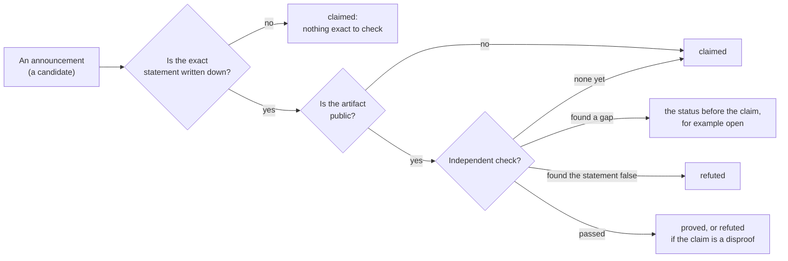

# Machines that prove: what AI systems reported proving or formalising in 2026, and how to audit such a claim

[Syllabus](../../../SYLLABUS.md) → [Frontier](../README.md) → [Physics, Finance and Machines](../README.md#s07) → Machines that prove

---

## General Overview

A ten-digit calculator shows $`1782^{12} + 1841^{12}`$ and $`1922^{12}`$ as the same number, 2.541210259e39, as if Fermat's last theorem failed for the power 12. It does not: the left side is odd and the right side even ([Machines in proofs](../01-How%20Research%20Works/06-computer-assistance-and-formal-verification.md) works this near miss). The calculator produced a **candidate**: an output that looks like a result. It did not produce a **confirmation**: a result that survives a check that does not depend on the thing being checked.

In 2026, AI systems (computer programs trained on large amounts of text and code) reported four results in research mathematics. AI labs announced them on these dates:

- **2026-05-20, unit distances.** A disproof of a 1946 conjecture about how many pairs of points in the plane can be exactly one unit apart.
- **2026-08-10, zeta zeros.** A proof that at least two thirds of the zeros of the Riemann zeta function, counted with multiplicity, are simple (not repeated) and lie on the critical line (the line of complex numbers with real part 1/2). The best earlier bound for the line alone was five twelfths.
- **2026-09-04, Fermat formalised.** A complete machine-checked proof of Fermat's last theorem, a theorem people already proved in 1995.
- **2026-09-08, Navier-Stokes.** A claimed proof that the fluid equations of a Millennium Prize problem can break down in finite time when a smooth force pushes the fluid.

Each announcement is a candidate until someone audits it. The **audit list**, taught on [Machines in proofs](../01-How%20Research%20Works/06-computer-assistance-and-formal-verification.md), has four fields: the exact **statement**, the public **artifact** (the paper or the formal proof file), an **independent check** (by people or tools that did not make the claim), and the dated **status**. This card applies that list to the four announcements and to the calculator's near miss.

**An AI-generated argument is a candidate, not a confirmation: its status rises only when an exact statement, a public artifact and an independent check all line up, and the status line carries the date of that check.**

**What kind of fact this is:** the audit list is a procedure, a rule for assigning status, not a theorem. Each row's status below is a dated report, true as of 2026-11-23 and open to change. The near miss and the small cases in the code are theorems, checked here by exact arithmetic.

### The picture: the audit list as a decision



Each diamond is one question. A claim moves right only on a yes, and its status carries the date of the last check.

---

## The formula

The audit list turns three fields into a status:

```math
\text{status} = \begin{cases} \text{refuted} & \text{if } C = \text{false} \\ \text{its status before the claim} & \text{if } C = \text{gap} \\ \text{what the claim asserts} & \text{if } S = A = 1 \text{ and } C = \text{pass} \\ \text{claimed} & \text{otherwise} \end{cases}
```

**Read it aloud:** a claim becomes what it says it is only when its exact statement is on record, its artifact is public and someone independent has checked it; until then it stays claimed. A check that finds the statement false refutes it, and one that finds a gap leaves the problem with the status it had before the claim, for example open.

| Symbol | Plain meaning | In our example | Push it up and the answer… |
| --- | --- | --- | --- |
| $`S`$ | statement field: 1 if the exact claim, with every hypothesis, is written down | 1 for all five rows | from 0 to 1, the claim becomes checkable |
| $`A`$ | artifact field: 1 if the paper or formal proof file is public | 1 for all five rows | from 0 to 1, anyone can rerun it |
| $`C`$ | independent check: pass, gap (an error in the argument), false (the statement fails) or none | false for the near miss; none for zeta and Navier-Stokes | from none to pass, the status rises |
| status | the dated label: open, claimed, proved or refuted | refuted, proved, claimed, refuted, claimed | — |
| $`a, b, c`$ | positive whole numbers in Fermat's equation $`a^n + b^n = c^n`$ | 1782, 1841, 1922 | — |
| $`n`$ | the power in Fermat's equation | 12 | above 2, no solutions exist (proved 1995) |
| $`u(n)`$ | the largest number of pairs at distance exactly 1 among $`n`$ points in the plane | at least 12 for $`n = 9`$: the 3 × 3 grid has 12 such pairs | grows faster than $`n`$ |
| $`\delta`$ | a fixed exponent above zero in $`u(n) \ge n^{1+\delta}`$ | about $`6.24 \times 10^{-38}`$ in the checked write-up; 0.014 claimed in a sharper preprint ([The unit-distance problem](../04-Geometry%20and%20Combinatorics/01-unit-distance-problem.md)) | a larger fixed value means more unit pairs |
| $`y`$ | the size of a quantity in the blow-up toy | 1 at the start | grows without limit before time 1 |
| $`t`$ | time in the blow-up toy | 0 to 0.999 | as it nears 1, $`y = 1/(1-t)`$ becomes infinite |

### When it holds

- **The statement is exact.** If the claim leaves out a hypothesis, such as "with a force" in Navier-Stokes, the check confirms a different statement from the one people read.
- **The check is independent.** A check run by the claim's makers, or one that reuses their code without reading it, can repeat their error. Then "pass" means less than it says.
- **The formal statement matches the informal one.** A proof assistant confirms only the statement it was given. If the formal statement is weaker, the check proves the weaker thing.
- **The status has a date.** A status is a report about a moment. Without a date, a reader cannot tell whether a later check changed it.
- **The trusted base is named.** A formal proof still trusts the kernel (the small program that checks each step) and the axioms. If either is wrong, every "pass" is in doubt.

---

## Why it works

### Step 0: checking is cheaper than finding, so audit the check

A machine that searches for proofs can make many wrong attempts and report the one that looks right. A check asks one narrow question about one finished argument. That asymmetry is the reason audits work: the check can be small, slow and done by someone else.

[Proof assistants](../../24-Computability%20and%20complexity/02-Computability%20and%20Logic/08-proof-assistants-and-formal-verification.md) shows the strongest form of check: a kernel accepts a proof only if every line follows by a fixed rule. It also shows what the kernel does not check: whether the formal statement means what was meant.

### Step 1: the statement field catches the wrong question

Every claim is first written as hypothesis, domain and conclusion. Then compare it with the problem as stated by its custodian (the body that states the problem, such as the Clay Institute for the Millennium problems).

The Fermat artifact states its main theorem in Lean, a proof assistant, as one line. This excerpt is quoted from the formal proof repository (Lean 4.33.1, Mathlib v4.33.0, announced 2026-09-04, read 2026-11-23). It was not compiled for this card:

```
theorem fermat_last_theorem (n : ℕ) (hn : 3 ≤ n) (a b c : ℕ) (ha : 0 < a) (hb : 0 < b) (hc : 0 < c) : a ^ n + b ^ n ≠ c ^ n
```

Read it field by field: for whole numbers $`n \ge 3`$ and positive whole numbers $`a, b, c`$, the sum $`a^n + b^n`$ is not $`c^n`$. That is Fermat's last theorem exactly. The repository also derives the library's own standard statement of the theorem from it.

### Step 2: the artifact field makes rerunning possible

A claim with no public artifact cannot be checked by anyone else. All four 2026 announcements published one: a paper, a formal proof file, or both. Some artifacts are very large. The Fermat files take hours to build on a large server, as their repository reports, so a rerun is itself a real piece of work.

### Step 3: the independent check is the step that changes status

The rule for the field C is the one [The status register](05-the-status-register.md) uses. C is pass when people who did not make the claim say in writing that they checked the makers' own argument or files. A new proof of the same statement, an exposition that retells the argument, or a critique of the formal files is evidence, but not that check. Four independent kinds of response appear in 2026, plus one that is not independent:

- **A formal proof rerun by an outsider: pass.** For Fermat, an outside mathematician who leads a separate human formalisation project reported on 2026-09-04 that he compiled the files and ran the statement-matching tool. In replies under the post he adds that he read the statement and inspected the code outside the proofs.
- **A written check by outside experts: pass.** For unit distances, nine mathematicians outside the lab posted a shorter version of the argument on 2026-05-20 and call it human-verified. It is not refereed, but it says the construction was checked.
- **A second, different proof: not a check of the first.** For zeta zeros, a mathematician outside the lab posted a new proof of the same bound on 2026-09-02. It reaches the bound another way and does not check the makers' argument. It is itself a preprint, not yet refereed, so C stays none until a referee or an outside check accepts one of the two proofs.
- **Expositions and a critique: not a pass.** For Navier-Stokes, two expositions by outside mathematicians (2026-09-28, 2026-11-04) retell the argument as a readable account and claim no original contribution. Three mathematicians outside the lab reported on 2026-10-06 that the Lean files prove something different from the written proof. That finds a mismatch in the files, not an error in the written proof, so C is not gap either: it stays none.
- **A check by the makers: not independent.** For zeta zeros, two mathematicians at the lab re-derived the argument. That checks the work, but it is not independent of the claim.

### Step 4: the status follows the weakest field

The formula reads like a chain. A missing statement means there is nothing to check. A private artifact means nobody else can check it. No independent check means the claim stays claimed, however confident the announcement is.

So a claim is never upgraded beyond its source: an announcement stays claimed until it is refereed, or until an outside check of the kind Step 3 counts as a pass is on record.

### Step 5: the four 2026 rows, audited

| Claim | Statement | Artifact | Independent check | Status, 2026-11-23 |
| --- | --- | --- | --- | --- |
| Unit distances: $`u(n) \ge n^{1+\delta}`$ for infinitely many $`n`$, some fixed $`\delta > 0`$ | exact, in the write-up | paper; human-verified write-up | pass: a written check by nine outside mathematicians, 2026-05-20, unrefereed | Erdős's conjecture $`u(n) \le n^{1+o(1)}`$: refuted |
| Zeta zeros: at least $`2/3`$ of zeros are simple and on the critical line, unconditionally | exact, in the preprint | preprint 2026-08-13; Lean files reported | none: the makers' re-derivation is not independent; an outsider's second proof (2026-09-02, unrefereed) is a new claim, not a check of this one | claimed |
| Fermat formalised: the Lean line above | exact; matched by a tool to the library's statement | public Lean repository, linked from the outside checker's post | pass: an outsider compiled it and ran the matching tool, 2026-09-04 | formalisation: proved; the theorem itself: proved 1995 |
| Navier-Stokes: for every viscosity above zero, smooth data and a smooth force with no global smooth solution | exact, in the repository; offered as alternatives to Clay's versions C and D | paper; Lean files | none: two expositions by outside mathematicians (2026-09-28, 2026-11-04) retell it and claim no original contribution; a critique, 2026-10-06, finds the Lean files do not match the written proof | claimed |

The "Zeta zeros" row needs one warning. A lower bound of 67.25 percent is a claimed floor on a share, not a measured share. A share of 100 percent would need every zero to be simple as well as on the line. The Riemann hypothesis says nothing about repeats, and that every zero is simple is a separate conjecture, open as of 2026-11-23.

<details>
<summary>What each 2026 claim says, in one paragraph each</summary>

**Unit distances.** Place $`n`$ points in the plane and count the pairs exactly 1 apart. A square grid, scaled well, gives about $`n^{1 + c/\log\log n}`$ pairs for a constant $`c`$, where $`\log`$ is the natural logarithm. The exponent above 1 shrinks to zero as $`n`$ grows. Erdős conjectured in 1946 that nothing does much better: $`u(n) \le n^{1+o(1)}`$, where $`o(1)`$ is an exponent excess that shrinks to zero as $`n`$ grows. The 2026 construction uses number fields (number systems built by adding roots of polynomials to the fractions) and gives a fixed exponent above 1. The best known upper bound is a constant times $`n^{4/3}`$, from 1984, so a gap remains.

**Zeta zeros.** The zeta function's nontrivial zeros all have real part between 0 and 1. The Riemann hypothesis says every one has real part exactly 1/2, the critical line. Proved lower bounds on the share that does are one third (1974), two fifths (1989) and five twelfths (2020). The 2026 preprint claims that at least two thirds are simple and on the line, and 0.6725 with a refined weighting called the Montgomery–Taylor (MT) window. These constants were known before, but only by assuming the Riemann hypothesis.

**Fermat formalised.** The proof follows the 1995 argument through elliptic curves and modular forms, in a simplified published form. The formalisation adds no new mathematics. It adds a check that a computer, not a referee, did line by line.

**Navier-Stokes.** The Clay problem offers four versions. Versions A and B ask for a proof that, with no force, smooth solutions exist forever, on all of space (A) or on a periodic box (B). Versions C and D ask for a smooth starting flow and a smooth force for which no smooth solution lasts forever, on all of space (C) or on a periodic box (D). The 2026 claim takes the form of C and D, with a force. It says nothing about the unforced versions A and B.

The blow-up toy in the code shows what "breaks down in finite time" means. The quantity $`y`$ grows at the rate $`y^2`$ and starts at 1. Its exact value is $`y = 1/(1-t)`$: 10 at $`t = 0.9`$, 1,000 at $`t = 0.999`$, and infinite at $`t = 1`$.

</details>

---

## Worked numbers, by hand

The zeta-zeros claim, audited with the four fields. Every number below is printed by the code.

| Step | Arithmetic | Value |
| --- | --- | --- |
| statement, flat window | at least two thirds of the nontrivial zeros, counted with multiplicity, are simple and on the critical line | 66.667% |
| statement, Montgomery–Taylor window | $`\tfrac32 - \tfrac{1}{\sqrt2}\cot\tfrac{1}{\sqrt2}`$, where cot is cosine over sine | 0.672500703679, so 67.250% |
| earlier proved bound, on the line alone | five twelfths (2020) | 41.667% |
| S: is the statement exact? | the preprint states it with every hypothesis | yes |
| A: is the artifact public? | preprint posted 2026-08-13; Lean files reported | yes |
| C: the makers' check | two mathematicians at the lab re-derived it | not independent |
| C: the outside second proof, 2026-09-02 | a new, unrefereed proof of the same bound; it does not check the first | still none |
| status from S, A and C | yes, yes, none | **claimed, as of 2026-11-23** |

A second route to the same bound is evidence that the bound is right. It is not a check of the makers' argument, so the status stays claimed until a referee or an outside check accepts one of the two proofs.

### What breaks if you drop a piece

| Mistake | Comes out at | What went wrong |
| --- | --- | --- |
| Trusting the ten-digit screen | "equal": 2.541210259e39 both sides | Rounding hid a difference of about 7.0 × 10^29 |
| Reading a search as a proof | 0 solutions for $`n`$ = 3 to 10 with $`c \le 100`$ | That is "checked for $`c \le 100`$", not "true"; the proof came only in 1995 |
| Reading a small-grid exponent as the trend | log pairs / log n = 1.232 at $`n`$ = 64 | Grid exponents rise at first, from 1.000 at $`n`$ = 4, and fall towards 1 only at sizes no one can draw ([The unit-distance problem](../04-Geometry%20and%20Combinatorics/01-unit-distance-problem.md)); small cases cannot tell $`n^{1+\delta}`$ from grid growth |
| Reading a lower bound as a share | "67.250% of zeros are on the line" | It is a claimed floor, not a measured share; 100% would also need every zero simple, and the Riemann hypothesis says nothing about repeats |

The code prints all four.

---

## Code, from first principles, and it actually runs

The code reruns six small audits, each by two independent roads. The near miss is computed exactly with whole numbers, checked by last digits and parity, and checked again by remainders modulo three primes. The Fermat search runs for $`n`$ = 2 as a control: brute force and Euclid's formula for right triangles must both find 52. The zeta constant is computed from a written-out series and again from the tangent function. Grid unit distances are counted pair by pair and again by counting vectors. The blow-up toy is stepped forward and compared with its exact formula. Last, the audit rule computes each status from its fields. Those fields are typed in from the sources, as Step 5's table reads them by Step 3's rule; only the near miss's check field is computed. So that part checks the rule, not the claims.

### Python

```python
# Machines that prove -- the check behind the card.  Standard library only.
# A machine's output is a candidate, not a confirmation.  Six small audits a
# reader can rerun: each recomputes a number by a second, independent road.
import math

def fmt10(x):                           # what a 10-digit calculator shows
    s = str(x); p = str((int(s[:11]) + 5) // 10)
    return f"{p[0]}.{p[1:]}e{len(s) - 1}"
def fpow(a, n):                         # float power by repeated multiplication
    p = 1.0
    for _ in range(n): p *= a
    return p

# 1. The near miss: 1782^12 + 1841^12 against 1922^12, three roads.
L, R = 1782 ** 12 + 1841 ** 12, 1922 ** 12
gap = (fpow(1782.0, 12) + fpow(1841.0, 12) - fpow(1922.0, 12)) / fpow(1922.0, 12)
print("near miss, left  1782^12 + 1841^12 =", L)
print("near miss, right 1922^12           =", R)
print("left minus right                   =", L - R)
print("10-digit calculator shows", fmt10(L), "and", fmt10(R))
print(f"relative gap (floating point)      = {gap:.4e}")
print("last digits", L % 10, "and", R % 10, "; left is", "odd" if L % 2 else "even",
      ", right is", "odd" if R % 2 else "even")
PRIMES = [1000003, 1000033, 1000037]
res = [((pow(1782, 12, p) + pow(1841, 12, p)) % p, pow(1922, 12, p)) for p in PRIMES]
print("residues mod 1000003, 1000033, 1000037:", res)

# 2. Fermat, small cases: search c <= 100.  n = 2 is the control that must hit.
def search(n, top):
    pw = {c ** n: c for c in range(1, top + 1)}
    return [(a, b, pw[a ** n + b ** n]) for a in range(1, top)
            for b in range(a, top) if a ** n + b ** n in pw]
TOP = 100
euclid = 0                              # second road for n = 2: Euclid's formula
for m in range(2, 11):
    for j in range(1, m):
        if (m - j) % 2 == 1 and math.gcd(m, j) == 1:
            euclid += TOP // (m * m + j * j)
hits = {n: len(search(n, TOP)) for n in range(2, 11)}
print(f"solutions of a^n + b^n = c^n with c <= {TOP}, n = 2..10:", list(hits.values()))
print("Euclid's formula count for n = 2:", euclid)
near = min(((abs(a**3 + b**3 - c**3), a, b, c) for a in range(2, TOP) for b in range(a, TOP)
            for c in range(b + 1, 126) if a**3 + b**3 != c**3))
print(f"closest cube miss: {near[1]}^3 + {near[2]}^3 - {near[3]}^3 =",
      near[1]**3 + near[2]**3 - near[3]**3)

# 3. Zeta zeros: the proved lower bounds as percentages, and the 2026 constants.
x = 1 / math.sqrt(2)
s = c = 0.0; t = x; u = 1.0
for k in range(12):                     # sin and cos by their series, written out
    s += t; c += u
    t *= -x * x / ((2 * k + 2) * (2 * k + 3)); u *= -x * x / ((2 * k + 1) * (2 * k + 2))
cinv_series = 0.5 + x * c / s
cinv_tan = 0.5 + x / math.tan(x)
mt, mt_d = 2 - cinv_series, (3 - cinv_series) / 2
for name, v in [("1974 one third", 1 / 3), ("1989 two fifths", 2 / 5), ("2020 five twelfths", 5 / 12),
                ("2026 two thirds", 2 / 3), ("2026 with the MT window", mt)]:
    print(f"zeros on the line, at least {name:<24}{100 * v:8.3f}%  " + "#" * round(50 * v))
print(f"MT window constant: series {mt:.12f}, tangent {2 - cinv_tan:.12f}; distinct {mt_d:.5f}")

# 4. Unit distances in a k by k grid: the commonest distance, two roads.
grid = []
for k in range(2, 9):
    pts = [(i, j) for i in range(k) for j in range(k)]
    cnt = {}
    for p in range(len(pts)):
        for q in range(p + 1, len(pts)):
            d = (pts[p][0] - pts[q][0]) ** 2 + (pts[p][1] - pts[q][1]) ** 2
            cnt[d] = cnt.get(d, 0) + 1
    best = max(cnt.values()); d = min(e for e in cnt if cnt[e] == best)
    rep = sum((k - abs(dx)) * (k - abs(dy)) for dx in range(-k + 1, k)
              for dy in range(-k + 1, k) if dx * dx + dy * dy == d) // 2
    grid.append((k * k, d, best, rep))
    print(f"grid {k}x{k}: n = {k*k:2}, squared distance {d}, pairs = {best:3}, "
          f"by counting vectors {rep:3}, log pairs / log n = {math.log(best) / math.log(k*k):.3f}")
print("unit-distance exponent excess, quoted: 6.24e-38 in the checked write-up, 0.014 claimed in a sharper preprint")

# 5. Finite-time blow-up in one line: y' = y^2, y(0) = 1, exact y = 1/(1 - t).
y, h, step, blow = 1.0, 0.0001, 0, []
for stop in (5000, 9000, 9900, 9990):
    while step < stop:
        k1 = y * y; a = y + h / 2 * k1; k2 = a * a; a = y + h / 2 * k2; k3 = a * a
        a = y + h * k3; k4 = a * a
        y += h / 6 * (k1 + 2 * k2 + 2 * k3 + k4); step += 1
    exact = 1 / (1 - stop * h)
    blow.append((y, exact))
    print(f"blow-up toy at t = {stop * h:.3f}: step by step {y:.6f}, exact 1/(1 - t) {exact:.6f}")

# 6. The audit list.  Fields: statement matched (S), artifact public (A),
#    independent check (C: pass, gap, false or none).  Status is computed, not typed.
def status(S, A, C, kind):
    if C == "false": return "refuted"
    if C == "gap": return "as before"
    if S and A and C == "pass": return kind
    return "claimed"
rows = [("near miss, n = 12", True, True, "pass" if L == R else "false", "proved"),
        ("Fermat formalisation", True, True, "pass", "proved"),
        ("zeta zeros, two thirds", True, True, "none", "proved"),
        ("unit-distance conjecture", True, True, "pass", "refuted"),
        ("Navier-Stokes blow-up", True, True, "none", "proved")]
audit = [status(S, A, C, kind) for _, S, A, C, kind in rows]
for (name, S, A, C, _), st in zip(rows, audit):
    print(f"audit: {name:<26} S={'yes' if S else 'no '} A={'yes' if A else 'no '} C={C:<5} -> {st}")

assert L != R and fmt10(L) == fmt10(R) and L % 2 != R % 2
assert all(r == ((L % p), (R % p)) for r, p in zip(res, PRIMES))
assert hits[2] == euclid == 52 and all(hits[n] == 0 for n in range(3, 11))
assert abs(cinv_series - cinv_tan) < 1e-12 and round(mt, 5) == 0.6725 and round(mt_d, 5) == 0.83625
assert grid[1][2] == 12 and all(g[2] == g[3] for g in grid)
assert all(abs(a / b - 1) < 1e-5 for a, b in blow)
assert audit == ["refuted", "proved", "claimed", "refuted", "claimed"]
print("ALL CHECKS PASS")
```

**Ran 2026-11-23 on macOS, Python 3.14.10, standard library only. All checks passed. Output, pasted from the run:**

```
near miss, left  1782^12 + 1841^12 = 2541210258614589176288669958142428526657
near miss, right 1922^12           = 2541210259314801410819278649643651567616
left minus right                   = -700212234530608691501223040959
10-digit calculator shows 2.541210259e39 and 2.541210259e39
relative gap (floating point)      = -2.7554e-10
last digits 7 and 6 ; left is odd , right is even
residues mod 1000003, 1000033, 1000037: [(910620, 310826), (174601, 204971), (654209, 677649)]
solutions of a^n + b^n = c^n with c <= 100, n = 2..10: [52, 0, 0, 0, 0, 0, 0, 0, 0]
Euclid's formula count for n = 2: 52
closest cube miss: 6^3 + 8^3 - 9^3 = -1
zeros on the line, at least 1974 one third            33.333%  #################
zeros on the line, at least 1989 two fifths           40.000%  ####################
zeros on the line, at least 2020 five twelfths        41.667%  #####################
zeros on the line, at least 2026 two thirds           66.667%  #################################
zeros on the line, at least 2026 with the MT window   67.250%  ##################################
MT window constant: series 0.672500703679, tangent 0.672500703679; distinct 0.83625
grid 2x2: n =  4, squared distance 1, pairs =   4, by counting vectors   4, log pairs / log n = 1.000
grid 3x3: n =  9, squared distance 1, pairs =  12, by counting vectors  12, log pairs / log n = 1.131
grid 4x4: n = 16, squared distance 1, pairs =  24, by counting vectors  24, log pairs / log n = 1.146
grid 5x5: n = 25, squared distance 5, pairs =  48, by counting vectors  48, log pairs / log n = 1.203
grid 6x6: n = 36, squared distance 5, pairs =  80, by counting vectors  80, log pairs / log n = 1.223
grid 7x7: n = 49, squared distance 5, pairs = 120, by counting vectors 120, log pairs / log n = 1.230
grid 8x8: n = 64, squared distance 5, pairs = 168, by counting vectors 168, log pairs / log n = 1.232
unit-distance exponent excess, quoted: 6.24e-38 in the checked write-up, 0.014 claimed in a sharper preprint
blow-up toy at t = 0.500: step by step 2.000000, exact 1/(1 - t) 2.000000
blow-up toy at t = 0.900: step by step 10.000000, exact 1/(1 - t) 10.000000
blow-up toy at t = 0.990: step by step 100.000000, exact 1/(1 - t) 100.000000
blow-up toy at t = 0.999: step by step 999.998631, exact 1/(1 - t) 1000.000000
audit: near miss, n = 12          S=yes A=yes C=false -> refuted
audit: Fermat formalisation       S=yes A=yes C=pass  -> proved
audit: zeta zeros, two thirds     S=yes A=yes C=none  -> claimed
audit: unit-distance conjecture   S=yes A=yes C=pass  -> refuted
audit: Navier-Stokes blow-up      S=yes A=yes C=none  -> claimed
ALL CHECKS PASS
```

### Rust

Same numbers, same labels, built with `rustc --edition 2021 -O`. Past the 128-bit limit, it uses a small written-out bignum in base $`10^9`$.

```rust
// Machines that prove -- the same check as the Python, in Rust.  No crates.
// A machine's output is a candidate, not a confirmation.  Six small audits a
// reader can rerun: each recomputes a number by a second, independent road.
use std::collections::HashMap;
type Big = Vec<u64>; // base 10^9 limbs, least significant first
const B: u64 = 1_000_000_000;
fn big_pow(a: u64, n: u32) -> Big {
    let mut x: Big = vec![1];
    for _ in 0..n {
        let mut carry = 0;
        for l in x.iter_mut() { let v = *l * a + carry; *l = v % B; carry = v / B; }
        while carry > 0 { x.push(carry % B); carry /= B; }
    }
    x
}
fn big_add(x: &Big, y: &Big) -> Big {
    let (mut z, mut carry) = (vec![], 0);
    for i in 0..x.len().max(y.len()) {
        let v = x.get(i).unwrap_or(&0) + y.get(i).unwrap_or(&0) + carry;
        z.push(v % B); carry = v / B;
    }
    if carry > 0 { z.push(carry); }
    z
}
fn big_sub(x: &Big, y: &Big) -> Big { // x >= y
    let (mut z, mut borrow) = (vec![], 0i64);
    for i in 0..x.len() {
        let mut v = x[i] as i64 - *y.get(i).unwrap_or(&0) as i64 - borrow;
        borrow = if v < 0 { v += B as i64; 1 } else { 0 };
        z.push(v as u64);
    }
    while z.len() > 1 && *z.last().unwrap() == 0 { z.pop(); }
    z
}
fn big_str(x: &Big) -> String {
    let mut s = format!("{}", x[x.len() - 1]);
    for l in x.iter().rev().skip(1) { s.push_str(&format!("{:09}", l)); }
    s
}
fn big_mod(x: &Big, p: u64) -> u64 { x.iter().rev().fold(0, |r, &l| (r * B + l) % p) }
fn fmt10(s: &str) -> String {
    let p = ((s[..11].parse::<u64>().unwrap() + 5) / 10).to_string();
    format!("{}.{}e{}", &p[..1], &p[1..], s.len() - 1)
}
fn fpow(a: f64, n: u32) -> f64 { let mut p = 1.0; for _ in 0..n { p *= a; } p }
fn pmod(a: u64, n: u32, p: u64) -> u64 { let mut r = 1; for _ in 0..n { r = r * a % p; } r }
fn gcd(a: u64, b: u64) -> u64 { if b == 0 { a } else { gcd(b, a % b) } }
fn search(n: u32, top: u64) -> usize {
    let pw: HashMap<u128, u64> = (1..=top).map(|c| ((c as u128).pow(n), c)).collect();
    let mut hits = 0;
    for a in 1..top { for b in a..top {
        if pw.contains_key(&((a as u128).pow(n) + (b as u128).pow(n))) { hits += 1; }
    } }
    hits
}
fn status(s: bool, a: bool, c: &str, kind: &'static str) -> &'static str {
    if c == "false" { return "refuted"; }
    if c == "gap" { return "as before"; }
    if s && a && c == "pass" { return kind; }
    "claimed"
}
fn main() {
    // 1. The near miss: 1782^12 + 1841^12 against 1922^12, three roads.
    let l = big_add(&big_pow(1782, 12), &big_pow(1841, 12));
    let r = big_pow(1922, 12);
    let (ls, rs) = (big_str(&l), big_str(&r));
    let gap = (fpow(1782.0, 12) + fpow(1841.0, 12) - fpow(1922.0, 12)) / fpow(1922.0, 12);
    println!("near miss, left  1782^12 + 1841^12 = {}", ls);
    println!("near miss, right 1922^12           = {}", rs);
    println!("left minus right                   = -{}", big_str(&big_sub(&r, &l)));
    println!("10-digit calculator shows {} and {}", fmt10(&ls), fmt10(&rs));
    println!("relative gap (floating point)      = {:.4e}", gap);
    let parity = |x: &Big| if big_mod(x, 2) == 1 { "odd" } else { "even" };
    println!("last digits {} and {} ; left is {} , right is {}", big_mod(&l, 10), big_mod(&r, 10), parity(&l), parity(&r));
    let primes = [1000003u64, 1000033, 1000037];
    let res: Vec<(u64, u64)> = primes.iter().map(|&p| ((pmod(1782, 12, p) + pmod(1841, 12, p)) % p, pmod(1922, 12, p))).collect();
    let rstr: Vec<String> = res.iter().map(|(a, b)| format!("({}, {})", a, b)).collect();
    println!("residues mod 1000003, 1000033, 1000037: [{}]", rstr.join(", "));

    // 2. Fermat, small cases: search c <= 100.  n = 2 is the control that must hit.
    let top = 100u64;
    let mut euclid = 0;
    for m in 2..11u64 { for j in 1..m {
        if (m - j) % 2 == 1 && gcd(m, j) == 1 { euclid += top / (m * m + j * j); }
    } }
    let hits: Vec<usize> = (2..11).map(|n| search(n, top)).collect();
    let hs: Vec<String> = hits.iter().map(|h| h.to_string()).collect();
    println!("solutions of a^n + b^n = c^n with c <= {}, n = 2..10: [{}]", top, hs.join(", "));
    println!("Euclid's formula count for n = 2: {}", euclid);
    let mut near = (i64::MAX, 0i64, 0i64, 0i64);
    for a in 2..100i64 { for b in a..100 { for c in b + 1..126 {
        let d = a * a * a + b * b * b - c * c * c;
        if d != 0 && (d.abs(), a, b, c) < near { near = (d.abs(), a, b, c); }
    } } }
    let (_, a, b, c) = near;
    println!("closest cube miss: {}^3 + {}^3 - {}^3 = {}", a, b, c, a * a * a + b * b * b - c * c * c);

    // 3. Zeta zeros: the proved lower bounds as percentages, and the 2026 constants.
    let x = 1.0 / 2f64.sqrt();
    let (mut s, mut cs, mut t, mut u) = (0.0, 0.0, x, 1.0);
    for k in 0..12 {
        s += t; cs += u;
        t *= -x * x / (((2 * k + 2) * (2 * k + 3)) as f64); u *= -x * x / (((2 * k + 1) * (2 * k + 2)) as f64);
    }
    let cinv_series = 0.5 + x * cs / s;
    let cinv_tan = 0.5 + x / x.tan();
    let (mt, mt_d) = (2.0 - cinv_series, (3.0 - cinv_series) / 2.0);
    for (name, v) in [("1974 one third", 1.0 / 3.0), ("1989 two fifths", 2.0 / 5.0), ("2020 five twelfths", 5.0 / 12.0),
                      ("2026 two thirds", 2.0 / 3.0), ("2026 with the MT window", mt)] {
        println!("zeros on the line, at least {:<24}{:8.3}%  {}", name, 100.0 * v, "#".repeat((50.0 * v as f64).round() as usize));
    }
    println!("MT window constant: series {:.12}, tangent {:.12}; distinct {:.5}", mt, 2.0 - cinv_tan, mt_d);

    // 4. Unit distances in a k by k grid: the commonest distance, two roads.
    let mut grid = vec![];
    for k in 2..9i64 {
        let pts: Vec<(i64, i64)> = (0..k).flat_map(|i| (0..k).map(move |j| (i, j))).collect();
        let mut cnt: HashMap<i64, i64> = HashMap::new();
        for p in 0..pts.len() { for q in p + 1..pts.len() {
            let d = (pts[p].0 - pts[q].0).pow(2) + (pts[p].1 - pts[q].1).pow(2);
            *cnt.entry(d).or_insert(0) += 1;
        } }
        let best = *cnt.values().max().unwrap();
        let d = *cnt.iter().filter(|(_, &v)| v == best).map(|(e, _)| e).min().unwrap();
        let mut rep = 0;
        for dx in -k + 1..k { for dy in -k + 1..k {
            if dx * dx + dy * dy == d { rep += (k - dx.abs()) * (k - dy.abs()); }
        } }
        rep /= 2;
        grid.push((k * k, d, best, rep));
        println!("grid {}x{}: n = {:2}, squared distance {}, pairs = {:3}, by counting vectors {:3}, log pairs / log n = {:.3}",
                 k, k, k * k, d, best, rep, (best as f64).ln() / ((k * k) as f64).ln());
    }
    println!("unit-distance exponent excess, quoted: 6.24e-38 in the checked write-up, 0.014 claimed in a sharper preprint");

    // 5. Finite-time blow-up in one line: y' = y^2, y(0) = 1, exact y = 1/(1 - t).
    let (mut y, h, mut step, mut blow) = (1.0f64, 0.0001, 0, vec![]);
    for stop in [5000, 9000, 9900, 9990] {
        while step < stop {
            let k1 = y * y; let mut a = y + h / 2.0 * k1; let k2 = a * a; a = y + h / 2.0 * k2; let k3 = a * a;
            a = y + h * k3; let k4 = a * a;
            y += h / 6.0 * (k1 + 2.0 * k2 + 2.0 * k3 + k4); step += 1;
        }
        let exact = 1.0 / (1.0 - stop as f64 * h);
        blow.push((y, exact));
        println!("blow-up toy at t = {:.3}: step by step {:.6}, exact 1/(1 - t) {:.6}", stop as f64 * h, y, exact);
    }

    // 6. The audit list.  Fields: statement matched (S), artifact public (A),
    //    independent check (C: pass, gap, false or none).  Status is computed, not typed.
    let rows = [("near miss, n = 12", true, true, if l == r { "pass" } else { "false" }, "proved"),
                ("Fermat formalisation", true, true, "pass", "proved"),
                ("zeta zeros, two thirds", true, true, "none", "proved"),
                ("unit-distance conjecture", true, true, "pass", "refuted"),
                ("Navier-Stokes blow-up", true, true, "none", "proved")];
    let audit: Vec<&str> = rows.iter().map(|&(_, s, a, c, kind)| status(s, a, c, kind)).collect();
    let yn = |v: bool| if v { "yes" } else { "no " };
    for (row, st) in rows.iter().zip(&audit) {
        println!("audit: {:<26} S={} A={} C={:<5} -> {}", row.0, yn(row.1), yn(row.2), row.3, st);
    }

    assert!(l != r && fmt10(&ls) == fmt10(&rs) && big_mod(&l, 2) != big_mod(&r, 2));
    assert!(res.iter().zip(primes).all(|(&rr, p)| rr == (big_mod(&l, p), big_mod(&r, p))));
    assert!(hits[0] == euclid as usize && euclid == 52 && hits[1..].iter().all(|&h| h == 0));
    assert!((cinv_series - cinv_tan).abs() < 1e-12 && (mt * 1e5).round() == 67250.0 && (mt_d * 1e5).round() == 83625.0);
    assert!(grid[1].2 == 12 && grid.iter().all(|g| g.2 == g.3));
    assert!(blow.iter().all(|(a, b)| (a / b - 1.0).abs() < 1e-5));
    assert!(audit == ["refuted", "proved", "claimed", "refuted", "claimed"]);
    println!("ALL CHECKS PASS");
}
```

**Ran 2026-11-23 on macOS, rustc 1.98.1, no crates. All checks passed. Output, pasted from the run:**

```
near miss, left  1782^12 + 1841^12 = 2541210258614589176288669958142428526657
near miss, right 1922^12           = 2541210259314801410819278649643651567616
left minus right                   = -700212234530608691501223040959
10-digit calculator shows 2.541210259e39 and 2.541210259e39
relative gap (floating point)      = -2.7554e-10
last digits 7 and 6 ; left is odd , right is even
residues mod 1000003, 1000033, 1000037: [(910620, 310826), (174601, 204971), (654209, 677649)]
solutions of a^n + b^n = c^n with c <= 100, n = 2..10: [52, 0, 0, 0, 0, 0, 0, 0, 0]
Euclid's formula count for n = 2: 52
closest cube miss: 6^3 + 8^3 - 9^3 = -1
zeros on the line, at least 1974 one third            33.333%  #################
zeros on the line, at least 1989 two fifths           40.000%  ####################
zeros on the line, at least 2020 five twelfths        41.667%  #####################
zeros on the line, at least 2026 two thirds           66.667%  #################################
zeros on the line, at least 2026 with the MT window   67.250%  ##################################
MT window constant: series 0.672500703679, tangent 0.672500703679; distinct 0.83625
grid 2x2: n =  4, squared distance 1, pairs =   4, by counting vectors   4, log pairs / log n = 1.000
grid 3x3: n =  9, squared distance 1, pairs =  12, by counting vectors  12, log pairs / log n = 1.131
grid 4x4: n = 16, squared distance 1, pairs =  24, by counting vectors  24, log pairs / log n = 1.146
grid 5x5: n = 25, squared distance 5, pairs =  48, by counting vectors  48, log pairs / log n = 1.203
grid 6x6: n = 36, squared distance 5, pairs =  80, by counting vectors  80, log pairs / log n = 1.223
grid 7x7: n = 49, squared distance 5, pairs = 120, by counting vectors 120, log pairs / log n = 1.230
grid 8x8: n = 64, squared distance 5, pairs = 168, by counting vectors 168, log pairs / log n = 1.232
unit-distance exponent excess, quoted: 6.24e-38 in the checked write-up, 0.014 claimed in a sharper preprint
blow-up toy at t = 0.500: step by step 2.000000, exact 1/(1 - t) 2.000000
blow-up toy at t = 0.900: step by step 10.000000, exact 1/(1 - t) 10.000000
blow-up toy at t = 0.990: step by step 100.000000, exact 1/(1 - t) 100.000000
blow-up toy at t = 0.999: step by step 999.998631, exact 1/(1 - t) 1000.000000
audit: near miss, n = 12          S=yes A=yes C=false -> refuted
audit: Fermat formalisation       S=yes A=yes C=pass  -> proved
audit: zeta zeros, two thirds     S=yes A=yes C=none  -> claimed
audit: unit-distance conjecture   S=yes A=yes C=pass  -> refuted
audit: Navier-Stokes blow-up      S=yes A=yes C=none  -> claimed
ALL CHECKS PASS
```

The two outputs match line for line.

### Lean

Lean proves the near miss can never be a counterexample, matches the Fermat line to the library's statement, and proves the blow-up toy.

- Take whole numbers $`a`$ even, $`b`$ odd and $`c`$ even, and a power $`n`$ of at least 1. Then $`a^n + b^n \ne c^n`$.
- 1782 is even, 1841 is odd and 1922 is even, so the near miss is a case of the bullet above.
- A ten-digit screen shows both sides of the near miss as 2.541210259e39, yet their exact values differ.
- The exact sides, their difference, their last digits 7 and 6 and their remainders modulo the three primes are the numbers the code prints.
- The Fermat line quoted in Step 1 and the library's standard statement of Fermat's last theorem each imply the other. This checks the statement field, not the theorem.
- Take $`y = 1/(1-t)`$. Then $`y`$ is 1 at time 0 and grows at the rate $`y^2`$ at every time before 1.
- As $`t`$ rises to 1 from below, $`y`$ grows without limit: it breaks down in finite time.
- The exact values of $`y`$ are 2, 10, 100 and 1,000 at times 1/2, 9/10, 99/100 and 999/1000.
- Euclid's formula counts 52 right triangles with whole sides and $`c \le 100`$.
- The closest cube miss is $`6^3 + 8^3 - 9^3 = -1`$.
- The proved bounds rise: one third is below two fifths, which is below five twelfths, which is below two thirds.
- The 3 × 3 grid has 12 pairs at distance 1, counted pair by pair and by counting vectors.

The 2026 claims are not proved here; the searches, zeta constants, blow-up run and audit statuses are left to the Python and Rust checks.

```lean
-- Machines that prove: a sum a^n + b^n with a even and b odd can never equal c^n with c even, so the calculator's near miss 1782^12 + 1841^12 against 1922^12 is no counterexample even though both sides agree to ten digits; the Fermat formalisation's one-line Lean statement is exactly Mathlib's Fermat's last theorem; and the blow-up toy y = 1/(1 - t) solves y' = y^2 from y(0) = 1 and becomes infinite as t rises to 1.
import Mathlib.NumberTheory.FLT.Basic
import Mathlib.Algebra.Group.Nat.Even
import Mathlib.Analysis.Calculus.Deriv.Inv
import Mathlib.Analysis.Calculus.Deriv.Add
import Mathlib.Topology.Algebra.Order.Field
import Mathlib.Data.Nat.GCD.Basic
import Mathlib.Tactic.NormNum
import Mathlib.Tactic.Linarith

open Filter Topology

/-- The near miss is no counterexample (General Overview). If a is even, b is odd and c is
even, then for every power n ≥ 1 the sum a^n + b^n is odd and c^n is even, so
a^n + b^n ≠ c^n, however many leading digits the two sides share. -/
theorem pow_add_pow_ne_pow_of_even_odd_even (n a b c : ℕ) (hn : 0 < n)
    (ha : Even a) (hb : Odd b) (hc : Even c) : a ^ n + b ^ n ≠ c ^ n := by
  have h1 : Even (a ^ n) := ha.pow_of_ne_zero hn.ne'
  have h2 : Odd (b ^ n) := hb.pow
  have h3 : Even (c ^ n) := hc.pow_of_ne_zero hn.ne'
  intro h
  have h4 : Odd (a ^ n + b ^ n) := h1.add_odd h2
  rw [h] at h4
  exact (Nat.not_even_iff_odd.mpr h4) h3

/-- The statement field, checked for Fermat (Step 1). The formalisation's one-line theorem,
"for whole numbers n ≥ 3 and positive whole numbers a, b, c, a^n + b^n ≠ c^n", says exactly
what Mathlib's own `FermatLastTheorem` says: each implies the other. -/
theorem fermat_one_line_iff_fermatLastTheorem :
    (∀ n : ℕ, 3 ≤ n → ∀ a b c : ℕ, 0 < a → 0 < b → 0 < c → a ^ n + b ^ n ≠ c ^ n) ↔
      FermatLastTheorem := by
  constructor
  · intro h n hn a b c ha hb hc
    exact h n hn a b c (Nat.pos_of_ne_zero ha) (Nat.pos_of_ne_zero hb) (Nat.pos_of_ne_zero hc)
  · intro h n hn a b c ha hb hc
    exact h n hn a b c ha.ne' hb.ne' hc.ne'

/-- The blow-up toy (the Navier-Stokes paragraph). The quantity y(t) = 1/(1 - t) starts at
y(0) = 1, grows at the rate y² at every time t before 1, and becomes infinite as t rises
to 1: it breaks down in finite time. -/
theorem blow_up_toy :
    (1 / (1 - (0 : ℝ)) = 1) ∧
    (∀ t : ℝ, t < 1 → HasDerivAt (fun s : ℝ => 1 / (1 - s)) ((1 / (1 - t)) ^ 2) t) ∧
    Tendsto (fun t : ℝ => 1 / (1 - t)) (𝓝[<] 1) atTop := by
  refine ⟨by norm_num, ?_, ?_⟩
  · intro t ht
    have hne : (1 - t) ≠ 0 := by linarith
    have hd : HasDerivAt (fun s : ℝ => 1 - s) (-1) t := by
      have := HasDerivAt.const_sub (1 : ℝ) (hasDerivAt_id' t)
      simpa only [neg_one_mul] using this
    have := (hasDerivAt_const t (1 : ℝ)).div hd hne
    convert this using 1
    field_simp
    ring
  · have h1 : Tendsto (fun t : ℝ => 1 - t) (𝓝[<] 1) (𝓝[>] 0) := by
      apply tendsto_nhdsWithin_of_tendsto_nhds_of_eventually_within
      · have : Tendsto (fun t : ℝ => 1 - t) (𝓝 1) (𝓝 (1 - 1)) :=
          tendsto_const_nhds.sub tendsto_id
        simpa using this.mono_left nhdsWithin_le_nhds
      · filter_upwards [self_mem_nhdsWithin] with t ht
        simp only [Set.mem_Ioi]
        exact sub_pos.mpr ht
    have := tendsto_inv_nhdsGT_zero.comp h1
    simp only [one_div]
    exact this

/-! The card's worked numbers. -/

-- The near miss, digit for digit.
example : (1782 : ℕ) ^ 12 + 1841 ^ 12 = 2541210258614589176288669958142428526657 ∧
    (1922 : ℕ) ^ 12 = 2541210259314801410819278649643651567616 := by norm_num
-- A ten-digit screen shows both as 2.541210259e39: both lie in [25412102585, 25412102595) × 10^29.
example : 25412102585 * 10 ^ 29 ≤ (1782 : ℕ) ^ 12 + 1841 ^ 12 ∧
    (1782 : ℕ) ^ 12 + 1841 ^ 12 < 25412102595 * 10 ^ 29 ∧
    25412102585 * 10 ^ 29 ≤ (1922 : ℕ) ^ 12 ∧ (1922 : ℕ) ^ 12 < 25412102595 * 10 ^ 29 := by
  norm_num
-- Left minus right, exactly.
example : ((1782 : ℤ) ^ 12 + 1841 ^ 12) - 1922 ^ 12 = -700212234530608691501223040959 := by
  norm_num
-- Last digits 7 and 6; the left side is odd, the right side even.
example : (1782 ^ 12 + 1841 ^ 12) % 10 = 7 ∧ 1922 ^ 12 % 10 = 6 ∧
    (1782 ^ 12 + 1841 ^ 12) % 2 = 1 ∧ 1922 ^ 12 % 2 = 0 := by norm_num
-- The residues modulo 1,000,003, 1,000,033 and 1,000,037, side by side.
example : ((1782 ^ 12 + 1841 ^ 12) % 1000003, 1922 ^ 12 % 1000003) = (910620, 310826) ∧
    ((1782 ^ 12 + 1841 ^ 12) % 1000033, 1922 ^ 12 % 1000033) = (174601, 204971) ∧
    ((1782 ^ 12 + 1841 ^ 12) % 1000037, 1922 ^ 12 % 1000037) = (654209, 677649) := by
  norm_num
-- The near miss's bases: 1782 even, 1841 odd, 1922 even, so the main theorem covers it.
example : Even 1782 ∧ Odd 1841 ∧ Even 1922 := by decide
-- Euclid's formula count of right triangles with whole sides and c ≤ 100: 52.
example : ((Finset.Ico 2 11).sum fun m => ((Finset.Ico 1 m).filter
    (fun j => (m - j) % 2 = 1 ∧ Nat.gcd m j = 1)).sum fun j => 100 / (m * m + j * j)) = 52 := by
  decide
-- The closest cube miss: 6^3 + 8^3 - 9^3 = -1.
example : (6 : ℤ) ^ 3 + 8 ^ 3 - 9 ^ 3 = -1 := by norm_num
-- The proved bounds rise: one third < two fifths < five twelfths < two thirds.
example : (1 : ℚ) / 3 < 2 / 5 ∧ (2 : ℚ) / 5 < 5 / 12 ∧ (5 : ℚ) / 12 < 2 / 3 := by norm_num
-- The 3 by 3 grid: 12 pairs at distance 1 (6 across, 6 up), counting vectors (1,0) and (0,1).
example : ((Finset.range 3 ×ˢ Finset.range 3).offDiag.filter (fun pq : (ℕ × ℕ) × (ℕ × ℕ) =>
    ((pq.1.1 : ℤ) - pq.2.1) ^ 2 + ((pq.1.2 : ℤ) - pq.2.2) ^ 2 = 1)).card / 2 = 12 ∧
    (3 - 1) * 3 + 3 * (3 - 1) = 12 := by decide +kernel
-- The blow-up toy's exact values: 2 at t = 1/2, 10 at t = 9/10, 100 at t = 99/100,
-- 1,000 at t = 999/1000.
example : (1 : ℚ) / (1 - 1 / 2) = 2 ∧ (1 : ℚ) / (1 - 9 / 10) = 10 ∧
    (1 : ℚ) / (1 - 99 / 100) = 100 ∧ (1 : ℚ) / (1 - 999 / 1000) = 1000 := by norm_num

#print axioms pow_add_pow_ne_pow_of_even_odd_even
#print axioms fermat_one_line_iff_fermatLastTheorem
#print axioms blow_up_toy
```

**Checked 2026-11-23 on macOS, Lean 4.36.0-rc2, Mathlib v4.36.0-rc2. Every proof is complete and uses only Lean's standard axioms. Output, pasted from the run:**

```
'pow_add_pow_ne_pow_of_even_odd_even' depends on axioms: [propext, Classical.choice, Quot.sound]
'fermat_one_line_iff_fermatLastTheorem' depends on axioms: [propext]
'blow_up_toy' depends on axioms: [propext, Classical.choice, Quot.sound]
```

> [!TIP]
> **Try changing**
> Guess first, then run it. An assert is a line that stops the program if a number comes out wrong.
> - **Move the near miss.** Change `1922 ** 12` to `1921 ** 12`. Guess: does the ten-digit screen still say "equal"? No: it shows 2.541210259e39 against 2.525389546e39, and the first assert stops it.
> - **Search further.** Set `TOP = 200`. Guess the number of right triangles with whole sides and $`c \le 200`$. Brute force finds 127. Euclid's formula, still looping only to 10, finds 117, and the assert stops it. A second road is only as good as its own range.
> - **Pretend the zeta claim was checked.** In the audit rows, change the zeta row's `"none"` to `"pass"`. Guess its status: it becomes "proved", and the last assert stops it. The status moved because a field changed, not because the mathematics did.

---

## The usual mistake

> [!warning]
> **Treating an announcement as a result.** A confident announcement, a large formal file or a famous name does not change a claim's status. Only an independent check does. The zeta and Navier-Stokes claims are claimed as of 2026-11-23, whatever their announcements say.
>
> - Reading a calculator's agreement as equality. Ten digits say "equal"; the left side falls short by about 2.7554 parts in 10^10 of the right side.
> - Reading a passed formal check as a check of the question people care about. Lean confirms the Lean statement. For Navier-Stokes the statement has a force in it, and an outside critique reports that the Lean files do not match the written proof.
> - Reading a lower bound as a share. 67.250% is a claimed floor, not a measured share; 100% would also need every zero simple, which the Riemann hypothesis does not say.
> - Reading "checked for $`c \le 100`$" as "true". The search finds 0 solutions for $`n`$ = 3 to 10, which proves nothing beyond 100.

---

## Where you meet it in real life

- **Refereeing.** A journal referee does the independent check by hand. AI-generated papers raise the number of candidates, so the check, not the search, becomes the scarce step.
- **Formal proof libraries.** Large libraries of checked mathematics accept new files only after people review them. A formal file that passes the kernel can still be refused for being unreadable or for stating the wrong thing.
- **Prize committees.** Custodians such as Clay wait years for community acceptance; their listing is quoted as their word.
- **Engineering and finance.** A model's output in a bank or a design office is also a candidate. The same four fields, a written statement, a stored artifact, an independent check and a dated status, are how model risk teams sign off a pricing model.

> **Say it back**
> A machine's output is a candidate until something independent confirms it. The audit list asks four things: the exact statement, the public artifact, an independent check, and the dated status. A ten-digit calculator says $`1782^{12} + 1841^{12}`$ equals $`1922^{12}`$; exact arithmetic says the left side is odd and the right side even. Of the four 2026 announcements, the Fermat formalisation and the unit-distance disproof passed independent checks; the zeta-zeros proof and the Navier-Stokes blow-up remain claimed as of 2026-11-23. A status rises only when a check is done and dated.

---

## What this builds on

- [Proof assistants](../../24-Computability%20and%20complexity/02-Computability%20and%20Logic/08-proof-assistants-and-formal-verification.md): what a kernel check guarantees, and the three things it leaves to trust: the kernel, the axioms and the meaning of the statement.
- [Machines in proofs](../01-How%20Research%20Works/06-computer-assistance-and-formal-verification.md): the four kinds of computer help and the audit list, which this card applies.
- [Kinds of claim](../01-How%20Research%20Works/02-theorem-conjecture-model-approximation.md): a claim's kind and its dated status as two separate fields.
- [Fermat's last theorem, proved in 1995 and reported formalised in 2026](../03-Primes%20and%20Numbers/06-fermats-last-theorem-formalised.md): what this formalisation covered and what it still trusts.
- [The August 2026 zeta-zeros claim](../05-Analysis%20and%20Dynamics/03-zeta-zero-proportion-2026.md): the bound's proof in outline, and why it is not the Riemann hypothesis.
- [The unit-distance problem](../04-Geometry%20and%20Combinatorics/01-unit-distance-problem.md): the bounds on $`u(n)`$ and the 2026 construction.
- [The September 2026 Navier-Stokes claim](../05-Analysis%20and%20Dynamics/01-navier-stokes-blow-up-claim-2026.md): which Clay versions the claim addresses, and the expositions and critique behind its row here.

## Where this goes next

- [The status register](05-the-status-register.md): every problem in the wing in one table, with the same fields, dates and sources, and a log of corrections.
- [Optimal transport](04-optimal-transport-and-machine-learning-theory.md): the mathematics behind machine learning itself, with its own proved and open parts.

Left open: when machines produce candidates faster than people can check them, who does the independent checks, and how is that check itself audited?

---

## Sources

Verified 2026-11-23: every link below resolves to the publisher's page.

- Alon, Noga, et al. "Remarks on the disproof of the unit distance conjecture." arXiv preprint, 2026. [doi:10.48550/arXiv.2605.20695](https://doi.org/10.48550/arXiv.2605.20695). The human-verified version of the unit-distance construction, by nine mathematicians outside the lab, with the history of the bounds.
- Alpöge, Levent, and Ralph Furman. "More than two thirds of the zeta zeros are simple and on the critical line." arXiv preprint, 2026. [doi:10.48550/arXiv.2608.13637](https://doi.org/10.48550/arXiv.2608.13637). The zeta-zeros claim's exact statement, its constants and the earlier records.
- Lamzouri, Youness. "A new proof that more than 2/3 of the zeros of the Riemann zeta function are simple and on the critical line." arXiv preprint, 2026. [doi:10.48550/arXiv.2609.02882](https://doi.org/10.48550/arXiv.2609.02882). A second proof by a different route, from outside the lab; not yet refereed.
- Buzzard, Kevin. Post on the Xena Project blog, 2026-09-04. [wp.me/p9bxpM-10G](https://wp.me/p9bxpM-10G). An outside mathematician's report that he compiled the Fermat formalisation and ran the statement-matching tool, with his replies on reading the statement; links the repository.
- Bastounis, Alexander, Fabian Circelli and Anders C. Hansen. "Navier-Stokes lost in translation: Why Lean verification of AI autoformalisation does not guarantee correct natural language proofs." arXiv preprint, 2026-10-06. [doi:10.48550/arXiv.2610.08144](https://doi.org/10.48550/arXiv.2610.08144). The outside critique of the Navier-Stokes claim's Lean files. The claim's own manuscript, Lean files and the two expositions are cited on [The September 2026 Navier-Stokes claim](../05-Analysis%20and%20Dynamics/01-navier-stokes-blow-up-claim-2026.md).
