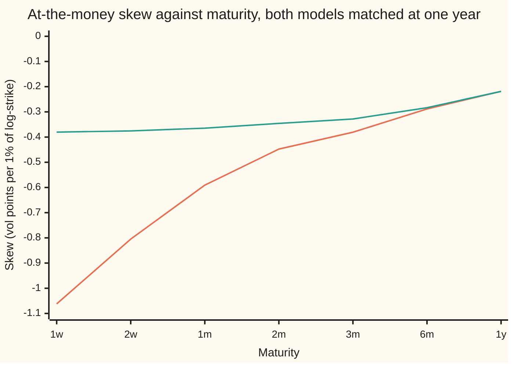

# Open questions in finance mathematics: rough volatility, the smile's true dynamics, and what a market model cannot know

[Syllabus](../../../SYLLABUS.md) → [Frontier](../README.md) → [Physics, Finance and Machines](../README.md#s07) → Open questions in finance mathematics

---

## General Overview

Take a stock index whose volatility (how widely its price swings, as a percentage per year) sits at 20%. The log of that volatility moves about 0.3 in a day (an illustrative value, as on Rougher than Brownian), and its moves scale with a Hurst exponent of about 0.1, where Brownian motion has 0.5. Jim Gatheral, Thibault Jaisson and Mathieu Rosenbaum reported that exponent for many stock indices in 2018. [Rougher than Brownian](../../11-Stochastic%20processes%20and%20calculus/09-Beyond%20Brownian/06-rough-paths-and-fractional-brownian-motion-in-outline.md) defines it and repeats their measurement.

An index option's **skew** is the slope of its implied volatility against strike. Implied volatility is the volatility that makes the Black-Scholes formula match a market price. The skew is negative, and much steeper for short-dated options than for long-dated ones.

In 2016 Christian Bayer, Peter Friz and Jim Gatheral published the **rough Bergomi** model, which puts the measured roughness into option pricing. With the illustrative inputs on this card, and to first order in the vol of vol, its skew is −0.2186 at one year and −1.0621 at one week. That is 4.8574 times steeper. A Heston model tuned to the same one-year skew reaches only −0.3803 at one week, 1.7392 times steeper. Simulated in full, the rough model is a little flatter at both maturities (What breaks gives the numbers).

The model fits short-dated skews well. Three questions about it are still open:

1. **Is volatility really rough?** Or does the roughness come from errors in how volatility is estimated?
2. **How does the smile really move** when the index moves? The answer sets the hedge.
3. **What can no market model know?** Option prices fix the pricing world, not the real-world chances.

**Rough Bergomi drives the variance with a kernel that weights recent shocks without limit, so short-dated skews steepen like the maturity to the power H − ½; the model fits, but whether volatility is rough, how the smile moves, and what real-world chances option prices hold are still open.**

**What kind of fact this is:** rough Bergomi is a model. Inside it, the skew power law and the skew-stickiness ratio H + 3/2 are first-order results, derived on this card in Why it works. The three questions are open, with dated status lines in Step 5.

### The picture: how the skew steepens as expiry nears



Orange: rough Bergomi, H = 0.1. Green: Heston, with its vol of vol (0.342374) chosen to give the same one-year skew. The two agree at one year. Both curves are first order in the vol of vol. The rough curve keeps falling as maturity shrinks. The Heston curve levels off near −0.3852, its short-maturity limit.

---

## The formula

Notation first, in words. $`W_t`$ and $`W^\perp_t`$ are independent Brownian motions, as on the Heston card. A $`d`$ in front of a quantity is its change over a short step. Time is in years, with 252 trading days in a year.

```math
v_t = \xi_0 \exp\!\Big(\eta\,Y_t - \tfrac12\eta^2 t^{2H}\Big), \qquad Y_t = \sqrt{2H}\int_0^t (t-s)^{H-\frac12}\,dW_s
```

```math
\frac{dS_t}{S_t} = \sqrt{v_t}\,\Big(\rho\,dW_t + \sqrt{1-\rho^2}\,dW^\perp_t\Big)
```

**Read it aloud:** the variance is today's level times the exponential of a weighted sum of past shocks, minus a correction that keeps its average fixed; the price shakes by the square root of the variance, partly with the variance's own shocks.

The weight $`(t-s)^{H-\frac12}`$ on a shock at time $`s`$ grows without limit as the shock gets more recent, because $`H - \tfrac12 = -0.4`$ is negative. That weight, the **kernel**, is the whole model.

Two results follow, both to first order in the vol of vol $`\eta`$. First order means the terms in $`\eta^2`$ and higher are dropped. The at-the-money skew is

```math
\psi(T) = \frac{\rho\,\eta\,\sqrt{2H}}{2\,(H+\frac12)(H+\frac32)}\;T^{\,H-\frac12}
```

**Read it aloud:** the skew is the correlation times the vol of vol times a constant, times the maturity to the power H minus a half.

The **skew-stickiness ratio** (SSR) compares how far the at-the-money volatility moves when the index moves with the slope of the smile:

```math
R = \frac{\text{change in at-the-money volatility per unit change in } \ln S}{\psi(T)} = H + \tfrac32
```

**Read it aloud:** in rough Bergomi the at-the-money volatility moves 1.6 times the skew for each unit of log-move in the index, at every maturity.

| Symbol | Plain meaning | In our example | Push it up and the answer… |
| --- | --- | --- | --- |
| $`S_t`$, $`K`$, $`k`$ | index level, as a forward with zero rates; strike; log-strike $`\ln(K/S)`$ | 100; near 100; near 0 | — |
| $`v_t`$, $`\xi_0`$, $`\sigma_0`$ | variance at time $`t`$; today's forward variance, flat in maturity; its volatility $`\sqrt{\xi_0}`$ | 0.04; 0.04; 0.2 | lifts every implied volatility |
| $`\xi^u_t`$ | forward variance: the forecast at time $`t`$ of the variance at a later time $`u`$ | 0.04 today | — |
| $`W_t`$, $`W^\perp_t`$, $`Z_t`$ | independent Brownian motions driving variance and price; $`Z = \rho W + \sqrt{1-\rho^2}\,W^\perp`$ is the price's own | — | — |
| $`Y_t`$ | the weighted sum of past shocks, a Gaussian process | variance $`t^{2H}`$ | — |
| $`H`$ | Hurst exponent: 0.5 for Brownian motion, lower is rougher | 0.1 | skew flattens; at 0.5 it no longer depends on maturity |
| $`\eta`$ | vol of vol: how hard shocks move the log variance | 1.0430 | skew steepens in proportion |
| $`\rho`$ | correlation of price shocks with variance shocks | −0.9 | skew less negative, in proportion |
| $`t`$, $`s`$, $`u`$, $`T`$ | times in years; $`T`$ is the option's maturity | $`T`$ from 1/52 to 1 | skew flattens like $`T^{-0.4}`$ |
| $`\psi(T)`$, $`R`$ | at-the-money skew, the change in implied volatility per unit of $`k`$; the skew-stickiness ratio | −0.2186 at 1 year; 1.6 | — |
| $`x_T`$, $`I`$, $`M_T`$, $`E`$ | log-return to maturity; total variance $`\int_0^T v_u\,du`$; the return's random part; the mean over all paths | — | — |
| $`c_3`$, $`\gamma`$, $`z`$, $`\kappa`$, $`\xi`$ | the return's third cumulant, its skewness, the standardised return; Heston's pull speed and vol of vol (bare $`\xi`$ is the Heston card's name for it, not a forward variance like $`\xi_0`$) | $`\kappa`$ = 2, $`\xi`$ = 0.342374 | — |

The skew is per unit of $`k`$. A 1% change in $`k`$ moves the implied volatility by $`\psi`$ volatility points. At one year, a strike 1% lower carries 0.2186 more points.

The vol of vol is not fitted here. It is set so that the log of volatility, half the log of variance, has a one-day spread of 0.3, as on the rough-paths card: $`\eta = 0.6 \times 252^{0.1} = 1.0430`$. The correlation −0.9 is illustrative.

### When it holds

- **A flat forward variance curve.** Real curves slope. A sloped $`\xi_0`$ changes the skew's level at each maturity, but not the power law.
- **Small vol of vol, for the two formulas.** At the full $`\eta`$ = 1.0430 the 32-step simulation finds a one-week skew of −0.9887. First order on the same grid gives −1.0344. The higher-order terms fade as maturity shrinks, but slowly.
- **Continuous paths.** Rough Bergomi has no jumps. A jump model also steepens short-dated skews, by another mechanism.
- **Volatility that really is rough.** The model takes H ≈ 0.1 as given. Step 5 shows that this input is disputed.
- **The pricing world.** Every number here is a pricing-world number. Step 5 shows why option prices alone do not give real-world chances.

---

## Why it works

### Step 0: recent shocks weigh most, so short options feel the most

Heston's variance forgets old shocks at a fixed rate. Every shock enters with a finite weight, so over a very short life the variance barely moves, and the skew stops growing.

Rough Bergomi's kernel $`(t-s)^{-0.4}`$ has no ceiling. The most recent shocks move the variance hardest. A one-week option lives entirely in the region where the weights are largest. So its price is most exposed to the link between price shocks and variance shocks, and that link is what tilts the smile.

### Step 1: the shock sum has the roughness of H

$`Y_t`$ is a sum of independent Gaussian shocks, so it is Gaussian with mean zero. Its variance, written Var, is the sum of the squared weights:

```math
\mathrm{Var}(Y_t) = 2H\int_0^t (t-s)^{2H-1}\,ds = t^{2H}
```

That is the scaling of fractional Brownian motion with exponent H. The Hurst exponent measured on [Rougher than Brownian](../../11-Stochastic%20processes%20and%20calculus/09-Beyond%20Brownian/06-rough-paths-and-fractional-brownian-motion-in-outline.md) passes straight into the model. $`Y`$ is not fractional Brownian motion itself, because its moves depend on the start, but the two share the same roughness.

For a normal number with mean zero, the mean of its exponential is e to the power of half its variance. Here $`\eta Y_t`$ has variance $`\eta^2 t^{2H}`$, so $`e^{\eta Y_t - \frac12\eta^2 t^{2H}}`$ has mean exactly 1, and $`E[v_t] = \xi_0`$ at every time. Drop the correction and the one-year mean variance becomes $`0.04\,e^{\eta^2/2}`$ = 0.06891, a volatility of 26.25% instead of 20%.

### Step 2: today's shock moves each forward variance by a power of the distance

The **forward variance** $`\xi^u_t`$ is today's best forecast of the variance at a later time $`u`$. A shock $`dW_t`$ today moves it by

```math
d\xi^u_t = \xi^u_t\;\eta\sqrt{2H}\,(u-t)^{H-\frac12}\,dW_t
```

Forward variances a day ahead jump far more than those a year ahead. In Heston the same response is $`e^{-\kappa(u-t)}`$: finite at $`u = t`$.

### Step 3: correlation tilts the smile, and the kernel sets the tilt's size

The skew comes from two facts, each first order in $`\eta`$.

- **Correlation makes the return lopsided.** Let $`x_T`$ be the log-return to maturity and $`I`$ the total variance $`\int_0^T v_u\,du`$. The return's third cumulant $`c_3`$ (its lopsidedness) is $`3\,\mathrm{Cov}(x_T, I)`$, three times the covariance (how far the two move together) of return and total variance. Its skewness $`\gamma`$, the third cumulant over the cube of the spread, is $`c_3/(\sigma_0\sqrt{T})^3`$.
- **A lopsided return tilts the smile.** An implied-volatility slope of skewness divided by $`6\sqrt{T}`$ reproduces a lopsided bell curve's option prices to first order.

Together these give $`\psi(T) = \mathrm{Cov}(x_T, I)/(2\sigma_0^3 T^2)`$. Step 2's kernel fixes the covariance. The integral of $`(u-t)^{H-\frac12}`$ over the triangle $`0 < t < u < T`$ grows like $`T^{H+\frac32}`$. Divided by $`T^2`$, that leaves $`T^{H-\frac12}`$.

<details>
<summary>Detailed derivation: the skew to first order in the vol of vol</summary>

Write $`M_T = \int_0^T \sqrt{v_t}\,dZ_t`$ for the random part of the log-return, with $`Z`$ the price's Brownian motion. Ito's formula gives $`d(M^3) = 3M^2\,dM + 3M\,v\,dt`$, so

$`\displaystyle E[M_T^3] = 3\int_0^T E[M_t\,v_t]\,dt = 3\int_0^T \mathrm{Cov}(M_t, v_t)\,dt = 3\,\mathrm{Cov}(M_T, I).`$

The last step holds because moves of $`M`$ after time $`t`$ are uncorrelated with $`v_t`$. The drift $`-\tfrac12 I`$ adds nothing at first order: the covariance of $`M_T^2`$ with the Gaussian part of $`I`$ is the mean of an odd product of Gaussians, which is zero.

To first order, $`v_u = \xi_0 + \xi_0\eta Y_u`$ and $`\sqrt{v_t} = \sigma_0`$. A price shock $`\sigma_0\rho\,dW_t`$ meets $`Y_u`$ through the weight $`\sqrt{2H}(u-t)^{H-\frac12}`$:

$`\displaystyle \mathrm{Cov}(x_T, I) = \rho\,\eta\,\sigma_0^3\sqrt{2H}\int_0^T\!\!\int_t^T (u-t)^{H-\frac12}\,du\,dt = \frac{\rho\,\eta\,\sigma_0^3\sqrt{2H}\;T^{H+\frac32}}{(H+\frac12)(H+\frac32)}.`$

The Gram-Charlier form of a lopsided bell curve adds $`(\gamma/6)(z^3 - 3z)`$ times the bell curve's height to the density of the standardised return $`z`$. Priced through Black-Scholes, it gives the implied volatility $`\sigma_0 + (\gamma/6)\,k/\sqrt{T}`$ near the money. With $`\gamma = 3\,\mathrm{Cov}(x_T,I)/(\sigma_0^3T^{3/2})`$ the slope is

$`\displaystyle \psi(T) = \frac{\gamma}{6\sqrt{T}} = \frac{\mathrm{Cov}(x_T, I)}{2\sigma_0^3T^2} = \frac{\rho\,\eta\,\sqrt{2H}}{2(H+\frac12)(H+\frac32)}\,T^{H-\frac12}.`$

For Heston the kernel is $`e^{-\kappa(u-t)}`$ and the vol of vol is $`\xi/\sigma_0`$. The same steps give $`\rho\xi/(2\sigma_0T^2)\,\big(T/\kappa - (1-e^{-\kappa T})/\kappa^2\big)`$, which tends to $`\rho\xi/(4\sigma_0)`$ as $`T \to 0`$: a finite limit, −0.385171 here.

This is an outline at first order, not a proof of the full model. The simulation in the code checks it. At $`\eta`$ = 0.05 it finds −0.0490 ± 0.0006 at one week and −0.0101 ± 0.0001 at one year, against −0.0496 and −0.0102 from the same 32-step grid.

</details>

### Step 4: the same kernel fixes how the smile moves

The at-the-money volatility is roughly the square root of the average forward variance to maturity. Step 2 says how a shock moves each forward variance. Regress that move on the index's log-move. The slope is $`\rho\eta\sqrt{2H}\,T^{H-\frac12}/(2(H+\frac12))`$. Divide by the skew and everything cancels except $`H + \tfrac32`$.

The smile rules on [Smile-adjusted delta](../../12-Financial%20mathematics/12-The%20smile%20and%20the%20surface/05-smile-adjusted-delta.md) have their own ratios. Computed from that card's three formulas, with Heston for comparison:

```
skew-stickiness ratio R, 20 blocks per unit
  sticky moneyness                                              0.0000
  sticky strike       ████████████████████                      1.0000
  Heston, 1 year      ██████████████████████████████            1.5232
  rough Bergomi       ████████████████████████████████          1.6000
  Heston, 1 week      ████████████████████████████████████████  1.9873
  local-vol rule      ████████████████████████████████████████  2.0000
```

Rough Bergomi's ratio is the same at every maturity. Heston's runs from about 2 for short options down to 1.5232 at one year. The hedge ratio depends on R. Which R the market follows is Step 5's second question.

### Step 5: three open questions, with dated status

| Question | Kind | Status, 2026-11-23 | The evidence, with primary sources |
| --- | --- | --- | --- |
| 1. Is volatility rough, with H near 0.1? | model claim about data | **open, disputed** | For: Gatheral, Jaisson and Rosenbaum (2018), H of order 0.1 at every reasonable time scale. Against: Cont and Das (2024), estimated volatility looks rough even when the true volatility is as smooth as Brownian motion; they suggest the roughness comes from estimation error. |
| 2. How does the smile move with the index? | empirical modelling question | **open** | Each model fixes its own R: 1.6 for rough Bergomi, 1.5232 to 1.9873 for Heston, 0, 1 or 2 for the smile rules. Fitting today's smile does not fit how it moves. Measured on S&P 500 options from 2000 to 2013 and DAX options from 2002 to 2013, R changes with maturity and rises above 2 at short maturities, above every value just listed ([Vargas, Dao and Bouchaud, 2015](https://doi.org/10.1142/S0219024915500223)). In that study a model calibrated on past returns (asymmetric GARCH, whose variance reacts more to falls than to rises) matches the measured R well, although option prices show a stronger skew and a stronger link between volatility and index moves than past returns predict. |
| 3. Can option prices reveal real-world chances? | theorem plus a question of fit | **theorem proved; its use open, disputed** | Ross (2015): under his assumptions on the pricing kernel, state prices fix the real-world chances. Borovička, Hansen and Scheinkman (2016): if the pricing kernel has a permanent (martingale) part, recovery returns a distorted measure, not the true chances; they find such parts are empirically relevant in many structural asset-pricing models. |

No accepted resolution of any of the three was found in the sources checked as of 2026-11-23. The three questions are rows ROUGH, SMILE and RECOV on [The status register](05-the-status-register.md).

Question 3 fits in three states: the index next year is down, flat or up. A **state price** is today's price of $1 paid in one state. The **pricing kernel** is the factor that turns real-world chances into state prices. Ross's form for it is a fixed discount times a ratio of marginal utilities (what an extra dollar is worth in each state).

- **World A:** from flat, the true chances are 0.2000, 0.6000 and 0.2000, and the kernel has Ross's form.
- **World B:** the chances are 0.1555, 0.6066 and 0.2379, and the kernel carries an extra permanent tilt.
- **Same prices:** the two worlds have the same state prices (an assert checks this), so the same option prices.
- **Recovery:** Ross's method returns 0.2000, 0.6000 and 0.2000 in both. In world B the true chance of a fall is 0.1555.

This is [Model risk](../../12-Financial%20mathematics/07-Greeks%20by%20Numbers%20and%20Calibration/07-model-risk-and-parameter-stability.md) one level down. There, two desks fitted the same quotes and disagreed on an unquoted contract. Here, two worlds share every price and disagree about what will happen.

---

## Worked numbers, by hand

Rough Bergomi with H = 0.1, ρ = −0.9 and η = 1.0430, at one week and one year, to first order in the vol of vol:

| Step | Arithmetic | Value |
| --- | --- | --- |
| $`\sqrt{2H}`$ | $`\sqrt{0.2}`$ | 0.4472 |
| $`(H+\frac12)(H+\frac32)`$ | $`0.6 \times 1.6`$ | 0.9600 |
| one-year skew $`\psi(1)`$ | $`-0.9 \times 1.0430 \times 0.4472 / (2 \times 0.9600)`$ | −0.2186 |
| steepening to one week | $`52^{0.4}`$ | 4.8574 |
| Heston, matched at one year, one week | first-order Heston formula, κ = 2 | −0.3803 |
| skew-stickiness ratio | $`0.1 + 1.5`$ | 1.6 |
| **one-week skew, first order** | $`-0.218649 \times 4.8574`$ | **−1.0621** |

To first order, a one-week strike 1% below the money carries about 1.06 more volatility points than the at-the-money option, and a one-year strike 0.22 more. The full model, simulated, gives about 0.99 and 0.19. Heston, matched at one year, gives the one-week option only 0.38.

### What breaks if you drop a piece

| Mistake | Comes out at | What went wrong |
| --- | --- | --- |
| Fit Heston's skew at one year and read off one week | −0.3803, where rough Bergomi gives −1.0621 | Heston's kernel is finite at zero lag, so its skew levels off at −0.3852 |
| Drop the correction $`-\frac12\eta^2t^{2H}`$ | mean variance at one year 0.06891 (simulated 0.06958), volatility 26.25% | The exponential of a Gaussian has mean above 1; the model no longer matches today's 0.04 |
| Trust the first-order skew at the full vol of vol | first order on the 32-step grid −1.0344 at one week and −0.2130 at one year; simulated −0.9887 ± 0.0118 and −0.1928 ± 0.0023 | Terms in $`\eta^2`$ and higher matter at η = 1.0430; the steepening survives, simulated ratio 5.1290 |
| Read Ross recovery as the real-world chance in world B | chance of a fall 0.2000, true 0.1555 | The kernel has a permanent part, which state prices cannot reveal |

---

## Code, from first principles, and it actually runs

The code reaches the skew and the skew-stickiness ratio by three independent roads, and runs Ross's recovery as a fourth.

- **Closed forms:** the first-order skew for rough Bergomi and Heston, and Heston's short-maturity limit.
- **Quadrature and sums:** the SSR by Simpson's rule, and the first-order skew summed from the covariance entries of a 32-step and a 1,024-step grid. The 1,024-step sum must converge on the closed form.
- **Simulation:** 20,000 antithetic pairs of paths (each path run again with every shock's sign flipped) on 32 steps. They are sampled exactly from their joint Gaussian law by a Cholesky factor, a triangular matrix that turns independent normal numbers into correlated ones. Given the variance path the price is lognormal, so each path gives exact Black-Scholes prices: the Heston card's mixing road. The skew at η = 0, exactly zero, is subtracted as a control. Standard errors come from 10 batches.
- **Power iteration** (multiplying by the matrix again and again until the vector settles): Ross's recovery on the three-state chain, against both worlds.

Random numbers come from SplitMix64, seed 20261123, made normal by Box-Muller. Both languages use the same Taylor series for the bell-curve area, so the outputs match line for line.

### Python

```python
# Rough Bergomi: skew power law, skew-stickiness ratio; Ross recovery.  Standard library only.
# Years; rates zero; forward 100.  Roads: closed forms; quadrature and sums over the kernel;
# simulation (SplitMix64, seed 20261123, exact Gaussian grid by Cholesky); power iteration.
from math import sqrt, exp, log, cos, pi
H, RHO, XI0, S0, KAP = 0.1, -0.9, 0.04, 0.2, 2.0   # Hurst, correlation, variance, its vol, Heston pull
ETA = 0.6 * 252.0 ** H                       # log-vol spread 0.3 a trading day, as on the rough-paths card
M64, state = (1 << 64) - 1, 20261123
def unif():
    global state
    state = (state + 0x9E3779B97F4A7C15) & M64
    z = ((state ^ (state >> 30)) * 0xBF58476D1CE4E5B9) & M64
    z = ((z ^ (z >> 27)) * 0x94D049BB133111EB) & M64
    return (((z ^ (z >> 31)) >> 11) + 1) / 2.0 ** 53
def gauss(): u1 = unif(); u2 = unif(); return sqrt(-2.0 * log(u1)) * cos(2.0 * pi * u2)   # Box-Muller
def ncdf(x):                                 # bell-curve area by its Taylor series, no erf
    if abs(x) > 8.0: return 0.0 if x < 0 else 1.0
    term, s, k = x, x, 1
    while abs(term) > 1e-17 * abs(s):
        term = term * x * x / (2 * k + 1); s += term; k += 1
    return 0.5 + s * exp(-0.5 * x * x) / sqrt(2.0 * pi)
def bs(f, k, w):                             # Black-Scholes call: forward f, strike k, total variance w
    sd = sqrt(w); d1 = (log(f / k) + 0.5 * w) / sd
    return f * ncdf(d1) - k * ncdf(d1 - sd)
def implied(c, k, T):                        # volatility by bisection, forward 100
    lo, hi = 0.001, 2.0
    for _ in range(100):
        mid = 0.5 * (lo + hi)
        lo, hi = (lo, mid) if bs(100.0, k, mid * mid * T) > c else (mid, hi)
    return 0.5 * (lo + hi)
def simpson(f, a, b, n):
    h = (b - a) / n; s = f(a) + f(b)
    for i in range(1, n): s += (4.0 if i % 2 else 2.0) * f(a + i * h)
    return s * h / 3.0
# ---- road 1: closed forms, first order in the vol of vol ----
def skew_rough(T, eta): return RHO * eta * sqrt(2 * H) / (2 * (H + 0.5) * (H + 1.5)) * T ** (H - 0.5)
def hI(T): return T / KAP - (1 - exp(-KAP * T)) / KAP ** 2
XIH = skew_rough(1.0, ETA) / (RHO / (2 * S0) * hI(1.0))   # Heston vol of vol giving the same 1-year skew
def skew_heston(T): return RHO * XIH / (2 * S0 * T * T) * hI(T)
def ssr_heston(T): return T * (1 - exp(-KAP * T)) / KAP / hI(T)
print(f"H {H}  rho {RHO}  eta {ETA:.6f}  xi0 {XI0}  sqrt(2H) {sqrt(2 * H):.4f}  (H+1/2)(H+3/2) {(H + 0.5) * (H + 1.5):.4f}")
print(f"Heston kappa {KAP}  vol of vol matched at 1y {XIH:.6f}")
print("maturity   years     rough   Heston  rough/1y Heston/1y")
for name, T in (("1w", 1 / 52), ("2w", 1 / 26), ("1m", 1 / 12), ("2m", 1 / 6), ("3m", 0.25), ("6m", 0.5), ("1y", 1.0)):
    r, h = skew_rough(T, ETA), skew_heston(T)
    print(f"{name:>8} {T:7.4f} {r:9.4f} {h:8.4f} {r / skew_rough(1.0, ETA):9.4f} {h / skew_heston(1.0):9.4f}")
print(f"52^(1/2-H) {52 ** (0.5 - H):.4f}   H = 0.3: {52 ** 0.2:.4f}   H = 0.5: {52 ** 0.0:.4f}")
heston_lim = RHO * XIH / (4 * S0); print(f"Heston skew at T = 1e-4: formula {skew_heston(1e-4):.6f}  limit rho*xi/(4 sigma0) {heston_lim:.6f}")
# ---- road 2: quadrature and sums over the model's own kernel ----
p, I1 = 1.0 / (H + 0.5), lambda s: s ** (H + 0.5) / (H + 0.5)    # integral of the kernel u^(H-1/2) from 0 to s
ssr_quad = I1(1.0) / simpson(I1, 0.0, 1.0, 4000)
print(f"SSR rough by quadrature {ssr_quad:.6f}  H + 3/2 = {H + 1.5:.6f}   Heston 1w {ssr_heston(1 / 52):.4f}  1y {ssr_heston(1.0):.4f}  T = 1e-4 {ssr_heston(1e-4):.4f}")
rules = (lambda K, S: 0.2 - 0.04 * (K / S - 1), lambda K, S: 0.2 - 0.0004 * (K - 100), lambda K, S: 0.2 - 0.0004 * (K + S - 200))
print("SSR of the smile card's rules (moneyness, strike, local vol):", " ".join(f"{(r(100, 100) - r(100 * exp(1e-4), 100 * exp(1e-4))) / (r(100, 100) - r(100 * exp(1e-4), 100)):.4f}" for r in rules))
def cov_yy(a, b):                            # Cov(Y_a, Y_b), a <= b; u = w^p removes the singularity
    if b - a <= 0: return a ** (2 * H)
    return 2 * H * simpson(lambda w: p * (w ** p + b - a) ** (H - 0.5), 0.0, a ** (H + 0.5), 400)
def cov_yw(a, lo, hi):                       # Cov(Y_a, W_hi - W_lo), hi <= a
    return sqrt(2 * H) / (H + 0.5) * ((a - lo) ** (H + 0.5) - (a - hi) ** (H + 0.5))
def skew_grid(T, n, eta):                    # first-order skew of the n-step model, from its covariances
    tot = 0.0
    for j in range(1, n):
        for i in range(j): tot += cov_yw(j / n, i / n, (i + 1) / n)
    return RHO * eta * tot / n * T ** (H - 0.5) / 2.0
g32, g1024 = skew_grid(1.0, 32, ETA), skew_grid(1.0, 1024, ETA)
print(f"first-order 1y skew: 32-step grid {g32:.6f}  1024-step grid {g1024:.6f}  formula {skew_rough(1.0, ETA):.6f}")
# ---- road 3: simulation, 32 steps, exact Gaussian grid, Black-Scholes over the price's own noise ----
N, n2, M, NB, TS, ETAS = 32, 64, 20000, 10, (1 / 52, 1.0), (0.0, 0.05, ETA)
C = [[0.0] * n2 for _ in range(n2)]          # rows 0..31: dW on each step; rows 32..63: Y at each step's end
for i in range(N):
    C[i][i] = 1.0 / N
    for j in range(i, N): C[N + j][i] = C[i][N + j] = cov_yw((j + 1) / N, i / N, (i + 1) / N)
    for j in range(i, N): C[N + i][N + j] = C[N + j][N + i] = cov_yy((i + 1) / N, (j + 1) / N)
L = [[0.0] * n2 for _ in range(n2)]
for i in range(n2):
    for j in range(i + 1):
        s = C[i][j]
        for k in range(j): s -= L[i][k] * L[j][k]
        L[i][j] = sqrt(s) if i == j else s / L[j][j]
acc, vmean, vnocomp = {(T, e, b): [0.0] * 3 for T in TS for e in ETAS for b in range(NB)}, 0.0, 0.0
for m in range(M):
    z = [gauss() for _ in range(n2)]
    for sgn in (1.0, -1.0):                  # antithetic pair
        g = [0.0] * n2
        for i in range(n2):
            for k in range(i + 1): g[i] += sgn * L[i][k] * z[k]
        for T in TS:
            sw, sy, dk = sqrt(T), T ** H, 0.1 * S0 * sqrt(T)
            for e in ETAS:
                i1 = i2 = 0.0; v = XI0
                for i in range(N):
                    i1 += sqrt(v) * g[i] * sw; i2 += v * T / N
                    v = XI0 * exp(e * g[N + i] * sy - 0.5 * e * e * ((i + 1) * T / N) ** (2 * H))
                f, w, a = 100.0 * exp(RHO * i1 - 0.5 * RHO * RHO * i2), (1 - RHO * RHO) * i2, acc[(T, e, m % NB)]
                a[0] += bs(f, 100.0 * exp(-dk), w); a[1] += f; a[2] += bs(f, 100.0 * exp(dk), w)
                if T == 1.0 and e == ETA: vmean += v; vnocomp += XI0 * exp(e * g[n2 - 1])
def batch_skew(T, e, b):
    a, n, dk = acc[(T, e, b)], 2.0 * M / NB, 0.1 * S0 * sqrt(T)
    F = a[1] / n
    lo, hi = (implied(a[q] / n * 100.0 / F, 100.0 * exp(x) * 100.0 / F, T) for q, x in ((0, -dk), (2, dk)))
    return (hi - lo) / (2 * dk)
sim = {}
for T in TS:
    for e in ETAS[1:]:                       # minus the eta = 0 skew, which is exactly 0: a control
        xs = [batch_skew(T, e, b) - batch_skew(T, 0.0, b) for b in range(NB)]
        mu = var = 0.0
        for x in xs: mu += x / NB
        for x in xs: var += (x - mu) * (x - mu)
        sim[(T, e)] = (mu, sqrt(var / (NB - 1) / NB))
        print(f"simulated skew T {T:.4f} eta {e:.4f}: {mu:.4f} +- {sim[(T, e)][1]:.4f}   grid {skew_grid(T, N, e):.4f}  formula {skew_rough(T, e):.4f}")
r_sim = sim[(TS[0], ETA)][0] / sim[(1.0, ETA)][0]
print(f"simulated 1w/1y skew ratio {r_sim:.4f}   power law {52 ** (0.5 - H):.4f}")
vm, vn, vn_exact = vmean / (2 * M), vnocomp / (2 * M), XI0 * exp(0.5 * ETA * ETA)
print(f"mean variance at 1y: simulated {vm:.5f}  no compensator: simulated {vn:.5f}  exact {vn_exact:.5f}  vol {sqrt(vn_exact):.4f}")
# ---- road 4: Ross recovery on a 3-state chain (states: down, flat, up) ----
P, Z, W, DELTA = [[0.6, 0.3, 0.1], [0.2, 0.6, 0.2], [0.1, 0.3, 0.6]], [1.25, 1.0, 0.8], [1.3, 1.0, 0.85], 0.97
# true chances; marginal utility in each state; world B's permanent tilt; one-year discount
A, e = [[DELTA * P[i][j] * Z[j] / Z[i] for j in range(3)] for i in range(3)], [1.0, 1.0, 1.0]   # state prices
for _ in range(500):                         # power iteration: positive eigenvector of A
    e2 = [A[i][0] * e[0] + A[i][1] * e[1] + A[i][2] * e[2] for i in range(3)]
    lam = e2[1] / e[1]; e = [x / e2[1] for x in e2]
R = [[A[i][j] * e[j] / (lam * e[i]) for j in range(3)] for i in range(3)]
c = [P[i][0] / W[0] + P[i][1] / W[1] + P[i][2] / W[2] for i in range(3)]
PB = [[P[i][j] / (c[i] * W[j]) for j in range(3)] for i in range(3)]       # world B's true chances
AB = [[PB[i][j] * DELTA * Z[j] / Z[i] * c[i] * W[j] for j in range(3)] for i in range(3)]
print(f"recovery: discount {lam:.6f}   from flat, recovered {R[1][0]:.4f} {R[1][1]:.4f} {R[1][2]:.4f}")
print(f"true chances from flat: world A {P[1][0]:.4f} {P[1][1]:.4f} {P[1][2]:.4f}   world B {PB[1][0]:.4f} {PB[1][1]:.4f} {PB[1][2]:.4f}")
assert abs(heston_lim - skew_heston(1e-4)) < 1e-4, "Heston skew formula vs its short-maturity limit"
assert abs(ssr_quad - (H + 1.5)) < 1e-5, "skew-stickiness ratio by quadrature vs H + 3/2"
assert abs(ssr_heston(1e-4) - 2.0) < 1e-3, "Heston SSR tends to 2 at short maturity"
assert abs(g1024 / skew_rough(1.0, ETA) - 1) < 2e-3, "grid sum of covariances converges to the closed form"
for T in TS:                                 # small vol of vol: simulation matches first order
    mu, se = sim[(T, 0.05)]
    assert abs(mu - skew_grid(T, N, 0.05)) < 4 * se + 0.03 * abs(mu), "simulated skew vs first order"
assert 4.0 < r_sim < 6.5, "rough skew steepens like a power law at full vol of vol"
assert abs(vm - XI0) < 0.002, "compensator keeps the mean variance at 0.04"
assert abs(vn / vn_exact - 1) < 0.05, "without it the mean is 0.04 e^(eta^2/2)"
assert max(abs(R[i][j] - P[i][j]) for i in range(3) for j in range(3)) < 1e-12, "recovery returns world A"
assert max(abs(A[i][j] - AB[i][j]) for i in range(3) for j in range(3)) < 1e-14, "worlds A and B: same prices"
assert abs(PB[1][0] - P[1][0]) > 0.04, "world B's true chance of down differs from the recovered one"
print("ALL CHECKS PASS")
```

**Ran 2026-11-23 on macOS, Python 3.14.10, standard library only. All checks passed. Output, pasted from the run:**

```
H 0.1  rho -0.9  eta 1.043017  xi0 0.04  sqrt(2H) 0.4472  (H+1/2)(H+3/2) 0.9600
Heston kappa 2.0  vol of vol matched at 1y 0.342374
maturity   years     rough   Heston  rough/1y Heston/1y
      1w  0.0192   -1.0621  -0.3803    4.8574    1.7392
      2w  0.0385   -0.8049  -0.3755    3.6812    1.7173
      1m  0.0833   -0.5908  -0.3646    2.7019    1.6677
      2m  0.1667   -0.4477  -0.3457    2.0477    1.5811
      3m  0.2500   -0.3807  -0.3283    1.7411    1.5013
      6m  0.5000   -0.2885  -0.2834    1.3195    1.2961
      1y  1.0000   -0.2186  -0.2186    1.0000    1.0000
52^(1/2-H) 4.8574   H = 0.3: 2.2039   H = 0.5: 1.0000
Heston skew at T = 1e-4: formula -0.385145  limit rho*xi/(4 sigma0) -0.385171
SSR rough by quadrature 1.600000  H + 3/2 = 1.600000   Heston 1w 1.9873  1y 1.5232  T = 1e-4 1.9999
SSR of the smile card's rules (moneyness, strike, local vol): 0.0000 1.0000 2.0000
first-order 1y skew: 32-step grid -0.212961  1024-step grid -0.218477  formula -0.218649
simulated skew T 0.0192 eta 0.0500: -0.0490 +- 0.0006   grid -0.0496  formula -0.0509
simulated skew T 0.0192 eta 1.0430: -0.9887 +- 0.0118   grid -1.0344  formula -1.0621
simulated skew T 1.0000 eta 0.0500: -0.0101 +- 0.0001   grid -0.0102  formula -0.0105
simulated skew T 1.0000 eta 1.0430: -0.1928 +- 0.0023   grid -0.2130  formula -0.2186
simulated 1w/1y skew ratio 5.1290   power law 4.8574
mean variance at 1y: simulated 0.04039  no compensator: simulated 0.06958  exact 0.06891  vol 0.2625
recovery: discount 0.970000   from flat, recovered 0.2000 0.6000 0.2000
true chances from flat: world A 0.2000 0.6000 0.2000   world B 0.1555 0.6066 0.2379
ALL CHECKS PASS
```

The small-η simulation lands on the first-order grid value at both maturities. At the full vol of vol it falls short of the formula by a few percent, and its one-week to one-year ratio, 5.1290, is near the power law's 4.8574.

### Rust

The same roads and inputs, with the same printed lines. No crates.

```rust
// Rough Bergomi: skew power law, skew-stickiness ratio; Ross recovery.  Standard library only, no crates.
// Same roads, inputs and printed lines as the Python check; the bell-curve area is its Taylor series.
use std::f64::consts::PI;
const H: f64 = 0.1; const RHO: f64 = -0.9; const XI0: f64 = 0.04; const S0: f64 = 0.2; const KAP: f64 = 2.0;
const N: usize = 32; const N2: usize = 64; const M: usize = 20000; const NB: usize = 10;
struct Rng(u64);
impl Rng {
    fn unif(&mut self) -> f64 {
        self.0 = self.0.wrapping_add(0x9E3779B97F4A7C15);
        let mut z = (self.0 ^ (self.0 >> 30)).wrapping_mul(0xBF58476D1CE4E5B9);
        z = (z ^ (z >> 27)).wrapping_mul(0x94D049BB133111EB);
        (((z ^ (z >> 31)) >> 11) + 1) as f64 / 2f64.powi(53)
    }
    fn gauss(&mut self) -> f64 { let u1 = self.unif(); let u2 = self.unif(); (-2.0 * u1.ln()).sqrt() * (2.0 * PI * u2).cos() }
}
fn ncdf(x: f64) -> f64 {                                   // bell-curve area by its Taylor series
    if x.abs() > 8.0 { return if x < 0.0 { 0.0 } else { 1.0 }; }
    let (mut term, mut s, mut k) = (x, x, 1.0_f64);
    while term.abs() > 1e-17 * s.abs() { term = term * x * x / (2.0 * k + 1.0); s += term; k += 1.0; }
    0.5 + s * (-0.5 * x * x).exp() / (2.0 * PI).sqrt()
}
fn bs(f: f64, k: f64, w: f64) -> f64 {
    let sd = w.sqrt(); let d1 = ((f / k).ln() + 0.5 * w) / sd;
    f * ncdf(d1) - k * ncdf(d1 - sd)
}
fn implied(c: f64, k: f64, t: f64) -> f64 {
    let (mut lo, mut hi) = (0.001, 2.0);
    for _ in 0..100 {
        let mid = 0.5 * (lo + hi);
        if bs(100.0, k, mid * mid * t) > c { hi = mid } else { lo = mid }
    }
    0.5 * (lo + hi)
}
fn simpson<F: Fn(f64) -> f64>(f: F, a: f64, b: f64, n: usize) -> f64 {
    let h = (b - a) / n as f64; let mut s = f(a) + f(b);
    for i in 1..n { s += if i % 2 == 1 { 4.0 } else { 2.0 } * f(a + i as f64 * h); }
    s * h / 3.0
}
fn skew_rough(t: f64, eta: f64) -> f64 { RHO * eta * (2.0 * H).sqrt() / (2.0 * (H + 0.5) * (H + 1.5)) * t.powf(H - 0.5) }
fn hi_(t: f64) -> f64 { t / KAP - (1.0 - (-KAP * t).exp()) / (KAP * KAP) }
fn ssr_heston(t: f64) -> f64 { t * (1.0 - (-KAP * t).exp()) / KAP / hi_(t) }
fn cov_yy(a: f64, b: f64) -> f64 {
    if b - a <= 0.0 { return a.powf(2.0 * H); }
    let p = 1.0 / (H + 0.5);
    2.0 * H * simpson(|w: f64| p * (w.powf(p) + b - a).powf(H - 0.5), 0.0, a.powf(H + 0.5), 400)
}
fn cov_yw(a: f64, lo: f64, hi: f64) -> f64 { (2.0 * H).sqrt() / (H + 0.5) * ((a - lo).powf(H + 0.5) - (a - hi).powf(H + 0.5)) }
fn skew_grid(t: f64, n: usize, eta: f64) -> f64 {
    let mut tot = 0.0; let nf = n as f64;
    for j in 1..n { for i in 0..j { tot += cov_yw(j as f64 / nf, i as f64 / nf, (i + 1) as f64 / nf); } }
    RHO * eta * tot / nf * t.powf(H - 0.5) / 2.0
}
fn main() {
    let eta_full = 0.6 * 252f64.powf(H);
    let xih = skew_rough(1.0, eta_full) / (RHO / (2.0 * S0) * hi_(1.0));
    let skew_heston = |t: f64| RHO * xih / (2.0 * S0 * t * t) * hi_(t);
    println!("H {}  rho {}  eta {:.6}  xi0 {}  sqrt(2H) {:.4}  (H+1/2)(H+3/2) {:.4}", H, RHO, eta_full, XI0, (2.0 * H).sqrt(), (H + 0.5) * (H + 1.5));
    println!("Heston kappa {:.1}  vol of vol matched at 1y {:.6}", KAP, xih);
    println!("maturity   years     rough   Heston  rough/1y Heston/1y");
    for (name, t) in [("1w", 1.0 / 52.0), ("2w", 1.0 / 26.0), ("1m", 1.0 / 12.0), ("2m", 1.0 / 6.0), ("3m", 0.25), ("6m", 0.5), ("1y", 1.0)] {
        let (r, h) = (skew_rough(t, eta_full), skew_heston(t));
        println!("{:>8} {:7.4} {:9.4} {:8.4} {:9.4} {:9.4}", name, t, r, h, r / skew_rough(1.0, eta_full), h / skew_heston(1.0));
    }
    println!("52^(1/2-H) {:.4}   H = 0.3: {:.4}   H = 0.5: {:.4}", 52f64.powf(0.5 - H), 52f64.powf(0.2), 52f64.powf(0.0));
    let heston_lim = RHO * xih / (4.0 * S0); println!("Heston skew at T = 1e-4: formula {:.6}  limit rho*xi/(4 sigma0) {:.6}", skew_heston(1e-4), heston_lim);
    let i1 = |s: f64| s.powf(H + 0.5) / (H + 0.5); let ssr_quad = i1(1.0) / simpson(i1, 0.0, 1.0, 4000);
    println!("SSR rough by quadrature {:.6}  H + 3/2 = {:.6}   Heston 1w {:.4}  1y {:.4}  T = 1e-4 {:.4}",
        ssr_quad, H + 1.5, ssr_heston(1.0 / 52.0), ssr_heston(1.0), ssr_heston(1e-4));
    let rules: [fn(f64, f64) -> f64; 3] = [|k, s| 0.2 - 0.04 * (k / s - 1.0), |k, _s| 0.2 - 0.0004 * (k - 100.0), |k, s| 0.2 - 0.0004 * (k + s - 200.0)];
    let u = 100.0 * 1e-4f64.exp(); let rs: Vec<String> = rules.iter().map(|r| format!("{:.4}", (r(100.0, 100.0) - r(u, u)) / (r(100.0, 100.0) - r(u, 100.0)))).collect();
    println!("SSR of the smile card's rules (moneyness, strike, local vol): {}", rs.join(" "));
    let (g32, g1024) = (skew_grid(1.0, 32, eta_full), skew_grid(1.0, 1024, eta_full));
    println!("first-order 1y skew: 32-step grid {:.6}  1024-step grid {:.6}  formula {:.6}", g32, g1024, skew_rough(1.0, eta_full));
    // ---- simulation: exact Gaussian grid by Cholesky ----
    let nf = N as f64;
    let mut c = vec![vec![0.0f64; N2]; N2];
    for i in 0..N {
        c[i][i] = 1.0 / nf;
        for j in i..N { let v = cov_yw((j + 1) as f64 / nf, i as f64 / nf, (i + 1) as f64 / nf); c[N + j][i] = v; c[i][N + j] = v; }
        for j in i..N { let v = cov_yy((i + 1) as f64 / nf, (j + 1) as f64 / nf); c[N + i][N + j] = v; c[N + j][N + i] = v; }
    }
    let mut l = vec![vec![0.0f64; N2]; N2];  // lower-triangular Cholesky factor
    for i in 0..N2 {
        for j in 0..=i {
            let mut s = c[i][j];
            for k in 0..j { s -= l[i][k] * l[j][k]; }
            l[i][j] = if i == j { s.sqrt() } else { s / l[j][j] };
        }
    }
    let (ts, etas) = ([1.0f64 / 52.0, 1.0], [0.0f64, 0.05, eta_full]);
    let mut acc = vec![[0.0f64; 3]; 2 * 3 * NB];   // per maturity, vol of vol, batch: low call, forward, high call
    let (mut vmean, mut vnocomp, mut rng) = (0.0, 0.0, Rng(20261123));
    for m in 0..M {
        let z: Vec<f64> = (0..N2).map(|_| rng.gauss()).collect();
        for sgn in [1.0, -1.0] {
            let mut g = vec![0.0f64; N2];
            for i in 0..N2 { for k in 0..=i { g[i] += sgn * l[i][k] * z[k]; } }
            for (ti, &t) in ts.iter().enumerate() {
                let (sw, sy, dk) = (t.sqrt(), t.powf(H), 0.1 * S0 * t.sqrt());
                for (ei, &e) in etas.iter().enumerate() {
                    let (mut i1s, mut i2s, mut v) = (0.0, 0.0, XI0);
                    for i in 0..N {
                        i1s += v.sqrt() * g[i] * sw; i2s += v * t / nf;
                        v = XI0 * (e * g[N + i] * sy - 0.5 * e * e * ((i + 1) as f64 * t / nf).powf(2.0 * H)).exp();
                    }
                    let (f, w) = (100.0 * (RHO * i1s - 0.5 * RHO * RHO * i2s).exp(), (1.0 - RHO * RHO) * i2s);
                    let a = &mut acc[(ti * 3 + ei) * NB + m % NB];
                    a[0] += bs(f, 100.0 * (-dk).exp(), w); a[1] += f; a[2] += bs(f, 100.0 * dk.exp(), w);
                    if t == 1.0 && e == eta_full { vmean += v; vnocomp += XI0 * (e * g[N2 - 1]).exp(); }
                }
            }
        }
    }
    let batch_skew = |ti: usize, ei: usize, b: usize| -> f64 {
        let (a, n, t) = (acc[(ti * 3 + ei) * NB + b], 2.0 * M as f64 / NB as f64, ts[ti]); let (dk, f) = (0.1 * S0 * t.sqrt(), a[1] / n);
        let lo = implied(a[0] / n * 100.0 / f, 100.0 * (-dk).exp() * 100.0 / f, t);
        let hi = implied(a[2] / n * 100.0 / f, 100.0 * dk.exp() * 100.0 / f, t);
        (hi - lo) / (2.0 * dk)
    };
    let mut sim = [[(0.0f64, 0.0f64); 3]; 2];
    for ti in 0..2 {
        for ei in 1..3 {
            let xs: Vec<f64> = (0..NB).map(|b| batch_skew(ti, ei, b) - batch_skew(ti, 0, b)).collect();
            let (mut mu, mut var) = (0.0, 0.0);
            for x in &xs { mu += x / NB as f64; }
            for x in &xs { var += (x - mu) * (x - mu); }
            sim[ti][ei] = (mu, (var / (NB - 1) as f64 / NB as f64).sqrt());
            println!("simulated skew T {:.4} eta {:.4}: {:.4} +- {:.4}   grid {:.4}  formula {:.4}",
                ts[ti], etas[ei], mu, sim[ti][ei].1, skew_grid(ts[ti], N, etas[ei]), skew_rough(ts[ti], etas[ei]));
        }
    }
    let r_sim = sim[0][2].0 / sim[1][2].0; println!("simulated 1w/1y skew ratio {:.4}   power law {:.4}", r_sim, 52f64.powf(0.5 - H));
    let (vm, vn, vn_exact) = (vmean / (2 * M) as f64, vnocomp / (2 * M) as f64, XI0 * (0.5 * eta_full * eta_full).exp());
    println!("mean variance at 1y: simulated {:.5}  no compensator: simulated {:.5}  exact {:.5}  vol {:.4}", vm, vn, vn_exact, vn_exact.sqrt());
    // ---- Ross recovery on a 3-state chain (down, flat, up) ----
    let (p, zz, ww, delta) = ([[0.6f64, 0.3, 0.1], [0.2, 0.6, 0.2], [0.1, 0.3, 0.6]], [1.25f64, 1.0, 0.8], [1.3f64, 1.0, 0.85], 0.97f64);
    let mut a = [[0.0f64; 3]; 3];
    for i in 0..3 { for j in 0..3 { a[i][j] = delta * p[i][j] * zz[j] / zz[i]; } }
    let (mut e, mut lam) = ([1.0f64; 3], 0.0);
    for _ in 0..500 {
        let mut e2 = [0.0f64; 3];
        for i in 0..3 { e2[i] = a[i][0] * e[0] + a[i][1] * e[1] + a[i][2] * e[2]; }
        lam = e2[1] / e[1]; for i in 0..3 { e[i] = e2[i] / e2[1]; }
    }
    let (mut r, mut pb, mut ab) = ([[0.0f64; 3]; 3], [[0.0f64; 3]; 3], [[0.0f64; 3]; 3]);
    let cc: Vec<f64> = (0..3).map(|i| p[i][0] / ww[0] + p[i][1] / ww[1] + p[i][2] / ww[2]).collect();
    for i in 0..3 {
        for j in 0..3 {
            r[i][j] = a[i][j] * e[j] / (lam * e[i]);
            pb[i][j] = p[i][j] / (cc[i] * ww[j]);
            ab[i][j] = pb[i][j] * delta * zz[j] / zz[i] * cc[i] * ww[j];
        }
    }
    println!("recovery: discount {:.6}   from flat, recovered {:.4} {:.4} {:.4}", lam, r[1][0], r[1][1], r[1][2]);
    println!("true chances from flat: world A {:.4} {:.4} {:.4}   world B {:.4} {:.4} {:.4}", p[1][0], p[1][1], p[1][2], pb[1][0], pb[1][1], pb[1][2]);
    let maxdiff = |x: &[[f64; 3]; 3], y: &[[f64; 3]; 3]| { let mut d: f64 = 0.0; for i in 0..3 { for j in 0..3 { d = d.max((x[i][j] - y[i][j]).abs()); } } d };
    assert!((heston_lim - skew_heston(1e-4)).abs() < 1e-4, "Heston skew formula vs its short-maturity limit");
    assert!((ssr_quad - (H + 1.5)).abs() < 1e-5, "skew-stickiness ratio by quadrature vs H + 3/2");
    assert!((ssr_heston(1e-4) - 2.0).abs() < 1e-3, "Heston SSR tends to 2 at short maturity");
    assert!((g1024 / skew_rough(1.0, eta_full) - 1.0).abs() < 2e-3, "grid sum of covariances converges to the closed form");
    for ti in 0..2 {   // small vol of vol: simulation matches first order
        let (mu, se) = sim[ti][1]; assert!((mu - skew_grid(ts[ti], N, 0.05)).abs() < 4.0 * se + 0.03 * mu.abs(), "simulated skew vs first order"); }
    assert!(4.0 < r_sim && r_sim < 6.5, "rough skew steepens like a power law at full vol of vol");
    assert!((vm - XI0).abs() < 0.002, "compensator keeps the mean variance at 0.04");
    assert!((vn / vn_exact - 1.0).abs() < 0.05, "without it the mean is 0.04 e^(eta^2/2)");
    assert!(maxdiff(&r, &p) < 1e-12, "recovery returns world A");
    assert!(maxdiff(&a, &ab) < 1e-14, "worlds A and B: same prices");
    assert!((pb[1][0] - p[1][0]).abs() > 0.04, "world B's true chance of down differs from the recovered one");
    println!("ALL CHECKS PASS");
}
```

**Ran 2026-11-23 on macOS, rustc 1.98.1, no crates. All checks passed. Output, pasted from the run:**

```
H 0.1  rho -0.9  eta 1.043017  xi0 0.04  sqrt(2H) 0.4472  (H+1/2)(H+3/2) 0.9600
Heston kappa 2.0  vol of vol matched at 1y 0.342374
maturity   years     rough   Heston  rough/1y Heston/1y
      1w  0.0192   -1.0621  -0.3803    4.8574    1.7392
      2w  0.0385   -0.8049  -0.3755    3.6812    1.7173
      1m  0.0833   -0.5908  -0.3646    2.7019    1.6677
      2m  0.1667   -0.4477  -0.3457    2.0477    1.5811
      3m  0.2500   -0.3807  -0.3283    1.7411    1.5013
      6m  0.5000   -0.2885  -0.2834    1.3195    1.2961
      1y  1.0000   -0.2186  -0.2186    1.0000    1.0000
52^(1/2-H) 4.8574   H = 0.3: 2.2039   H = 0.5: 1.0000
Heston skew at T = 1e-4: formula -0.385145  limit rho*xi/(4 sigma0) -0.385171
SSR rough by quadrature 1.600000  H + 3/2 = 1.600000   Heston 1w 1.9873  1y 1.5232  T = 1e-4 1.9999
SSR of the smile card's rules (moneyness, strike, local vol): 0.0000 1.0000 2.0000
first-order 1y skew: 32-step grid -0.212961  1024-step grid -0.218477  formula -0.218649
simulated skew T 0.0192 eta 0.0500: -0.0490 +- 0.0006   grid -0.0496  formula -0.0509
simulated skew T 0.0192 eta 1.0430: -0.9887 +- 0.0118   grid -1.0344  formula -1.0621
simulated skew T 1.0000 eta 0.0500: -0.0101 +- 0.0001   grid -0.0102  formula -0.0105
simulated skew T 1.0000 eta 1.0430: -0.1928 +- 0.0023   grid -0.2130  formula -0.2186
simulated 1w/1y skew ratio 5.1290   power law 4.8574
mean variance at 1y: simulated 0.04039  no compensator: simulated 0.06958  exact 0.06891  vol 0.2625
recovery: discount 0.970000   from flat, recovered 0.2000 0.6000 0.2000
true chances from flat: world A 0.2000 0.6000 0.2000   world B 0.1555 0.6066 0.2379
ALL CHECKS PASS
```

### Lean

Lean proves the three first-order formulas from Step 3's covariance, for every H above zero, and checks the worked numbers at H = 0.1.

- Take Step 3's first-order covariance, divided by $`2\sigma_0^3T^2`$. Then it equals the skew formula $`\psi(T)`$ at every maturity.
- Suppose the correlation and the vol of vol are not zero. Then Step 4's slope divided by the skew is $`H + \tfrac32`$ at every maturity.
- Take Heston with pull speed $`\kappa`$ above zero. Then its first-order skew tends to $`\rho\xi/(4\sigma_0)`$ as the maturity shrinks to zero.
- Take H = 0.1. Then $`(H+\tfrac12)(H+\tfrac32)`$ is 0.96, the ratio is 1.6, and $`H - \tfrac12`$ is −0.4.

The step from the model to that covariance, the simulation, the full vol of vol and Ross's recovery are left to the Python and Rust checks.

```lean
-- Open questions in finance mathematics: to first order in the vol of vol, rough Bergomi's at-the-money skew is ρη√(2H)/(2(H+1/2)(H+3/2)) times T^(H−1/2), its skew-stickiness ratio is H + 3/2 at every maturity, and Heston's first-order skew levels off at ρξ/(4σ₀) as the maturity shrinks.
import Mathlib.Analysis.SpecialFunctions.Integrals.Basic
import Mathlib.Analysis.SpecialFunctions.Pow.Real
import Mathlib.Analysis.SpecialFunctions.Sqrt

open Real Filter Topology

/-- Helper: the rough kernel integrated over the triangle 0 < t < u < T. -/
theorem rough_kernel_double_integral (H T : ℝ) (hH : 0 < H) :
    (∫ t in (0 : ℝ)..T, ∫ u in t..T, (u - t) ^ (H - 1 / 2)) =
      T ^ (H + 3 / 2) / ((H + 1 / 2) * (H + 3 / 2)) := by
  have h1 : ∀ t : ℝ, (∫ u in t..T, (u - t) ^ (H - 1 / 2)) = (T - t) ^ (H + 1 / 2) / (H + 1 / 2) := by
    intro t
    rw [intervalIntegral.integral_comp_sub_right (fun x : ℝ => x ^ (H - 1 / 2)) t, sub_self,
      integral_rpow (Or.inl (by linarith))]
    have : H - 1 / 2 + 1 = H + 1 / 2 := by ring
    rw [this, zero_rpow (by linarith), sub_zero]
  simp_rw [h1]
  rw [intervalIntegral.integral_div,
    intervalIntegral.integral_comp_sub_left (fun x : ℝ => x ^ (H + 1 / 2)) T, sub_self, sub_zero,
    integral_rpow (Or.inl (by linarith))]
  have : H + 1 / 2 + 1 = H + 3 / 2 := by ring
  rw [this, zero_rpow (by linarith), sub_zero, div_div, mul_comm (H + 3 / 2)]

/-- Helper: the second-order Taylor remainder of exp(−κT), divided by T², tends to 0. -/
theorem exp_second_order_remainder_tendsto (κ : ℝ) (hκ : 0 < κ) :
    Tendsto (fun T : ℝ => (exp (-κ * T) - 1 - (-κ * T) - (-κ * T) ^ 2 / 2) / T ^ 2)
      (𝓝[>] 0) (𝓝 0) := by
  have hc : Tendsto (fun T : ℝ => κ ^ 3 * (2 / 9) * |T|) (𝓝[>] 0) (𝓝 0) := by
    apply tendsto_nhdsWithin_of_tendsto_nhds
    have : Continuous (fun T : ℝ => κ ^ 3 * (2 / 9) * |T|) := by fun_prop
    simpa using this.tendsto 0
  apply squeeze_zero_norm' _ hc
  filter_upwards [Ioo_mem_nhdsGT (show (0 : ℝ) < 1 / κ by positivity)] with T hT
  obtain ⟨hT0, hT1⟩ := hT
  have hx : |-κ * T| ≤ 1 := by
    rw [abs_le]
    have : κ * T < 1 := by rwa [lt_div_iff₀ hκ, mul_comm] at hT1
    constructor <;> nlinarith
  have hb := Real.exp_bound hx (n := 3) (by norm_num)
  simp only [Finset.sum_range_succ, Finset.sum_range_zero] at hb
  norm_num [Nat.factorial] at hb
  have hT2 : 0 < T ^ 2 := by positivity
  rw [Real.norm_eq_abs, abs_div, abs_of_pos hT2, div_le_iff₀ hT2]
  rw [abs_of_pos hκ, abs_of_pos hT0] at hb
  rw [abs_of_pos hT0]
  calc |exp (-κ * T) - 1 - -κ * T - (-κ * T) ^ 2 / 2|
      = |rexp (-(κ * T)) - (1 + -(κ * T) + (κ * T) ^ 2 / 2)| := by congr 1; ring_nf
    _ ≤ (κ * T) ^ 3 * (2 / 9) := hb
    _ = κ ^ 3 * (2 / 9) * T * T ^ 2 := by ring

/-- The skew power law (first order in the vol of vol η): the return-variance covariance is
Cov(x_T, I) = ρ η σ₀³ √(2H) ∫₀ᵀ ∫ₜᵀ (u − t)^(H − 1/2) du dt, the kernel integrated over the
triangle 0 < t < u < T, and the at-the-money skew is ψ(T) = Cov(x_T, I) / (2 σ₀³ T²).
Then ψ(T) = ρ η √(2H) / (2 (H + 1/2)(H + 3/2)) · T^(H − 1/2): short-dated skews steepen like
the maturity to the power H − 1/2. -/
theorem rough_bergomi_skew_power_law (H ρ η σ₀ T : ℝ) (hH : 0 < H) (hσ : 0 < σ₀) (hT : 0 < T) :
    (ρ * η * σ₀ ^ 3 * √(2 * H) *
        ∫ t in (0 : ℝ)..T, ∫ u in t..T, (u - t) ^ (H - 1 / 2)) / (2 * σ₀ ^ 3 * T ^ 2) =
      ρ * η * √(2 * H) / (2 * (H + 1 / 2) * (H + 3 / 2)) * T ^ (H - 1 / 2) := by
  rw [rough_kernel_double_integral H T hH]
  have hp : T ^ (H + 3 / 2) = T ^ (H - 1 / 2) * T ^ 2 := by
    rw [← rpow_natCast, ← rpow_add hT]; norm_num; ring_nf
  rw [hp]
  have h1 : H + 1 / 2 ≠ 0 := by linarith
  have h2 : H + 3 / 2 ≠ 0 := by linarith
  field_simp

/-- The skew-stickiness ratio is H + 3/2 at every maturity: a shock moves each forward
variance ξᵘ by ξ₀ η √(2H) u^(H − 1/2), so the regression slope of the at-the-money volatility
on the index's log-move is ρ η √(2H) / (2T) · ∫₀ᵀ u^(H − 1/2) du; divided by the first-order
skew ψ(T) above, everything cancels except H + 3/2 (1.6 at H = 0.1). -/
theorem rough_bergomi_skew_stickiness_ratio (H ρ η σ₀ T : ℝ) (hH : 0 < H) (hρ : ρ ≠ 0)
    (hη : η ≠ 0) (hσ : 0 < σ₀) (hT : 0 < T) :
    (ρ * η * √(2 * H) / (2 * T) * ∫ u in (0 : ℝ)..T, u ^ (H - 1 / 2)) /
      ((ρ * η * σ₀ ^ 3 * √(2 * H) *
        ∫ t in (0 : ℝ)..T, ∫ u in t..T, (u - t) ^ (H - 1 / 2)) / (2 * σ₀ ^ 3 * T ^ 2)) =
      H + 3 / 2 := by
  rw [rough_bergomi_skew_power_law H ρ η σ₀ T hH hσ hT, integral_rpow (Or.inl (by linarith))]
  have e : H - 1 / 2 + 1 = H + 1 / 2 := by ring
  have hp : T ^ (H + 1 / 2) = T ^ (H - 1 / 2) * T := by
    rw [← rpow_add_one hT.ne', e]
  rw [e, zero_rpow (by linarith), sub_zero, hp]
  have h1 : H + 1 / 2 ≠ 0 := by linarith
  have h2 : H + 3 / 2 ≠ 0 := by linarith
  have hs : √(2 * H) ≠ 0 := by positivity
  have hq : T ^ (H - 1 / 2) ≠ 0 := (rpow_pos_of_pos hT _).ne'
  have hT' : T ≠ 0 := hT.ne'
  field_simp

/-- Heston's skew levels off: with pull speed κ > 0 and vol of vol ξ, Heston's first-order
skew ρ ξ / (2 σ₀ T²) · (T/κ − (1 − e^(−κT))/κ²) tends to the finite limit ρ ξ / (4 σ₀) as the
maturity T shrinks to 0, where rough Bergomi's skew grows without limit. -/
theorem heston_skew_short_maturity_limit (ρ ξ σ₀ κ : ℝ) (hσ : 0 < σ₀) (hκ : 0 < κ) :
    Tendsto (fun T : ℝ => ρ * ξ / (2 * σ₀ * T ^ 2) * (T / κ - (1 - exp (-κ * T)) / κ ^ 2))
      (𝓝[>] 0) (𝓝 (ρ * ξ / (4 * σ₀))) := by
  have key := (exp_second_order_remainder_tendsto κ hκ).const_mul (ρ * ξ / (2 * σ₀ * κ ^ 2))
  have key2 := (tendsto_const_nhds (x := ρ * ξ / (4 * σ₀))).add key
  rw [mul_zero, add_zero] at key2
  apply key2.congr'
  filter_upwards [self_mem_nhdsWithin] with T hT
  have hT0 : T ≠ 0 := (show (0 : ℝ) < T from hT).ne'
  have hk : κ ≠ 0 := hκ.ne'
  have hs : σ₀ ≠ 0 := hσ.ne'
  field_simp
  ring

-- The card's worked numbers at H = 1/10: (H + 1/2)(H + 3/2) = 0.96 = 24/25.
example : ((1 : ℚ) / 10 + 1 / 2) * (1 / 10 + 3 / 2) = 24 / 25 := by norm_num

-- The skew-stickiness ratio at H = 1/10: H + 3/2 = 1.6 = 8/5.
example : (1 : ℚ) / 10 + 3 / 2 = 8 / 5 := by norm_num

-- The kernel's power at H = 1/10: H − 1/2 = −0.4 = −2/5, and the steepening exponent 1/2 − H = 2/5.
example : (1 : ℚ) / 10 - 1 / 2 = -2 / 5 := by norm_num

#print axioms rough_kernel_double_integral
#print axioms exp_second_order_remainder_tendsto
#print axioms rough_bergomi_skew_power_law
#print axioms rough_bergomi_skew_stickiness_ratio
#print axioms heston_skew_short_maturity_limit
```

**Checked 2026-11-23 on macOS, Lean 4.36.0-rc2, Mathlib v4.36.0-rc2. Every proof is complete and uses only Lean's standard axioms. Output, pasted from the run:**

```
'rough_kernel_double_integral' depends on axioms: [propext, Classical.choice, Quot.sound]
'exp_second_order_remainder_tendsto' depends on axioms: [propext, Classical.choice, Quot.sound]
'rough_bergomi_skew_power_law' depends on axioms: [propext, Classical.choice, Quot.sound]
'rough_bergomi_skew_stickiness_ratio' depends on axioms: [propext, Classical.choice, Quot.sound]
'heston_skew_short_maturity_limit' depends on axioms: [propext, Classical.choice, Quot.sound]
```

> [!TIP]
> **Try changing**
> - Guess first: how much steeper is the one-week skew than the one-year skew at `H = 0.3`? Answer: 2.2039 times, against 4.8574 at H = 0.1.
> - Guess first: what happens at `H = 0.5`? Answer: the table's ratio is 1.0000. The kernel becomes flat, and the skew no longer depends on maturity. Then the run stops with an error: at H = 0.5 the shock sum Y is the Brownian motion W itself, so the simulation's covariance matrix is singular and its Cholesky step breaks down.
> - Guess first: halve the correlation, `RHO = -0.45`. Answer: every skew in the table halves and every ratio stays. The skew is proportional to the correlation: without it the return is not lopsided.
> - Guess first: set `W = [1.0, 1.0, 1.0]`. Answer: world B becomes world A, the recovered 0.2000 is the true chance of a fall, and the last assert fails, as it should.

---

## The usual mistake

> [!warning]
> **Taking a good fit to today's smile as proof of the model's dynamics.** A fit pins only what today's prices can see. Rough Bergomi and Heston share the one-year skew of −0.2186, yet disagree at one week and on how the smile moves: R of 1.6 against 1.5232 to 1.9873. Two worlds with identical state prices give a fall the chance 0.2000 or 0.1555.
>
> - **Reading the first-order constant as exact at one week.** The power law describes the model as T shrinks, but at the full vol of vol the one-week value is still off: −1.0344 from first order on the 32-step grid, −0.9887 simulated.
> - **Forgetting the correction term.** Without it the one-year mean variance is 0.06891 instead of 0.04, and every price is too high.
> - **Calling H = 0.1 a settled fact.** Where the roughness comes from is disputed (Step 5, question 1). Quote it with its date and both sides.
> - **Simulating rough volatility like Heston.** The variance depends on the whole past, so each step needs the full history, here a 64 by 64 Cholesky factor. A one-step update loses the roughness.

---

## Where you meet it in real life

- **Index option desks.** Bayer, Friz and Gatheral report that rough Bergomi fits the S&P 500 volatility surface markedly better than conventional Markov stochastic-volatility models (whose future depends only on today's state), with fewer parameters.
- **Variance products.** The model also prices claims on total variance. Its authors compare its variance-swap forecasts with market curves around the collapse of Lehman Brothers and the Flash Crash.
- **Hedging.** The share count a desk holds depends on how the smile moves, the R of Step 4 ([Smile-adjusted delta](../../12-Financial%20mathematics/12-The%20smile%20and%20the%20surface/05-smile-adjusted-delta.md)).
- **Model reserves.** Banks hold capital against prices that the quoted options do not pin ([Model risk](../../12-Financial%20mathematics/07-Greeks%20by%20Numbers%20and%20Calibration/07-model-risk-and-parameter-stability.md)).
- **Reading forecasts from option prices.** Ross's method offers the market's forecast of a crash from option prices. Question 3 is why such forecasts carry assumptions.

> **Say it back**
> Rough Bergomi drives the log of variance with a kernel that weights recent shocks without limit, so it carries the roughness measured in volatility, H near 0.1, into option prices. To first order its skew grows like the maturity to the power H − ½: 4.8574 times steeper at one week than at one year, where Heston gives 1.7392. The same kernel sets the skew-stickiness ratio at H + 3/2. Whether volatility is really rough is disputed, and how the smile really moves is open. Option prices fix the pricing world, but without extra assumptions they do not fix the real-world chances.

---

## What this builds on

- [Rougher than Brownian](../../11-Stochastic%20processes%20and%20calculus/09-Beyond%20Brownian/06-rough-paths-and-fractional-brownian-motion-in-outline.md): fractional Brownian motion, the Hurst exponent, and the evidence that log-volatility has H near 0.1.
- [The Heston model](../../12-Financial%20mathematics/14-Stochastic%20volatility%20-%20Heston%2C%20SABR%20and%20their%20mix/01-heston-model.md): the stochastic-volatility model this card compares with, and the mixing road the simulation uses.
- [Smile-adjusted delta](../../12-Financial%20mathematics/12-The%20smile%20and%20the%20surface/05-smile-adjusted-delta.md): the three rules for how the smile moves, whose ratios 0, 1 and 2 Step 4 computes.
- [Model risk](../../12-Financial%20mathematics/07-Greeks%20by%20Numbers%20and%20Calibration/07-model-risk-and-parameter-stability.md): two models that fit the same quotes and disagree on everything else.

## Where this goes next

- [Optimal transport](04-optimal-transport-and-machine-learning-theory.md): the next card on this shelf, on moving mass at least cost.
- [The status register](05-the-status-register.md): the three questions as rows ROUGH, SMILE and RECOV, beside every other problem in this wing.

Earlier on this shelf, [Quantum advantage](01-quantum-supremacy-and-bqp.md) and [Machines that prove](02-ai-and-mathematics-2026.md) take the same dated-status approach to physics and to machine proof.

The question this card leaves open: if roughness is partly estimation error, what does the true volatility look like, and which model fits both the skew and the way the smile moves?

---

## Sources

Verified 2026-11-23: every link below resolves to the publisher's page.

- Bayer, Christian, Peter Friz, and Jim Gatheral. "Pricing under Rough Volatility." *Quantitative Finance* 16, no. 6 (2016): 887–904. [doi:10.1080/14697688.2015.1099717](https://doi.org/10.1080/14697688.2015.1099717). The rough Bergomi model, its fit to S&P 500 options, and its variance-swap forecasts.
- Gatheral, Jim, Thibault Jaisson, and Mathieu Rosenbaum. "Volatility is Rough." *Quantitative Finance* 18, no. 6 (2018): 933–949. [doi:10.1080/14697688.2017.1393551](https://doi.org/10.1080/14697688.2017.1393551). The evidence that log-volatility behaves like fractional Brownian motion with H of order 0.1.
- Cont, Rama, and Purba Das. "Rough Volatility: Fact or Artefact?" *Sankhya B* 86 (2024): 191–223. [doi:10.1007/s13571-024-00322-2](https://doi.org/10.1007/s13571-024-00322-2). The other side of question 1: realized volatility looks rough even when the true volatility is not.
- Ross, Stephen A. "The Recovery Theorem." *Journal of Finance* 70, no. 2 (2015): 615–648. [doi:10.1111/jofi.12092](https://doi.org/10.1111/jofi.12092). Real-world chances recovered from state prices, under assumptions on the pricing kernel.
- Borovička, Jaroslav, Lars Peter Hansen, and José A. Scheinkman. "Misspecified Recovery." *Journal of Finance* 71, no. 6 (2016): 2493–2544. [doi:10.1111/jofi.12404](https://doi.org/10.1111/jofi.12404). Why recovery returns a distorted measure when the kernel has a permanent part, and the evidence that it does.
