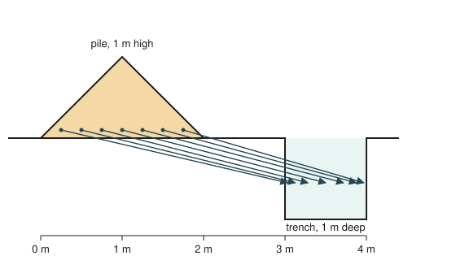
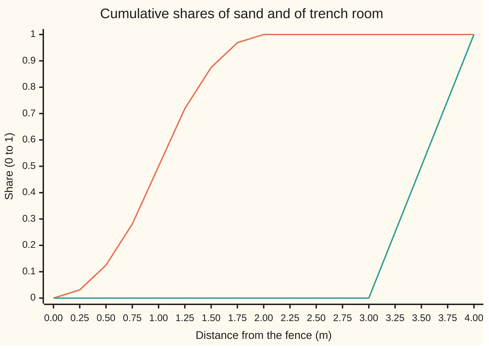

# Optimal transport: moving mass at least cost, and the theory questions behind modern learning

[Syllabus](../../../SYLLABUS.md) → [Frontier](../README.md) → [Physics, Finance and Machines](../README.md#s07) → Optimal transport

---

## General Overview

A builder digs a trench for a garden wall. The trench runs from 3 m to 4 m out from a fence and is 1 m deep. The sand from the dig stands in a pile beside it, from 0 m to 2 m, shaped like a roof and 1 m high at its peak. Pile and trench each hold 1 m³ of sand per metre of wall.

The job is to shovel the pile back into the trench with the least work. Work here means volume times distance carried, in m³·m. Which sand goes where?

Gaspard Monge asked exactly this in 1781, for earthworks: the cut (soil dug out) and the fill (soil put back). His version stayed hard for 160 years. In 1942 Leonid Kantorovich allowed each shovelful to be split between several places. That one change turned the problem into a linear program (a problem with a straight-line cost and straight-line limits), and it became solvable.

For this pile every plan that carries sand only toward the trench costs the same: 2.5 m on average, 2.5 m³·m of work per metre of wall, because each one moves the pile's centre at 1 m to the trench's centre at 3.5 m. So this work has many cheapest plans. The picture shows the in-order plan: sand at the fence end of the pile (0 m) travels 3 m, and sand at the trench end (2 m) travels 2 m. If the cost of a carry grows with the square of its distance, the in-order plan is the only cheapest one. That least average distance, 2.5 m, is called the **Wasserstein distance** between the pile and the trench. It is a way to say how far apart two spreads of anything are: sand, money, or the pictures a machine draws.

Machine learning uses this distance because it measures *how far* mass must move, not just *whether* two shapes differ. The card ends with the other half of its title. It lists what is proved, and what is still open as of 2026-11-23, about why large neural networks learn so well.

**Optimal transport finds the cheapest way to move one spread of mass onto another; allowing mass to split makes it a linear program with prices on the other side, and its least cost, turned into a distance, measures how far apart two distributions are.**

**What kind of fact this is:** Monge's and Kantorovich's problems and the Wasserstein distance are definitions. The line formula, the never-cross rule and the price floor are theorems, proved on this card in Why it works. Existence of a best plan, the full duality theorem, Brenier's theorem and the fact that the Wasserstein distance is a true distance are theorems stated with Villani's book (Sources). Why deep networks generalize is a question, a conjecture by kind, open as of 2026-11-23.

### The picture: where each slice of sand goes

<p align="center"></p>

To scale. Each arrow starts in the pile and ends where the in-order plan puts that sand. It is one of many cheapest plans when work is volume times distance, and the only cheapest plan when the distance is squared. It keeps the order: sand further left lands further left. The pile is thick in the middle, so the middle arrows fan out across the trench.

---

## The formula

Notation first, in words. The pile is a **distribution** $`\mu`$ (read "mu"): it says what share of the sand lies in each stretch of ground. The trench is a distribution $`\nu`$ (read "nu") of room to fill. Both total 1, as shares. A grain sits at $`x`$; a spot in the trench is $`y`$. Carrying one unit from $`x`$ to $`y`$ costs $`c(x, y) = \lvert x - y\rvert^p`$, the distance raised to a power $`p \ge 1`$.

**Monge's problem** asks for a map $`T`$: one destination $`T(x)`$ for every grain. The map must fill the trench exactly, written $`T_\# \mu = \nu`$ (read "T pushes mu onto nu"). Then:

```math
\text{Monge:}\quad \min_{T:\ T_\#\mu = \nu}\ \int \lvert x - T(x)\rvert^p \, d\mu(x)
```

**Kantorovich's problem** asks for a plan $`\gamma`$ (read "gamma", also called a **coupling**): a table of how much sand goes from each $`x`$ to each $`y`$. Its row totals must be the pile and its column totals the trench. All such plans form the set $`\Gamma(\mu, \nu)`$. On this wing $`\pi`$ is taken, so the plan is $`\gamma`$ and the set is a capital gamma.

```math
W_p(\mu, \nu) = \Big(\min_{\gamma \in \Gamma(\mu,\nu)} \iint \lvert x - y\rvert^p \, d\gamma(x, y)\Big)^{1/p}
```

**Read it aloud:** over every plan that empties the pile into the trench, find the least average of distance to the power $`p`$, then take the $`p`$-th root to get back to metres.

On a line, with cumulative shares $`F(x)`$ (sand left of $`x`$) and $`G(y)`$ (room left of $`y`$), the answer has a closed form:

```math
W_p^p = \int_0^1 \big\lvert F^{-1}(u) - G^{-1}(u)\big\rvert^p \, du, \qquad W_1 = \int \lvert F(x) - G(x)\rvert \, dx
```

**Read it aloud:** match the first share $`u`$ of the sand with the first share $`u`$ of the room, in order, and average the distances; for $`p = 1`$ that is the area between the two cumulative curves.

The price side, for $`p = 1`$ (the Kantorovich–Rubinstein theorem):

```math
W_1(\mu, \nu) = \max_{f:\ \lvert f(x) - f(y)\rvert \le \lvert x - y\rvert} \Big(\int f \, d\nu - \int f \, d\mu\Big)
```

**Read it aloud:** put a price on sand at every place, never changing faster than 1 per metre; the most the sand can gain in value on its way to the trench equals the least work.

| Symbol | Plain meaning | In our example | Push it up and the answer… |
| --- | --- | --- | --- |
| $`\mu`$, $`\nu`$ | the pile and the trench, as shares of sand and of room | roof shape on 0 to 2 m; flat on 3 to 4 m | — |
| $`x`$, $`y`$ | a place in the pile; a place in the trench, in metres | 0.5 m; 3.125 m | — |
| $`c(x,y)`$, $`p`$ | cost of carrying one unit; the power on distance | $`\lvert x - y\rvert^p`$; $`p`$ = 1 or 2 | larger $`p`$ punishes long carries more |
| $`T`$, $`T_\#\mu`$ | Monge's map: one destination per grain; what the map delivers | $`T(x) = 3 + F(x)`$ | — |
| $`\gamma`$, $`\Gamma(\mu,\nu)`$ | a plan (coupling); every plan with the right totals | the in-order plan | — |
| $`W_p`$ | the Wasserstein distance of order $`p`$ | $`W_1`$ = 2.5 m, $`W_2`$ = 2.503331 m | rises as the trench moves away |
| $`F`$, $`G`$; $`F^{-1}`$, $`G^{-1}`$, $`u`$ | cumulative shares of sand and of room; the place where share $`u`$ (from 0 to 1) is reached | $`F(1) = 0.5`$, $`G(3.5) = 0.5`$; $`F^{-1}(0.5) = 1`$ m | — |
| $`f`$ | a price per unit of sand at each place | $`f(x) = x`$ | — |
| $`\mathbb E[\cdot]`$, $`X`$, $`Y`$ | an average; a random grain's start and end | $`\mathbb E[X] = 1`$ m, $`\mathbb E[Y] = 3.5`$ m | — |
| $`m`$, $`d`$ | labelled examples; VC dimension | 50,000; 50,000 | larger $`m`$: the bound shrinks; larger $`d`$: more examples needed |
| $`e`$ | Euler's number, the base of natural logarithms | 2.718 | — |
| $`\varepsilon`$, $`\delta`$ | error allowance; allowed chance of failure | 5%; 1% | fewer examples needed |

$`\min`$ and $`\max`$ are the least and greatest value over the choices underneath. $`\int \ldots d\mu`$ is the average over the pile.

### When it holds

- **Equal totals.** The pile must hold exactly the trench's room, 1 m³ each per metre. With 1.2 m³ of sand there is no plan at all; unbalanced versions of the problem exist but are different problems.
- **Cost depends only on distance carried.** The card ignores lifting and slope. A real earthworks cost adds height, and the never-cross rule of Step 1 then needs checking again.
- **A power $`p \ge 1`$.** For $`p < 1`$ the cost is concave (long carries are cheap per metre), and the in-order plan is no longer always best.
- **Finite average distance to the power $`p`$.** A spread with a long thin tail can make $`W_p`$ infinite.
- **A map needs spread-out sand.** A best map exists when the pile has a density: its mass is spread smoothly over intervals, as the roof pile's is (Brenier's theorem in Step 4, for squared distance). On a line it is enough that no single point holds a lump of positive mass; in two or more dimensions it is not. A lump that must fill two holes has no map at all; see What breaks.

---

## Why it works

### Step 0: splitting makes it linear

Monge's map is a hard object: one destination per grain, and the trench must come out exactly full. Kantorovich replaced the map with a table of amounts. The cost is then a sum of amount times cost per unit, and the limits say rows and columns add up to fixed totals. That is a linear program.

For finitely many places, it is the shipping problem of [Network flows](../../15-Optimization/04-Linear%20Programming/06-network-flows-as-linear-programs.md): mills become sand heaps, workshops become trench spots. Every linear program has a partner problem with prices, by [LP duality](../../15-Optimization/04-Linear%20Programming/04-lp-duality-and-complementary-slackness.md). Here the prices become a price for sand at every place.

The continuous problem is the limit of finer and finer tables. Villani's book proves a best plan always exists when costs are continuous and the totals match.

### Step 1: on a line, paths never need to cross

Take two grains at $`a \le b`$ and two trench spots $`s \le t`$. Send $`a`$ to $`s`$ and $`b`$ to $`t`$ (in order), or swap them. For $`p \ge 1`$ the in-order choice never costs more:

```math
\lvert a - s\rvert^p + \lvert b - t\rvert^p \;\le\; \lvert a - t\rvert^p + \lvert b - s\rvert^p
```

So any plan with a swapped pair can be uncrossed without raising the cost, and a best plan keeps the order. For $`p > 1`$ uncrossing strictly lowers the cost, so the in-order plan is the only best one. In order means the first share $`u`$ of the sand fills the first share $`u`$ of the room. That gives $`x = F^{-1}(u)`$ and $`y = G^{-1}(u)`$, the line formula, and Monge's map $`T = G^{-1} \circ F`$. Here $`G^{-1}(u) = 3 + u`$, so $`T(x) = 3 + F(x)`$.

<details>
<summary>Detailed proof: why uncrossing never costs more</summary>

Write the four differences as $`A = a - s`$, $`D = b - t`$, $`B = a - t`$ and $`C = b - s`$.

Since $`s \le t`$ and $`a \le b`$, the smallest is $`B`$ and the largest is $`C`$. Both $`A`$ and $`D`$ lie between them.

The two sums match: $`A + D = B + C = a + b - s - t`$.

The function $`z \mapsto \lvert z\rvert^p`$ is convex for $`p \ge 1`$: its graph bends upward. For a convex function, two points with a fixed sum give the largest total when they are furthest apart. The pair $`B, C`$ is further apart than $`A, D`$, so

$`\displaystyle \lvert A\rvert^p + \lvert D\rvert^p \le \lvert B\rvert^p + \lvert C\rvert^p.`$

That is the inequality above. In a finite plan, each uncrossing step strictly reduces the number of crossed pairs, so finitely many steps reach the in-order plan. The continuous case follows by the limit in Step 0.

</details>

### Step 2: for $`p = 1`$, the area between the curves

For $`p = 1`$ the line formula can be turned sideways. Instead of adding the gaps between $`F^{-1}`$ and $`G^{-1}`$ share by share, add the gaps between $`F`$ and $`G`$ place by place. Both count the same region between the two curves, once horizontally and once vertically.



Orange: $`F`$, the share of sand left of each place. Green: $`G`$, the share of trench room. The area between them is $`W_1`$ = 2.5 m.

### Step 3: prices give a floor under every plan

Suppose sand at place $`x`$ has price $`f(x)`$, and the price never changes faster than 1 per metre. Then carrying a unit from $`x`$ to $`y`$ costs at least its gain in price: $`\lvert x - y\rvert \ge f(y) - f(x)`$. Average over any plan:

```math
\iint \lvert x - y\rvert \, d\gamma \;\ge\; \int f\, d\nu - \int f\, d\mu
```

Take $`f(x) = x`$, the distance from the fence. The right side is the trench's centre minus the pile's centre: 3.5 − 1 = 2.5 m. No plan does better. The in-order plan moves every grain to the right, so its cost is exactly that difference of centres: 2.5 m. Floor and plan meet, so 2.5 m is the least work.

This is [LP duality](../../15-Optimization/04-Linear%20Programming/04-lp-duality-and-complementary-slackness.md) in a new setting. The Kantorovich–Rubinstein theorem says the floor is always reached by some price $`f`$ (stated with Villani's book).

### Step 4: Monge can fail; Kantorovich cannot

A map sends each grain to one place. Put all the sand in one lump at 0 m, with two half-holes at −1 m and +1 m. No map works: every grain goes left, or every grain goes right. Kantorovich's plan sends half each way at cost 1 m.

When the pile has a density and the cost is squared distance, Brenier's theorem (1991, stated with Villani's book) says the best plan is a map after all. In several dimensions that map is the slope (gradient) of a convex function. On a line it is the in-order map $`T`$.

### Step 5: $`W_p`$ is a distance

$`W_p`$ is zero only when the two spreads are equal, and it is the same in both directions. It also obeys the triangle rule: the distance from the pile to a third spread is at most the pile-to-trench distance plus the trench-to-third distance. The triangle rule is proved by gluing a plan from $`\mu`$ to $`\nu`$ onto one from $`\nu`$ onward (Villani's book). So spreads of mass form a space with distances, a second geometry beside the [Fisher metric](../../23-Differential%20geometry%20and%20Lie%20groups/07-Geometric%20Analysis%20and%20Physics/09-information-geometry-and-the-fisher-metric.md). Fisher measures how fast data tell two nearby models apart; Wasserstein measures how far the probability must travel.

### Step 6: why the classical guarantee goes blank for large networks

[Learning with a guarantee](../../24-Computability%20and%20complexity/06-Data%2C%20Learning%20and%20Fine-Grained%20Complexity/04-pac-learning-and-vc-dimension.md) proves that a family of rules learns from enough examples when its VC dimension $`d`$ is finite. The VC dimension is the size of the largest set of examples the family can label in every possible way. The bound is: the chance of a bad fit is at most $`2\,(2em/d)^d\,2^{-\varepsilon m/2}`$, using its counting lemma. Here $`m`$ is the number of labelled examples, $`\varepsilon`$ the error allowed and $`e \approx 2.718`$. For its price caps, $`d = 1`$ and this gives 789 sales, as on that card.

In 2017, Zhang and co-authors (paper revised in 2021, Sources) trained standard image networks on photos whose labels had been replaced by random ones. The networks still fitted every training label. Their paper also proves that a depth-two network fits any labels of its training points "as soon as the number of parameters exceeds the number of data points".

So a network big enough to fit any labels of its 50,000 training photos (illustrative size) can label those photos every possible way: $`d \ge 50{,}000`$. The bound then asks for at least 22,515,208 photos. At 50,000 photos the bound is a number near $`10^{36390}`$, far above 1: it says nothing. Yet the same networks, trained on true labels, do predict well on new photos. Any explanation must use the data or the training method, not the family of rules alone.

### Step 7: what is proved and what is open, as of 2026-11-23

| Question | Kind | Status 2026-11-23 | What the source shows |
| --- | --- | --- | --- |
| Why do networks that can fit random labels predict well on real ones? | conjecture | open | Zhang et al.: family-only bounds such as VC cannot explain it |
| Why does test error fall again past the point where a model fits every training example ("double descent")? | conjecture | open | Belkin et al. 2019: the curve, seen in experiments, joins the classical U-shape and the modern regime; seeing it is evidence, not a theory |
| How does training move a very wide two-layer network? | theorem | proved | Mei, Montanari and Nguyen 2018, under their assumptions: as the width grows, the training path tends to a partial differential equation for the spread of neuron weights, a gradient flow (steepest-downhill motion) in the $`W_2`$ geometry |
| Why does stochastic gradient descent (SGD: small downhill steps on random batches of data) find good networks? | conjecture | open | Mei et al. 2018 ask it: "Does SGD converge to a global optimum of the risk or only to a local optimum?" |

A question asked without a proof is a conjecture by kind, as on [Kinds of claim](../01-How%20Research%20Works/02-theorem-conjecture-model-approximation.md).

These lines go into [The status register](05-the-status-register.md) as rows GEN, DDES, MF and SGD. Here optimal transport is not only a tool for comparing data: it is the geometry in which one proved piece of learning theory, the wide two-layer limit, takes place.

---

## Worked numbers, by hand

Pile: roof shape on 0 to 2 m. Trench: flat on 3 to 4 m. Write $`X`$ for where a random grain starts and $`Y`$ for where it ends.

| Step | Arithmetic | Value |
| --- | --- | --- |
| pile's centre $`\mathbb E[X]`$ | the roof is symmetric about 1 m | 1 m |
| trench's centre $`\mathbb E[Y]`$ | middle of 3 to 4 m | 3.5 m |
| price floor, $`f(x) = x`$ | 3.5 − 1 | 2.5 m |
| in-order plan's cost | every grain moves right, so the difference of centres | 2.5 m |
| **$`W_1`$** | floor equals plan | **2.5 m** |
| Monge map at 0.5 m | $`F(0.5) = 0.5^2/2 = 0.125`$, so $`3 + 0.125`$ | 3.125 m, carried 2.625 m |
| $`\mathbb E[X^2]`$ | $`\int_0^1 x^3\,dx + \int_1^2 x^2(2 - x)\,dx = 1/4 + 11/12`$ | 7/6 |
| $`\mathbb E[Y^2]`$ | $`(4^3 - 3^3)/3`$ | 37/3 |
| $`\mathbb E[X\,F(X)]`$ | $`1/10 + 31/60`$, the two halves of the roof | 37/60 |
| $`\mathbb E[XY]`$, in order | $`3 \times 1 + 37/60`$, since $`Y = 3 + F(X)`$ | 217/60 |
| $`W_2^2`$ | $`7/6 + 37/3 - 2 \times 217/60`$ | 94/15 = 6.266667 m² |
| **$`W_2`$** | $`\sqrt{6.266667}`$ | **2.503331 m** |

$`W_2^2 = 2.5^2 + 1/60`$: the shift of centres costs 6.25 m², and reshaping a roof into a flat layer costs only 1/60 m² more. So the builder's work is almost all distance, and almost none is spreading.

### What breaks if you drop a piece

| Mistake | Comes out at | What went wrong |
| --- | --- | --- |
| Fill the trench's near end with the pile's near sand (reversed plan) | $`W_1`$ still 2.5 m, but $`W_2`$ = 2.594867 m, not 2.503331 | For $`p = 1`$ on a line, every rightward plan ties; for $`p = 2`$ crossed pairs cost more (Step 1) |
| Spread every grain over the whole trench (independent plan) | $`W_2`$ = 2.549510 m | A plan with the right totals, but not the cheapest |
| Compare the two shapes height by height | 1.000000 with the trench at 3 m, and 1.000000 at 100 m | Blind to distance: $`W_1`$ is 2.5 m and 99.5 m |
| Insist on a map when one lump must fill two holes | 0 of 2 maps work | Monge cannot split; Kantorovich sends half each way, cost 1 m |
| Apply the VC bound to a network that fits any labels | at least 22,515,208 photos needed for 50,000 | The bound is about $`10^{36390}`$: true, but empty |

The height comparison is the total variation distance: half the area where the two shapes differ. It hits its maximum, 1, as soon as the shapes stop overlapping, however far apart they are.

---

## Code, from first principles, and it actually runs

The scripts compute the pile-to-trench distance by four independent roads:

1. exact fractions from polynomial integrals;
2. the quantile integral;
3. the area between the cumulative curves;
4. brute force over all 720 one-to-one plans for six equal barrow loads.

They also check Monge's map, every row of What breaks, the price floor (summed over the two densities, against the plan's cost) and the VC bound, which reproduces the 789 sales of the PAC card. No solver or library holds the answer: the integrals, the fractions in Rust and the search are written out.

### Python

```python
# Optimal transport check: a sand pile moved into a trench, W1 and W2 by four roads,
# Monge's problem failing on a split, and the VC bound for a network that fits any labels.
# Standard library only: the integrals, the brute force and the bound are written out.
import math
from fractions import Fraction as Fr
from itertools import permutations

# Pile: triangle cross-section on [0, 2] m, peak 1 m high at x = 1. Trench: [3, 4] m, 1 m deep.
# Each holds 1 m^2 of cross-section, so 1 m^3 of sand per metre of trench. Shares sum to 1.
def F(x):  # share of the pile's sand to the left of x
    if x <= 0: return 0.0
    if x <= 1: return x * x / 2
    if x <= 2: return 1 - (2 - x) * (2 - x) / 2
    return 1.0
def G(y): return min(1.0, max(0.0, y - 3))  # share of the trench's room to the left of y
def Finv(u): return math.sqrt(2 * u) if u <= 0.5 else 2 - math.sqrt(2 * (1 - u))
def Ginv(u): return 3 + u
def pile(x): return 1 - abs(x - 1) if 0 <= x <= 2 else 0.0  # the roof's height in m: its density
N = 200000
us = [(k + 0.5) / N for k in range(N)]

# ---- road 1: exact fractions. Integrate polynomials piece by piece.
def integ(c, a, b):  # integral of sum c[k] x^k from a to b
    return sum(ck * (Fr(b) ** (k + 1) - Fr(a) ** (k + 1)) / (k + 1) for k, ck in enumerate(c))
h = Fr(1, 2)
mX = integ([0, 0, 1], 0, 1) + integ([0, 2, -1], 1, 2)                  # E[X] = 1
mX2 = integ([0, 0, 0, 1], 0, 1) + integ([0, 0, 2, -1], 1, 2)           # E[X^2] = 7/6
mXF = integ([0, 0, 0, 0, h], 0, 1) + integ([0, 2, -1, -1, h], 0, 1)    # E[X F(X)], by w = 2 - x
mY, mY2 = Fr(7, 2), Fr(37, 3)                                           # trench: uniform on [3, 4]
w1x = mY - mX                                                           # every grain moves right
w2x = mX2 + mY2 - 2 * (3 * mX + mXF)                                    # monotone plan: Y = 3 + F(X)
anti = mX2 + mY2 - 2 * (4 * mX - mXF)                                   # reversed plan: Y = 4 - F(X)
indep = mX2 + mY2 - 2 * mX * mY                                         # independent plan
print(f"exact: E[X] = {mX}, E[X^2] = {mX2}, E[X F(X)] = {mXF}, trench E[Y] = {mY}, E[Y^2] = {mY2}")
print(f"exact pieces: E[X^2] = {integ([0, 0, 0, 1], 0, 1)} + {integ([0, 0, 2, -1], 1, 2)},"
      f" E[X F(X)] = {integ([0, 0, 0, 0, h], 0, 1)} + {integ([0, 2, -1, -1, h], 0, 1)}")
print(f"exact: E[XY] in the monotone plan = 3 E[X] + E[X F(X)] = {3 * mX + mXF}")
print(f"exact: W1 = {w1x} m, W2^2 = {w2x} m^2 = (5/2)^2 + {w2x - w1x ** 2}")
assert mX == 1 and mX2 == Fr(7, 6) and w1x == Fr(5, 2) and w2x == Fr(94, 15)

# ---- road 2: quantile integral, matching equal shares of sand and room in order
q1 = sum(abs(Finv(u) - Ginv(u)) for u in us) / N
q2 = sum((Finv(u) - Ginv(u)) ** 2 for u in us) / N
qa = sum((Finv(u) - Ginv(1 - u)) ** 2 for u in us) / N
print(f"quantile road: W1 = {q1:.6f} m, W2^2 = {q2:.6f} m^2, W2 = {math.sqrt(q2):.6f} m")
assert abs(q1 - float(w1x)) < 1e-6 and abs(q2 - float(w2x)) < 1e-6 and abs(qa - float(anti)) < 1e-6

# ---- road 3: area between the two cumulative curves, x from 0 to 4 m
M = 400000
cdf = sum(abs(F(4 * (k + 0.5) / M) - G(4 * (k + 0.5) / M)) for k in range(M)) * 4 / M
print(f"area road: W1 = {cdf:.6f} m")
assert abs(cdf - float(w1x)) < 1e-6

# ---- the dual price f(x) = x: value of the trench's sand minus the pile's, a floor under every plan
K = 4000  # midpoint sums over the two densities, not the moments of road 1
floor = sum(3 + (k + 0.5) / K for k in range(K)) / K - sum(2 * (k + 0.5) / K * pile(2 * (k + 0.5) / K) for k in range(K)) * 2 / K
print(f"dual road: price f(x) = x gives floor {floor:.6f} m; the monotone plan costs {q1:.6f} m")
assert abs(floor - q1) < 1e-6

# ---- road 4: brute force over every plan for 6 equal barrow loads (720 one-to-one plans)
n = 6
xs = [Finv((k + 0.5) / n) for k in range(n)]
ys = [Ginv((k + 0.5) / n) for k in range(n)]
c1 = [sum(abs(xs[i] - ys[s[i]]) for i in range(n)) / n for s in permutations(range(n))]
c2 = [sum((xs[i] - ys[s[i]]) ** 2 for i in range(n)) / n for s in permutations(range(n))]
best = min(c2); arg = [s for s, c in zip(permutations(range(n)), c2) if c - best < 1e-12]
ties = sum(1 for c in c1 if abs(c - min(c1)) < 1e-12)
print("loads at x =", " ".join(f"{x:.4f}" for x in xs), "m")
print(f"brute force, {len(c1)} plans: W1 cost {min(c1):.6f} m, tied by {ties} plans; worst {max(c1):.6f}")
print(f"brute force: best W2^2 {best:.6f}, {len(arg)} best plan(s), in order: {arg[0] == tuple(range(n))}; reversed {c2[-1]:.6f}")
assert ties == 720 and len(arg) == 1 and arg[0] == tuple(range(n)) and abs(min(c1) - 2.5) < 1e-12
assert c2.index(max(c2)) == len(c2) - 1  # the last plan, (5, 4, 3, 2, 1, 0), fully reversed, is the worst
for n2 in (60, 600):
    d2 = sum((Finv((k + 0.5) / n2) - Ginv((k + 0.5) / n2)) ** 2 for k in range(n2)) / n2
    print(f"{n2} loads in order: W2^2 {d2:.6f}")

# ---- Monge's map T(x) = G^-1(F(x)) = 3 + F(x), and where each slice of sand goes
for x in (0.0, 0.5, 1.0, 1.5, 2.0):
    print(f"Monge map: sand at {x:.2f} m goes to {3 + F(x):.4f} m, carried {3 + F(x) - x:.4f} m")
fig = [(x, 3 + F(x)) for x in (0.25, 0.5, 0.75, 1.0, 1.25, 1.5, 1.75)]
print("figure, arrows", " ".join(f"{a:.2f}>{b:.4f}" for a, b in fig))

# ---- what breaks
print(f"reversed plan (near sand to near end): W1 {float(w1x):.6f}, W2 {math.sqrt(anti):.6f} (exact W2^2 {anti})")
print(f"independent plan (each grain spread over the trench): W2 {math.sqrt(indep):.6f} (exact W2^2 {indep})")
dbl = sum((x - y) ** 2 * pile(x) for x in (2 * (i + 0.5) / 1000 for i in range(1000)) for y in (3 + (j + 0.5) / 500 for j in range(500)))
assert abs(dbl * (2 / 1000) * (1 / 500) - float(indep)) < 1e-5  # double integral over the densities
mass = integ([0, 1], 0, 1) + integ([2, -1], 1, 2)  # the pile's area, exact: 1
for far in (3, 100):  # height-by-height comparison: the shares that do not overlap
    tv = sum(abs(pile(x) - (1 if far <= x <= far + 1 else 0))
             for x in (k * 0.001 + 0.0005 for k in range((far + 2) * 1000))) * 0.001 / 2
    print(f"trench at {far} m: height difference {tv:.6f}, W1 {far + 0.5 - 1:.6f} m")
    assert abs(tv - float(mass + 1) / 2) < 1e-9  # no overlap, so half of (pile's mass + trench's mass)
src, dst = [(0.0, 1.0)], [(-1.0, 0.5), (1.0, 0.5)]  # one heap, two half-holes
maps_ok = sum(1 for t in range(2) if all(abs(m - (1.0 if j == t else 0.0)) < 1e-12 for j, (_, m) in enumerate(dst)))
split = sum(m * abs(y - src[0][0]) for y, m in dst)
print(f"split: maps that fill both holes {maps_ok} of 2; Kantorovich plan half each, cost {split:.6f} m")
assert abs(math.sqrt(anti) - math.sqrt(qa)) < 1e-6

# ---- the VC bound from the PAC card: smallest m with 2 (2em/d)^d 2^(-eps m/2) <= delta
EPS, DELTA = 0.05, 0.01
def log2_bound(m, d): return 1 + d * math.log2(2 * math.e * m / d) - EPS * m / 2
def vc_m(d):
    lo = max(math.ceil(8 / EPS), d); hi = lo
    while log2_bound(hi, d) > math.log2(DELTA): hi *= 2
    while lo < hi:
        mid = (lo + hi) // 2
        if log2_bound(mid, d) > math.log2(DELTA): lo = mid + 1
        else: hi = mid
    return lo
m1, mbig = vc_m(1), vc_m(50000)
print(f"VC bound, d = 1 (PAC card's caps): {m1} sales")
print(f"VC bound, d = 50000 (network fitting any labels of 50000 photos): {mbig} photos")
print(f"bound at m = 50000, d = 50000: log10 = {log2_bound(50000, 50000) * math.log10(2):.1f}")
assert m1 == 789 and mbig > 400 * 50000 and log2_bound(50000, 50000) > 0

# ---- try changing: a far trench, the power p = 3, a smaller network
far1 = sum(abs(Finv(u) - Ginv(u) - 7) for u in us) / N
far2 = sum((Finv(u) - Ginv(u) - 7) * (Finv(u) - Ginv(u) - 7) for u in us) / N
w3 = sum(abs(Finv(u) - Ginv(u)) * (Finv(u) - Ginv(u)) * (Finv(u) - Ginv(u)) for u in us) / N
print(f"try: trench at [10, 11] m: W1 {far1:.6f} m, W2 {math.sqrt(far2):.6f} m; p = 3: W3 {w3 ** (1 / 3):.6f} m")
print(f"try: VC bound, d = 1000: {vc_m(1000)} photos")
assert abs(far2 - (9.5 ** 2 + 1 / 60)) < 1e-6

# ---- chart: the two cumulative curves, x = 0 to 4 m in 0.25 m steps
print("chart, x", " ".join(f"{k / 4:.2f}" for k in range(17)))
print("chart, F", " ".join(f"{F(k / 4):.3f}" for k in range(17)))
print("chart, G", " ".join(f"{G(k / 4):.3f}" for k in range(17)))
print("ALL CHECKS PASS")
```

**Ran 2026-11-23 on macOS, Python 3.14.10, standard library only. All checks passed. Output, pasted from the run:**

```
exact: E[X] = 1, E[X^2] = 7/6, E[X F(X)] = 37/60, trench E[Y] = 7/2, E[Y^2] = 37/3
exact pieces: E[X^2] = 1/4 + 11/12, E[X F(X)] = 1/10 + 31/60
exact: E[XY] in the monotone plan = 3 E[X] + E[X F(X)] = 217/60
exact: W1 = 5/2 m, W2^2 = 94/15 m^2 = (5/2)^2 + 1/60
quantile road: W1 = 2.500000 m, W2^2 = 6.266667 m^2, W2 = 2.503331 m
area road: W1 = 2.500000 m
dual road: price f(x) = x gives floor 2.500000 m; the monotone plan costs 2.500000 m
loads at x = 0.4082 0.7071 0.9129 1.0871 1.2929 1.5918 m
brute force, 720 plans: W1 cost 2.500000 m, tied by 720 plans; worst 2.500000
brute force: best W2^2 6.260836, 1 best plan(s), in order: True; reversed 6.696899
60 loads in order: W2^2 6.266362
600 loads in order: W2^2 6.266656
Monge map: sand at 0.00 m goes to 3.0000 m, carried 3.0000 m
Monge map: sand at 0.50 m goes to 3.1250 m, carried 2.6250 m
Monge map: sand at 1.00 m goes to 3.5000 m, carried 2.5000 m
Monge map: sand at 1.50 m goes to 3.8750 m, carried 2.3750 m
Monge map: sand at 2.00 m goes to 4.0000 m, carried 2.0000 m
figure, arrows 0.25>3.0312 0.50>3.1250 0.75>3.2812 1.00>3.5000 1.25>3.7188 1.50>3.8750 1.75>3.9688
reversed plan (near sand to near end): W1 2.500000, W2 2.594867 (exact W2^2 101/15)
independent plan (each grain spread over the trench): W2 2.549510 (exact W2^2 13/2)
trench at 3 m: height difference 1.000000, W1 2.500000 m
trench at 100 m: height difference 1.000000, W1 99.500000 m
split: maps that fill both holes 0 of 2; Kantorovich plan half each, cost 1.000000 m
VC bound, d = 1 (PAC card's caps): 789 sales
VC bound, d = 50000 (network fitting any labels of 50000 photos): 22515208 photos
bound at m = 50000, d = 50000: log10 = 36390.2
try: trench at [10, 11] m: W1 9.500000 m, W2 9.500877 m; p = 3: W3 2.506649 m
try: VC bound, d = 1000: 450648 photos
chart, x 0.00 0.25 0.50 0.75 1.00 1.25 1.50 1.75 2.00 2.25 2.50 2.75 3.00 3.25 3.50 3.75 4.00
chart, F 0.000 0.031 0.125 0.281 0.500 0.719 0.875 0.969 1.000 1.000 1.000 1.000 1.000 1.000 1.000 1.000 1.000
chart, G 0.000 0.000 0.000 0.000 0.000 0.000 0.000 0.000 0.000 0.000 0.000 0.000 0.000 0.250 0.500 0.750 1.000
ALL CHECKS PASS
```

### Rust

```rust
// Optimal transport check: a sand pile moved into a trench, W1 and W2 by four roads,
// Monge's problem failing on a split, and the VC bound for a network that fits any labels.
// std only: the fractions, the integrals, the brute force and the bound are written out.

#[derive(Clone, Copy, PartialEq)]
struct Fr { n: i128, d: i128 }
fn gcd(a: i128, b: i128) -> i128 { if b == 0 { a.abs() } else { gcd(b, a % b) } }
fn fr(n: i128, d: i128) -> Fr { let g = gcd(n, d) * if d < 0 { -1 } else { 1 }; Fr { n: n / g, d: d / g } }
impl std::ops::Add for Fr { type Output = Fr; fn add(self, o: Fr) -> Fr { fr(self.n * o.d + o.n * self.d, self.d * o.d) } }
impl std::ops::Sub for Fr { type Output = Fr; fn sub(self, o: Fr) -> Fr { fr(self.n * o.d - o.n * self.d, self.d * o.d) } }
impl std::ops::Mul for Fr { type Output = Fr; fn mul(self, o: Fr) -> Fr { fr(self.n * o.n, self.d * o.d) } }
impl std::fmt::Display for Fr {
    fn fmt(&self, f: &mut std::fmt::Formatter) -> std::fmt::Result {
        if self.d == 1 { write!(f, "{}", self.n) } else { write!(f, "{}/{}", self.n, self.d) }
    }
}
fn fl(a: Fr) -> f64 { a.n as f64 / a.d as f64 }
fn int(k: i128) -> Fr { fr(k, 1) }
fn pw(b: Fr, k: usize) -> Fr { let mut r = int(1); for _ in 0..k { r = r * b; } r }
fn integ(c: &[Fr], a: i128, b: i128) -> Fr { // integral of sum c[k] x^k from a to b
    let mut s = int(0);
    for (k, ck) in c.iter().enumerate() { s = s + *ck * (pw(int(b), k + 1) - pw(int(a), k + 1)) * fr(1, k as i128 + 1); }
    s
}

// Pile: triangle cross-section on [0, 2] m, peak 1 m high at x = 1. Trench: [3, 4] m, 1 m deep.
fn f_cdf(x: f64) -> f64 {
    if x <= 0.0 { 0.0 } else if x <= 1.0 { x * x / 2.0 } else if x <= 2.0 { 1.0 - (2.0 - x) * (2.0 - x) / 2.0 } else { 1.0 }
}
fn g_cdf(y: f64) -> f64 { (y - 3.0).max(0.0).min(1.0) }
fn finv(u: f64) -> f64 { if u <= 0.5 { (2.0 * u).sqrt() } else { 2.0 - (2.0 * (1.0 - u)).sqrt() } }
fn ginv(u: f64) -> f64 { 3.0 + u }
fn pile(x: f64) -> f64 { if 0.0 <= x && x <= 2.0 { 1.0 - (x - 1.0).abs() } else { 0.0 } } // the roof's height in m: its density

fn perms(n: usize) -> Vec<Vec<usize>> { // lexicographic order, as Python's itertools
    if n == 0 { return vec![vec![]]; }
    let mut out = vec![];
    fn rec(rest: &mut Vec<usize>, cur: &mut Vec<usize>, out: &mut Vec<Vec<usize>>) {
        if rest.is_empty() { out.push(cur.clone()); return; }
        for i in 0..rest.len() { let v = rest.remove(i); cur.push(v); rec(rest, cur, out); cur.pop(); rest.insert(i, v); }
    }
    rec(&mut (0..n).collect(), &mut vec![], &mut out);
    out
}

const EPS: f64 = 0.05;
const DELTA: f64 = 0.01;
fn log2_bound(m: u64, d: u64) -> f64 { 1.0 + d as f64 * (2.0 * std::f64::consts::E * m as f64 / d as f64).log2() - EPS * m as f64 / 2.0 }
fn vc_m(d: u64) -> u64 {
    let mut lo = ((8.0 / EPS) as f64).ceil().max(d as f64) as u64; let mut hi = lo;
    while log2_bound(hi, d) > DELTA.log2() { hi *= 2; }
    while lo < hi { let mid = (lo + hi) / 2; if log2_bound(mid, d) > DELTA.log2() { lo = mid + 1; } else { hi = mid; } }
    lo
}
fn join(v: &[String]) -> String { v.join(" ") }

fn main() {
    let n_big = 200000usize;
    let us: Vec<f64> = (0..n_big).map(|k| (k as f64 + 0.5) / n_big as f64).collect();
    // ---- road 1: exact fractions
    let (z, h) = (int(0), fr(1, 2));
    let mx = integ(&[z, z, int(1)], 0, 1) + integ(&[z, int(2), int(-1)], 1, 2);
    let mx2 = integ(&[z, z, z, int(1)], 0, 1) + integ(&[z, z, int(2), int(-1)], 1, 2);
    let mxf = integ(&[z, z, z, z, h], 0, 1) + integ(&[z, int(2), int(-1), int(-1), h], 0, 1);
    let (my, my2) = (fr(7, 2), fr(37, 3));
    let w1x = my - mx;
    let w2x = mx2 + my2 - int(2) * (int(3) * mx + mxf);
    let anti = mx2 + my2 - int(2) * (int(4) * mx - mxf);
    let indep = mx2 + my2 - int(2) * mx * my;
    println!("exact: E[X] = {}, E[X^2] = {}, E[X F(X)] = {}, trench E[Y] = {}, E[Y^2] = {}", mx, mx2, mxf, my, my2);
    println!("exact pieces: E[X^2] = {} + {}, E[X F(X)] = {} + {}", integ(&[z, z, z, int(1)], 0, 1),
             integ(&[z, z, int(2), int(-1)], 1, 2), integ(&[z, z, z, z, h], 0, 1), integ(&[z, int(2), int(-1), int(-1), h], 0, 1));
    println!("exact: E[XY] in the monotone plan = 3 E[X] + E[X F(X)] = {}", int(3) * mx + mxf);
    println!("exact: W1 = {} m, W2^2 = {} m^2 = (5/2)^2 + {}", w1x, w2x, w2x - w1x * w1x);
    assert!(mx == int(1) && mx2 == fr(7, 6) && w1x == fr(5, 2) && w2x == fr(94, 15));
    // ---- road 2: quantile integral
    let nf = n_big as f64;
    let q1 = us.iter().fold(0.0, |s, &u| s + (finv(u) - ginv(u)).abs()) / nf;
    let q2 = us.iter().fold(0.0, |s, &u| { let e = finv(u) - ginv(u); s + e * e }) / nf;
    let qa = us.iter().fold(0.0, |s, &u| { let e = finv(u) - ginv(1.0 - u); s + e * e }) / nf;
    println!("quantile road: W1 = {:.6} m, W2^2 = {:.6} m^2, W2 = {:.6} m", q1, q2, q2.sqrt());
    assert!((q1 - fl(w1x)).abs() < 1e-6 && (q2 - fl(w2x)).abs() < 1e-6 && (qa - fl(anti)).abs() < 1e-6);
    // ---- road 3: area between the cumulative curves
    let mm = 400000usize;
    let mut cdf = 0.0;
    for k in 0..mm { let x = 4.0 * (k as f64 + 0.5) / mm as f64; cdf += (f_cdf(x) - g_cdf(x)).abs(); }
    cdf = cdf * 4.0 / mm as f64;
    println!("area road: W1 = {:.6} m", cdf);
    assert!((cdf - fl(w1x)).abs() < 1e-6);
    let kk = 4000usize; // midpoint sums over the two densities, not the moments of road 1
    let floor = (0..kk).fold(0.0, |s, k| s + 3.0 + (k as f64 + 0.5) / kk as f64) / kk as f64
        - (0..kk).fold(0.0, |s, k| { let x = 2.0 * (k as f64 + 0.5) / kk as f64; s + x * pile(x) }) * 2.0 / kk as f64;
    println!("dual road: price f(x) = x gives floor {:.6} m; the monotone plan costs {:.6} m", floor, q1);
    assert!((floor - q1).abs() < 1e-6);
    // ---- road 4: brute force over 720 plans
    let n = 6usize;
    let xs: Vec<f64> = (0..n).map(|k| finv((k as f64 + 0.5) / n as f64)).collect();
    let ys: Vec<f64> = (0..n).map(|k| ginv((k as f64 + 0.5) / n as f64)).collect();
    let ps = perms(n);
    let c1: Vec<f64> = ps.iter().map(|s| (0..n).fold(0.0, |a, i| a + (xs[i] - ys[s[i]]).abs()) / n as f64).collect();
    let c2: Vec<f64> = ps.iter().map(|s| (0..n).fold(0.0, |a, i| { let e = xs[i] - ys[s[i]]; a + e * e }) / n as f64).collect();
    let best = c2.iter().cloned().fold(f64::INFINITY, f64::min);
    let (min1, max1) = (c1.iter().cloned().fold(f64::INFINITY, f64::min), c1.iter().cloned().fold(f64::NEG_INFINITY, f64::max));
    let arg: Vec<&Vec<usize>> = ps.iter().zip(c2.iter()).filter(|(_, &c)| c - best < 1e-12).map(|(s, _)| s).collect();
    let ties = c1.iter().filter(|&&c| (c - min1).abs() < 1e-12).count();
    let in_order = *arg[0] == (0..n).collect::<Vec<usize>>();
    println!("loads at x = {} m", join(&xs.iter().map(|x| format!("{:.4}", x)).collect::<Vec<_>>()));
    println!("brute force, {} plans: W1 cost {:.6} m, tied by {} plans; worst {:.6}", c1.len(), min1, ties, max1);
    println!("brute force: best W2^2 {:.6}, {} best plan(s), in order: {}; reversed {:.6}", best, arg.len(),
             if in_order { "True" } else { "False" }, c2[c2.len() - 1]);
    assert!(ties == 720 && arg.len() == 1 && in_order && (min1 - 2.5).abs() < 1e-12);
    let worst = (0..c2.len()).fold(0, |b, i| if c2[i] > c2[b] { i } else { b });
    assert!(worst == c2.len() - 1); // the last plan, (5, 4, 3, 2, 1, 0), fully reversed, is the worst
    for n2 in [60usize, 600] {
        let d2 = (0..n2).fold(0.0, |a, k| { let u = (k as f64 + 0.5) / n2 as f64; let e = finv(u) - ginv(u); a + e * e }) / n2 as f64;
        println!("{} loads in order: W2^2 {:.6}", n2, d2);
    }
    // ---- Monge's map T(x) = 3 + F(x)
    for x in [0.0, 0.5, 1.0, 1.5, 2.0] {
        println!("Monge map: sand at {:.2} m goes to {:.4} m, carried {:.4} m", x, 3.0 + f_cdf(x), 3.0 + f_cdf(x) - x);
    }
    let fig: Vec<String> = [0.25, 0.5, 0.75, 1.0, 1.25, 1.5, 1.75].iter().map(|&a| format!("{:.2}>{:.4}", a, 3.0 + f_cdf(a))).collect();
    println!("figure, arrows {}", join(&fig));
    // ---- what breaks
    println!("reversed plan (near sand to near end): W1 {:.6}, W2 {:.6} (exact W2^2 {})", fl(w1x), fl(anti).sqrt(), anti);
    println!("independent plan (each grain spread over the trench): W2 {:.6} (exact W2^2 {})", fl(indep).sqrt(), indep);
    let mut dbl = 0.0;
    for i in 0..1000 { let x = 2.0 * (i as f64 + 0.5) / 1000.0; for j in 0..500 { let y = 3.0 + (j as f64 + 0.5) / 500.0; dbl += (x - y) * (x - y) * pile(x); } }
    assert!((dbl * (2.0 / 1000.0) * (1.0 / 500.0) - fl(indep)).abs() < 1e-5); // double integral over the densities
    let mass = integ(&[z, int(1)], 0, 1) + integ(&[int(2), int(-1)], 1, 2); // the pile's area, exact: 1
    for far in [3i64, 100] {
        let mut tv = 0.0;
        for k in 0..((far + 2) * 1000) {
            let x = k as f64 * 0.001 + 0.0005;
            let hole = if far as f64 <= x && x <= far as f64 + 1.0 { 1.0 } else { 0.0 };
            tv += (pile(x) - hole).abs();
        }
        tv = tv * 0.001 / 2.0;
        println!("trench at {} m: height difference {:.6}, W1 {:.6} m", far, tv, far as f64 + 0.5 - 1.0);
        assert!((tv - fl(mass + int(1)) / 2.0).abs() < 1e-9); // no overlap, so half of (pile's mass + trench's mass)
    }
    let dst = [(-1.0f64, 0.5f64), (1.0, 0.5)];
    let maps_ok = (0..2).filter(|&t| dst.iter().enumerate().all(|(j, &(_, m))| (m - if j == t { 1.0 } else { 0.0 }).abs() < 1e-12)).count();
    let split = dst.iter().fold(0.0, |a, &(y, m)| a + m * (y - 0.0f64).abs());
    println!("split: maps that fill both holes {} of 2; Kantorovich plan half each, cost {:.6} m", maps_ok, split);
    assert!((fl(anti).sqrt() - qa.sqrt()).abs() < 1e-6);
    // ---- the VC bound from the PAC card
    let (m1, mbig) = (vc_m(1), vc_m(50000));
    println!("VC bound, d = 1 (PAC card's caps): {} sales", m1);
    println!("VC bound, d = 50000 (network fitting any labels of 50000 photos): {} photos", mbig);
    println!("bound at m = 50000, d = 50000: log10 = {:.1}", log2_bound(50000, 50000) * 2f64.log10());
    assert!(m1 == 789 && mbig > 400 * 50000 && log2_bound(50000, 50000) > 0.0);
    // ---- try changing: a far trench, the power p = 3, a smaller network
    let far1 = us.iter().fold(0.0, |s, &u| s + (finv(u) - ginv(u) - 7.0).abs()) / nf;
    let far2 = us.iter().fold(0.0, |s, &u| { let e = finv(u) - ginv(u) - 7.0; s + e * e }) / nf;
    let w3 = us.iter().fold(0.0, |s, &u| { let e = finv(u) - ginv(u); s + e.abs() * e * e }) / nf;
    println!("try: trench at [10, 11] m: W1 {:.6} m, W2 {:.6} m; p = 3: W3 {:.6} m", far1, far2.sqrt(), w3.powf(1.0 / 3.0));
    println!("try: VC bound, d = 1000: {} photos", vc_m(1000));
    assert!((far2 - (9.5 * 9.5 + 1.0 / 60.0)).abs() < 1e-6);
    // ---- chart
    let row = |g: &dyn Fn(f64) -> f64| join(&(0..17).map(|k| format!("{:.3}", g(k as f64 / 4.0))).collect::<Vec<_>>());
    println!("chart, x {}", join(&(0..17).map(|k| format!("{:.2}", k as f64 / 4.0)).collect::<Vec<_>>()));
    println!("chart, F {}", row(&f_cdf));
    println!("chart, G {}", row(&g_cdf));
    println!("ALL CHECKS PASS");
}
```

**Ran 2026-11-23 on macOS, rustc 1.98.1, no crates. All checks passed. Output, pasted from the run:**

```
exact: E[X] = 1, E[X^2] = 7/6, E[X F(X)] = 37/60, trench E[Y] = 7/2, E[Y^2] = 37/3
exact pieces: E[X^2] = 1/4 + 11/12, E[X F(X)] = 1/10 + 31/60
exact: E[XY] in the monotone plan = 3 E[X] + E[X F(X)] = 217/60
exact: W1 = 5/2 m, W2^2 = 94/15 m^2 = (5/2)^2 + 1/60
quantile road: W1 = 2.500000 m, W2^2 = 6.266667 m^2, W2 = 2.503331 m
area road: W1 = 2.500000 m
dual road: price f(x) = x gives floor 2.500000 m; the monotone plan costs 2.500000 m
loads at x = 0.4082 0.7071 0.9129 1.0871 1.2929 1.5918 m
brute force, 720 plans: W1 cost 2.500000 m, tied by 720 plans; worst 2.500000
brute force: best W2^2 6.260836, 1 best plan(s), in order: True; reversed 6.696899
60 loads in order: W2^2 6.266362
600 loads in order: W2^2 6.266656
Monge map: sand at 0.00 m goes to 3.0000 m, carried 3.0000 m
Monge map: sand at 0.50 m goes to 3.1250 m, carried 2.6250 m
Monge map: sand at 1.00 m goes to 3.5000 m, carried 2.5000 m
Monge map: sand at 1.50 m goes to 3.8750 m, carried 2.3750 m
Monge map: sand at 2.00 m goes to 4.0000 m, carried 2.0000 m
figure, arrows 0.25>3.0312 0.50>3.1250 0.75>3.2812 1.00>3.5000 1.25>3.7188 1.50>3.8750 1.75>3.9688
reversed plan (near sand to near end): W1 2.500000, W2 2.594867 (exact W2^2 101/15)
independent plan (each grain spread over the trench): W2 2.549510 (exact W2^2 13/2)
trench at 3 m: height difference 1.000000, W1 2.500000 m
trench at 100 m: height difference 1.000000, W1 99.500000 m
split: maps that fill both holes 0 of 2; Kantorovich plan half each, cost 1.000000 m
VC bound, d = 1 (PAC card's caps): 789 sales
VC bound, d = 50000 (network fitting any labels of 50000 photos): 22515208 photos
bound at m = 50000, d = 50000: log10 = 36390.2
try: trench at [10, 11] m: W1 9.500000 m, W2 9.500877 m; p = 3: W3 2.506649 m
try: VC bound, d = 1000: 450648 photos
chart, x 0.00 0.25 0.50 0.75 1.00 1.25 1.50 1.75 2.00 2.25 2.50 2.75 3.00 3.25 3.50 3.75 4.00
chart, F 0.000 0.031 0.125 0.281 0.500 0.719 0.875 0.969 1.000 1.000 1.000 1.000 1.000 1.000 1.000 1.000 1.000
chart, G 0.000 0.000 0.000 0.000 0.000 0.000 0.000 0.000 0.000 0.000 0.000 0.000 0.000 0.250 0.500 0.750 1.000
ALL CHECKS PASS
```

The six loads sit at the middle of each sixth of the sand, not spread through it, so their best $`W_2^2`$ is 6.260836. With 60 and 600 loads the in-order cost climbs to 6.266362 and 6.266656, toward the exact 6.266667.

### Lean

Lean proves the rules of Steps 1 and 3 in general, Step 4's lump case, and the worked arithmetic.

- Take grains at $`a \le b`$, trench spots $`s \le t`$ and a power $`p \ge 1`$. Then sending $`a`$ to $`s`$ and $`b`$ to $`t`$ never costs more than the swap.
- Take a plan $`\gamma`$, a pile and trench with finite centres, and a price $`f`$ changing at most 1 per metre. Then the plan's work is at least the trench's average price minus the pile's.
- Take one lump at 0 m and two half-holes at −1 m and +1 m. Then no map fills both holes, but a plan sending half each way does, at cost 1 m.
- The worked fractions add up, such as 7/6 + 37/3 − 2 × 217/60 = 94/15, as in the table.

The integrals behind 2.5 m and 2.503331 m, the 720-plan brute force and the VC bound are left to the Python and Rust checks.

```lean
-- Optimal transport: on a line the in-order pairing never costs more for any power p ≥ 1, prices give a floor under every plan, and a lump that must fill two holes has a plan but no map.
import Mathlib.Analysis.SpecialFunctions.Pow.Real
import Mathlib.Analysis.Convex.SpecificFunctions.Basic
import Mathlib.MeasureTheory.Integral.Bochner.Basic
import Mathlib.MeasureTheory.Measure.Dirac
import Mathlib.Topology.EMetricSpace.Lipschitz

open MeasureTheory
open scoped ENNReal

lemma abs_rpow_convex_comb (p : ℝ) (hp : 1 ≤ p) (x y l : ℝ) (hl0 : 0 ≤ l) (hl1 : l ≤ 1) :
    |l * x + (1 - l) * y| ^ p ≤ l * |x| ^ p + (1 - l) * |y| ^ p := by
  have h1 : |l * x + (1 - l) * y| ≤ l * |x| + (1 - l) * |y| := by
    calc |l * x + (1 - l) * y| ≤ |l * x| + |(1 - l) * y| := abs_add_le _ _
      _ = l * |x| + (1 - l) * |y| := by
        rw [abs_mul, abs_mul, abs_of_nonneg hl0, abs_of_nonneg (by linarith : (0:ℝ) ≤ 1 - l)]
  have h2 := (convexOn_rpow hp).2 (Set.mem_Ici.2 (abs_nonneg x)) (Set.mem_Ici.2 (abs_nonneg y))
    hl0 (by linarith : (0:ℝ) ≤ 1 - l) (by ring)
  simp only [smul_eq_mul] at h2
  calc |l * x + (1 - l) * y| ^ p ≤ (l * |x| + (1 - l) * |y|) ^ p :=
        Real.rpow_le_rpow (abs_nonneg _) h1 (by linarith)
    _ ≤ _ := h2

#print axioms abs_rpow_convex_comb

/-- The never-cross rule: for a power `p ≥ 1`, two grains at `a ≤ b` and two trench spots `s ≤ t`,
sending the grains in order (`a` to `s`, `b` to `t`) never costs more than the swapped pairing,
when carrying one unit a distance `d` costs `d ^ p`. -/
theorem in_order_pairing_never_costs_more (p : ℝ) (hp : 1 ≤ p) (a b s t : ℝ)
    (hab : a ≤ b) (hst : s ≤ t) :
    |a - s| ^ p + |b - t| ^ p ≤ |a - t| ^ p + |b - s| ^ p := by
  rcases eq_or_lt_of_le (show a - t ≤ b - s by linarith) with h | h
  · have e1 : a - s = a - t := by linarith
    have e2 : b - t = a - t := by linarith
    have e3 : b - s = a - t := by linarith
    rw [e1, e2, e3]
  · set x := a - t
    set y := b - s
    have hd : 0 < y - x := by linarith
    set l := (y - (a - s)) / (y - x) with hl
    have hl0 : 0 ≤ l := div_nonneg (by simp only [y]; linarith) hd.le
    have hl1 : l ≤ 1 := by
      rw [div_le_one hd]; simp only [x]; linarith
    have hu : a - s = l * x + (1 - l) * y := by
      simp only [hl]; field_simp; ring
    have hv : b - t = (1 - l) * x + (1 - (1 - l)) * y := by
      simp only [hl]; field_simp; simp only [x, y]; ring
    have k1 := abs_rpow_convex_comb p hp x y l hl0 hl1
    have k2 := abs_rpow_convex_comb p hp x y (1 - l) (by linarith) (by linarith)
    rw [hu, hv]
    nlinarith [k1, k2]

/-- Prices give a floor under every plan: if the pile `μ` and the trench `ν` have equal totals
(both are probability distributions on the line) with finite average distance from the origin,
`γ` is any plan (coupling) whose row totals are `μ` and column totals are `ν`, and the price `f`
never changes faster than 1 per metre, then the plan's work is at least the gain in price,
`∫ f dν - ∫ f dμ ≤ ∫ |x - y| dγ`. -/
theorem price_floor_under_every_plan (μ ν : Measure ℝ) [IsProbabilityMeasure μ]
    [IsProbabilityMeasure ν] (hμ : Integrable (fun x => |x|) μ) (hν : Integrable (fun y => |y|) ν)
    (γ : Measure (ℝ × ℝ)) (hγμ : γ.map Prod.fst = μ) (hγν : γ.map Prod.snd = ν)
    (f : ℝ → ℝ) (hf : LipschitzWith 1 f) :
    ∫ y, f y ∂ν - ∫ x, f x ∂μ ≤ ∫ z, |z.1 - z.2| ∂γ := by
  have hfc : Continuous f := hf.continuous
  have hfm : Measurable f := hfc.measurable
  have hbound : ∀ x, |f x| ≤ |f 0| + |x| := by
    intro x
    have := hf.dist_le_mul x 0
    simp only [NNReal.coe_one, one_mul, Real.dist_eq, sub_zero] at this
    calc |f x| = |(f x - f 0) + f 0| := by ring_nf
      _ ≤ |f x - f 0| + |f 0| := abs_add_le _ _
      _ ≤ |x| + |f 0| := by linarith
      _ = |f 0| + |x| := by ring
  have hfint : ∀ (m : Measure ℝ) [IsProbabilityMeasure m], Integrable (fun x => |x|) m →
      Integrable f m := by
    intro m _ hm
    refine Integrable.mono' ((integrable_const |f 0|).add hm) hfc.aestronglyMeasurable ?_
    exact Filter.Eventually.of_forall (fun x => by simpa [Real.norm_eq_abs] using hbound x)
  have hfμ := hfint μ hμ
  have hfν := hfint ν hν
  have h1 : Integrable (fun z : ℝ × ℝ => f z.1) γ := by
    rw [← hγμ] at hfμ
    exact hfμ.comp_measurable measurable_fst
  have h2 : Integrable (fun z : ℝ × ℝ => f z.2) γ := by
    rw [← hγν] at hfν
    exact hfν.comp_measurable measurable_snd
  have a1 : Integrable (fun z : ℝ × ℝ => |z.1|) γ := by
    rw [← hγμ] at hμ
    exact hμ.comp_measurable measurable_fst
  have a2 : Integrable (fun z : ℝ × ℝ => |z.2|) γ := by
    rw [← hγν] at hν
    exact hν.comp_measurable measurable_snd
  have hd : Integrable (fun z : ℝ × ℝ => |z.1 - z.2|) γ := by
    refine Integrable.mono' (a1.add a2) ?_ ?_
    · exact (continuous_abs.comp (continuous_fst.sub continuous_snd)).aestronglyMeasurable
    · exact Filter.Eventually.of_forall (fun z => by
        simp only [Real.norm_eq_abs, abs_abs]
        exact abs_sub _ _)
  have eν : ∫ y, f y ∂ν = ∫ z, f z.2 ∂γ := by
    rw [← hγν, integral_map measurable_snd.aemeasurable hfc.aestronglyMeasurable]
  have eμ : ∫ x, f x ∂μ = ∫ z, f z.1 ∂γ := by
    rw [← hγμ, integral_map measurable_fst.aemeasurable hfc.aestronglyMeasurable]
  rw [eν, eμ, ← integral_sub h2 h1]
  refine integral_mono (h2.sub h1) hd (fun z => ?_)
  have := hf.dist_le_mul z.2 z.1
  simp only [NNReal.coe_one, one_mul, Real.dist_eq] at this
  calc f z.2 - f z.1 ≤ |f z.2 - f z.1| := le_abs_self _
    _ ≤ |z.2 - z.1| := this
    _ = |z.1 - z.2| := abs_sub_comm _ _

/-- Monge can fail, Kantorovich cannot: with all the sand in one lump at 0 m and two half-holes at
-1 m and +1 m, no map pushes the lump onto the holes, but a plan with the right totals exists
that sends half each way at average distance 1 m. -/
theorem lump_into_two_holes_plan_but_no_map :
    (¬ ∃ T : ℝ → ℝ, Measurable T ∧
        (Measure.dirac (0 : ℝ)).map T =
          (1 / 2 : ℝ≥0∞) • Measure.dirac (-1 : ℝ) + (1 / 2 : ℝ≥0∞) • Measure.dirac (1 : ℝ)) ∧
    ∃ γ : Measure (ℝ × ℝ),
      γ.map Prod.fst = Measure.dirac (0 : ℝ) ∧
      γ.map Prod.snd =
        (1 / 2 : ℝ≥0∞) • Measure.dirac (-1 : ℝ) + (1 / 2 : ℝ≥0∞) • Measure.dirac (1 : ℝ) ∧
      ∫ z, |z.1 - z.2| ∂γ = 1 := by
  refine ⟨?_, ?_⟩
  · rintro ⟨T, hT, hmap⟩
    rw [Measure.map_dirac' hT] at hmap
    have h := congrArg (fun m : Measure ℝ => m {1}) hmap
    simp only [Measure.add_apply, Measure.smul_apply, smul_eq_mul] at h
    rw [Measure.dirac_apply' _ (measurableSet_singleton _),
      Measure.dirac_apply' _ (measurableSet_singleton _),
      Measure.dirac_apply' _ (measurableSet_singleton _)] at h
    have hne : (-1 : ℝ) ∉ ({1} : Set ℝ) := by norm_num
    rw [Set.indicator_of_notMem hne, Set.indicator_of_mem (Set.mem_singleton _)] at h
    simp only [Pi.one_apply, mul_zero, mul_one, zero_add] at h
    by_cases hT0 : T 0 ∈ ({1} : Set ℝ)
    · rw [Set.indicator_of_mem hT0] at h
      simp only [Pi.one_apply] at h
      norm_num at h
      exact ne_of_gt (ENNReal.inv_lt_one.2 (by norm_num)) h
    · rw [Set.indicator_of_notMem hT0] at h
      norm_num at h
      exact (ENNReal.inv_ne_zero.2 ENNReal.ofNat_ne_top) h.symm
  · refine ⟨(1 / 2 : ℝ≥0∞) • Measure.dirac ((0 : ℝ), (-1 : ℝ)) +
      (1 / 2 : ℝ≥0∞) • Measure.dirac ((0 : ℝ), (1 : ℝ)), ?_, ?_, ?_⟩
    · rw [Measure.map_add _ _ measurable_fst, Measure.map_smul, Measure.map_smul,
        Measure.map_dirac' measurable_fst, Measure.map_dirac' measurable_fst, ← add_smul,
        ENNReal.add_halves, one_smul]
      all_goals exact measurable_fst.aemeasurable
    · rw [Measure.map_add _ _ measurable_snd, Measure.map_smul, Measure.map_smul,
        Measure.map_dirac' measurable_snd, Measure.map_dirac' measurable_snd]
      all_goals exact measurable_snd.aemeasurable
    · rw [integral_add_measure, integral_smul_measure, integral_smul_measure,
        integral_dirac, integral_dirac]
      · norm_num
      · exact (integrable_dirac (by simp)).smul_measure (by simp)
      · exact (integrable_dirac (by simp)).smul_measure (by simp)

-- Worked numbers, by hand (exact fractions, in metres).
-- Price floor with f(x) = x: trench centre 7/2 minus pile centre 1.
example : (7 / 2 : ℚ) - 1 = 5 / 2 := by norm_num
-- E[X^2] = 1/4 + 11/12 = 7/6 and E[Y^2] = (4^3 - 3^3)/3 = 37/3.
example : (1 / 4 : ℚ) + 11 / 12 = 7 / 6 := by norm_num
example : ((4 : ℚ) ^ 3 - 3 ^ 3) / 3 = 37 / 3 := by norm_num
-- E[X F(X)] = 1/10 + 31/60 = 37/60, and E[XY] in order = 3 × 1 + 37/60 = 217/60.
example : (1 / 10 : ℚ) + 31 / 60 = 37 / 60 := by norm_num
example : (3 : ℚ) * 1 + 37 / 60 = 217 / 60 := by norm_num
-- W2^2 = 7/6 + 37/3 - 2 × 217/60 = 94/15 = (5/2)^2 + 1/60.
example : (7 / 6 : ℚ) + 37 / 3 - 2 * (217 / 60) = 94 / 15 := by norm_num
example : (94 / 15 : ℚ) = (5 / 2) ^ 2 + 1 / 60 := by norm_num
-- Monge map at 0.5 m: F(1/2) = (1/2)^2 / 2 = 1/8, so the sand lands at 3 + 1/8 and is carried 21/8.
example : ((1 / 2 : ℚ) ^ 2 / 2 = 1 / 8) ∧ (3 + 1 / 8 - 1 / 2 : ℚ) = 21 / 8 := by norm_num
-- Brute force over 6 loads: 6! = 720 plans.
example : Nat.factorial 6 = 720 := by decide

#print axioms in_order_pairing_never_costs_more
#print axioms price_floor_under_every_plan
#print axioms lump_into_two_holes_plan_but_no_map
```

**Checked 2026-11-23 on macOS, Lean 4.36.0-rc2, Mathlib v4.36.0-rc2. Every proof is complete and uses only Lean's standard axioms. Output, pasted from the run:**

```
'abs_rpow_convex_comb' depends on axioms: [propext, Classical.choice, Quot.sound]
'in_order_pairing_never_costs_more' depends on axioms: [propext, Classical.choice, Quot.sound]
'price_floor_under_every_plan' depends on axioms: [propext, Classical.choice, Quot.sound]
'lump_into_two_holes_plan_but_no_map' depends on axioms: [propext, Classical.choice, Quot.sound]
```

> [!TIP]
> **Try changing**
> - Guess first: move the trench to 10 m to 11 m. In the code each gap grows by 7 m (the `far1` and `far2` lines). $`W_1`$ becomes 9.5 m and $`W_2`$ 9.500877 m: the shape term, 1/60 m², does not depend on distance.
> - Guess first: use $`p = 3`$. $`W_3`$ = 2.506649 m, a little above $`W_2`$: higher powers weigh the 3 m carries more.
> - Guess first: a network that can fit any labels of only 1,000 photos. The line `vc_m(1000)` gives it: the VC bound asks for at least 450,648 photos.
> - Guess first: six loads, reversed. Brute force prints $`W_2^2`$ = 6.696899 for the fully reversed plan, the worst of the 720.

---

## The usual mistake

> [!warning]
> **Comparing two distributions height by height instead of by transport.** Height-by-height measures, such as total variation, say only whether two shapes overlap. The pile and a trench 3 m away score 1.000000; a trench 100 m away also scores 1.000000. $`W_1`$ says 2.5 m and 99.5 m. When a model's pictures start far from the real ones, a transport distance still tells the training which way to move.
>
> Smaller traps:
> - **Reading the tie as "any plan is best".** For $`p = 1`$, all 720 rightward plans cost 2.5 m here. For $`p = 2`$ only the in-order plan is best, and the reversed one costs $`W_2`$ = 2.594867 m.
> - **Forgetting the root.** $`W_2^2`$ = 6.266667 m² is not a distance in metres; $`W_2`$ = 2.503331 m is.
> - **Assuming a map always exists.** A lump of sand that must fill two holes has 0 working maps; the plan must split.
> - **Reading an empty bound as a bad prediction.** The VC bound of about $`10^{36390}`$ says nothing, not that the network will fail. It is an upper bound that stopped being useful.

---

## Where you meet it in real life

- **Earthworks.** Road and rail builders plan cut and fill so that soil travels as little as possible: Monge's 1781 problem.
- **Picture-making networks.** The Wasserstein GAN (generative adversarial network: one network draws, a second judges; Arjovsky, Chintala and Bottou, 2017) trains a second network to play the price $`f`$ of Step 3. The price side of $`W_1`$ is its training signal.
- **Shipping.** With finitely many depots and shops, optimal transport is the shipping problem of [Network flows](../../15-Optimization/04-Linear%20Programming/06-network-flows-as-linear-programs.md).
- **Shapes in data.** [Persistence diagram and stability](../../17-Topology/06-Topological%20Data%20Analysis/04-persistence-diagrams-and-stability.md) compares two diagrams by $`W_p`$ over matchings of their points.
- **Training theory.** A very wide two-layer network trains along a gradient flow in the $`W_2`$ geometry (Mei, Montanari and Nguyen, 2018).

> **Say it back**
> Optimal transport asks for the cheapest way to move one spread of mass onto another. Monge wanted one destination per grain; Kantorovich let mass split, which makes the problem a linear program with prices on the other side. The least cost, rooted, is the Wasserstein distance: 2.5 m from this pile to this trench, and on a line it comes from matching shares in order. Unlike a height-by-height comparison, it grows with how far mass must travel. In learning theory, classical bounds go blank for networks that can fit any labels, and why such networks still predict well is open as of 2026-11-23.

---

## What this builds on

- [LP duality](../../15-Optimization/04-Linear%20Programming/04-lp-duality-and-complementary-slackness.md): every linear program has a price partner with the same value. Step 3's floor is that partner for sand.
- [Fisher metric](../../23-Differential%20geometry%20and%20Lie%20groups/07-Geometric%20Analysis%20and%20Physics/09-information-geometry-and-the-fisher-metric.md): the first geometry on probability models. Wasserstein is the second, built from distance travelled.
- [Network flows](../../15-Optimization/04-Linear%20Programming/06-network-flows-as-linear-programs.md): the shipping problem, which is Kantorovich's problem with finitely many places.
- [Learning with a guarantee](../../24-Computability%20and%20complexity/06-Data%2C%20Learning%20and%20Fine-Grained%20Complexity/04-pac-learning-and-vc-dimension.md): the VC bound that Step 6 applies, and finds empty, for large networks.
- [The assignment problem](../../14-Applied%20and%20computational/05-Operations%20Research/05-assignment-and-the-hungarian-algorithm.md): the finite, equal-mass case, solved by the Hungarian method; road 4 of the code is its brute-force version.

## Where this goes next

- [The status register](05-the-status-register.md): records Step 7's four lines as rows GEN, DDES, MF and SGD, and Brenier's theorem as row OT, with their dates and sources.
- [Machines that prove](02-ai-and-mathematics-2026.md): another place where learning machines meet open mathematics, and how to audit what they claim.
- [Open questions in finance mathematics](03-rough-volatility-and-open-finance-questions.md): a third shelf topic where a model's proved part and its evidence are kept apart.
- [Quantum advantage](01-quantum-supremacy-and-bqp.md): the shelf's physics card, with the same status discipline.

The question this card leaves open: what property of real data and of gradient training makes a network that could memorise random labels predict well instead?

---

## Sources

Verified 2026-11-23: every link below resolves to the publisher's page.

- Villani, Cédric. *Optimal Transport: Old and New*. Springer, Grundlehren der mathematischen Wissenschaften 338, 2009. [doi:10.1007/978-3-540-71050-9](https://doi.org/10.1007/978-3-540-71050-9). The general theory: Monge and Kantorovich, existence, duality, Brenier's theorem, $`W_p`$ as a distance, and the history from 1781.
- Zhang, Chiyuan, Samy Bengio, Moritz Hardt, Benjamin Recht, and Oriol Vinyals. "Understanding Deep Learning (Still) Requires Rethinking Generalization." *Communications of the ACM* 64, no. 3 (2021): 107–115. [doi:10.1145/3446776](https://doi.org/10.1145/3446776). Networks fit random labels; depth-two networks fit any labels once parameters exceed data points.
- Belkin, Mikhail, Daniel Hsu, Siyuan Ma, and Soumik Mandal. "Reconciling Modern Machine-Learning Practice and the Classical Bias–Variance Trade-Off." *Proceedings of the National Academy of Sciences* 116, no. 32 (2019): 15849–15854. [doi:10.1073/pnas.1903070116](https://doi.org/10.1073/pnas.1903070116). The double-descent curve.
- Mei, Song, Andrea Montanari, and Phan-Minh Nguyen. "A Mean Field View of the Landscape of Two-Layer Neural Networks." *Proceedings of the National Academy of Sciences* 115, no. 33 (2018): E7665–E7671. [doi:10.1073/pnas.1806579115](https://doi.org/10.1073/pnas.1806579115). The wide-network training limit as a partial differential equation.
- Arjovsky, Martin, Soumith Chintala, and Léon Bottou. "Wasserstein Generative Adversarial Networks." *Proceedings of the 34th International Conference on Machine Learning*, PMLR 70 (2017): 214–223. [Publisher page](https://proceedings.mlr.press/v70/arjovsky17a.html). $`W_1`$'s price side as a training signal.
