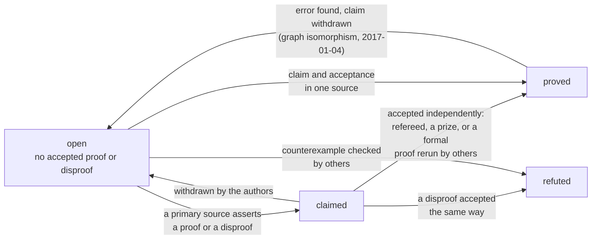
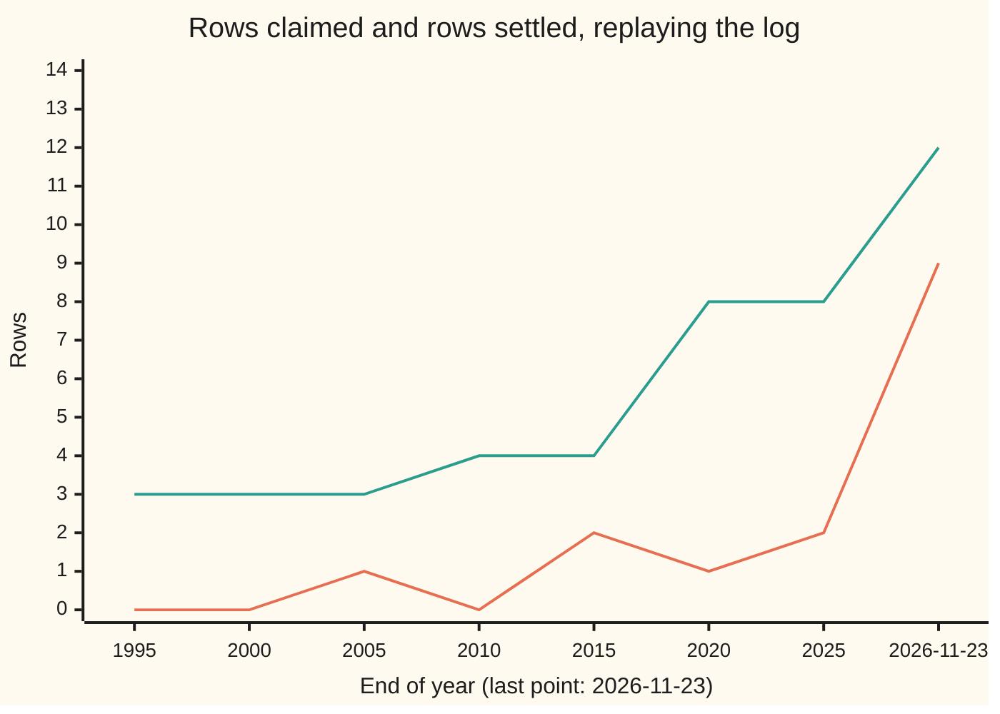

# The status register: every problem in this wing, its status, its date, and its source

[Syllabus](../../../SYLLABUS.md) → [Frontier](../README.md) → [Physics, Finance and Machines](../README.md#s07) → The status register

---

## General Overview

On 2026-11-20 Levent Alpöge released a proof of the Riemann hypothesis as a Lean library of about 17 million lines. Lean is a proof assistant: a program that checks every step of a proof. On 2026-11-21 the people who maintain Lean and its mathematics library, Mathlib, published a joint statement. It certifies that the proof checks and that its statement is exactly Mathlib's statement of the hypothesis. On 2026-11-23 the Clay Mathematics Institute, which offers $1 million for it, still files the problem under "Active problems".

So what is the status of the Riemann hypothesis today? A one-word answer misleads. "Proved" hides that no refereed paper exists. "Open" hides a certified formal proof. This card keeps one table, the **register**, that answers such questions the same way for every problem in this wing. Each row holds the problem, its kind, its status in one of four fixed words, the date the status was set, the date someone last checked, and the primary source. A primary source is the paper, formal proof or official page that makes the claim, never a news story.

Next to the table sits the **correction log**: a dated list of every status change, oldest first. Graph isomorphism shows why it matters. A fast algorithm, already in a refereed conference paper, was withdrawn by its author on 2017-01-04 and restored on 2017-01-09. A register without a log would hide those five days, and hide that even a proved row can fall back to open.

**The register is a dated table in which a fixed rule turns each row's primary source into one of four status words, and every change is written into a log, so the table can be rebuilt from the log and checked against the evidence at any time.**

**What kind of fact this is:** a definition and a record. The rule and the recheck periods are this library's conventions, not theorems. The rows are dated observations of the literature. The checks prove only that the rule, the rows and the log agree, plus a slice of small cases.

### The picture: how a status moves



Every arrow is one line in the correction log, with a date and a source.

### The register as of 2026-11-23

The four status words come from [Kinds of claim](../01-How%20Research%20Works/02-theorem-conjecture-model-approximation.md):

- **open:** no accepted proof or disproof.
- **claimed:** a primary source asserts a proof or disproof that is not yet accepted.
- **proved:** refereed, or accepted in a source independent of the authors.
- **refuted:** a counterexample or disproof is accepted the same way.

"Since" is the date of the source that set the status, at that source's precision. Every source below was opened on 2026-11-23. A write-up by others that says it checked the proof counts as independent acceptance; an exposition that only explains the proof, or a new proof by others that is not refereed, is evidence and leaves the row claimed (Step 1). The problem cards draw the same line. Where an AI lab made a claim first (CDC, SOFIC, Z23, PERC, NS), the row names that artifact and its date and links the write-ups by others that cite it, as the problem cards do.

Which problems get a row: each problem card's problem, with one row per sub-case the card separates (KAK3 and KAKN, JAC3 and JAC2, IGP and M23). Survey cards add the problems they follow: Landau's four give LEG and NSQ, and the Erdős problems give DIST beside UNIT and ER. Hilbert's and Smale's lists keep their marks on their own card. On this shelf each card names the rows it sends (BQP; ROUGH; OT with its learning-theory lines GEN, DDES, MF and SGD); its other dated lines, such as an experiment's run, stay on that card.

| Row | Problem | Kind | Status | Since | Checked | Primary source |
| --- | --- | --- | --- | --- | --- | --- |
| RH | [The Riemann hypothesis](../02-The%20Millennium%20Problems/01-riemann-hypothesis.md) | conjecture | proved | 2026-11-21 | 2026-11-23 | [Lean community statement](https://leanprover-community.github.io/blog/posts/riemann-hypothesis/); [verification files](https://math.mit.edu/~drew/grh/). Clay's word: "Active" |
| BSD | [Birch and Swinnerton-Dyer](../02-The%20Millennium%20Problems/02-birch-and-swinnerton-dyer.md) | conjecture | open | — | 2026-11-23 | [Clay problem list](https://www.claymath.org/millennium-problems/) |
| PNP | [P versus NP](../02-The%20Millennium%20Problems/03-p-versus-np.md) | conjecture | open | — | 2026-11-23 | [Clay problem list](https://www.claymath.org/millennium-problems/) |
| NS | [Navier-Stokes](../02-The%20Millennium%20Problems/04-navier-stokes-existence-and-smoothness.md): blow-up claimed for versions C and D ([The September 2026 Navier-Stokes claim](../05-Analysis%20and%20Dynamics/01-navier-stokes-blow-up-claim-2026.md)) | conjecture | claimed | 2026-09-08 | 2026-11-23 | an AI lab's manuscript of 2026-09-08, read through the exposition [arXiv:2609.35406](https://arxiv.org/abs/2609.35406); not refereed. Clay's word: "Active" |
| HODGE | [The Hodge conjecture](../02-The%20Millennium%20Problems/05-hodge-conjecture.md) | conjecture | open | — | 2026-11-23 | [Clay problem list](https://www.claymath.org/millennium-problems/) |
| YM | [Yang-Mills existence and mass gap](../02-The%20Millennium%20Problems/06-yang-mills-and-the-mass-gap.md) | conjecture | open | — | 2026-11-23 | [Clay problem list](https://www.claymath.org/millennium-problems/) |
| POINC | [The Poincare conjecture, solved](../02-The%20Millennium%20Problems/07-poincare-conjecture-solved.md) | conjecture | proved | 2006-07-25 | 2026-11-23 | full check by others, [arXiv:math/0607607](https://arxiv.org/abs/math/0607607); [Clay prize, 2010-03-18](https://www.claymath.org/millennium/poincare-conjecture/) |
| TWIN | [Twin primes](../03-Primes%20and%20Numbers/01-twin-primes-and-bounded-gaps.md) | conjecture | open | — | 2026-11-23 | gap 246 proved: [doi:10.1186/s40687-014-0012-7](https://doi.org/10.1186/s40687-014-0012-7) |
| GOLD | [Goldbach](../03-Primes%20and%20Numbers/02-goldbach-conjecture.md) | conjecture | open | — | 2026-11-23 | checked to 4 × 10^18: [doi:10.1090/S0025-5718-2013-02787-1](https://doi.org/10.1090/S0025-5718-2013-02787-1) |
| LEG | Legendre: a prime between consecutive squares ([Landau's four problems](../03-Primes%20and%20Numbers/03-landau-problems.md)) | conjecture | open | — | 2026-11-23 | best interval proved: [doi:10.1112/plms/83.3.532](https://doi.org/10.1112/plms/83.3.532) |
| NSQ | infinitely many primes of the form n² + 1 ([Landau's four problems](../03-Primes%20and%20Numbers/03-landau-problems.md)) | conjecture | open | — | 2026-11-23 | two prime factors at most, proved: [doi:10.1007/bf01578070](https://doi.org/10.1007/bf01578070) |
| ABC | [The abc conjecture](../03-Primes%20and%20Numbers/04-abc-conjecture.md) | conjecture | claimed | 2012-08 | 2026-11-23 | [RIMS preprints 1756 to 1759](https://www.kurims.kyoto-u.ac.jp/preprint/preprint_y2012.html), published 2021: [doi:10.4171/PRIMS/57-1-1](https://doi.org/10.4171/PRIMS/57-1-1); disputed: [Scholze and Stix, 2018](https://www.math.uni-bonn.de/people/scholze/WhyABCisStillaConjecture.pdf) |
| BEAL | [Beal's conjecture](../03-Primes%20and%20Numbers/05-beal-conjecture.md) | conjecture | open | — | 2026-11-23 | [AMS prize page](https://www.ams.org/profession/prizes-awards/ams-supported/beal-prize) |
| FLT | [Fermat's last theorem, proved in 1995 and reported formalised in 2026](../03-Primes%20and%20Numbers/06-fermats-last-theorem-formalised.md) | conjecture | proved | 1995-05 | 2026-11-23 | [doi:10.2307/2118559](https://doi.org/10.2307/2118559); claimed in lectures of 1993-06, [doi:10.1090/S0273-0979-1994-00512-9](https://doi.org/10.1090/S0273-0979-1994-00512-9). The 2026 Lean proof: compiled independently, [2026-09-04](https://wp.me/p9bxpM-10G) |
| DIST | Distinct distances ([Erdos problems](../03-Primes%20and%20Numbers/07-erdos-problems-selected.md)): n points make at least about n/sqrt(log n) distances | conjecture | open | — | 2026-11-23 | at least c n/log n, proved: [doi:10.4007/annals.2015.181.1.2](https://doi.org/10.4007/annals.2015.181.1.2) |
| UNIT | [The unit-distance problem](../04-Geometry%20and%20Combinatorics/01-unit-distance-problem.md): unit distances among many points grow barely faster than the number of points | conjecture | refuted | 2026-05-20 | 2026-11-23 | [arXiv:2605.20695](https://arxiv.org/abs/2605.20695): a write-up checked by nine mathematicians outside the announcement |
| KAK3 | [Kakeya](../04-Geometry%20and%20Combinatorics/02-kakeya-and-restriction.md) in three dimensions | conjecture | proved | 2026-07-23 | 2026-11-23 | [Fields Medal 2026 citation](https://www.mathunion.org/imu-awards/fields-medal/fields-medals-2026) |
| KAKN | [Kakeya](../04-Geometry%20and%20Combinatorics/02-kakeya-and-restriction.md) in four or more dimensions | conjecture | open | — | 2026-11-23 | [arXiv:2502.17655](https://arxiv.org/abs/2502.17655) proves three only |
| HN | [Colouring the plane](../04-Geometry%20and%20Combinatorics/03-hadwiger-nelson-chromatic-number-of-the-plane.md): the exact number, 5, 6 or 7 | conjecture | open | — | 2026-11-23 | at least 5: [arXiv:1804.02385](https://arxiv.org/abs/1804.02385) |
| CDC | [Cycle double cover](../04-Geometry%20and%20Combinatorics/04-cycle-double-cover-conjecture.md) | conjecture | claimed | 2026-07-10 | 2026-11-23 | an AI lab's note "A proof of the cycle double cover conjecture", file dated 2026-07-10, listed as reference 22 of the exposition [arXiv:2607.16356](https://arxiv.org/abs/2607.16356); exposition [arXiv:2607.15399](https://arxiv.org/abs/2607.15399); a separate claim, [arXiv:2607.14140](https://arxiv.org/abs/2607.14140), 2026-07-13; not refereed |
| ER | Erdős–Rado sunflowers ([Sunflowers and union-closed families](../04-Geometry%20and%20Combinatorics/05-sunflower-and-union-closed-conjectures.md)) | conjecture | open | — | 2026-11-23 | best bound: [doi:10.4007/annals.2021.194.3.5](https://doi.org/10.4007/annals.2021.194.3.5) |
| ES | Erdős–Szemerédi sunflowers ([Sunflowers and union-closed families](../04-Geometry%20and%20Combinatorics/05-sunflower-and-union-closed-conjectures.md)) | conjecture | claimed | 2026-10-19 | 2026-11-23 | [arXiv:2610.26686](https://arxiv.org/abs/2610.26686); not refereed |
| UC | union-closed families ([Sunflowers and union-closed families](../04-Geometry%20and%20Combinatorics/05-sunflower-and-union-closed-conjectures.md)) | conjecture | open | — | 2026-11-23 | constant fraction: [arXiv:2211.09055](https://arxiv.org/abs/2211.09055) |
| SP8 | [Sphere packing, solved in dimensions 8 and 24](../04-Geometry%20and%20Combinatorics/06-sphere-packing-and-viazovska.md): dimension 8 | conjecture | proved | 2017-05-01 | 2026-11-23 | [doi:10.4007/annals.2017.185.3.7](https://doi.org/10.4007/annals.2017.185.3.7) |
| SP24 | [Sphere packing, solved in dimensions 8 and 24](../04-Geometry%20and%20Combinatorics/06-sphere-packing-and-viazovska.md): dimension 24 | conjecture | proved | 2017-05-01 | 2026-11-23 | [doi:10.4007/annals.2017.185.3.8](https://doi.org/10.4007/annals.2017.185.3.8) |
| COLL | [Collatz](../05-Analysis%20and%20Dynamics/02-collatz-conjecture.md) | conjecture | open | — | 2026-11-23 | almost all orbits: [doi:10.1017/fmp.2022.8](https://doi.org/10.1017/fmp.2022.8) |
| Z23 | [The August 2026 zeta-zeros claim](../05-Analysis%20and%20Dynamics/03-zeta-zero-proportion-2026.md): more than 67.25% of zeros are simple and on the line, proved without the Riemann hypothesis | theorem | claimed | 2026-08-10 | 2026-11-23 | the manuscript, dated 2026-08-10 and posted as [arXiv:2608.13637](https://arxiv.org/abs/2608.13637) on 2026-08-13, with Lean files reported; second proof [arXiv:2609.02882](https://arxiv.org/abs/2609.02882); not refereed |
| JAC3 | [The Jacobian conjecture](../05-Analysis%20and%20Dynamics/04-jacobian-conjecture.md), three or more variables | conjecture | refuted | 2026-07-20 | 2026-11-23 | [Isabelle formal check](https://isa-afp.org/entries/Jacobian_Counterexample.html) by others; its three points with one image rechecked exactly by the code below |
| JAC2 | [The Jacobian conjecture](../05-Analysis%20and%20Dynamics/04-jacobian-conjecture.md), two variables | conjecture | open | — | 2026-11-23 | the same entry makes no claim here |
| SOFIC | [Two algebra questions](../05-Analysis%20and%20Dynamics/05-sofic-groups-and-kothe.md): every group is sofic | conjecture | claimed (no) | 2026-08-01 | 2026-11-23 | an AI lab's announcement of 2026-08-01, dated by [arXiv:2608.02025](https://arxiv.org/abs/2608.02025); follow-up [arXiv:2608.06222](https://arxiv.org/abs/2608.06222); not refereed |
| KOTHE | [Two algebra questions](../05-Analysis%20and%20Dynamics/05-sofic-groups-and-kothe.md): Köthe | conjecture | claimed (no) | 2026-09-07 | 2026-11-23 | [arXiv:2609.07996](https://arxiv.org/abs/2609.07996); not refereed |
| PERC | [Percolation](../05-Analysis%20and%20Dynamics/06-dying-percolation-and-critical-phenomena.md): none at the threshold, dimensions 3 to 10 | conjecture | claimed | 2026-08-28 | 2026-11-23 | a Lean proof with a 15-page summary, posted by an AI lab on 2026-08-28 (repository formal-math, commit 795efb86); notes by others [arXiv:2610.10502](https://arxiv.org/abs/2610.10502), [arXiv:2610.30063](https://arxiv.org/abs/2610.30063); not refereed |
| IGP | [The inverse Galois problem](../06-Algebra%2C%20Logic%20and%20Computation/01-inverse-galois-problem.md) | conjecture | open | — | 2026-11-23 | [doi:10.1007/978-3-662-55420-3](https://doi.org/10.1007/978-3-662-55420-3) |
| M23 | [The inverse Galois problem](../06-Algebra%2C%20Logic%20and%20Computation/01-inverse-galois-problem.md) for the Mathieu group M23 | conjecture | claimed | 2026-08-09 | 2026-11-23 | [arXiv:2608.08538](https://arxiv.org/abs/2608.08538); not refereed |
| CH | [The continuum hypothesis](../06-Algebra%2C%20Logic%20and%20Computation/02-continuum-hypothesis-and-independence.md): independent of ZFC | theorem | proved | 1963-12 | 2026-11-23 | Gödel, [doi:10.1073/pnas.24.12.556](https://doi.org/10.1073/pnas.24.12.556), and Cohen, [doi:10.1073/pnas.50.6.1143](https://doi.org/10.1073/pnas.50.6.1143) |
| UGC | [The unique games conjecture](../06-Algebra%2C%20Logic%20and%20Computation/03-unique-games-conjecture.md) | conjecture | open | — | 2026-11-23 | the 2-to-2 case proved: [doi:10.4007/annals.2023.198.1.1](https://doi.org/10.4007/annals.2023.198.1.1) |
| GI | [Graph isomorphism](../06-Algebra%2C%20Logic%20and%20Computation/04-graph-isomorphism.md) in quasipolynomial time | theorem | proved | 2017-01-16 | 2026-11-23 | [arXiv:1512.03547](https://arxiv.org/abs/1512.03547); independent check [arXiv:1701.04372](https://arxiv.org/abs/1701.04372) |
| BQP | [Quantum advantage](01-quantum-supremacy-and-bqp.md): BPP differs from BQP | conjecture | open | — | 2026-11-23 | [doi:10.1137/S0097539796300921](https://doi.org/10.1137/S0097539796300921) |
| ROUGH | [Open questions in finance mathematics](03-rough-volatility-and-open-finance-questions.md): volatility is rough | model | open | — | 2026-11-23 | for: [doi:10.1080/14697688.2017.1393551](https://doi.org/10.1080/14697688.2017.1393551); against: [doi:10.1007/s13571-024-00322-2](https://doi.org/10.1007/s13571-024-00322-2) |
| OT | [Optimal transport](04-optimal-transport-and-machine-learning-theory.md): if the starting distribution has a density, the best plan for squared distance is a map | theorem | proved | 1991-06 | 2026-11-23 | [doi:10.1002/cpa.3160440402](https://doi.org/10.1002/cpa.3160440402) |
| GEN | [Optimal transport](04-optimal-transport-and-machine-learning-theory.md): why networks that can fit random labels predict well on real ones | conjecture | open | — | 2026-11-23 | the question: [doi:10.1145/3446776](https://doi.org/10.1145/3446776) |
| DDES | [Optimal transport](04-optimal-transport-and-machine-learning-theory.md): why test error falls again once a model fits every training example (double descent) | conjecture | open | — | 2026-11-23 | the curve, seen in experiments: [doi:10.1073/pnas.1903070116](https://doi.org/10.1073/pnas.1903070116) |
| MF | [Optimal transport](04-optimal-transport-and-machine-learning-theory.md): under the paper's assumptions, training a two-layer network tends, as its width grows, to a gradient flow in the Wasserstein geometry | theorem | proved | 2018-07-27 | 2026-11-23 | [doi:10.1073/pnas.1806579115](https://doi.org/10.1073/pnas.1806579115); preprint [arXiv:1804.06561](https://arxiv.org/abs/1804.06561), 2018-04-18 |
| SGD | [Optimal transport](04-optimal-transport-and-machine-learning-theory.md): why training by stochastic gradient descent (small downhill steps on random batches of data) finds good networks | conjecture | open | — | 2026-11-23 | the question: [doi:10.1073/pnas.1806579115](https://doi.org/10.1073/pnas.1806579115) |

"Claimed (no)" means the claim is a disproof: the answer claimed is no. The register stores it as the status word claimed.

---

## The formula

The register's status for a row on a date is read from the log:

```math
\mathrm{status}(r, d) = \text{the new status of the latest log entry for row } r \text{ dated on or before } d\text{, or open if there is none}
```

**Read it aloud:** to know where row r stood on day d, read its log up to day d and take the last word written; a row with no entries is open.

The status a row should have comes from its evidence alone, by a fixed rule:

```math
\mathrm{rule}(c, a) = \begin{cases} \text{open} & \text{if } c = \text{none} \\ \text{proved or refuted} & \text{if } c \ne \text{none and } a = \text{independent} \\ \text{claimed} & \text{otherwise} \end{cases}
```

**Read it aloud:** no claim means open; a claim accepted by someone other than its authors means proved, or refuted for a disproof; any other claim stays claimed.

Each row is checked again after a fixed period that depends on its status:

```math
\mathrm{due}(r) = t_r + L(s_r), \qquad L(\text{claimed}) = 30 \text{ days}, \quad L(\text{any other status}) = 365 \text{ days}
```

**Read it aloud:** a row is due for its next check one month after its last check if it is claimed, and one year after if it is anything else.

| Symbol | Plain meaning | In our example | Push it up and the answer… |
| --- | --- | --- | --- |
| $`r`$ | a row of the register: one problem, or one case of it | GI, graph isomorphism | — |
| $`d`$ | the date the register is read at | 2017-01-05 | later dates see more log entries |
| $`\mathrm{status}(r, d)`$ | the status word of row $`r`$ on day $`d`$ | open: the claim was withdrawn the day before | — |
| $`c`$ | the claim on record: none, a proof, or a disproof | a proof, for GI | — |
| $`a`$ | who accepted the claim: nobody yet, only its authors, a published dispute, or someone independent | independent: a check by another mathematician, 2017-01-16 | more independence moves claimed to proved |
| $`\mathrm{rule}(c, a)`$ | the status the evidence supports | proved | — |
| $`t_r`$ | the date row $`r`$ was last checked | 2026-11-23 | the next check moves later too |
| $`s_r`$ | the status of row $`r`$ now | claimed, for NS | — |
| $`L(s_r)`$ | the recheck period for that status | 30 days for claimed | rows go stale for longer |
| $`\mathrm{due}(r)`$ | the date of the next check | 2026-12-23 for NS | — |
| $`k`$ | a count of log entries, read oldest first, in the fold below | 12, up to the GI withdrawal | — |
| $`S_k`$ | the state of every row after the first $`k`$ log entries; $`S_0`$ is all open | $`S_{31}`$ equals the table | — |

### When it holds

- **Every status has a primary source.** Without one, a row gets no status, only "no primary source found as of" a date. The syllabus's "claimed" for dying percolation lacked a source until the 2026-08-28 Lean proof was found.
- **A log entry carries the date of its source, not the date it was typed.** Otherwise replay puts events in the order someone noticed them, and the 2017 withdrawal of graph isomorphism could land after its restoration.
- **Only the four words are used.** A fifth word such as "essentially solved" cannot be counted, compared or replayed.
- **The rule is applied as written.** If an announcement counts as acceptance, the register reports 21 settled rows instead of 12.
- **Custodians' words stay theirs.** Clay's "Active" is quoted beside RH; it is not translated into a status.

---

## Why it works

### Step 0: a status is a dated statement about the literature

"The Riemann hypothesis is proved" is a claim about mathematics. "On 2026-11-23 the strongest source on record certifies a formal proof" is a claim about documents, and anyone can check it by opening the documents. The register records only the second kind. That is why every row needs a source and a date, and why "proved" in the register never means "certain".

### Step 1: one rule gives one word

The rule reads two fields: what is claimed, and who accepted it. The first is a fact about the sources. The second is a judgement, so the register fixes the test it uses. A source counts as independent acceptance when it is a refereed paper, a prize, a certification that reruns a formal proof and matches its statement (RH), or a write-up by people outside the claim who say they checked the original argument (Morgan and Tian for POINC, the nine mathematicians for UNIT). A new proof by others that is not refereed is a second claim: evidence, not acceptance (the notes on PERC, the second proof for Z23).

Two people who apply this test to the same sources write the same word. A reader with a stricter test, one who waits for a refereed paper, writes open for RH. The code applies the rule to all 44 rows and compares the result with the status typed in each row. They agree.

### Step 2: the table is a summary of the log

Start every row at open. Read the log oldest first, and let each entry overwrite its row's status. Each entry also records the status it replaces, and replay checks that this matches the current state. So the state after the last entry equals the table exactly when every change to the table went through the log.

<details>
<summary>Why replay catches an unlogged change</summary>

Write $`S_0`$ for the all-open state and $`S_k`$ for the state after the first $`k`$ log entries. Entry $`k`$ names a row, an old word and a new word. Replay checks that the old word equals that row's word in $`S_{k-1}`$, then sets the new word.

Suppose someone edits row $`r`$ in the table without adding a log entry. Replay never sees that edit. So the final state still holds the last logged word for $`r`$, and the table holds a different one. The comparison of table and replay fails at row $`r`$.

Suppose instead someone adds an entry whose old word is wrong, for example "open to proved" when the row was claimed. Then the check at that entry fails. Either way, a broken history cannot pass both checks. Deleting the 2026-11-21 RH entry, for example, leaves replay at open while the table says proved.

</details>

### Step 3: replaying to an earlier date rebuilds the past

Stop the replay at any date and the result is the register as it stood then, by the sources it cites: a row turns claimed at its first primary claim and proved or refuted at its first independent acceptance. CH and OT enter at the refereed papers cited, with no claimed stage before them. Stopping at 2026-09-13 gives two rows that differ from today: RH and ES. PERC was already claimed then: its Lean proof was posted on 2026-08-28. Statuses can go down as well as up: graph isomorphism went from proved, by a refereed conference paper, back to open on 2017-01-04. So replay must apply every entry, not only upgrades.

### Step 4: claims move fast, so they are checked often

A claimed row can change within days, as graph isomorphism did. Open and proved rows usually change over years. So claimed rows are checked every 30 days and the rest every 365 days. These periods are a choice of this library, not a theorem; the code shows what a single yearly period costs.

---

## Worked numbers, by hand

| Step | Arithmetic | Value |
| --- | --- | --- |
| rows | one per problem or case, shelves 02 to 07 | 44 |
| open | BSD, PNP, HODGE, YM, TWIN, GOLD, LEG, NSQ, BEAL, DIST, KAKN, HN, ER, UC, COLL, JAC2, IGP, UGC, BQP, ROUGH, GEN, DDES, SGD | 23 |
| claimed | NS, ABC, CDC, ES, Z23, SOFIC, KOTHE, PERC, M23 | 9 |
| proved | RH, POINC, FLT, KAK3, SP8, SP24, CH, GI, OT, MF | 10 |
| refuted | UNIT, JAC3 | 2 |
| age of the 2026-09-13 snapshot | 17 days left in September + 31 + 23 | 71 days |
| changes since that snapshot | RH open to proved, ES open to claimed | 2 |
| next check, claimed rows | 2026-11-23 + 30 days | 2026-12-23 |
| next check, other rows | 2026-11-23 + 365 days, no 29 February in between | 2027-11-23 |
| **the register** | 23 + 9 + 10 + 2 | **44 rows: 23 open, 9 claimed, 10 proved, 2 refuted** |

So as of 2026-11-23, 12 of the 44 rows are settled, and the 9 claimed rows are due again on 2026-12-23.

### What breaks if you drop a piece

| Mistake | Comes out at | What went wrong |
| --- | --- | --- |
| Count every claim as accepted | 21 rows proved or refuted, not 12 | An announcement, a preprint or the authors' own Lean file is not independent acceptance |
| Count abc's journal and ignore the published dispute | 11 rows proved, not 10 | A refereed paper with a named, published objection stays claimed |
| Never let a status go down | GI on 2017-01-05 reads proved; it was open | The author withdrew the claim on 2017-01-04 |
| One 365-day recheck period for every row | claimed rows due 2027-11-23, 335 days late | Claims change in days; a year-old "claimed" may be withdrawn or accepted |

---

## How a row moves: the correction log

### One story: graph isomorphism, 2015 to 2017

| Date | Event | Status after |
| --- | --- | --- |
| 2015-12-11 | A quasipolynomial-time algorithm is posted, [arXiv:1512.03547](https://arxiv.org/abs/1512.03547) | claimed |
| 2016-06-19 | The refereed extended abstract appears at the STOC 2016 conference | proved |
| 2017-01-04 | The author withdraws the time bound after an error is found | open |
| 2017-01-09 | The author announces a repair | claimed |
| 2017-01-16 | An independent check by another mathematician is posted, [arXiv:1701.04372](https://arxiv.org/abs/1701.04372) | proved |

Five days passed between withdrawal and repair. A register checked once a year would never have shown the withdrawal; the log keeps it for good.

### The whole log

| Date | Row | Change | Date | Row | Change |
| --- | --- | --- | --- | --- | --- |
| 1963-12 | CH | open → proved | 2018-04-18 | MF | open → claimed |
| 1991-06 | OT | open → proved | 2018-07-27 | MF | claimed → proved |
| 1993-06 | FLT | open → claimed | 2025-02-24 | KAK3 | open → claimed |
| 1995-05 | FLT | claimed → proved | 2026-05-20 | UNIT | open → refuted |
| 2002-11-11 | POINC | open → claimed | 2026-07-10 | CDC | open → claimed |
| 2006-07-25 | POINC | claimed → proved | 2026-07-20 | JAC3 | open → refuted |
| 2012-08 | ABC | open → claimed | 2026-07-23 | KAK3 | claimed → proved |
| 2015-12-11 | GI | open → claimed | 2026-08-01 | SOFIC | open → claimed |
| 2016-03-14 | SP8 | open → claimed | 2026-08-09 | M23 | open → claimed |
| 2016-03-21 | SP24 | open → claimed | 2026-08-10 | Z23 | open → claimed |
| 2016-06-19 | GI | claimed → proved | 2026-08-28 | PERC | open → claimed |
| 2017-01-04 | GI | proved → open | 2026-09-07 | KOTHE | open → claimed |
| 2017-01-09 | GI | open → claimed | 2026-09-08 | NS | open → claimed |
| 2017-01-16 | GI | claimed → proved | 2026-10-19 | ES | open → claimed |
| 2017-05-01 | SP8 | claimed → proved | 2026-11-21 | RH | open → proved |
| 2017-05-01 | SP24 | claimed → proved | | | |

CH and OT enter at the refereed papers this register cites. FLT enters claimed at the lectures of 1993-06 and proved at the refereed papers of 1995-05. POINC becomes proved at the first full check by others, 2006-07-25, not at the 2010 prize.

### How long a claim waits

```
days from first claim to acceptance (or repair, for GI)
POINC  2002-11-11 to 2006-07-25  ████████████████████████████████  1352
KAK3   2025-02-24 to 2026-07-23  ████████████                       514
SP8    2016-03-14 to 2017-05-01  ██████████                         413
GI     2017-01-04 to 2017-01-09  ▏                                    5
```

Poincaré's row waited 1,352 days, from the first preprint to the first full check by others; the Clay prize followed in 2010. Every 2026 claim in this register is younger than one year, so a claimed row is not a stalled one.

### The whole register over time



Orange: rows claimed. Green: rows proved or refuted. Each point is the log replayed to that date. In 2026 claims jump to 9, while settled rows move from 8 to 12.

### Corrections to labels found while building the register

- **The "dying percolation" lead.** The syllabus called it claimed with no source. The word was right; only the source was missing. It is now found: a Lean proof with a 15-page summary, commit 795efb86 of 2026-08-28 in an AI lab's public repository. Row PERC is claimed from that date, not from a second lab's preprints of 2026-09-24.
- **Dates moved to the first primary source.** abc is claimed from 2012-08, when the IUT preprints were posted, not from their 2021-03-04 journal date. Cycle double cover is claimed from 2026-07-10, the AI lab's own note, not from 2026-07-16, the first exposition. Poincaré is proved from 2006-07-25, the first full check by others, not from the 2010-03-18 prize.
- **The zeta-zeros claim.** Claimed from 2026-08-10, the date printed on the manuscript posted on 2026-08-13, not from 2026-09-02, the second proof. The statement now follows from row RH through Montgomery and Taylor's bound; the row tracks the August proof, which avoids the hypothesis and is unrefereed. So it stays claimed, as on [The August 2026 zeta-zeros claim](../05-Analysis%20and%20Dynamics/03-zeta-zero-proportion-2026.md).
- **The unit-distance problem.** A write-up checked by nine mathematicians outside the announcement is independent acceptance, so row UNIT is refuted, as on [The unit-distance problem](../04-Geometry%20and%20Combinatorics/01-unit-distance-problem.md).
- **Graph isomorphism.** The refereed STOC paper of 2016-06-19 made the row proved before the 2017 withdrawal, so the withdrawal moved a proved row back to open.
- **The Riemann hypothesis.** Open until 2026-11-21, then proved: the certification of that day reruns the formal proof and matches it to Mathlib's statement, the kind of independent acceptance the rule names. [The Riemann hypothesis](../02-The%20Millennium%20Problems/01-riemann-hypothesis.md) records the same. Clay's "Active" stays quoted beside the row, not translated.

---

## Code, from first principles, and it actually runs

The register is typed in twice: once as rows with their evidence, once as a dated log. The code takes **three independent roads** to the 44 statuses and checks they agree: the rule applied to the evidence, the status typed in each row, and the log replayed from all-open. Day counts are computed two ways, by a closed formula and by adding up months. Replaying the log to the end of every fifth year gives the chart's points. Then it checks a slice of small cases that rows rest on, and recomputes the Jacobian counterexample of row JAC3 exactly: three points with one image, a determinant of −2 at 343 grid points by worked derivatives, and the same determinant again by central differences. Every assert checks an instance or an agreement, never a conjecture.

### Python

```python
# The status register -- the check behind the card.  Standard library only.
# The register is data typed in twice: the rows, and a dated log of changes.
# Roads: status rule vs rows, log replay vs rows, two day counts, small cases.
from fractions import Fraction as Fr

TODAY, SNAP = "2026-11-23", "2026-09-13"
# id kind status claim accept.  kind: C conjecture, T theorem, M model.
# status: o open, c claimed, p proved, r refuted.  claim: - none, P proof, D disproof.
# accept: - none, A authors only, X disputed, I independent (refereed, prize, formal rerun).
ROWS = """RH C p P I  BSD C o - -  PNP C o - -  NS C c D A  HODGE C o - -  YM C o - -
POINC C p P I  TWIN C o - -  GOLD C o - -  LEG C o - -  NSQ C o - -  ABC C c P X
BEAL C o - -  FLT C p P I  DIST C o - -  UNIT C r D I  KAK3 C p P I  KAKN C o - -
HN C o - -  CDC C c P A  ER C o - -  ES C c P A  UC C o - -  SP8 C p P I  SP24 C p P I
COLL C o - -  Z23 T c P A  JAC3 C r D I  JAC2 C o - -  SOFIC C c D A  KOTHE C c D A
PERC C c P A  IGP C o - -  M23 C c P A  CH T p P I  UGC C o - -  GI T p P I
BQP C o - -  ROUGH M o - -  OT T p P I  GEN C o - -  DDES C o - -  MF T p P I  SGD C o - -"""
LOG = """1963-12 CH o p|1991-06 OT o p|1993-06 FLT o c|1995-05 FLT c p
2002-11-11 POINC o c|2006-07-25 POINC c p|2012-08 ABC o c|2015-12-11 GI o c
2016-03-14 SP8 o c|2016-03-21 SP24 o c|2016-06-19 GI c p|2017-01-04 GI p o
2017-01-09 GI o c|2017-01-16 GI c p|2017-05-01 SP8 c p|2017-05-01 SP24 c p
2018-04-18 MF o c|2018-07-27 MF c p|2025-02-24 KAK3 o c|2026-05-20 UNIT o r
2026-07-10 CDC o c|2026-07-20 JAC3 o r|2026-07-23 KAK3 c p|2026-08-01 SOFIC o c
2026-08-09 M23 o c|2026-08-10 Z23 o c|2026-08-28 PERC o c|2026-09-07 KOTHE o c
2026-09-08 NS o c|2026-10-19 ES o c|2026-11-21 RH o p"""
w = ROWS.split()
rows = {w[i]: tuple(w[i + 1:i + 5]) for i in range(0, len(w), 5)}
log = [tuple(e.split()) for e in LOG.replace("\n", "|").split("|")]
NAME = {"o": "open", "c": "claimed", "p": "proved", "r": "refuted"}

def rule(claim, accept):                    # the status rule, from the evidence alone
    if claim == "-": return "o"
    if accept == "I": return "p" if claim == "P" else "r"
    return "c"

def replay(upto, monotone=False):           # rebuild every status from the log
    st = {k: "o" for k in rows}
    for d, k, old, new in sorted(log, key=lambda e: e[0]):
        if d > upto[:len(d)]: continue
        if monotone:
            if "ocpr".index(new) < "ocpr".index(st[k]): continue
        else: assert st[k] == old, (d, k)   # each entry starts where the last one left
        st[k] = new
    return st

def days(s):                                # road 1: closed formula, days since 1970-01-01
    y, m, d = map(int, s.split("-")); y -= m <= 2
    era = y // 400; yoe = y - era * 400
    doy = (153 * (m + (-3 if m > 2 else 9)) + 2) // 5 + d - 1
    return era * 146097 + yoe * 365 + yoe // 4 - yoe // 100 + doy - 719468

def days_loop(s):                           # road 2: add up whole years and months
    y, m, d = map(int, s.split("-")); n = 0
    leap = lambda t: t % 4 == 0 and (t % 100 != 0 or t % 400 == 0)
    for t in range(1970, y): n += 366 if leap(t) else 365
    for t in range(1, m): n += [31, 29 if leap(y) else 28, 31, 30, 31, 30, 31, 31, 30, 31, 30, 31][t - 1]
    return n + d - 1

def date(n):                                # inverse of days(), found by counting forward
    y = 1970 + n // 366
    while days(f"{y + 1}-01-01") <= n: y += 1
    m = 1
    while m < 12 and days(f"{y}-{m + 1:02d}-01") <= n: m += 1
    return f"{y}-{m:02d}-{n - days(f'{y}-{m:02d}-01') + 1:02d}"

print(f"register as of {TODAY}: {len(rows)} rows, every row checked {TODAY}")
assert all(rule(c, a) == s for k, s, c, a in rows.values()), "status rule disagrees with a row"
now = replay(TODAY)
assert now == {k: v[1] for k, v in rows.items()}, "log replay disagrees with the rows"
tally = lambda st: [sum(v == s for v in st.values()) for s in "ocpr"]
assert tally(now) == [sum(v[1] == s for v in rows.values()) for s in "ocpr"]
print("open %d, claimed %d, proved %d, refuted %d" % tuple(tally(now)))
print("kinds: conjecture %d, theorem %d, model %d" % tuple(sum(v[0] == q for v in rows.values()) for q in "CTM"))
print(f"status rule = rows = log replay for all {len(rows)} rows; log has {len(log)} entries")
for i in range(0, len(log), 3): print("log  " + " | ".join(f"{d} {k} {NAME[o]}>{NAME[n]}" for d, k, o, n in log[i:i + 3]))
old = replay(SNAP)
print(f"changed between {SNAP} and {TODAY}: " + ", ".join(f"{k} {NAME[old[k]]}>{NAME[now[k]]}" for k in rows if old[k] != now[k]))
for a, b in [(SNAP, TODAY), ("2002-11-11", "2006-07-25"), ("2017-01-04", "2017-01-09"), ("2016-03-14", "2017-05-01"), ("2025-02-24", "2026-07-23")]:
    assert days(b) - days(a) == days_loop(b) - days_loop(a)
    print(f"days {a} to {b}: {days(b) - days(a)}")
due = {s: date(days(TODAY) + L) for s, L in [("c", 30), ("o", 365)]}
assert days(due["o"]) - days(TODAY) == 365 and date(days("2017-01-09")) == "2017-01-09"
print(f"next recheck: claimed rows {due['c']}, all other rows {due['o']}")
yrs = [str(y) for y in range(1995, 2026, 5)]               # the chart: replay stopped at each year's end
snaps = [replay(y + "-12-31") for y in yrs] + [now]
print("chart, end of " + " ".join(yrs) + ", then " + TODAY)
print("chart, claimed " + " ".join(str(tally(s)[1]) for s in snaps))
print("chart, proved or refuted " + " ".join(str(sum(tally(s)[2:])) for s in snaps))
# ---- what breaks ----
up = sum(rule(c, "I" if a in "AX" else a) in "pr" for k, s, c, a in rows.values())
abc = sum(rule(c, "I" if a == "X" else a) == "p" for k, s, c, a in rows.values())
print(f"breaks: claims counted as accepted: proved or refuted {sum(tally(now)[2:])} -> {up}")
print(f"breaks: abc's journal counted, dispute ignored: proved {tally(now)[2]} -> {abc}")
gi, gm = replay("2017-01-05")["GI"], replay("2017-01-05", True)["GI"]
assert (gi, gm) == ("o", "p")
print(f"breaks: never downgrade: GI on 2017-01-05 reads {NAME[gm]}, true {NAME[gi]}")
print(f"breaks: one 365-day period: claimed rows due {due['o']}, {days(due['o']) - days(due['c'])} days late")
# ---- a slice of small cases, each 'checked for n <= N', never 'true' ----
N = 10**6; sv = bytearray([1]) * (N + 1); sv[0] = sv[1] = 0
for i in range(2, 1001):
    if sv[i]: sv[i * i::i] = bytearray(len(range(i * i, N + 1, i)))
assert all(any(sv[p] and sv[n - p] for p in range(2, n // 2 + 1)) for n in range(4, 10001, 2))
print("GOLD: every even n with 4 <= n <= 10000 is a sum of two primes: checked")
tw = sum(sv[p] and sv[p + 2] for p in range(N - 1))
assert tw == 8169
print(f"TWIN: prime pairs p, p + 2 with p + 2 < 10^6: {tw}")
n, st, top = 27, 0, 27
while n != 1: n = n // 2 if n % 2 == 0 else 3 * n + 1; st += 1; top = max(top, n)
assert (st, top) == (111, 9232)
print(f"COLL: 27 reaches 1 in {st} steps, peak {top}")
def F(x, y, z):
    u, v = 1 + x * y, 4 + 3 * x * y         # products only, so floats agree to the bit with Rust
    return (u * u * u * z + y * y * u * v, y + 3 * x * u * u * z + 3 * x * y * y * v, 2 * x - 3 * x * x * y - x * x * x * z)
def det3(J): return (J[0][0] * (J[1][1] * J[2][2] - J[1][2] * J[2][1]) - J[0][1] * (J[1][0] * J[2][2] - J[1][2] * J[2][0])
                     + J[0][2] * (J[1][0] * J[2][1] - J[1][1] * J[2][0]))
def jac(x, y, z):                           # partial derivatives, worked by hand
    u, w = 1 + x * y, x * y
    return [[3 * u**2 * y * z + y**3 * (7 + 6 * w), 3 * u**2 * x * z + 2 * y * u * (4 + 3 * w) + x * y**2 * (7 + 6 * w), u**3],
            [3 * u**2 * z + 6 * w * u * z + 3 * y**2 * (4 + 3 * w) + 9 * x * y**3, 1 + 6 * x**2 * u * z + 6 * w * (4 + 3 * w) + 9 * w * w, 3 * x * u**2],
            [2 - 6 * w - 3 * x**2 * z, -3 * x**2, -x**3]]
pts = [(Fr(0), Fr(0), Fr(-1, 4)), (Fr(1), Fr(-3, 2), Fr(13, 2)), (Fr(-1), Fr(3, 2), Fr(13, 2))]
img = [F(*p) for p in pts]
assert img[0] == img[1] == img[2] == (Fr(-1, 4), 0, 0)
g = range(-3, 4)
assert all(det3(jac(x, y, z)) == -2 for x in g for y in g for z in g)
h, p0 = 0.001, (0.5, -0.25, 0.75)
fd = [[(F(*[p0[j] + h * (j == i) for j in range(3)])[r] - F(*[p0[j] - h * (j == i) for j in range(3)])[r]) / (2 * h)
       for i in range(3)] for r in range(3)]
assert abs(det3(fd) + 2) < 1e-4 and det3(jac(Fr(1, 2), Fr(-1, 3), Fr(2, 5))) == -2
print("JAC3: (0, 0, -1/4), (1, -3/2, 13/2), (-1, 3/2, 13/2) all map to (-1/4, 0, 0)")
print(f"JAC3: det = -2 at all 343 grid points; by central differences at (0.5, -0.25, 0.75): {det3(fd):.9f}")
print("ALL CHECKS PASS")
```

**Ran 2026-11-23 on macOS, Python 3.14.10, standard library only. All checks passed. Output, pasted from the run:**

```
register as of 2026-11-23: 44 rows, every row checked 2026-11-23
open 23, claimed 9, proved 10, refuted 2
kinds: conjecture 38, theorem 5, model 1
status rule = rows = log replay for all 44 rows; log has 31 entries
log  1963-12 CH open>proved | 1991-06 OT open>proved | 1993-06 FLT open>claimed
log  1995-05 FLT claimed>proved | 2002-11-11 POINC open>claimed | 2006-07-25 POINC claimed>proved
log  2012-08 ABC open>claimed | 2015-12-11 GI open>claimed | 2016-03-14 SP8 open>claimed
log  2016-03-21 SP24 open>claimed | 2016-06-19 GI claimed>proved | 2017-01-04 GI proved>open
log  2017-01-09 GI open>claimed | 2017-01-16 GI claimed>proved | 2017-05-01 SP8 claimed>proved
log  2017-05-01 SP24 claimed>proved | 2018-04-18 MF open>claimed | 2018-07-27 MF claimed>proved
log  2025-02-24 KAK3 open>claimed | 2026-05-20 UNIT open>refuted | 2026-07-10 CDC open>claimed
log  2026-07-20 JAC3 open>refuted | 2026-07-23 KAK3 claimed>proved | 2026-08-01 SOFIC open>claimed
log  2026-08-09 M23 open>claimed | 2026-08-10 Z23 open>claimed | 2026-08-28 PERC open>claimed
log  2026-09-07 KOTHE open>claimed | 2026-09-08 NS open>claimed | 2026-10-19 ES open>claimed
log  2026-11-21 RH open>proved
changed between 2026-09-13 and 2026-11-23: RH open>proved, ES open>claimed
days 2026-09-13 to 2026-11-23: 71
days 2002-11-11 to 2006-07-25: 1352
days 2017-01-04 to 2017-01-09: 5
days 2016-03-14 to 2017-05-01: 413
days 2025-02-24 to 2026-07-23: 514
next recheck: claimed rows 2026-12-23, all other rows 2027-11-23
chart, end of 1995 2000 2005 2010 2015 2020 2025, then 2026-11-23
chart, claimed 0 0 1 0 2 1 2 9
chart, proved or refuted 3 3 3 4 4 8 8 12
breaks: claims counted as accepted: proved or refuted 12 -> 21
breaks: abc's journal counted, dispute ignored: proved 10 -> 11
breaks: never downgrade: GI on 2017-01-05 reads proved, true open
breaks: one 365-day period: claimed rows due 2027-11-23, 335 days late
GOLD: every even n with 4 <= n <= 10000 is a sum of two primes: checked
TWIN: prime pairs p, p + 2 with p + 2 < 10^6: 8169
COLL: 27 reaches 1 in 111 steps, peak 9232
JAC3: (0, 0, -1/4), (1, -3/2, 13/2), (-1, 3/2, 13/2) all map to (-1/4, 0, 0)
JAC3: det = -2 at all 343 grid points; by central differences at (0.5, -0.25, 0.75): -1.999995284
ALL CHECKS PASS
```

### Rust

```rust
// The status register -- the check behind the card.  Rust std only, no crates.
// The register is data typed in twice: the rows, and a dated log of changes.
// Roads: status rule vs rows, log replay vs rows, two day counts, small cases.
use std::collections::BTreeMap;
use std::ops::{Add, Mul, Sub};

const TODAY: &str = "2026-11-23";
const SNAP: &str = "2026-09-13";
const ROWS: &str = "RH C p P I  BSD C o - -  PNP C o - -  NS C c D A  HODGE C o - -  YM C o - -
POINC C p P I  TWIN C o - -  GOLD C o - -  LEG C o - -  NSQ C o - -  ABC C c P X
BEAL C o - -  FLT C p P I  DIST C o - -  UNIT C r D I  KAK3 C p P I  KAKN C o - -
HN C o - -  CDC C c P A  ER C o - -  ES C c P A  UC C o - -  SP8 C p P I  SP24 C p P I
COLL C o - -  Z23 T c P A  JAC3 C r D I  JAC2 C o - -  SOFIC C c D A  KOTHE C c D A
PERC C c P A  IGP C o - -  M23 C c P A  CH T p P I  UGC C o - -  GI T p P I
BQP C o - -  ROUGH M o - -  OT T p P I  GEN C o - -  DDES C o - -  MF T p P I  SGD C o - -";
const LOG: &str = "1963-12 CH o p|1991-06 OT o p|1993-06 FLT o c|1995-05 FLT c p
2002-11-11 POINC o c|2006-07-25 POINC c p|2012-08 ABC o c|2015-12-11 GI o c
2016-03-14 SP8 o c|2016-03-21 SP24 o c|2016-06-19 GI c p|2017-01-04 GI p o
2017-01-09 GI o c|2017-01-16 GI c p|2017-05-01 SP8 c p|2017-05-01 SP24 c p
2018-04-18 MF o c|2018-07-27 MF c p|2025-02-24 KAK3 o c|2026-05-20 UNIT o r
2026-07-10 CDC o c|2026-07-20 JAC3 o r|2026-07-23 KAK3 c p|2026-08-01 SOFIC o c
2026-08-09 M23 o c|2026-08-10 Z23 o c|2026-08-28 PERC o c|2026-09-07 KOTHE o c
2026-09-08 NS o c|2026-10-19 ES o c|2026-11-21 RH o p";

fn name(s: &str) -> &str { match s { "o" => "open", "c" => "claimed", "p" => "proved", _ => "refuted" } }
fn rule(claim: &str, accept: &str) -> &'static str {
    if claim == "-" { "o" } else if accept == "I" { if claim == "P" { "p" } else { "r" } } else { "c" }
}
type Row<'a> = (&'a str, &'a str, &'a str, &'a str, &'a str);
fn replay<'a>(rows: &[Row<'a>], log: &[Vec<&'a str>], upto: &str, mono: bool) -> BTreeMap<&'a str, &'a str> {
    let mut st: BTreeMap<&str, &str> = rows.iter().map(|r| (r.0, "o")).collect();
    let mut sorted: Vec<&Vec<&str>> = log.iter().collect();
    sorted.sort_by(|a, b| a[0].cmp(b[0]));
    let rank = |s: &str| "ocpr".find(s).unwrap();
    for e in sorted {
        if e[0] > &upto[..e[0].len()] { continue; }
        if mono { if rank(e[3]) < rank(st[e[1]]) { continue; } }
        else { assert_eq!(st[e[1]], e[2], "{} {}", e[0], e[1]); }
        st.insert(e[1], e[3]);
    }
    st
}
fn ymd(s: &str) -> (i64, i64, i64) { let v: Vec<i64> = s.split('-').map(|t| t.parse().unwrap()).collect(); (v[0], v[1], v[2]) }
fn days(s: &str) -> i64 {
    let (y0, m, d) = ymd(s); let y = y0 - (m <= 2) as i64;
    let era = y.div_euclid(400); let yoe = y - era * 400;
    let doy = (153 * (m + if m > 2 { -3 } else { 9 }) + 2) / 5 + d - 1;
    era * 146097 + yoe * 365 + yoe / 4 - yoe / 100 + doy - 719468
}
fn leap(t: i64) -> bool { t % 4 == 0 && (t % 100 != 0 || t % 400 == 0) }
fn days_loop(s: &str) -> i64 {
    let (y, m, d) = ymd(s); let mut n = 0;
    for t in 1970..y { n += if leap(t) { 366 } else { 365 }; }
    let ml = [31, if leap(y) { 29 } else { 28 }, 31, 30, 31, 30, 31, 31, 30, 31, 30, 31];
    for t in 1..m { n += ml[(t - 1) as usize]; }
    n + d - 1
}
fn date(n: i64) -> String {
    let mut y = 1970 + n / 366;
    while days(&format!("{}-01-01", y + 1)) <= n { y += 1; }
    let mut m = 1;
    while m < 12 && days(&format!("{}-{:02}-01", y, m + 1)) <= n { m += 1; }
    format!("{}-{:02}-{:02}", y, m, n - days(&format!("{}-{:02}-01", y, m)) + 1)
}
#[derive(Clone, Copy, PartialEq, Debug)]
struct Q(i128, i128);
fn gcd(a: i128, b: i128) -> i128 { if b == 0 { a.abs() } else { gcd(b, a % b) } }
fn q(n: i128, d: i128) -> Q { let g = gcd(n, d) * d.signum(); Q(n / g, d / g) }
impl Add for Q { type Output = Q; fn add(self, o: Q) -> Q { q(self.0 * o.1 + o.0 * self.1, self.1 * o.1) } }
impl Sub for Q { type Output = Q; fn sub(self, o: Q) -> Q { q(self.0 * o.1 - o.0 * self.1, self.1 * o.1) } }
impl Mul for Q { type Output = Q; fn mul(self, o: Q) -> Q { q(self.0 * o.0, self.1 * o.1) } }
trait Num: Copy + Add<Output = Self> + Sub<Output = Self> + Mul<Output = Self> { fn k(n: i64) -> Self; }
impl Num for Q { fn k(n: i64) -> Q { Q(n as i128, 1) } }
impl Num for f64 { fn k(n: i64) -> f64 { n as f64 } }
impl Num for i64 { fn k(n: i64) -> i64 { n } }
fn f<T: Num>(x: T, y: T, z: T) -> [T; 3] {
    let (u, v) = (T::k(1) + x * y, T::k(4) + T::k(3) * x * y);
    [u * u * u * z + y * y * u * v, y + T::k(3) * x * u * u * z + T::k(3) * x * y * y * v,
     T::k(2) * x - T::k(3) * x * x * y - x * x * x * z]
}
fn det3<T: Num>(j: &[[T; 3]; 3]) -> T {
    j[0][0] * (j[1][1] * j[2][2] - j[1][2] * j[2][1]) - j[0][1] * (j[1][0] * j[2][2] - j[1][2] * j[2][0])
        + j[0][2] * (j[1][0] * j[2][1] - j[1][1] * j[2][0])
}
fn jac<T: Num>(x: T, y: T, z: T) -> [[T; 3]; 3] {
    let (u, w, k) = (T::k(1) + x * y, x * y, T::k);
    [[k(3) * u * u * y * z + y * y * y * (k(7) + k(6) * w), k(3) * u * u * x * z + k(2) * y * u * (k(4) + k(3) * w) + x * y * y * (k(7) + k(6) * w), u * u * u],
     [k(3) * u * u * z + k(6) * w * u * z + k(3) * y * y * (k(4) + k(3) * w) + k(9) * x * y * y * y, k(1) + k(6) * x * x * u * z + k(6) * w * (k(4) + k(3) * w) + k(9) * w * w, k(3) * x * u * u],
     [k(2) - k(6) * w - k(3) * x * x * z, k(0) - k(3) * x * x, k(0) - x * x * x]]
}

fn main() {
    let w: Vec<&str> = ROWS.split_whitespace().collect();
    let rows: Vec<Row> = w.chunks(5).map(|c| (c[0], c[1], c[2], c[3], c[4])).collect();
    let log: Vec<Vec<&str>> = LOG.split(|c| c == '|' || c == '\n').map(|e| e.split(' ').collect()).collect();
    println!("register as of {}: {} rows, every row checked {}", TODAY, rows.len(), TODAY);
    assert!(rows.iter().all(|r| rule(r.3, r.4) == r.2), "status rule disagrees with a row");
    let now = replay(&rows, &log, TODAY, false);
    assert!(rows.iter().all(|r| now[r.0] == r.2), "log replay disagrees with the rows");
    let tally = |st: &BTreeMap<&str, &str>| -> Vec<usize> { ["o", "c", "p", "r"].iter().map(|s| st.values().filter(|v| *v == s).count()).collect() };
    let t = tally(&now);
    let t_rows: Vec<usize> = ["o", "c", "p", "r"].iter().map(|s| rows.iter().filter(|r| r.2 == *s).count()).collect();
    assert_eq!(t, t_rows);
    println!("open {}, claimed {}, proved {}, refuted {}", t[0], t[1], t[2], t[3]);
    let kc = |q: &str| rows.iter().filter(|r| r.1 == q).count();
    println!("kinds: conjecture {}, theorem {}, model {}", kc("C"), kc("T"), kc("M"));
    println!("status rule = rows = log replay for all {} rows; log has {} entries", rows.len(), log.len());
    for ch in log.chunks(3) {
        let s: Vec<String> = ch.iter().map(|e| format!("{} {} {}>{}", e[0], e[1], name(e[2]), name(e[3]))).collect();
        println!("log  {}", s.join(" | "));
    }
    let old = replay(&rows, &log, SNAP, false);
    let ch: Vec<String> = rows.iter().filter(|r| old[r.0] != now[r.0]).map(|r| format!("{} {}>{}", r.0, name(old[r.0]), name(now[r.0]))).collect();
    println!("changed between {} and {}: {}", SNAP, TODAY, ch.join(", "));
    for (a, b) in [(SNAP, TODAY), ("2002-11-11", "2006-07-25"), ("2017-01-04", "2017-01-09"), ("2016-03-14", "2017-05-01"), ("2025-02-24", "2026-07-23")] {
        assert_eq!(days(b) - days(a), days_loop(b) - days_loop(a));
        println!("days {} to {}: {}", a, b, days(b) - days(a));
    }
    let (due_c, due_o) = (date(days(TODAY) + 30), date(days(TODAY) + 365));
    assert!(days(&due_o) - days(TODAY) == 365 && date(days("2017-01-09")) == "2017-01-09");
    println!("next recheck: claimed rows {}, all other rows {}", due_c, due_o);
    let yrs: Vec<String> = (1995..2026).step_by(5).map(|y| y.to_string()).collect(); // the chart: replay stopped at each year's end
    let mut snaps: Vec<Vec<usize>> = yrs.iter().map(|y| tally(&replay(&rows, &log, &format!("{}-12-31", y), false))).collect();
    snaps.push(t.clone());
    println!("chart, end of {}, then {}", yrs.join(" "), TODAY);
    println!("chart, claimed {}", snaps.iter().map(|v| v[1].to_string()).collect::<Vec<_>>().join(" "));
    println!("chart, proved or refuted {}", snaps.iter().map(|v| (v[2] + v[3]).to_string()).collect::<Vec<_>>().join(" "));
    // ---- what breaks ----
    let up = rows.iter().filter(|r| "pr".contains(rule(r.3, if "AX".contains(r.4) { "I" } else { r.4 }))).count();
    let abc = rows.iter().filter(|r| rule(r.3, if r.4 == "X" { "I" } else { r.4 }) == "p").count();
    println!("breaks: claims counted as accepted: proved or refuted {} -> {}", t[2] + t[3], up);
    println!("breaks: abc's journal counted, dispute ignored: proved {} -> {}", t[2], abc);
    let (gi, gm) = (replay(&rows, &log, "2017-01-05", false)["GI"], replay(&rows, &log, "2017-01-05", true)["GI"]);
    assert_eq!((gi, gm), ("o", "p"));
    println!("breaks: never downgrade: GI on 2017-01-05 reads {}, true {}", name(gm), name(gi));
    println!("breaks: one 365-day period: claimed rows due {}, {} days late", due_o, days(&due_o) - days(&due_c));
    // ---- a slice of small cases, each 'checked for n <= N', never 'true' ----
    let n_max = 1_000_000usize;
    let mut sv = vec![true; n_max + 1]; sv[0] = false; sv[1] = false;
    for i in 2..=1000 { if sv[i] { let mut j = i * i; while j <= n_max { sv[j] = false; j += i; } } }
    assert!((4..=10000).step_by(2).all(|n| (2..=n / 2).any(|p| sv[p] && sv[n - p])));
    println!("GOLD: every even n with 4 <= n <= 10000 is a sum of two primes: checked");
    let tw = (0..n_max - 1).filter(|&p| sv[p] && sv[p + 2]).count();
    assert_eq!(tw, 8169);
    println!("TWIN: prime pairs p, p + 2 with p + 2 < 10^6: {}", tw);
    let (mut n, mut st, mut top) = (27u64, 0, 27u64);
    while n != 1 { n = if n % 2 == 0 { n / 2 } else { 3 * n + 1 }; st += 1; top = top.max(n); }
    assert_eq!((st, top), (111, 9232));
    println!("COLL: 27 reaches 1 in {} steps, peak {}", st, top);
    let pts = [(q(0, 1), q(0, 1), q(-1, 4)), (q(1, 1), q(-3, 2), q(13, 2)), (q(-1, 1), q(3, 2), q(13, 2))];
    let img: Vec<[Q; 3]> = pts.iter().map(|p| f(p.0, p.1, p.2)).collect();
    assert!(img.iter().all(|v| *v == [q(-1, 4), q(0, 1), q(0, 1)]));
    assert!((-3..4i64).all(|x| (-3..4i64).all(|y| (-3..4i64).all(|z| det3(&jac(x, y, z)) == -2))));
    let (h, p0) = (0.001f64, [0.5f64, -0.25, 0.75]);
    let mut fd = [[0.0f64; 3]; 3];
    for r in 0..3 { for i in 0..3 {
        let (mut a, mut b) = (p0, p0);
        for j in 0..3 { let e = h * if j == i { 1.0 } else { 0.0 }; a[j] = p0[j] + e; b[j] = p0[j] - e; }
        fd[r][i] = (f(a[0], a[1], a[2])[r] - f(b[0], b[1], b[2])[r]) / (2.0 * h);
    } }
    assert!((det3(&fd) + 2.0).abs() < 1e-4 && det3(&jac(q(1, 2), q(-1, 3), q(2, 5))) == q(-2, 1));
    println!("JAC3: (0, 0, -1/4), (1, -3/2, 13/2), (-1, 3/2, 13/2) all map to (-1/4, 0, 0)");
    println!("JAC3: det = -2 at all 343 grid points; by central differences at (0.5, -0.25, 0.75): {:.9}", det3(&fd));
    println!("ALL CHECKS PASS");
}
```

**Ran 2026-11-23 on macOS, rustc 1.98.1, no crates. All checks passed. Output, pasted from the run:**

```
register as of 2026-11-23: 44 rows, every row checked 2026-11-23
open 23, claimed 9, proved 10, refuted 2
kinds: conjecture 38, theorem 5, model 1
status rule = rows = log replay for all 44 rows; log has 31 entries
log  1963-12 CH open>proved | 1991-06 OT open>proved | 1993-06 FLT open>claimed
log  1995-05 FLT claimed>proved | 2002-11-11 POINC open>claimed | 2006-07-25 POINC claimed>proved
log  2012-08 ABC open>claimed | 2015-12-11 GI open>claimed | 2016-03-14 SP8 open>claimed
log  2016-03-21 SP24 open>claimed | 2016-06-19 GI claimed>proved | 2017-01-04 GI proved>open
log  2017-01-09 GI open>claimed | 2017-01-16 GI claimed>proved | 2017-05-01 SP8 claimed>proved
log  2017-05-01 SP24 claimed>proved | 2018-04-18 MF open>claimed | 2018-07-27 MF claimed>proved
log  2025-02-24 KAK3 open>claimed | 2026-05-20 UNIT open>refuted | 2026-07-10 CDC open>claimed
log  2026-07-20 JAC3 open>refuted | 2026-07-23 KAK3 claimed>proved | 2026-08-01 SOFIC open>claimed
log  2026-08-09 M23 open>claimed | 2026-08-10 Z23 open>claimed | 2026-08-28 PERC open>claimed
log  2026-09-07 KOTHE open>claimed | 2026-09-08 NS open>claimed | 2026-10-19 ES open>claimed
log  2026-11-21 RH open>proved
changed between 2026-09-13 and 2026-11-23: RH open>proved, ES open>claimed
days 2026-09-13 to 2026-11-23: 71
days 2002-11-11 to 2006-07-25: 1352
days 2017-01-04 to 2017-01-09: 5
days 2016-03-14 to 2017-05-01: 413
days 2025-02-24 to 2026-07-23: 514
next recheck: claimed rows 2026-12-23, all other rows 2027-11-23
chart, end of 1995 2000 2005 2010 2015 2020 2025, then 2026-11-23
chart, claimed 0 0 1 0 2 1 2 9
chart, proved or refuted 3 3 3 4 4 8 8 12
breaks: claims counted as accepted: proved or refuted 12 -> 21
breaks: abc's journal counted, dispute ignored: proved 10 -> 11
breaks: never downgrade: GI on 2017-01-05 reads proved, true open
breaks: one 365-day period: claimed rows due 2027-11-23, 335 days late
GOLD: every even n with 4 <= n <= 10000 is a sum of two primes: checked
TWIN: prime pairs p, p + 2 with p + 2 < 10^6: 8169
COLL: 27 reaches 1 in 111 steps, peak 9232
JAC3: (0, 0, -1/4), (1, -3/2, 13/2), (-1, 3/2, 13/2) all map to (-1/4, 0, 0)
JAC3: det = -2 at all 343 grid points; by central differences at (0.5, -0.25, 0.75): -1.999995284
ALL CHECKS PASS
```

### Lean

Lean proves the replay rule for every log in date order, and checks this card's register, its log and two small cases exactly.

- Take any log listed in the order of its sources' dates, and any date. Then replay to that date succeeds exactly when every entry up to it starts from its row's word.
- When it succeeds, each row holds the last word its log wrote by that date, or open if there is none.
- Suppose one entry's old word differs from its row's word just before it. Then replay fails outright.
- The register has 44 rows and the log 31 entries, in date order. The rule gives each row its typed status.
- The log replayed to 2026-11-23 gives every typed status: 23 open, 9 claimed, 10 proved and 2 refuted.
- Between 2026-09-13 and 2026-11-23 exactly two rows changed: RH and ES. The chart's points all check.
- What breaks checks too: 21 settled rows, 11 proved rows, and GI read as proved on 2017-01-05 by a replay that never moves a row down.
- Take the map of row JAC3. Then its determinant is the constant −2, and its three points all map to (−1/4, 0, 0).
- 27 reaches 1 after 111 Collatz steps, with peak 9232. The 71-day and 335-day counts check as plain sums.

The calendar dates, the GOLD and TWIN counts and the central differences are left to the Python and Rust checks.

```lean
-- The status register: replaying a date-ordered correction log from all-open succeeds exactly when every entry starts from the word its row holds, and then rebuilds every row's status on any date; the card's 44-row register, its 31-entry log, the JAC3 counterexample and its small cases check exactly.
import Mathlib.Algebra.MvPolynomial.PDeriv
import Mathlib.Algebra.Field.Rat
import Mathlib.LinearAlgebra.Matrix.Determinant.Basic
import Mathlib.LinearAlgebra.Matrix.Notation
import Mathlib.Logic.Function.Iterate
import Mathlib.Tactic.NormNum

/-! ## The register's fields -/

/-- The four status words, and no others. -/
inductive Status
  | «open» | claimed | proved | refuted
  deriving DecidableEq, Repr

/-- One correction-log entry: the date of its source (written YYYYMMDD, with DD = 00 for a
source dated to the month), the row it changes, the word it replaces and the new word. -/
structure Entry (R : Type*) where
  date : ℕ
  row : R
  old : Status
  new : Status

section Replay

variable {R : Type*} [DecidableEq R]

/-- Apply one log entry to a state: it succeeds only if the word it replaces is the row's
current word, and then overwrites that row. -/
def applyEntry (S : R → Status) (e : Entry R) : Option (R → Status) :=
  if S e.row = e.old then some (Function.update S e.row e.new) else none

/-- Replay: start every row at open and apply the entries in order; `none` means some entry's
old word did not match. -/
def replay (L : List (Entry R)) : Option (R → Status) :=
  List.foldlM applyEntry (fun _ => Status.open) L

/-- Replay stopped at date `d`: read the log oldest first and stop at the first entry dated
after `d`. -/
def replayTo (log : List (Entry R)) (d : ℕ) : Option (R → Status) :=
  replay (log.takeWhile (fun e => e.date ≤ d))

/-- The last word written for row `r` in the list `L`, or open if `L` has no entry for `r`. -/
def lastWord (L : List (Entry R)) (r : R) : Status :=
  ((L.filter (fun e => e.row = r)).getLast?.map Entry.new).getD Status.open

/-- The card's formula: status(r, d) is the new status of the latest log entry for row `r`
dated on or before `d`, or open if there is none. -/
def statusOn (log : List (Entry R)) (d : ℕ) (r : R) : Status :=
  lastWord (log.filter (fun e => e.date ≤ d)) r

/-- An unbroken history: each entry's old word is the word its row holds just before it. -/
def Consistent (L : List (Entry R)) : Prop :=
  ∀ (i : ℕ) (h : i < L.length), L[i].old = lastWord (L.take i) L[i].row

/-- Ranks of the words, used only by the faulty replay that never moves a row down. -/
def Status.rank : Status → ℕ
  | .open => 0
  | .claimed => 1
  | .proved => 2
  | .refuted => 3

/-- The faulty replay of "What breaks": it skips every entry that would lower a row's rank. -/
def replayUpgradesOnly (L : List (Entry R)) : R → Status :=
  L.foldl (fun S e => if e.new.rank < (S e.row).rank then S else Function.update S e.row e.new)
    (fun _ => Status.open)

theorem lastWord_concat (L : List (Entry R)) (e : Entry R) (r : R) :
    lastWord (L ++ [e]) r = if e.row = r then e.new else lastWord L r := by
  unfold lastWord
  by_cases h : e.row = r
  · simp [List.filter_append, h]
  · simp [List.filter_append, h]

theorem consistent_concat (L : List (Entry R)) (e : Entry R) :
    Consistent (L ++ [e]) ↔ Consistent L ∧ e.old = lastWord L e.row := by
  constructor
  · intro h
    refine ⟨fun i hi => ?_, ?_⟩
    · have := h i (by simp; omega)
      simpa [List.getElem_append_left hi, List.take_append_of_le_length hi.le] using this
    · have := h L.length (by simp)
      simpa using this
  · rintro ⟨h1, h2⟩ i hi
    simp at hi
    rcases Nat.lt_or_ge i L.length with h | h
    · rw [List.getElem_append_left h, List.take_append_of_le_length h.le]; exact h1 i h
    · have : i = L.length := by omega
      subst this
      simpa using h2

theorem replay_concat (L : List (Entry R)) (e : Entry R) :
    replay (L ++ [e]) = (replay L).bind (fun S => applyEntry S e) := by
  unfold replay
  rw [List.foldlM_append]
  cases List.foldlM applyEntry (fun _ => Status.open) L with
  | none => rfl
  | some T =>
    change (applyEntry T e >>= fun b => pure b) = applyEntry T e
    cases applyEntry T e <;> rfl

theorem replay_iff (L : List (Entry R)) (S : R → Status) :
    replay L = some S ↔ Consistent L ∧ ∀ r, S r = lastWord L r := by
  induction L using List.reverseRecOn generalizing S with
  | nil =>
    show some (fun _ => Status.open) = some S ↔ _
    constructor
    · intro h
      cases h
      exact ⟨fun i hi => absurd hi (by simp), fun r => rfl⟩
    · rintro ⟨-, hS⟩
      congr 1
      funext r
      exact (hS r).symm
  | append_singleton L e ih =>
    rw [replay_concat, consistent_concat]
    constructor
    · intro h
      rcases hT : replay L with _ | T
      · rw [hT] at h; simp at h
      · rw [hT] at h
        simp only [Option.bind_some, applyEntry] at h
        split_ifs at h with hold
        obtain ⟨hc, hT'⟩ := (ih T).1 hT
        cases h
        refine ⟨⟨hc, ?_⟩, fun r => ?_⟩
        · rw [← hold, hT']
        · rw [lastWord_concat]
          by_cases h : e.row = r
          · subst h; simp
          · simp [Function.update_of_ne (Ne.symm h), h, hT']
    · rintro ⟨⟨hc, hold⟩, hS⟩
      have : replay L = some (fun r => lastWord L r) := (ih _).2 ⟨hc, fun r => rfl⟩
      rw [this]
      simp only [Option.bind_some, applyEntry, hold, ite_true]
      congr 1
      funext r
      rw [hS r, lastWord_concat]
      by_cases h : e.row = r
      · subst h; simp
      · simp [Function.update_of_ne (Ne.symm h), h]

omit [DecidableEq R] in
theorem takeWhile_eq_filter_of_sorted (log : List (Entry R)) (d : ℕ)
    (hdated : log.Pairwise (fun a b => a.date ≤ b.date)) :
    log.takeWhile (fun e => e.date ≤ d) = log.filter (fun e => e.date ≤ d) := by
  induction log with
  | nil => rfl
  | cons a l ih =>
    rw [List.pairwise_cons] at hdated
    by_cases h : a.date ≤ d
    · simp [h, ih hdated.2]
    · have : l.filter (fun e => e.date ≤ d) = [] := by
        rw [List.filter_eq_nil_iff]
        intro b hb
        have := hdated.1 b hb
        simp
        omega
      simp [h, this]

#print axioms lastWord_concat
#print axioms consistent_concat
#print axioms replay_concat
#print axioms replay_iff
#print axioms takeWhile_eq_filter_of_sorted

/-- The table is a summary of the log. If the log is listed in the order of its sources' dates,
then replaying it from all-open up to any date `d` succeeds exactly when every entry dated on or
before `d` starts from the word its row holds (an unbroken history), and the state it produces
is then, row by row, status(r, d): the new word of the latest entry for `r` dated on or before
`d`, or open if there is none. -/
theorem replay_rebuilds_register (log : List (Entry R)) (d : ℕ)
    (hdated : log.Pairwise (fun a b => a.date ≤ b.date)) (S : R → Status) :
    replayTo log d = some S ↔
      Consistent (log.filter (fun e => e.date ≤ d)) ∧ ∀ r, S r = statusOn log d r := by
  rw [replayTo, takeWhile_eq_filter_of_sorted log d hdated, replay_iff]
  rfl

/-- Replay catches every broken history: if some entry's old word differs from the word its row
holds just before it (for example "open to proved" on a claimed row), replay fails outright. -/
theorem replay_fails_on_broken_history (L : List (Entry R)) (i : ℕ) (hi : i < L.length)
    (hbad : L[i].old ≠ lastWord (L.take i) L[i].row) :
    replay L = none := by
  rcases h : replay L with _ | S
  · rfl
  · exact (hbad (((replay_iff L S).1 h).1 i hi)).elim

end Replay

/-! ## Row JAC3: the 2026 map with Jacobian determinant −2 that sends three points to one -/

open MvPolynomial in
/-- The map of row JAC3, with u = 1 + xy and v = 4 + 3xy:
F(x, y, z) = (u³z + y²uv, y + 3xu²z + 3xy²v, 2x − 3x²y − x³z). -/
noncomputable def jac3Map : Fin 3 → MvPolynomial (Fin 3) ℚ :=
  let x : MvPolynomial (Fin 3) ℚ := X 0
  let y : MvPolynomial (Fin 3) ℚ := X 1
  let z : MvPolynomial (Fin 3) ℚ := X 2
  let u := 1 + x * y
  let v := 4 + 3 * x * y
  ![u ^ 3 * z + y ^ 2 * u * v,
    y + 3 * x * u ^ 2 * z + 3 * x * y ^ 2 * v,
    2 * x - 3 * x ^ 2 * y - x ^ 3 * z]

open MvPolynomial in
/-- The numerals 2, 3 and 4 have partial derivative zero. -/
theorem pderiv_numerals_fin3 (i : Fin 3) :
    pderiv i (2 : MvPolynomial (Fin 3) ℚ) = 0 ∧ pderiv i (3 : MvPolynomial (Fin 3) ℚ) = 0 ∧
      pderiv i (4 : MvPolynomial (Fin 3) ℚ) = 0 :=
  ⟨by simpa using (pderiv i).map_natCast (A := MvPolynomial (Fin 3) ℚ) 2,
   by simpa using (pderiv i).map_natCast (A := MvPolynomial (Fin 3) ℚ) 3,
   by simpa using (pderiv i).map_natCast (A := MvPolynomial (Fin 3) ℚ) 4⟩

#print axioms pderiv_numerals_fin3

open MvPolynomial in
/-- Row JAC3's counterexample, rechecked exactly: the Jacobian determinant of the map, the
determinant of its grid of partial derivatives ∂F_i/∂x_j, is the constant −2, yet the three
different points (0, 0, −1/4), (1, −3/2, 13/2) and (−1, 3/2, 13/2) all map to (−1/4, 0, 0). -/
theorem jac3_det_neg_two_and_three_points_one_image :
    (Matrix.of fun i j => pderiv j (jac3Map i)).det = C (-2) ∧
      (fun i => eval ![0, 0, -1/4] (jac3Map i)) = ![-1/4, 0, 0] ∧
      (fun i => eval ![1, -3/2, 13/2] (jac3Map i)) = ![-1/4, 0, 0] ∧
      (fun i => eval ![-1, 3/2, 13/2] (jac3Map i)) = ![-1/4, 0, 0] := by
  refine ⟨?_, ?_, ?_, ?_⟩
  · rw [Matrix.det_fin_three]
    simp only [Matrix.of_apply, jac3Map, Matrix.cons_val_zero, Matrix.cons_val_one,
      Matrix.cons_val_two, Matrix.head_cons, Matrix.tail_cons]
    simp only [map_add, map_sub, Derivation.leibniz, Derivation.leibniz_pow,
      pderiv_X, smul_eq_mul, Derivation.map_one_eq_zero, (pderiv_numerals_fin3 _).1,
      (pderiv_numerals_fin3 _).2.1, (pderiv_numerals_fin3 _).2.2, nsmul_eq_mul, Pi.single_apply]
    simp only [Fin.reduceEq, ite_true, ite_false, map_neg, map_ofNat]
    push_cast
    ring
  all_goals
    funext i
    fin_cases i <;> simp [jac3Map] <;> norm_num

/-! ## The card's register as of 2026-11-23 -/

/-- The register's 44 rows. -/
inductive Row
  | RH | BSD | PNP | NS | HODGE | YM | POINC | TWIN | GOLD | LEG | NSQ | ABC | BEAL | FLT
  | DIST | UNIT | KAK3 | KAKN | HN | CDC | ER | ES | UC | SP8 | SP24 | COLL | Z23 | JAC3
  | JAC2 | SOFIC | KOTHE | PERC | IGP | M23 | CH | UGC | GI | BQP | ROUGH | OT | GEN | DDES
  | MF | SGD
  deriving DecidableEq, Repr

/-- A claim's kind. -/
inductive Kind
  | conjecture | «theorem» | model
  deriving DecidableEq, Repr

/-- The claim on record: none, a proof, or a disproof. -/
inductive Claim
  | noClaim | proof | disproof
  deriving DecidableEq, Repr

/-- Who accepted the claim: nobody, only its authors, a published dispute, or someone
independent (refereed, a prize, a formal proof rerun by others). -/
inductive Accept
  | nobody | authors | disputed | independent
  deriving DecidableEq, Repr

/-- The status rule: no claim is open; a claim accepted independently is proved, or refuted for
a disproof; any other claim stays claimed. -/
def rule : Claim → Accept → Status
  | .noClaim, _ => .open
  | .proof, .independent => .proved
  | .disproof, .independent => .refuted
  | _, _ => .claimed

/-- One typed row of the register. -/
structure RegRow where
  row : Row
  kind : Kind
  status : Status
  claim : Claim
  accept : Accept

open Row Kind Status Claim Accept

/-- The register as of 2026-11-23, as typed in the card's checks. -/
def register : List RegRow :=
  [⟨RH, conjecture, proved, proof, independent⟩, ⟨BSD, conjecture, «open», noClaim, nobody⟩,
   ⟨PNP, conjecture, «open», noClaim, nobody⟩, ⟨NS, conjecture, claimed, disproof, authors⟩,
   ⟨HODGE, conjecture, «open», noClaim, nobody⟩, ⟨YM, conjecture, «open», noClaim, nobody⟩,
   ⟨POINC, conjecture, proved, proof, independent⟩, ⟨TWIN, conjecture, «open», noClaim, nobody⟩,
   ⟨GOLD, conjecture, «open», noClaim, nobody⟩, ⟨LEG, conjecture, «open», noClaim, nobody⟩,
   ⟨NSQ, conjecture, «open», noClaim, nobody⟩, ⟨ABC, conjecture, claimed, proof, disputed⟩,
   ⟨BEAL, conjecture, «open», noClaim, nobody⟩, ⟨FLT, conjecture, proved, proof, independent⟩,
   ⟨DIST, conjecture, «open», noClaim, nobody⟩, ⟨UNIT, conjecture, refuted, disproof, independent⟩,
   ⟨KAK3, conjecture, proved, proof, independent⟩, ⟨KAKN, conjecture, «open», noClaim, nobody⟩,
   ⟨HN, conjecture, «open», noClaim, nobody⟩, ⟨CDC, conjecture, claimed, proof, authors⟩,
   ⟨ER, conjecture, «open», noClaim, nobody⟩, ⟨ES, conjecture, claimed, proof, authors⟩,
   ⟨UC, conjecture, «open», noClaim, nobody⟩, ⟨SP8, conjecture, proved, proof, independent⟩,
   ⟨SP24, conjecture, proved, proof, independent⟩, ⟨COLL, conjecture, «open», noClaim, nobody⟩,
   ⟨Z23, «theorem», claimed, proof, authors⟩, ⟨JAC3, conjecture, refuted, disproof, independent⟩,
   ⟨JAC2, conjecture, «open», noClaim, nobody⟩, ⟨SOFIC, conjecture, claimed, disproof, authors⟩,
   ⟨KOTHE, conjecture, claimed, disproof, authors⟩, ⟨PERC, conjecture, claimed, proof, authors⟩,
   ⟨IGP, conjecture, «open», noClaim, nobody⟩, ⟨M23, conjecture, claimed, proof, authors⟩,
   ⟨CH, «theorem», proved, proof, independent⟩, ⟨UGC, conjecture, «open», noClaim, nobody⟩,
   ⟨GI, «theorem», proved, proof, independent⟩, ⟨BQP, conjecture, «open», noClaim, nobody⟩,
   ⟨ROUGH, model, «open», noClaim, nobody⟩, ⟨OT, «theorem», proved, proof, independent⟩,
   ⟨GEN, conjecture, «open», noClaim, nobody⟩, ⟨DDES, conjecture, «open», noClaim, nobody⟩,
   ⟨MF, «theorem», proved, proof, independent⟩, ⟨SGD, conjecture, «open», noClaim, nobody⟩]

/-- The correction log, oldest first; dates YYYYMMDD, DD = 00 for a month-precision source. -/
def cardLog : List (Entry Row) :=
  [⟨19631200, CH, «open», proved⟩, ⟨19910600, OT, «open», proved⟩,
   ⟨19930600, FLT, «open», claimed⟩, ⟨19950500, FLT, claimed, proved⟩,
   ⟨20021111, POINC, «open», claimed⟩, ⟨20060725, POINC, claimed, proved⟩,
   ⟨20120800, ABC, «open», claimed⟩, ⟨20151211, GI, «open», claimed⟩,
   ⟨20160314, SP8, «open», claimed⟩, ⟨20160321, SP24, «open», claimed⟩,
   ⟨20160619, GI, claimed, proved⟩, ⟨20170104, GI, proved, «open»⟩,
   ⟨20170109, GI, «open», claimed⟩, ⟨20170116, GI, claimed, proved⟩,
   ⟨20170501, SP8, claimed, proved⟩, ⟨20170501, SP24, claimed, proved⟩,
   ⟨20180418, MF, «open», claimed⟩, ⟨20180727, MF, claimed, proved⟩,
   ⟨20250224, KAK3, «open», claimed⟩, ⟨20260520, UNIT, «open», refuted⟩,
   ⟨20260710, CDC, «open», claimed⟩, ⟨20260720, JAC3, «open», refuted⟩,
   ⟨20260723, KAK3, claimed, proved⟩, ⟨20260801, SOFIC, «open», claimed⟩,
   ⟨20260809, M23, «open», claimed⟩, ⟨20260810, Z23, «open», claimed⟩,
   ⟨20260828, PERC, «open», claimed⟩, ⟨20260907, KOTHE, «open», claimed⟩,
   ⟨20260908, NS, «open», claimed⟩, ⟨20261019, ES, «open», claimed⟩,
   ⟨20261121, RH, «open», proved⟩]

/-- All 44 rows, in register order. -/
def allRows : List Row := register.map RegRow.row

/-- How many rows of a state hold each word: (open, claimed, proved, refuted). -/
def tally (S : Row → Status) : ℕ × ℕ × ℕ × ℕ :=
  ((allRows.filter (fun r => S r = «open»)).length, (allRows.filter (fun r => S r = claimed)).length,
   (allRows.filter (fun r => S r = proved)).length, (allRows.filter (fun r => S r = refuted)).length)

-- 44 rows, 31 log entries; kinds: conjecture 38, theorem 5, model 1.
example : register.length = 44 ∧ cardLog.length = 31 := by decide
example : ((register.filter (·.kind = conjecture)).length, (register.filter (·.kind = «theorem»)).length,
    (register.filter (·.kind = model)).length) = (38, 5, 1) := by decide
-- The log is listed in date order, so the main theorem applies to it.
example : cardLog.Pairwise (fun a b => a.date ≤ b.date) := by decide
-- Road 1 = road 2: the status rule applied to each row's evidence gives the status typed in it.
example : ∀ x ∈ register, rule x.claim x.accept = x.status := by decide
-- Road 3 = road 2: the log replayed from all-open to 2026-11-23 gives every typed status.
example : ∀ x ∈ register, (replayTo cardLog 20261123).map (· x.row) = some x.status := by decide
-- The register as of 2026-11-23: 23 open, 9 claimed, 10 proved, 2 refuted.
example : (replayTo cardLog 20261123).map tally = some (23, 9, 10, 2) := by decide
example : 23 + 9 + 10 + 2 = 44 ∧ 10 + 2 = 12 := by norm_num
-- Between the 2026-09-13 snapshot and 2026-11-23 exactly two rows changed: RH and ES.
example : (do
    let a ← replayTo cardLog 20260913
    let b ← replayTo cardLog 20261123
    pure (allRows.filter (fun r => a r ≠ b r))) = some [RH, ES] := by decide
-- The snapshot's age: 17 days left in September, then 31 and 23.
example : (30 - 13) + 31 + 23 = 71 := by norm_num
-- The chart: rows claimed, and rows proved or refuted, at the end of 1995, 2000, …, 2025,
-- then on 2026-11-23.
example : [19951231, 20001231, 20051231, 20101231, 20151231, 20201231, 20251231, 20261123].map
    (fun d => (replayTo cardLog d).map (fun S => let t := tally S; (t.2.1, t.2.2.1 + t.2.2.2))) =
    [some (0, 3), some (0, 3), some (1, 3), some (0, 4), some (2, 4), some (1, 8), some (2, 8),
     some (9, 12)] := by decide
-- What breaks: counting every claim as accepted settles 21 rows, not 12.
example : (register.filter (fun x =>
    rule x.claim (if x.accept = authors ∨ x.accept = disputed then independent else x.accept) = proved ∨
    rule x.claim (if x.accept = authors ∨ x.accept = disputed then independent else x.accept) = refuted)).length
    = 21 := by decide
-- What breaks: counting abc's journal and ignoring the dispute gives 11 proved rows, not 10.
example : (register.filter (fun x =>
    rule x.claim (if x.accept = disputed then independent else x.accept) = proved)).length = 11 := by
  decide
-- What breaks: on 2017-01-05 GI is open; a replay that never moves a row down says proved.
example : (replayTo cardLog 20170105).map (· GI) = some «open» ∧
    replayUpgradesOnly (cardLog.takeWhile (fun e => e.date ≤ 20170105)) GI = proved := by decide
-- What breaks: one 365-day period puts claimed rows 335 days late.
example : 365 - 30 = 335 := by norm_num

/-- One step of the Collatz map. -/
def collatzStep (n : ℕ) : ℕ := if n % 2 = 0 then n / 2 else 3 * n + 1

-- COLL's small case: 27 first reaches 1 after 111 steps, and its peak on the way is 9232.
example : collatzStep^[111] 27 = 1 ∧ ∀ k < 111, collatzStep^[k] 27 ≠ 1 := by decide +kernel
example : (∀ k ≤ 111, collatzStep^[k] 27 ≤ 9232) ∧ ∃ k ≤ 111, collatzStep^[k] 27 = 9232 := by
  decide +kernel

#print axioms replay_rebuilds_register
#print axioms replay_fails_on_broken_history
#print axioms jac3_det_neg_two_and_three_points_one_image
```

**Checked 2026-11-23 on macOS, Lean 4.36.0-rc2, Mathlib v4.36.0-rc2. Every proof is complete and uses only Lean's standard axioms. Output, pasted from the run:**

```
'lastWord_concat' depends on axioms: [propext, Quot.sound]
'consistent_concat' depends on axioms: [propext, Classical.choice, Quot.sound]
'replay_concat' depends on axioms: [propext, Quot.sound]
'replay_iff' depends on axioms: [propext, Classical.choice, Quot.sound]
'takeWhile_eq_filter_of_sorted' depends on axioms: [propext, Classical.choice, Quot.sound]
'pderiv_numerals_fin3' depends on axioms: [propext, Classical.choice, Quot.sound]
'replay_rebuilds_register' depends on axioms: [propext, Classical.choice, Quot.sound]
'replay_fails_on_broken_history' depends on axioms: [propext, Classical.choice, Quot.sound]
'jac3_det_neg_two_and_three_points_one_image' depends on axioms: [propext, Classical.choice, Quot.sound]
```

> [!TIP]
> **Try changing**
> - Guess first: how many rows changed between 2026-07-01 and today? Set `SNAP = "2026-07-01"`. The answer is **11**: the two above plus NS, KAK3, CDC, Z23, JAC3, SOFIC, KOTHE, PERC and M23.
> - Guess first: what happens if abc's dispute is ignored in the row? Change `ABC C c P X` to `ABC C c P I`. The run stops: **status rule disagrees with a row**, because the rule now says proved and the row says claimed.
> - Guess first: delete `2026-11-21 RH o p` from the log. The run stops: **log replay disagrees with the rows**, because replay leaves RH open.
> - Guess first: set `TODAY = "2026-11-20"`. The run stops at the same replay check: the RH entry is dated after that day.

---

## The usual mistake

> [!warning]
> **Upgrading a status beyond its source.** A confident announcement, a preprint, or the authors' own formal proof is a claim. Only acceptance by someone independent of the authors moves a row to proved or refuted. Count every claim as accepted and this register reports 21 settled rows instead of 12.
>
> Smaller traps, each with the wrong number it gives:
> - **"Checked up to N" read as proved.** Goldbach is checked to 4 × 10^18 and the code checks every even number to 10,000. The row stays open.
> - **A journal counted, a dispute ignored.** abc would join the proved rows, 11 instead of 10, while the 2018 objection is on record.
> - **Upgrades only.** Replay that never moves a row down shows graph isomorphism as proved on 2017-01-05, when its author had withdrawn it the day before.
> - **One recheck period.** Checking claimed rows yearly puts their next check at 2027-11-23, 335 days after it was due.

---

## Where you meet it in real life

- **Prize custodians.** Clay sorts its seven problems under "Active", "Unsolved" and "Solved". The register quotes that word and keeps its own status beside it.
- **Formal proof libraries.** A Lean or Isabelle entry is an artifact with a date. The register separates the artifact from its acceptance: a rerun by others is what moved RH and JAC3.
- **Preprint servers.** arXiv keeps every version with its date. That history is a correction log for one paper, and it dated the graph isomorphism story.
- **Databases.** Many databases write each change to a log first and rebuild their tables from it after a crash. Step 2's check, replay equals table, is the same idea.
- **Laboratory and audit records.** A finding is written with a date and its evidence, and a correction is a new dated entry, never an erasure.

> **Say it back**
> The register holds one row per problem in this wing: its kind, one of four status words, the date of the source that set it, the date it was checked, and that primary source. A fixed rule turns evidence into a word: no claim is open, a claim is claimed, and a claim accepted by someone independent is proved or refuted. Every change goes into a dated log, so replaying the log rebuilds the table on any date and exposes any unlogged edit. As of 2026-11-23 it reads 23 open, 9 claimed, 10 proved and 2 refuted. Claimed rows are checked monthly, the rest yearly.

---

## What this builds on

- [Kinds of claim](../01-How%20Research%20Works/02-theorem-conjecture-model-approximation.md): the four status words and the four kinds, as separate fields. This card fixes them as the register's columns.
- [Machines in proofs](../01-How%20Research%20Works/06-computer-assistance-and-formal-verification.md): the audit list of statement, artifact, independent check and status. It decides whether a formal proof counts as independent acceptance.
- [Working on a problem](../01-How%20Research%20Works/07-how-to-work-on-an-open-problem.md): the status ledger for one problem. The register is the same fields for the whole wing.
- [Counterexamples](../01-How%20Research%20Works/03-how-a-counterexample-works.md): why one checked instance refutes a universal claim, as the JAC3 map does.
- [Reading a paper](../01-How%20Research%20Works/05-reading-a-research-paper.md): how to find what a source actually claims before writing its row.

## Where this goes next

- [Machines that prove](02-ai-and-mathematics-2026.md): the audit list applied to 2026 machine-assisted claims, the source of many 2026 rows here.
- [Quantum advantage](01-quantum-supremacy-and-bqp.md): row BQP, a separation of complexity classes that stays open.
- [Open questions in finance mathematics](03-rough-volatility-and-open-finance-questions.md): row ROUGH, a model whose evidence is data, not proof.
- [Optimal transport](04-optimal-transport-and-machine-learning-theory.md): rows OT and MF, proved theorems, and GEN, DDES and SGD, open questions about learning around them.
- [Erdos problems](../03-Primes%20and%20Numbers/07-erdos-problems-selected.md): a list whose problems enter the register row by row, as DIST, UNIT and ER. [Hilbert's and Smale's lists](../06-Algebra%2C%20Logic%20and%20Computation/05-hilbert-and-smale-problems-selected.md) keep their marks on their own card.

The question this card leaves open: when a formal proof is certified in a day but no refereed paper exists, what evidence should move such a row back, and who would supply it?

---

## Sources

Verified 2026-11-23: every link below resolves to the publisher's page.

- Clay Mathematics Institute. [The Millennium Prize Problems](https://www.claymath.org/millennium-problems/). The custodian's own grouping into "Active", "Unsolved" and "Solved", quoted beside rows RH, NS and the other Millennium rows.
- Lean FRO and Mathlib Initiative. [Lean verification of the Riemann Hypothesis](https://leanprover-community.github.io/blog/posts/riemann-hypothesis/), 2026-11-21. The independent certification that set row RH to proved.
- Xena Project. [And the proof is checked in Lean](https://xenaproject.wordpress.com/2026/11/12/and-the-proof-is-checked-in-lean/), 2026-11-12. Four criteria for accepting a formal proof: statement match, compilation, standard axioms only, and independent kernels.
- Babai, László. [Graph Isomorphism update, January 9, 2017](http://web.archive.org/web/20191221034128/http://people.cs.uchicago.edu/~laci/update.html) (archived copy). The withdrawal of 2017-01-04 and the repair of 2017-01-09, the correction log's main story.
- International Mathematical Union. [Fields Medals 2026](https://www.mathunion.org/imu-awards/fields-medal/fields-medals-2026). The prize citation naming the three-dimensional Kakeya problem, which set row KAK3 to proved.
