<p align="center">
  
</p>

<p align="center">
  
  
  
  
  
  
</p>

<p align="center"><b>A plain-English math library, from counting to open research problems.</b><br>
One idea per card, with a worked example.<br>
Python and Rust check every number. Lean proves key results.</p>

<p align="center">
  <a href="SYLLABUS.md"></a>
  <a href="#start-here"></a>
</p>

---

## What this library is

This library teaches math with short, self-contained **cards**, one idea each. It is for adults without formal math training who want to see why each rule works.

Cards build in order, using only ideas from earlier cards:

- **Start:** place value and fractions.
- **Middle:** algebra, calculus, and probability.
- **End:** topology, number theory, and unsolved problems.

Read in order, or jump to any topic.

**2,351 of 2,351 cards are ready to read.** The library organizes cards into 25 **wings** (major subjects), each split into **shelves** (topic groups). See the [syllabus](SYLLABUS.md) for all 25 wings.

## What a card contains

Every card uses the same sections:

| Section | What you get |
| --- | --- |
| **General Overview** | Plain-English explanation starting from a real situation and real numbers. |
| **The formula** | The rule, every symbol defined, and how to read it aloud. |
| **Why it works** | Step-by-step reasoning. Long proofs stay collapsed until you open them. |
| **Worked numbers, by hand** | Full example you can follow on paper. |
| **The code** | Python and Rust programs that print every number on the card and reach the main answer by at least two independent routes. |
| **The proof** | Formal proof in **Lean** (a computer proof checker) for key results. States what Lean proves and what Python and Rust check. |
| **What breaks** | Numbers showing what goes wrong when an assumption fails. |
| **The usual mistake** | The common error and how to avoid it. |
| **Where you meet it** | Real-life uses of the idea. |
| **Builds on / goes next** | Links to required cards and next cards. |
| **Sources** | Real books and papers, verified to exist. |

## Start here

Try one of these five cards:

- [**Place value**](Cards/01-Foundations/01-Everyday%20Arithmetic/01-place-value.md): Why the 5 in 523 equals 500.
- [**Bayes' rule**](Cards/09-Probability%20and%20statistics/01-Chance%20and%20Events/06-bayes-rule.md): Why a positive test can still mean you probably do not have the disease.
- [**The Black–Scholes call**](Cards/12-Financial%20mathematics/08-The%20Black-Scholes%20call%20and%20put/01-black-scholes-call.md): The formula that prices a financial option, step by step.
- [**Brownian motion**](Cards/11-Stochastic%20processes%20and%20calculus/05-Brownian%20Motion/01-brownian-motion.md): The random path behind pollen grains and stock prices.
- [**Why a new integral?**](Cards/10-Measure%20and%20integration/01-Sets%20You%20Can%20Measure/01-why-a-new-integral.md): The question that led mathematicians to rebuild the idea of area.

## The map

Select any wing to open its shelves and cards.

<!-- map:start -->
| # | Wing | What it's about | Ready to read |
| --- | --- | --- | --- |
| 01 | [**Foundations**](Cards/01-Foundations/README.md) | Numbers, fractions, powers, logic and proof: the toolkit everything else uses. | 70 of 70 |
| 02 | [**Number theory**](Cards/02-Number%20theory/README.md) | Primes, remainders, clock arithmetic, codes and secrets. | 57 of 57 |
| 03 | [**Algebra**](Cards/03-Algebra/README.md) | Equations, vectors, matrices, groups and fields. | 72 of 72 |
| 04 | [**Combinatorics and graphs**](Cards/04-Combinatorics%20and%20graphs/README.md) | Counting cleverly, networks, routes and puzzles. | 106 of 106 |
| 05 | [**Geometry and trig**](Cards/05-Geometry%20and%20trig/README.md) | Shapes, angles, coordinates and space. | 62 of 62 |
| 06 | [**Calculus and analysis**](Cards/06-Calculus%20and%20analysis/README.md) | Change, limits, areas and the infinitely small. | 85 of 85 |
| 07 | [**Complex analysis**](Cards/07-Complex%20analysis/README.md) | What the square root of −1 unlocks. | 77 of 77 |
| 08 | [**Differential equations and dynamics**](Cards/08-Differential%20equations%20and%20dynamics/README.md) | How things change over time: growth, orbits, chaos. | 109 of 109 |
| 09 | [**Probability and statistics**](Cards/09-Probability%20and%20statistics/README.md) | Chance, data and drawing honest conclusions. | 120 of 120 |
| 10 | [**Measure and integration**](Cards/10-Measure%20and%20integration/README.md) | The rigorous floor under probability and calculus. | 84 of 84 |
| 11 | [**Stochastic processes and calculus**](Cards/11-Stochastic%20processes%20and%20calculus/README.md) | Randomness in motion: random walks to Brownian motion. | 83 of 83 |
| 12 | [**Financial mathematics**](Cards/12-Financial%20mathematics/README.md) | Interest, pricing, risk and markets, from loans to derivatives. | 375 of 375 |
| 13 | [**Engineering mathematics**](Cards/13-Engineering%20mathematics/README.md) | Units, signals, control, circuits, mechanics, heat. | 111 of 111 |
| 14 | [**Applied and computational**](Cards/14-Applied%20and%20computational/README.md) | Algorithms, information, cryptography, machine learning. | 92 of 92 |
| 15 | [**Optimization**](Cards/15-Optimization/README.md) | Finding the best choice under limits. | 82 of 82 |
| 16 | [**Numerical analysis**](Cards/16-Numerical%20analysis/README.md) | Computing answers you can trust, and knowing how far off they are. | 87 of 87 |
| 17 | [**Topology**](Cards/17-Topology/README.md) | Shape without measurement: stretching, holes and knots. | 65 of 65 |
| 18 | [**Functional analysis**](Cards/18-Functional%20analysis/README.md) | Infinite-dimensional spaces behind modern analysis. | 67 of 67 |
| 19 | [**Partial differential equations**](Cards/19-Partial%20differential%20equations/README.md) | Heat, waves and fluids. | 76 of 76 |
| 20 | [**Harmonic analysis**](Cards/20-Harmonic%20analysis/README.md) | Breaking signals into waves. | 70 of 70 |
| 21 | [**Algebraic and analytic number theory**](Cards/21-Algebraic%20and%20analytic%20number%20theory/README.md) | Primes in depth: zeta, L-functions and Galois. | 95 of 95 |
| 22 | [**Algebraic geometry**](Cards/22-Algebraic%20geometry/README.md) | Shapes defined by equations. | 83 of 83 |
| 23 | [**Differential geometry and Lie groups**](Cards/23-Differential%20geometry%20and%20Lie%20groups/README.md) | Curved space, symmetry and physics. | 87 of 87 |
| 24 | [**Computability and complexity**](Cards/24-Computability%20and%20complexity/README.md) | What computers can and can't do, and how fast. | 78 of 78 |
| 25 | [**Frontier**](Cards/25-Frontier/README.md) | How research works, and the great open problems. | 58 of 58 |
<!-- map:end -->

## How cards are checked

Each card has a Python check and a Rust check, almost every card has a Lean proof, and a second agent reviews each card.

### Code and review

- No number on a card is typed by hand. The card's Python and Rust programs print every stated number, and their output must match exactly.
- Each check reaches the main answer by at least two independent routes, such as a formula against a brute-force count, a simulation or an exact calculation.
- During review, each Python check is broken on purpose in three ways, to confirm that a wrong formula fails.
- A **linter** (an automated format checker) checks each card's structure, links, symbols and sources. Every source's DOI (Digital Object Identifier, a permanent link to a work) is checked.
- A second AI agent that did not write the card reviews it. It recomputes the numbers, tests the proofs, flags misleading text and fixes what it finds.

### Lean proofs

- Almost every card has a proof in [Lean 4](https://lean-lang.org), built on [Mathlib](https://leanprover-community.github.io) (Lean's math library). A computer checks each proof.
- Every proof uses only Lean's standard axioms (the basic assumptions Lean accepts without proof).
- Lean proves the exact math. Python and Rust check the worked numbers and the real-world models. Each card says which is which.
- 22 of the 2,351 cards have no Lean yet. For most of them, Mathlib does not yet cover enough of the subject:
  - planar drawings and polyhedra
  - the homology of spheres and Poincaré duality
  - interpolation of operators
  - Bézout's theorem
  - rational points on elliptic curves
  - Hilbert's tenth problem
  - the prime number theorem and the results built on it

Errors still happen sometimes. If you find one, [open an issue](https://github.com/wappy-x/Mathematics/issues).

## Run a check yourself

All checks are in [`checks/`](checks).

### Python and Rust

1. Install Python 3 (and Rust to run the second program).
2. Run one or both checks:

   ```bash
   python3 checks/place_value_check.py
   rustc --edition 2021 -O checks/place_value_check.rs -o /tmp/check && /tmp/check
   ```

Each program prints its steps and confirms every check passed.

### Lean

1. Install [elan](https://github.com/leanprover/elan) (Lean's installer). The [`lean/`](lean) folder fixes the Lean and Mathlib versions.
2. Fetch precompiled Mathlib and run Lean on a proof:

   ```bash
   cd lean
   lake exe cache get                          # fetch Mathlib, already compiled
   lake env lean ../checks/place_value_check.lean
   ```

Lean prints each theorem's axioms. A complete proof uses only `propext`, `Classical.choice`, and `Quot.sound`.

## Reading tips

Read the cards on GitHub. They are **Markdown** files (plain text with light formatting):

- Formulas, charts, and diagrams display inline.
- Links between cards work.
- Long proofs stay collapsed until you open them.
- Unwritten cards appear as plain text.

## What is in this repository

Seven items sit at the top level:

- [`Cards/`](Cards): the library itself. One folder per wing, one folder per shelf inside it, one file per card.
- [`checks/`](checks): each card's Python check, Rust check and Lean proof, so you can test any card yourself.
- [`lean/`](lean): settings only, no proofs. They fix the Lean and Mathlib versions that the proofs in `checks/` are checked with.
- [`SYLLABUS.md`](SYLLABUS.md): the table of contents. All 25 wings in reading order, each linked to its own page.
- `README.md`: this page.
- [`LICENSE`](LICENSE): the terms for reusing the writing (CC BY 4.0). The terms for the code are in [`checks/LICENSE`](checks/LICENSE).
- [`.github/`](.github): files that GitHub looks for under this fixed name. It holds the [contributing guide](.github/CONTRIBUTING.md), the [agent brief](.github/AGENTS.md) (the standard every card meets), the checklist for proposed changes, and the banner at the top of this page.

Inside the folders:

- `Cards/<wing>/README.md`: the wing's page, listing its shelves and cards.
- `Cards/<wing>/<shelf>/<card>.md`: one card.
- `Cards/<wing>/figures/`: the drawings shown on that wing's cards.
- `checks/<card>_check.py`, `checks/<card>_check.rs`, `checks/<card>_check.lean`: one card's Python check, Rust check and Lean proof.

## How it is made

AI agents write the cards, following the [agent brief](.github/AGENTS.md). It is the standard every card meets. A second agent that did not write the card then reviews it, and the automated checks above run on every card.

## Contributing

Help is welcome, from a one-word fix to a new shelf.

- **Fix a mistake:** [Open an issue](https://github.com/wappy-x/Mathematics/issues) naming the card and error, or submit a **pull request** (proposed change on GitHub).
- **Build cards:** Right now, 0 cards are still to write. Check the [syllabus](SYLLABUS.md) for current status.

To build an open shelf:

1. Claim the shelf on GitHub.
2. Give your AI agent the [agent brief](.github/AGENTS.md).
3. Submit the cards in a pull request.

See the [contributing guide](.github/CONTRIBUTING.md) for a step-by-step example using the next shelf.

## License

This library uses two licenses:

- **Writing:** [Creative Commons Attribution 4.0](LICENSE) (CC BY 4.0). Share and adapt for any purpose with credit to this library.
- **Code:** [Apache 2.0](checks/LICENSE). Covers every program in `checks/` and the matching programs shown on the cards.
